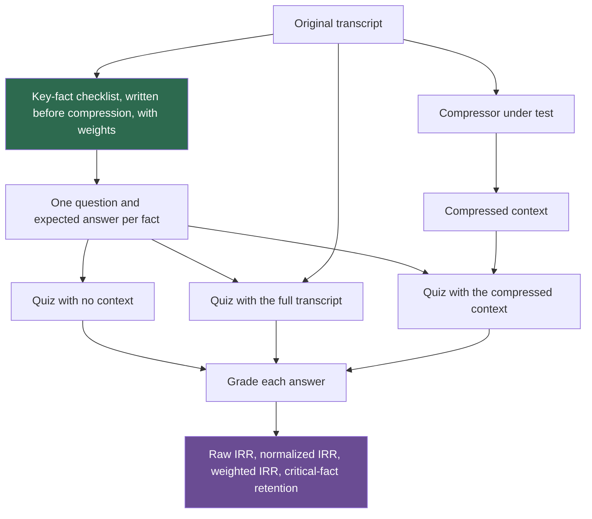

## 1. The question this idea answers

I added compression to an agent. It now uses 60% fewer tokens. Is it better? Savings alone cannot say: a compression that deletes everything saves 100% (lesson [7.1](/notes/ai/context-engineering/07-compress-and-isolate/l1-why-compress)). I need numbers for what the agent still achieves and what it still knows.

The handbook (Session 5, §8) proposes three metrics: TCR, IRR and RQPT. This lesson computes them and shows a counterexample in which each one ranks a worse system higher. Then it builds a measurement without that flaw.

## 2. Mental model

> [!analogy] Fuel economy on a trip that did not arrive
> A car's fuel economy is kilometers per liter. A car that drives 10 km on half a liter and then stops with a fault has an excellent number for that trip. But it did not arrive. An efficiency ratio means something only for trips that reached their goal.
>
> **Where it stops working:** a trip either arrives or not, and distance is an exact number. An agent's answer can be partly right, and its "quality" is often a judgment on a 1–5 scale. Dividing a judgment by a token count gives a number that looks exact but is not.

## 3. Terms

| Term | Plain meaning |
|---|---|
| task completion rate (TCR) | The handbook's name for successful tasks divided by total tokens. It is an efficiency ratio, not a rate of success. |
| success rate | Successful tasks divided by attempted tasks. |
| tokens per success | Total tokens divided by successful tasks. It is the inverse of TCR. |
| information retention ratio (IRR) | Key facts that can still be recovered after compression, divided by key facts before compression. |
| key-fact checklist | A list of facts from the original content, written before compression, used to measure IRR. |
| normalized IRR | Facts recovered from the compressed context divided by facts recovered from the full context. |
| weighted IRR | IRR in which each fact counts by an importance weight. |
| response quality per token (RQPT) | The handbook's ratio of a quality score (1–5 or a judge score) to the tokens used for that response. |
| ordinal scale | A scale whose values have an order but no fixed distance between them, such as a 1–5 rating. |
| Pareto front | The designs that no other design beats on both success and cost at the same time. |

## 4. Method and math

### 4.1 Three things to measure

| Question | Measure | Example |
|---|---|---|
| Does the agent still do the job? | Success rate, quality | 8 of 10 tasks pass their tests |
| What does it cost? | Tokens, USD, latency | 200,000 tokens for 10 tasks |
| What did the compression lose? | Retention of key facts | 17 of 20 decisions can still be recalled |

Every metric of this lesson combines two of these. The danger is in the combining.

### 4.2 TCR: tasks per token

$$
\text{TCR} = \frac{\text{successful tasks}}{\text{total tokens}}
$$

> [!example] Worked example: the handbook's two agents (Session 5, §8)
> - Agent A: 8 of 10 tasks, 500,000 tokens. $\text{TCR}_A = 8/500{,}000 = 0.000016$, or 16 successes per million tokens.
> - Agent B: 8 of 10 tasks, 200,000 tokens. $\text{TCR}_B = 8/200{,}000 = 0.00004$, or 40 per million tokens.
> - B is 2.5 times more efficient, at the same success rate. The handbook's numbers are correct.

Now add a third agent.

> [!example] Counterexample: the cheap agent that fails
> Agent C: 1 of 10 tasks, 10,000 tokens. $\text{TCR}_C = 1/10{,}000 = 0.0001$, or 100 per million tokens.
>
> C has the **best** TCR: 2.5 times better than B. Its success rate is 10%. TCR rewards an agent that stops early.

Tokens per success, the inverse, has the same flaw: A uses 62,500, B 25,000 and C 10,000. An efficiency ratio can compare two systems only when their success rates are equal or both above a floor. The handbook's own example works because A and B both complete 8 of 10.

The name is also misleading. "Rate" suggests successes per attempt. TCR is successes per token. Report the plain success rate next to it, always. The handbook's FAQ (Q33) has the right practice: log every call's tokens with the task's outcome (success, partial, failure), and watch a dashboard for regressions.

### 4.3 Choose with a floor and a Pareto front

A safer rule has two steps:

1. **Set a floor.** Discard every design whose success rate is below the floor, for example 70%.
2. **Minimize cost among the rest.** Or show the **Pareto front**: the designs that no other design beats on both success and tokens.

> [!example] Worked example: three designs
> | Design | Success rate | Tokens | On the Pareto front? |
> |---|---|---|---|
> | A | 80% | 500,000 | No: B has the same success with fewer tokens |
> | B | 80% | 200,000 | Yes |
> | C | 10% | 10,000 | Yes, but below the 70% floor |
>
> With the floor, B is the choice. Without it, a TCR ranking picks C.

Convert tokens to USD when the input and output mix differs between designs. Output costs about 5 times input on many models (lesson [1.4](/notes/ai/context-engineering/01-foundations/l4-attention-and-the-cost-of-length)).

### 4.4 IRR: what the compression kept

$$
\text{IRR} = \frac{\text{key facts recovered after compression}}{\text{key facts before compression}}
$$

> [!example] Worked example: 20 decisions (Session 5, §8)
> The original conversation holds 20 key decisions. After compression, the agent can recall 17. $\text{IRR} = 17/20 = 85\%$.

> [!note] Source check: the IRR target
> **Corrected.** The handbook gives two targets that disagree. The lecture (Session 5, §8) and FAQ Q17 say that IRR below 80% means "compressing too aggressively". The same FAQ answer then says that "a reasonable target for most applications is 75% retention at 90% compression", which is below 80%. Neither number has a source. Treat both as a rule of thumb, and set the target per class of fact: critical facts need 100%. FAQ Q41 also cites "LangChain's blog" for 70–85% retention at 90% compression, with no link. Measure your own retention.

IRR can be gamed in four ways:

| Way to game IRR | What happens | Defense |
|---|---|---|
| Write the checklist after reading the summary | You list what the summary kept, so IRR is near 100%. | Write the checklist from the original, before compression, and freeze it. |
| Use guessable facts | The model answers from its weights without any context. | Run a no-context baseline and drop the facts it answers. |
| Count all facts the same | Losing the budget limit counts as much as losing a team member's name. | Weight the facts, and report critical facts separately. |
| Score the summary text | A fact in the text may still be missed by the agent, or misread. | Quiz the model with only the compressed context. |

> [!example] Counterexample: 90% IRR and a failed task
> 20 facts. Two are critical constraints: "Budget under USD 200 per month" and "Auth must be OAuth2 with Google". The compression loses exactly these two.
>
> - Unweighted IRR: $18/20 = 90\%$. It passes the 80% target.
> - Weighted IRR with weight 5 for the two critical facts and 1 for the rest: $18/(2 \times 5 + 18) = 18/28 \approx 64.3\%$.
> - Critical-fact retention: $0/2 = 0\%$.
>
> The agent now proposes a USD 900 per month design with JWT. A single IRR number hid the failure.

**Normalize by the full context.** Some facts are missed even with the full context. Suppose that the model answers 19 of 20 questions with the full transcript and 17 with the compressed one. Then the compression lost 2 of 19 recoverable facts. Normalized IRR $= 17/19 \approx 89.5\%$, against a raw 85%.

### 4.5 RQPT: quality per token

$$
\text{RQPT} = \frac{\text{quality score}}{\text{tokens used for the response}}
$$

> [!example] Worked example: the handbook's two responses (Session 5, §8)
> - 50,000-token context, score 4.2 of 5: $\text{RQPT} = 4.2/50{,}000 = 0.000084$.
> - 15,000-token context, score 4.0 of 5: $\text{RQPT} = 4.0/15{,}000 \approx 0.000267$.
> - Ratio: $0.000267/0.000084 \approx 3.17$, which the handbook rounds to 3.2. The arithmetic is correct.

> [!example] Counterexample: the useless short answer
> A 1,000-token context gives an answer with a score of 1 of 5: $\text{RQPT} = 1/1{,}000 = 0.001$.
>
> That is 3.75 times better than the 4.0 answer. RQPT rewards a cheap, useless response.

There is a second problem. A 1–5 rating is an **ordinal scale**: 4 is better than 2, but it is not "twice as good". Dividing it by tokens treats it as a measured quantity. Use the score as a floor instead: among responses with a score of at least 4, prefer the one with fewer tokens.

> [!key] The pairing rule
> Never report an efficiency ratio alone. Report the success rate, or the share of responses above a quality floor, next to it. Compare costs only among designs that pass the floor.

### 4.6 An IRR harness



The parts:

1. **Checklist.** 10 to 20 facts from the original (FAQ Q17): decisions, constraints, names, numbers, file paths, preferences. Mark the critical ones.
2. **Questions.** One per fact, with an exact expected answer. "Which database did the team choose?" Expected: "PostgreSQL".
3. **Three runs.** No context (drop guessable facts), full context (the ceiling), compressed context (the test).
4. **Grading.** Exact match for numbers, IDs and paths. A model judge for free text, checked against human grades on a sample (Part 9, lesson [9.6](/notes/ai/context-engineering/09-production/l6-evaluation)).
5. **Report.** Raw, normalized and weighted IRR, and the retention of critical facts.

The handbook's FAQ (Q41) gives the right closing advice: a domain test set of about 20 questions tells you more than any generic benchmark.

### 4.7 Measure summary drift

A rolling summary is summarized again at each compaction (lesson [7.2](/notes/ai/context-engineering/07-compress-and-isolate/l2-summarization-and-compaction)). Measure IRR after each cycle $k$ with the same checklist. A reference model: if each pass keeps a fact with probability $q$, independently, then

$$
\text{IRR}(k) = q^k
$$

The symbols mean:

- $k$ is the number of compaction cycles.
- $q$ is the probability that one pass keeps a given fact.

With $q = 0.95$: 95% after 1 cycle, 77.4% after 5 and 59.9% after 10. With $q = 0.9$: 59.0% after 5 cycles. Your measured curve can be better (pinned facts) or worse (facts that depend on each other). If it falls below your target within the length of a typical session, change the summary design, not the threshold.

### 4.8 Production view

| Concern | What this lesson means for it |
|---|---|
| Evaluation | Measure success rate, cost and retention together. Never rank designs by an efficiency ratio alone. |
| Regression testing | Run the IRR harness in CI whenever the summary prompt, the summarizer model or the trigger changes (Part 9). |
| Observability | Log tokens per call with the task outcome. Plot success rate and tokens per success over time. |
| Cost | The harness itself costs model calls: three quiz runs per transcript. Use a small, fixed set of transcripts. |
| Quality | Report the retention of critical facts separately. One lost constraint can fail the task. |

## 5. Graphs

```plot
{
  "title": "Reference drift model: retention after k compaction cycles for q = 0.95 (blue) and q = 0.9 (red), with an 80% target (gold)",
  "xAxis": { "label": "compaction cycles k", "domain": [0, 10] },
  "yAxis": { "label": "share of facts retained", "domain": [0, 1] },
  "disableZoom": true,
  "data": [
    { "fn": "0.95^x", "color": "#1E6091" },
    { "fn": "0.9^x", "color": "#C81D25" },
    { "fn": "0.8", "color": "#B8860B" }
  ]
}
```

The blue curve crosses the 80% line between 4 and 5 cycles. The red curve crosses it between 2 and 3 cycles. The model assumes independent passes. Measure the real curve with your harness.

## 6. Code

These exercises go in `notebooks/07-compress-and-isolate.ipynb`. Put the metrics in `src/eval/metrics.py`.

**Exercise 10.1: a metrics module that cannot be fooled.**

1. Write `tcr`, `success_rate`, `tokens_per_success`, `rqpt` and `pareto_front(designs)`.
2. Write `choose(designs, floor)` that drops designs below the success floor and returns the cheapest of the rest.

Acceptance tests:

- `tcr` ranks C above B on the data of section 4.3.
- `choose(designs, 0.7)` returns B.
- `pareto_front` returns B and C.

**Exercise 10.2: a text-level IRR, free of cost.**

1. Take a 20-turn synthetic project transcript and write a checklist of 15 facts, with 3 marked critical, **before** you compress.
2. For each fact, write a regular expression that finds it in a text.
3. Compress the transcript with three methods: your compactor from lesson 7.2, the priority trimmer from 7.4 and the clearing policy from 7.3. Compute raw, weighted and critical-fact IRR from the text.

Acceptance test: a table with columns Technique, Tokens, Savings, Raw IRR, Weighted IRR and Critical IRR. This is the handbook's Exercise 5A table with two more columns.

**Exercise 10.3 (optional, costs money): a model-level IRR harness.**

1. Turn each fact into a question with an expected answer.
2. Quiz a cheap model three times: no context, full transcript, compressed context.
3. Grade numbers and names by exact match.

Acceptance tests:

- The report shows raw and normalized IRR.
- Facts answered correctly with no context are listed and excluded.

**Exercise 10.4: measure drift.** Run your rolling compactor for 8 cycles on a long synthetic session, adding 10 new turns per cycle. After each cycle, compute the text-level IRR of the first cycle's facts. Plot it against $0.95^k$.

Acceptance test: the plot, and one sentence on whether pinned facts change the curve.

## 7. Common mistakes

1. **"TCR is a completion rate."** It is successes per token. A system that fails cheaply scores well. Report the success rate next to it.
2. **"High savings and high IRR mean a good compression."** IRR can hide the loss of the one critical fact. Weight the facts and report critical facts separately.
3. **"Write the fact checklist from the summary."** Then IRR measures nothing. Write it from the original, before compression.
4. **"RQPT shows that the shortest answer is best."** It divides an ordinal score by tokens and rewards cheap, poor answers. Use a quality floor.
5. **"One IRR measurement is enough."** A rolling summary drifts. Measure IRR after several compaction cycles.

## 8. One-minute explanation

Savings alone do not tell you whether a compression is good, because deleting everything saves 100%. The handbook proposes three metrics. TCR divides successes by tokens, so a cheap agent that fails most tasks can beat a good one. RQPT divides a 1 to 5 quality score by tokens, so a useless short answer can win. IRR counts how many key facts survive, but it hides the loss of a critical constraint if all facts count the same. The fix is a pairing rule. Report the success rate or a quality floor next to every efficiency ratio, and compare costs only among designs that pass. For retention, write the fact checklist before compressing, weight the facts, and quiz the model three ways: no context, full context and compressed. Then measure again after several compaction cycles, because summaries drift.

## 9. Check questions

```check
{
  "question": "Agent D completes 9 of 10 tasks with 450,000 tokens. Agent E completes 4 of 10 with 80,000 tokens. Compute TCR (per million tokens) and the success rate of each. Which do you choose with a 70% floor?",
  "answer": "D: TCR = 9 / 450,000 = 20 per million tokens, success 90%. E: TCR = 4 / 80,000 = 50 per million tokens, success 40%. TCR prefers E, but E is below the 70% floor. Choose D."
}
```

```check
{
  "question": "A checklist has 15 facts: 3 critical with weight 4, 12 normal with weight 1. A compression loses one critical fact and two normal facts. Compute raw IRR, weighted IRR and critical-fact retention.",
  "hint": "Total weight = 3 × 4 + 12 × 1.",
  "answer": "Raw: 12 / 15 = 80%. Total weight = 24. Kept weight = 2 × 4 + 10 × 1 = 18, so weighted IRR = 18 / 24 = 75%. Critical retention = 2 / 3 ≈ 66.7%. The raw number meets an 80% target, but a critical fact is lost."
}
```

```check
{
  "question": "With the full transcript, a model answers 18 of 20 questions. With the compressed context, it answers 15. With no context, it answers 3 of them, and those 3 are also among the 15 and the 18. Compute the raw IRR, the normalized IRR, and the normalized IRR after removing the guessable facts.",
  "answer": "Raw = 15 / 20 = 75%. Normalized = 15 / 18 ≈ 83.3%. After removing the 3 guessable facts: compressed 12, full 15, so 12 / 15 = 80%."
}
```

```check
{
  "question": "Response F scores 4.5 with 40,000 tokens. Response G scores 2.0 with 5,000 tokens. Compute RQPT for both. Which would you ship if the quality floor is 4.0?",
  "answer": "F: 4.5 / 40,000 = 0.0001125. G: 2.0 / 5,000 = 0.0004, about 3.6 times higher. G is below the floor of 4.0, so ship F. RQPT alone would pick the worse answer."
}
```

```check
{
  "question": "Under the reference drift model IRR(k) = q^k, with q = 0.97, after how many compaction cycles does IRR fall below 80%?",
  "hint": "Solve 0.97^k < 0.8, so k > ln 0.8 / ln 0.97.",
  "answer": "ln 0.8 / ln 0.97 ≈ −0.2231 / −0.0305 ≈ 7.3. So after the 8th cycle IRR is below 80%: 0.97⁷ ≈ 0.808 and 0.97⁸ ≈ 0.784."
}
```

## 10. Links

- Previous: [L9: Contract-first design](/notes/ai/context-engineering/07-compress-and-isolate/l9-contract-first-design)
- Next: [Hard questions: Compress and isolate](/notes/ai/context-engineering/07-compress-and-isolate/hard-questions)
- [5.8: Measure retrieval and answers](/notes/ai/context-engineering/05-retrieval-quality/l8-measure-retrieval)
- [9.6: Evaluation](/notes/ai/context-engineering/09-production/l6-evaluation)
- [11.E1: Context utilization](/notes/ai/context-engineering/11-research-track/e1-context-utilization)
- [Glossary](/notes/ai/context-engineering/glossary)
