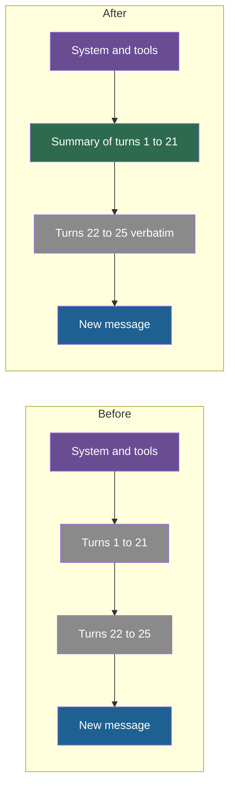

## 1. The question this idea answers

The history of an agent is close to its token limit. I want to replace the old turns with a summary and continue. Five questions decide whether this works in production:

1. **When** do I trigger it?
2. **Where** do I cut the message list without breaking the API format?
3. **What** must the summary keep?
4. **Does it pay**, once I count the summary call and prompt caching?
5. **What happens** when I summarize a summary again and again?

This is **compaction**: the most common compression technique. Claude Code, the Anthropic API and LangChain all ship a version of it.

## 2. Mental model

> [!analogy] A shift handover in a hospital
> At the end of a shift, the night nurse does not read the whole night aloud to the day nurse. The nurse writes a structured handover: each patient, the decisions taken, the open problems, and the exact doses of every drug. The last hour of events is handed over in full, because it is still active. The day nurse starts from the handover note plus the recent events.
>
> **Where it stops working:** a nurse writes one handover per shift. A rolling summary writes a new summary of the old summary at every compaction, so small losses accumulate. Also, the nurse knows which details matter tomorrow. The model that writes the summary does not know which detail the next step needs.

## 3. Terms

| Term | Plain meaning |
|---|---|
| compaction | Replacing the older part of a conversation with a summary and continuing in a smaller context. |
| rolling summary | One summary that is updated at each compaction. It includes the previous summary and the turns since then. |
| keep window | The most recent turns that compaction keeps verbatim. |
| compaction trigger | The condition that starts a compaction, for example "the next input is above 150,000 tokens". |
| safe split point | A place in the message list where a cut does not separate a tool call from its result and does not break the role order. |
| structured summary | A summary with fixed sections, such as decisions, constraints, open items and exact identifiers. |
| summary drift | The loss or distortion of facts when a summary is summarized again at each compaction. |
| payback point | The number of later calls after which a compaction has saved more than it cost. |
| compaction block | The Anthropic API content block that holds a server-written summary. Later requests drop everything before it. |

## 4. Method and math

### 4.1 The shape of a compacted history



Three parts never go into the summary:

1. **The system prompt and the tool definitions.** They are P0 content (lesson [7.4](/notes/ai/context-engineering/07-compress-and-isolate/l4-priority-trimming-and-hierarchical-compression)). They also form the cached prefix (lesson [1.7](/notes/ai/context-engineering/01-foundations/l7-prompt-caching)).
2. **The keep window.** The last few turns are still active. The model needs their exact words.
3. **Pending content.** A plan, diff or number that the agent has not acted on yet (lesson [7.1](/notes/ai/context-engineering/07-compress-and-isolate/l1-why-compress)).

### 4.2 Trigger on tokens, not on messages

A trigger on the number of messages is wrong. One message can hold 20 tokens ("OK") or 50,000 tokens (a file). Trigger on the token count of the next input:

$$
\text{compact when } \hat{I}_{\text{next}} \ge T
$$

The symbols mean:

- $\hat{I}_{\text{next}}$ is the estimated input of the next call: the input of the last call, plus the last reply, plus the new message.
- $T$ is the trigger threshold, in tokens. Lesson [7.5](/notes/ai/context-engineering/07-compress-and-isolate/l5-when-to-compress) shows how to choose it.

Use the `usage` field of the last response for the exact count. On Anthropic with caching, the input of a call is `input_tokens + cache_creation_input_tokens + cache_read_input_tokens`. A monitor that reads only `input_tokens` sees a few hundred tokens and never triggers.

### 4.3 Cut only at a safe split point

The API format has rules. A cut that breaks them makes the next call fail.

| Rule | Anthropic | OpenAI Chat Completions |
|---|---|---|
| A tool result needs its call | A `tool_result` block needs the `tool_use` block with the same ID in the previous assistant message. | A `tool` message needs the assistant message with the matching `tool_call_id` before it. |
| A tool call needs its result | An assistant `tool_use` must be answered in the next user message. | Each `tool_call_id` must get a `tool` message. |
| Roles | Two neighboring messages with the same role are merged into one turn (lesson [1.3](/notes/ai/context-engineering/01-foundations/l3-the-chat-api-call)). | A `developer` or `system` message in the list is P0 content and must not be summarized. |

> [!example] Worked example: where to cut
> A message list has 12 messages. `T1` to `T3` are tool IDs.
>
> | Index | Role | Content |
> |---|---|---|
> | 0 | user | text: the task |
> | 1 | assistant | text |
> | 2 | user | text |
> | 3 | assistant | `tool_use` T1 |
> | 4 | user | `tool_result` T1 |
> | 5 | assistant | text |
> | 6 | user | text: a new question |
> | 7 | assistant | `tool_use` T2 |
> | 8 | user | `tool_result` T2 |
> | 9 | assistant | `tool_use` T3 |
> | 10 | user | `tool_result` T3 |
> | 11 | assistant | text |
>
> - Keep the last 4 messages: the kept part starts at index 8, a `tool_result` for T2. Its `tool_use` (index 7) is summarized away. The next call fails.
> - Keep the last 5 messages: the kept part starts at index 7, an assistant message. If the summary is followed by a synthetic assistant message, two assistant messages are neighbors.
> - **Safe cut:** move the cut back to the nearest user message with plain text, index 6. Summarize messages 0 to 5. Keep messages 6 to 11.

The rule in one line: **the kept part starts with a real user message, and no tool pair crosses the cut.**

### 4.4 What a good summary keeps

Anthropic's context-engineering post (29 September 2025) describes Claude Code's compaction. The model summarizes the history and keeps "architectural decisions, unresolved bugs, and implementation details". It drops redundant tool outputs and messages. It then continues with the summary "plus the five most recently accessed files".

A structured summary makes this repeatable. Ask for fixed sections:

| Section | Example (the decisions and the constraint come from Session 5, §3.1) |
|---|---|
| Goal | Build the project's backend. |
| Decisions, with reasons | FastAPI. OAuth2 with Google. PostgreSQL. Docker on AWS ECS. |
| Constraints | The user prefers established, well-documented libraries. |
| Current state | Auth endpoints are done. Tests for refresh tokens fail. |
| Open items | Choose a migration tool. Fix the refresh-token test. |
| Exact identifiers | File paths, table names, IDs, numbers, URLs, copied verbatim. |

Three prompt rules:

1. **Ask for exact values verbatim.** "Copy file paths, numbers and IDs exactly as they appear."
2. **Forbid new facts.** "Use only information from the conversation."
3. **Label the summary as a summary.** The next model must not read it as a new user request.

> [!trap] A summary can launder an injection
> Old tool results can hold injected instructions (Part 6). A summary may copy such an instruction into its text. The summary then sits near the top of the history, in a more trusted position. Tell the summarizer to report instructions found in tool results as data, not to follow or copy them.

### 4.5 Check the summary call itself

A summary call is a normal model call. It has a `stop_reason` (lesson [1.3](/notes/ai/context-engineering/01-foundations/l3-the-chat-api-call)).

- `end_turn`: the summary is complete. Check that every required section is present.
- `max_tokens`: the summary is cut. The last sections, often the open items, are missing. Raise the limit and run it again. Never use a cut summary.
- `refusal`: keep the old history and alert.

Also do not assume that `content[0]` is text. With thinking enabled, the first block can be a thinking block. Read the text blocks by type.

### 4.6 Does it pay?

Let a compaction replace $O$ old tokens with a summary of $s$ tokens. The summary call reads $O$ tokens and writes $s$ tokens.

$$
n^{*} = \frac{C_{\text{sum}}}{p_{in}\,(O - s)} \qquad C_{\text{sum}} = \frac{O\,p^{\text{sum}}_{in} + s\,p^{\text{sum}}_{out}}{10^6}
$$

The symbols mean:

- $n^{*}$ is the payback point: the number of later calls after which the compaction has paid for itself.
- $O$ is the number of old tokens that the summary replaces.
- $s$ is the number of summary tokens.
- $p_{in}$ is the input price of the main model, in USD per token (the price per MTok divided by $10^6$). Each later call sends $O - s$ fewer tokens.
- $p^{\text{sum}}_{in}$ and $p^{\text{sum}}_{out}$ are the prices of the summarizer model, in USD per MTok.

> [!example] Worked example: 8,000 tokens to 500, no caching
> Main model: Claude Sonnet 5.5 at USD 2 / MTok input and USD 10 / MTok output (checked on 2026-10-12). $O = 8{,}000$, $s = 500$.
>
> - Saving on each later call: $7{,}500 \times 2 / 10^6 = 0.015$ USD.
> - Summary by Sonnet 5.5: $C_{\text{sum}} = (8{,}000 \times 2 + 500 \times 10)/10^6 = 0.021$ USD. $n^{*} = 0.021 / 0.015 = 1.4$ calls.
> - Summary by Haiku 5.5 at USD 0.10 / 0.50 (prompts up to 100K tokens): $C_{\text{sum}} = (800 + 250)/10^6 = 0.00105$ USD. $n^{*} = 0.07$ calls.
>
> Without caching, the compaction recovers its cost within 2 later calls, or within 1 with a cheap summarizer.

Caching changes the result. With prompt caching, the old tokens were cheap already: a cache read costs $r$ times the input price (lesson [1.7](/notes/ai/context-engineering/01-foundations/l7-prompt-caching)). And the summary rewrites the history, so the cache after the summary point is invalid. The summary and the keep window must be written to the cache again.

$$
n^{*}_{\text{cache}} = \frac{C_{\text{sum}} + p_{in}\left[\,w\,(s+R) - r\,(O+R)\,\right]}{r\,p_{in}\,(O - s)}
$$

The symbols mean:

- $w$ is the cache-write multiplier and $r$ the cache-read multiplier.
- $R$ is the number of tokens in the keep window, which must be written again.
- The bracket is the extra cost on the compaction call: write the new part instead of reading the old part.

> [!example] Worked example: the same compaction with caching
> Sonnet 5.5: $w = 1.25$, $r = 0.05$. Keep window $R = 2{,}000$ tokens.
>
> - Saving on each later call: $0.05 \times 7{,}500 \times 2 / 10^6 = 0.00075$ USD. That is 20 times less than without caching.
> - Extra cost of the cache rewrite: $(1.25 \times 2{,}500 - 0.05 \times 10{,}000) \times 2/10^6 = (3{,}125 - 500) \times 2/10^6 = 0.00525$ USD.
> - Sonnet 5.5 summarizer: $n^{*} = (0.021 + 0.00525)/0.00075 = 35$ calls.
> - Haiku 5.5 summarizer: $n^{*} = (0.00105 + 0.00525)/0.00075 = 8.4$ calls.
>
> With caching, a compaction rarely recovers its cost in a short session. Its main value is window space and quality.

> [!note] Source check: "it pays for itself within 2–3 turns"
> **Corrected.** The handbook (Session 5, §3.1) says that summarization "pays for itself within 2–3 turns". Without caching, a same-model summary recovers its cost in about 1.4 later calls. This holds at Claude Sonnet 4 prices (USD 3 / 15) and at Sonnet 5.5 prices (USD 2 / 10). Now add prompt caching on Sonnet 5.5 and a 2,000-token keep window. Then it is about 35 calls with a Sonnet summarizer and about 8.4 with Haiku 5.5. The compaction also invalidates the cached history after the summary point. Sources: Anthropic pricing and prompt-caching docs, checked on 2026-10-12.

### 4.7 The sawtooth: an exact model

Take the chat of lesson [1.6](/notes/ai/context-engineering/01-foundations/l6-the-cost-of-a-conversation): $S = 2{,}000$, $u = 100$, $a = 300$, $t = 400$. Define a compaction policy:

1. Before each call, compute the input. If it is above $T = 12{,}000$ tokens, compact.
2. A compaction replaces all finished turns except the last 4 with a summary of exactly 500 tokens. The old summary is part of what is summarized.

> [!example] Worked example: 50 turns with this policy
> - Call 26: the input would be $2{,}000 + 25 \times 400 + 100 = 12{,}100$, above $T$. Compact 21 turns (8,400 tokens). The new input is $2{,}000 + 500 + 4 \times 400 + 100 = 4{,}200$.
> - Calls 27 to 45: the input grows by 400 per call, to 11,800 at call 45.
> - Call 46: the input would be 12,200. Compact the old summary and 20 turns (8,500 tokens). The input is 4,200 again.
>
> Totals over 50 calls:
>
> - Chat input: 357,500 tokens, against 595,000 without compaction.
> - Summary calls: $8{,}400 + 8{,}500 = 16{,}900$ input tokens and $2 \times 500$ output tokens.
> - Cost at Sonnet 5.5 prices, no caching: $374{,}400 \times 2/10^6 + 1{,}000 \times 10/10^6 + 0.15 \approx 0.91$ USD, against 1.34 USD without compaction.

Lesson 1.7 found 0.26 USD for the same chat with caching and no compaction. So for a short chat with caching, caching is the cost tool, and compaction is the window and quality tool.

### 4.8 Summary drift

A rolling summary includes the previous summary. At call 46 above, the summarizer reads the summary from call 26 again. A fact that survived the first pass can be dropped in the second.

If each pass keeps a given fact with probability $q$, and passes are independent, the fact survives $k$ passes with probability $q^k$. With $q = 0.95$, that is 95% after 1 pass, 77.4% after 5 passes and 59.9% after 10 passes. The independence is an assumption. Lesson [7.10](/notes/ai/context-engineering/07-compress-and-isolate/l10-measure-compression) shows how to measure the real curve.

Four defenses:

1. **Structured fields.** Tell the summarizer to copy each section of the old summary unless a later turn changed it.
2. **Pinned facts.** Keep a short list of critical facts outside the summary, and copy it verbatim into every new context.
3. **External notes.** Write decisions to a file or a memory store as they happen (Part 8). Anthropic's memory-tool docs suggest this pairing: compaction keeps the active context small, and memory keeps what must survive the summary.
4. **Keep the full transcript.** Store it outside the window, so that a lost fact can be found again.

### 4.9 How the tools do it (checked on 2026-10-12)

**Claude Code.**

- **Trigger.** Auto-compact runs "when the conversation reaches the model's context limit". On models with a native 1M window, that is about 967K tokens. On 200K configurations, it is the 200K boundary. You can set the window from 100K to 1M with `/autocompact`, the `autoCompactWindow` setting, the `--autocompact` flag or the `CLAUDE_CODE_AUTO_COMPACT_WINDOW` variable.
- **Order.** "It clears older tool outputs first, then summarizes the conversation if needed."
- **Instructions.** `/compact <instructions>` tells the summary what to keep. A "Compact instructions" section in CLAUDE.md sets a standing default.
- **What survives.** The project-root CLAUDE.md, auto memory and the plan-mode plan are injected again from disk. Up to five recently modified files that Claude read or edited are read again. A file over 5,000 tokens returns as a path only.
- **Thrashing.** If one huge output fills the context again right after each summary, auto-compact stops after a few tries with an error.

> [!note] Source check: Claude Code compacts "at 95%"
> **Corrected.** The handbook (Session 5, §3.1, Key Takeaway 2 and FAQ Q24) says that Claude Code auto-compacts at 95%. The current docs give no percentage. The default is the model's context limit, and it is configurable. The changelog shows "Increased auto-compact warning threshold from 60% to 80%" (v1.0.51, July 2025), which is a warning, not the trigger. The message "Auto-compact: conversation summarized" is not in the docs. The documented `/compact` message is "Conversation compacted". FAQ Q24 also says that Claude Code keeps its plan "via CLAUDE.md files". CLAUDE.md holds instructions that you write. The plan-mode plan and a to-do list are separate. Sources: code.claude.com docs (model-config, how-claude-code-works, context-window).

**The Anthropic API: server-side compaction.**

| Item | Value |
|---|---|
| Threshold mode | Beta header `compact-2026-01-12`. Add `{"type": "compact_20260112"}` to `context_management.edits`. |
| `trigger` | Default 150,000 input tokens. Minimum 50,000. |
| `instructions` | Replaces the default summary prompt completely. |
| `pause_after_compaction` | Default false. |
| Flow | The API writes the summary into a `compaction` block and continues the response. On later requests, it "automatically drops all content blocks prior to the compaction block". |
| Caching | You can put `cache_control` on the compaction block. A breakpoint at the end of the system prompt keeps the system cache valid. |
| On-demand mode | Beta header `compact-2026-09-04`. The parameter `compaction: {"type": "summarize"}` returns one signed `compaction` block instead of a reply. You put it first in `messages`. It cannot be combined with `context_management` on the same request. |

The Anthropic docs now say: "For most use cases, server-side compaction is the primary strategy for managing context in long-running conversations." It launched in beta on 5 February 2026.

**LangChain 1.0: `SummarizationMiddleware`.**

| Parameter | Default | Meaning |
|---|---|---|
| `model` | required | The summarizer model. A cheaper model is common. |
| `trigger` | none | With no trigger, it never summarizes. Accepts `("tokens", n)`, `("messages", n)` or `("fraction", f)`. |
| `keep` | `("messages", 20)` | The keep window. |
| `token_counter` | character-based | Replace it with a real tokenizer count for exact budgets. |
| `summary_prompt` | built-in | Must contain `{messages}`. |

> [!note] Source check: LangChain memory classes
> **Corrected.** The handbook (Session 5, FAQ Q40) presents `ConversationBufferWindowMemory`, `ConversationSummaryMemory` and `ConversationSummaryBufferMemory` as LangChain's tools. The first two are deprecated since 0.3.1, with removal planned for 2.0.0, and their code moved to the `langchain-classic` package. The current path is `create_agent` with `SummarizationMiddleware` or `ContextEditingMiddleware`. Sources: LangChain source code and middleware docs, checked on 2026-10-12.

### 4.10 Production view

| Concern | What this lesson means for it |
|---|---|
| Reliability | Cut only at safe split points. Check `stop_reason` and the required sections of every summary. |
| Cost | Without caching, compaction recovers its cost within about 2 calls. With caching, it can take 8 to 35 calls. Use a cheap summarizer. |
| Quality | Use a structured summary. Pin critical facts. Measure retention after each compaction cycle (lesson 7.10). |
| Caching | Compaction invalidates the cached history after the summary point. Keep a breakpoint at the end of the system prompt. |
| Security | Tell the summarizer to treat instructions inside tool results as data. |
| Observability | Log each compaction: tokens before and after, the summary text, and the cut index. |

## 5. Graphs

```plot
{
  "title": "Input of call k in thousands of tokens: no compaction (red), compaction at 12,000 tokens with 4 turns kept (blue)",
  "xAxis": { "label": "call number k", "domain": [1, 50] },
  "yAxis": { "label": "thousands of tokens", "domain": [0, 22] },
  "disableZoom": true,
  "data": [
    { "fn": "2.1 + 0.4*(x-1)", "color": "#C81D25" },
    { "points": [[1, 2.1], [2, 2.5], [3, 2.9], [4, 3.3], [5, 3.7], [6, 4.1], [7, 4.5], [8, 4.9], [9, 5.3], [10, 5.7], [11, 6.1], [12, 6.5], [13, 6.9], [14, 7.3], [15, 7.7], [16, 8.1], [17, 8.5], [18, 8.9], [19, 9.3], [20, 9.7], [21, 10.1], [22, 10.5], [23, 10.9], [24, 11.3], [25, 11.7], [26, 4.2], [27, 4.6], [28, 5.0], [29, 5.4], [30, 5.8], [31, 6.2], [32, 6.6], [33, 7.0], [34, 7.4], [35, 7.8], [36, 8.2], [37, 8.6], [38, 9.0], [39, 9.4], [40, 9.8], [41, 10.2], [42, 10.6], [43, 11.0], [44, 11.4], [45, 11.8], [46, 4.2], [47, 4.6], [48, 5.0], [49, 5.4], [50, 5.8]], "fnType": "points", "graphType": "polyline", "color": "#1E6091", "skipTip": true },
    { "points": [[1, 2.1], [5, 3.7], [10, 5.7], [15, 7.7], [20, 9.7], [25, 11.7], [26, 4.2], [30, 5.8], [35, 7.8], [40, 9.8], [45, 11.8], [46, 4.2], [50, 5.8]], "fnType": "points", "graphType": "scatter", "color": "#1E6091", "skipTip": true }
  ]
}
```

The red line is the input of one call without compaction. It ends at 21.7 thousand. The blue sawtooth is the exact model of section 4.7. It never passes 12 thousand, and it drops to 4.2 thousand at calls 26 and 46.

## 6. Code

These exercises go in `notebooks/07-compress-and-isolate.ipynb`. Put the final compactor in `src/compress/compactor.py` with tests in `tests/test_compactor.py`.

**Exercise 2.1: the safe split point.**

1. Represent messages in the Anthropic format: content is a string or a list of blocks of type `text`, `tool_use` or `tool_result`.
2. Write `safe_cut(messages, keep_min)` that returns the index where the kept part starts. The kept part holds at least `keep_min` messages and starts with a user message that has plain text.
3. Write `validate_pairs(messages)` that raises an error if any `tool_result` has no matching `tool_use` before it, or any `tool_use` has no result after it.

Acceptance tests:

- On the 12-message list of section 4.3, `safe_cut(messages, 4)` returns 6.
- `validate_pairs(messages[safe_cut(messages, k):])` passes for every `k` from 1 to 12.
- A list with no plain-text user message after index 0 returns 0, so nothing is compacted.

**Exercise 2.2: a token-triggered compactor.**

1. Write `compact(messages, count_tokens, summarize, T, keep_min)`. `summarize` is a function that returns `(text, stop_reason)`.
2. Trigger on tokens. Cut at `safe_cut`. Place the summary in one labeled user message.
3. Test with a fake `summarize` that returns fixed text. Then (optional, costs money) use a real cheap model.

Acceptance tests:

- No compaction when the count is below `T`.
- A fake summarizer that returns `stop_reason = "max_tokens"` makes `compact` raise an error and leaves the messages unchanged.
- After compaction, `validate_pairs` passes and the system prompt is unchanged.

**Exercise 2.3: the payback calculator.**

1. Write `payback(O, s, R, main_prices, sum_prices, w=None, r=None)`. With `w` and `r` set to `None`, it uses the formula without caching.
2. Reproduce the four results of section 4.6.
3. Find the keep window $R$ at which the Haiku case with caching reaches 20 calls.

Acceptance tests:

- The function returns 1.4, 0.07, 35 and 8.4 calls (to two decimals) for the four cases of section 4.6.
- Your value of $R$, passed back into `payback`, gives 20.0 calls.
- A larger keep window always gives a later payback point when caching is on.

**Debug exercise: the handbook's compactor (Session 5, Listing 1).** Find at least six problems in this excerpt. Write each problem and its fix.

```python
def compress_context(messages, llm_client, keep_recent=5):
    if len(messages) <= keep_recent:
        return messages
    old_messages = messages[:-keep_recent]
    recent_messages = messages[-keep_recent:]
    conversation_text = "\n".join(
        f"{msg['role']}: {msg['content']}" for msg in old_messages)
    summary_response = llm_client.messages.create(
        model="claude-sonnet-4-20250514", max_tokens=500,
        messages=[{"role": "user", "content":
            "Summarize the following conversation into a concise paragraph. "
            "Preserve all decisions, preferences, and key technical choices.\n\n"
            f"Conversation:\n{conversation_text}"}])
    summary_text = summary_response.content[0].text
    compressed = [
        {"role": "user", "content": f"[Previous conversation summary: {summary_text}]"},
        {"role": "assistant", "content": "Understood. I have the context from our earlier discussion."}]
    compressed.extend(recent_messages)
    return compressed
```

The answer is in the check questions.

## 7. Common mistakes

1. **"Trigger after N messages."** One message can be 50,000 tokens. Trigger on the token count of the next input.
2. **"Keep the last K messages."** A cut by count can separate a `tool_use` from its `tool_result`. Cut at a safe split point.
3. **"The summary call always succeeds."** A `max_tokens` stop gives a cut summary with no error code. Check `stop_reason`.
4. **"Compaction always saves money."** With prompt caching, the old history was cheap already, and compaction invalidates the cache. On cost alone, it can take 35 calls to recover its cost.
5. **"Claude Code compacts at 95%, so 95% is Anthropic's number."** The docs give no percentage. The default is the model's limit, and you can configure it.
6. **"A rolling summary is stable."** Each pass can drop facts. Pin critical facts and measure drift.

## 8. One-minute explanation

Compaction replaces the old part of a conversation with a summary and keeps the recent turns verbatim. Trigger it on the token count of the next input, never on the number of messages. Cut only where no tool call is separated from its result, so that the API accepts the new list. Ask for a structured summary: decisions with reasons, constraints, open items and exact identifiers. Check the stop reason of the summary call, because a cut summary looks normal. Without caching, a compaction recovers its cost within about two calls. With caching, it can take dozens, because old tokens were cheap and the cache must be rewritten. A rolling summary drifts, since each pass can drop facts. So pin critical facts and keep the full transcript outside the window. Claude Code, the Anthropic API and LangChain all offer this pattern.

## 9. Check questions

```check
{
  "question": "A compaction replaces 20,000 old tokens with a 1,000-token summary. The main model costs USD 2 / MTok input. The summarizer is Haiku 5.5 at USD 0.10 / 0.50. There is no caching. What is the payback point?",
  "hint": "n* = C_sum / (p_in (O − s)).",
  "answer": "C_sum = (20,000 × 0.10 + 1,000 × 0.50) / 10⁶ = 0.0025 USD. Saving per later call = 19,000 × 2 / 10⁶ = 0.038 USD. n* = 0.0025 / 0.038 ≈ 0.066 calls. It recovers its cost on the first later call."
}
```

```check
{
  "question": "A message list ends: [7] assistant tool_use T2, [8] user tool_result T2, [9] assistant text. The code keeps the last 2 messages. What happens on the next Anthropic call, and where must the cut be?",
  "answer": "The kept part starts with the tool_result for T2 at index 8, but its tool_use at index 7 was summarized away. The API rejects the request because the tool_result has no matching tool_use. The cut must move back to the nearest user message with plain text before index 7, so that the T2 pair stays together."
}
```

```check
{
  "question": "Why can a compaction cost more than it saves in a short session that uses prompt caching on Sonnet 5.5?",
  "answer": "With caching, the old tokens cost only 0.05 times the input price on each call, so removing them saves little per call. The summary also changes the history, so the cache after the summary point is invalid. The summary and the keep window must be written again at 1.25 times. With a Sonnet summarizer, the worked example needs 35 later calls to recover its cost."
}
```

```check
{
  "question": "A rolling summary keeps a given fact with probability 0.9 on each pass. If passes are independent, what share of such facts survive 5 compactions? Name two defenses.",
  "hint": "q^k.",
  "answer": "0.9⁵ ≈ 0.59, so about 59%. Defenses: pin critical facts outside the summary and copy them verbatim into each new context, and write decisions to an external note or memory store as they happen. A structured summary that copies old sections unless they changed also helps."
}
```

```check
{
  "question": "Debug exercise: list the problems in the handbook's compress_context (Session 5, Listing 1).",
  "answer": "1. It triggers on message count (len(messages) <= keep_recent), not tokens. 2. The cut by count can separate a tool_use from its tool_result, so the next call fails. 3. The kept part can start with an assistant message, so two assistant messages become neighbors after the synthetic acknowledgement. 4. msg['content'] can be a list of blocks, and the f-string writes its Python repr into the prompt. 5. It never checks stop_reason, so a summary cut at max_tokens = 500 is used silently. 6. It reads content[0].text, which fails if the first block is not text. 7. On a second run, it summarizes its own summary, so facts drift. 8. A system or developer message in the list would be summarized away. 9. The model ID claude-sonnet-4-20250514 was retired on 15 June 2026, so the call fails. Fixes: token trigger, safe split point, block-aware rendering, stop_reason and section checks, a structured summary with pinned facts, P0 kept outside, a current cheap model."
}
```

## 10. Links

- Previous: [L1: Why compress](/notes/ai/context-engineering/07-compress-and-isolate/l1-why-compress)
- Next: [L3: Tool-result clearing](/notes/ai/context-engineering/07-compress-and-isolate/l3-tool-result-clearing)
- [1.7: Prompt caching](/notes/ai/context-engineering/01-foundations/l7-prompt-caching): why compaction invalidates the cache
- [7.10: Measure compression](/notes/ai/context-engineering/07-compress-and-isolate/l10-measure-compression): how to measure drift
- [Glossary](/notes/ai/context-engineering/glossary)
