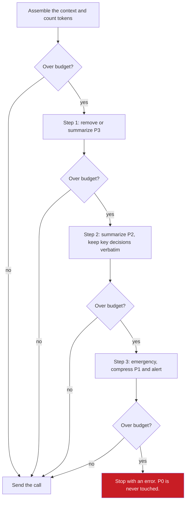

## 1. The question this idea answers

The next call is 2,500 tokens over budget. Something must go. Which content goes first? How do I write that rule as code? No bug may ever remove the system prompt or the plan that the agent is executing.

Summarization (lesson [7.2](/notes/ai/context-engineering/07-compress-and-isolate/l2-summarization-and-compaction)) treats all old turns the same. Tool-result clearing (lesson [7.3](/notes/ai/context-engineering/07-compress-and-isolate/l3-tool-result-clearing)) handles one kind of content. This lesson gives a general rule for **every** item in the window: a priority, a removal order, and a graded amount of detail.

## 2. Mental model

> [!analogy] A suitcase with a weight limit
> At the airport, your suitcase is 3 kg over the limit. The passport never leaves the bag. Clothes for tomorrow's meeting stay. Clothes for later can go into a vacuum bag. Souvenirs go first. That is a **priority ladder**. A vacuum bag keeps a sweater but makes it smaller. That is **graded compression**: the item stays at a lower size, instead of all or nothing.
>
> **Where it stops working:** items in a context depend on each other. A tool call without its result breaks the API format, so the two must leave together. Also, priorities change over time. A task that was P1 this morning is P3 when it is done. The labels must be computed again on every call.

## 3. Terms

| Term | Plain meaning |
|---|---|
| token budget | The largest number of input tokens that the application allows for one call. It is set below the window size and leaves room for the output. |
| priority level | A label from P0 (never remove) to P3 (remove first) that decides the order in which content is removed or compressed. |
| priority ladder | The order of actions when a call is over budget. Remove or compress P3, then compress P2, then touch P1 only in an emergency. Never touch P0. |
| removal unit | A group of items that must be kept or removed together, for example a tool call and its result. |
| hierarchical compression | Compression that keeps a different share of each item, by importance tier, instead of keeping or removing it whole. |
| preservation ratio | The share of an item's tokens that hierarchical compression keeps, for example 100%, 50%, 10% or 0%. |
| detail level | One of several prepared versions of the same item at different sizes, for example 10, 30, 200 and 2,000 tokens. |

## 4. Method and math

### 4.1 The four priority levels

The handbook (Session 5, Table 2) defines four levels:

| Level | Content | Policy |
|---|---|---|
| P0 | System prompt, core instructions, active tool definitions | Never remove. |
| P1 | Current task context, current user query, active plan | Remove only as a last resort. Keep verbatim. |
| P2 | Recent conversation (5–10 turns), recent tool results | Summarize if space is needed. Keep key decisions verbatim. |
| P3 | Older conversation, finished task records, stale tool results | Compress or remove first. |

The levels link to the rule of lesson [7.1](/notes/ai/context-engineering/07-compress-and-isolate/l1-why-compress). Pending content, such as a running plan or a diff not yet applied, is always P1, whatever its age.

### 4.2 The ladder



> [!example] Worked example: 12,500 tokens into a 10,000 budget (Session 5, §3.3)
> - Start: 12,500 tokens. Budget: 10,000.
> - Step 1a: remove the P3 stale tool results: $-2{,}000$, so 10,500.
> - Step 1b: compress the P3 task records from 1,500 to 300 tokens: $-1{,}200$, so 9,300.
> - Result: 9,300 tokens, a margin of 700. P0, P1 and P2 are unchanged.

The last box of the diagram matters. If even P1 compression does not fit, the call must fail loudly. Silent truncation of P0 is the worst outcome: the agent loses its rules and still answers.

### 4.3 Who assigns the priority?

Priorities come from rules, computed at every assembly:

| Rule | Priority |
|---|---|
| The system prompt and the definitions of tools that are active | P0 |
| The new user message, the active plan, pending content | P1 |
| The last $K$ turns (for example $K = 5$) and their tool results | P2 |
| Turns older than $K$, finished sub-tasks, used tool results | P3 |
| Greetings and acknowledgements at any age | P3, and they can be deleted |

The handbook's labeling test (Exercise 5A tip) is a good check for each item: "Would the agent produce a worse response if this turn was removed?" If not, it is P3. The common error is to label everything P1, which makes the ladder useless.

### 4.4 Removal units

The ladder must never split a tool call from its result (lesson [7.2](/notes/ai/context-engineering/07-compress-and-isolate/l2-summarization-and-compaction), section 4.3). So the trimmer works on **removal units**, not on single messages:

- A `tool_use` block and its `tool_result` form one unit with one priority.
- A summary and the turns it replaced are never both in the window.
- Parallel tool calls in one assistant message, with their results, form one unit.

### 4.5 Which P3 item goes first?

Inside one level, the order is a design choice. Two simple orders give different results.

> [!example] Worked example: largest first or smallest first?
> P0 = 1,500, P1 = 2,000, P2 = 6,000 tokens. Four P3 items: 100, 400, 1,500 and 3,000 tokens. Total 14,500. Budget 10,000, so 4,500 tokens must go.
>
> - **Smallest first:** remove 100 (14,400), 400 (14,000), 1,500 (12,500), 3,000 (9,500). All four items go.
> - **Largest first:** remove 3,000 (11,500), then 1,500 (10,000). Two items go, and the context is exactly at the budget.
>
> Largest first removes fewer items. A third option ranks P3 items by an estimated value per token, which needs a scoring function (Part 8 shows recency and importance scores).

> [!example] Worked example: P3 is not enough
> P0 = 1,500, P1 = 2,000, P2 = 8,000. P3 items: 100, 400 and 1,000. Total 13,000. Budget 10,000.
>
> Removing all P3 frees 1,500 tokens, so the context is still 11,500. The trimmer must go to step 2 and compress P2 by at least 1,500 tokens. A trimmer that stops after P3 returns 1,500 tokens over budget, and the API call fails or the output has no room.

### 4.6 Hierarchical compression: graded detail

Priority trimming keeps or removes. Hierarchical compression keeps a **share** of each item by importance tier (Session 5, §3.4):

| Tier | Preservation ratio | Example |
|---|---|---|
| Critical | 100%, verbatim | "User requires OAuth2 with Google. Database is PostgreSQL. Budget: under USD 200 per month." |
| Important | 50% | "Discussed auth options (JWT vs OAuth2 vs API keys). Chose OAuth2 for SSO capability." |
| Background | 10% | "Discussed project scope, team size (4 devs), timeline (March deadline)." |
| Routine | 0% | "ok", "thanks", "got it" |

The tokens after compression are:

$$
N_{\text{after}} = \sum_{i} n_i \, L_i \, \rho_i
$$

The symbols mean:

- $i$ runs over the tiers.
- $n_i$ is the number of items in tier $i$.
- $L_i$ is the average length of one item in tier $i$, in tokens.
- $\rho_i$ is the preservation ratio of tier $i$.

> [!example] Worked example: 50 turns with consistent units
> 50 turns of 200 tokens each: 10,000 tokens. 5 critical, 10 important, 15 background and 20 routine turns.
>
> $N_{\text{after}} = 5 \times 200 \times 1 + 10 \times 200 \times 0.5 + 15 \times 200 \times 0.1 + 20 \times 200 \times 0 = 1{,}000 + 1{,}000 + 300 + 0 = 2{,}300$ tokens.
>
> Savings $= 1 - 2{,}300/10{,}000 = 77\%$.

> [!note] Source check: hierarchical compression saves "88.5%"
> **Corrected.** The handbook (Session 5, §3.4 and FAQ Q15) computes $5 \times 100 + 10 \times 50 + 15 \times 10 = 1{,}150$ tokens and 88.5% savings. It uses 100 tokens as the "full" size of a critical item, but 200 tokens as the size of a turn. With one unit for all turns, the result is 2,300 tokens and 77% savings.

The original size also hides an assumption. Routine turns such as "thanks" are short, not 200 tokens. If they have 10 tokens, the original is $30 \times 200 + 20 \times 10 = 6{,}200$ tokens, and the savings drop to $1 - 2{,}300/6{,}200 \approx 63\%$. Measure the real lengths of each tier.

**Flat or hierarchical?** A flat summary compresses everything to the same density. It can reach similar savings, but it may compress a critical constraint as hard as a greeting. Hierarchical compression guarantees that critical items stay verbatim (FAQ Q15). The cost is a classifier that assigns the tiers, by rules or by a model.

### 4.7 Detail levels: choose the resolution by budget

The handbook (Session 5, §4.1) prepares several versions of one important item in advance:

| Level | Size | Example for "Refactored the authentication module to use JWT" |
|---|---|---|
| L1 Summary | 10 tokens | "Refactored auth module to use JWT." |
| L2 Overview | 30 tokens | Adds: session cookies replaced by JWT, refresh-token rotation every 15 minutes, 3 middleware files changed. |
| L3 Detailed | 200 tokens | Adds: file names, rationale (stateless auth for horizontal scaling), expiry settings, test results. |
| L4 Complete | 2,000 tokens | Full diffs, history, alternatives considered, deployment notes. |

The handbook's rule for one item: if the remaining budget is above 2,000, use L4. Else above 200, use L3. Else above 30, use L2. Else use L1. This rule has a flaw. With 2,001 tokens left, it picks L4 and leaves 1 token for every other item and for the output.

A rule for many items must reserve room for the rest. Process the items in priority order. For each item, reserve the L1 size for every item that is still waiting. Then pick the largest level that fits in what remains.

> [!example] Worked example: five items, budget 2,500
> Levels: 10, 30, 200, 2,000 tokens. Items 1 to 5 are in priority order.
>
> | Item | Remaining before | Reserved for later items | Available | Level chosen |
> |---|---|---|---|---|
> | 1 | 2,500 | $4 \times 10 = 40$ | 2,460 | L4 (2,000) |
> | 2 | 500 | 30 | 470 | L3 (200) |
> | 3 | 300 | 20 | 280 | L3 (200) |
> | 4 | 100 | 10 | 90 | L2 (30) |
> | 5 | 70 | 0 | 70 | L2 (30) |
>
> Used: $2{,}000 + 200 + 200 + 30 + 30 = 2{,}460$ tokens. 40 tokens stay free.

The best choice in general is a multiple-choice knapsack problem: one level per item, a value for each level, and one total budget. The greedy rule above is simple and predictable, which matters more in production than a small gain in value.

### 4.8 Compression ratios by content type

The handbook's FAQ (Q45) gives ratios by content type: factual content 90% or more, reasoning 50–70%, procedural content and code 20–30%. It adds a "quality cliff" near 95% compression. It gives no source for these numbers. Treat them as a **rule of thumb** and measure your own curve (lesson [7.10](/notes/ai/context-engineering/07-compress-and-isolate/l10-measure-compression)). The direction is sound: code and step lists lose their function when a character or a step is missing.

### 4.9 Production view

| Concern | What this lesson means for it |
|---|---|
| Reliability | P0 is never touched. If the ladder cannot reach the budget, fail loudly. Trim removal units, never single tool messages. |
| Quality | Recompute priorities on every call. A finished task drops to P3. Pending content stays P1. |
| Cost | Priority trimming needs no model call. Hierarchical compression and detail levels need a classifier or prepared summaries. |
| Caching | Removing an old P3 item early in the history invalidates the cache after it (lesson [7.3](/notes/ai/context-engineering/07-compress-and-isolate/l3-tool-result-clearing), section 4.5). Prefer removals near the end, or batch them. |
| Observability | Log the priority of each item, what was removed or compressed, and the tokens before and after. |

## 5. Code

These exercises go in `notebooks/07-compress-and-isolate.ipynb`. Put the trimmer in `src/compress/trim.py` with tests in `tests/test_trim.py`.

**Exercise 4.1: a priority labeler.**

1. Define a dataclass `Unit(items, priority, tokens, pending)` where `items` is one message or a tool pair.
2. Write `label(messages, K=5)` that groups messages into units and applies the rules of section 4.3.

Acceptance tests:

- A `tool_use` and its `tool_result` are always in the same unit.
- The system prompt is P0. The last user message is P1. A pending plan is P1 even when it is 30 turns old.

**Exercise 4.2: a trimmer that follows the full ladder.**

1. Write `trim(units, budget, summarize_p2)`. Step 1 removes P3 units, largest first. Step 2 calls `summarize_p2` on the P2 units. Step 3 raises an `OverBudget` error that reports the remaining excess.
2. Never remove or change a P0 unit.

Acceptance tests:

- The first example of section 4.5 removes exactly the 3,000 and 1,500 units and ends at 10,000 tokens.
- The second example of section 4.5 calls `summarize_p2`.
- If `summarize_p2` frees too little, `trim` raises `OverBudget` and reports the excess in tokens.

**Exercise 4.3: hierarchical compression under two unit assumptions.**

1. Write `hierarchical_tokens(counts, lengths, ratios)` that returns the tokens before and after compression.
2. Run it with the handbook's units, with consistent units, and with 10-token routine turns.

Acceptance tests:

- The three runs give 1,150, 2,300 and 2,300 tokens after compression.
- The savings are 77% with consistent units and about 63% with 10-token routine turns.
- The handbook's 88.5% appears only when you divide 1,150 by a 10,000-token original, which uses the other unit.

**Exercise 4.4: detail levels with a shared budget.**

1. Write `allocate(levels, n_items, budget)` with the reserve rule of section 4.7.
2. Run it for budgets of 2,500 and 1,000.

Acceptance tests:

- A budget of 2,500 reproduces the table of section 4.7: L4, L3, L3, L2, L2.
- A budget of 1,000 gives L3 to every item.
- The total never exceeds the budget.

**Debug exercise: the handbook's trimmer (Session 5, Listing 3).** The comment says "Remove largest P3 items first". Find the problems.

```python
def trim_to_budget(prioritized, token_budget):
    total = sum(p.token_count for p in prioritized)
    if total <= token_budget:
        return [p.message for p in prioritized]
    # Remove largest P3 items first
    to_remove = sorted(
        [p for p in prioritized if p.priority >= Priority.P3_OLD],
        key=lambda p: (-p.priority, p.token_count),
    )
    removed = 0
    remove_indices = set()
    for p in to_remove:
        if total - removed <= token_budget:
            break
        removed += p.token_count
        remove_indices.add(id(p))
    return [p.message for p in prioritized if id(p) not in remove_indices]
```

The answer is in the check questions.

## 6. Common mistakes

1. **"Label everything important as P1."** Then the ladder has nothing to remove. Use the test: would the response be worse without this item?
2. **"Remove P3, and the job is done."** P3 may not be enough. The trimmer must compress P2, then fail loudly.
3. **"Priorities are fixed when the message arrives."** A finished task drops to P3. A plan stays P1 while it runs. Recompute on every call.
4. **"Trim messages one by one."** A tool call without its result breaks the API format. Trim removal units.
5. **"Hierarchical compression saves 88.5%."** That number mixes two units. With consistent units, the example saves 77%, and less if routine turns are short.

## 7. One-minute explanation

When the next call is over budget, something must go, and the order must be explicit. Priority trimming gives every item a level from P0 to P3. P0, the system prompt and active tools, is never touched. P1 holds the current task, the new question and any pending plan. P2 is the last few turns, and P3 is old and finished work. Remove or compress P3 first, then summarize P2, and touch P1 only in an emergency. If that is not enough, fail loudly instead of cutting P0. Always remove a tool call and its result together. Hierarchical compression keeps a share of each item by tier. It keeps all of a critical decision, half of a discussion, one line of background and nothing of a greeting. Detail levels let a budget pick the resolution of each item, while it reserves room for the rest.

## 8. Check questions

```check
{
  "question": "Context: P0 = 2,000, P1 = 3,000, P2 = 5,000, P3 items of 500, 1,200 and 2,500 tokens. Budget 10,000. Which P3 items does a largest-first trimmer remove, and what is the final total?",
  "hint": "Total first. Then remove the largest P3 items until the total is at or below the budget.",
  "answer": "Total = 2,000 + 3,000 + 5,000 + 4,200 = 14,200. Remove 2,500 → 11,700. Remove 1,200 → 10,500. Remove 500 → 10,000. All three P3 items go, and the total is exactly 10,000."
}
```

```check
{
  "question": "A 40-turn conversation: 4 critical, 8 important, 12 background, 16 routine turns. Critical, important and background turns have 250 tokens, routine turns have 15. Ratios 100/50/10/0. What are the tokens before and after, and the savings?",
  "hint": "N_after = Σ n_i L_i ρ_i.",
  "answer": "Before: 24 × 250 + 16 × 15 = 6,000 + 240 = 6,240. After: 4 × 250 + 8 × 125 + 12 × 25 + 0 = 1,000 + 1,000 + 300 = 2,300. Savings = 1 − 2,300 / 6,240 ≈ 63%."
}
```

```check
{
  "question": "With the handbook's single-item rule, an item gets L4 (2,000 tokens) whenever more than 2,000 tokens remain. Why is that unsafe when 2,050 tokens remain and four more items wait?",
  "answer": "L4 uses 2,000 tokens and leaves 50 for the four other items. They can get only L1 (4 × 10 = 40 tokens), however important they are, and 10 tokens remain. One item took almost the whole budget because it came first. A many-item rule reserves at least the L1 size for every waiting item before it chooses a level. The reserve for the output must be outside this budget."
}
```

```check
{
  "question": "A trimmer removes an old assistant message with a tool_use block (P3) but keeps the next user message with its tool_result, because that message also holds a P1 question. What happens, and what is the fix?",
  "answer": "The tool_result now points to a tool_use that is gone, so the API rejects the call. The fix: treat the tool_use and the tool_result as one removal unit. If the user message also holds new text, split the logic: clear the tool_result content or move the question into its own unit, but never keep a result without its call."
}
```

```check
{
  "question": "Debug exercise: list the problems in the handbook's trim_to_budget (Session 5, Listing 3).",
  "answer": "1. The sort key (-p.priority, p.token_count) sorts token_count ascending, so it removes the smallest P3 items first, against the comment. For largest first, use key=lambda p: -p.token_count. 2. It only removes P3. It never summarizes P3 records (step 2 of the worked example) and never compresses P2, so it can return a context that is still over budget, with no error. It should continue with the next steps of the ladder and raise an error if the budget is still not met. 3. It trims single messages, so it can split a tool_use from its tool_result. 4. It has no protection for pending content that carries a P3 label. 5. The listing caption says \"Priority assignment\", but the code trims and assigns nothing."
}
```

## 9. Links

- Previous: [L3: Tool-result clearing](/notes/ai/context-engineering/07-compress-and-isolate/l3-tool-result-clearing)
- Next: [L5: When to compress](/notes/ai/context-engineering/07-compress-and-isolate/l5-when-to-compress)
- [L6: Token budgets](/notes/ai/context-engineering/07-compress-and-isolate/l6-token-budgets): how large the budget is
- [8.3: Retrieval, scoring and decay](/notes/ai/context-engineering/08-memory/l3-retrieval-scoring-and-decay): value scores for items
- [Glossary](/notes/ai/context-engineering/glossary)
