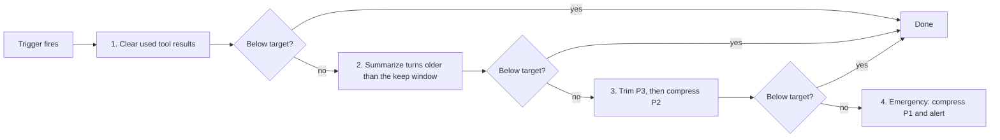

## 1. The question this idea answers

Compression has a price. A summary costs a model call and 1 to 3 seconds. A clearing breaks the prompt cache. If I compress too late, the model is already in the degraded zone, or the call fails. If I compress too often, I pay again and again for little gain. **When** should an agent compress, and how does it know?

## 2. Mental model

> [!analogy] A fuel gauge, not an empty tank
> A driver fills the tank when the gauge shows a quarter, not when the engine stops. The driver also refuels at natural stops: before a long road, after a delivery. And the driver fills the tank to the top, not one liter at a time, or the car would stop at every station.
>
> **Where it stops working:** a car runs the same on a full tank and on a nearly empty one. A model does not. Its accuracy can drop as the input gets longer, long before the window is full (lesson [1.5](/notes/ai/context-engineering/01-foundations/l5-position-and-length-effects)). So the gauge must measure your own token budget, set by tests, not the size of the window.

## 3. Terms

| Term | Plain meaning |
|---|---|
| utilization | The input tokens of a call divided by the token budget, as a percentage. |
| usable window | The window size minus the output reserve (at least `max_tokens`). Only this part can hold input. |
| trigger threshold | The utilization at which compression starts, for example 80%. |
| target level | The utilization that compression aims for, for example 60%. It is below the trigger threshold. |
| hysteresis | Using a target below the trigger, so that the system does not switch on and off at every step. |
| thrashing | Compression that runs again and again because the context is full again right after each pass. |
| event trigger | A compression that starts at a point in the task, such as a used tool result, a handoff or the end of a phase. |
| background compaction | A compaction that runs after the reply is sent and before the next turn arrives, so the user does not wait for it. |

## 4. Method and math

### 4.1 The trigger table

The handbook (Session 5, Table 3) lists five triggers. This version keeps them and adds a note to each.

| Trigger | Action | Technique | Note |
|---|---|---|---|
| A tool result has been used | Replace it with a 1–2 sentence note | Tool-result clearing | Batch the clearings when caching is on (lesson [7.3](/notes/ai/context-engineering/07-compress-and-isolate/l3-tool-result-clearing)). |
| Utilization above 80% of the budget | Summarize the oldest turns, keep recent turns verbatim, aim for 60% | Summarization and priority trimming | The 80% is a rule of thumb. Measure where your quality drops. |
| Handoff to another agent | Write a structured briefing | Hierarchical compression | Lesson [7.9](/notes/ai/context-engineering/07-compress-and-isolate/l9-contract-first-design) gives the contract for it. |
| A task phase is complete | Archive the outcome, write a summary, clear the working details | Summarization and WRITE | The best moment: little is pending. |
| Utilization above 95% | Emergency: apply every technique | All four | Alert. This should be rare. |

The handbook's key advice (Session 5, §4) is sound engineering: "Do not wait until 95%." Act early, as with disk alerts at 80%.

### 4.2 Utilization: measure against your budget

$$
U = \frac{\hat{I}_{\text{next}}}{B} \qquad B \le W - R_{out}
$$

The symbols mean:

- $U$ is the utilization of the next call.
- $\hat{I}_{\text{next}}$ is the estimated input of the next call, in tokens.
- $B$ is the token budget for input, which you choose.
- $W$ is the window size.
- $R_{out}$ is the output reserve: at least the `max_tokens` of the call, which includes thinking tokens.

> [!example] Worked example: 80% of what?
> A model has $W = 1{,}000{,}000$ tokens and up to 128,000 output tokens (current Claude models, checked on 2026-10-12).
>
> - Usable window: $1{,}000{,}000 - 128{,}000 = 872{,}000$ tokens.
> - 80% of the usable window: 697,600 tokens.
> - 80% of the full window: 800,000 tokens.
>
> Both numbers are far beyond the lengths at which many models stay reliable. RULER found that only half of 17 models kept satisfactory performance at 32K tokens (lesson 1.5). So on a 1M window, set $B$ from your own evaluation, for example $B = 100{,}000$, and trigger at 80% of $B$, which is 80,000 tokens.

The providers' own defaults are absolute token counts, not shares of the window. Anthropic context editing starts at 100,000 input tokens by default. Anthropic server-side compaction starts at 150,000 by default, with a minimum of 50,000 (checked on 2026-10-12).

> [!note] Source check: Claude Code's "95%" as the emergency line
> **Corrected.** The handbook (Session 5, Key Takeaway 2) uses Claude Code's "95%" as the reference line. The current docs give no percentage. By default, Claude Code compacts at the model's context limit, about 967K tokens on 1M models. You can set it from 100K to 1M. Its changelog raised a **warning** threshold from 60% to 80% (v1.0.51). The 80% trigger is good advice, but it is your own rule, not Anthropic's number. Details in lesson [7.2](/notes/ai/context-engineering/07-compress-and-isolate/l2-summarization-and-compaction).

### 4.3 Trigger and target: avoid thrashing

If compression only goes a little below the trigger, the next few turns push it above the trigger again. Compression then runs on almost every turn. The handbook's table aims for "below 60%" after a trigger at 80%. This gap is **hysteresis**.

$$
m = \frac{(\theta_{\text{trig}} - \theta_{\text{target}})\, B}{t}
$$

The symbols mean:

- $m$ is the number of turns between two compactions.
- $\theta_{\text{trig}}$ and $\theta_{\text{target}}$ are the trigger threshold and the target level, as fractions.
- $B$ is the token budget.
- $t$ is the number of tokens that one turn adds.

> [!example] Worked example: two targets
> $B = 100{,}000$ tokens, $t = 2{,}000$ tokens per turn, trigger at 80%.
>
> - Target 60%: $m = 0.20 \times 100{,}000 / 2{,}000 = 10$ turns between compactions.
> - Target 78%: $m = 0.02 \times 100{,}000 / 2{,}000 = 1$ turn. The agent compacts on every turn.

A large tool result can also cause thrashing. If one result is larger than the gap $(\theta_{\text{trig}} - \theta_{\text{target}})B$, the context is over the trigger again right after the compaction. Claude Code stops auto-compact after a few such refills with a "thrashing" error. The fix is to limit the size of a result before it enters the window (lesson [7.6](/notes/ai/context-engineering/07-compress-and-isolate/l6-token-budgets)).

### 4.4 Event triggers are better than thresholds

A threshold fires at a random point in the task. It can fire while a plan is running, so the summary must protect pending content. An event trigger fires at a natural boundary:

- **After a tool result is used:** the result is stale, and nothing is pending in it.
- **At a handoff:** the receiving agent needs a briefing, not the transcript.
- **At the end of a phase:** the phase's working details are finished work.

Use events for routine compression. Keep the threshold as a safety net.

### 4.5 A utilization monitor

The monitor runs before every call. It needs an exact count, not a guess.

1. **Read the last `usage`.** On Anthropic with caching, the input of the last call is `input_tokens + cache_creation_input_tokens + cache_read_input_tokens` (lesson [1.7](/notes/ai/context-engineering/01-foundations/l7-prompt-caching)). Check how your provider reports cached tokens.
2. **Estimate the next call.** Add the last output, the new user message and, if a tool will run, its expected result size.
3. **Compare with the levels.** Below 80% of $B$: send. From 80%: compress to the target. From 95%: emergency pass and an alert. If the input plus `max_tokens` is above $W$: never send.

> [!example] Worked example: the cached call that looks small
> The last response reports `input_tokens = 300`, `cache_creation_input_tokens = 1,200` and `cache_read_input_tokens = 18,000`.
>
> - The real input was $300 + 1{,}200 + 18{,}000 = 19{,}500$ tokens.
> - A monitor that reads only `input_tokens` sees 300 tokens, 1.5% of what the model read. It never triggers.

### 4.6 One pass, in order of safety

When compression triggers, run every technique in one pass. The handbook (FAQ Q21) gives the reason: summarize, clear and prune together. One pass means one summary call, one cache rewrite and one consistent new state.



The order follows the handbook's FAQ (Q12): the safest technique first. Clearing used results loses almost nothing. A summary loses some detail. Trimming loses whole items.

### 4.7 Background compaction

A summary call takes time. The handbook (FAQ Q21) gives 1 to 3 seconds as a rule of thumb. The user should not wait for it.

1. Send the reply to the user.
2. Start the compaction in the background on a **snapshot**: the messages up to index $m$.
3. When the summary is ready, replace messages $0$ to $m-1$ with it. Keep every message after $m$ that arrived in the meantime.
4. Use a version number. If the history before $m$ changed during the compaction, discard the result.

At scale, the handbook (FAQ Q30) separates the work. Clearing is a fast string edit, so it runs inline. Summaries run in a worker queue, and each conversation stores its compaction state in a database.

> [!trap] One prompt for many conversations
> The handbook (FAQ Q30) suggests putting 10 to 20 conversations into one summary prompt to save cost. This puts the data of several users into one context. A summary can then leak one user's data into another user's history. Summarize each conversation in its own call. To save money, use the provider's batch interface: Anthropic's Batch API gives "a 50% discount on both input and output tokens" for asynchronous requests.

### 4.8 Use a cheap model for compression

A summary is an easier task than the agent's main reasoning, so a smaller model is often enough (FAQ Q19). Test the summaries with a retention check before you switch (lesson [7.10](/notes/ai/context-engineering/07-compress-and-isolate/l10-measure-compression)).

> [!example] Worked example: one summary call, 8,000 tokens in and 500 out
> Prices in USD per MTok, input / output, checked on 2026-10-12.
>
> | Model | Prices | Cost of the call (USD) |
> |---|---|---|
> | Claude Haiku 5.5 (prompt up to 100K tokens) | 0.10 / 0.50 | 0.00105 |
> | OpenAI gpt-6-luna (short context) | 0.10 / 0.50 | 0.00105 |
> | OpenAI gpt-4o-mini | 0.15 / 0.60 | 0.0015 |
> | Claude Haiku 4.5 | 1 / 5 | 0.0105 |
> | Claude Sonnet 5.5 | 2 / 10 | 0.021 |
> | Claude Sonnet 4.6 | 3 / 15 | 0.0315 |
> | Claude Opus 5.5 | 4 / 20 | 0.042 |
>
> Sonnet 5.5 to Haiku 5.5 is a factor of 20. Sonnet 4.6 to Haiku 4.5 is a factor of 3. The handbook's range "USD 0.001–0.01 with Haiku" (FAQ Q14) still covers both current Haiku models.

> [!note] Source check: cheap-model prices
> **Corrected.** The handbook (Session 5, FAQ Q19) quotes Claude Haiku at USD 0.25 / 1.25, GPT-4o-mini at USD 0.15 / 0.60 and Sonnet at USD 3 / 15. It says that routing saves "10–20x". USD 0.25 / 1.25 was Claude 3 Haiku, retired on 20 April 2026. Haiku 5.5 costs USD 0.10 / 0.50 for prompts up to 100K tokens, and Haiku 4.5 costs USD 1 / 5. GPT-4o-mini's price is still correct, but GPT-6 Luna is cheaper. Sonnet 4.x is USD 3 / 15, and Sonnet 5.5 is USD 2 / 10. The saving is 20 times for Sonnet 5.5 to Haiku 5.5, but 3 times for Sonnet 4.6 to Haiku 4.5. Sources: Anthropic pricing and deprecation pages, OpenAI model pages.

Two traps in the price table:

1. **The long-prompt tier.** Haiku 5.5 charges USD 0.50 / 2.50 for prompts above 100K tokens. A summary of a 150,000-token history with 2,000 output tokens costs $(150{,}000 \times 0.5 + 2{,}000 \times 2.5)/10^6 = 0.08$ USD. At the lower tier, it would be 0.016 USD. Compact before the history passes 100K tokens.
2. **Volume.** At 100 compactions per minute and 0.00105 USD each, the cost is $100 \times 60 \times 0.00105 = 6.30$ USD per hour, or 151.20 USD per day. With the Batch API, where latency allows it, the hourly cost is 3.15 USD.

### 4.9 Production view

| Concern | What this lesson means for it |
|---|---|
| Quality | Set the budget from your own length tests, not from the window size. Trigger at a share of that budget. |
| Reliability | Use hysteresis. Limit large tool results before they enter. Detect thrashing and alert. |
| Latency | Run summaries in the background on a snapshot, with a version check. |
| Cost | Use a cheap summarizer, stay below long-prompt price tiers, and batch through the provider's batch interface. |
| Privacy | One conversation per summary call. |
| Observability | Log utilization before and after each pass, the trigger type (threshold or event) and the time of each compaction. |

## 5. Code

These exercises go in `notebooks/07-compress-and-isolate.ipynb`. Put the monitor in `src/compress/monitor.py`.

**Exercise 5.1: a utilization monitor.**

1. Write `real_input(usage)` that sums the three Anthropic input fields.
2. Write `level(next_input, budget, window, max_tokens)` that returns `"ok"`, `"compress"`, `"emergency"` or `"refuse"`.

Acceptance tests:

- `real_input` returns 19,500 for the worked example of section 4.5.
- `level(85_000, 100_000, 1_000_000, 8_000)` returns `"compress"`.
- `level(900_000, 1_000_000, 1_000_000, 128_000)` returns `"refuse"`.

**Exercise 5.2: a hysteresis simulator.**

1. Simulate 200 turns of $t = 2{,}000$ tokens with $B = 100{,}000$, a trigger at 80% and a target that you choose.
2. Count the compactions. Add one tool result of 30,000 tokens at turn 50 and detect thrashing: three compactions in three turns.

Acceptance tests:

- Target 60%: a compaction about every 10 turns.
- Target 78%: a compaction on almost every turn, and the simulator reports it.

**Exercise 5.3: the one-pass compressor.** Combine your functions from lessons 7.2 to 7.4 into `compress_pass(messages, budget, target)` in the order of section 4.6. Stop at the first step that reaches the target.

Acceptance test: on a synthetic history, clearing alone reaches the target when tool results dominate, and the summary step does not run.

**Exercise 5.4: background compaction.** With `asyncio`, write `compact_in_background(state)` that summarizes a snapshot and splices the result. Use a fake summarizer that sleeps 2 seconds. Add two user messages during the sleep.

Acceptance tests:

- Both new messages are present after the splice.
- If the test changes a message before the snapshot index during the sleep, the result is discarded.

## 6. Common mistakes

1. **"Trigger at 80% of the window."** On a 1M window, that is 800,000 tokens, far past the lengths at which many models stay reliable. Trigger at a share of a budget that you measured.
2. **"Compress just below the trigger."** The context is over the trigger again after one turn. Use a target well below it.
3. **"`input_tokens` is the input size."** With caching on Anthropic, most of the input is in the two cache fields.
4. **"Compression must block the reply."** Run summaries in the background on a snapshot.
5. **"Put many users' histories into one summary prompt to save money."** That mixes private data. Use one call per conversation and the provider's batch discount.
6. **"A cheap model is always 10–20 times cheaper."** The ratio depends on the pair: 20 times for Sonnet 5.5 to Haiku 5.5, 3 times for Sonnet 4.6 to Haiku 4.5.

## 7. One-minute explanation

Compress early, but not constantly. Measure utilization against a token budget that comes from your own quality tests, not against the window. On a 1M window, 80% is far too late. Start compression at about 80% of that budget and aim well below it, near 60%. Then the next few turns do not trigger it again. Better still, compress at natural events: after a tool result is used, at a handoff and at the end of a phase. When a pass runs, do everything at once, safest first: clear used results, then summarize, then trim. Read the real input from all usage fields, including cached tokens. Run summaries in the background, one conversation per call, on a cheap model. Watch for long-prompt price tiers.

## 8. Check questions

```check
{
  "question": "Budget B = 60,000 tokens. Each turn adds 1,500 tokens. Trigger at 80%, target 55%. How many turns pass between compactions? What happens with a single 20,000-token tool result?",
  "hint": "m = (θ_trig − θ_target) B / t.",
  "answer": "m = 0.25 × 60,000 / 1,500 = 10 turns. The gap is 0.25 × 60,000 = 15,000 tokens. A 20,000-token result is larger than the gap, so the context is over the trigger again right after the compaction. Limit or truncate the result before it enters the window."
}
```

```check
{
  "question": "An Anthropic response reports input_tokens = 450, cache_creation_input_tokens = 2,050 and cache_read_input_tokens = 61,500. The budget is 80,000. What is the utilization, and should the agent compress before the next call?",
  "answer": "Real input = 450 + 2,050 + 61,500 = 64,000 tokens. U = 64,000 / 80,000 = 80%. The next call adds the reply and a new message, so it is above the 80% trigger. Compress, with the target near 60%."
}
```

```check
{
  "question": "A team triggers compaction at 80% of a 1,000,000-token window. Their agent's accuracy on long tasks is poor long before the first compaction. Why, and what should they change?",
  "answer": "80% of the window is 800,000 tokens. Accuracy drops with absolute input length, often at tens of thousands of tokens (lesson 1.5). The trigger never fires in the range where the problem starts. They should measure accuracy against input length on their task, set a budget below the drop (for example 100,000), and trigger at 80% of that budget."
}
```

```check
{
  "question": "Compute the cost of one summary call with 120,000 input and 3,000 output tokens on Claude Haiku 5.5. Then compute it if the agent had compacted at 90,000 input tokens.",
  "hint": "Above 100K prompt tokens, Haiku 5.5 charges USD 0.50 / 2.50 per MTok. Up to 100K, USD 0.10 / 0.50.",
  "answer": "120,000 tokens is above 100K: (120,000 × 0.50 + 3,000 × 2.50) / 10⁶ = (60,000 + 7,500) / 10⁶ = 0.0675 USD. At 90,000 tokens: (90,000 × 0.10 + 3,000 × 0.50) / 10⁶ = (9,000 + 1,500) / 10⁶ = 0.0105 USD. The earlier compaction is about 6.4 times cheaper."
}
```

```check
{
  "question": "Why is the end of a task phase a better moment to compress than a utilization threshold?",
  "answer": "At the end of a phase, its working details are finished work, so little is pending. The summary can archive the outcome without the risk of compressing a running plan or an unapplied diff. A threshold can fire in the middle of a step, so the compactor must detect and protect pending content."
}
```

## 9. Links

- Previous: [L4: Priority trimming and hierarchical compression](/notes/ai/context-engineering/07-compress-and-isolate/l4-priority-trimming-and-hierarchical-compression)
- Next: [L6: Token budgets](/notes/ai/context-engineering/07-compress-and-isolate/l6-token-budgets)
- [1.5: Position and length effects](/notes/ai/context-engineering/01-foundations/l5-position-and-length-effects): why the budget comes from tests
- [9.8: Observability, cost and latency](/notes/ai/context-engineering/09-production/l8-observability-cost-and-latency)
- [Glossary](/notes/ai/context-engineering/glossary)
