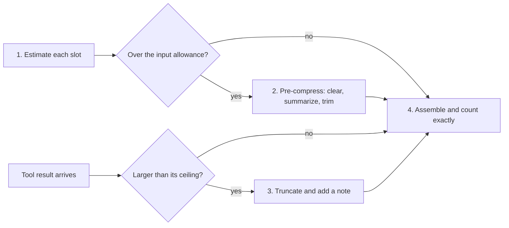

## 1. The question this idea answers

Before I build an agent, I must decide how many tokens each kind of content may use. The kinds are instructions, tools, documents, history, tool results and the answer. Without a plan, the input grows until it fills the window, and the answer has no room. With a plan, I know which slot is over and which technique to use. Two questions make this hard. How large must the reserve for the answer be? And what do I do when a tool returns 40,000 tokens that I did not expect?

## 2. Mental model

> [!analogy] A household budget
> A household divides its income before the month starts: rent, food, transport, savings. When food costs more, the plan says where the money comes from. A token budget divides the window the same way, before the first call.
>
> **Where it stops working:** the "savings" line of a token budget is not saved for later. The reserve is room for the output of **this** call. If the answer needs 20,000 tokens and the reserve has 10,000, the answer is cut. Also, money is the same wherever it sits. Tokens are not: the same fact can help or hurt, depending on where it is in the window (lesson [1.5](/notes/ai/context-engineering/01-foundations/l5-position-and-length-effects)).

## 3. Terms

| Term | Plain meaning |
|---|---|
| 40-40-20 model | A budget rule from the handbook: 40% task context, 40% working memory, 20% reserve. |
| task context | The content that defines the task: system prompt, tool definitions, retrieved documents, few-shot examples. |
| working memory | The content that grows during the task: history, tool results, scratchpad, agent state. |
| reserve | Tokens kept free on a call: room for the output plus a safety buffer. |
| pyramid model | A budget rule from the handbook with five tiers: core instructions, critical context, history, auxiliary context, reserve. |
| budget ceiling | The largest share that a slot may use. It is a limit, not a target to fill. |
| dynamic budgeting | Adjusting the budget of each slot on each call, from measured and estimated sizes. |
| two-pass assembly | Building the context twice: the first pass estimates sizes and decides cuts, the second builds and counts exactly. |
| truncation note | A short text that replaces the cut part of an oversized tool result and says how to get the rest. |

## 4. Method and math

### 4.1 A budget is a set of ceilings

Write each slot's budget as a share of a total:

$$
b_i = s_i \, B_{\text{tot}} \qquad \sum_i s_i = 1
$$

The symbols mean:

- $B_{\text{tot}}$ is the total budget for one call, input and output together. It is at most the window size $W$.
- $s_i$ is the share of slot $i$.
- $b_i$ is the ceiling of slot $i$, in tokens.

Each $b_i$ is a ceiling. A slot that needs less leaves the tokens free. Only the reserve is different: it must stay empty for the output.

### 4.2 The 40-40-20 model

The handbook (Session 5, §7.1) uses three buckets:

| Bucket | Share | Contents |
|---|---|---|
| Task context | 40% | System prompt, tool definitions, retrieved documents, few-shot examples, task instructions |
| Working memory | 40% | History, tool results, scratchpad, intermediate results, agent state |
| Reserve | 20% | Room for the answer, and a buffer for an oversized tool result or an error message |

> [!example] Worked example: a support agent with a 10,000-token budget (Session 5, FAQ Q13)
> | Bucket | Contents | Tokens |
> |---|---|---|
> | Task context (4,000) | System prompt 500, tools for CRM, order tracking and refunds 1,500, retrieved FAQ 1,500, few-shot 500 | 4,000 |
> | Working memory (4,000) | History 2,500, account lookup results 1,000, scratchpad plan 500 | 4,000 |
> | Reserve (2,000) | Empty | 2,000 |
>
> When working memory passes 4,000 tokens, compress it: clear used results, then summarize old turns (lesson [7.5](/notes/ai/context-engineering/07-compress-and-isolate/l5-when-to-compress)).

The budget tells you **which** technique to use. Working memory over its ceiling calls for compression. Task context over its ceiling calls for better retrieval or fewer tools (Parts 5 and 6).

### 4.3 The pyramid model

The handbook (Session 5, Table 5) gives five tiers for a 200K window:

| Tier | Share | Tokens | Contents |
|---|---|---|---|
| Core instructions | 20% | 40,000 | System prompt, identity, rules, constraints |
| Critical context | 30% | 60,000 | Retrieved documents, active tool definitions, specs |
| Conversation history | 30% | 60,000 | Recent turns, tool results, agent state |
| Auxiliary context | 15% | 30,000 | Examples, secondary documents, background |
| Reserve | 5% | 10,000 | Room for the answer, safety buffer |

Its main gift is a clear order: cut from the top (auxiliary, then history) and never touch the base. Three parts need care:

1. **The shares are ceilings.** A 40,000-token system prompt is far larger than a normal one. Do not fill a tier because the table allows it.
2. **The handbook places content in two ways.** Few-shot examples are task context in 40-40-20 but auxiliary in the pyramid. Tool definitions are "system instructions" in FAQ Q3 but task context in 40-40-20. Choose one placement and record it.
3. **The reserve is too small.** Section 4.4 shows why.

### 4.4 The reserve must be at least `max_tokens`

The output shares the window with the input (lesson [1.1](/notes/ai/context-engineering/01-foundations/l1-what-a-model-does-with-context)). On reasoning models, the output also includes the thinking tokens. So the rule is in tokens, not in percent:

$$
R \ge m_{\text{out}} + \beta
$$

The symbols mean:

- $R$ is the reserve, in tokens.
- $m_{\text{out}}$ is the `max_tokens` that the call allows, including thinking.
- $\beta$ is a safety buffer for estimates that are too low.

> [!example] Worked example: the 5% reserve on two windows
> Current Claude models allow up to 128,000 output tokens (checked on 2026-10-12). Assume that a call may use all of them, and $\beta = 8{,}000$.
>
> | Window | 5% reserve | Required reserve | Required share | Left for input |
> |---|---|---|---|---|
> | 200,000 | 10,000 | 136,000 | 68% | 64,000 |
> | 1,000,000 | 50,000 | 136,000 | 13.6% | 864,000 |
>
> The 5% reserve is too small on both windows. A long answer or long thinking is cut, or it stops with `model_context_window_exceeded`.
>
> Now take a call with `max_tokens = 8,000` and the same buffer: $R = 16{,}000$. That is 8% of 200K and 1.6% of 1M. Here a 20% reserve would waste 184,000 tokens on the 1M window.

A fixed percentage is wrong in both directions. It is too small for long outputs and too large for short ones. Compute the reserve from `max_tokens`, then give the rest to the other slots.

> [!note] Source check: the pyramid's 5% reserve
> **Corrected.** The handbook (Session 5, Table 5 and Table 6) gives the pyramid a "lean" 5% reserve and recommends it for production. FAQ Q8 uses a third value, "a 10% reserve". The reserve must be at least the `max_tokens` of the call plus a buffer. On a 200K window with long outputs, 5% (10,000 tokens) is far too small. Source: Anthropic context-window docs (the output, including thinking, counts toward the window) and models overview (128K max output), checked on 2026-10-12.

### 4.5 40-40-20 or pyramid?

| Aspect | 40-40-20 | Pyramid |
|---|---|---|
| Slots | 3 | 5 |
| Compression order | Not defined | Top down: auxiliary, then history, never the base |
| Reserve | 20% | 5% |
| Correct reserve | At least `max_tokens` plus a buffer, in tokens | Same |

The handbook calls 40-40-20 the prototype model and the pyramid the production model. The real difference is the number of slots and the explicit compression order. Either works in production if the reserve is computed in tokens.

### 4.6 Dynamic budgeting: tool results of unknown size

A tool can return 200 tokens or 40,000. The handbook (FAQ Q31) gives four steps:



1. **Estimate.** The fixed prompt is measured once. The history is counted. Tool results are estimated from history: use a high percentile, such as the 95th, not the average, because the reserve must absorb the bad cases.
2. **Pre-compress.** If the estimate is over the allowance, compress before the call.
3. **Truncate with a note.** Cut an oversized result to its ceiling. Replace the rest with a note that says how much is missing and how to get it.
4. **Two-pass assembly.** The first pass estimates and decides. The second pass builds the context and counts it exactly. If it is still over, run the ladder of lesson [7.4](/notes/ai/context-engineering/07-compress-and-isolate/l4-priority-trimming-and-hierarchical-compression).

> [!example] Worked example: pre-compress before a search
> Total budget 100,000 tokens. Reserve 16,000 (`max_tokens` 8,000 plus an 8,000 buffer). Input allowance: 84,000.
>
> - Fixed prompt: 12,000 (measured).
> - History: 55,000 (counted).
> - Next tool result: 25,000 (95th percentile of past results).
> - Estimate: $12{,}000 + 55{,}000 + 25{,}000 = 92{,}000$, which is 8,000 over the allowance.
>
> Compress the history from 55,000 to at most 47,000 tokens **before** the call.

> [!example] Worked example: truncate a query result
> A query returns 550 rows at about 100 tokens each: about 55,000 tokens. The ceiling for one tool result is 10,000 tokens.
>
> 100 rows fill the ceiling exactly, so the note would not fit. Keep the first 99 rows (9,900 tokens) and add: "[truncated: 99 of 550 rows shown. 451 more rows are available. Call query_orders with offset=99.]"
>
> A better design returns aggregates and a sample by default, and lets the model page through the rest (Part 6, lesson [6.4](/notes/ai/context-engineering/06-tools-and-mcp/l4-tool-results-and-errors)).

### 4.7 Design lab: a legal research assistant

This lab comes from the Session 1 workshop notebook (Lab 3). It uses everything in this lesson.

**The task.** A law firm has 10,000 documents with about 20 million tokens in total. The model has a 128,000-token window. Lawyers ask questions and expect answers with citations.

- The corpus is $20{,}000{,}000 / 128{,}000 \approx 156$ windows. It can never fit. Retrieval is mandatory.
- The average document has $20{,}000{,}000 / 10{,}000 = 2{,}000$ tokens.

> [!example] One possible allocation of 128,000 tokens
> | Slot | Tokens | Share | Reason |
> |---|---|---|---|
> | System instructions | 4,000 | 3.1% | Citation rules, privilege rules, answer format |
> | Tool definitions | 3,000 | 2.3% | Search, fetch document, check privilege |
> | Retrieved documents | 64,000 | 50.0% | About 32 documents of 2,000 tokens, or more chunks |
> | Conversation history | 16,000 | 12.5% | Summarized after about 10 turns |
> | Tool results | 12,000 | 9.4% | Ceiling per result, with truncation notes |
> | State and memory | 4,000 | 3.1% | Matter ID, client, open questions |
> | New user message | 1,000 | 0.8% | The question |
> | Reserve | 24,000 | 18.8% | `max_tokens` 16,000 plus an 8,000 buffer |
> | Total | 128,000 | 100% | |
>
> The 32 documents in the window are 0.32% of the corpus. So retrieval quality decides the answer (Part 5).

The lab then compares the learner's list of failure modes with five reference failure modes:

| Failure mode | What happens | Budget or design response |
|---|---|---|
| Hallucinated citations | The answer cites a case or a page that is not in the window. | Require citations to retrieved document IDs. Check every citation against the window. |
| Missed documents | The relevant document was not retrieved. | Better retrieval: hybrid search and reranking (Part 5). Measure recall. |
| History overflow | A long session pushes documents out of the window. | A ceiling on history, and compaction at a threshold of that ceiling. |
| Contradictory documents | Two versions of a clause disagree. | Keep version and date metadata. Tell the model to present both versions, report the conflict and state which is more recent. |
| Privileged-data leakage | A privileged memo enters a context that it must not enter. | Filter by permission **before** retrieval. Never after. |

> [!trap] The prototype retrieval of the lab leaks the privileged memo
> The lab's prototype scores a document by counting substring matches of the query words. Two bugs follow.
>
> 1. **Stop-words count.** "the" and "of" match almost every document, so the scores say little.
> 2. **A fallback that returns everything.** When no document matches, the function returns **all** documents. The privileged memo is one of them, so it enters every context with no match. The same fallback would also overflow the window.
>
> The fixes:
>
> - Score with a real method such as BM25 (lesson [5.1](/notes/ai/context-engineering/05-retrieval-quality/l1-bm25)).
> - Remove the documents that the user may not see, before scoring.
> - Return "no documents found" when nothing matches.
>
> An empty result is safe. "Everything" is never a safe default.

### 4.8 Production view

| Concern | What this lesson means for it |
|---|---|
| Reliability | Compute the reserve from `max_tokens`, including thinking. Never send a call whose input plus `max_tokens` is above the window. |
| Cost | Ceilings stop slow growth. Log the tokens of every slot on every call, and alert when a slot passes its ceiling. |
| Quality | A budget that gives retrieved documents a fixed ceiling forces you to rank and choose them. |
| Security | Permission filters run before retrieval. A fallback that returns everything is a leak. |
| Evolution | Re-measure the fixed prompt and the tool-result percentiles after every change to prompts, tools or models. |

## 5. Graphs

```plot
{
  "title": "Reserve as a share of the window: required for 128,000 output tokens (red), pyramid 5% (gold), 40-40-20 20% (blue)",
  "xAxis": { "label": "window size (thousands of tokens)", "domain": [128, 1000] },
  "yAxis": { "label": "share of the window (%)", "domain": [0, 100] },
  "disableZoom": true,
  "data": [
    { "fn": "100*128/x", "color": "#C81D25" },
    { "fn": "5", "color": "#B8860B" },
    { "fn": "20", "color": "#1E6091" }
  ]
}
```

The red curve is $100 \times 128{,}000 / W$. It is 100% at a 128K window, 64% at 200K and 12.8% at 1M. It is above the gold line everywhere on this chart, and above the blue line for windows below 640K. A fixed share is safe only when `max_tokens` is small.

## 6. Code

These exercises go in `notebooks/07-compress-and-isolate.ipynb`. Put the budget code in `src/context/budget.py`.

**Exercise 6.1: a budget allocator.**

1. Write `allocate(window, max_tokens, buffer, shares)` that first reserves `max_tokens + buffer` and then splits the rest by the shares of the other slots.
2. Provide the 40-40-20 and pyramid shares as presets, without their reserve share.

Acceptance tests:

- `allocate(200_000, 128_000, 8_000, ...)` gives a reserve of 136,000 and 64,000 for the rest.
- If `max_tokens + buffer` is at least the window, it raises a `ValueError`.
- The sum of the slot ceilings and the reserve equals the window.

**Exercise 6.2: a dynamic budget planner.**

1. Write `plan(fixed, history, tool_samples, allowance, pct=95)` that estimates the next tool result from the percentile of `tool_samples`.
2. It returns how many history tokens must be compressed before the call, or 0.

Acceptance test: the worked example of section 4.6 returns 8,000.

**Exercise 6.3: truncation with a note.** Write `truncate_rows(rows, row_tokens, ceiling, tool_name)` that keeps whole rows and appends the note of section 4.6.

Acceptance tests:

- 550 rows of 100 tokens and a 10,000 ceiling keep 99 rows, and the note says 451.
- The result with the note is never above the ceiling.

**Exercise 6.4: the legal lab, fixed.**

1. Build a corpus of 200 short synthetic legal documents. Mark 3 of them `privileged=True`.
2. Reproduce the prototype: substring counting with a fallback that returns all documents. Show that a query with no match places a privileged memo in the context.
3. Replace it with `rank_bm25` and a permission filter that runs first. Return an empty list when nothing scores above zero.

Acceptance tests:

- For a user without privilege, no query ever returns a privileged document.
- A query with no match returns an empty list.
- The query "the contract" no longer scores every document as a match.

## 7. Common mistakes

1. **"A reserve of 5% (or 20%) is enough."** The reserve must be at least `max_tokens` plus a buffer. Compute it in tokens.
2. **"The budget shares are targets."** They are ceilings. A slot that needs less leaves the tokens free.
3. **"Estimate tool results from their average."** The reserve must absorb the large cases. Use a high percentile.
4. **"Truncate a tool result silently."** The model then believes that it saw everything. Add a note with the missing amount and how to get it.
5. **"When retrieval finds nothing, send everything."** It overflows the window and can leak data the user may not see. Return nothing and say so.

## 8. One-minute explanation

A token budget decides, before the first call, how many tokens each kind of content may use. The 40-40-20 model gives 40% to task context, 40% to working memory and 20% to a reserve. The pyramid model has five tiers and a clear order for cuts: auxiliary first, the core never. Treat every share as a ceiling, not a target. The reserve is special: it must hold the whole output, including thinking. So compute it as max_tokens plus a buffer, in tokens. A 5% reserve is far too small for long outputs, and 20% wastes space for short ones. For tool results of unknown size, estimate with a high percentile, compress before the call, and truncate oversized results with a note. Finally, never let a fallback send everything: in the legal lab, that leaked a privileged memo.

## 9. Check questions

```check
{
  "question": "A model has a 400,000-token window. Calls use max_tokens = 64,000, and you add a 6,000-token buffer. What is the reserve, as tokens and as a share? Is the pyramid's 5% enough?",
  "hint": "R ≥ max_tokens + buffer.",
  "answer": "R = 64,000 + 6,000 = 70,000 tokens, which is 17.5% of 400,000. The pyramid's 5% is 20,000 tokens, far too small. The input allowance is 330,000 tokens."
}
```

```check
{
  "question": "Total budget 60,000. Reserve 10,000. Fixed prompt 8,000. History 30,000. The 95th percentile of tool results is 15,000. How much must you compress before the call?",
  "answer": "Input allowance = 60,000 − 10,000 = 50,000. Estimate = 8,000 + 30,000 + 15,000 = 53,000. Over by 3,000, so compress the history to at most 27,000 tokens before the call."
}
```

```check
{
  "question": "In the 40-40-20 support example, the history grows to 3,500 tokens and a lookup returns 1,200 tokens. The scratchpad has 500. Which bucket is over its ceiling, and what do you do?",
  "answer": "Working memory = 3,500 + 1,200 + 500 = 5,200 tokens, over its 4,000 ceiling by 1,200. Compress working memory: clear used lookup results first, then summarize old turns. Task context and the reserve stay as they are."
}
```

```check
{
  "question": "In the legal lab's prototype, a lawyer without access to privileged files asks a question with no matching words. Explain step by step how the privileged memo reaches the model.",
  "answer": "The substring scorer finds no match. The fallback then returns all documents. No permission filter runs before or after, so the privileged memo is in the returned list. The context builder puts the returned documents into the window, so the model can read and quote the memo. The fix: filter by permission before retrieval, and return an empty list when nothing matches."
}
```

```check
{
  "question": "Why can a 20% reserve be wasteful on a 1,000,000-token window?",
  "answer": "20% is 200,000 tokens. If the call uses max_tokens = 8,000 with a buffer of 8,000, it needs only 16,000. The other 184,000 tokens stay empty for no reason. Compute the reserve from max_tokens, and give the rest to the input slots."
}
```

## 10. Links

- Previous: [L5: When to compress](/notes/ai/context-engineering/07-compress-and-isolate/l5-when-to-compress)
- Next: [L7: ISOLATE: one window is not enough](/notes/ai/context-engineering/07-compress-and-isolate/l7-isolate-one-window-is-not-enough)
- [5.6: Retrieval budgets and chunk order](/notes/ai/context-engineering/05-retrieval-quality/l6-retrieval-budgets-and-order)
- [2.3: The six elements of context](/notes/ai/context-engineering/02-paradigm-shift/l3-the-six-elements-of-context)
- [10.M1: Context builder](/notes/ai/context-engineering/10-capstone/m1-context-builder): a budget in the capstone
- [Glossary](/notes/ai/context-engineering/glossary)
