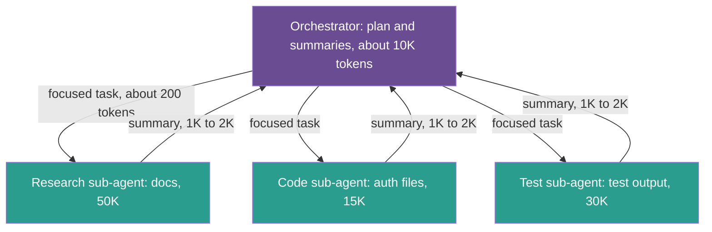
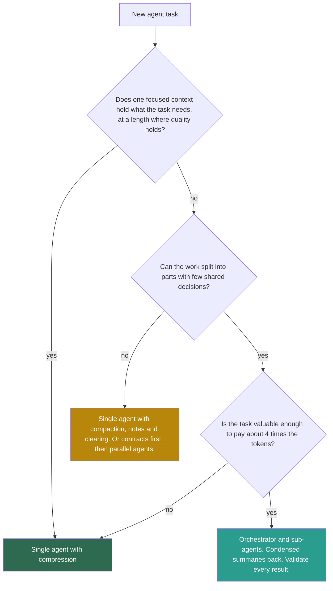

## 1. The question this idea answers

Some tasks need more context than one window can use well. Compression helps, but it loses detail, and a summary of a 100,000-token codebase is not the codebase. The alternative is **isolation**: split the work across several windows, so that each one stays small and focused.

The handbook (Session 5, §5) presents isolation as the answer for complex tasks. The evidence is more mixed. Anthropic reports a large gain for research. Cognition argues against multi-agent systems for most work. This lesson gives both sides with their numbers, and a guide for the decision.

## 2. Mental model

> [!analogy] An editor and reporters
> A news editor sends four reporters to four events. Each reporter spends the day there, fills a notebook, and files a 400-word story. The editor reads four stories, not four notebooks, and builds the front page. Each reporter's notebook is an **isolated context**. The story is the **condensed summary**.
>
> **Where it stops working:** this works because the four events are independent. Now ask two reporters to write the two halves of one article. Each makes choices about tone, facts and structure that the other cannot see, and the halves do not fit. Agents that build parts of one product have the same problem. Also, the editor never sees the notebooks, so the editor cannot know what a reporter missed.

## 3. Terms

| Term | Plain meaning |
|---|---|
| context isolation | Splitting the work of a task across several context windows, so that each window holds only what its part of the work needs. |
| orchestrator (lead agent) | The agent that plans a task, delegates parts of it to sub-agents, and combines their results. |
| sub-agent | An agent that runs in its own context window with its own instructions and returns a result to the agent that started it. |
| orchestrator-worker pattern | A workflow in which a central model breaks a task into parts, delegates them to workers, and combines the results. |
| condensed summary | The short result that a sub-agent returns instead of its full working context. |
| multi-agent system | A system in which several model instances, each with its own context, work on one task. |
| single-threaded agent | One agent that does all steps of a task in one continuous context. |
| implicit decision | A choice that an action makes without stating it, for example a style or an assumption inside generated code. |

## 4. Method and math

### 4.1 When one window is not enough

The handbook (Session 5, §5.1) gives a software task:

| Content | Tokens |
|---|---|
| Project documentation | 50,000 |
| Relevant code files | 100,000 |
| Conversation history | 20,000 |
| Tool definitions and results | 30,000 |
| Task instructions | 5,000 |
| Total | 205,000 |

On a 200K window, this does not fit. On the current 1M-token windows (checked on 2026-10-12), it fits with room to spare: 20.5% of the window. So the reason to isolate is no longer "it does not fit". The reasons are:

1. **Quality.** 205,000 tokens in one input is far beyond the length at which many models stay reliable (lesson [1.5](/notes/ai/context-engineering/01-foundations/l5-position-and-length-effects)).
2. **Focus.** A sub-agent that reads only the auth code, with a security checklist, has a narrow job.
3. **Parallel time.** Independent sub-tasks can run at the same time.
4. **A clean main thread.** The orchestrator keeps conclusions, not raw material.

> [!note] Source check: the 205K example and "Claude's 200K context window"
> **Corrected.** The handbook (Session 5, §3.2, §5.1 and §5.3.4) uses a 200K window for Claude. Current Claude models (Fable 5.1, Opus 5.5, Sonnet 5.5, Haiku 5.5) have a 1M-token window and up to 128K output tokens. The 205K example still makes the right point, but for quality, not for fit. Source: Anthropic models overview, checked on 2026-10-12.

**Compress or isolate?** The handbook's FAQ (Q11) gives a clear rule. Compress when the context is too large but one agent can do the task with less detail. Isolate when the task needs separate kinds of expertise, or more information than one window can use well. The two work together: isolate, then compress inside each sub-agent.

### 4.2 The orchestrator-worker architecture

Anthropic's "Building effective agents" (19 December 2024) describes this workflow under the name "orchestrator-workers". Anthropic's context-engineering post (29 September 2025) gives the context view: each sub-agent "might explore extensively, using tens of thousands of tokens or more", and it "returns only a condensed, distilled summary of its work (often 1,000-2,000 tokens)".



The handbook (FAQ Q9) lists the orchestrator's five duties: receive the task, choose the sub-agents, send focused instructions, collect the summaries, and combine the result. Its context stays small, about 10,000 tokens in the handbook's example, because it never holds the raw material.

Anthropic's research system adds one refinement. Sub-agents write their full outputs to a filesystem and "pass lightweight references back to the coordinator". The orchestrator reads a full output only when it needs it.

### 4.3 Total tokens rise

The handbook's delegation example (Session 5, §5.3.1): the orchestrator must analyze 5 auth files of 15,000 tokens. It spends about 50 tokens to delegate and gets about 200 back. The handbook adds: "Direct file loading would have consumed 15,000 tokens." That count is only the orchestrator's window.

> [!example] Worked example: the full account of one delegation
> - Orchestrator: 50 tokens out (the task) and 200 tokens in (the summary).
> - Sub-agent input, one call at least: system prompt 500 + task 50 + files 15,000 + checklist 1,000 = 16,550 tokens.
> - Total for the analysis: $50 + 16{,}550 + 200 = 16{,}800$ tokens, against 15,000 for a single agent that reads the files once.
>
> The sub-agent is more expensive on the first pass. It also makes several calls in practice, and each call re-sends its own growing history (lesson [1.6](/notes/ai/context-engineering/01-foundations/l6-the-cost-of-a-conversation)).

The picture changes with the calls that come **after** the analysis. A single agent keeps the 15,000 tokens in its history and sends them again on each later call. Let $n$ be the number of later calls of the main thread:

$$
T_{\text{single}} = 15{,}000\,(1 + n) \qquad T_{\text{isolated}} = 16{,}800 + 200\,n \qquad T_{\text{single+clear}} = 15{,}000 + 200\,n
$$

The symbols mean:

- $n$ is the number of later calls of the main agent.
- $T$ is the total of the tokens for the analysis and for carrying its result.
- "single+clear" is one agent that clears the file contents after use and keeps a 200-token note (lesson [7.3](/notes/ai/context-engineering/07-compress-and-isolate/l3-tool-result-clearing)).

At $n = 20$: 315,000 tokens for the single agent, 20,800 for isolation, 19,000 for the single agent with clearing. So isolation beats a careless single agent, but clearing gives the same token benefit without a second agent. The real gains of isolation are focus and parallel time, not token count.

> [!note] Source check: 50 tokens to delegate against 15,000 to load
> **Corrected.** The handbook (Session 5, §5.3.1) compares 50 + 200 orchestrator tokens with 15,000. That omits the sub-agent's own input of at least 16,550 tokens. Total tokens rise. The handbook's own Exercise 5B admits this: about 130,000 tokens for four agents against about 35,000 for one.

> [!example] Worked example: the code review of Exercise 5B
> 15 changed files with about 30,000 tokens of code. Four review agents: quality, security, performance and tests. Each has a 500-token system prompt and a 1,000-token checklist.
>
> - Each agent's input: $30{,}000 + 500 + 1{,}000 = 31{,}500$ tokens. Four agents: 126,000.
> - Outputs: about 750 tokens per agent plus a 200-token summary each: about 3,800. Total: about 130,000.
> - Single agent: $30{,}000 + 500 + 4 \times 1{,}000 = 34{,}500$ input tokens plus about 1,000 output: about 35,000.
> - Ratio: about 3.7 times.
> - Input price of Claude Sonnet 5.5: USD 2 / MTok (checked on 2026-10-12). The handbook's 132,000 and 35,000 input tokens then cost 0.264 USD and 0.07 USD per review. FAQ Q27 computed 0.40 against 0.10 USD with Sonnet 4 at USD 3. That model was retired on 15 June 2026.
>
> Note that each agent still reads all 30,000 tokens of code. Its input is 31,500 tokens against 34,500 for the single agent. So any quality gain comes from the focused instructions, not from a smaller input.

### 4.4 What isolation buys: Anthropic's research system

Anthropic's post "How we built our multi-agent research system" (13 June 2025) is the strongest evidence for isolation.

| Finding | Value |
|---|---|
| Quality | A multi-agent system (Claude Opus 4 as lead, Claude Sonnet 4 sub-agents) "outperformed single-agent Claude Opus 4 by 90.2% on our internal research eval". |
| Example task | Find all board members of the IT-sector companies in the S&P 500. The multi-agent system split the work. The single agent failed with slow, sequential searches. |
| Tokens | "agents typically use about 4× more tokens than chat interactions", and "multi-agent systems use about 15× more tokens than chats". |
| What explains performance | BrowseComp tests whether browsing agents can find hard-to-find information. On it, three factors explained 95% of the variance. "Token usage by itself explains 80% of the variance", with the number of tool calls and the model choice as the other two. |

Two cautions. The 90.2% is an internal evaluation, not a public benchmark. And the BrowseComp result says that the system works largely because it **spends more tokens**, in parallel windows. From the two multipliers, a multi-agent run uses about $15/4 \approx 3.75$ times the tokens of a single-agent run, close to the 3.7 of Exercise 5B. Anthropic states the economic condition: multi-agent systems need tasks "where the value of the task is high enough … to pay for the increased performance".

### 4.5 When multi-agent is a poor fit

The same Anthropic post is clear about the limits. Some domains "require all agents to share the same context or involve many dependencies between agents" and are "not a good fit for multi-agent systems". Its example is most coding, which has fewer truly parallel tasks than research. It also says that agents are "not yet great at coordinating and delegating to other agents in real time".

It names the good fit: "valuable tasks that involve heavy parallelization, information that exceeds single context windows, and interfacing with numerous complex tools."

### 4.6 The case against: Cognition and Shopify

Cognition's post "Don't Build Multi-Agents" (Walden Yan, 12 June 2025) states two principles:

1. "Share context, and share full agent traces, not just individual messages"
2. "Actions carry implicit decisions, and conflicting decisions carry bad results"

**The Flappy Bird example.** The task "build a Flappy Bird clone" is split into two sub-tasks: the background with green pipes and hit boxes, and the bird. Sub-agent 1 "mistook your subtask and started building a background that looks like Super Mario Bros." Sub-agent 2 builds a bird that neither looks like a game asset nor moves like the one in Flappy Bird. The final agent must combine two misunderstandings.

Each sub-agent saw only its sub-task, not the full conversation. Each made style and design choices that the other could not see. These are **implicit decisions**. A condensed summary does not carry them, because nobody knew they mattered.

Cognition's recommendation: "The simplest way to follow the principles is to just use a single-threaded linear agent". For very long tasks, add a separate model whose job is to compress the history of actions and conversation into key details, events and decisions.

Shopify's engineering post on its Sidekick agent (Andrew McNamara, 26 August 2025) gives the same advice as a principle: "Avoid multi-agent architectures early: Simple single-agent systems can handle more complexity than you might expect".

> [!note] Source check: the missing counterpoint
> **Corrected.** The handbook (Session 5, §5 and Key Takeaway 3) says that multi-agent architectures "outperform single agents with everything crammed in", and it cites no evidence against. Anthropic itself reports that multi-agent systems are a poor fit for work with shared context or many dependencies, such as most coding. Cognition and Shopify both recommend a single agent first. Sources: anthropic.com/engineering/multi-agent-research-system, cognition.com/blog/dont-build-multi-agents, shopify.engineering/building-production-ready-agentic-systems.

The two views fit together once you separate **reading** from **writing**:

| Work | Implicit decisions | Isolation |
|---|---|---|
| Search, research, review, analysis of independent parts | Few: each sub-agent reports facts | Works well: parallel, condensed summaries |
| Writing parts of one artifact (code, a document, a design) | Many: style, names, structure, assumptions | Risky: decisions conflict. Use one agent, or define contracts first (lesson [7.9](/notes/ai/context-engineering/07-compress-and-isolate/l9-contract-first-design)). |

### 4.7 A decision guide



Start at the top. Most tasks end at the first box. Isolation earns its cost when the parts are independent, the volume of material is large, and the result is worth several times the tokens.

### 4.8 Production view

| Concern | What this lesson means for it |
|---|---|
| Cost | Expect several times more tokens in total. Anthropic measured about 15 times chat for multi-agent and 4 times for single agents. |
| Quality | Gains come from focus and parallel exploration. Losses come from conflicting implicit decisions. Measure both on your task. |
| Latency | Parallel sub-agents cut wall-clock time. Sequential sub-agents add the orchestrator's overhead. |
| Reliability | Each sub-agent is a new failure point. Validate every summary against a contract (lesson 7.9). |
| Observability | Trace each sub-agent as its own span with its tokens, inputs and returned summary (Part 9). |

## 5. Graphs

```plot
{
  "title": "Total tokens in thousands after n later calls: single agent (red), isolation (blue), single agent with tool-result clearing (gold)",
  "xAxis": { "label": "later calls of the main agent, n", "domain": [0, 5] },
  "yAxis": { "label": "thousands of tokens", "domain": [0, 40] },
  "disableZoom": true,
  "data": [
    { "fn": "15*(1+x)", "color": "#C81D25" },
    { "fn": "16.8 + 0.2*x", "color": "#1E6091" },
    { "fn": "15 + 0.2*x", "color": "#B8860B" }
  ]
}
```

The three lines are the formulas of section 4.3. The red line leaves the chart after about 1.7 later calls. The blue and gold lines stay almost flat, 1,800 tokens apart. The model assumes one call per agent for the analysis, so real sub-agents cost more.

## 6. Code

These exercises go in `notebooks/07-compress-and-isolate.ipynb`.

**Exercise 7.1: a token estimator for Exercise 5B.**

1. Write `review_tokens(code, n_agents, sys=500, checklist=1000, out=750, summary=200)` for the multi-agent design, and `single_tokens(...)` for one agent.
2. Plot the ratio for 1 to 8 agents and code sizes of 10,000, 30,000 and 100,000 tokens.

Acceptance tests:

- Four agents and 30,000 tokens of code give 126,000 input tokens and about 129,800 in total.
- The ratio grows almost linearly with the number of agents, because each agent reads all the code.

**Exercise 7.2: three designs over a long session.**

1. Implement the three formulas of section 4.3 as functions of $n$.
2. Let the sub-agent make $c$ calls. Call $i$ sends its 16,550-token input plus 2,000 tokens of history for each earlier call.
3. For $c = 1$, 3 and 5, find the smallest $n$ at which isolation costs less than the single agent without clearing.

Acceptance tests:

- With $c = 1$ and $n = 20$, the functions return 315,000, 20,800 and 19,000.
- Isolation never costs less than the single agent with clearing, for any $c$ and $n$.
- The break-even $n$ grows with $c$.

**Exercise 7.3 (optional, costs money): read-heavy against write-heavy.**

1. Read-heavy: four independent questions about four different documents. Run one agent with all four documents, and an orchestrator with four sub-agents.
2. Write-heavy: ask for a small web page with a header and a footer that share a color scheme. Run one agent, and two sub-agents (header and footer) with no shared context.
3. Record tokens, time and a quality score for each.

Acceptance test: a 2 × 2 table, and two sentences that explain the result with the two principles of section 4.6.

**Exercise 7.4: a decision record.** Choose one agent task from your own work. Walk through the guide of section 4.7 and write a half-page decision record: the parts, the shared decisions, the expected token multiplier and the choice.

Acceptance test: the record names each box of the guide that you passed, with one reason per box.

## 7. Common mistakes

1. **"Isolation saves tokens."** It moves tokens into sub-agents and usually adds more. Anthropic measured about 15 times chat for multi-agent systems.
2. **"The orchestrator's small window is the cost."** Count every agent's input and output, and every call.
3. **"Multi-agent always beats a single agent."** It won by 90.2% on Anthropic's internal research evaluation. It is a poor fit for coupled work such as most coding.
4. **"A summary carries everything the next agent needs."** It carries what the sub-agent thought was important. Implicit decisions stay behind.
5. **"Split a writing task into parallel parts, then merge."** Parts with shared style and structure conflict. Use one agent or define contracts first.

## 8. One-minute explanation

Isolation splits a task across several context windows. An orchestrator plans and delegates, and each sub-agent explores in its own window and returns a condensed summary, often 1,000 to 2,000 tokens. The main thread stays small and focused, and independent parts run in parallel. But total tokens rise: Anthropic measured about 15 times the tokens of chat for its multi-agent system. In return, that system beat a single Opus 4 agent by 90.2% on an internal research evaluation. The evidence against is just as real. Cognition shows that actions carry implicit decisions, so parallel agents that build one thing make choices that conflict. Shopify advises a single agent first. So isolate reading work with independent parts. Keep coupled writing work in one agent, or define contracts first.

## 9. Check questions

```check
{
  "question": "A single agent loads 24,000 tokens of logs once and then makes 10 more calls with the logs still in its history. An isolated design spends 60 tokens to delegate, the sub-agent reads 600 + 60 + 24,000 + 800 tokens in one call, and it returns a 300-token summary. Compare the totals after 10 later calls.",
  "hint": "Single: 24,000 × (1 + n). Isolated: delegation + sub-agent input + summary × (1 + n).",
  "answer": "Single: 24,000 × 11 = 264,000 tokens. Sub-agent input = 25,460. Isolated: 60 + 25,460 + 300 + 300 × 10 = 28,820 tokens. The isolated design is cheaper here because the single agent re-sends the logs. A single agent that clears the logs after use to a 300-token note would need about 24,000 + 300 × 10 = 27,000."
}
```

```check
{
  "question": "Anthropic reports that agents use about 4 times the tokens of chat and multi-agent systems about 15 times. A single-agent task costs USD 0.20. Estimate the multi-agent cost, and state the condition under which it is worth it.",
  "answer": "15 / 4 ≈ 3.75, so about 0.75 USD. It is worth it only when the task's value covers the extra cost, for example a research task where the multi-agent system finds much more, as in Anthropic's internal eval. Measure the quality gain on your own task."
}
```

```check
{
  "question": "State Cognition's two principles, and explain with the Flappy Bird example why a condensed summary does not fix the problem.",
  "answer": "1. Share context, and share full agent traces, not just individual messages. 2. Actions carry implicit decisions, and conflicting decisions carry bad results. In the example, one sub-agent built a Super Mario-style background and the other a bird that did not fit the game. Each made style choices that were never stated. A summary back to the orchestrator reports what was built, but the conflict is in choices that neither agent saw as important, so the parts still do not fit."
}
```

```check
{
  "question": "In Exercise 5B, each review agent reads 31,500 input tokens, and a single agent reads 34,500. What does this tell you about where any quality gain comes from?",
  "answer": "The per-agent input is only about 9% smaller, because every agent reads all 30,000 tokens of code. So the gain cannot come from a shorter context. It must come from the focused instructions: one checklist and one role per agent. A design that also splits the code would reduce the input, but then a reviewer can miss problems that cross files."
}
```

```check
{
  "question": "Classify each task as a good or poor fit for sub-agents, and give the reason: (a) compare the pricing pages of 12 competitors, (b) refactor one module and update all its callers, (c) review 6 independent microservices for security issues.",
  "answer": "(a) Good fit: independent reading tasks that run in parallel and return facts. (b) Poor fit: the refactor and the callers share many decisions, such as names and signatures, so parallel agents would conflict. Use one agent, or define the new interface as a contract first. (c) Good fit: each service is independent, and each reviewer returns findings, not code."
}
```

## 10. Links

- Previous: [L6: Token budgets](/notes/ai/context-engineering/07-compress-and-isolate/l6-token-budgets)
- Next: [L8: Isolation patterns](/notes/ai/context-engineering/07-compress-and-isolate/l8-isolation-patterns)
- [7.9: Contract-first design](/notes/ai/context-engineering/07-compress-and-isolate/l9-contract-first-design): how to make parallel writing work
- [6.6: Execution patterns and ReAct](/notes/ai/context-engineering/06-tools-and-mcp/l6-execution-patterns-and-react)
- [Glossary](/notes/ai/context-engineering/glossary)
