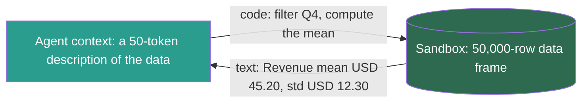
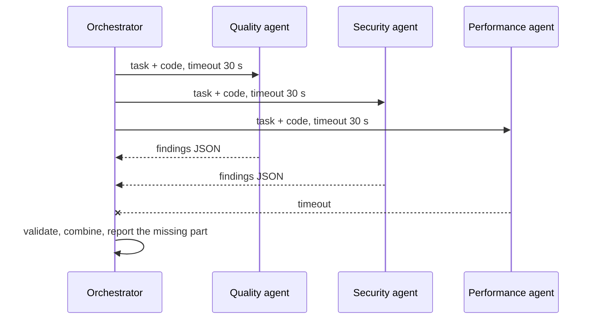

## 1. The question this idea answers

Lesson [7.7](/notes/ai/context-engineering/07-compress-and-isolate/l7-isolate-one-window-is-not-enough) decided **when** to isolate. This lesson shows **how**. The handbook (Session 5, §5.3) names four patterns. Each one isolates something different, sends something different back, and fails in its own way. Two of its descriptions are wrong in ways that matter. Its LangGraph schema isolates nothing, and real agent teams work differently from its description.

## 2. Mental model

> [!analogy] A hospital
> - A doctor sends a **referral** to a specialist and gets a one-page report back. That is sub-agent delegation.
> - The blood sample goes to the **lab**. The sample never enters the consulting room. Only the numbers return. That is sandbox isolation.
> - The **patient record** has access rights: the radiologist sees the images, not the billing data. That is state-schema isolation.
> - A **surgical team** works at the same time, with a shared checklist, and the members talk to each other directly. That is an agent team.
>
> **Where it stops working:** a hospital enforces its boundaries with rules, training and locks. An agent follows a boundary only if code enforces it. A comment that says "Visible to research step" changes nothing, as section 4.4 shows.

## 3. Terms

| Term | Plain meaning |
|---|---|
| sub-agent delegation | Starting a sub-agent with a focused task in a fresh context window and receiving only its result. |
| sandbox | An isolated execution environment, such as a container or a small virtual machine, where agent-written code runs. |
| sandbox isolation | Keeping large objects, such as data frames, inside a sandbox and sending only short text results into the context window. |
| code action | An agent action written as executable code instead of a JSON tool call. CodeAct is the paper that studied this. |
| state schema | The typed definition of the shared state of a LangGraph graph: its keys and their types. |
| node input schema | The part of the state that one LangGraph node receives. By default, it is the whole state schema. |
| private state channel | A state key that some LangGraph nodes declare for their own use, outside the graph's public input and output. |
| subgraph | A LangGraph graph used as one node of another graph, with its own state and its own checkpoints. |
| agent team | A Claude Code feature: a lead session and teammate sessions, each with its own context window, a shared task list and direct messages. |
| handoff | In the OpenAI Agents SDK, a transfer of control from one agent to another. By default, the new agent sees the whole earlier conversation. |

## 4. Method and math

### 4.1 The four patterns at a glance

| Pattern | What stays isolated | What flows back | Complexity | Main risk |
|---|---|---|---|---|
| Sub-agent delegation | The sub-agent's working context: files read, searches, dead ends | A condensed summary, often 1,000–2,000 tokens | Low | A summary that misses what the orchestrator needed |
| Sandbox isolation | Large objects: data frames, images, files | Short text results of commands | Medium | Code that prints the whole object back into the context |
| State-schema isolation | State keys that a node does not need | The keys that the node writes | Medium | A schema that looks isolated but is not |
| Agent teams | Each teammate's whole session | Messages and task updates | High | Conflicting edits, and several times the token cost |

The handbook's Table 4 says that the state schema gives "typed safety" and agent teams give "maximum scale". Sections 4.4 and 4.5 correct both.

### 4.2 Pattern 1: sub-agent delegation

This is the most common pattern. Claude Code ships it (checked on 2026-10-12):

- **Definition.** A sub-agent is a Markdown file with YAML frontmatter in `.claude/agents/` (project) or `~/.claude/agents/` (user). `name` and `description` are required. `tools` and `model` are optional.
- **Context.** "Each subagent starts with a fresh, isolated context window. It doesn't see your conversation history". It has its own system prompt, tools and permissions, and it returns only a summary. A **fork** is the exception: it inherits the parent conversation.
- **Nesting.** By default, up to 3 layers below the main conversation.
- **Purpose.** In the docs' words, "the verbose output stays in the subagent's context while only the relevant summary returns to your main conversation."

Because the sub-agent sees nothing of the parent's history, the delegation message is its whole world. Write it like a ticket:

| Field | Example |
|---|---|
| Goal | Find security problems in the auth module. |
| Scope | Files `auth/*.py` only. Do not edit files. |
| Inputs | The 5 file paths, the security checklist. |
| Output contract | JSON: a list of findings with severity, file, line and evidence (lesson [7.9](/notes/ai/context-engineering/07-compress-and-isolate/l9-contract-first-design)). |
| Limits | At most 20 tool calls. Stop when every checklist item is checked. |

> [!example] Worked example: the auth review (Session 5, §5.3.1)
> The sub-agent reads 5 files (15,000 tokens) with a checklist and returns: "Found 3 issues: (1) JWT tokens never expire. (2) No rate limiting on login endpoint. (3) OAuth state parameter not validated." That is about 200 tokens.
>
> A 200-token return fits a narrow question. Anthropic's typical figure is larger: "often 1,000-2,000 tokens". For a longer report, write it to a file and return the path plus a short summary. Anthropic's research system does this: sub-agents "pass lightweight references back to the coordinator".

### 4.3 Pattern 2: sandbox isolation

Some objects are far too large for any window. A data frame with 50,000 rows would be about 500,000 tokens if serialized. That is the handbook's estimate of 10 tokens per row, so measure your own. The agent never needs to read every row. It needs answers about the rows.

So the agent writes **code**, the code runs in a sandbox that holds the data, and only the printed result returns:



> [!example] Worked example: the token ratio
> The data: about 500,000 tokens if serialized. The result: "Revenue mean: USD 45.20, std: USD 12.30", about 20 tokens (Session 5, FAQ Q37).
>
> Ratio: $500{,}000 / 20 = 25{,}000$. No summary of the data could reach this ratio. The data never enters the window.

**Code actions.** The CodeAct paper (Wang et al., "Executable Code Actions Elicit Better LLM Agents", arXiv 2402.01030, ICML 2024) proposed "to use executable Python code to consolidate LLM agents' actions into a unified action space". It reported up to 20% higher success rates than the usual alternatives. Hugging Face announced its smolagents library on 31 December 2024. It gives "first-class support for Code Agents" and can run them in E2B sandboxes. E2B is "an open-source infrastructure that allows you to run AI-generated code in secure isolated sandboxes in the cloud".

A sandbox isolates two things: **tokens** (the data stays outside the window) and **risk** (agent-written code cannot touch the host). The second matters as much as the first (lesson [6.9](/notes/ai/context-engineering/06-tools-and-mcp/l9-tool-security-and-prompt-injection)).

> [!trap] The sandbox that prints everything
> If the agent's code runs `print(df)` or the tool returns the full stdout, the data flows back into the window. Cap the size of every result that leaves the sandbox, and add a truncation note (lesson [7.6](/notes/ai/context-engineering/07-compress-and-isolate/l6-token-budgets)).

> [!note] Source check: "HuggingFace's CodeAgent pioneered this pattern with E2B"
> **Corrected.** The handbook (Session 5, §5.3.2) says that Hugging Face's CodeAgent pioneered sandbox isolation. ChatGPT Code Interpreter ran Python in a sandboxed environment in 2023 (alpha in March, beta in July). The CodeAct paper appeared in February 2024. smolagents adopted code actions with E2B sandboxes in December 2024. FAQ Q37 also expands E2B as "Environment-to-Browser". Neither the E2B README nor its docs give an expansion. Sources: arXiv 2402.01030, the Hugging Face smolagents post, the E2B repository, Datanami (11 July 2023).

### 4.4 Pattern 3: state-schema isolation in LangGraph

The handbook's Listing 4 defines one `TypedDict` state with comments such as `# Visible to research step` and `# Visible to coding step`. It then says that "the research step never sees the generated code".

The LangGraph docs say the opposite (checked on 2026-10-12): "The schema of the State will be the input schema to all Nodes and Edges in the graph". The `input_schema` parameter of `add_node` defaults to the graph's state schema, and any node can write to any state channel. Comments do not change this. **By default, every node receives the full state.**

Three mechanisms do restrict what a node reads:

1. **A per-node input schema.** LangGraph infers a node's input schema from the type hint on its first parameter. You can also pass `input_schema=` to `add_node`.
2. **Private state channels.** Nodes can declare extra state channels for their own use, "as long as the state schema definition exists". The docs' example uses `InputState`, `OutputState`, `OverallState` and `PrivateState`.
3. **Subgraphs with a different schema.** Call a subgraph inside a node function, and transform the state in and out. The docs say: "This is common when you want to keep a private message history for each agent in a multi-agent system." Each subgraph call gets its own checkpoint namespace.

A per-node input schema looks like this. The node receives only the two declared keys:

```python
class ResearchInput(TypedDict):
    task_description: str
    research_query: str

def research(state: ResearchInput) -> dict:
    ...  # generated_code is not in state here
```

Three caveats remain:

- **Reads, not writes.** An input schema limits what the node reads. A node can still return any key of the state.
- **Streaming.** "Private channels are not redacted when streaming." With `stream_mode="values"`, the stream shows all channels unless you pass `output_keys`.
- **Types.** "The Python runtime does not enforce function and variable type annotations." A `TypedDict` is not checked at runtime. Use a Pydantic model as the state schema if you need runtime checks.

> [!note] Source check: "each step only sees the fields relevant to it"
> **Corrected.** The handbook (Session 5, §5.3.3, Listing 4) claims that comments in one `TypedDict` make each step see only its fields. Its Table 4 calls this "typed safety". By default, every LangGraph node receives the full state, and a `TypedDict` is not validated at runtime. Restrict reads with per-node input schemas, private state or subgraphs, and use Pydantic for runtime checks. Sources: LangGraph Graph API and subgraph docs, `state.py` source, Python `typing` docs. langgraph 1.0.0 shipped on 17 October 2025. The latest release is 1.2.14 (6 October 2026).

### 4.5 Pattern 4: agent teams

Claude Code's agent teams (checked on 2026-10-12) are **experimental** and off by default. You enable them with `CLAUDE_CODE_EXPERIMENTAL_AGENT_TEAMS=1`. Anthropic introduced them as a research preview on 5 February 2026, with Opus 4.6.

| Part | What it is |
|---|---|
| Team lead | The main session. |
| Teammates | Separate Claude Code instances, each with its own context window. The lead's history is not passed to them. Teammates get the spawn prompt plus CLAUDE.md, MCP servers and skills. |
| Shared task list | Tasks are pending, in progress or completed. They can depend on other tasks. Teammates claim tasks with file locking. |
| Mailbox | One JSON inbox per agent. Teammates message each other directly, and you can message any teammate. |
| Display | In-process by default. Split panes need tmux or iTerm2. |

The docs give two pieces of advice. Start with 3 to 5 teammates. And "Two teammates editing the same file leads to overwrites." The cost page says that agent teams use "approximately 7x more tokens than standard sessions when teammates run in plan mode".

> [!note] Source check: agent teams "communicate via shared files" and give "600K tokens"
> **Corrected.** The handbook (Session 5, §5.3.4) says that agents in tmux panes "communicate via shared files" and that three agents give "effectively 600K tokens of working context". Agent teams have a shared task list and direct messages between teammates. tmux is one display mode, not the mechanism. Separate windows are not one 600K window: no agent can read the others' context, and each teammate adds its own token cost. Sources: code.claude.com docs on agent teams and costs.

### 4.6 Handoffs in the OpenAI Agents SDK

A **handoff** is not a delegation. Control moves to the new agent, and it continues the conversation. The SDK docs say: "it's as though the new agent takes over the conversation, and gets to see the entire previous conversation history." So a handoff isolates nothing by default. To narrow what the new agent sees (checked on 2026-10-12):

- `input_filter`: a function that receives `HandoffInputData` and returns a new one. A prebuilt filter, `handoff_filters.remove_all_tools`, removes tool items. It does not redact tool content that was already copied into messages.
- `RunConfig.handoff_history_mapper`: a custom mapping of the history.
- `nest_handoff_history`: an opt-in beta, off by default.

> [!note] Source check: the OpenAI Agents SDK is "OpenAI-only"
> **Corrected.** The handbook (Session 5, FAQ Q36) says that the SDK is OpenAI-only. It also says that a handoff passes "a context briefing". The SDK describes itself as "provider-agnostic, supporting the OpenAI Responses and Chat Completions APIs, as well as 100+ other LLMs". It reaches them through LiteLLM, Any-LLM or OpenAI-compatible endpoints. These adapters are labeled beta, and features differ by provider. By default, a handoff passes the entire earlier conversation. A briefing needs a configured filter. Sources: the openai-agents-python repository and docs.

### 4.7 Other frameworks (checked on 2026-10-12)

| Framework | Status | Isolation by default |
|---|---|---|
| Microsoft AutoGen | "AutoGen is now in maintenance mode." Its successor is Microsoft Agent Framework, announced on 1 October 2025, version 1.0 on 3 April 2026. | Not covered here. Check the successor's docs. |
| CrewAI | One unified `Memory` class. Default storage: LanceDB under `./.crewai/memory`. | "All agents in the crew share the crew's memory unless an agent has its own." |
| LangGraph | 1.x | Full state to every node, unless you narrow it (section 4.4). |

> [!note] Source check: AutoGen as an active framework
> **Corrected.** The handbook (Session 5, FAQ Q34) compares CrewAI with AutoGen as current options. AutoGen is in maintenance mode and receives no new features. Its CrewAI description, in which agents share one memory object, is broadly right, but the memory types it lists were merged into one class. Sources: github.com/microsoft/autogen, Microsoft Agent Framework 1.0 blog, CrewAI memory docs.

### 4.8 Orchestration without a framework

The handbook's FAQ (Q29) gives a design that needs only Python. Each sub-agent is an async function. It takes a focused input, builds its own context, calls the model and returns a structured result. The orchestrator runs them in parallel with `asyncio.gather()` and validates each result against a contract.



Five details turn this sketch into production code:

1. **Timeouts per agent.** Wrap each call in `asyncio.timeout()` or `asyncio.wait_for()`.
2. **No single failure kills the run.** Use `asyncio.gather(..., return_exceptions=True)`, then handle each exception as a missing part.
3. **Validation.** Parse each result with a Pydantic model (lesson 7.9).
4. **Rate limits.** Parallel calls can hit the provider's limits. Limit the number of calls in flight with an `asyncio.Semaphore`.
5. **Accounting.** Log the tokens and the time of every agent.

> [!example] Worked example: wall-clock time
> Four review agents take 8, 10, 7 and 9 seconds.
>
> - Sequential: $8 + 10 + 7 + 9 = 34$ seconds.
> - Parallel: $\max(8, 10, 7, 9) = 10$ seconds, plus the orchestrator's own calls.
>
> The parallel time is set by the **slowest** agent. One slow agent with no timeout holds the whole review.

The handbook's advice on frameworks is a sound rule of thumb (FAQ Q29). Start without one. Adopt one when you need persistence, human-in-the-loop steps or complex routing.

### 4.9 Production view

| Concern | What this lesson means for it |
|---|---|
| Security | A sandbox isolates risk as well as tokens. A LangGraph input schema restricts reads only. A handoff passes the full history unless you filter it. |
| Reliability | Every isolated unit needs a timeout, a validated output and a defined behavior when it fails. |
| Cost | Agent teams use several times the tokens of one session. Sub-agents add their own inputs. |
| Latency | Parallel time equals the slowest agent. Use timeouts. |
| Observability | Log each sub-agent's input, output, tokens and time as its own span. Remember that private LangGraph channels appear in streams. |

## 5. Code

These exercises go in `notebooks/07-compress-and-isolate.ipynb`. Put the orchestrator in `src/agents/orchestrator.py`.

**Exercise 8.1: sandbox isolation in miniature.**

1. Create a pandas data frame with 50,000 rows and 6 columns of synthetic sales data.
2. Count the tokens of `df.to_csv()` with `tiktoken` (`o200k_base`).
3. Write a tool `run_query(code: str) -> str` that runs code against the frame in a restricted namespace. It returns at most 500 characters of output, with a truncation note.

Acceptance tests:

- A table that compares the token count of the serialized frame with the token count of three query results.
- `run_query("print(df)")` returns at most 500 characters and a note.

**Exercise 8.2: prove LangGraph isolation.**

1. Build a graph with three nodes: research, code and test.
2. Give the research node an input schema without `generated_code`.
3. Let the code node write one private key, `scratch_notes`, declared in a separate `PrivateState` schema.
4. In each node, record the keys that it received.

Acceptance tests:

- With the default schema, every node receives every key.
- With the input schema, the research node never receives `generated_code`.
- A stream with `stream_mode="values"` still shows `scratch_notes`, and the test documents it.

**Exercise 8.3: a framework-free orchestrator.**

1. Write three async review agents with a fake model call that sleeps a random time and returns JSON.
2. Run them with `asyncio.gather(..., return_exceptions=True)`, a 2-second timeout each and a semaphore of 2.
3. Return a combined report that names any missing agent.

Acceptance tests:

- An agent that sleeps 5 seconds is reported as a timeout, and the others' results are present.
- With the semaphore set to 3, the total time is close to the slowest agent that finished, not the sum.
- With the semaphore set to 2, the third agent waits for a free slot, and the test shows the longer total time.

**Debug exercise: the handbook's state schema (Session 5, Listing 4).** The handbook says that this schema means that "the research step never sees the generated code". What is wrong, and how do you fix it?

```python
class AgentState(TypedDict):
    # Visible to research step
    research_query: str
    research_results: List[str]
    # Visible to coding step
    code_spec: str
    generated_code: str
    # Visible to ALL steps
    task_description: str
    final_output: str
```

The answer is in the check questions.

## 6. Common mistakes

1. **"A comment in the state schema isolates a node."** By default, every LangGraph node receives the full state. Use per-node input schemas, private state or subgraphs.
2. **"A `TypedDict` state is type-safe."** Python does not check annotations at runtime. Use Pydantic if you need checks.
3. **"A handoff gives the new agent a briefing."** By default, it gets the whole earlier conversation. Add an input filter.
4. **"A sandbox keeps the data out of the window."** Only if every result that leaves it is capped.
5. **"Agent teams give one large shared window."** Each teammate has its own window and its own cost. They coordinate through a task list and messages.
6. **"`asyncio.gather` makes the system robust."** Without timeouts and `return_exceptions=True`, one failure or one slow agent stops the run.

## 7. One-minute explanation

There are four ways to isolate context. Sub-agent delegation sends a focused task to a fresh window and receives a summary of about 1,000 to 2,000 tokens. Write the task like a ticket, because the sub-agent sees nothing else. Sandbox isolation keeps large data inside an execution environment, and the agent sends code and reads short results. That is how 500,000 tokens of rows become a 20-token answer. State-schema isolation in LangGraph needs real input schemas, private state or subgraphs, because by default every node sees the whole state. Agent teams run several sessions with a shared task list and direct messages, at several times the token cost. Without a framework, use async functions, timeouts, validated outputs and a report of what is missing.

## 8. Check questions

```check
{
  "question": "A data frame has 80,000 rows. Serialized, it uses about 12 tokens per row. The agent's question needs one 30-token result. What is the compression ratio of sandbox isolation here?",
  "answer": "Serialized size ≈ 80,000 × 12 = 960,000 tokens. Ratio = 960,000 / 30 = 32,000. The data never enters the window. Serialized, it would fill almost all of a 1M-token window."
}
```

```check
{
  "question": "Four parallel sub-agents take 12, 5, 9 and 31 seconds. Each has a 20-second timeout. What is the wall-clock time of the parallel step, and what does the orchestrator report?",
  "answer": "The 31-second agent hits its timeout at 20 seconds, so the parallel step takes about 20 seconds. Without the timeout it would take 31. The orchestrator reports three results and marks the fourth agent as missing because of a timeout."
}
```

```check
{
  "question": "An OpenAI Agents SDK triage agent transfers control to a billing agent through a handoff. The triage conversation contains a customer's full address and an internal tool result with fraud scores. What does the billing agent see by default, and how do you limit it?",
  "answer": "By default, the billing agent sees the entire earlier conversation, including the address and the tool result. Use an input_filter or a handoff_history_mapper that passes only what billing needs. The prebuilt remove_all_tools filter removes tool items, but it does not redact tool content that was already copied into messages, so check the messages too."
}
```

```check
{
  "question": "Two Claude Code teammates are assigned the frontend and the backend. Both edit src/config.ts. What happens, and what is the fix?",
  "answer": "The docs warn that two teammates editing the same file leads to overwrites, so one teammate's change can be lost. Assign file ownership: each file has one owner. Keep shared values in a contract or a file that only the lead edits, and coordinate changes through the task list and messages."
}
```

```check
{
  "question": "Debug exercise: what is wrong with the handbook's AgentState (Session 5, Listing 4), and how do you fix it?",
  "answer": "The comments do nothing. LangGraph uses the state schema as the input schema of every node by default, so the research node receives generated_code and every other key. Also, TypedDict is not checked at runtime, so \"typed safety\" is not real. Fixes: give each node its own input schema (by the type hint of its first parameter or input_schema= in add_node), use private state channels for keys that only some nodes need, or put each agent in a subgraph with its own schema and transform the state in and out. Use a Pydantic state if you need runtime validation. Remember that input schemas restrict reads, not writes, and that private channels still appear in streams."
}
```

## 9. Links

- Previous: [L7: ISOLATE: one window is not enough](/notes/ai/context-engineering/07-compress-and-isolate/l7-isolate-one-window-is-not-enough)
- Next: [L9: Contract-first design](/notes/ai/context-engineering/07-compress-and-isolate/l9-contract-first-design)
- [6.9: Tool security and prompt injection](/notes/ai/context-engineering/06-tools-and-mcp/l9-tool-security-and-prompt-injection): why sandboxes isolate risk
- [9.5: Commands, skills and hooks](/notes/ai/context-engineering/09-production/l5-commands-skills-and-hooks): more Claude Code mechanisms
- [Glossary](/notes/ai/context-engineering/glossary)
