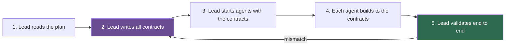
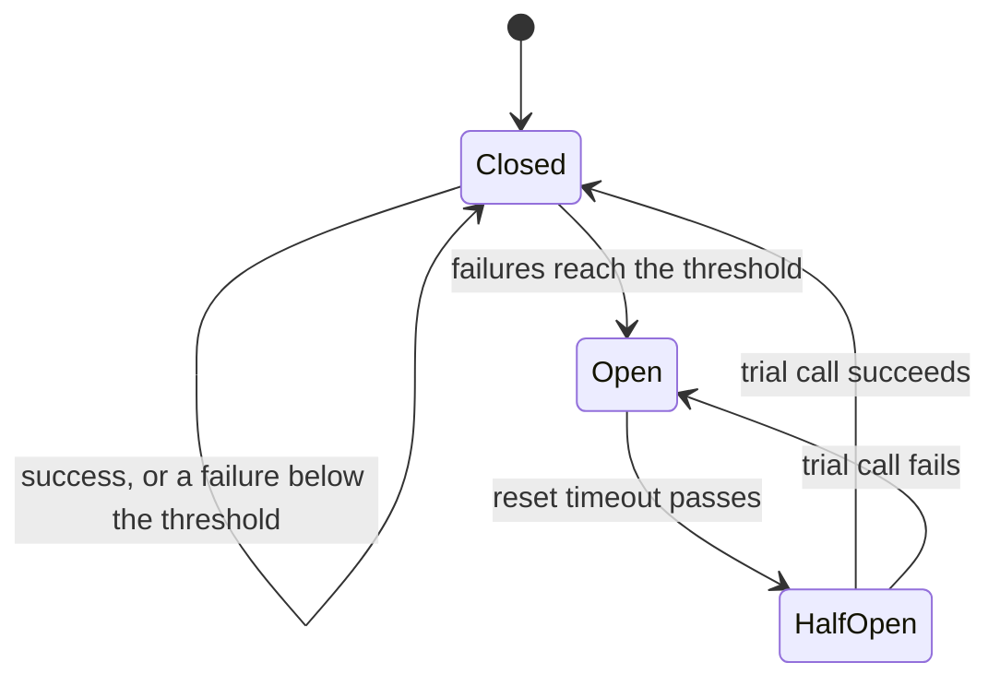

## 1. The question this idea answers

Two agents build two halves of one system at the same time. The frontend agent calls `/api/users`. The backend agent implements `/api/v1/user`. One returns `{"data": [...]}`, the other expects `{"users": [...]}`. Each half works. Together, nothing works.

Lesson [7.7](/notes/ai/context-engineering/07-compress-and-isolate/l7-isolate-one-window-is-not-enough) showed why: isolated agents make implicit decisions that the others cannot see. This lesson makes those decisions **explicit and shared before the work starts**. It also covers the other side of the contract. What does the orchestrator do when a sub-agent returns bad output, is slow, or fails again and again?

## 2. Mental model

> [!analogy] Plugs and sockets
> The company that makes a lamp and the electrician who wires a house never meet. The lamp still works in the house, because both follow one standard for plugs and sockets. The standard is a **contract**: it fixes the interface and leaves everything else free.
>
> **Where it stops working:** a factory checks every plug against the standard. An agent "follows" a contract the way it follows any instruction: mostly. So a contract for agents needs a validator that checks every output. And a contract covers only what it states. A design choice that nobody stated, such as a color scheme, is still an implicit decision.

## 3. Terms

| Term | Plain meaning |
|---|---|
| contract | A written, machine-checkable definition of an interface between agents: endpoints, field names, types, formats, errors and limits. |
| contract-first design | Writing every shared contract before any agent starts to build, and validating against it at the end. |
| JSON Schema | A standard language for describing the structure of JSON data: types, required fields, allowed values. |
| schema validation | Checking a piece of data against a schema, and rejecting it with a list of errors if it does not match. |
| error contract | The agreed shape of a failure response, so that the receiver can handle errors by code. |
| retry with backoff | Repeating a failed call after a wait that grows with each attempt. |
| fallback | The planned action when a call fails for good: a simpler call, a cached result, or a report that the part is missing. |
| circuit breaker | A wrapper that counts failures of a call and, after a threshold, makes further calls fail at once without running them. |
| verification question | A specific question that the orchestrator asks to check that a sub-agent's summary is consistent. |

## 4. Method and math

### 4.1 The anti-pattern: spawn without contracts

The handbook (Session 5, §6.1) states it well: without explicit contracts, "each agent makes independent assumptions about endpoints, field names, response formats, and authentication methods. The result: nothing integrates."

| Interface | Agent A assumes | Agent B assumes |
|---|---|---|
| Endpoint | `GET /api/users` | `GET /api/v1/user` |
| Column name | `user_name` | `username` |
| Response body | `{"users": [...]}` | `{"data": [...]}` |
| Auth | Bearer token in the `Authorization` header | Session cookie |

Each row is an implicit decision in Cognition's sense (lesson 7.7). A contract makes it an explicit decision that both agents read.

### 4.2 Contracts before agents: five steps



Step 2 covers endpoints, JSON schemas, response formats, authentication and error formats. Step 3 gives each agent an instruction such as "Build the frontend. Follow `contracts/api-spec.json` exactly." Step 5 runs integration tests against the contract, not a manual review.

The handbook's tip is right: this is not new. OpenAPI specifications, Protocol Buffers, database schemas and interface definitions all do the same job for human teams.

### 4.3 A contract that a machine can check

The handbook's Listing 5 describes the response like this:

```json
{"users": [{"id": "string (UUID)", "username": "string", "email": "string",
            "created_at": "ISO 8601 datetime"}],
 "total": "integer", "page": "integer"}
```

This is a description for a human. `"string (UUID)"` is a string value, not a type, so no validator can use it. A real contract uses JSON Schema:

```json
{
  "type": "object",
  "required": ["users", "total", "page"],
  "additionalProperties": false,
  "properties": {
    "users": {"type": "array", "items": {
      "type": "object",
      "required": ["id", "username", "email", "created_at"],
      "additionalProperties": false,
      "properties": {
        "id": {"type": "string", "format": "uuid"},
        "username": {"type": "string"},
        "email": {"type": "string", "format": "email"},
        "created_at": {"type": "string", "format": "date-time"}}}},
    "total": {"type": "integer", "minimum": 0},
    "page": {"type": "integer", "minimum": 1}
  }
}
```

In Python, write the contract as Pydantic models and export the schema. The Pydantic docs (checked on 2026-10-12) give three facts that matter:

1. `model_validate` checks a dictionary and raises one `ValidationError` that lists **every** error. `model_validate_json` does the same for a JSON string.
2. Extra fields are **ignored by default**. Set `extra='forbid'` to reject them.
3. `model_json_schema()` returns the JSON Schema, which follows Draft 2020-12 and OpenAPI 3.1.0.

> [!example] Worked example: catching the `users` against `data` mismatch
> The backend agent returns `{"data": [...], "total": 2, "page": 1}`. The contract model requires `users`.
>
> - With default settings: one error, `users` is missing. The extra key `data` is ignored.
> - With `extra='forbid'`: two errors, `users` is missing and `data` is not allowed. The second error tells the agent what it did wrong, not only what is missing.
>
> Both cases fail before any frontend code runs against the wrong shape.

> [!note] Source check: Listing 5 as a contract
> **Corrected.** The handbook (Session 5, Listing 5 and FAQ Q16) presents a JSON object with descriptive strings as the contract. It cannot be validated by a machine. Write the contract as a Pydantic model or a JSON Schema document. Export it with `model_json_schema()` and validate with `model_validate`, using `extra='forbid'` to catch unexpected keys. Source: Pydantic docs, checked on 2026-10-12.

### 4.4 Contracts for agent outputs, not only for APIs

Contracts also fix what a sub-agent returns to the orchestrator. A review sub-agent's output contract can be:

```json
{
  "status": "ok",
  "agent": "security",
  "findings": [
    {"severity": "high", "file": "auth/jwt.py", "line": 42,
     "issue": "Tokens never expire", "evidence": "exp claim is not set"}
  ],
  "tokens_used": 18450
}
```

And an error contract for the same agent:

```json
{
  "status": "error",
  "agent": "security",
  "error": {"code": "TIMEOUT", "message": "No result within 30 s", "retryable": true}
}
```

Three fields deserve attention:

- `status` with fixed values (`ok`, `partial`, `error`) lets the orchestrator branch by code.
- `severity` as an enumeration (`low`, `medium`, `high`, `critical`) lets the orchestrator sort and count.
- `retryable` tells the orchestrator whether a retry makes sense.

The handbook's FAQ (Q23) adds that the contract should state `timeout_seconds`, so that every party knows the limit.

### 4.5 Validate every output

The handbook's FAQ (Q16) gives the rule: each sub-agent validates its output against the contract before it returns. The orchestrator validates again on receipt. Then it does three things:

1. **On a validation error:** run the sub-agent again once, with the validation errors in the prompt. A model often fixes its output when it sees the exact error.
2. **On a second failure:** use the fallback (section 4.6).
3. **On success:** check the content, not only the shape. FAQ Q20 suggests a **verification question**. If the security summary says "found 3 vulnerabilities", ask "what is the most critical one, and where is it?". The answer must name one of the three findings.

Structured outputs (lesson [6.3](/notes/ai/context-engineering/06-tools-and-mcp/l3-tool-schemas-and-structured-outputs)) can constrain the model's output to the schema when it generates. Validation is still needed: a schema-valid answer can still be wrong.

### 4.6 Timeouts, retries and fallbacks

The handbook (FAQ Q23) lists the pieces: timeouts, fallbacks, never block, error contracts and a circuit breaker.

If one attempt succeeds with probability $p$, and attempts are independent, at least one of $n$ attempts succeeds with probability:

$$
P_n = 1 - (1 - p)^n
$$

The symbols mean:

- $p$ is the success probability of one attempt.
- $n$ is the number of attempts.
- $P_n$ is the probability that at least one attempt succeeds.

> [!example] Worked example: three attempts
> - $p = 0.9$: $P_3 = 1 - 0.1^3 = 0.999$.
> - $p = 0.5$: $P_3 = 1 - 0.5^3 = 0.875$.
>
> The independence is the weak point. A model that fails a prompt often fails the same prompt again in the same way. So change something between attempts: add the validation errors, simplify the instructions, or use a different model.

Retries cost time. With a 30-second timeout, 3 attempts and backoff waits of 1 and 2 seconds, the worst case is $3 \times 30 + 1 + 2 = 93$ seconds. Set a deadline for the whole step, not only for each attempt.

Failures are normal at scale. If each of four agents succeeds with probability 0.95, all four succeed with probability $0.95^4 \approx 0.81$. About one review in five has a missing part. So the combiner must accept partial results and report what is missing. It must never block the whole pipeline on one agent.

### 4.7 The circuit breaker

Martin Fowler describes the pattern (bliki, 6 March 2014): "You wrap a protected function call in a circuit breaker object, which monitors for failures." Once the failures reach a threshold, the breaker trips, and "all further calls to the circuit breaker return with an error, without the protected call being made at all."



The closed and open states are the core of the pattern. The half-open state, with a reset timeout and one trial call, is a common extension that lets the breaker recover by itself. The handbook's rule (FAQ Q23) is to stop calling a sub-agent and alert the developer after 3 failures in a row. That is a design choice for the threshold. Fowler's definition leaves the threshold to you.

Why it matters for agents: a sub-agent that fails because its provider is down will fail again. Without a breaker, every request waits for its timeouts and retries, and the costs and delays grow. With a breaker, the orchestrator skips the agent at once and reports the gap.

### 4.8 Share conclusions, not working notes

Isolated agents still need each other's results. The handbook (FAQ Q28) gives the principle: **"share conclusions, not working notes."**

- **Relay through the orchestrator.** The research agent returns "Found 3 relevant libraries: X, Y, Z, with trade-offs A, B, C". The orchestrator adds that summary to the code agent's input. The code agent never sees the research agent's search queries and dead ends.
- **A shared store with a schema.** For larger state, agents read and write a file or a database whose shape is itself a contract. Anthropic's research system passes "lightweight references" to files. Claude Code agent teams use a shared task list.

Working notes hold discarded results, half-formed guesses and possibly injected text from tool results. Passing them to other agents spreads stale and unsafe context into clean windows.

### 4.9 Production view

| Concern | What this lesson means for it |
|---|---|
| Reliability | Every shared interface has a contract. Every output is validated. Every call has a timeout, a retry policy, a fallback and a breaker. |
| Quality | Validation checks the shape. A verification question checks the content. |
| Latency | Budget the whole step: attempts × timeout + backoff. Report partial results instead of waiting. |
| Cost | A breaker stops paying for calls that will fail. Retries with feedback cost one extra call, not many. |
| Security | Share conclusions only. Contracts with `extra='forbid'` reject unexpected fields that could carry injected content. |
| Change control | Version the contracts in the repository. A contract change is a reviewed change (Part 9). |

## 5. Graphs

```plot
{
  "title": "Probability that at least one of n independent attempts succeeds: n = 1 (red), n = 2 (blue), n = 3 (gold)",
  "xAxis": { "label": "success probability of one attempt, p", "domain": [0, 1] },
  "yAxis": { "label": "probability of at least one success", "domain": [0, 1] },
  "disableZoom": true,
  "data": [
    { "fn": "x", "color": "#C81D25" },
    { "fn": "1 - (1-x)^2", "color": "#1E6091" },
    { "fn": "1 - (1-x)^3", "color": "#B8860B" }
  ]
}
```

The curves are $P_n = 1 - (1-p)^n$. Retries help most when $p$ is in the middle. At $p = 0.5$, the curves are at 0.5, 0.75 and 0.875. They assume independence, which real model failures often break.

## 6. Code

These exercises go in `notebooks/07-compress-and-isolate.ipynb`. Put the contracts in `src/contracts/` and the reliability code in `src/agents/reliability.py`.

**Exercise 9.1: the API contract in Pydantic.**

1. Write `User` and `UsersResponse` models for the contract of section 4.3, with `extra='forbid'`.
2. Export the schema with `model_json_schema()` and save it as `contracts/users-response.json`.
3. Validate three mock payloads: a correct one, one with `data` instead of `users`, and one with a missing `created_at`.

Acceptance tests:

- The correct payload passes.
- The `data` payload fails with two errors: `users` missing and `data` not allowed.
- The saved schema lists `users`, `total` and `page` as required.

**Exercise 9.2: a sub-agent output and error contract.** Write the models for section 4.4 as a tagged union on `status`. Validate an `ok` result, an `error` result, and a result with severity `"urgent"`.

Acceptance test: the severity `"urgent"` fails, and the error message names the allowed values.

**Exercise 9.3: retry with feedback.** Write `call_with_retry(agent, payload, model_cls, attempts=3, backoff=(1, 2))`. On a validation error, it calls the agent again with the error text added. Use a fake agent that returns wrong JSON once, then right JSON.

Acceptance tests:

- The fake agent succeeds on the second attempt, and the second prompt contains the validation error.
- After three failures, the function returns an error-contract object, not an exception.

**Exercise 9.4: a circuit breaker.** Write a `CircuitBreaker(threshold, reset_timeout, clock)` class with closed, open and half-open states. Inject the clock, so that the tests do not sleep.

Acceptance tests:

- After `threshold` failures in a row, the next call fails at once and the protected function is not called.
- After `reset_timeout`, one trial call runs. Success closes the breaker. Failure opens it again.

**Exercise 9.5: connect everything.** Add the contracts, the retry function and one breaker per agent to the orchestrator of lesson 7.8. Log tokens, time and status per agent.

Acceptance test: use `threshold=2`, no retries and one agent that always fails. The third review skips that agent at once, and the report names it as missing.

## 7. Common mistakes

1. **"A JSON example is a contract."** Descriptive strings such as `"string (UUID)"` cannot be validated. Use JSON Schema or Pydantic.
2. **"Pydantic rejects unknown fields."** By default, it ignores them. Set `extra='forbid'` to catch `data` instead of `users`.
3. **"A valid schema means a correct answer."** Validation checks the shape. Check the content with a verification question or a test.
4. **"Retry the same prompt three times."** Model failures are often correlated. Change the attempt: add the error, simplify, or switch models.
5. **"Wait for every agent."** At a 0.95 success rate per agent, one review in five misses a part. Return partial results and name the gap.
6. **"Pass the research agent's notes to the code agent, to be safe."** Notes carry dead ends and possibly injected text. Share conclusions.

## 8. One-minute explanation

Parallel agents fail at the seams: one calls /api/users, the other builds /api/v1/user, and nothing fits. Contract-first design fixes the seams before work starts. The lead writes every shared interface as a machine-checkable contract, in JSON Schema or Pydantic, and every agent builds to it. Sub-agent outputs get contracts too, with a status field, enumerated values and an error shape. Every output is validated, and a failed validation gets one retry with the error in the prompt. Every call has a timeout and a fallback, and the combiner accepts partial results. A circuit breaker stops calling an agent that keeps failing. And agents share conclusions through the orchestrator, never their working notes.

## 9. Check questions

```check
{
  "question": "A sub-agent returns valid output with probability 0.7 per attempt. With up to 3 attempts, what is the probability of a valid result if attempts are independent? Why is the real number likely lower?",
  "hint": "P_n = 1 − (1 − p)^n.",
  "answer": "P_3 = 1 − 0.3³ = 1 − 0.027 = 0.973. Real attempts are often correlated: the same prompt tends to fail the same way. Adding the validation errors or changing the instructions between attempts makes them less correlated."
}
```

```check
{
  "question": "Five review agents each succeed with probability 0.96, independently. What is the probability that a review has all five parts? What must the combiner do?",
  "answer": "0.96⁵ ≈ 0.815. So about 18.5% of reviews miss at least one part. The combiner must accept partial results, mark the missing agents in the report, and never block the whole review on one agent."
}
```

```check
{
  "question": "A Pydantic model for the users response has default settings. The backend returns {\"data\": [], \"users\": [], \"total\": 0, \"page\": 1}. Does validation pass? What setting would catch the problem?",
  "answer": "It passes: users, total and page are present, and the extra key data is ignored by default. With extra='forbid', validation fails because data is not allowed. That error shows that the backend still emits a field that the contract does not define."
}
```

```check
{
  "question": "A step allows 3 attempts with a 20-second timeout each and backoff waits of 2 and 4 seconds. What is the worst-case time? The product needs an answer within 45 seconds. What do you change?",
  "answer": "Worst case = 3 × 20 + 2 + 4 = 66 seconds, above 45. Options: fewer attempts (2 × 20 + 2 = 42 seconds), a shorter timeout per attempt, or a deadline for the whole step after which the orchestrator uses the fallback and reports the gap."
}
```

```check
{
  "question": "Explain how a circuit breaker reduces cost and latency when a sub-agent's provider has an outage.",
  "answer": "Without a breaker, every request calls the failing agent, waits for each timeout and runs every retry, so each request is slow and pays for failed calls. After the threshold of failures, the breaker trips: further calls fail at once without running the protected call. Requests get a fast fallback and a report of the missing part. After a reset timeout, one trial call tests whether the provider is back."
}
```

## 10. Links

- Previous: [L8: Isolation patterns](/notes/ai/context-engineering/07-compress-and-isolate/l8-isolation-patterns)
- Next: [L10: Measure compression](/notes/ai/context-engineering/07-compress-and-isolate/l10-measure-compression)
- [6.3: Tool schemas and structured outputs](/notes/ai/context-engineering/06-tools-and-mcp/l3-tool-schemas-and-structured-outputs)
- [9.4: Validation loops](/notes/ai/context-engineering/09-production/l4-validation-loops)
- [Glossary](/notes/ai/context-engineering/glossary)
