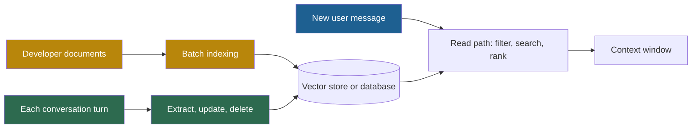
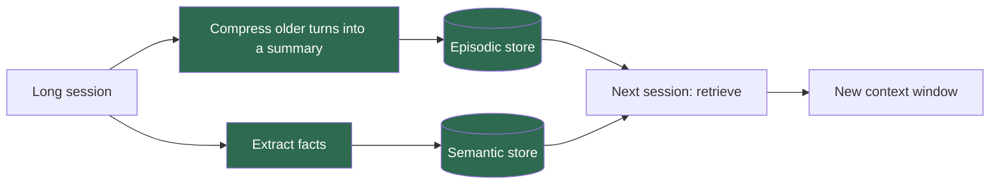

## 1. The question this idea answers

On Monday a user tells a coding assistant: "I use Python, and our database is PostgreSQL." On Tuesday the user opens a new chat. The assistant suggests JavaScript and MongoDB.

The model did not forget. It never knew. Every call starts from an empty state (lesson [1.3](/notes/ai/context-engineering/01-foundations/l3-the-chat-api-call)). So where does "memory" live in an LLM product, who writes it, and what decides which parts of it reach the model? This lesson defines memory as an application feature. The rest of Part 8 builds it.

## 2. Mental model

> [!analogy] A consultant who forgets every client
> A consultant forgets each client when a meeting ends. The receptionist keeps a case file for every client. Before each meeting, the receptionist writes a one-page brief from the file and hands it to the consultant. The consultant knows only what is on the brief.
>
> - The consultant is the **model**: capable, but with no memory between meetings.
> - The case file is the **memory store**: it lives outside the consultant.
> - The one-page brief is the **memory part of the context**: a small, selected part of the file.
> - The receptionist is **your application code**: it decides what goes into the file and what goes onto the brief.
>
> **Where it stops working:** a real receptionist understands the client. Your application often uses another LLM call to write the file, and that call can be wrong. Also, with memory tools (lesson [8.8](/notes/ai/context-engineering/08-memory/l8-three-layer-memory-agent)), the consultant can ask for more pages during the meeting. The brief is then not fixed before the meeting starts.

## 3. Terms

| Term | Plain meaning |
|---|---|
| memory (LLM application) | Information from past interactions that the application stores and selects into the context of later calls. The model itself stores nothing between calls. |
| session | One continuous conversation or task run. A new session starts with an empty message list. |
| within-session memory | Memory that keeps continuity inside one session, for example the recent turns and a running summary. |
| cross-session memory | Memory that survives the end of a session and comes back in a later session, for example stored facts about a user. |
| full-history replay | The simplest memory strategy: the application sends every earlier turn of the session again on every call. |
| memory injection | The step that puts selected memories into the input of a call, for example into the system prompt or the last user message. |
| write path | The part of a memory system that decides what to store, in which form, and when to update or delete it. |
| read path | The part of a memory or retrieval system that selects stored items and puts them into the context of a call. |
| memory budget | The maximum number of tokens that the application allows for injected memories on one call. |
| fine-tuning | Further training of a model's weights on new examples. The change applies to every request that uses those weights. |

## 4. Method and math

### 4.1 The model forgets, the application remembers

The handbook (Session 6, §1.3) shows the problem with two calls. Call 1 sends "My name is Alice and I prefer Python." Call 2 is a separate call. It sends only the question `What is my name?`. The model cannot answer, because call 2 does not contain call 1.

The fix does not change the model. The application stores the fact after call 1 and puts it into call 2:

```json
{
  "model": "<model id>",
  "max_tokens": 256,
  "system": "You are a coding assistant.\n\nKnown facts about the user:\n- Name: Alice\n- Prefers Python",
  "messages": [
    { "role": "user", "content": "What is my name?" }
  ]
}
```

The model now answers "Alice". It did not remember. It read the answer in its input.

> [!key] Memory is an application feature
> The handbook states it directly: "Memory is not a feature of the model; it is a feature of your application layer." Every memory system in this part has the same two jobs. The **write path** decides what to store. The **read path** decides what to put into the next call.

### 4.2 Four failures without memory

The handbook (Session 6, §1.2) lists four failures that a user sees when an application has no memory:

| Failure | The handbook's example | What the user feels | Memory that fixes it |
|---|---|---|---|
| Starts from zero | "Why do I have to explain my project again?" | Repeated work at the start of every session | Stored facts about the project (semantic memory, lesson 8.2) |
| No learning | "It keeps suggesting JavaScript even though I told it I use Python." | The same mistake again and again | A stored preference, and rules learned from failures (procedural memory, lesson 8.7) |
| No consistency | "Yesterday it recommended FastAPI, today it is suggesting Flask for the same project." | Contradictions across sessions | Records of past decisions (episodic memory, lesson 8.2) |
| No personalization | Every user gets identical treatment. | Generic answers | A user profile with preferences (semantic memory) |

The handbook says that these four failures "separate a tool from an assistant". A calculator takes an input, gives an output and forgets. An assistant keeps your context.

### 4.3 The context formula

The handbook (Session 6, §1.3) writes the change as a formula:

- Without memory: CONTEXT = INSTRUCTIONS + CURRENT_INPUT
- With memory: CONTEXT = INSTRUCTIONS + EXAMPLES + MEMORY + CURRENT_INPUT

It defines MEMORY as "carefully selected prior information injected into the context window at the right time". It also says: "Memory is just context engineering applied to past interactions."

The formula is also a token budget. Every part takes space in the same window:

$$
\lvert C \rvert = \lvert I \rvert + \lvert E \rvert + \lvert M \rvert + \lvert X \rvert \le W - R
$$

The symbols mean:

- $\lvert \cdot \rvert$ is a size in tokens.
- $C$ is the full context of one call.
- $I$ is the instructions (system prompt and tool definitions).
- $E$ is the examples.
- $M$ is the injected memory.
- $X$ is the current input: the new user message and the recent turns.
- $W$ is the window size, and $R$ is the output reserve (lesson [1.1](/notes/ai/context-engineering/01-foundations/l1-what-a-model-does-with-context)).

On current models $W$ is large, so the window limit is rarely the problem. The real limit is a **memory budget** that you choose for cost and quality.

> [!example] Worked example: the store is larger than the budget
> A user has 200 stored memories. Each one has about 100 tokens. The memory budget is 2,000 tokens (the handbook's suggestion in Session 6, FAQ Q19).
>
> - Size of the whole store: $200 \times 100 = 20{,}000$ tokens.
> - Memories that fit the budget: $2{,}000 / 100 = 20$.
> - With longer memories of 130 tokens: $\lfloor 2{,}000 / 130 \rfloor = 15$.
>
> So 90% or more of the store stays out of every call. Memory is mainly a **selection** problem. Lesson [8.3](/notes/ai/context-engineering/08-memory/l3-retrieval-scoring-and-decay) shows how to choose the 15 to 20 items.

### 4.4 Full-history replay is already a memory strategy

The chat loop of lesson 1.3 sends the whole session again on every call. This is **full-history replay**. It gives perfect recall inside one session, but it has three limits:

1. It ends with the session. Tomorrow's chat starts empty.
2. The input grows on every call, and the total input grows with the square of the number of turns (lesson [1.6](/notes/ai/context-engineering/01-foundations/l6-the-cost-of-a-conversation)).
3. Long inputs reduce accuracy (lesson [1.5](/notes/ai/context-engineering/01-foundations/l5-position-and-length-effects)).

> [!example] Worked example: the handbook's 20-turn conversation
> The handbook's cost box (Session 6, §8) uses 200 tokens per turn and counts the history at turn 20 as $20 \times 200 = 4{,}000$ tokens.
>
> The cumulative input over all 20 calls is $200 \times (1 + 2 + \cdots + 20) = 200 \times 210 = 42{,}000$ tokens.
>
> With a summary of 300 tokens, facts of 200 tokens and the last 5 turns (1,000 tokens), call 20 sends 1,500 tokens. That is $1 - 1{,}500 / 4{,}000 = 62.5\%$ less for that one call. Lesson [8.8](/notes/ai/context-engineering/08-memory/l8-three-layer-memory-agent) adds the system prompt and prompt caching to this comparison.

> [!note] Source check: "without memory" in the cost box
> **Corrected.** The handbook (Session 6, §8) labels the 4,000-token case `Without memory`. That case resends the full history, so it is full-history replay, which is a memory strategy. The true case without memory is the first code box of §1.3. There, call 2 holds only the new question. The arithmetic of the box is correct.

### 4.5 Memory against RAG: two write paths, one read path

RAG (Part 4) and memory use the same read machinery: embeddings, a vector store, filters and ranking. They differ in the **write path**.



| Aspect | RAG | Memory |
|---|---|---|
| Who writes | The developer, in batch jobs | The application, during and after every conversation |
| What it holds | Documents: policies, manuals, code | Facts and events about one user, team or task |
| How a search is scoped | The whole corpus, sometimes with metadata filters | Always one user or one scope first, then similarity |
| How an item changes | A new document version replaces the old one | Facts get corrected, superseded, decayed and deleted |
| Main risk | Stale or missing documents | Wrong stored facts, leaks between users, data that must be erased |
| Typical question | "What does the policy say about returns?" | "What did this user tell me about their stack?" |

The handbook (Session 6, FAQ Q7) calls RAG the agent's "reference library" and memory its "personal notebook". The hard part of memory is the write path. Lessons 8.5 and 8.6 cover it.

### 4.6 Memory against compression: two sides of one pipeline

Compression (Part 7) makes the **current** window smaller. Memory decides what survives **into later** sessions. The handbook (Session 6, FAQ Q20) calls them "two sides of the same coin" and gives this pipeline:



The FAQ states both failure cases: "Compression without memory means every session starts from scratch. Memory without compression means the current session degrades as context grows." Lesson [7.2](/notes/ai/context-engineering/07-compress-and-isolate/l2-summarization-and-compaction) teaches the compression side.

### 4.7 Why not fine-tune the model on each user?

The weights do not change during a call (lesson 1.1). So one idea is to train the weights on each user's chats. Compare the two designs:

| Need | External memory | Per-user fine-tuning |
|---|---|---|
| Use a new fact on the next turn | Yes: write it, then read it on the next call | No: a training job must run first |
| See what the system "knows" | Yes: list the rows | No: you cannot list what weights store |
| Correct one fact | Update one row | Train again, and check that the old fact is gone |
| Delete one user's data on request | Delete the rows and vectors | Hard to prove for weights |
| Serve many users | One model, many small stores | One model copy or adapter for each user |

The handbook (Session 6, FAQ Q11) estimates "USD 10–100+ per fine-tune job" and "hours" per job. It gives no source, so treat these numbers as a rough guess. The structural reasons in the table matter more than the price. Fine-tuning changes **behavior** for all users of a model. External memory stores **facts** for one user.

### 4.8 Production view

| Concern | What this lesson means for it |
|---|---|
| Cost | Every injected memory is input on every call. Set a memory budget in tokens. |
| Quality | Wrong or stale memories mislead the model more than missing ones, because the model treats its input as true. |
| Privacy | A memory store holds personal data by design. Plan isolation and deletion from day one (lesson [8.6](/notes/ai/context-engineering/08-memory/l6-persistent-memory)). |
| Observability | Log which memories were injected into each call. Without that log, a wrong answer cannot be traced to a wrong memory. |
| Portability | Keep memories in your own neutral format. Convert them to each provider's request format at the last step (lesson 1.3). |

## 5. Code

These exercises go in `notebooks/08-memory.ipynb`.

**Exercise 1.1: statelessness and injection with a fake model.**

1. Write `fake_llm(system, messages)`. It answers "Your name is X" only if the text "Name: X" or "My name is X" appears in `system` or in `messages`. Otherwise it answers "I do not know your name."
2. Write `remember(store, user_id, text)`. It finds "My name is X" in the text and saves `{"name": "X"}` for that user.
3. Write `inject(system, store, user_id)`. It returns the system prompt with a "Known facts" block.

Acceptance tests:

- Two calls with only the new message each time: the second answer is "I do not know your name."
- The same two calls with `inject` on call 2: the second answer contains the name.
- A second user with a different name never gets the first user's name.

**Exercise 1.2: a budgeted context assembler.**

1. Write `assemble(instructions, examples, memories, current_input, budget)`. Each memory is a dictionary with `text`, `tokens` and `score`.
2. Add memories in order of score until the next one does not fit the budget.
3. Never drop the instructions or the current input.

Acceptance tests:

- 200 memories of 100 tokens and a budget of 2,000 give exactly 20 memories.
- 200 memories of 130 tokens and the same budget give exactly 15 memories.
- The total memory tokens never exceed the budget.

**Exercise 1.3: memory or RAG?** List 10 items from a real assistant that you use at work. Examples: "return policy PDF", "user said they moved to Toronto", "table schema of `fact_orders`". For each one, write who writes it, when it changes, and whether it is RAG content or memory. Add one sentence on each borderline case.

## 6. Common mistakes

1. **"The model remembers what I told it last week."** The application stores it and injects it again (section 4.1).
2. **"Sending the full history means the app has no memory."** Full-history replay is a memory strategy. It works only inside one session and gets more expensive on every call.
3. **"Memory is RAG with another name."** They share the read path. Memory has its own write path, with updates, conflicts, decay, per-user isolation and deletion.
4. **"More memories in the prompt give better answers."** Irrelevant or stale memories cost tokens and can mislead the model. Select by budget.
5. **"Fine-tune the model on each user's chats."** It is slow, hard to inspect and hard to delete. It changes behavior. It is not a reliable fact store.

## 7. One-minute explanation

A language model is stateless. Each call sees only its input and forgets it when the call ends. So memory is not in the model. It is a feature of the application. The application has a write path that decides what to store from each conversation. It has a read path that selects stored items and puts them into the next call. The handbook writes this as context equals instructions plus examples plus memory plus the current input. Memory is mostly selection, because the store is much larger than the budget for one call. Memory is not the same as RAG: RAG reads documents that developers write, and memory reads facts that the conversation writes. Compression keeps the current window small, and memory carries the important parts into later sessions. You need both.

## 8. Check questions

```check
{
  "question": "A user has 300 stored memories with an average of 120 tokens. The memory budget is 2,400 tokens. What share of the store can one call use at most?",
  "hint": "Compute the number of memories that fit, then divide by 300.",
  "answer": "2,400 / 120 = 20 memories fit. 20 / 300 ≈ 6.7% of the store. The other 93% must stay out, so the read path must choose well."
}
```

```check
{
  "question": "A team says: \"Our chatbot has no memory system. It just sends the full conversation every time.\" Correct this statement in two sentences.",
  "answer": "Sending the full conversation is full-history replay, which is a memory strategy for one session. It has no cross-session memory, and its cost per call grows with every turn."
}
```

```check
{
  "question": "Name two ways in which a memory system differs from a RAG system, even when both use the same vector database.",
  "answer": "Any two of these. The application writes memory continuously during conversations, while developers write RAG content in batches. Memory searches must filter to one user or scope before similarity search. Memory items get corrected, superseded, decayed and deleted, and they hold personal data that may need erasure."
}
```

```check
{
  "question": "Why is per-user fine-tuning a poor way to store the fact \"the user moved from Python 3.11 to 3.12\"?",
  "answer": "The fact is needed on the next turn, but a fine-tuning job must run first. You cannot list or check what the weights stored, so you cannot confirm that 3.11 is gone. Deleting the fact on request is hard to prove. An external store updates one row in milliseconds and can show the change."
}
```

```check
{
  "question": "The handbook's FAQ says that compression and memory are \"two sides of the same coin\". Describe the pipeline in three steps.",
  "answer": "1. During a session, compress older turns into a summary and extract facts. 2. At the end of the session, store the summary as an episodic memory and the facts as semantic memories. 3. When the user returns, retrieve the relevant episodic and semantic memories and put them into the new context."
}
```

## 9. Links

- Next: [L2: Three kinds of memory](/notes/ai/context-engineering/08-memory/l2-three-kinds-of-memory)
- [1.3: The chat API call](/notes/ai/context-engineering/01-foundations/l3-the-chat-api-call): why the model is stateless
- [1.6: The cost of a conversation](/notes/ai/context-engineering/01-foundations/l6-the-cost-of-a-conversation): the cost of full-history replay
- [4.3: Why retrieval](/notes/ai/context-engineering/04-write-and-rag/l3-why-retrieval) and [7.2: Summarization and compaction](/notes/ai/context-engineering/07-compress-and-isolate/l2-summarization-and-compaction)
- [Glossary](/notes/ai/context-engineering/glossary)
