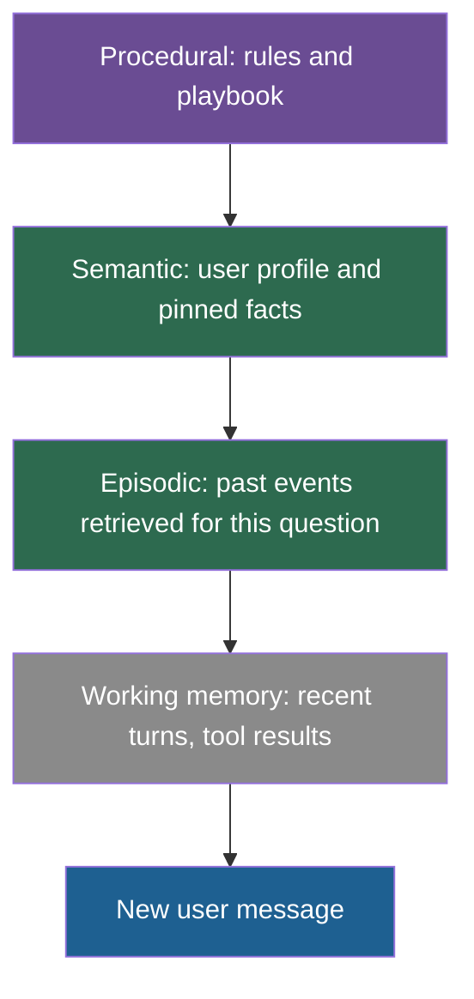

## 1. The question this idea answers

A support agent must remember three things. A customer reported a billing error last Tuesday. The customer is on the Pro plan. The agent must check the billing system before it states a balance. These are three different kinds of information. The first is an event. The second is a fact. The third is a rule.

Should one table hold all three? The handbook says no: "Design your memory system around these tiers, not as a flat key-value store" (Session 6, §10). This lesson gives each kind an exact definition and a source. It then shows what changes in storage, lifetime, retrieval and position in the request.

## 2. Mental model

> [!analogy] A hospital ward
> - The **whiteboard** next to the bed shows today's plan and the latest readings. The shift erases it when the task is done. This is **working memory**.
> - The **visit notes** record what happened at each visit, with a date. This is **episodic memory**.
> - The **patient chart summary** lists stable facts: allergies, blood type, current medication. Nobody remembers on which visit each fact was learned. This is **semantic memory**.
> - The **ward protocols** say how to act: "check allergies before you prescribe". This is **procedural memory**.
>
> **Where it stops working:** a hospital keeps these in separate books written by trained staff. In an LLM application, one LLM call often writes all of them. It can put an item into the wrong kind, or write a wrong item. Also, the kinds overlap: "the patient prefers morning visits" is a fact about the patient that also works as a rule for the staff.

## 3. Terms

| Term | Plain meaning |
|---|---|
| working memory | The information that an agent uses for its current step: the recent messages, intermediate results and task variables. Most of it is in the window on each call. |
| long-term memory | Memory that an agent keeps beyond the current step or session, in storage outside the window. |
| episodic memory | Long-term memory of specific past events, each with a time and a context. Example: "On 18 February the user asked about the enterprise plan." |
| semantic memory | Long-term memory of facts and knowledge without the event in which they were learned. Example: "The user's team uses AWS." |
| procedural memory | Long-term memory of how to act: rules, skills, routines and playbooks. Example: "Always include unit tests when you write code." |
| declarative memory | The psychology term for memory of facts and events (semantic plus episodic), as opposed to procedural memory of skills. |
| decision cycle | In the CoALA framework, one loop of an agent: read the situation, choose an action, act. |
| CoALA | Cognitive Architectures for Language Agents: a 2023 framework by Sumers, Yao, Narasimhan and Griffiths that names the memory types of LLM agents. |
| consolidation | A process that turns many episodic records into fewer semantic facts or procedural rules. |
| reflection (Generative Agents) | A step that asks the model to write higher-level conclusions from recent memories and stores them as new memories. |

## 4. Method and math

### 4.1 Where the categories come from

The handbook (Session 6, §2) says that its three tiers are "inspired by cognitive science". It cites no source. Two sources define the categories:

1. **Tulving (1972)**, "Episodic and semantic memory", in *Organization of Memory*. Tulving separated memory for events from memory for facts. In his 1987 commentary on the chapter he wrote: "Episodic memory refers to memory for personal events and the temporal-spatial relations among these events".
2. **CoALA** (Sumers et al., TMLR 2024, arXiv 2309.02427) applies the categories to LLM agents. It names "short-term working memory and several long-term memories: episodic, semantic, and procedural."

Procedural memory comes from a different distinction in psychology: **declarative** memory (facts and events) against **procedural** memory (skills). It is not in Tulving's 1972 chapter.

> [!note] Source check: "inspired by cognitive science"
> **Corrected.** The handbook (Session 6, §2) gives the three tiers with no citation. Cite Tulving (1972) for episodic against semantic memory. Cite CoALA (Sumers et al., TMLR 2024) for working, episodic, semantic and procedural memory in language agents. CoALA itself cites Atkinson and Shiffrin (1968) and work on the Soar architecture, not Tulving.

### 4.2 The four memories, defined exactly

| Memory | CoALA's definition | What it holds in an LLM application | Typical store | Typical retrieval |
|---|---|---|---|---|
| Working | "Working memory maintains active and readily available information as symbolic variables for the current decision cycle" | Recent turns, the current plan, tool results, task variables | The message list and agent state in your process | None: it is already in the window |
| Episodic | "Episodic memory stores experience from earlier decision cycles." | Session summaries, logs of past actions and their results, decisions with dates | Rows or documents with timestamps, often with embeddings | By time ("last session") or by similarity to the current event |
| Semantic | "Semantic memory stores an agent's knowledge about the world and itself." | User profile, preferences, project facts | Key-value rows, documents, knowledge graphs | By key, or by similarity to the current question |
| Procedural | Two forms: "implicit knowledge stored in the LLM weights," and explicit knowledge in the agent's code | System prompt rules, playbooks, style guides, the agent code itself | Prompt files, rules files, code | Loaded on every call, or chosen by the task type |

The handbook's own table (Session 6, §2.1) gives these lifespans: episodic "within a session to a few days", semantic "weeks to permanent", procedural "permanent (until explicitly updated)". These are design choices, not results from the sources. In CoALA, episodic memory is a long-term memory. Many systems keep episodic records for months, for audit, and only stop **retrieving** old ones. Lesson [8.3](/notes/ai/context-engineering/08-memory/l3-retrieval-scoring-and-decay) separates "stop retrieving" (decay) from "delete" (lesson 8.6).

### 4.3 Two worked examples

> [!example] Worked example: a customer-support agent
> The first three rows come from the handbook's box (Session 6, §2.1).
>
> | Memory | Content |
> |---|---|
> | Episodic | "Customer reported a billing error on ticket #4521 last Tuesday" |
> | Semantic | "Customer is on the Pro plan, joined in 2024, prefers email over chat" |
> | Procedural | "Always check the billing system before telling the customer their balance" |
> | Working | The current chat, the result of the billing lookup, the draft reply |

> [!example] Worked example: a coding agent on a data-engineering repository
> | Memory | Content |
> |---|---|
> | Episodic | "On 3 October we added a ZORDER on `customer_id` to fix the slow nightly job. The runtime did not change." |
> | Semantic | "The repository uses Python 3.12, uv and pytest. Silver tables live in the `silver` schema." |
> | Procedural | "Run the linter and the unit tests before you propose a commit. Never edit files under `generated/`." |
> | Working | The failing test output, the open file, the plan for this task |
>
> The episodic row prevents a repeated failed fix. The semantic row prevents wrong commands. The procedural row prevents unsafe edits. A rules file such as `CLAUDE.md` (lesson [3.5](/notes/ai/context-engineering/03-system-layer/l5-rules-files)) is a hand-written store of semantic and procedural project memory.

### 4.4 Where each kind goes in the request

Each kind changes at a different speed. Lesson [1.7](/notes/ai/context-engineering/01-foundations/l7-prompt-caching) says: put stable content first and changing content last. That rule gives a natural order:



| Memory | Where in the request | How often it changes | Effect on prompt caching |
|---|---|---|---|
| Procedural | System prompt, near the top | Rarely: on a deploy or after a review | Cacheable for all users of the agent |
| Semantic (pinned) | System prompt, after the rules | Once per session, or when a fact changes | Cacheable within a session |
| Episodic (retrieved) | Near the end, close to the question | Often on every turn | Not cacheable. If you put it high, it breaks the cache for everything below it |
| Working | The message list | Every turn | Grows at the end, so earlier turns stay cacheable |

Some teams put retrieved episodic items inside the new user message, in a tagged block. This keeps every block above it stable. Lesson [8.8](/notes/ai/context-engineering/08-memory/l8-three-layer-memory-agent) uses this layout.

### 4.5 Consolidation: from many events to one fact or rule

Episodic records pile up quickly. Consolidation turns them into compact semantic or procedural memory:

| Episodes | Consolidated memory | Kind |
|---|---|---|
| The user rejected class components in three sessions. | "Prefers React function components." | Semantic |
| A SQL tool call failed four times because a partition filter was missing. | "Filter `fact_orders` by `order_date` before any join." | Procedural |
| The user asked for tests after each of the last six functions. | "Always add a pytest test with each new function." | Procedural |

Generative Agents (Park et al., UIST 2023) gives a concrete trigger for this. The agent runs a **reflection** step when the sum of the importance scores of its latest memories exceeds "a threshold (150 in our implementation)". In the paper this happened "roughly two or three times a day" of simulated time. The reflections are stored as new memories, so later retrieval can find them. The handbook (Session 6, FAQ Q23 and Q46) describes the same idea as a periodic analysis prompt or a nightly "consolidation cycle".

> [!trap] Consolidation can make a wrong rule permanent
> A rule that comes from three episodes is a generalization. If the episodes were special cases, the rule is wrong for every later session. Keep a link from each consolidated item to the episodes that produced it, so that a reviewer can check it and remove it.

### 4.6 Decide the kind when you write

The write path must label each new item. Ask three questions in this order:

1. **Does it tell the agent how to act in future tasks?** Words such as "always", "never" or "before you" point to a rule. Store it as **procedural** memory, and review it before it becomes active.
2. **Does it depend on when it happened?** A date, a ticket number or a result of one attempt points to an event. Store it as **episodic** memory with a timestamp.
3. **Is it true independent of the event that showed it?** A preference, a plan, a name or a technical choice is a fact. Store it as **semantic** memory, with the episode as its source.

> [!example] Worked example: one user message, three items
> The user writes: "Yesterday's deploy failed because the migration ran twice. We use Alembic. From now on, check the migration table before you run a migration."
>
> | Item | Kind | Why |
> |---|---|---|
> | "Deploy on 11 October failed: the migration ran twice." | Episodic | A dated event with a result |
> | "The project uses Alembic for migrations." | Semantic | True independent of the event |
> | "Check the migration table before you run a migration." | Procedural | A rule for future actions |
>
> One message gave three items of three kinds. A flat store would keep one blob, and later retrieval could not use the parts separately.

### 4.7 Kind and tier are two separate axes

The handbook (Session 6, §2.3) says that "the three-tier cognitive model maps to a physical storage architecture" of hot, warm and cold storage. It does not map one to one. The **kind** says what the information is. The **tier** says how fast it reaches the window (lesson [8.4](/notes/ai/context-engineering/08-memory/l4-hot-warm-and-cold-tiers)). Every kind can sit in more than one tier:

| Kind | Hot (in every call) | Warm (session cache) | Cold (persistent, searched) |
|---|---|---|---|
| Procedural | Core rules in the system prompt | Rules for the current task type | Rare rules, found by task type |
| Semantic | "Name: Alice. Language: Python." | Profile loaded at session start | Old project facts |
| Episodic | The last few turns | The summary of this session | Summaries of past sessions |

### 4.8 Where the human analogy fails

The categories are useful labels. The parallel with the brain is weak in four ways:

1. **Human recall rebuilds the memory.** The handbook (Session 6, FAQ Q42) notes that human memory is "reconstructive". An LLM memory store returns the stored text exactly. Its errors come from a different place: the extraction call can write a wrong item.
2. **The systems depend on each other.** Renoult and Rugg (2020) note that Tulving himself argued from 1972 onward that episodic and semantic memory are "inter-dependent". So a clean three-way split is a simplification.
3. **Nothing forgets by itself.** A database never fades. Decay is a rule that you write (lesson 8.3).
4. **The boundaries blur.** "The user prefers short answers" is a semantic fact about the user. It also acts as a procedural rule for the agent. Choose the kind by how the item is **used**, and document the choice.

### 4.9 Production view

| Concern | What this lesson means for it |
|---|---|
| Schema | Store the kind as a column. Different kinds need different update, decay and retrieval rules. |
| Cost | Procedural and pinned semantic memory go first, so they stay in the cached prefix. Retrieved episodic memory goes last. |
| Reliability | Keep the source of every consolidated fact or rule: the episode IDs. Without it, a wrong rule cannot be traced. |
| Security | A stored procedural rule changes the behavior of every later session. Treat writes to procedural memory as code changes: review them or limit who can make them. |

## 5. Code

These exercises go in `notebooks/08-memory.ipynb`.

**Exercise 2.1: a memory item schema.**

1. Write a dataclass `MemoryItem` with the fields `id`, `user_id`, `kind`, `text`, `created_at`, `last_accessed`, `source` and `derived_from`.
2. `kind` is one of `working`, `episodic`, `semantic` or `procedural`. `derived_from` is a list of item IDs.
3. Validate `kind` in `__post_init__`.

Acceptance tests:

- An item with `kind="fact"` raises a `ValueError`.
- A consolidated item keeps the IDs of the items that produced it.

**Exercise 2.2: label 20 statements.** Write 20 short statements from a support chat and a coding session. Label each one by hand as episodic, semantic or procedural. Then write a rule-based labeler: a date or a past-tense verb points to episodic, "always" or "never" points to procedural, and the rest is semantic.

Acceptance tests:

- A table of your labels against the labeler's labels.
- The accuracy of the labeler, and two statements where the rules fail, with the reason.

**Exercise 2.3: consolidation without an LLM.**

1. Make 15 episodic items. Five of them mention that the user rejected class components.
2. Write `consolidate(items, min_count=3)`. It finds a preference that appears in at least `min_count` items and returns one semantic item with `derived_from` set.

Acceptance tests:

- The five related episodes produce one semantic item that lists all five IDs.
- A preference that appears only twice produces nothing.

## 6. Common mistakes

1. **"Memory is one key-value table."** Events, facts and rules need different updates, lifetimes and positions in the request.
2. **"Episodic memory lasts a few days."** That is one design choice from the handbook. Episodic records are long-term memory. Decide separately when to stop retrieving them and when to delete them.
3. **"Procedural memory is the hot tier, semantic is warm, episodic is cold."** Kind and tier are separate axes (section 4.7).
4. **"Retrieved past events belong at the top of the system prompt."** They change on every turn. At the top, they break the prompt cache for everything below.
5. **"A consolidated rule is always safe."** It generalizes from a few episodes. Keep the links to the source episodes, and review rules before they become permanent.

## 7. One-minute explanation

An agent uses four kinds of memory. Working memory is what it uses for the current step: the recent messages and tool results. Episodic memory stores what happened, each with a time, like a log of past sessions. Semantic memory stores what is true, such as the user's plan or the project's language, without the event that taught it. Procedural memory stores how to act: rules, routines and playbooks. Tulving separated episodic from semantic memory in 1972, and the CoALA framework applied all four to LLM agents. Each kind changes at a different speed, so each goes to a different place in the request. Rules go first, retrieved events go last. Consolidation turns many episodes into one fact or rule. The brain analogy is only a label: a database does not forget or rebuild memories, so we write those rules ourselves.

## 8. Check questions

```check
{
  "question": "Label each item as episodic, semantic or procedural: (a) \"Customer prefers email over chat.\" (b) \"On 2 May the refund for order 881 failed.\" (c) \"Escalate any refund above 500 USD to a human.\"",
  "answer": "(a) Semantic: a fact about the customer, with no event attached. (b) Episodic: a specific event with a date. (c) Procedural: a rule for how the agent must act."
}
```

```check
{
  "question": "A team puts the five most similar past-session summaries at the very top of the system prompt, above the rules. Name two problems with this position.",
  "hint": "Think about lesson 1.7 and about what changes on every turn.",
  "answer": "First, the summaries change with every question, so the prompt cache breaks for the rules and everything else below them. Second, the stable rules lose the top position, and the first lines are now content that changes. Move the retrieved summaries near the end, close to the question."
}
```

```check
{
  "question": "Which source should you cite for the split between episodic and semantic memory, and which one for the four memory types of LLM agents?",
  "answer": "Tulving (1972), \"Episodic and semantic memory\", for the episodic against semantic split. CoALA (Sumers, Yao, Narasimhan and Griffiths, TMLR 2024) for working, episodic, semantic and procedural memory in language agents."
}
```

```check
{
  "question": "The handbook says that the three cognitive tiers map onto hot, warm and cold storage. Give one counterexample for each of procedural and episodic memory.",
  "answer": "Procedural: core rules sit in the system prompt on every call, so they are hot, while rare rules for unusual tasks stay cold and load by task type. Episodic: the last few turns are hot, the current session summary is warm, and past-session summaries are cold. So the kind does not decide the tier."
}
```

```check
{
  "question": "Why must a consolidated rule keep links to the episodes that produced it?",
  "answer": "The rule is a generalization from a few events and can be wrong. The links let a reviewer check the evidence, and let the system remove or correct the rule when the evidence turns out to be a special case."
}
```

## 9. Links

- Previous: [L1: Stateless models, stateful apps](/notes/ai/context-engineering/08-memory/l1-stateless-models-stateful-apps)
- Next: [L3: Retrieval, scoring and decay](/notes/ai/context-engineering/08-memory/l3-retrieval-scoring-and-decay)
- [1.7: Prompt caching](/notes/ai/context-engineering/01-foundations/l7-prompt-caching): why stable memory goes first
- [3.5: Rules files](/notes/ai/context-engineering/03-system-layer/l5-rules-files): hand-written procedural memory
- [Glossary](/notes/ai/context-engineering/glossary)
