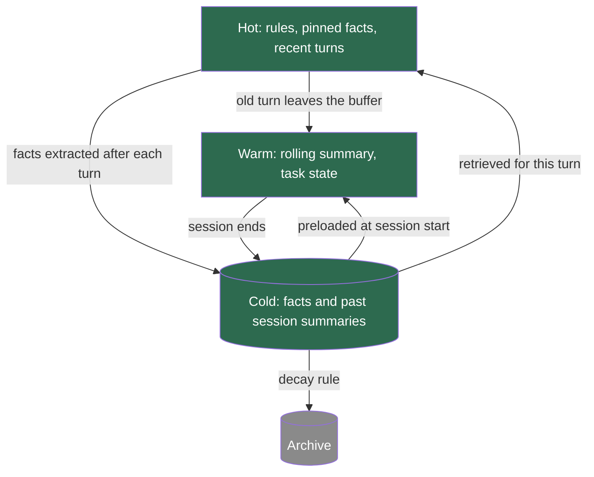
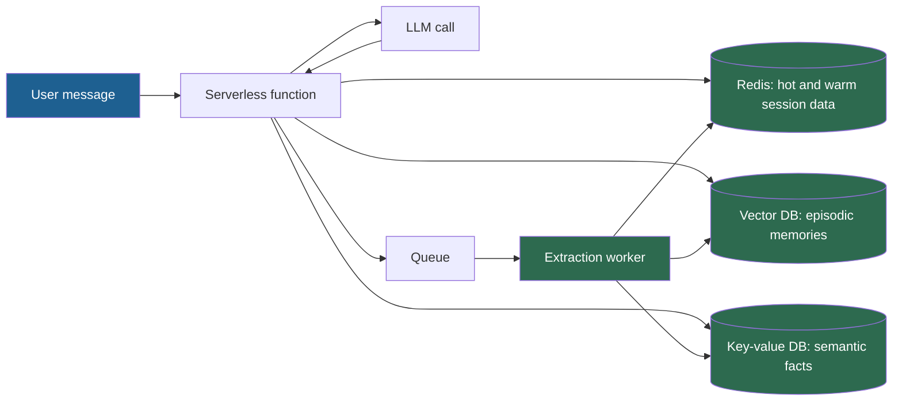

## 1. The question this idea answers

On every turn, a memory system must answer three questions. What goes into this call as it is? What can wait in faster session storage, often in a shorter form? What goes to long-term storage, to be searched only when needed?

The handbook calls these places the hot, warm and cold tiers. It also gives two different definitions of them, one in the lecture and one in the FAQ. This lesson picks one definition, explains why, and gives rules and latency numbers that follow from it.

## 2. Mental model

> [!analogy] A restaurant kitchen
> - The **counter** next to the stove holds what the cook uses for this dish: salt, oil, the open order ticket. No walking needed.
> - The **fridge** holds prepared items for tonight's service: sauces and chopped vegetables. One step and one door.
> - The **storeroom** in the basement holds everything else. The cook must go down and search the shelves.
>
> Items move down when nobody needs them for a while, and up when an order needs them.
>
> **Where it stops working:** between calls the model holds nothing (lesson [8.1](/notes/ai/context-engineering/08-memory/l1-stateless-models-stateful-apps)). Even hot items live in the application and are sent again on every call. Also, a vegetable is the same vegetable in the fridge and on the counter. A memory often changes form when it moves down: a verbatim turn becomes a line in a summary, then a fact. Moving it up returns the shorter form, not the original words.

## 3. Terms

| Term | Plain meaning |
|---|---|
| memory tier | A class of memory storage defined by how memories reach the context window and how long they live. |
| hot tier | Memory that the application sends on every call without a lookup: core rules, pinned facts and the recent turns. |
| warm tier | Session memory that the application keeps in fast storage and fetches by key without a search, for example the rolling summary. |
| cold tier | Persistent memory that reaches the window only through a query: a filter plus a keyword or vector search. |
| promotion | Moving a memory to a faster tier, for example loading a stored fact into the current session. |
| demotion | Moving a memory to a slower tier, for example folding an old turn into the summary. |
| pinned memory | A memory that the application keeps in the hot tier for the whole session, whatever the current topic. |
| session cache | Fast storage for one user's session data, such as process memory or Redis, usually with an expiry time. |
| access path | The steps that bring a memory from its store into the request: a copy, a key lookup or a search. |
| latency budget | The maximum time that a step may add to a request, set by design. |
| read-your-writes | The guarantee that a read returns a value that the same user wrote just before. |

## 4. Method and math

### 4.1 The handbook defines the tiers twice

| Aspect | Lecture (Session 6, §2.3, Table 2) | FAQ (Q5 and Q13) |
|---|---|---|
| Hot | "Current conversation, recent messages in the context window right now", in an in-memory list, 2–4K tokens | Facts and preferences "that are always present", for example "user name: Alice, role: admin, language: Python", 2–4K tokens |
| Warm | "Recent session history, compressed summaries and recent turns", in an in-memory buffer or Redis, 8–16K tokens | Session context "stored outside the active window but retrievable within milliseconds", 8–16K tokens |
| Cold | "Past sessions, long-term facts, user profiles", in SQLite, PostgreSQL or a vector DB, unlimited | A vector or traditional database, "10–100ms for vector search" |
| Analogy | L1 cache, L2 cache, main memory | CPU cache, RAM, disk |

The two versions disagree on what hot means: recent messages, or always-present facts. Even the lecture lists "recent turns" under both hot and warm.

> [!note] Source check: two definitions of hot, warm and cold
> **Corrected.** The lecture (Session 6, §2.3) defines hot memory as the recent messages. The FAQ (Q5, Q13) defines it as always-present facts about the user. The two analogies also differ: L1, L2 and main memory against cache, RAM and disk. This subject uses one definition by access path (section 4.2). Under that definition, both the recent messages and the pinned facts are hot.

### 4.2 One definition: the access path decides the tier

In a CPU, cache levels differ by **how long the processor waits** for the data, not by what the data means. The same idea works here. The context window is the processor, and the tier is the cost of the path to it:

| Tier | Access path | Lifetime | Typical content | Typical store | Size (handbook rule of thumb) |
|---|---|---|---|---|---|
| Hot | Copied into every request, no lookup | The session | Core rules, pinned facts, the recent turns | The application's message list and a pinned-facts block | 2–4K tokens |
| Warm | One key lookup, no search | The session, with an expiry time | Rolling summary, task state, a profile loaded at session start | Process memory or Redis | 8–16K tokens |
| Cold | A filter plus a search, then the top results | Months or longer, with decay | Past session summaries, all facts, event logs | SQLite, PostgreSQL, a vector database | Unlimited |

This definition has four advantages:

1. It matches what the CPU analogy measures: the cost of reaching the processor.
2. It contains both handbook versions. Recent turns and pinned facts both travel without a lookup, so both are hot.
3. It matches the three-layer agent of lesson [8.8](/notes/ai/context-engineering/08-memory/l8-three-layer-memory-agent): buffer is hot, rolling summary is warm, fact store is cold.
4. It is testable. Read the code path of an item: a copy, a key lookup or a search.

The **kind** of a memory (lesson [8.2](/notes/ai/context-engineering/08-memory/l2-three-kinds-of-memory)) is a separate axis. A semantic fact can be hot (pinned) or cold (searched).

### 4.3 Promotion and demotion



The handbook's figure caption says: "Data flows downward as it ages, and upward when retrieved." Turn that sentence into explicit rules.

**Demotion rules:**

1. **Hot to warm.** When the buffer holds more than $K$ turns, or more than its token budget, the oldest turns leave the buffer. The summarizer folds them into the rolling summary.
2. **Hot to cold.** After each turn, an extraction step writes new facts to the persistent store.
3. **Warm to cold.** When the session ends, the rolling summary becomes an episodic record in the persistent store. The session cache entry expires after an idle time.
4. **Cold to archive.** The decay job removes items from search (lesson [8.3](/notes/ai/context-engineering/08-memory/l3-retrieval-scoring-and-decay)).

**Promotion rules:**

1. **Cold to warm.** At session start, load the user's top-ranked facts and the summary of the last session into the session cache.
2. **Cold to hot, for one call.** Retrieval puts the top results for this question into the request. They are not kept for the next call.
3. **To hot, for the session.** Pin an item when the user states it as identity, such as "My name is Alice". Also pin an item that retrieval returned on several recent turns.

Rule 3 of promotion is a design choice, not a rule from a source. Measure whether pinning helps: compare recall and token use with and without it.

### 4.4 The repeat test

The FAQ (Session 6, Q13) gives a practical test:

> "if removing the information would cause the model to ask the user to repeat themselves within the next 3 turns, it belongs in hot cache. If within the next 30 minutes, warm storage. Everything else goes cold."

This is a rule of thumb. Its numbers (3 turns, 30 minutes) are not measured values, so check them on your own logs.

> [!example] Worked example: six items in a support chat
> | Item | Repeat test | Tier |
> |---|---|---|
> | The customer's name | Needed in the next reply | Hot (pinned) |
> | The order number under discussion | Needed in the next 3 turns | Hot (recent turns) |
> | A summary of the first 20 minutes of this chat | Needed later in this session | Warm |
> | "Prefers email": used for the confirmation at the end | Needed within 30 minutes | Warm (preloaded) |
> | A billing ticket from last month | Needed only if the topic returns | Cold |
> | The company's refund policy | Not memory at all | RAG (Part 4) |
>
> The last row is a trap. The refund policy is the same for every user, and developers write it. It belongs to retrieval, not to the user's memory.

### 4.5 Size budgets

The handbook gives 2–4K tokens for hot memory and 8–16K for warm memory. These are rules of thumb. The FAQ (Q19) adds a worked case: with 200 stored memories and a 2K budget, inject "15–20 short memories (each 100–130 tokens)". The arithmetic holds: $15 \times 130 = 1{,}950$ and $20 \times 100 = 2{,}000$ tokens. The FAQ also puts memory in the "auxiliary" share of the Session 5 budget, 15% of the total (lesson [7.6](/notes/ai/context-engineering/07-compress-and-isolate/l6-token-budgets)).

> [!example] Worked example: how many pinned facts fit?
> A hot budget of 3,000 tokens holds the recent turns and the pinned facts. Five recent turns take about 1,800 tokens. Each pinned fact takes about 40 tokens.
>
> - Room for pinned facts: $3{,}000 - 1{,}800 = 1{,}200$ tokens.
> - Number of facts: $1{,}200 / 40 = 30$.
>
> If the turns grow to 2,600 tokens, only $400 / 40 = 10$ facts fit. A hot budget must cover both parts, so decide which one shrinks first.

### 4.6 A latency budget per tier

The handbook gives latency numbers for the cold path in two FAQ answers. It cites no measurements, so treat every number as an estimate.

| Step | Tier | Handbook estimate |
|---|---|---|
| Read the hot data | Hot | None: it is already in the process |
| Load the session data from Redis | Warm | "sub-5ms" (Q28) |
| Embed the query with a local model | Cold | 5–20 ms (Q30) |
| Embed the query through an API | Cold | 50–100 ms (Q30) |
| Filtered approximate search | Cold | 10–50 ms (Q28, Q30) |
| Put the memories into the prompt | All | "negligible" (Q30) |

> [!example] Worked example: add the cold path
> - Local embedding: $5 + 10 = 15$ ms to $20 + 50 = 70$ ms.
> - API embedding: $50 + 10 = 60$ ms to $100 + 50 = 150$ ms.
> - With a Redis load of up to 5 ms added: 15–75 ms (local) and 60–155 ms (API).
>
> The FAQ's target is a cold path under 100 ms. The local path meets it. The API path can miss it.

> [!note] Source check: latency totals
> **Corrected.** FAQ Q30 lists its components and gives the total as `25–170ms`. The components add to 15–150 ms: 15–70 ms with a local embedding model and 60–150 ms with an API. FAQ Q28 gives `20–60ms` for the whole serverless memory overhead. It leaves out the query embedding that Q30 includes. With the embedding, the total is about 15–75 ms (local) or 60–155 ms (API). All of these are estimates without a source. Measure them.

For scale, compare one published system. The Mem0 paper (Chhikara et al., arXiv 2504.19413) reports a p95 of 1.440 s for memory search plus answer generation on the LOCOMO benchmark. Its full-context baseline had a p95 of 17.117 s. These are the vendor's own numbers. They show that the cold path is small next to the model call, but not free. Measure the 95th percentile, not the mean, and run retrieval in parallel with the other steps of context assembly.

### 4.7 A serverless memory stack

A serverless function keeps no state between invocations, just like the model. So every tier must live outside it. The handbook (Session 6, FAQ Q28) sketches this stack:



One request runs five steps:

1. Load the session data from Redis.
2. Query the vector database.
3. Assemble the context and call the model.
4. Send the turn to a queue for extraction.
5. Update the session data in Redis.

> [!trap] Asynchronous extraction breaks read-your-writes
> The extraction worker runs after the reply. If the user sends the next message quickly, the new fact may not be in the store yet. The user says "I switched to MySQL", and one turn later the agent still says PostgreSQL. Keep the raw turn in the hot buffer until the worker confirms the write. Write a critical correction to the session data synchronously.

### 4.8 Production view

| Concern | What this lesson means for it |
|---|---|
| Latency | Only the cold path adds a search. Keep it local when you can, run it in parallel, and track its 95th percentile. |
| Cost | Hot items are input on every call. Every token that you pin is paid on every turn of the session. |
| Caching | Hot and warm blocks that stay the same within a session belong above the cache breakpoint. Per-turn retrieved items go below it (lesson [1.7](/notes/ai/context-engineering/01-foundations/l7-prompt-caching)). |
| Reliability | Asynchronous writes need read-your-writes handling. Session caches need an expiry time and a rebuild path from the persistent store. |
| Observability | Log the tier and the access path of every injected memory. A "memory miss" is then traceable to a demotion that came too early. |

## 5. Code

These exercises go in `notebooks/08-memory.ipynb`. Exercise 4.1 can become `src/memory/tiers.py`.

**Exercise 4.1: a tier manager.**

1. Write a class `TierManager` with a hot budget, a warm budget and a cold store (a list or SQLite).
2. Methods: `add_turn(turn)`, `pin(fact)`, `retrieve(query, k)`, `end_session()` and `start_session(user_id)`.
3. Use a stub summarizer that keeps the first sentence of each old turn.

Acceptance tests:

- The hot part never exceeds its budget, counted with a simple token counter.
- A turn that leaves the buffer appears in the input of the next summary update.
- A pinned fact stays in the hot part after 50 more turns.
- `end_session()` writes one episodic record to the cold store, and `start_session()` loads it into the warm part.

**Exercise 4.2: measure the cold path.**

1. Embed 10,000 short memories with `all-MiniLM-L6-v2`. Assign them to 100 users.
2. For 200 queries, measure the embedding time and a NumPy search that filters by `user_id` first.
3. Report the 50th and 95th percentiles.

Acceptance test: a table with your measured percentiles next to the handbook's estimates from section 4.6, and one sentence on the difference.

**Exercise 4.3: show the read-your-writes problem.** Simulate an extraction worker with a delay of two turns. The user says "I switched to MySQL" at turn 5 and asks "Which database do I use?" at turn 6.

Acceptance tests:

- Without a fix, the answer at turn 6 uses the old fact.
- With the raw turn kept in the hot buffer, the answer is MySQL.

## 6. Common mistakes

1. **"Hot means recent messages" or "hot means user facts".** Under the access-path definition, both are hot, because both travel without a lookup.
2. **"The tier is set by the kind of memory."** A semantic fact can be pinned (hot) or searched (cold). Kind and tier are separate axes.
3. **"Memory retrieval adds 25–170 ms."** The handbook's own components add to 15–150 ms, and none of them are measured. Measure your own path.
4. **"Promotion returns the original text."** A demoted item is often a summary or a fact. Keep the source turn ID if you need the original words.
5. **"Asynchronous extraction is free."** It saves latency, but a fact can be missing on the next turn.

## 7. One-minute explanation

Hot, warm and cold tiers sort memory by the path that brings it into the context window. Hot memory travels on every call with no lookup: the core rules, pinned facts and recent turns. Warm memory waits in fast session storage and comes back by one key lookup: the rolling summary and the task state. Cold memory sits in a persistent store and comes back only through a search. The handbook defines hot in two ways, as recent messages and as always-present facts, and this definition covers both. Old turns move down into the summary, and session summaries move down into the persistent store. Retrieved items move up for one call, and important ones get pinned. A practical test: if removing an item makes the model ask the user to repeat within three turns, it is hot. The cold path costs tens of milliseconds, so measure it.

## 8. Check questions

```check
{
  "question": "Classify by the access-path definition: (a) the rolling summary stored in Redis and fetched by session ID, (b) the user's name in a pinned-facts block, (c) a fact found by vector search over the user's memories.",
  "answer": "(a) Warm: one key lookup, no search. (b) Hot: copied into every call with no lookup. (c) Cold: it reaches the window only through a search."
}
```

```check
{
  "question": "Query embedding through an API takes 50–100 ms and a filtered vector search takes 10–50 ms. What range does the cold path add? Does it meet a 100 ms target?",
  "answer": "60–150 ms. It meets the target only in the best cases. A local embedding model (5–20 ms) gives 15–70 ms and meets it."
}
```

```check
{
  "question": "The lecture says hot memory is the recent messages, and the FAQ says it is always-present facts. Why does the access-path definition resolve this?",
  "answer": "The access-path definition asks only how an item reaches the window. Recent messages and pinned facts both travel on every call without a lookup, so both are hot. The difference between them is the kind of memory, which is a separate axis."
}
```

```check
{
  "question": "A user says \"I switched to MySQL\" and, ten seconds later, asks which database they use. The agent answers PostgreSQL. The system extracts facts asynchronously through a queue. Explain the bug and give one fix.",
  "hint": "Think about when the new fact reaches the store.",
  "answer": "The extraction worker had not yet written the new fact when the next request read the store, so the read missed the write. Fix: keep the raw turn in the hot buffer until the worker confirms the write, or write corrections to the session data synchronously."
}
```

```check
{
  "question": "A hot budget is 2,500 tokens. The recent turns take 1,600 tokens and each pinned fact takes 45 tokens. How many pinned facts fit?",
  "answer": "2,500 − 1,600 = 900 tokens are left. 900 / 45 = 20 pinned facts."
}
```

## 9. Links

- Previous: [L3: Retrieval, scoring and decay](/notes/ai/context-engineering/08-memory/l3-retrieval-scoring-and-decay)
- Next: [L5: Five management strategies](/notes/ai/context-engineering/08-memory/l5-five-management-strategies)
- [L8: Build a three-layer memory agent](/notes/ai/context-engineering/08-memory/l8-three-layer-memory-agent): the tiers in code
- [7.6: Token budgets](/notes/ai/context-engineering/07-compress-and-isolate/l6-token-budgets)
- [Glossary](/notes/ai/context-engineering/glossary)
