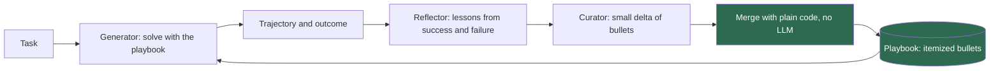

## 1. The question this idea answers

An agent fails on the same kind of task again and again. A human expert would write a note after each failure: "the orders API returns at most 100 rows, so loop over the pages". Can an agent write such notes for itself, and get better without any change to its weights?

The handbook (Session 6, §5) says yes, and presents the ACE framework (arXiv 2510.04618) as "the frontier of context engineering". Its description and its results table contain errors. This lesson teaches the real mechanism of the paper and its exact numbers.

## 2. Mental model

> [!analogy] An operations manual after incident reviews
> After each incident, a reviewer writes down what went wrong and what worked. An editor adds the lesson to the manual as a new numbered item. Or the editor adds a tally mark to an existing item: "helped again" or "caused a problem". The editor never rewrites the whole manual from memory.
>
> **Where it stops working:** an incident review needs a clear outcome: the system was down or it was not. An agent needs the same thing, such as a test that passes or an answer that matches a label. Without that signal, the reviewer guesses. Also, the reviewer here is an LLM, and it can draw the wrong lesson. Finally, the manual sits in the context window, so every item costs tokens on every call.

## 3. Terms

| Term | Plain meaning |
|---|---|
| ACE (agentic context engineering) | A framework by Zhang et al. (2025) in which an agent improves its own context, a playbook, from its successes and failures, with no weight updates. |
| playbook | An evolving context of strategies, rules and known pitfalls that an agent reads before it works on a task. |
| Generator | The ACE role that solves tasks with the current playbook and produces reasoning trajectories. |
| Reflector | The ACE role that reads trajectories and outcomes and distills concrete lessons from successes and errors. |
| Curator | The ACE role that turns the lessons into small, structured updates to the playbook. |
| delta update | A small change to a context, such as new items or counter changes, that is merged into it instead of a full rewrite. |
| context bullet | One item of an ACE playbook, with a unique ID and helpful and harmful counters. |
| grow-and-refine | The ACE step that adds new bullets, updates counters, and removes duplicate bullets by embedding similarity. |
| brevity bias | The tendency of prompt optimization to collapse toward short, generic prompts that lose domain detail. |
| context collapse | A sudden loss of detail when an LLM rewrites a long context in full, often with a drop in accuracy. |
| offline adaptation | Improving the playbook on a training set before deployment, sometimes with ground-truth labels. |
| online adaptation | Improving the playbook during use, task by task, from the outcomes the agent sees. |
| Dynamic Cheatsheet | A method by Suzgun et al. (2025) in which a black-box model keeps and rewrites a memory of strategies and code at test time. |

## 4. Method and math

### 4.1 The idea: context as an evolving playbook

The handbook (Session 6, §5.1.1) states the idea well: "instead of treating context as a static prompt you write once, treat it as an evolving playbook that the agent itself refines over time." After a success, the agent adds what worked. After a failure, it adds a rule that avoids the mistake.

The source is Zhang et al., "Agentic Context Engineering: Evolving Contexts for Self-Improving Language Models", arXiv 2510.04618. Version 1 appeared on 6 October 2025, and version 3 on 29 March 2026, marked `ICLR 2026`. In the terms of lesson [8.2](/notes/ai/context-engineering/08-memory/l2-three-kinds-of-memory), a playbook is **procedural memory** about a task, not semantic memory about a user. The handbook agrees: "ACE playbook entries live in the procedural memory tier (Tier 3)".

### 4.2 Two ways that context updates fail

The paper names two failures of earlier methods that rewrite the context with an LLM.

**Brevity bias** is "the tendency of optimization to collapse toward short, generic prompts". The abstract says that such methods drop "domain insights for concise summaries". The handbook's example shows the effect: "Use PostgreSQL with JSONB columns for flexible metadata" becomes "Use a database".

**Context collapse** happens when "iterative rewriting erodes details over time". The paper gives a measured case with Dynamic Cheatsheet on the AppWorld agent benchmark: at step 60, "the context contained 18,282 tokens and achieved an accuracy of 66.7, but at the very next step it collapsed to just 122 tokens". Accuracy fell to 57.1. The same model with no adaptation scores 63.7.

> [!example] Worked example: the size of the collapse
> - Context size: $1 - 122 / 18{,}282 = 99.3\%$ smaller, a factor of about 150.
> - Accuracy: $66.7 - 57.1 = 9.6$ points lower in one step.
> - Against no adaptation: $63.7 - 57.1 = 6.6$ points **below** the model with no playbook at all.
>
> One full rewrite threw away 60 steps of learning and then some.

This is the same effect as summary drift (lesson [8.5](/notes/ai/context-engineering/08-memory/l5-five-management-strategies)), but in one step and with a measured cost.

### 4.3 Three roles

ACE splits the work among three roles. Each role is an LLM call with its own prompt:



1. The **Generator** works on a task with the current playbook. It produces a trajectory: its reasoning, its tool calls and its answer.
2. The **Reflector** reads the trajectory and the outcome, for example a failed test or a wrong answer. It writes specific lessons: what helped, what failed, and why.
3. The **Curator** turns the lessons into a small set of new or changed bullets.

The merge step is ordinary code. The paper merges the bullets with deterministic logic, not with an LLM. So no LLM ever rewrites the whole playbook.

### 4.4 Incremental delta updates

The playbook is a list of "structured, itemized bullets". Each bullet has a unique ID and counters for how often it was marked helpful or harmful. The format below is illustrative, not the paper's exact format:

```text
[sql-001] helpful=7 harmful=0 :: Filter fact_orders by order_date before any join. The table is partitioned by date.
[sql-002] helpful=2 harmful=3 :: Run SELECT * on a table to inspect it before you query it.
[api-004] helpful=4 harmful=0 :: The orders API returns at most 100 rows. Loop with the next_page token.
```

> [!example] Worked example: merge one delta
> After a task, the Curator returns this delta:
>
> - Add to section `sql`: "Cast `order_total` to DECIMAL(18,2) before SUM. The column is a string."
> - Mark `sql-001` as helpful. Mark `sql-002` as harmful: it timed out on a large table.
>
> The merge code gives the new bullet the next free ID, `sql-003`, with both counters at 0. It changes `sql-001` to helpful=8 and `sql-002` to harmful=4. Nothing else changes. The old bullets keep their exact words, so no detail can drift.

Delta updates have two benefits:

1. **No collapse.** The LLM writes a few lines. It never re-creates the full context, so it cannot drop old details.
2. **Lower cost.** The paper reports an adaptation latency 86.9% lower on average than its baselines.

### 4.5 Grow-and-refine

A playbook that only grows becomes long and repetitive. ACE's **grow-and-refine** step handles this. It adds new bullets, updates counters, then removes duplicates "by comparing bullets via semantic embeddings". The paper runs this step in one of two modes: **proactively** after each delta, or **lazily**, only when the playbook exceeds the context window.

The counters also give you a simple rule of your own: retire a bullet whose harmful count exceeds its helpful count after enough votes. This rule is a design choice, not part of the paper. Test it on your task.

### 4.6 What the paper measured

The paper tests on AppWorld (agent tasks with apps and code), and on FiNER and Formula (financial analysis). Version 3 adds DDXPlus (medical diagnosis) and BIRD-SQL (text to SQL) in an appendix. There is **no** coding benchmark. The main model is DeepSeek-V3.1.

AppWorld, average of the two task-completion scores (Table 1):

| Method | Score |
|---|---|
| ReAct | 42.4 |
| ReAct + in-context learning | 46.0 |
| ReAct + GEPA | 46.4 |
| ReAct + Dynamic Cheatsheet (online) | 51.9 |
| ReAct + ACE (offline, with ground-truth labels) | 59.4 |
| ReAct + ACE (offline, without labels) | 57.2 |
| ReAct + ACE (online) | 59.5 |

Finance (Table 2):

| Method | FiNER | Formula | Average |
|---|---|---|---|
| Base model | 70.7 | 67.5 | 69.1 |
| ACE (offline, with ground-truth labels) | 78.3 | 85.5 | 81.9 |
| ACE (online, without labels) | | | 72.9 |

> [!example] Worked example: read the gains correctly
> - AppWorld: $59.4 - 42.4 = 17.0$ points over plain ReAct. Against the strongest baseline, Dynamic Cheatsheet: $59.4 - 51.9 = 7.5$ points.
> - Finance, offline with labels: FiNER $+7.6$, Formula $+18.0$, average $81.9 - 69.1 = 12.8$ points.
> - The abstract's headline, "+10.6% on agents and +8.6% on finance", is an **average over selected baselines**, in points. It is not one before-and-after pair.

> [!note] Source check: the handbook's ACE results and claims
> **Corrected.** The handbook (Session 6, §5.2, Table 5) gives agent tasks 72.3% → 82.9%, finance 68.1% → 76.7% and coding tasks 74.5% → 81.2%. None of these absolute values is an ACE result, and the paper has no coding benchmark. Only the deltas +10.6 and +8.6 appear in the paper, as averages over baselines. The handbook (§5.1.1) also says that ACE is "exactly what tools like Claude's memory feature, Cursor's memories, and ChatGPT's memory are doing under the hood". No vendor documents this, so treat it as unsupported. Its fixes for brevity bias and collapse ("eternal tier", "verbatim quotes") are its own ideas. The paper's fixes are delta updates, non-LLM merging and grow-and-refine. Source: Zhang et al., arXiv 2510.04618, version 3.

### 4.7 Dynamic Cheatsheet: the baseline that collapsed

Suzgun et al., "Dynamic Cheatsheet: Test-Time Learning with Adaptive Memory" (arXiv 2504.07952, April 2025), describe "a lightweight framework that endows a black-box LM with a persistent, evolving memory". The model keeps a cheatsheet of strategies and code snippets across queries and rewrites it as it goes. In their paper, GPT-4o on the Game of 24 puzzle went from 10% to 99%.

Dynamic Cheatsheet is ACE's main online baseline. It is also the source of the collapse example in section 4.2. So the comparison is direct: the same idea of test-time memory, with a full rewrite (Dynamic Cheatsheet) against delta updates (ACE).

### 4.8 How ACE differs from summarization

| Aspect | Rolling summary (lesson 8.5) | ACE playbook |
|---|---|---|
| Goal | A shorter history | Better results on future tasks |
| What it stores | What happened in this conversation | Strategies, rules and pitfalls for a task type |
| Kind of memory | Episodic | Procedural |
| Update | An LLM rewrites the whole summary | An LLM proposes a delta, and code merges it |
| Needs an outcome signal | No | Yes: a label, a test result or user feedback |
| Size over time | Bounded, and it can collapse | Grows, then is refined by de-duplication |
| Main failure | Drift and collapse | Wrong lessons and growth |

### 4.9 Use the idea in your own agents

The handbook's takeaway is sound: "after a successful interaction, extract what worked and add it to your procedural memory. After a failure, add a rule to prevent it." Add the paper's mechanics and four production rules:

1. **Define the outcome signal first.** For a SQL agent: the query runs and its result matches the expected result. For a coding agent: the tests pass. Without a signal, the Reflector guesses.
2. **Store bullets with IDs and counters,** and merge deltas with plain code.
3. **Update between tasks or in batches.** Do not update in the middle of a conversation. A changed playbook changes the prompt. So the prompt cache breaks for everything after it (lesson [1.7](/notes/ai/context-engineering/01-foundations/l7-prompt-caching)). Put the playbook after the fixed system rules.
4. **Review new bullets before they reach production.** A bullet is a rule for every later session. A wrong or poisoned bullet spreads (lesson [8.6](/notes/ai/context-engineering/08-memory/l6-persistent-memory)).

Also measure accuracy against playbook size. Every bullet is input on every call (lesson [1.6](/notes/ai/context-engineering/01-foundations/l6-the-cost-of-a-conversation)).

### 4.10 Production view

| Concern | What this lesson means for it |
|---|---|
| Quality | Track accuracy per playbook version. Roll back a version that lowers it. |
| Cost | The playbook is input on every call. Cap its size, and de-duplicate it. |
| Caching | Change the playbook in batches, and place it after the stable rules. |
| Security | New bullets act like new code. Review them, and never learn rules from untrusted text. |
| Observability | Log which bullets were in the context of each task, and the counter changes after it. |

## 5. Code

These exercises go in `notebooks/08-memory.ipynb`. Exercise 7.1 can become `src/memory/playbook.py`.

**Exercise 7.1: a delta merge.**

1. Write a `Playbook` class that stores bullets with `id`, `section`, `text`, `helpful` and `harmful`.
2. Write `apply_delta(delta)`. A delta has a list of new bullets and a map of counter changes.
3. New IDs follow the pattern of the section, such as `sql-003`.

Acceptance tests:

- Applying the delta of section 4.4 gives exactly the counters and the new bullet of the worked example.
- No existing bullet text changes during a merge.
- A counter change for an unknown ID raises an error.

**Exercise 7.2: de-duplication.** Embed all bullets with `all-MiniLM-L6-v2`. Merge two bullets when their cosine similarity is above a threshold. Keep the older ID and add the counters.

Acceptance tests:

- Two paraphrases of the same rule merge into one bullet.
- Two different rules in the same section stay separate.
- A table of the number of merges for thresholds 0.8, 0.85, 0.9 and 0.95.

**Exercise 7.3: simulate collapse.**

1. Make a playbook of 40 specific bullets, each with a number or a name.
2. Strategy A: in each of 5 rounds, a stub rewriter keeps the playbook under 25% of its previous length.
3. Strategy B: in each round, apply a delta of 3 new bullets.
4. After each round, count the original specific bullets that are still present.

Acceptance test: a table of surviving bullets per round for A and B, and one sentence that links the result to section 4.2.

**Exercise 7.4 (optional, costs money): a small ACE loop.** Use a SQLite database with 20 questions and their expected results. Write Generator, Reflector and Curator prompts. Run 3 passes over the questions. The outcome signal is whether the result of the generated query matches the expected rows.

Acceptance test: accuracy per pass, with and without the playbook, and the final playbook with its counters.

## 6. Common mistakes

1. **"ACE improved coding tasks from 74.5% to 81.2%."** The paper has no coding benchmark, and none of the handbook's absolute values are in it.
2. **"+10.6% means one model went from X to X + 10.6."** It is an average gain in points over selected baselines.
3. **"ChatGPT, Claude and Cursor memory do exactly what ACE does."** No vendor documents that.
4. **"Ask the LLM to rewrite the playbook after each task."** That is the full-rewrite design that collapsed from 18,282 to 122 tokens. Merge small deltas with code.
5. **"Any agent can learn this way."** ACE needs an outcome signal. Without labels, tests or feedback, the Reflector guesses.

## 7. One-minute explanation

ACE lets an agent improve without new weights, by improving its own context. The context is a playbook of small, numbered bullets with counters for how often each one helped or hurt. Three roles run in a loop. The Generator solves a task with the playbook. The Reflector reads the outcome and writes lessons. The Curator turns the lessons into a small delta, and plain code merges it. Because no LLM rewrites the whole playbook, old bullets keep their exact words. The paper shows why that matters. A full-rewrite method collapsed from 18,282 tokens to 122. Its accuracy fell from 66.7 to 57.1, below the 63.7 of no adaptation. ACE reports an average gain of 10.6 points on agent tasks and 8.6 on finance. The handbook's results table and its coding row are not in the paper.

## 8. Check questions

```check
{
  "question": "In the paper's collapse example, the context fell from 18,282 to 122 tokens and accuracy from 66.7 to 57.1. The baseline without adaptation is 63.7. Compute the size reduction and the two accuracy gaps.",
  "answer": "Size: 1 − 122 / 18,282 ≈ 99.3% smaller, a factor of about 150. Accuracy fell 66.7 − 57.1 = 9.6 points in one step, and ended 63.7 − 57.1 = 6.6 points below the model with no adaptation."
}
```

```check
{
  "question": "Which numbers in the handbook's ACE table (Session 6, Table 5) can you keep, and which must you remove?",
  "answer": "Keep only the deltas +10.6 (agents) and +8.6 (finance), described as averages over selected baselines, in points. Remove the absolute values 72.3, 82.9, 68.1, 76.7, 74.5 and 81.2, and the whole coding row: the paper has no coding benchmark. Use the paper's values instead, for example AppWorld ReAct 42.4 against ReAct + ACE 59.4."
}
```

```check
{
  "question": "Why does a delta update with non-LLM merging prevent context collapse, while a full rewrite does not?",
  "answer": "In a delta update, the LLM writes only a few new bullets and counter changes. Plain code appends them, so the old bullets keep their exact text. In a full rewrite, the LLM must reproduce the whole context, and it can shorten or drop any part, as Dynamic Cheatsheet did when it fell to 122 tokens."
}
```

```check
{
  "question": "A team updates its agent's playbook after every user message, in the middle of conversations. Name two problems.",
  "hint": "Think about lesson 1.7 and about the outcome signal.",
  "answer": "First, each change rewrites part of the prompt, so the prompt cache breaks for everything after the playbook on the next call. Second, a single message rarely gives a clear outcome, so the Reflector learns from guesses. Update between tasks or in batches, from clear outcomes such as passing tests or matched results."
}
```

```check
{
  "question": "You build a text-to-SQL agent on Databricks and want to use ACE ideas. What is a good outcome signal, and what would one bullet in the playbook look like?",
  "answer": "A good signal: the generated query runs without error and its result matches the expected result for a labeled question. A bullet could be: \"[sql-007] helpful=0 harmful=0 :: Join dim_customer on customer_key, not customer_id. customer_id is not unique after the 2024 migration.\""
}
```

## 9. Links

- Previous: [L6: Persistent memory](/notes/ai/context-engineering/08-memory/l6-persistent-memory)
- Next: [L8: Build a three-layer memory agent](/notes/ai/context-engineering/08-memory/l8-three-layer-memory-agent)
- [L5: Five management strategies](/notes/ai/context-engineering/08-memory/l5-five-management-strategies): summary drift
- [7.2: Summarization and compaction](/notes/ai/context-engineering/07-compress-and-isolate/l2-summarization-and-compaction)
- [Glossary](/notes/ai/context-engineering/glossary)
