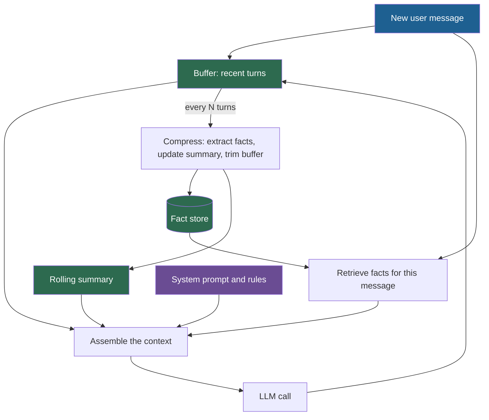

## 1. The question this idea answers

Lessons 8.1 to 8.7 gave the parts. This lesson builds the agent from the handbook's last sections (Session 6, §6 to §9). The agent keeps the recent turns, a rolling summary and a store of facts. It must remember across sessions and keep each call small.

Four practical questions follow. What happens, step by step, on each user message? How do you lay out the request for two providers, and for prompt caching? What does the memory system cost with today's prices? When should you use a product instead of your own code?

## 2. Mental model

> [!analogy] A doctor's appointment
> - The **conversation in the room** is the buffer: the last few things said, word for word.
> - The **nurse's notes of today's visit** are the rolling summary: short, and updated as the visit goes on.
> - The **patient chart** is the fact store: allergies, medication and history, kept for years.
>
> Before each answer, the doctor looks at the conversation, the notes and the parts of the chart that matter now. After the visit, the nurse writes new facts into the chart.
>
> **Where it stops working:** a doctor can open the chart at any time. The model sees only what the application put into the request, unless it has a memory tool (section 4.7). Also, the "nurse" is an LLM call that can write a wrong fact.

## 3. Terms

| Term | Plain meaning |
|---|---|
| buffer | The list of the most recent turns that the agent sends word for word on every call. It is the hot layer. |
| fact store | The persistent store of extracted facts about a user or task, searched on each message. It is the cold layer. |
| context assembly | The step that builds the request for one call from the system prompt, facts, summary, recent turns and the new message. |
| compression trigger | The rule that starts compression, for example every N turns or when the buffer passes a token limit. |
| extraction prompt | The prompt that asks a model to turn conversation turns into structured facts. |
| memory confidence | A label from the extraction model that says how sure it is about a fact. It is not a measured probability. |
| memory precision | The share of injected memories that were relevant to the call. |
| memory miss | An event in which the user refers to something from the past and the system has no matching memory. |
| memory tool | A tool that lets the model itself read and write memory files or blocks, for example Anthropic's `memory` tool. |
| checkpointer | In LangGraph, a component that saves the state of one conversation thread so that it can continue later. |
| LOCOMO | A benchmark of long multi-session conversations with questions about earlier sessions, used to compare memory systems. |
| token unit | A cost measure: tokens multiplied by their price multiplier. One normal input token is 1 unit. On Sonnet 5.5, a cache read is 0.05 units and a 5-minute cache write is 1.25 units. |

## 4. Method and math

### 4.1 The architecture



The three layers match the tiers of lesson [8.4](/notes/ai/context-engineering/08-memory/l4-hot-warm-and-cold-tiers): the buffer is hot, the rolling summary is warm and the fact store is cold.

### 4.2 The data flow, step by step

The handbook (Session 6, §6.1) gives eight steps for each user message:

| Step | What happens | Layer | What to watch |
|---|---|---|---|
| 1 | Add the message to the buffer. | Hot | The buffer now holds the new turn before any retrieval. |
| 2 | Retrieve the facts that match the message. | Cold | Filter by user ID first (lesson [8.6](/notes/ai/context-engineering/08-memory/l6-persistent-memory)). Update the access time of the returned facts. |
| 3 | Load the rolling summary. | Warm | One key lookup by session ID. |
| 4 | Take the last N messages from the buffer. | Hot | Count whole turns, and keep tool-call pairs together (lesson [8.5](/notes/ai/context-engineering/08-memory/l5-five-management-strategies)). |
| 5 | Assemble: system prompt, facts, summary, recent messages. | All | The order decides what the prompt cache can reuse (section 4.3). |
| 6 | Call the LLM. | — | Check the stop reason (lesson [1.3](/notes/ai/context-engineering/01-foundations/l3-the-chat-api-call)). |
| 7 | Add the reply to the buffer. | Hot | |
| 8 | Every N turns: extract facts to the store, update the summary, trim the buffer to the last M messages. | All | Run it outside the user's request. Keep the turns in the buffer until the writes succeed (lesson 8.4). |

### 4.3 Context assembly: order and provider format

The handbook calls context assembly "the most critical function in the entire system". Its Listing 8 builds a list with up to two `system` messages. The first holds the system prompt and the facts, and the second holds the summary. The recent buffer follows.

Use this order instead, from stable to changing:

1. The system rules (procedural memory). They change only on a deploy.
2. Pinned facts about the user. They change about once per session.
3. The rolling summary. It changes every N turns.
4. The recent turns. They grow by one turn per call.
5. The new user message, with the facts retrieved for this turn in a tagged block.

Retrieved facts change on every call. At the end, they leave blocks 1 to 4 as a stable prefix between compressions, so the prompt cache can reuse it (lesson [1.7](/notes/ai/context-engineering/01-foundations/l7-prompt-caching)).

**Anthropic Messages API.** The system prompt is the top-level `system` field. It can be a list of text blocks, and a `cache_control` marker can end the cached part. The `messages` list has only `user` and `assistant` roles.

```json
{
  "model": "<model id>",
  "max_tokens": 1024,
  "system": [
    { "type": "text", "text": "<rules, about 2,000 tokens>" },
    { "type": "text", "text": "Known facts about the user:\n- Name: Alice\n- Prefers Python" },
    { "type": "text", "text": "Conversation summary so far:\n<about 300 tokens>", "cache_control": { "type": "ephemeral" } }
  ],
  "messages": [
    { "role": "user", "content": "<turn 11>" },
    { "role": "assistant", "content": "<reply 11>" },
    { "role": "user", "content": "<retrieved_memories>\n- 2026-09-30: chose PostgreSQL over MongoDB\n</retrieved_memories>\n\nWhich database did we pick?" }
  ]
}
```

**OpenAI Chat Completions.** The instructions go into a `developer` message at the start (lesson 1.3). Caching is automatic for a prefix of at least 1,024 tokens on current models (lesson 1.7).

```json
{
  "model": "<model id>",
  "messages": [
    { "role": "developer", "content": "<rules>\n\nKnown facts about the user:\n- Name: Alice\n- Prefers Python\n\nConversation summary so far:\n<summary>" },
    { "role": "user", "content": "<turn 11>" },
    { "role": "assistant", "content": "<reply 11>" },
    { "role": "user", "content": "<retrieved_memories>\n- 2026-09-30: chose PostgreSQL over MongoDB\n</retrieved_memories>\n\nWhich database did we pick?" }
  ]
}
```

> [!note] Source check: two system messages in Listing 8
> **Corrected.** The handbook's Listing 8 (Session 6, §6.2) puts the facts and the summary into two messages with the role `system`. That assumes an API that accepts `system` messages inside the list, and more than one of them. The Anthropic Messages API has no `system` role in `messages`. Keep the parts in a neutral format in your code, and convert them to each provider's format at the last step.

### 4.4 The extraction prompt

The FAQ (Session 6, Q18) gives a good template. Each extracted fact has five fields:

| Field | Values | Job |
|---|---|---|
| `category` | personal, technical, preference, decision | Routes the fact to the right rules |
| `key` | A descriptive name, such as `python_version` | The unique key per user in the store |
| `value` | The fact | What the model reads later |
| `confidence` | high, medium, low | Decides whether the fact is stored without review |
| `supersedes` | The key of the fact it replaces, or null | Handles corrections |

> [!example] Worked example: one turn, two facts
> The user writes: "By the way, I'm Alice. We moved the service from Python 3.11 to 3.12 last week."
>
> ```json
> [
>   { "category": "personal", "key": "user_name", "value": "Alice", "confidence": "high", "supersedes": null },
>   { "category": "technical", "key": "python_version", "value": "3.12", "confidence": "high", "supersedes": "python_version" }
> ]
> ```
>
> The second fact replaces the stored value 3.11. The store keeps 3.11 in its history table (lesson 8.6).

Six rules for the extraction step:

1. Give two or three examples in the prompt: a personal fact, a technical decision and a correction that supersedes an earlier fact (FAQ Q18).
2. Ask for the output through structured outputs or a tool schema, and validate it (lesson [6.3](/notes/ai/context-engineering/06-tools-and-mcp/l3-tool-schemas-and-structured-outputs)).
3. Use a cheap model, and run extraction after the reply, outside the user's request (FAQ Q18).
4. Extract only from the user's turns and from decisions that the user confirmed. Text from tools and documents can poison memory (lesson 8.6).
5. Store "high" facts at once. Hold "medium" facts until the user confirms them. Drop "low" facts.
6. Measure how often each confidence label is right, on 50 turns that you label by hand. The label is the model's opinion, not a probability.

### 4.5 Test the agent: retention and production metrics

Build the FAQ's 20-turn stress test (Q17) as a script:

| Turns | Content | What it tests |
|---|---|---|
| 2 | "Our project uses PostgreSQL." | A fact early in the session |
| 4 | "We are a team of 4." | A second fact |
| 6–11 | A long digression about logging | Facts must survive outside the window |
| 12 | "Actually, we switched to MySQL." | A contradiction |
| 13–17 | API design, then deployment | Several topics |
| 18 | Back to the database | A return to an old topic |
| 19–20 | "Which database do we use? How big is the team?" | Recall and consistency |

Score the four metrics of lesson 8.5: recall, consistency, relevance and efficiency. Run the same script for windowing only, windowing plus a summary, and the full agent.

In production, the FAQ (Q21) adds four signals:

1. **Memory precision.** "If you inject 10 memories and only 3 are used, precision is 30%." The other seven waste tokens.
2. **Memory misses.** Count messages such as "remember when we discussed X?" for which retrieval returned nothing relevant.
3. **Freshness.** The average age of injected memories.
4. **Conflicts.** How often contradicting facts sit in the store together.

The FAQ also suggests a weekly audit. Sample 50 conversations, and check by hand whether the injected memories were relevant and whether important facts were missed.

### 4.6 What it costs

**Step 1: the handbook's cost box, recomputed.** The box (Session 6, §8) names no model and no price. GPT-4o-class prices (USD 2.50 / MTok input, USD 10 / MTok output) reproduce its extraction figure. Current prices for a cheap Claude model, checked on 2026-10-12, give much smaller numbers:

| Item | Tokens (handbook) | Handbook | At USD 2.50 / 10 per MTok | Claude Haiku 5.5, USD 0.10 / 0.50 per MTok, prompts up to 100K |
|---|---|---|---|---|
| Fact extraction | 500 in, 200 out | 0.003 | 0.00325 | 0.00015 |
| Summarization | 500 in, 150 out | 0.002 | 0.00275 | 0.000125 |
| Retrieval | 100 | 0.0003 | 0.00025 as model input | 0.000002 as an embedding call (`text-embedding-3-small`, USD 0.02 / MTok) |

> [!note] Source check: the cost box
> **Corrected.** The handbook (Session 6, §8) gives "~USD 0.003" per extraction and "~USD 0.002" per summary with no model or price. GPT-4o-class prices give 0.00325 and 0.00275. Claude Haiku 5.5 gives 0.00015 and 0.000125 (checked on 2026-10-12). The box prices retrieval as model input, but retrieval is an embedding call that costs about 0.000002 USD. It counts one extraction per conversation, while FAQ Q18 runs extraction after every turn, which is 20 times more calls. Always state the model and the price per MTok next to a cost.

**Step 2: tokens per call.** Design A is full-history replay. Design B is a three-layer agent whose buffer moves forward by one turn per call. Use these values: a system prompt of $S = 2{,}000$ tokens, user messages of 100 tokens, replies of 100 tokens, so $t = 200$ tokens per turn. Design B keeps the last 5 turns, plus a 300-token summary and 200 tokens of facts once older turns exist.

$$
I_A(k) = S + u + (k-1)\,t, \qquad I_B(k) = S + u + \min(k-1, 5)\,t + 500 \cdot [k > 6]
$$

The symbols mean:

- $k$ is the call number, and $u = 100$ is the new user message.
- $[k > 6]$ is 1 when call $k$ has turns older than the buffer, and 0 otherwise.

> [!example] Worked example: 20 and 100 turns
> - Call 20: $I_A = 2{,}100 + 19 \times 200 = 5{,}900$ tokens. $I_B = 2{,}100 + 1{,}000 + 500 = 3{,}600$ tokens, 39% less.
> - Cumulative input over 20 calls: A sends 80,000 tokens, B sends 66,000, which is 17.5% less.
> - Cumulative input over 100 calls: A sends 1,200,000 tokens, B sends 354,000, which is 70.5% less.
>
> The system prompt is the same in both designs, so it dilutes the savings in short conversations. The handbook's "62.5% per call at turn 20" leaves the system prompt out.

**Step 3: cost without caching.** Main model Claude Sonnet 5.5 at USD 2 / MTok input and USD 10 / MTok output (checked on 2026-10-12). Every reply has 100 output tokens. Design B also pays for extraction after every turn and one summary update for each turn that leaves the buffer, both on Haiku 5.5. In 20 turns that is 20 extractions and 14 summary updates: $20 \times 0.00015 + 14 \times 0.000125 = 0.00475$ USD.

**Step 4: cost with prompt caching.** The cost model, in full:

- On Sonnet 5.5, a 5-minute cache write costs 1.25 times the input price, and a cache read costs 0.05 times (lesson 1.7).
- Every call comes within 5 minutes of the one before, so no cache entry expires.
- A call reads the longest prefix that an earlier call wrote. It pays the write price from there to its last cache breakpoint, and the normal price for the rest.
- Output and the memory calls on Haiku 5.5 are never cached.

The designs differ only in their layout:

| Design | Layout | Cache breakpoints |
|---|---|---|
| A: full-history replay | System prompt, every earlier turn, the new message | One, at the end of the request. This is the cached formula of lesson 1.7. |
| B: three-layer agent, sliding window | System prompt, summary and facts, the last 5 turns, the new message. One turn leaves the buffer on every call, so the summary changes on every call. | One, after the system prompt. Nothing after it repeats. |
| C: three-layer agent, layout of section 4.3 | System prompt, summary, buffer, then this turn's facts with the new message. When the buffer holds 10 turns, the oldest 5 go into the summary. | Two: after the system prompt and after the last reply. |

C has the same 200 tokens of facts as B from call 7 on, and its first summary at call 11. The buffer stores each user message without its facts block. So the summary changes only every 5 turns, and the buffer grows between compressions. C also extracts after every turn, but it updates the summary once per compression: 2 times in 20 turns. Its buffer holds 5 to 9 turns, so C sends more tokens than B: 70,800 over 20 calls and 390,800 over 100. Most of them are cache reads.

All values are USD per conversation, including output and the memory calls:

| Design | 20 turns, no cache | 20 turns, cache | 100 turns, no cache | 100 turns, cache |
|---|---|---|---|---|
| A: full-history replay | 0.180 | 0.042 | 2.500 | 0.273 |
| B: sliding window | 0.157 | 0.086 | 0.835 | 0.460 |
| C: layout of section 4.3 | 0.165 | 0.059 | 0.899 | 0.311 |

> [!key] With cheap cache reads, memory is not mainly a cost saving inside one session
> Without caching, B costs 13% less than A at 20 turns and 67% less at 100 turns. With caching and no pauses, A is the cheapest design at both lengths. The layout matters: at 100 turns, C costs 32% less than B.
>
> Per call, the cached input of A costs $335 + 10k$ token units, and B costs 1,700 units from call 7 on (section 5). These cross at call 137. The totals, with output and memory calls, cross later: at call 143 for C and at call 296 for B.
>
> The result depends on the assumption of no pauses. Suppose that the cache is cold before every 10th call. Then A must write its whole history again each time. At 100 turns the costs become 0.577 USD for A, 0.508 for B and 0.404 for C, so both memory designs are cheaper.
>
> So inside one active session, cost is not the main reason for a memory agent. It gives continuity across sessions, when the cache is cold and the old turns are gone. It keeps the context bounded, which protects quality (lesson [1.5](/notes/ai/context-engineering/01-foundations/l5-position-and-length-effects)). It also gives control over what the model sees. Do this arithmetic with your own prices, turn sizes and pause pattern.

**Step 5: scale.** The FAQ (Q24) takes 10,000 users with 20 turns per day. That gives 200,000 extraction calls per day, each with 500 input and 200 output tokens. That is 100 MTok of input and 40 MTok of output per day.

| Model (USD per MTok, input / output) | Per call | Per day | Per 30 days |
|---|---|---|---|
| Claude Haiku 5.5 (0.10 / 0.50) | 0.00015 | 30 | 900 |
| Claude Haiku 5.5 with the Batch API (50% off, results arrive later) | 0.000075 | 15 | 450 |
| Claude Haiku 4.5 (1 / 5) | 0.0015 | 300 | 9,000 |
| OpenAI gpt-4o-mini (0.15 / 0.60, still listed) | 0.000195 | 39 | 1,170 |

> [!note] Source check: extraction cost at 10,000 users
> **Corrected.** The handbook (Session 6, FAQ Q24) says that 200,000 extraction calls per day cost "roughly USD 5–10/day with Haiku pricing". At the prices checked on 2026-10-12, the cheapest option is 30 USD per day, or 15 with batch processing. Claude Haiku 4.5 costs 300 USD per day. The FAQ (Q37) also says that prompt caching makes memory injection "nearly free". It leaves out three facts. Cache writes cost more: 1.25 times for 5 minutes, 2 times for 1 hour. The default lifetime is 5 minutes, so the cache is cold between sessions. And a changed memory block breaks the cache for everything after it.

### 4.7 A map of memory products

All facts below were checked on 2026-10-12. Products change often, so check again before you build.

| Product | What it keeps | How memories reach the model | Facts to know |
|---|---|---|---|
| ChatGPT memory | "Saved memories" and "Reference chat history" | "ChatGPT decides which available information is relevant to a response." OpenAI does not document the mechanism. | Chat history reference since 2025-04-10 for Plus and Pro, a lightweight version for Free users since 2025-06-03. Deleting a chat does not delete a saved memory made from it. |
| Claude memory (claude.ai) | A memory summary built from chat history, with a separate space per project | The summary is "updated every 24 hours". Paid plans can also search past chats. | Team and Enterprise from 2025-09-11, Pro and Max from 2025-10-23, now on all plans. Settings, Capabilities, "View and edit memory". Incognito chats are not saved. |
| Claude API memory tool | Files under `/memories` that your code stores | The model calls the tool: `view`, `create`, `str_replace`, `insert`, `delete`, `rename` | Type `memory_20250818`. Client-side: "your application executes them". Validate paths against traversal. Public beta from 2025-09-29, no beta header needed now. |
| Claude Code `CLAUDE.md` | Hand-written project and user instructions | Sent as a user message after the system prompt | Managed, user (`~/.claude/CLAUDE.md`), project and local levels (lesson [3.5](/notes/ai/context-engineering/03-system-layer/l5-rules-files)). |
| Letta (MemGPT) | Memory blocks pinned in the context, plus recall and archival storage | The model edits blocks with tools: `memory_insert`, `memory_replace`, `memory_rethink`, `conversation_search`, `archival_memory_insert`, `archival_memory_search` | The MemGPT paper (Packer et al., 2023) splits main context from external recall and archival storage. A single `memory` tool exists since 2025-09-30. |
| Mem0 | Extracted facts with embeddings, and a history in SQLite | `m.search(query, filters={"user_id": ...})` returns facts that you inject | `m.add(messages, user_id=...)`. Defaults: `gpt-5-mini`, `text-embedding-3-small` (1,536 dimensions), Qdrant on disk. An LLM picks ADD, UPDATE, DELETE or NOOP for each fact. |
| LangGraph | Checkpointers: one thread's state. Stores: data across threads | `store.search(namespace, query=..., limit=...)`, with namespaces such as `(user_id, "memories")` | Store launched 2024-10-08, semantic search 2024-12-05, LangMem SDK 2025-02-18. `InMemoryStore` is for development. |

Anthropic reported two results for the memory tool and context editing on 2025-09-29. Memory plus context editing improved performance by 39% on an internal agentic-search evaluation. Context editing reduced token use by 84% in a 100-turn evaluation. These are the vendor's own evaluations.

> [!note] Source check: product claims in the FAQ
> **Corrected.**
> - The handbook (§9 box, FAQ Q1 and Q14) describes ChatGPT's internals. It says that an extraction prompt runs after each conversation and that embeddings select memories. It also names a `secondary model` and `2–4K tokens` of injected memories. OpenAI documents none of this. Treat it as speculation.
> - FAQ Q36 says that the Anthropic API gives you "neither automatically". The API has had a memory tool since 2025-09-29, although your application stores the files.
> - FAQ Q39 says the LangGraph memory store was "released 2025". It launched on 2024-10-08.
> - FAQ Q34 gives MemGPT "two tiers" with `core_memory_append` and `core_memory_replace`. The paper also has recall storage, and the current Letta docs teach `memory_insert`, `memory_replace` and `memory_rethink`. The old names are still in the code.
> - FAQ Q35 writes `mem0.search(query, user_id)`. The current form passes `filters={"user_id": ...}`. A graph store is not a default of the open-source library.

**What a vendor benchmark shows.** The Mem0 paper (Chhikara et al., arXiv 2504.19413) compares memory systems on LOCOMO with an LLM judge (J). All LLM steps used GPT-4o-mini. Mem0g is the graph variant: it stores entities as nodes and their relations as labeled edges, in Neo4j. This is one form of the associative retrieval of lesson [8.3](/notes/ai/context-engineering/08-memory/l3-retrieval-scoring-and-decay).

| Method | J (%) | p95 latency (s) | Context tokens per query |
|---|---|---|---|
| Full context | 72.90 | 17.117 | 26,031 |
| Mem0 with graph (Mem0g) | 68.44 | 2.590 | 3,616 |
| Mem0 | 66.88 | 1.440 | 1,764 |
| Zep | 65.99 | 2.926 | 3,911 |
| Best RAG setup | 60.97 | 1.907 | not given |
| LangMem | 58.10 | 60.40 | 127 |
| OpenAI memory | 52.90 | 0.889 | 4,437 |

> [!example] Worked example: the trade-off
> Full context has the best accuracy. Mem0 gives up $72.90 - 66.88 = 6.02$ judge points. In exchange, its p95 latency is $1 - 1.440 / 17.117 = 91.6\%$ lower, and it uses $1 - 1{,}764 / 26{,}031 = 93.2\%$ fewer context tokens. These are the vendor's own numbers on one benchmark. Run the same comparison on your own conversations.

### 4.8 Build or buy

The FAQ (Session 6, Q49) says that an off-the-shelf memory "will get you 80% of the way with 5% of the effort" for simple preference recall. That is the handbook's estimate, not a measurement. It names three reasons to build your own. You need fine-grained control over what may be stored, for example in healthcare. You need a specific decay model or lifecycle. Or several agents need separate memory scopes.

| Question | If yes |
|---|---|
| Must some categories of data never be stored? | Build, or confirm that the product can exclude them before storage |
| Do you need your own decay, tiers or history rules? | Build |
| Do several agents need separate and shared memory scopes? | Build, or use a store with namespaces such as LangGraph's |
| Must deletion reach every copy, with an audit record? | Check the product's deletion path across vectors, history and backups |
| Is basic recall of preferences enough? | Buy, and measure it with your stress test |

Even when you buy, five things stay your job. They are the user ID on every call, the memory budget, the position of memories in the request, deletion, and evaluation.

### 4.9 Production view

| Concern | What this lesson means for it |
|---|---|
| Cost | Compute cost with real prices, with and without caching, and with your pause pattern. Memory saves money mainly across sessions, in long sessions and when pauses let the cache expire. |
| Latency | Retrieval runs before the call. Extraction and summary updates run after it. |
| Caching | Keep the system rules, pinned facts, summary and old turns as a stable prefix. Put per-turn facts at the end. |
| Reliability | Validate extraction output. Keep turns in the buffer until the writes succeed. |
| Privacy | Extract only from trusted turns, isolate by user in the database, and cascade deletion. |
| Observability | Log the assembled request, the injected memories with their scores, and every write to the store. |

## 5. Graphs

```plot
{
  "title": "Input tokens per call in thousands: full-history replay A (red) and the sliding-window agent B (blue)",
  "xAxis": { "label": "call number k", "domain": [1, 20] },
  "yAxis": { "label": "thousands of input tokens", "domain": [0, 6.5] },
  "disableZoom": true,
  "data": [
    { "fn": "2.1 + 0.2*(x-1)", "color": "#C81D25" },
    { "points": [[1, 2.1], [2, 2.3], [3, 2.5], [4, 2.7], [5, 2.9], [6, 3.1], [7, 3.6], [20, 3.6]], "fnType": "points", "graphType": "polyline", "color": "#1E6091", "skipTip": true },
    { "points": [[1, 2.1], [2, 2.3], [3, 2.5], [4, 2.7], [5, 2.9], [6, 3.1], [7, 3.6], [20, 3.6]], "fnType": "points", "graphType": "scatter", "color": "#1E6091", "skipTip": true }
  ]
}
```

The red line grows by 200 tokens per call and ends at 5,900. The blue line grows until the buffer is full. It jumps by 500 tokens when the summary and facts appear at call 7, and then stays at 3,600. Same values as section 4.6.

```plot
{
  "title": "Main-model input cost per call with prompt caching, in token units: design A (red), design B (blue), design C averaged over its 5-call cycle (gold)",
  "xAxis": { "label": "call number k", "domain": [7, 200] },
  "yAxis": { "label": "token units (tokens × price multiplier)", "domain": [0, 2500] },
  "disableZoom": true,
  "data": [
    { "fn": "335 + 10*x", "color": "#C81D25" },
    { "fn": "1700", "color": "#1E6091" },
    { "fn": "989", "color": "#B8860B" }
  ]
}
```

The red line is $0.05 \times I_A(k-1) + 1.25 \times 200 = 335 + 10k$. The blue line is $0.05 \times 2{,}000 + 1{,}600 = 1{,}700$. The gold line is the average of design C over one 5-call cycle. That cycle costs 2,025 units on the call after a compression, then 715, 725, 735 and 745. Red crosses gold at $k = 65.4$ and blue at $k = 136.5$. The lines leave out output and the memory calls, and the early calls cost A less, so the totals cross later (section 4.6).

## 6. Code

These exercises go in `src/memory/` with tests in `tests/`. Use a fake LLM for the tests, so that they cost nothing.

**Exercise 8.1: the agent.**

1. Write `MemoryAgent` with a buffer, a rolling summary and a SQLite fact store from lesson 8.6.
2. Implement the 8 steps of section 4.2. Compress every 5 turns.
3. Write `to_anthropic(parts)` and `to_openai_chat(parts)` that turn the assembled parts into request bodies, in the order of section 4.3.

Acceptance tests:

- The assembled input never exceeds a set token budget.
- With a fake LLM that answers from its input, a fact from turn 1 is answered correctly at turn 40.
- The Anthropic body has no message with the role `system`. The OpenAI body starts with a `developer` message.
- The facts retrieved for a turn appear only in the last user message.

**Exercise 8.2 (optional, costs money): the extraction prompt.**

1. Write the prompt of section 4.4 with three examples and a JSON schema.
2. Label 30 turns by hand with the facts they contain.
3. Run the prompt with a cheap model.

Acceptance test: precision and recall of the extracted facts, for each confidence label.

**Exercise 8.3: the stress test.** Write the 20-turn script of section 4.5 as data. Run it against windowing, windowing plus a summary, and the full agent.

Acceptance test: a table of recall, consistency, relevance and efficiency for the three designs.

**Exercise 8.4: the cost calculator.**

1. Write `cost(design, n_turns, prices, cache, cold_calls)` for designs A, B and C of section 4.6.
2. `cold_calls` lists the calls before which the cache has expired. Such a call reads nothing from the cache.
3. Reproduce the cost table of section 4.6.

Acceptance tests:

- The calculator reproduces 0.180, 0.042, 0.157, 0.086, 0.165 and 0.059 USD for 20 turns.
- With a cold cache before every 10th call, it gives 0.577, 0.508 and 0.404 USD for A, B and C at 100 turns.
- One sentence that says which design fits your own traffic, and why.

## 7. Common mistakes

1. **"Put the retrieved facts at the top of the system prompt."** They change on every call and break the cache for everything below. Put them at the end.
2. **"Two `system` messages work on every provider."** The Anthropic Messages API has no `system` role in `messages`.
3. **"Memory always saves money."** With cheap cache reads and no pauses, full-history replay can cost less inside one session. Compute it.
4. **"ChatGPT memory works by an extraction prompt and embedding retrieval."** OpenAI does not document its mechanism.
5. **"The Anthropic API gives you no memory."** It has a memory tool, although your code stores the files.

## 8. One-minute explanation

A three-layer memory agent keeps the recent turns word for word, a rolling summary of older turns, and a store of extracted facts. On each message it adds the message to the buffer, retrieves matching facts for this user, loads the summary and assembles the request. It puts stable parts first: rules, pinned facts, summary and recent turns, then the new message with this turn's facts. After the reply, it extracts facts with a cheap model, with a confidence label and a supersedes field for corrections. Test it with a 20-turn script that includes a contradiction. With current prices, memory calls cost fractions of a cent, and the handbook's cost numbers need a named model. With cheap cache reads and no pauses, full replay can cost less inside one session. So the real value of memory is continuity across sessions, quality and control. Products such as Mem0, Letta, LangGraph and the Claude memory tool can do parts of this, but isolation, deletion and evaluation stay your job.

## 9. Check questions

```check
{
  "question": "Why should the facts retrieved for the current turn go into the last user message and not into the system prompt?",
  "answer": "They change on every call. In the system prompt, they would change the prefix near the top, so the prompt cache would break for everything after them. At the end, the rules, pinned facts, summary and older turns stay a stable prefix that the cache can reuse."
}
```

```check
{
  "question": "A system prompt has 1,500 tokens. User messages have 80 tokens and replies 120 tokens. Design B keeps 6 recent turns and 600 tokens of summary and facts. How many input tokens do designs A and B send on call 30?",
  "hint": "t = 200. A: S + u + 29t. B: S + u + 6t + 600.",
  "answer": "A: 1,500 + 80 + 29 × 200 = 7,380 tokens. B: 1,500 + 80 + 6 × 200 + 600 = 3,380 tokens."
}
```

```check
{
  "question": "A product runs 300,000 extraction calls per day, each with 500 input and 200 output tokens, on a model at USD 0.10 / MTok input and USD 0.50 / MTok output. What is the cost per day?",
  "answer": "Input: 300,000 × 500 = 150 MTok × 0.10 = 15 USD. Output: 300,000 × 200 = 60 MTok × 0.50 = 30 USD. Total: 45 USD per day."
}
```

```check
{
  "question": "With prompt caching and no pauses, 20 turns cost 0.042 USD with full-history replay, 0.086 USD with the sliding-window agent B and 0.059 USD with agent C. Does this mean that the memory agent is a bad design? Explain.",
  "answer": "No. Inside one active session with no pauses, cheap cache reads make replay cheap. Pauses change the result: with a cold cache before every 10th call, both memory designs cost less than replay at 100 turns. The memory agent also pays off across sessions, when the cache is cold and the old conversation is gone. It keeps the context bounded, which protects quality in long sessions, and it gives control over what the model sees. The gap between B and C shows that the layout decides much of the cost."
}
```

```check
{
  "question": "Where are the memory files stored when you use Anthropic's memory tool, and what must your code check?",
  "answer": "In your own storage. The tool is client-side: the model asks for file operations under /memories, and your application performs them. Your code must validate every path, so that a request such as /memories/../../secrets.env cannot leave the memory folder."
}
```

```check
{
  "question": "On LOCOMO, Mem0 scores 66.88 J with a p95 latency of 1.440 s, and full context scores 72.90 J with 17.117 s. State the trade-off in numbers, and one reason to be careful with it.",
  "answer": "Mem0 loses 6.02 judge points but has a 91.6% lower p95 latency (1 − 1.440 / 17.117) and uses 93.2% fewer context tokens. Be careful: these are the vendor's own results on one benchmark, with GPT-4o-mini and an LLM judge. Your conversations and models can give different numbers."
}
```

## 10. Links

- Previous: [L7: Self-improving context: ACE](/notes/ai/context-engineering/08-memory/l7-ace-self-improving-context)
- Next part: [9.1: Context is the product](/notes/ai/context-engineering/09-production/l1-context-is-the-product)
- [1.6: The cost of a conversation](/notes/ai/context-engineering/01-foundations/l6-the-cost-of-a-conversation) and [1.7: Prompt caching](/notes/ai/context-engineering/01-foundations/l7-prompt-caching)
- Capstone milestone: [M5: Memory](/notes/ai/context-engineering/10-capstone/m5-memory)
- Interview practice: [Hard questions: Memory](/notes/ai/context-engineering/08-memory/hard-questions)
- [Glossary](/notes/ai/context-engineering/glossary)
