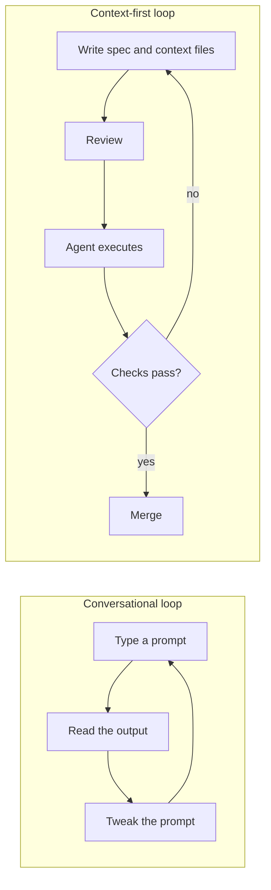
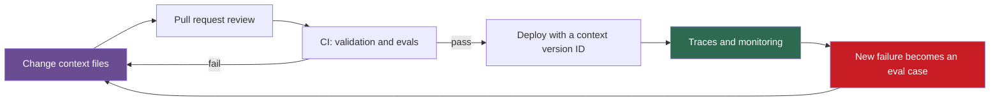

## 1. The question this idea answers

An agent works well in a notebook demo. Three months later, in production, it tells a customer the wrong return window. Nobody can say which system prompt was live that day, who changed it, or whether anyone tested the change. The model did not change. The context did.

This lesson answers two questions. What changes when an LLM system moves from a demo to production? And why does the handbook say that the context, not the model, is the product?

## 2. Mental model

> [!analogy] Servers before and after infrastructure as code
> Twenty years ago, engineers configured each server by hand. Nobody knew the exact state of a server. Two servers that "should be the same" were different. Infrastructure as code changed this. The configuration became text files in git. Each change went through a pull request, a review and an automatic test. Anyone could rebuild any server from the files.
>
> Context files are the configuration of an LLM system. The system prompt, the tool descriptions, CLAUDE.md, the examples and the specs decide what the model does. So they get the same treatment: git, review, tests and the ability to rebuild an old version.
>
> **Where it stops working:** the same configuration file gives the same server every time. The same context does not give the same answer every time, because the model samples its output (lesson [1.1](/notes/ai/context-engineering/01-foundations/l1-what-a-model-does-with-context)). So a test of context cannot check one output. It must measure a rate over many cases (lessons [L6](/notes/ai/context-engineering/09-production/l6-evaluation) and [L7](/notes/ai/context-engineering/09-production/l7-evals-in-ci-and-versioning)).

## 3. Terms

| Term | Plain meaning |
|---|---|
| context layer | All the text that an application or a coding agent puts into the model's window by design. Examples: system prompt, tool definitions, rules files, specs and examples. |
| context artifact | One file of the context layer, for example CLAUDE.md, a spec or a tool description. |
| specification (spec) | A written description of what to build, with requirements that a reader can check one by one. |
| context as code | The practice of keeping context artifacts in version control, with review, tests and release rules, like application code. |
| pull request (PR) | A proposed change to a git repository that other people review before it merges. |
| regression | A case that worked before a change and fails after it. |
| build-time context | The context that a coding agent reads while it writes your software, for example CLAUDE.md and a spec. |
| run-time context | The context that the model inside your product reads on each user call, for example the system prompt and tool results. |
| context version ID | A short hash of all context artifacts that one call used. It identifies the exact context version in logs and traces. |

## 4. Method and math

### 4.1 Two ways to work with an AI

The handbook (Session 7, §1) contrasts two habits:

| | Conversational loop | Context-first loop |
|---|---|---|
| First step | Type a prompt | Write the spec and the context files |
| Where the decisions live | In a chat that ends with the session | In files that the next session can read |
| Who can review them | Nobody | A teammate, in a pull request |
| How you know it works | You read the output | Automatic checks and evaluations |
| What the next feature gets | Nothing | The same files, improved |



The conversational loop is fine for a quick experiment. It fails at scale for one reason: the knowledge that makes the output correct stays in one person's head and one chat. The context-first loop stores that knowledge in files.

### 4.2 Rule 1: spec before code

The handbook states the rule this way: "Claude should never be the first to decide what to build." It adds a test: "If Claude is guessing what to build, you skipped a step." (Session 7, §1.1.)

The reason comes from lesson [1.1](/notes/ai/context-engineering/01-foundations/l1-what-a-model-does-with-context). The model can use only the weights and the window. Your decisions about this feature are in neither place until you write them in a file. When a decision is missing, the model fills the gap with the most probable pattern from its training. That is a generic choice, not your choice.

> [!example] Worked example: guesses compound
> The request is "Add a summary export to the research assistant." The agent must decide at least six things that the request does not say:
>
> 1. The file format.
> 2. The file path.
> 3. When the export runs.
> 4. What happens when the disk write fails.
> 5. Whether the function is sync or async.
> 6. Which fields the summary holds.
>
> Assume, for this example, that each guess matches your intent with probability 0.7, and that the guesses are independent. The chance that all six match is:
>
> $$
> 0.7^6 \approx 0.118
> $$
>
> So about 12% of attempts match on the first try. With a spec that states all six decisions, the agent guesses none of them. The 0.7 is an assumption, but the shape of the result holds for any value below 1: more open decisions mean fewer correct first attempts.

### 4.3 Rule 2: context is the product

The handbook's key concept (Session 7, §1): "A perfect model with bad context produces bad results. An average model with excellent context produces professional results."

Treat the second sentence as a rule of thumb, not a measured law. The first sentence follows directly from lesson 1.1. A model that does not see a fact cannot use it, however capable the model is. The handbook also says that good context makes the output "predictable, reviewable, and repeatable". Predictable here means that outputs stay inside a narrow, acceptable range. It does not mean identical outputs.

### 4.4 Two context layers in production

Session 7 mixes two different context layers. The lecture is about the context of a **coding agent**. The FAQ, with the Shopify case, is mostly about the context of the **model inside the product**. The discipline is the same for both, but the tests differ.

| | Build-time context | Run-time context |
|---|---|---|
| Reader | A coding agent, such as Claude Code, that writes your software | The model inside your product, on every user call |
| Artifacts | CLAUDE.md, INITIAL.md, PRPs, examples/, skills, hooks | System prompt, tool definitions, just-in-time instructions, retrieval settings, memory rules |
| Typical failure | Wrong imports, wrong patterns, missing edge cases | Wrong answers to users, high cost, slow replies |
| How you test it | The validation loop: lint, type check, tests ([L4](/notes/ai/context-engineering/09-production/l4-validation-loops)) | Evaluation sets and judges ([L6](/notes/ai/context-engineering/09-production/l6-evaluation)) |
| Lessons in this part | L2 to L5 | L6 to L9 |

### 4.5 Context files are code

The handbook says that the context artifacts "live in git. They are versioned. They are reviewed in pull requests. They are the system." (Session 7, §1.) This is right for most of them. The table gives each artifact's lifetime and test.

| Artifact | Lifetime | In git? | How you check it |
|---|---|---|---|
| `CLAUDE.md` | Months | Yes | Review. Size limit. Every path in it exists. |
| `CLAUDE.local.md` | Personal | No | Nobody else reads it. |
| `INITIAL.md` | One feature | Yes, replaced for each feature | The specificity test ([L2](/notes/ai/context-engineering/09-production/l2-the-project-files)) |
| `PRPs/*.md` | One feature, then history | Yes | The review gate ([L3](/notes/ai/context-engineering/09-production/l3-the-prp-workflow)) |
| `examples/` | Until the pattern changes | Yes | The examples pass lint and tests themselves. |
| `.claude/skills/`, `.claude/commands/` | Months | Yes | A dry run on a small input ([L5](/notes/ai/context-engineering/09-production/l5-commands-skills-and-hooks)) |
| `.claude/settings.json` | Months | Yes | Review of permissions and hooks |
| `.claude/settings.local.json` | Personal | No | Nobody else reads it. |
| Product system prompt | Weeks | Yes | The evaluation suite |
| Tool descriptions and just-in-time instructions | Weeks | Yes | Evaluation cases for each tool |
| Evaluation cases (ground truth set) | Grows over time | Yes | Agreement between labelers ([L6](/notes/ai/context-engineering/09-production/l6-evaluation)) |

> [!note] Source check: settings.local.json in git
> **Corrected.** The handbook (Session 7, §1 and the §2 folder tree) says that all context artifacts live in git. Its tree shows `.claude/settings.local.json` with them. Claude Code's settings docs treat `settings.local.json` as personal: "Claude Code keeps it out of git when it creates the file". Shared permissions and hooks go in `.claude/settings.json`, which the docs tell you to commit. The upstream template repository (coleam00/context-engineering-intro) commits a `settings.local.json` with permissions. That is a convenience of a template repo, not the convention. Source: Claude Code docs, "Settings", checked on 2026-10-12.

### 4.6 What changes from demo to production

| | Demo | Production |
|---|---|---|
| Inputs | Hand-picked, clean | Real users: messy, ambiguous, adversarial |
| Who edits the context | One person | Several people or teams |
| Version of the context | Whatever is in the notebook | A tagged version, with an ID in every trace |
| Quality check | You read a few outputs | An evaluation suite on every change |
| Failures | You see them | Many are silent: a confident wrong answer looks like a right one ([L6](/notes/ai/context-engineering/09-production/l6-evaluation)) |
| Cost | Ignored | Measured per conversation ([L8](/notes/ai/context-engineering/09-production/l8-observability-cost-and-latency)) |
| Latency | Ignored | A budget, often at the 95th percentile |
| Data | Test data | Personal data, with privacy and retention rules |

The gap between the two columns is the **demo-to-production gap**. Most of the work in this part closes it.

### 4.7 The production loop



| Step | Lesson |
|---|---|
| Write the project files and the spec | [L2](/notes/ai/context-engineering/09-production/l2-the-project-files), [L3](/notes/ai/context-engineering/09-production/l3-the-prp-workflow) |
| Validate the code that the agent writes | [L4](/notes/ai/context-engineering/09-production/l4-validation-loops), [L5](/notes/ai/context-engineering/09-production/l5-commands-skills-and-hooks) |
| Evaluate the run-time context | [L6](/notes/ai/context-engineering/09-production/l6-evaluation), [L7](/notes/ai/context-engineering/09-production/l7-evals-in-ci-and-versioning) |
| Trace, measure cost and latency | [L8](/notes/ai/context-engineering/09-production/l8-observability-cost-and-latency) |
| Diagnose failures by pattern | [L9](/notes/ai/context-engineering/09-production/l9-seven-anti-patterns) |

The last arrow is the most important. Each production failure becomes a permanent test case. So the evaluation suite grows from real failures, not from guesses.

### 4.8 Start minimal, then add

The FAQ (Session 7, Q9) says: start with a bare prompt and few tools, and run real tasks. Then add one targeted fix for each observed failure. The FAQ credits "Anthropic's production guidance" without a link. The source is Anthropic's post "Building effective agents" (Schluntz and Zhang, 19 December 2024): "Start with simple prompts, optimize them with comprehensive evaluation, and add multi-step agentic systems only when simpler solutions fall short."

The rule protects the context layer from growth without evidence. Each new rule must answer one observed failure, and it comes with a test case for that failure. Lesson [3.4](/notes/ai/context-engineering/03-system-layer/l4-start-minimal-then-add) teaches this method for the system prompt.

### 4.9 Production view

| Concern | What this lesson means for it |
|---|---|
| Reliability | Every behavior that matters is written in a context file and covered by a test case. |
| Change control | Context changes go through pull requests, like code. A one-word edit can change many answers. |
| Observability | Every trace records the context version ID, so you can tie a bad answer to the exact context. |
| Security | Personal files (`settings.local.json`, `CLAUDE.local.md`) stay out of git. Secrets never go into context files. |
| Team scale | Ownership of each context artifact is clear. Lesson [L7](/notes/ai/context-engineering/09-production/l7-evals-in-ci-and-versioning) adds a registry of instructions. |

## 5. Code

These exercises go in `notebooks/09-production.ipynb`. Exercise 1.2 is a reusable module in `src/context_version.py`, with tests in `tests/`.

**Exercise 1.1: inventory your context layer.**

1. Pick one real project, for example an MCP server or a LangGraph agent from your work.
2. List every context artifact: system prompts, tool descriptions, rules files, examples, specs, evaluation files.
3. For each one, record its path, its owner, its lifetime, whether it is in git and how it is tested today.

Acceptance tests:

- A table with one row for each artifact.
- At least one row marked "not tested". Write one sentence about the risk of that row.

**Exercise 1.2: a context version ID.**

1. Write `context_version(paths: list[Path]) -> str`. It reads each file, computes a SHA-256 hash over the sorted paths and their contents, and returns the first 12 hex characters.
2. Write `context_manifest(paths) -> dict` that maps each path to its own hash.

Acceptance tests:

- The same files give the same ID on every run.
- A change of one character in one file gives a different ID.
- The order of the input list does not change the ID.
- A missing file raises a `FileNotFoundError` with the path in the message.

**Exercise 1.3: count the guesses.** Take one feature request that you typed into an AI tool in the last month. List every decision that the request left open. Compute the first-try match chance with your own estimate of $p$, as in section 4.2.

## 6. Common mistakes

1. **"The prompt is a string in the code, so it needs no review."** A one-word change to a prompt can change many answers. Review it like code and test it with evaluations.
2. **"A better model will fix bad context."** The model can use only what is in the window. A missing fact stays missing for any model.
3. **"Everything under `.claude/` goes into git."** `settings.local.json` and `CLAUDE.local.md` are personal. Shared settings go into `.claude/settings.json`.
4. **"One good demo run proves that the context works."** The output is sampled. Only a rate over many real cases shows quality.
5. **"Write all the rules before launch."** Rules without an observed failure add tokens and conflicts. Start minimal, then add one tested rule for each real failure.

## 7. One-minute explanation

A demo works on clean inputs that one person chose. Production has messy users, several editors of the context and silent failures. The handbook gives two rules for this. First, write the spec before the code, because the model cannot use a decision that is not in its window. Second, treat context as the product: CLAUDE.md, specs, examples, system prompts and tool instructions decide the output. So they live in git, go through review and have tests. Personal settings files are the exception and stay out of git. There are two context layers: the one that a coding agent reads and the one that your product's model reads. Code checks test the first. Evaluation sets test the second. Every production failure becomes a new test case.

## 8. Check questions

```check
{
  "question": "A feature request leaves five decisions open. Assume that each guess matches your intent with probability 0.8, independently. What is the chance that all five match? What does this say about specs?",
  "hint": "Multiply the five probabilities.",
  "answer": "0.8^5 ≈ 0.328, so about one first attempt in three is right. Each open decision multiplies the risk. A spec that states the five decisions removes the guesses."
}
```

```check
{
  "question": "No compiler reads a system prompt. Why does the handbook still call it code?",
  "answer": "Because it changes the behavior of the system as much as code does, and a small edit can break many cases. So it needs the same controls: version history, review in a pull request, automatic tests (evaluations) and a fast return to an earlier version."
}
```

```check
{
  "question": "After a teammate edited the product's system prompt, answer quality dropped and nobody knows when the edit went live. Name three practices from this lesson that were missing.",
  "answer": "1. The prompt was not changed through a reviewed pull request. 2. No evaluation suite ran on the change. 3. Traces did not record a context version ID, so nobody can match bad answers to the prompt version."
}
```

```check
{
  "question": "Which of these files belong in git: CLAUDE.md, CLAUDE.local.md, .claude/settings.json, .claude/settings.local.json, INITIAL.md, examples/?",
  "answer": "In git: CLAUDE.md, .claude/settings.json, INITIAL.md and examples/. Not in git: CLAUDE.local.md and .claude/settings.local.json, which are personal."
}
```

```check
{
  "question": "What is the difference between build-time context and run-time context? Give the main test for each.",
  "answer": "Build-time context is what a coding agent reads while it writes your software, such as CLAUDE.md and a spec. You test its result with the validation loop: lint, type check and tests. Run-time context is what your product's model reads on each user call, such as the system prompt and tool results. You test it with evaluation sets and judges."
}
```

## 9. Links

- Next: [L2: The project files](/notes/ai/context-engineering/09-production/l2-the-project-files)
- [Lesson 1.1: What a model does with context](/notes/ai/context-engineering/01-foundations/l1-what-a-model-does-with-context): why a missing decision becomes a guess
- [Lesson 3.4: Start minimal, then add](/notes/ai/context-engineering/03-system-layer/l4-start-minimal-then-add)
- [Lesson 3.5: Rules files](/notes/ai/context-engineering/03-system-layer/l5-rules-files)
- [Glossary](/notes/ai/context-engineering/glossary)
