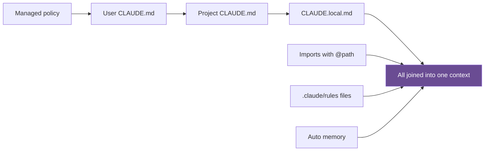

## 1. The question this idea answers

A coding agent starts every session with no memory of your project. It does not know your folder layout, your naming rules, your test commands or the bug that cost you a day last month. Which files give it that knowledge? What goes into each file, and what must stay out? How long does each file live?

The handbook (Session 7, §2) names three files and folders: `CLAUDE.md`, `INITIAL.md` and `examples/`. This lesson teaches each one, corrects the handbook where Claude Code works differently today, and writes a full `CLAUDE.md` for a Python service.

## 2. Mental model

> [!analogy] Onboarding a contractor
> A good company gives a new contractor three things. The **handbook** says how the company works: where things are, which rules apply, which mistakes to avoid. The **ticket** says what to build this week, in enough detail that the contractor does not need to ask. The **reference samples** show finished work in the house style.
>
> `CLAUDE.md` is the handbook. `INITIAL.md` is the ticket. `examples/` holds the reference samples.
>
> **Where it stops working:** a contractor remembers the handbook after one read and can ask questions. The agent reads the files again in every session, and each line costs context. Also, the agent treats the files as context, not as rules that it must obey. A rule that must never break needs a mechanical check (lessons [L4](/notes/ai/context-engineering/09-production/l4-validation-loops) and [L5](/notes/ai/context-engineering/09-production/l5-commands-skills-and-hooks)).

## 3. Terms

| Term | Plain meaning |
|---|---|
| CLAUDE.md | A Markdown file that Claude Code loads into context at the start of a session. It describes the project: layout, conventions, common mistakes, key files and commands. |
| CLAUDE.local.md | A personal version of CLAUDE.md in the project folder. You add it to `.gitignore`, so that it stays out of git. |
| auto memory | Notes that Claude Code writes for itself in a per-project MEMORY.md file and loads in later sessions. |
| import (in CLAUDE.md) | A line `@path/to/file` that loads another file into context together with the CLAUDE.md. |
| path-scoped rule | A rules file in `.claude/rules/` with a `paths:` field, so that it applies only to matching files. |
| INITIAL.md | A feature spec for the current task. It is replaced for each new feature. |
| specificity test | The question "Could the agent misinterpret this requirement?" asked for each requirement, until the answer is no. |
| example file | A real code file in `examples/` that shows the structure new code must copy. It is a structural template, not documentation. |
| key files | The files that the agent must read before it changes anything in an area. |
| AGENTS.md | A cross-tool rules file for coding agents. Claude Code reads it when the project has no CLAUDE.md. |

## 4. Method and math

### 4.1 The folder tree, with each file's job and lifetime

The handbook's tree is for a TypeScript and React app. This version is for the Python and FastAPI research assistant that the rest of this part uses. It also fixes the place of personal files.

```text
research-assistant/
  CLAUDE.md                     <- project context
  CLAUDE.local.md               <- personal notes (not in git)
  INITIAL.md                    <- the current feature spec
  PRPs/
    templates/prp_base.md       <- the plan template
    session-summary.md          <- the plan for one feature
  examples/
    endpoint_example.py         <- pattern: one API endpoint
    test_example.py             <- pattern: one test module
  .claude/
    settings.json               <- shared permissions and hooks
    settings.local.json         <- personal approvals (not in git)
    skills/create-prp/SKILL.md  <- the /create-prp workflow
    rules/api.md                <- rules for app/api/ only
  app/
  tests/
```

| File | Job | Lifetime | In git? |
|---|---|---|---|
| `CLAUDE.md` | What the project is, how it is organized, its rules, its traps | Months. It changes slowly. | Yes |
| `CLAUDE.local.md` | Your personal preferences for this project | As long as you like | No |
| `INITIAL.md` | What to build now | One feature | Yes, replaced each time |
| `PRPs/*.md` | The reviewed plan for one feature ([L3](/notes/ai/context-engineering/09-production/l3-the-prp-workflow)) | One feature, then history | Yes |
| `examples/` | The patterns to copy | Until the pattern changes | Yes |
| `.claude/settings.json` | Shared permissions and hooks ([L5](/notes/ai/context-engineering/09-production/l5-commands-skills-and-hooks)) | Months | Yes |
| `.claude/settings.local.json` | Your own permission approvals | Personal | No |
| `.claude/skills/` | Workflows that you start with a slash command ([L5](/notes/ai/context-engineering/09-production/l5-commands-skills-and-hooks)) | Months | Yes |
| `.claude/rules/` | Rules for one part of the code only | Months | Yes |

### 4.2 How Claude Code loads CLAUDE.md

All values in this section were checked on 2026-10-12 in the Claude Code memory docs.

Claude Code reads CLAUDE.md files from four places, from the broadest to the most specific:

| Scope | Location | Shared? |
|---|---|---|
| Managed policy | `/etc/claude-code/CLAUDE.md` on Linux (other systems have their own path) | The whole organization |
| User | `~/.claude/CLAUDE.md` | Only you, in all projects |
| Project | `./CLAUDE.md` or `./.claude/CLAUDE.md` | The team, through git |
| Local | `./CLAUDE.local.md` | Only you, in this project. Add it to `.gitignore`. |



Four rules of the loader matter for design:

1. **The files are joined, not replaced.** The docs say: "All discovered files are concatenated into context rather than overriding each other". Instructions from files closer to the launch folder come last.
2. **Files in folders above the working folder load at launch.** CLAUDE.md files in subfolders load only when Claude reads files in those subfolders.
3. **A line `@path/to/file` imports another file.** Relative paths start from the importing file. Imports can chain up to four hops deep.
4. **Rules files in `.claude/rules/` can carry a `paths:` field.** Such a rule applies only to matching files. Personal rules go in `~/.claude/rules/`.

Two commands help. `/init` writes a starter CLAUDE.md, or suggests improvements to an existing one. `/memory` lists and opens the loaded memory files.

> [!note] Source check: "the first thing Claude reads"
> **Corrected.** The handbook (Session 7, §2.1) says that CLAUDE.md is "the first thing Claude reads when you open a project". Claude Code loads several CLAUDE.md files and joins them, from managed policy to local. Subfolder files load on demand. Auto memory also loads in each session: the first 200 lines or 25KB of a per-project `MEMORY.md`. So the project CLAUDE.md is one part of the start context, not the only part. Source: Claude Code docs, "Memory", checked on 2026-10-12.

### 4.3 What goes in, and what stays out

The handbook (Session 7, Tables 1 and 2) gives six sections to include and five kinds of content to leave out. One row is added below: secrets.

| Include | What to write |
|---|---|
| Project summary | What the project does, in 2 or 3 sentences |
| Architecture | The main folders and layers, and the reason for the layout |
| Conventions | Exact rules for this project: naming, imports, patterns |
| Common mistakes | "Never do X", each with the reason |
| Key files | What to read before touching an area |
| Commands | How to install, run, lint, type check and test |

| Leave out | Why |
|---|---|
| Generic advice ("write clean code") | The model already knows it. It adds tokens and no information. |
| Anything that the code already shows | It wastes tokens, and the code is the authority. It also goes stale. |
| Goals without actions ("we want high quality") | The agent cannot act on it. |
| Opinions on tools that the project does not use | Irrelevant context |
| Long tutorials | "CLAUDE.md is a reference card, not a textbook." |
| Secrets, keys, passwords | The file is in git and in every session's context. |

The reason for the "leave out" list comes from Part 1. Every line goes into the window of every session. Lesson [1.5](/notes/ai/context-engineering/01-foundations/l5-position-and-length-effects) showed that irrelevant text lowers accuracy. A line that teaches nothing still costs attention.

### 4.4 How long should CLAUDE.md be?

> [!note] Source check: "A good CLAUDE.md is 200–400 lines"
> **Corrected.** The handbook (Session 7, §2.1 Tip) says that "A good CLAUDE.md is 200–400 lines", and that fewer than 100 lines means careless conventions. The Claude Code docs say the opposite: "Size: target under 200 lines per CLAUDE.md file. Longer files consume more context and reduce adherence." Claude Code shows a warning at startup when a file is over the recommended length. Source: Claude Code docs, "Memory", checked on 2026-10-12.

Three tools keep the file short:

1. **Imports.** Move a long reference, for example the API error table, to `docs/errors.md`. Import it only in the area that needs it.
2. **Path-scoped rules.** Rules for `app/api/` go in `.claude/rules/api.md` with a `paths:` field. They load only when the agent works on those files.
3. **The local file.** Personal preferences go in `CLAUDE.local.md` or `~/.claude/CLAUDE.md`, not in the shared file.

Short is not the goal by itself. The goal is that every line changes what the agent does. A 40-line file with exact rules beats a 300-line file of general advice.

### 4.5 The bad example and its five defects

The handbook (Session 7, §2.1.3) shows this file:

```text
# My Project

This is a research assistant. It uses Python and FastAPI.
Please write clean code and follow best practices.
Use environment variables for API keys.
```

The handbook lists five defects:

1. **"Clean code" is not actionable.** Clean by whose standard?
2. **"Best practices" says nothing about this project's practices.**
3. **No architecture.** The agent guesses the folder structure.
4. **No key files.** The agent invents imports for modules that do not exist.
5. **No common mistakes.** The agent repeats your past bugs.

Only one line has value: "Use environment variables for API keys". Even that line is weak, because it does not say where the project reads them.

The handbook describes a good file but does not show one. Here is one.

> [!example] Worked example: a good CLAUDE.md for the research assistant
> ```text
> # Research Assistant API
>
> ## Summary
> FastAPI service that answers research questions over a folder of PDFs and web pages.
> It retrieves chunks with hybrid search (BM25 + embeddings), calls Claude, and returns
> answers with citations. Each research session keeps a compressed history.
>
> ## Architecture
> - app/main.py: app factory and router registration. No business logic.
> - app/api/: HTTP layer only. One router per resource. Pydantic models from app/schemas/.
> - app/core/session.py: ResearchSession (history, token budget, compress()).
> - app/retrieval/: chunker, BM25 index, embedding index, RRF fusion.
> - app/llm/client.py: the ONLY module that calls the model API (retries, usage logging).
> - app/schemas/: Pydantic v2 models shared by api and core.
> Layers call downward only: api -> core -> retrieval and llm. core never imports app.api.
>
> ## Conventions
> - Python 3.12. Type hints on every function. mypy --strict must pass.
> - Pydantic v2 API only: model_validate, model_dump. Never .dict() or .parse_obj().
> - Async endpoints and async I/O with httpx.AsyncClient. Never requests.
> - Config only through app/config.py (Settings). Never read os.environ elsewhere.
> - Token counts only from app/llm/tokens.py. Never len(text) / 4.
> - Core raises subclasses of app.errors.DomainError. app/api maps them to HTTP codes.
> - Tests: one happy path, one edge case, one failure case per public function.
>
> ## Common mistakes (each one happened here)
> - Do not call the model from app/api/. It skips retries and usage logging.
> - Do not put timestamps or IDs in the system prompt. They break prompt caching.
> - Do not send all chunks to the model. Use retrieve(query, k) with
>   Settings.retrieval_budget_tokens.
> - Do not catch bare Exception in app/core. It hid a rate-limit bug for a week.
> - Do not skip, delete or weaken a failing test. Fix the code, or stop and ask.
>
> ## Key files (read before you change an area)
> - app/core/session.py: session lifecycle and the budget check.
> - app/llm/client.py: the single model call site.
> - examples/endpoint_example.py and examples/test_example.py: patterns to copy.
>
> ## Commands
> - Install: uv sync
> - Run: uv run uvicorn app.main:app --reload
> - Lint: uv run ruff check app tests
> - Types: uv run mypy app
> - Tests: uv run pytest -q
> Run lint, types and tests in that order before you report a task as done.
> ```

Why each part earns its place:

| Part | Which defect it removes |
|---|---|
| Architecture with paths and the layer rule | The agent no longer guesses the layout (defect 3). |
| Conventions with exact API names | "Clean" and "best practice" become checkable rules (defects 1 and 2). |
| Common mistakes with reasons | Old bugs become written traps (defect 5). The reason helps the agent handle cases that the rule does not name. |
| Key files | The agent reads real interfaces before it writes imports (defect 4). |
| Commands | The agent can run the validation loop itself ([L4](/notes/ai/context-engineering/09-production/l4-validation-loops)). |

The file has about 45 lines. Most lines state rules, reasons and traps that the code alone does not show. The architecture lines name paths that the code also shows, but they add the job of each folder and the layer rule.

> [!trap] CLAUDE.md is context, not enforcement
> The docs say: "Claude treats them as context, not enforced configuration. To block an action regardless of what Claude decides, use a PreToolUse hook instead." So "Do not skip a failing test" in CLAUDE.md lowers the chance of a skip. It does not prevent it. Lessons [L4](/notes/ai/context-engineering/09-production/l4-validation-loops) and [L5](/notes/ai/context-engineering/09-production/l5-commands-skills-and-hooks) add the mechanical check.

### 4.6 INITIAL.md: the task spec

The handbook (Session 7, §2.2) calls INITIAL.md "the contract between you and Claude for this work session". It is not a running document. You replace it for each feature. Think of it as "a ticket with enough detail that Claude can start without asking questions".

The lecture lists five sections:

1. **FEATURE:** what to build and what it looks like.
2. **Specific requirements:** numbered, testable statements.
3. **EXAMPLES:** files in `examples/` to copy.
4. **DOCUMENTATION:** files and pages to read before coding.
5. **OTHER CONSIDERATIONS:** edge cases and constraints that "look optional but are not".

> [!note] Source check: five sections in INITIAL.md
> **Corrected.** The lecture (Session 7, §2.2.1) presents five sections. The upstream template (coleam00/context-engineering-intro, `INITIAL.md`) has four: FEATURE, EXAMPLES, DOCUMENTATION and OTHER CONSIDERATIONS. Upstream puts specific requirements inside OTHER CONSIDERATIONS. The lecture's separate requirements list is a useful addition, but it is the handbook's own. Checked on 2026-10-12.

> [!example] Worked example: INITIAL.md for a session summary export
> ```text
> ## FEATURE:
> Export a summary of a research session to disk when the session ends.
>
> Specific requirements:
> 1. Add ResearchSession.save_summary(directory: Path) -> Path.
> 2. File name: <session_id>.summary.json. The method returns the full path.
> 3. The JSON matches SessionSummary in app/schemas/session.py: session_id, topic,
>    started_at and ended_at (ISO 8601, UTC), turn_count, total_input_tokens,
>    total_output_tokens, sources (paths cited at least once), summary (at most 300 words).
> 4. The write is atomic: write a temp file in the same directory, then os.replace.
> 5. Add POST /sessions/{session_id}/summary. Return 201 and {"path": "..."}.
>    Unknown session: 404.
> 6. The summary text comes from one call through app/llm/client.py with max_tokens=600.
>
> ## EXAMPLES:
> - examples/endpoint_example.py: router layout, error mapping, response model.
> - examples/test_example.py: fixtures, the fake LLM client, tmp_path.
>
> ## DOCUMENTATION:
> - app/core/session.py: the session lifecycle.
> - app/llm/client.py: how to call the model and read usage.
> - Python docs for os.replace: atomic rename on the same file system.
>
> ## OTHER CONSIDERATIONS:
> - A session with 0 turns still writes a file, with summary "" and no model call.
> - Create the directory if it does not exist.
> - Disk errors raise SummaryWriteError (a DomainError). The endpoint returns 500.
> - session_id comes from the URL. Reject anything that is not [a-z0-9-]{1,64}.
>   This blocks path traversal.
> - Token totals come from the logged usage values, not from a new count.
> ```

Lesson [L3](/notes/ai/context-engineering/09-production/l3-the-prp-workflow) turns this spec into a plan.

### 4.7 The specificity test

For each requirement, ask: "Could Claude misinterpret this?" If yes, rewrite it until the answer is no (Session 7, §2.2.2). The handbook's example is a token-usage bar, a bar that shows how much of the window each part of the context uses.

- Vague: "The bar should show token usage."
- Specific: "Bar width = (segmentTokens / maxTokens) * 100 + '%', relative to maxTokens, NOT totalTokens, so available headroom remains visible."

The two readings give different widths. Let $s_i$ be the tokens of segment $i$, $T$ the sum of all segments and $M$ the window size:

$$
w_i^{\text{vague}} = \frac{s_i}{T} \times 100\% \qquad w_i^{\text{spec}} = \frac{s_i}{M} \times 100\%
$$

The symbols mean:

- $s_i$: the tokens of segment $i$, for example the system prompt.
- $T = \sum_i s_i$: the tokens in use.
- $M$: the maximum, the window size of the model.
- $w_i$: the width of segment $i$ as a percent of the full bar.

> [!example] Worked example: the same data, two bars
> Segments: system prompt 20,000 tokens, history 70,000, retrieved documents 30,000. So $T = 120{,}000$. The window is $M = 200{,}000$.
>
> | Segment | Relative to $T$ | Relative to $M$ |
> |---|---|---|
> | System prompt | 16.7% | 10.0% |
> | History | 58.3% | 35.0% |
> | Retrieved | 25.0% | 15.0% |
> | Sum | 100% | 60% |
>
> Relative to $T$, the bar is always full, so the user never sees how much room is left. Relative to $M$, the bar shows 40% headroom. Both versions satisfy "show token usage". Only the specific version says which one you want.

The same test applies to the capstone spec. "compress() summarizes old turns when the context exceeds a threshold" fails the test: which threshold, measured how, and what stays? A version that passes: "Before each model call, count the input tokens with app/llm/tokens.py. If input tokens plus max_tokens exceed 0.8 × the model's window, summarize all turns except the last 4 into one summary message." The 0.8 trigger comes from lesson [7.5](/notes/ai/context-engineering/07-compress-and-isolate/l5-when-to-compress).

### 4.8 examples/: structural templates

The handbook (Session 7, §2.4) says that these files are not documentation. They are structural templates that tell the agent: "make it look exactly like this file." The PRP points the agent at them before it writes any code.

The mechanism is in-context learning from lessons [3.7](/notes/ai/context-engineering/03-system-layer/l7-atomic-and-molecular-prompts) and [3.8](/notes/ai/context-engineering/03-system-layer/l8-few-shot-examples). The model copies the structure of examples in its window. The FAQ (Q2) claims that agents follow code examples more reliably than prose. Treat that as a rule of thumb.

A good example file:

1. **Is real code from this repository,** not a sketch. It passes lint, type checks and tests.
2. **Shows one pattern.** One endpoint, one test module, one tool.
3. **Says what to copy.** A short comment at the top names the parts that matter: error mapping, logging, fixture use.
4. **Stays current.** When a pattern changes, change the example in the same pull request. A stale example teaches the old pattern to every new feature.

### 4.9 Other tools and AGENTS.md

The FAQ (Q22) maps CLAUDE.md to the rules files of other coding tools and names AGENTS.md as a cross-tool standard. One fact needs an update: Claude Code itself reads `AGENTS.md` when a project has no CLAUDE.md (version 2.1.277 and later). A project can also import it with a line `@AGENTS.md` in CLAUDE.md (Claude Code docs, "Memory", checked on 2026-10-12). The file names of other tools change often. Check each tool's docs.

### 4.10 Production view

| Concern | What this lesson means for it |
|---|---|
| Cost | CLAUDE.md loads in every session. Each extra line costs tokens on every run. |
| Quality | A short file with exact rules gives better adherence than a long file of advice. |
| Reliability | Rules that must never break need hooks or CI, because CLAUDE.md is advisory. |
| Security | No secrets in any context file. Personal files stay out of git. |
| Maintenance | Review CLAUDE.md and `examples/` in the same pull request as the code that changes a pattern. |

## 5. Code

These exercises go in `notebooks/09-production.ipynb`. The linter is a module in `src/claude_md_lint.py`, with tests in `tests/`.

**Exercise 2.1: write a CLAUDE.md for a repository that you own.**

1. Use the six sections of section 4.3. Pick a real repository, for example an MCP server from your work.
2. Delete every line that the code already shows, and every line of generic advice.
3. Count the lines. Count the tokens with `tiktoken` and `o200k_base` as an estimate (lesson [1.2](/notes/ai/context-engineering/01-foundations/l2-tokens-and-tokenizers) explains why it is only an estimate for Claude).

Acceptance tests:

- Fewer than 200 lines.
- Every "do not" rule has a reason.
- Every path in the file exists in the repository.

**Exercise 2.2: a CLAUDE.md linter.**

1. Write `lint(text: str, repo_root: Path) -> list[Issue]`.
2. Flag four issues: more than 200 lines, generic phrases from a list, paths in backticks that do not exist, and lines that look like secrets.
3. Start the phrase list with "clean code", "best practices" and "high quality". Treat `sk-` followed by many characters as a likely secret.

Acceptance tests:

- The bad example of section 4.5 gives at least two issues.
- The good example gives no generic-phrase issue.
- A missing path gives an issue that names the path.

**Exercise 2.3: the specificity test.** Take five requirements that you wrote in a real ticket. For each one, write down one way an agent could misread it. Then rewrite it until you cannot find a misreading.

**Exercise 2.4: INITIAL.md for the capstone.** Write the INITIAL.md for the `ResearchSession` class of the capstone (lesson [10.M0](/notes/ai/context-engineering/10-capstone/m0-scaffold)). Include edge cases: an empty document list, a model error, the compression threshold and a failed disk write. Give it to a fresh session and ask it to list every question it still has. Rewrite until the list is empty.

## 6. Common mistakes

1. **"A longer CLAUDE.md is a better CLAUDE.md."** The docs target fewer than 200 lines. Longer files use more context and lower adherence.
2. **"CLAUDE.md is the only thing loaded at start."** Managed, user, project and local files load and join. Auto memory also loads.
3. **"A rule in CLAUDE.md is enforced."** It is context. Use a hook or a CI check for rules that must hold.
4. **"Write what the code does."** The code already says it, and a copy goes stale. Write what the code cannot say: reasons, traps and conventions.
5. **"INITIAL.md grows with the project."** It is one feature spec. Replace it for each feature.
6. **"Examples are documentation."** They are templates to copy. A stale example spreads an old pattern.

## 7. One-minute explanation

A coding agent knows nothing about your project at the start of a session. Three kinds of files fix that. CLAUDE.md is the project handbook: summary, architecture, exact conventions, common mistakes with reasons, key files and commands. Claude Code joins several CLAUDE.md files, from managed policy to your local file, and the docs say to keep each one under 200 lines. Leave out generic advice, anything the code shows, and secrets. INITIAL.md is the ticket for one feature, with numbered requirements, examples, docs and edge cases. Apply the specificity test to each requirement: could the agent misread it? The examples folder holds real code that new code must copy. Remember that all these files are context, not enforcement. Rules that must hold need hooks or CI.

## 8. Check questions

```check
{
  "question": "A token bar has three segments: 15,000, 45,000 and 40,000 tokens. The window is 400,000 tokens. Give the widths relative to the total in use and relative to the window. Which one shows headroom?",
  "hint": "T = 100,000 and M = 400,000.",
  "answer": "Relative to T: 15%, 45% and 40%, which fill the bar. Relative to M: 3.75%, 11.25% and 10%, which use 25% of the bar and show 75% headroom. Only the version relative to the window shows headroom."
}
```

```check
{
  "question": "Which of these CLAUDE.md lines should you delete, and why? (a) \"Write clean, maintainable code.\" (b) \"app/llm/client.py is the only module that calls the model API.\" (c) \"We use FastAPI.\" (d) \"Never catch bare Exception in app/core: it hid a rate-limit bug.\" (e) \"ANTHROPIC_API_KEY=sk-ant-...\"",
  "answer": "Delete (a): generic advice that the model already knows. Delete (c): the code and the dependency file already show it. Delete (e) at once and rotate the key: a secret in a file that is in git and in context. Keep (b) and (d): they state a rule and a trap that the code alone does not explain."
}
```

```check
{
  "question": "The handbook says a good CLAUDE.md has 200 to 400 lines. What do the Claude Code docs say, and why?",
  "answer": "The docs say to target under 200 lines per CLAUDE.md file, because longer files consume more context and reduce adherence. Move area-specific rules to .claude/rules/ with a paths: field, or to imported files."
}
```

```check
{
  "question": "CLAUDE.md says \"Never add # type: ignore\". In a long session, the agent still adds one to pass mypy. Why did the rule not hold, and what is the fix?",
  "answer": "CLAUDE.md is context, not enforced configuration. Under pressure to make a check pass, the model can still choose the suppression. The fix is mechanical: a PreToolUse hook that blocks edits that add the comment, or a CI check that fails on new suppressions (lessons 9.4 and 9.5)."
}
```

```check
{
  "question": "Where should each of these go: (a) your preference for verbose explanations, (b) the team's rule that tests mirror the app/ folders, (c) rules that apply only to app/api/?",
  "answer": "(a) CLAUDE.local.md for this project, or ~/.claude/CLAUDE.md for all projects. (b) The project CLAUDE.md, in git. (c) A file in .claude/rules/ with a paths: field that matches app/api/."
}
```

## 9. Links

- Previous: [L1: Context is the product](/notes/ai/context-engineering/09-production/l1-context-is-the-product)
- Next: [L3: The PRP workflow](/notes/ai/context-engineering/09-production/l3-the-prp-workflow)
- [Lesson 3.5: Rules files](/notes/ai/context-engineering/03-system-layer/l5-rules-files)
- [Lesson 3.8: Few-shot examples](/notes/ai/context-engineering/03-system-layer/l8-few-shot-examples)
- [Glossary](/notes/ai/context-engineering/glossary)
