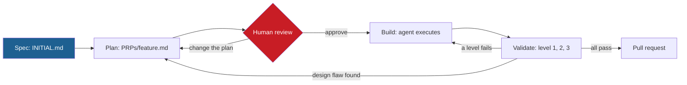
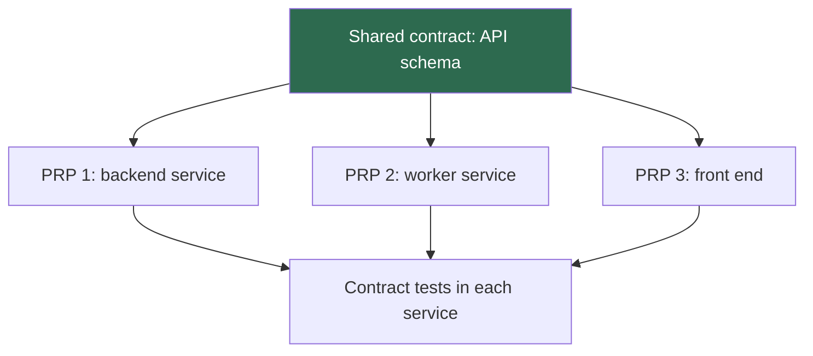

## 1. The question this idea answers

Lesson [L2](/notes/ai/context-engineering/09-production/l2-the-project-files) produced a good spec in INITIAL.md. Why not give it to the agent and let it code? What does a plan add, and who checks the plan?

The handbook's answer is the PRP workflow: spec, plan, build, validate. The lecture, the FAQ and the upstream repository describe it in three different ways. This lesson teaches the idea, reconciles the three versions and writes a full PRP for a small feature.

## 2. Mental model

> [!analogy] A building permit and staged inspections
> A builder does not start a house from a sketch on a napkin. An architect draws the plans. The city checks the plans before anyone pours concrete. A mistake on paper costs an eraser. A mistake in concrete costs a demolition. Then inspectors check the work in stages: the foundation before the frame, the frame before the walls.
>
> The PRP is the plan. The human review of the PRP is the permit check. The validation levels are the staged inspections ([L4](/notes/ai/context-engineering/09-production/l4-validation-loops)).
>
> **Where it stops working:** an architect needs weeks for a plan. An agent writes a draft PRP in minutes. So the expensive step is no longer the drawing. It is your review of it. Also, the inspections are commands that the agent runs itself, not people.

## 3. Terms

| Term | Plain meaning |
|---|---|
| PRP (Product Requirements Prompt) | A plan document that an agent executes. It holds the goal, the context to read, the files to change in order, the validation commands and the known risks. |
| review gate | A step where a human must approve an artifact before the next phase starts. |
| context to assemble | The ordered list of files that the agent must read before it writes code. |
| implementation blueprint | The exact files to create or change, their order and the key logic of each. |
| success criteria | A checklist of statements that a test or a person can verify, one by one. |
| validation checkpoint | One level of checks in a PRP: an exact command and the expected result. |
| known risk | A trap identified during planning, with its likelihood and a mitigation. |
| broken intermediate state | A point during a change where the code does not import, build or pass tests, because a dependency is not written yet. |
| shared contract | An agreed interface, for example an API schema, that two services or two PRPs both follow. |

## 4. Method and math

### 4.1 The name and the origin

> [!note] Source check: what PRP stands for, and who introduced it
> **Corrected.** The lecture (Session 7, §2.3) expands PRP as "Product Requirements for Prompts". The FAQ (Q1) says "Product Requirements Prompt" and names Cole Medin's repository coleam00/context-engineering-intro as the origin. The upstream README says "PRPs (Product Requirements Prompts)". The idea is older than that repository: Rasmus Widing's Wirasm/PRPs-agentic-eng has its first commit on 2025-06-11, and coleam00's repository on 2025-07-01. Widing's README defines it: "Product Requirement Prompt (PRP) = PRD + curated codebase intelligence + agent/runbook". The coleam00 repository does not credit it. Teach it this way: Rasmus Widing introduced PRP in June 2025, and Cole Medin's template made it popular in July 2025. Checked on 2026-10-12.

Widing's definition is a good summary. A PRD (product requirements document) says what to build. A PRP adds two things that an agent needs: the facts about this codebase, and the steps and checks to run.

### 4.2 Four phases, four artifacts

The lecture (Session 7, §3) gives four phases. Each one produces the input of the next.



| Phase | Who acts | Artifact | Command (this course) |
|---|---|---|---|
| Spec | You | `INITIAL.md` | none |
| Plan | The agent drafts, you review | `PRPs/<feature>.md` | `/create-prp INITIAL.md` |
| Build | The agent | Code and tests | `/execute-prp PRPs/<feature>.md` |
| Validate | The agent runs, you check level 3 | Passing checks | the PRP's commands |

> [!note] Source check: /create-prp and /generate-prp
> **Corrected.** The lecture (Session 7, §3.2, §4.3, §5 and §6) uses `/create-prp INITIAL.md`. The upstream repository names the command `/generate-prp INITIAL.md`, and it has no `/create-prp`. This course keeps the handbook's name `/create-prp` for its own skill. Know both names when you read other material. Checked on 2026-10-12.

### 4.3 Why plan before code: the review gate

The lecture's key concept (Session 7, §3.2) is "The PRP is your review gate." The plan makes three things visible before any code exists:

1. **The files that the agent will read.** A wrong list means the agent invents an interface. You see this in one line of the plan, not in a failed build.
2. **The order of changes.** A wrong order leaves broken intermediate states.
3. **The design decisions.** For example, where to validate input, or how to make a write safe. These are cheap to change on paper.

The FAQ (Q46) gives a rule of thumb: writing INITIAL.md takes 15 to 30 minutes and saves 2 to 3 hours of corrections. No source measures this. Record your own times (exercise 3.4) and keep your own number.

### 4.4 Three versions, one table

The lecture, the FAQ and the upstream repository describe the same workflow with different names and details.

| Item | Lecture (Session 7) | FAQ (Session 7) | Upstream coleam00 template |
|---|---|---|---|
| PRP stands for | "Product Requirements for Prompts" | "Product Requirements Prompt" | "Product Requirements Prompts" |
| Phases | Spec, Plan, Build, Validate | Setup, Request, Generate, Execute | README steps: rules (CLAUDE.md), examples, INITIAL.md, generate the PRP, execute the PRP |
| Plan command | `/create-prp` | `/generate-prp` | `/generate-prp` |
| INITIAL.md sections | Five (adds Specific Requirements) | Feature, examples, docs, gotchas | Four: FEATURE, EXAMPLES, DOCUMENTATION, OTHER CONSIDERATIONS |
| PRP sections | Six (section 4.5) | not listed | Ten headings in `prp_base.md` (section 4.5) |
| Level 1 | Type check and lint: `npx tsc --noEmit` | Syntax and style: ruff, prettier, mypy | Syntax and style: `ruff check --fix`, `mypy` |
| Level 2 | Unit tests: `npm test` | Unit tests: pytest or jest | Unit tests: `uv run pytest` |
| Level 3 | Visual review by a human | Integration tests | Integration test: start the service, then `curl -X POST` |
| ULTRATHINK | In `/execute-prp` | In `/generate-prp` | In both command files |
| Stack | TypeScript and React | Mixed | Python |

The phase names map as follows. Setup is the precondition: CLAUDE.md and `examples/` exist before the first feature. Request is Spec. Generate is Plan. Execute covers Build and Validate. Lesson [L4](/notes/ai/context-engineering/09-production/l4-validation-loops) resolves the level 3 difference, and lesson [L5](/notes/ai/context-engineering/09-production/l5-commands-skills-and-hooks) explains what ULTRATHINK does today.

### 4.5 Anatomy of a PRP

The lecture (Session 7, §3.2.1) gives six sections. Each one prevents a specific failure.

| Section | What it holds | Failure it prevents |
|---|---|---|
| Goal | One sentence | Scope creep: the agent builds more or less than you want. |
| Success Criteria | A checklist of verifiable statements | "Done" with no definition of done |
| Context to Assemble | Files to read, in order, with the reason for each | Invented imports and interfaces |
| Implementation Blueprint | Files to create and change, their order, key logic, decisions | Broken intermediate states, and design decided by default |
| Validation Checkpoints | Three levels, each with an exact command and the expected result | Unchecked code, and "it should work" |
| Known Risks | A table of risk, likelihood and mitigation | Traps that a planner could see but the builder did not |

The upstream template is `PRPs/templates/prp_base.md`, named "Base PRP Template v2 - Context-Rich with Validation Loops". Its ten headings, in order:

1. Purpose
2. Core Principles
3. Goal
4. Why
5. What, with a Success Criteria subsection
6. All Needed Context
7. Implementation Blueprint
8. Validation Loop
9. Final validation Checklist
10. Anti-Patterns to Avoid

| Lecture section | Upstream equivalent |
|---|---|
| Goal | Goal, Why and What |
| Success Criteria | "Success Criteria" under What, plus the Final validation Checklist |
| Context to Assemble | All Needed Context: documentation and references, the current and desired codebase trees, "Known Gotchas of our codebase & Library Quirks" |
| Implementation Blueprint | Implementation Blueprint: data models, the ordered task list, pseudocode for each task, integration points |
| Validation Checkpoints | Validation Loop: Level 1 Syntax and Style, Level 2 Unit Tests, Level 3 Integration Test |
| Known Risks | No table. The nearest parts are "Known Gotchas" and "Anti-Patterns to Avoid". |

> [!note] Source check: the six-section PRP
> **Corrected.** The lecture (Session 7, §3.2.1 and §3.2.2) presents its six-section template as the PRP template. It is the handbook's adaptation. The upstream template has the ten headings above and no Known Risks table. Both work. The upstream version holds more codebase facts. The lecture version is shorter and easier to review. Source: coleam00/context-engineering-intro, `PRPs/templates/prp_base.md`, checked on 2026-10-12.

The upstream `generate-prp.md` also asks the agent to score the PRP from 1 to 10. The score is its confidence that one pass will succeed (checked on 2026-10-12). Treat a low score as a signal to add context before you execute.

### 4.6 A full PRP for a small feature

This PRP follows the lecture's six sections and the INITIAL.md of lesson [L2](/notes/ai/context-engineering/09-production/l2-the-project-files), section 4.6.

> [!example] Worked example: PRPs/session-summary.md
> ```text
> # PRP: Session summary export
>
> ## Goal
> ResearchSession.save_summary() writes a validated JSON summary of a finished session
> to disk atomically, and POST /sessions/{session_id}/summary exposes it.
>
> ## Success Criteria
> - [ ] save_summary(d) returns d / "<session_id>.summary.json". The file parses as SessionSummary.
> - [ ] A session with 0 turns writes summary "" and makes no model call.
> - [ ] A failed write raises SummaryWriteError and leaves no .json and no .tmp file.
> - [ ] POST returns 201 and {"path": ...}. Unknown id: 404. Invalid id: 422.
> - [ ] ruff, mypy and pytest pass. The diff adds no "# type: ignore" and no "# noqa".
>
> ## Context to Assemble (read before implementing)
> 1. app/schemas/session.py -- shared models. SessionSummary goes here.
> 2. app/core/session.py -- history, usage totals, lifecycle.
> 3. app/llm/client.py -- the only model call site. How usage comes back.
> 4. app/errors.py -- DomainError, and how app/api maps it to HTTP codes.
> 5. examples/endpoint_example.py -- router layout and error mapping to copy.
> 6. examples/test_example.py -- the FakeLLMClient fixture and tmp_path use.
>
> ## Implementation Blueprint
> ### Files to Create
> app/api/summary.py              <- POST /sessions/{session_id}/summary
> tests/test_session_summary.py   <- unit tests for save_summary
> tests/test_summary_api.py       <- API tests with the test client
> ### Files to Modify
> app/schemas/session.py          <- add SessionSummary
> app/errors.py                   <- add SummaryWriteError(DomainError)
> app/core/session.py             <- add save_summary()
> app/main.py                     <- register the summary router
> ### Implementation Order
> 1. app/schemas/session.py -- first, because every other file imports the model.
> 2. app/errors.py -- the error type that core raises.
> 3. app/core/session.py -- build the model, make one LLM call (none for 0 turns),
>    write <name>.tmp in the same directory, then os.replace. On error, delete the
>    .tmp file and raise SummaryWriteError.
> 4. tests/test_session_summary.py -- happy path, 0 turns, write failure.
> 5. app/api/summary.py and app/main.py -- validate session_id, map errors.
> 6. tests/test_summary_api.py -- 201, 404, 422.
> ### Key Decisions Made During Planning
> - Atomic write with os.replace: a crash never leaves half a JSON file.
> - session_id is checked in app/api with the pattern [a-z0-9-]{1,64}. This blocks
>   path traversal before core sees the value.
> - Token totals come from logged usage: no second count and no tokenizer mismatch.
>
> ## Validation Checkpoints
> ### Level 1: Type Check + Lint
> uv run ruff check app tests && uv run mypy app
> Expected: no errors and no new suppression comments.
> ### Level 2: Unit Tests
> uv run pytest tests/test_session_summary.py tests/test_summary_api.py -v
> Required tests:
> - test_save_summary_writes_valid_json -- the file parses as SessionSummary
> - test_save_summary_empty_session_no_llm_call -- the fake client counts 0 calls
> - test_save_summary_write_failure_leaves_no_file -- os.replace patched to raise
> - test_summary_endpoint_unknown_session_404
> - test_summary_endpoint_rejects_invalid_id_422 -- id "..etc" fails the pattern
> ### Level 3: Integration Test
> uv run uvicorn app.main:app --port 8000
> curl -X POST http://localhost:8000/sessions/demo-1/summary
> Expected: HTTP 201 and a path. The file exists and parses.
>
> ## Known Risks
> | Risk | Likelihood | Mitigation |
> | Path traversal through session_id | Med | Pattern check in app/api, plus a test |
> | Partial file after a crash | Low | Temp file and os.replace in the same directory |
> | Summary longer than 300 words | Med | max_tokens=600, a word count, one retry |
> | Disk full | Low | SummaryWriteError and a 500 with a clear message |
> ```

Read the PRP as a reviewer. Every success criterion has a test or a command. Every file in the blueprint depends only on files earlier in the order. The two security and reliability decisions (the id pattern and the atomic write) are explicit, so you can disagree with them now.

### 4.7 How to review a PRP

The lecture (Session 7, §5.1) lists three checks. Context to Assemble lists the right files. The blueprint order is right. The validation checkpoints are specific. A fuller review checklist:

1. **Context:** every listed file exists, and no key file is missing. Compare the list with the key files in CLAUDE.md.
2. **Order:** no step imports something from a later step.
3. **Criteria:** each success criterion maps to a named test or a command.
4. **Commands:** each validation command runs as written, from the repository root.
5. **Decisions:** each key decision has a reason, and you agree with it.
6. **Risks:** security risks (input from users, file paths, secrets) appear in the table.
7. **Scope:** the PRP does not change files that the spec does not need.

If the review finds a problem, edit the PRP, not the code. The plan is the cheapest place to fix a design.

### 4.8 Features that span many files or services

The FAQ (Q16) gives three rules.

1. **List every file and its dependencies.** Put them in OTHER CONSIDERATIONS of INITIAL.md, so that the plan starts complete.
2. **Order the blueprint.** The order must avoid broken intermediate states. For a web feature, a typical order is the database migration, the model, the API endpoint, the tests and the front end. Each step depends only on earlier steps.
3. **Split by service.** Write one PRP for each service. Each PRP references the others and follows one shared contract, for example an OpenAPI schema or a Pydantic model package. If the work needs several agents, use an orchestrator and sub-agents with shared contracts (lessons [7.7](/notes/ai/context-engineering/07-compress-and-isolate/l7-isolate-one-window-is-not-enough) and [7.9](/notes/ai/context-engineering/07-compress-and-isolate/l9-contract-first-design)).



The contract comes first and changes only through review. Each service then has its own small PRP with its own validation, plus a contract test.

### 4.9 When a PRP is overkill

The FAQ (Q46) says that typing a request directly works well for small, single-file tasks. It also suggests that direct typing hits a ceiling at about 500 to 1,000 lines of change. That number is a rule of thumb with no source. Claude Code's best practices give a sharper test for when to skip a plan: "If you could describe the diff in one sentence, skip the plan."

| Task | Use |
|---|---|
| A one-sentence change: rename, small bug fix, one test | Type the request directly. |
| One file, a few decisions | Plan mode in Claude Code: review the plan in the session ([L5](/notes/ai/context-engineering/09-production/l5-commands-skills-and-hooks)). |
| Several files, edge cases, existing patterns to follow | INITIAL.md and a PRP |
| Several services or teams | One PRP per service, with a shared contract |

For a solo developer, the FAQ (Q49) keeps a minimum of four things:

1. A CLAUDE.md.
2. An `examples/` folder with 2 or 3 real files.
3. A short INITIAL.md for each feature.
4. An evaluation script with 20 cases.

It skips formal commands, CI evaluations and registries until the project needs them. The FAQ calls this "the 20% of PRP that gives 80% of the value", which is also a rule of thumb.

### 4.10 The DOCUMENTATION section and web access

> [!note] Source check: "agents cannot search the web"
> **Corrected.** The FAQ (Q2) says that INITIAL.md lists URLs because agents "cannot search the web independently". The upstream `generate-prp.md` says the opposite: "The Agent has Websearch capabilities, so pass urls to documentation and examples." Claude Code has web tools. The real reason to list URLs is control. You choose the exact version of the docs that the agent reads. A search can return an old or wrong page. Checked on 2026-10-12.

### 4.11 Production view

| Concern | What this lesson means for it |
|---|---|
| Reliability | The review gate catches design errors before code exists. The validation levels catch code errors before review. |
| Security | The Known Risks table forces a security pass at plan time: user input, paths, secrets. |
| Team work | A PRP is reviewable by a teammate who did not write the spec. It is the record of why the code looks as it does. |
| Cost | A PRP adds one planning call and one human review. It saves repeated build attempts. Measure both. |
| Scale | Large changes split into PRPs per service, linked by shared contracts. |

## 5. Code

These exercises go in `notebooks/09-production.ipynb`. The PRP checker is a module in `src/prp_check.py`, with tests in `tests/`.

**Exercise 3.1: write a PRP by hand.**

1. Take the INITIAL.md that you wrote in exercise 2.4, or the summary export spec of lesson 9.2.
2. Write the PRP in the six-section format, with exact commands for your stack.
3. Swap with a colleague, or open a fresh session, and review it with the checklist of section 4.7.

Acceptance tests:

- Each success criterion maps to a named test or a command.
- Each validation command runs from the repository root without edits.

**Exercise 3.2: a PRP checker.**

1. Write `check_prp(path: Path, repo_root: Path) -> list[str]` that returns a list of problems.
2. Check three things. The six section headings exist. Each file under Context to Assemble exists. Each of the three levels has at least one command line.
3. Check that no blueprint step names a file that appears only in a later step's "Files to Create" list.

Acceptance tests:

- The worked example of section 4.6, in a repository that has those files, gives no problems.
- A PRP without a Level 3 command gives one problem that names Level 3.
- A PRP that lists a file that does not exist gives a problem with that path.

**Exercise 3.3: reconcile from memory.** Without looking, write the table of section 4.4. Then compare it with the lesson and mark each error.

**Exercise 3.4: measure the rule of thumb.** Do your next three real features with a PRP. For each one, record the minutes for the spec, the plan review and the corrections after the build. Compare with one feature done by typing the request directly.

## 6. Common mistakes

1. **"PRP means Product Requirements for Prompts, and Cole Medin invented it."** Upstream says "Product Requirements Prompts". Rasmus Widing's repository is older.
2. **"The agent wrote the PRP, so it is correct."** The PRP is a review gate. Its value is your review.
3. **"The lecture's six sections are the PRP standard."** They are the handbook's adaptation of a ten-heading upstream template.
4. **"Fix a bad plan in the code."** Fix it in the PRP and execute again. The plan is the cheapest place to change a design.
5. **"Every change needs a PRP."** A one-sentence change does not. Use plan mode for small multi-step tasks.
6. **"List URLs because the agent cannot search."** It can. List them to control which version of the docs it reads.

## 7. One-minute explanation

The PRP workflow has four phases: spec, plan, build and validate. You write the spec in INITIAL.md. The agent drafts a PRP, a Product Requirements Prompt. It holds the goal, the success criteria and the files to read and to change, in order. It also holds the validation commands for three levels and the known risks. Then you review the plan. This is the key step, because a design error on paper costs one edit, and in code it costs a rebuild. After approval, the agent builds in blueprint order and runs the levels in order. The lecture, the FAQ and the upstream repository use different names and a different level 3, but the idea is the same. Rasmus Widing introduced PRP, and Cole Medin's template made it popular. Skip the PRP for one-sentence changes.

## 8. Check questions

```check
{
  "question": "A PRP's blueprint says: 1. app/api/summary.py, 2. app/schemas/session.py (add SessionSummary), 3. app/core/session.py. What is wrong, and what is the fix?",
  "hint": "Check what each file imports.",
  "answer": "Step 1 imports SessionSummary, which step 2 creates, so after step 1 the code does not import: a broken intermediate state. Put the schema first, then core, then the API layer."
}
```

```check
{
  "question": "Map the FAQ phases Setup, Request, Generate and Execute to the lecture phases.",
  "answer": "Setup is the precondition: CLAUDE.md, permissions and examples/ exist before the first feature. Request is Spec (INITIAL.md). Generate is Plan (the PRP). Execute covers Build and Validate."
}
```

```check
{
  "question": "The lecture's level 3 is a human visual review. The FAQ's and upstream's level 3 is an integration test. Which is right?",
  "answer": "Both are valid level 3 checks for different systems. A backend service needs an integration test: start the service and call it. A user interface also needs a person to check layout and behavior. Upstream is a Python service, so it uses an integration test with curl. Lesson 9.4 covers this."
}
```

```check
{
  "question": "Your PRP review finds that Context to Assemble does not list app/llm/client.py, the only module that calls the model. What failure does this invite, and where do you fix it?",
  "answer": "The agent may write its own model call, or invent the client's interface, which skips retries and usage logging. Fix it in the PRP: add the file to Context to Assemble with the reason, then execute."
}
```

```check
{
  "question": "Which of these tasks needs a PRP: (a) rename a variable in one file, (b) add an endpoint that writes files and calls the model, (c) change an API used by three services?",
  "answer": "(a) No: describe it in one sentence and type it. (b) Yes: several files, edge cases and security decisions. (c) Yes, as one PRP per service with a shared contract that changes first and goes through review."
}
```

## 9. Links

- Previous: [L2: The project files](/notes/ai/context-engineering/09-production/l2-the-project-files)
- Next: [L4: Validation loops](/notes/ai/context-engineering/09-production/l4-validation-loops)
- [Lesson 7.9: Contract-first design](/notes/ai/context-engineering/07-compress-and-isolate/l9-contract-first-design)
- [Glossary](/notes/ai/context-engineering/glossary)
