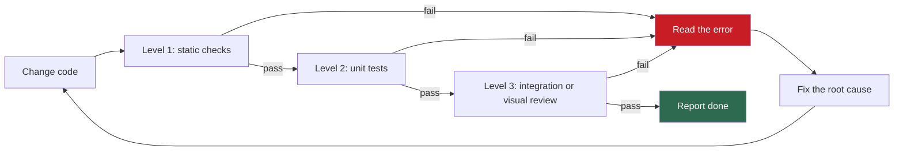

## 1. The question this idea answers

An agent finishes a feature and reports "done". How do you know that the code works? And how does the agent know, before it reports?

The answer is a **validation loop**: commands that the agent runs after each change, reads, and acts on. Anthropic's Claude Code best practices put this first. Their advice is "Give Claude a check it can run: tests, a build, a screenshot to compare."

This lesson orders the checks and shows with numbers why the order matters. It also closes the main loophole: an agent that makes a check pass by disabling it.

## 2. Mental model

> [!analogy] Quality gates in a car factory
> A factory checks a car in stages. First, cheap checks: do the parts fit, are the bolts tight? Then component tests: do the brakes stop the wheel? Last, the expensive check: a test drive on a track. Nobody takes a car with a missing bolt to the track. The cheap gate finds that fault in seconds, and it says exactly which bolt.
>
> **Where it stops working:** a car cannot remove the inspector. An agent can. It can delete a test, add a comment that silences the type checker, or skip the failing case. So a validation loop for an agent needs one more part. The agent must not be able to change the checks, and a machine must enforce that rule.

## 3. Terms

| Term | Plain meaning |
|---|---|
| validation loop | The cycle in which an agent runs checks, reads the errors, fixes the cause and runs the checks again until they pass. |
| static check | A check that reads the code without running it, such as a type check or a lint. |
| type checker | A tool that finds type errors without running the code. Examples: mypy for Python, `tsc` for TypeScript. |
| linter | A tool that finds likely bugs and style problems by rules. Examples: Ruff for Python, ESLint for JavaScript and TypeScript. |
| formatter check | A run of a code formatter that reports unformatted files without changing them, for example `prettier --check`. |
| unit test | A test of one function or class in isolation, with fakes for slow or external parts. |
| integration test | A test that runs several parts together, for example the real service called through HTTP. |
| visual review | A person examines a running user interface to check layout, behavior and accessibility. |
| suppression directive | A comment that tells a checker to ignore a line or a test, such as `# type: ignore` or `@ts-ignore`. |
| exit code | The number a command returns when it ends. 0 means success. Any other value means failure. |
| fail fast | Stop at the first failed check, so that later, slower checks do not run on broken code. |

## 4. Method and math

### 4.1 The loop



The upstream PRP template states the inner step in one line: "If failing: Read error, understand root cause, fix code, re-run (never mock to pass)". Each word matters. "Read error" means the agent uses the message, not a guess. "Root cause" means the fix changes the code that is wrong, not the check that found it.

### 4.2 Three levels

| Level | What runs | Python | TypeScript | What it catches |
|---|---|---|---|---|
| 1: Static checks | Type check, lint, format check | `uv run ruff check app tests` and `uv run mypy app` | `npx tsc --noEmit`, `npx eslint .`, `npx prettier --check .` | Wrong imports, missing attributes, type mismatches, unused code, style |
| 2: Unit tests | Tests of single functions with fakes | `uv run pytest -q` | `npm test` | Logic errors, missing edge cases |
| 3: Integration or visual review | The real service, end to end. A person for a user interface. | Start the service, then `curl` | `npm run dev`, then a person or an end-to-end test | Wiring, configuration, layout, accessibility |

The tools, in their own words (checked on 2026-10-12):

- mypy: "Mypy is a static type checker for Python."
- Ruff: "An extremely fast Python linter and code formatter, written in Rust."
- `tsc --noEmit`: "Do not emit compiler output files like JavaScript source code, source-maps or declarations." So it only type-checks.
- Prettier: "When you want to check if your files are formatted, you can run Prettier with the `--check` flag". It returns exit code 1 when a file is not formatted.

> [!note] Source check: flags with dashes
> **Corrected.** The handbook (Session 7, Table 3 and FAQ Q6) prints "npx tsc –noEmit" and "prettier –check" with an en dash. These are PDF conversion errors. The flags have two hyphens: `--noEmit` and `--check`. The tools do not read the en-dash form as a flag, so a copied command fails. Sources: TypeScript and Prettier docs, checked on 2026-10-12.

> [!note] Source check: what level 3 is
> **Corrected.** The lecture (Session 7, §3.4) makes level 3 a human visual review with `npm run dev`. The FAQ (Q6) makes it integration tests. The upstream template's level 3 is "Integration Test": start the service with `uv run python -m src.main --dev`, then send a `curl -X POST`. The two are not rivals. A backend needs the integration test. A user interface needs both, because no automatic check judges layout well. Use the integration test as level 3, and add a human visual review when the change touches a user interface. Source: coleam00/context-engineering-intro, `PRPs/templates/prp_base.md`, checked on 2026-10-12.

### 4.3 Why the order matters: expected cost

Assume that each check either passes or fails, and that the loop stops at the first failure. Let check $k$ cost $c_k$ seconds and fail with probability $p_k$, independently of the others. The expected time of one pass through the loop, with checks run in the order $1, 2, \ldots, n$, is:

$$
E = \sum_{k=1}^{n} c_k \prod_{j<k} (1 - p_j)
$$

The symbols mean:

- $c_k$: the time that check $k$ takes.
- $p_k$: the probability that check $k$ fails on this change.
- $\prod_{j<k}(1-p_j)$: the probability that all checks before $k$ passed, so that check $k$ runs at all. For $k = 1$ the product is empty and equals 1.

A swap of two neighboring checks shows which order is best. Check $a$ should run before check $b$ when $c_a / p_a < c_b / p_b$. So sort the checks by **cost per probability of failure**, smallest first.

> [!example] Worked example: three levels, two orders
> Assume these values for one change: level 1 takes 15 s and fails with $p = 0.30$. Level 2 takes 90 s and fails with $p = 0.25$. Level 3 takes 600 s and fails with $p = 0.10$.
>
> **Cheap first (1, 2, 3):**
>
> $$
> E = 15 + 0.70 \times 90 + 0.70 \times 0.75 \times 600 = 15 + 63 + 315 = 393 \text{ s}
> $$
>
> **Expensive first (3, 2, 1):**
>
> $$
> E = 600 + 0.90 \times 90 + 0.90 \times 0.75 \times 15 = 600 + 81 + 10.1 \approx 691 \text{ s}
> $$
>
> The ratios $c/p$ are 50, 360 and 6,000, so the rule also gives the order 1, 2, 3. Of all six possible orders, 1, 2, 3 has the lowest expected time.

Two things make the real gap larger than this example:

1. **Diagnosis time.** A level 1 error names the file and the line. The same fault found at level 3 shows only a symptom, such as a 500 error, and needs a search through logs.
2. **The loop repeats.** An agent often runs the loop several times on one feature. Each failed pass pays the expected cost again.

When every check passes, all levels run anyway (705 s here). So the order changes the cost of failing passes only. In an agent loop, most passes before the last one fail.

### 4.4 The wrong-import example

The handbook (Session 7, §3.4) explains the order with one case. A type error at level 1 often reveals a wrong import, "for example, types/chat.ts instead of lib/api.ts". If you skip to level 3, you debug what looks like a visual problem but is a type problem.

The same case in Python:

```python
# app/core/session.py, written by the agent
from app.schemas.session import ChatTurn

def total_tokens(turns: list[ChatTurn]) -> int:
    return sum(t.tokens for t in turns)  # the model has input_tokens and output_tokens
```

| Where you find it | What you see | Time to the cause |
|---|---|---|
| Level 1: `mypy app` | An error at this file and line: `ChatTurn` has no attribute `tokens` | Seconds |
| Level 2: a unit test of `total_tokens` | An `AttributeError` with a traceback | About a minute |
| Level 3: the running service | The summary endpoint returns 500. Other endpoints work. | Minutes in logs |

The fault is the same in all three rows. Only the cost of finding it changes.

### 4.5 Fix, don't disable

The lecture (Session 7, §3.3) states the rule "Fix, Don't Disable": "no @ts-ignore, no it.skip(), no eslint-disable." The FAQ (Q6) adds: never skip, comment out or delete a failing test. Fix the code, or fix the test if the test is wrong.

Why an agent breaks the rule: the shortest path to a passing check is often to disable the check. The agent optimizes for "all checks pass". Lesson [L6](/notes/ai/context-engineering/09-production/l6-evaluation) calls this reward hacking.

| Language | Common suppression forms |
|---|---|
| Python | `# type: ignore`, `# noqa`, `@pytest.mark.skip`, `pytest.skip()`, a deleted `assert`, a mock that returns the expected value |
| TypeScript and JavaScript | `@ts-ignore`, `@ts-expect-error`, `// eslint-disable-next-line`, `it.skip()`, `describe.skip()`, a type cast to `any` |

The upstream template's "Anti-Patterns to Avoid" list holds the root of the rule: "Don't skip validation because "it should work"" and "Don't ignore failing tests - fix them". Anthropic's prompting guide says: "It is unacceptable to remove or edit tests because this could lead to missing or buggy functionality." The Claude Code best practices say: "address the root cause, don't suppress the error".

Some suppressions are correct, for example a third-party library without type information. Allow them only in a narrow form: one line, a specific error code, a reason in the comment, and a human reviewer.

### 4.6 Enforce the rule with a machine

> [!note] Source check: "Fix, Don't Disable" as a command rule
> **Corrected.** The lecture (Session 7, §3.3) says that the `/execute-prp` command enforces "Fix, Don't Disable". A command file is a prompt, and prompts advise. The Claude Code docs say that CLAUDE.md content is "context, not enforced configuration". They add: "To block an action regardless of what Claude decides, use a PreToolUse hook instead." Enforce the rule with a hook, a linter setting or CI. Source: Claude Code docs, "Memory" and "Hooks", checked on 2026-10-12.

Three layers, from closest to the agent to the last line of defense:

| Layer | Mechanism | What it stops |
|---|---|---|
| Tool settings | ESLint `noInlineConfig: true` or `--no-inline-config` ignores disable comments. `linterOptions.reportUnusedDisableDirectives` reports stale ones. | Inline disables in JavaScript and TypeScript |
| Claude Code hooks | A PreToolUse hook on `Edit` and `Write` that exits with code 2 blocks the edit. A Stop hook can block the end of a turn until the checks pass ([L5](/notes/ai/context-engineering/09-production/l5-commands-skills-and-hooks)). | The agent's own edits, during the session |
| CI | A job that scans the diff for new suppressions, made a required status check ([L7](/notes/ai/context-engineering/09-production/l7-evals-in-ci-and-versioning)) | Every change from any source, before merge |

> [!example] Worked example: a CI diff check for new suppressions
> ```bash
> #!/usr/bin/env bash
> set -euo pipefail
> pattern='(# type: ignore|# noqa|pytest\.mark\.skip|@ts-ignore|@ts-expect-error|eslint-disable|it\.skip|describe\.skip)'
> diff=$(git diff --unified=0 origin/main...HEAD -- '*.py' '*.ts' '*.tsx')
> added=$(printf '%s\n' "$diff" | grep -E '^\+[^+]' | grep -E "$pattern" || true)
> if [ -n "$added" ]; then
>   echo "New suppression found. Fix the cause instead:"
>   echo "$added"
>   exit 1
> fi
> echo "No new suppressions."
> ```
> The `git diff` runs on its own line, so `set -e` stops the script if the diff fails, for example when `origin/main` is missing. The first `grep` keeps only added lines and drops the `+++` file headers. The second `grep` keeps lines with a suppression. The `|| true` stops `set -e` from ending the script when nothing matches. An added line that holds a suppression ends the job with exit code 1, so the check fails.

The check looks only at added lines. A change that removes a suppression passes, which is what you want. In CI, fetch the base branch before the script runs, for example with `fetch-depth: 0` in `actions/checkout`. A shallow clone has no `origin/main`.

### 4.7 The same ladder for run-time context

The three levels also apply to the context of your product (lesson [L1](/notes/ai/context-engineering/09-production/l1-context-is-the-product), section 4.4), not only to code.

| Level | For code | For a prompt, a tool description or a JIT instruction |
|---|---|---|
| 1: Static | Type check, lint | Token count under the budget. All template variables filled. Tool schemas are valid JSON Schema. No timestamp or ID near the top (lesson [1.7](/notes/ai/context-engineering/01-foundations/l7-prompt-caching)). |
| 2: Unit | Unit tests | Deterministic checks on single outputs: valid JSON, required facts present, forbidden phrases absent |
| 3: Integration | Integration test | The evaluation suite on a ground truth set, with a calibrated judge ([L6](/notes/ai/context-engineering/09-production/l6-evaluation), [L7](/notes/ai/context-engineering/09-production/l7-evals-in-ci-and-versioning)) |

The cost argument of section 4.3 holds here too. A token count takes milliseconds. A judged evaluation of 100 cases takes minutes and costs money.

### 4.8 How many tests?

Martin Fowler's test pyramid (2012, crediting Mike Cohn) says to have "many more low-level UnitTests than high level BroadStackTests running through a GUI". Unit tests are fast and precise. Broad tests are slow and say less about the cause.

The FAQ (Q6) asks for at least three tests per function: a happy path, an edge case and a failure case. This comes from the upstream CLAUDE.md, which asks for "1 test for expected use, 1 edge case, 1 failure case". It is a good default and a rule of thumb, not a law. A pure function with many branches needs more. A thin wrapper may need one.

### 4.9 Production view

| Concern | What this lesson means for it |
|---|---|
| Reliability | The agent's "done" means "all three levels passed", not "I think it works". |
| Latency of development | Cheap checks first. Sort by cost per probability of failure. |
| Security | Suppressions can hide real faults. Block new ones with a hook and with CI. |
| Cost | Level 3 for run-time context calls a model. Run the full suite on merge, a smoke suite on each pull request ([L7](/notes/ai/context-engineering/09-production/l7-evals-in-ci-and-versioning)). |
| Observability | Log each level's command, time and exit code. A level that fails often is a design signal. |

## 5. Code

These exercises go in `notebooks/09-production.ipynb`. The scripts go in `scripts/`, and reusable code in `src/`, with tests in `tests/`.

**Exercise 4.1: a validation runner.**

1. Write `scripts/validate.py` that runs a list of levels. Each level has a name and one or more commands.
2. Run the levels in order. Stop at the first command with a non-zero exit code.
3. Print a table: level, command, seconds, exit code. Exit with the failed command's code, or 0.

Acceptance tests:

- With a deliberate wrong attribute in one module, the run stops at level 1 and never starts the tests.
- With all checks green, the exit code is 0 and the table has a row for every command.

**Exercise 4.2: a suppression scanner.**

1. Write `find_new_suppressions(diff_text: str) -> list[Finding]` in `src/no_suppressions.py`. A finding holds the file, the line and the pattern.
2. Read only added lines. Ignore removed lines and the `+++` headers.

Acceptance tests:

- A diff that adds `# type: ignore` gives one finding with the right file.
- A diff that removes `@ts-ignore` gives no finding.
- A diff that adds `@pytest.mark.skip(reason="flaky")` gives one finding.

**Exercise 4.3: the best order.** Write `expected_cost(order)` with the formula of section 4.3, and `best_order(checks)` that tries every order. Check that the result matches a sort by $c/p$.

Acceptance test: the worked example gives 393 s for the order 1, 2, 3 and about 691 s for 3, 2, 1.

**Exercise 4.4: three tests for one function.** Take `chunk_text` from lesson [4.5](/notes/ai/context-engineering/04-write-and-rag/l5-chunking), or any function of your own. Write one happy-path test, one edge-case test and one failure-case test.

**Debug exercise 4.5.** A teammate wrote this validation script. CI reports success even when the type check fails. Find the two bugs and fix them.

```bash
#!/usr/bin/env bash
uv run ruff check app tests; uv run mypy app; uv run pytest -q
echo "validation done"
```

The answer is in the check questions.

## 6. Common mistakes

1. **"The tests pass, so the app works."** Tests check only what they test. Level 3 and the evaluation suite cover the rest.
2. **"Run the end-to-end check first, because it catches everything."** It catches faults late, slowly and with poor messages. Cheap, precise checks go first.
3. **"A suppression comment is a fix."** It hides the fault. Fix the cause. Allow narrow, reviewed exceptions only.
4. **"A rule in CLAUDE.md or in a command file enforces Fix, Don't Disable."** Prompts advise. Hooks, linter settings and CI enforce.
5. **"Level 3 is either visual review or integration tests."** A service needs integration tests. A user interface needs a person as well.
6. **"Three tests per function is a law."** It is a rule of thumb from the upstream CLAUDE.md.

## 7. One-minute explanation

A validation loop lets the agent check its own work. It runs checks, reads the errors, fixes the cause and runs the checks again. The checks come in three levels. Level 1 is static: type check and lint, for example mypy and Ruff, or `tsc --noEmit` and ESLint. Level 2 is unit tests. Level 3 is an integration test of the running service, plus a person for any user interface. Cheap checks go first, because they find most faults in seconds and name the exact line. The math says: sort checks by cost per probability of failure. The main loophole is an agent that disables a check. So the rule is fix, don't disable, and a hook or a CI job enforces it, because a prompt only advises.

## 8. Check questions

```check
{
  "question": "Check A takes 20 s and fails with probability 0.4. Check B takes 200 s and fails with probability 0.2. What is the expected time of one pass for each order, and which order is better?",
  "hint": "E = c1 + (1 − p1) c2. Compare c/p.",
  "answer": "A then B: 20 + 0.6 × 200 = 140 s. B then A: 200 + 0.8 × 20 = 216 s. A first is better. The ratios agree: c/p is 50 for A and 1,000 for B."
}
```

```check
{
  "question": "Debug exercise 4.5: why does CI report success when mypy fails? Give the fix.",
  "answer": "Bug 1: the semicolon separator runs every command whatever the result, so a failed level does not stop the next one. Bug 2: the script's exit code is the exit code of the last command, echo, which is always 0. Fix: start with set -euo pipefail, or join the commands with && so that the first failure stops the script with its exit code. Then the final echo runs only on success."
}
```

```check
{
  "question": "An agent's change adds @pytest.mark.skip(reason=\"flaky\") to a failing test, and the PR is green. What does the rule say, and which two mechanisms would have stopped it?",
  "answer": "Fix, don't disable: find why the test fails and fix the code, or fix the test if it is wrong. A PreToolUse hook that blocks edits adding the skip would stop it during the session. A CI diff check for new suppressions, set as a required status check, would block the merge."
}
```

```check
{
  "question": "Why does the handbook's wrong-import example argue for level 1 before level 3?",
  "answer": "The type checker reports a wrong import or a missing attribute in seconds, with the file and the line. At level 3 the same fault shows only a symptom, such as a broken page or a 500 error, so you spend minutes searching for the cause."
}
```

```check
{
  "question": "Give one level 1 check and one level 2 check for a system prompt, not for code.",
  "answer": "Level 1: count the prompt's tokens and fail if it is over its budget, or fail if a timestamp appears near the top. Level 2: run a few fixed inputs and assert deterministic properties of each output, for example valid JSON or a required fact present."
}
```

## 9. Links

- Previous: [L3: The PRP workflow](/notes/ai/context-engineering/09-production/l3-the-prp-workflow)
- Next: [L5: Commands, skills and hooks](/notes/ai/context-engineering/09-production/l5-commands-skills-and-hooks)
- [L7: Evals in CI and versioning](/notes/ai/context-engineering/09-production/l7-evals-in-ci-and-versioning): the required status check
- [Glossary](/notes/ai/context-engineering/glossary)
