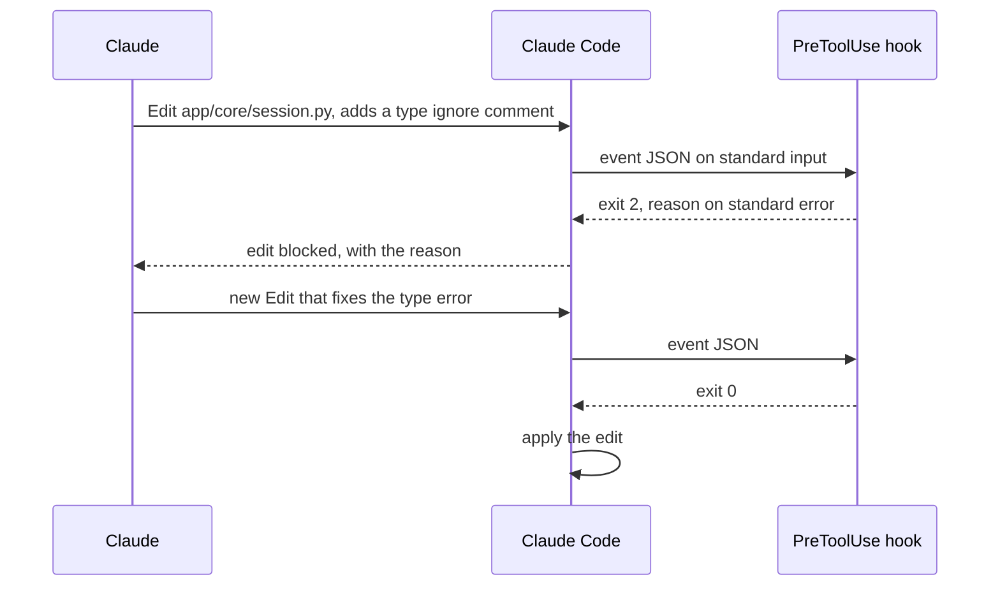

## 1. The question this idea answers

The PRP workflow repeats the same steps for every feature: draft a plan, execute it, validate it. How do you turn each step into a one-line command that the whole team uses? And how do you make some rules hold every time, instead of most of the time?

The handbook (Session 7, §4) answers the first question with custom slash commands. Claude Code changed since then. Commands are now part of skills, and the handbook never mentions hooks, plan mode or subagents. Every fact about Claude Code in this lesson was checked on 2026-10-12 in the Claude Code docs.

## 2. Mental model

> [!analogy] A professional kitchen
> A kitchen runs on four things. **Recipe cards** say how to make each dish, step by step. A **safety interlock** on the oven stops it from running with the door open, whatever the cook wants. A **sous-chef** works at a separate station and brings back only the finished sauce. Before a big service, the head chef **approves the menu plan** before anyone starts to cook.
>
> In Claude Code, skills and commands are the recipe cards. Hooks are the interlocks. Subagents are the sous-chefs. Plan mode is the menu approval.
>
> **Where it stops working:** a recipe card is still read by a cook who can deviate. Only the interlock is mechanical. And an interlock works only at the points where the oven has a sensor. A hook runs only at the lifecycle events that Claude Code exposes.

## 3. Terms

| Term | Plain meaning |
|---|---|
| slash command | A workflow that you start by typing `/name` in Claude Code. Its file holds instructions that Claude reads as a prompt. |
| skill | A folder with a `SKILL.md` file that defines a workflow. It creates the command `/name`, and Claude can also use it when its description matches the task. |
| frontmatter | A YAML block between two `---` lines at the top of a Markdown file. It holds settings such as `description`. |
| argument substitution | Claude Code replaces placeholders such as `$ARGUMENTS` in a command or skill with the text that you typed after the command name. |
| project scope | A file in the repository's `.claude/` folder. It applies to everyone who works in that repository. |
| user scope | A file in `~/.claude/`. It applies to you in all projects. |
| hook | A shell command that Claude Code runs at a fixed point in its lifecycle. It can block an action. |
| hook event | A named lifecycle point where hooks run, for example `PreToolUse` or `Stop`. |
| PreToolUse hook | A hook that runs before a tool call. With exit code 2 it blocks the call. |
| Stop hook | A hook that runs when Claude is about to end its turn. With exit code 2 it makes Claude continue. |
| plan mode | A Claude Code mode in which Claude reads files and proposes a plan, but makes no edits until you approve. |
| subagent | A separate Claude instance with its own context window, system prompt and tool permissions. The main session gives it a task and gets back a result. |
| effort level | The Claude Code setting that controls how much reasoning the model does: low, medium, high, xhigh or max, depending on the model. |
| ultrathink | A keyword in a prompt. Claude Code adds an in-context instruction to reason more on that turn. It does not change the effort level. |

## 4. Method and math

### 4.1 Advise or enforce: the map of mechanisms

The most important line in this lesson: some mechanisms **advise** the model, and others **enforce** a rule. The Claude Code best practices say: "Unlike CLAUDE.md instructions which are advisory, hooks are deterministic and guarantee the action happens."

| Mechanism | Where it lives | Who starts it | Advises or enforces | Use it for |
|---|---|---|---|---|
| CLAUDE.md and rules | `CLAUDE.md`, `.claude/rules/` | Loaded at start or on demand | Advises | Facts and conventions ([L2](/notes/ai/context-engineering/09-production/l2-the-project-files)) |
| Skill or command | `.claude/skills/<name>/SKILL.md` or `.claude/commands/<name>.md` | You, with `/name`. Claude too, unless you disable that. | Advises | Repeated workflows |
| Subagent | `.claude/agents/<name>.md` | Claude, or you by name | Advises, in its own window | Isolated tasks, such as a review |
| Plan mode | A permission mode | You | Enforces "no edits before approval" | A review gate inside one session |
| Hook | A `hooks` block in a settings file | Claude Code, at an event | Enforces | Rules that must always hold |
| Settings | `.claude/settings.json` and others | Loaded at start | Enforces permissions | Allowed tools and commands |

### 4.2 Commands are now skills

> [!note] Source check: where commands live
> **Corrected.** The handbook (Session 7, §2.5, §4.1, §4.5 and Table 6) teaches custom commands as Markdown files in `.claude/commands/` or `~/.claude/commands/`. The Claude Code docs say: "Custom commands have been merged into skills. A file at `.claude/commands/deploy.md` and a skill at `.claude/skills/deploy/SKILL.md` both create `/deploy`". Old command files still work. For new work, the docs recommend skills: "For new workflows, use skills/ instead." Source: Claude Code docs, "Skills" and "The .claude directory", checked on 2026-10-12.

| Form | Project scope | User scope |
|---|---|---|
| Skill (recommended for new work) | `.claude/skills/<name>/SKILL.md` | `~/.claude/skills/<name>/SKILL.md` |
| Command (still works) | `.claude/commands/<name>.md` | `~/.claude/commands/<name>.md` |

A skill is a folder, so it can hold more than one file, for example a template that the instructions refer to.

### 4.3 Frontmatter

> [!note] Source check: the command template
> **Corrected.** The handbook (Session 7, §4.2 and §9) gives a command template with a `# /name` title and a `## Usage` section. That is only a convention. The documented format is YAML frontmatter followed by the instructions. Source: Claude Code docs, "Skills", checked on 2026-10-12.

All frontmatter fields are optional. The docs recommend `description`. The fields that matter most for the PRP workflow:

| Field | What it does |
|---|---|
| `description` | Says what the skill does. Claude uses it to decide when the skill fits a task. |
| `argument-hint` | Shows the expected arguments in the command menu. It replaces the handbook's "Usage" section. |
| `disable-model-invocation` | With `true`, only you can start the skill. Use it for workflows with side effects. |
| `model`, `effort` | The model and the effort level for the skill. |
| `context: fork` | Runs the skill in a forked context. |

Other fields exist: `name`, `when_to_use`, `arguments`, `allowed-tools`, `disallowed-tools`, `user-invocable`, `agent`, `hooks`, `paths` and `shell`. Read the skills docs for the exact effect of the tool fields on permissions. Command files accept "The skill fields except `name` and `paths`".

### 4.4 Argument substitution

| Placeholder | Becomes |
|---|---|
| `$ARGUMENTS` | All the text after the command name |
| `$ARGUMENTS[N]` or `$N` | Argument number N, counted from 0. So `$0` is the first argument. |
| `$name` | A named argument, declared with the `arguments` field |
| `${CLAUDE_SESSION_ID}` | The ID of the current session |

Two more rules: if no placeholder receives the arguments, Claude Code appends "ARGUMENTS: <value>" to the instructions. And a line with `` !`cmd` `` runs a shell command and puts its output into the content before Claude sees it.

> [!example] Worked example: three invocations
> 1. `/execute-prp PRPs/token-budget-bar.md` with the body `Execute the PRP in $ARGUMENTS`. Claude reads `Execute the PRP in PRPs/token-budget-bar.md`. This is the handbook's example (Session 7, §4.2).
> 2. `/compare-prps PRPs/a.md PRPs/b.md` with the body `Compare $0 with $1`. Claude reads `Compare PRPs/a.md with PRPs/b.md`.
> 3. `/summarize notes.md` with a body that has no placeholder. Claude reads the body, followed by `ARGUMENTS: notes.md`.

### 4.5 Worked example: /create-prp as a skill

The handbook's `create-prp.md` (Session 7, §4.3) in the current format. The upstream name of this workflow is `/generate-prp` ([L3](/notes/ai/context-engineering/09-production/l3-the-prp-workflow)).

> [!example] Worked example: .claude/skills/create-prp/SKILL.md
> ```text
> ---
> description: Draft a PRP (plan) from a feature spec such as INITIAL.md. Writes one file in PRPs/ and changes no code.
> argument-hint: <path to the feature spec>
> disable-model-invocation: true
> ---
>
> Create a PRP for the feature spec in $ARGUMENTS.
>
> 1. Read $ARGUMENTS completely. If the file does not exist, stop and say so.
> 2. Read CLAUDE.md and every file named in the spec's EXAMPLES and DOCUMENTATION sections.
> 3. Find the files that the feature touches. Read their public interfaces.
> 4. Write PRPs/<feature-slug>.md with these sections, in this order:
>    Goal (one sentence).
>    Success Criteria (each item verifiable by a test or a command).
>    Context to Assemble (files to read, in order, each with the reason).
>    Implementation Blueprint (files to create and modify, their order, key decisions).
>    Validation Checkpoints (three levels, each with an exact command and the expected result).
>    Known Risks (risk, likelihood, mitigation).
> 5. Take every command from the Commands section of CLAUDE.md. Do not invent commands.
> 6. Do not change any code and do not run the build.
> 7. Reply with the PRP path and a list of open questions.
> ```

Why each choice:

| Choice | Reason |
|---|---|
| `disable-model-invocation: true` | The skill writes a file and starts a workflow. You decide when it runs. |
| `argument-hint` | The menu shows how to call it, so no "Usage" section is needed. |
| Step 1 checks that the file exists | An empty `$ARGUMENTS` or a typo must stop the run, not start a plan from nothing. |
| Step 5 | Commands from CLAUDE.md are tested. Invented commands fail at validation. |
| Step 6 | The handbook's "Do NOT start implementing", stated as two concrete prohibitions |
| Step 7 | Open questions go back to you, the reviewer of the plan |

The handbook's best practices for commands (Session 7, Table 4) still apply to skills:

1. One workflow step for each skill.
2. `$ARGUMENTS` for the variable part, and no hardcoded paths.
3. Project skills in the repository, personal ones in `~/.claude/`.
4. Review of skill files in pull requests.

### 4.6 Project scope, user scope and settings

| What | Project (in git) | Personal |
|---|---|---|
| Skills | `.claude/skills/` | `~/.claude/skills/` |
| Commands | `.claude/commands/` | `~/.claude/commands/` |
| Subagents | `.claude/agents/` | `~/.claude/agents/` |
| Settings, hooks, permissions | `.claude/settings.json` | `.claude/settings.local.json` (this project) or `~/.claude/settings.json` (all projects) |

Settings files are read in a fixed precedence, highest first:

1. Managed settings
2. Command line (`--settings`)
3. `.claude/settings.local.json`: personal for this project
4. `.claude/settings.json`: shared, committed
5. `~/.claude/settings.json`: user

When you answer "Yes, and don't ask again" to a permission prompt, Claude Code saves an `allow` rule in `settings.local.json`. That file is personal. The docs say: "Commit `.claude/settings.json` so everyone who clones the repository gets the same permissions, hooks, and plugins."

### 4.7 Hooks

The docs define them: "Hooks are user-defined shell commands. Claude Code runs them at specific points in its lifecycle, which gives you deterministic control". The current list has 33 events. The ones that matter most for a production workflow:

| Event | When it runs | What exit code 2 does |
|---|---|---|
| `PreToolUse` | Before a tool call | It blocks the call. A JSON decision `deny` also blocks it. |
| `PostToolUse` | After a tool call | It cannot undo the call: "Shows stderr to Claude; the tool already ran." |
| `Stop` | Claude is about to end its turn | It "Prevents Claude from stopping, continues the conversation." |

Other events include `SessionStart`, `UserPromptSubmit`, `SubagentStop`, `PreCompact`, `PostCompact` and `SessionEnd`. Exit code 2 has a different effect on each event. Read the table of exit code 2 behavior in the hooks reference before you write a hook for any other event.

How a hook talks to Claude Code:

1. **Input:** the hook gets the event as JSON on standard input. For a tool event, the fields `tool_name` and `tool_input` describe the call. For `Edit` and `Write`, `tool_input.file_path` holds the target file. (These input field names were not part of this lesson's source check. Confirm them in the hooks reference before you depend on them.)
2. **Exit code 0:** success. JSON on standard output can give a structured decision. For `PreToolUse`, `hookSpecificOutput.permissionDecision` is `allow`, `deny`, `ask` or `defer`.
3. **Exit code 2:** block. The text on standard error becomes the message.
4. **Any other exit code:** a non-blocking error.

Hooks live in a `hooks` block of a settings file: user, project or local. Plugins and the frontmatter of a skill or a subagent can also hold hooks.



### 4.8 Worked example: a hook that enforces "fix, don't disable"

Lesson [L4](/notes/ai/context-engineering/09-production/l4-validation-loops) showed that the rule needs a machine. This hook blocks any `Edit` or `Write` that contains a suppression. It follows the pattern of the "Block edits to protected files" example in the Claude Code hooks guide.

> [!example] Worked example: .claude/settings.json and the hook script
> ```json
> {
>   "hooks": {
>     "PreToolUse": [
>       {
>         "matcher": "Edit|Write",
>         "hooks": [
>           { "type": "command", "command": "python3 \"$CLAUDE_PROJECT_DIR\"/.claude/hooks/block_suppressions.py" }
>         ]
>       }
>     ]
>   }
> }
> ```
>
> ```python
> #!/usr/bin/env python3
> """PreToolUse hook: block edits that add a check suppression."""
> import json
> import re
> import sys
>
> PATTERN = re.compile(r"# type: ignore|# noqa|pytest\.mark\.skip|@ts-ignore|eslint-disable|it\.skip\(")
>
> event = json.load(sys.stdin)
> tool_input = event.get("tool_input", {})
> match = PATTERN.search(json.dumps(tool_input))  # version 1: scan every field
> if match:
>     path = tool_input.get("file_path", "?")
>     print(f"Blocked: this edit to {path} contains '{match.group(0)}'. "
>           "Fix the cause of the failing check. Do not suppress it.", file=sys.stderr)
>     sys.exit(2)
> sys.exit(0)
> ```
>
> The script reads `tool_input` and `file_path`, and the test payload uses `content`. These field names, and the `CLAUDE_PROJECT_DIR` variable in the settings file, are not confirmed by this lesson's source check. Check them in the hooks reference.
>
> Test the script without Claude. Pipe a payload into it:
>
> ```bash
> echo '{"tool_name":"Write","tool_input":{"file_path":"app/x.py","content":"y = f(x)  # type: ignore"}}' \
>   | python3 .claude/hooks/block_suppressions.py
> echo "exit code: $?"
> ```
>
> The script prints the reason and exits with code 2. A payload without a suppression exits with 0.

Version 1 has a known flaw. It scans every field of `tool_input`. An `Edit` that **removes** a suppression also holds the old text, so the hook blocks a good change. Exercise 5.3 fixes this: scan only the new text. The hooks reference lists the field names for each tool.

A **Stop hook** adds a second gate. It runs `scripts/validate.py` from lesson 9.4 when Claude tries to end its turn. If a level fails, it exits with code 2 and prints the failing level, so Claude continues and fixes it.

A Stop hook that always blocks can keep the session in a loop. So give the hook its own exit condition. The usual guard reads a `stop_hook_active` field in the input. When that field is `true`, the hook already forced a continuation, so it exits with 0 and lets Claude stop. This field name is not confirmed by this lesson's source check. Check it in the hooks reference.

### 4.9 Plan mode: the built-in review gate

The docs describe plan mode in one sentence: "Claude reads files and proposes a plan but makes no edits until you approve." Start it with `Shift+Tab` (the status bar shows plan mode on) or with `claude --permission-mode plan`. `Ctrl+G` opens the plan in your editor.

| | PRP | Plan mode |
|---|---|---|
| Where the plan lives | A file in `PRPs/`, in git | The session |
| Who can review it | Anyone, in a pull request | You, in the session |
| Survives the session | Yes | No, unless you save it |
| Best for | Multi-file features, teams, records | Small multi-step changes |

Both apply the same idea from lesson [L3](/notes/ai/context-engineering/09-production/l3-the-prp-workflow): approve the plan before any edit. The best practices give the boundary: "If you could describe the diff in one sentence, skip the plan."

### 4.10 Subagents

The docs: "Each subagent runs in its own context window with a custom system prompt, specific tool access, and independent permissions." A subagent is a Markdown file with YAML frontmatter in `.claude/agents/` (project) or `~/.claude/agents/` (user). Only `name` and `description` are required. Optional fields include `tools`, `model`, `disallowedTools`, `permissionMode`, `maxTurns`, `skills`, `mcpServers`, `hooks`, `memory`, `effort` and `isolation`.

For the PRP workflow, a good subagent is a read-only reviewer:

```text
---
name: prp-reviewer
description: Reviews a PRP file against the team's PRP checklist before execution. Read-only.
---
You review PRP files. You never edit files.
Check that every file in Context to Assemble exists, that no blueprint step uses a file
created in a later step, that every success criterion maps to a test or a command,
and that the Known Risks table covers user input, file paths and secrets.
Reply with a numbered list of problems, or "No problems found".
```

The reviewer reads many files, but only its short report enters the main session's window. This is the ISOLATE strategy of Part 7 (lesson [7.7](/notes/ai/context-engineering/07-compress-and-isolate/l7-isolate-one-window-is-not-enough)). The line "You never edit files" only advises. To enforce read-only access, use the `tools` field to limit the subagent to read tools. The subagents docs give the exact format.

### 4.11 What ultrathink does today

> [!note] Source check: ULTRATHINK
> **Corrected.** The lecture (Session 7, §3.3) puts ULTRATHINK in `/execute-prp` as the step where "Claude plans internally before writing any code". The FAQ (Q8) puts it in `/generate-prp` and says that it triggers extended reasoning. Upstream has it in **both** command files. Today the Claude Code docs say: "Claude Code recognizes the keyword and adds an in-context instruction. The effort level sent to the API is unchanged." Phrases such as "think" and "think hard" are ordinary prompt text. In April 2025, Anthropic's best-practices post mapped these phrases to increasing thinking budgets. That mapping is history, not current behavior. Source: Claude Code docs, "Model configuration", checked on 2026-10-12.

To get more reasoning now, raise the effort level: `/effort`, the `--effort` flag, the `CLAUDE_CODE_EFFORT_LEVEL` variable or the `effortLevel` setting. The levels are low, medium, high, xhigh and max, depending on the model. A skill can also set `effort` in its frontmatter, which suits a planning skill such as `/create-prp`.

The FAQ also claims that power keywords such as IMPORTANT, NEVER and ALWAYS work through attention weighting. It says that they work in practice, but it gives no source. Anthropic's prompting guide says to "dial back any aggressive language". Claude Code's best practices warn: "If you emphasize many lines, none of them stands out." Use emphasis for one or two hard rules, and enforce those rules with hooks.

### 4.12 Production view

| Concern | What this lesson means for it |
|---|---|
| Reliability | Rules that must hold go into hooks, linter settings or CI. Skills and CLAUDE.md only advise. |
| Security | Hooks are shell commands that run with your permissions. Review `.claude/settings.json` like code. Keep personal approvals in `settings.local.json`. |
| Team work | Project skills, agents and settings live in git. Everyone gets the same workflow. |
| Cost | Subagents keep large reads out of the main window. A higher effort level costs more tokens, so set it per skill. |
| Change control | A skill is a prompt. A one-word change changes behavior. Review it and test it on a small input. |

## 5. Code

These exercises go in `notebooks/09-production.ipynb`, where you record your observations. Skills and hooks go in `.claude/` of the lab repository, scripts in `scripts/`, and tests in `tests/`.

**Exercise 5.1: port /create-prp to a skill.**

1. Write `.claude/skills/create-prp/SKILL.md` from section 4.5, adapted to your project.
2. Run `/create-prp INITIAL.md` on the spec of lesson 9.2.
3. Compare the result with the PRP that you wrote by hand in exercise 3.1.

Acceptance tests:

- The skill writes exactly one file in `PRPs/` and changes no other file.
- `/create-prp missing.md` stops with a clear message.

**Exercise 5.2: watch the substitution.**

1. Write a skill `echo-args` whose body is `Reply with exactly: ALL=[$ARGUMENTS] FIRST=[$0] SECOND=[$1]`.
2. Write a second skill `echo-plain` with no placeholder, whose body is: "Reply with the exact text of these instructions."
3. Run `/echo-args a.md b.md` and `/echo-plain a.md`.

Acceptance test: your notes show the substituted values, and the "ARGUMENTS:" line that Claude Code appends to the second skill.

**Exercise 5.3: the suppression hook.**

1. Write `.claude/hooks/block_suppressions.py` from section 4.8 and register it.
2. Write `tests/test_block_suppressions.py`. It runs the script with `subprocess` and sample payloads on standard input.
3. Find the field names of `Edit` and `Write` in the hooks reference. Change the script to scan only the new text.

Acceptance tests:

- A payload that adds `# type: ignore` gives exit code 2 and a message on standard error.
- A clean payload gives exit code 0.
- After step 3, an `Edit` that removes a suppression gives exit code 0.

**Exercise 5.4: a Stop-hook gate.** Write a Stop hook that runs `scripts/validate.py` from exercise 4.1. It exits with 2 and a one-line summary when a level fails. First confirm the name of the loop-guard field (`stop_hook_active`) in the hooks reference. The hook exits with 0 when that field is `true`.

Acceptance test: with a deliberate type error, Claude continues after its first attempt to stop, and the summary names level 1.

**Exercise 5.5: sort by scope.** Put each workflow in project scope or user scope. Give one reason for each: `/create-prp`, `/execute-prp`, `/run-evals`, `/release-checklist`, `/my-standup-notes`, `/explain-simply`, `/review-in-my-style`, `/my-git-cleanup`.

## 6. Common mistakes

1. **"Custom commands live only in `.claude/commands/`."** Commands are merged into skills. Both forms work, and skills are recommended for new work.
2. **"The `## Usage` header is the format."** The format is YAML frontmatter, such as `description` and `argument-hint`, plus the instructions.
3. **"A command file can enforce a rule."** It is a prompt. Hooks enforce.
4. **"A PostToolUse hook can undo a bad edit."** The tool already ran. Block it before, with PreToolUse.
5. **"ultrathink raises the thinking budget."** Today it adds an in-context instruction. The effort level stays the same. Use `/effort`.
6. **"Put my approvals and personal shortcuts in the shared repo."** They go in `settings.local.json` and `~/.claude/`.

## 7. One-minute explanation

Claude Code has several mechanisms, and the key question for each is whether it advises or enforces. CLAUDE.md, skills, commands and subagents are prompts, so they advise. Commands are now merged into skills. A skill lives in `.claude/skills/name/SKILL.md` and has YAML frontmatter such as `description`. It receives arguments through `$ARGUMENTS` or `$0`, `$1`. Hooks enforce. They are shell commands that run at lifecycle events. A PreToolUse hook that exits with code 2 blocks a tool call. A Stop hook that exits with 2 keeps Claude working until checks pass. Plan mode is a built-in review gate: no edits until you approve. Subagents work in their own context window. Finally, ultrathink no longer changes the thinking budget. Use the effort level.

## 8. Check questions

```check
{
  "question": "A skill's body is `Compare $0 with $1. Arguments: $ARGUMENTS`. You type `/compare PRPs/a.md PRPs/b.md`. What text does Claude read?",
  "answer": "`Compare PRPs/a.md with PRPs/b.md. Arguments: PRPs/a.md PRPs/b.md`. `$0` is the first argument, `$1` is the second, and `$ARGUMENTS` is all the text after the command name."
}
```

```check
{
  "question": "A team adds a PostToolUse hook that exits with code 2 when an edit adds @ts-ignore. The comment is still in the file. Why, and what is the fix?",
  "answer": "PostToolUse runs after the tool. Its exit code 2 only shows the message to Claude, and the edit already happened. Use a PreToolUse hook on Edit and Write instead. Its exit code 2 blocks the edit before it is applied."
}
```

```check
{
  "question": "An old PRP workflow puts ULTRATHINK in /execute-prp to get more reasoning. What does the keyword do in current Claude Code, and what should the team use instead?",
  "answer": "Claude Code recognizes it and adds an in-context instruction for that turn. The effort level sent to the API is unchanged. To get more reasoning, raise the effort level with /effort, --effort, CLAUDE_CODE_EFFORT_LEVEL or the effortLevel setting, or set effort in the skill's frontmatter."
}
```

```check
{
  "question": "Where do these go: (a) the hook that blocks suppressions for the whole team, (b) your \"Yes, and don't ask again\" approval for a tool, (c) a skill that writes your personal standup notes?",
  "answer": "(a) .claude/settings.json, committed. (b) .claude/settings.local.json, which Claude Code writes and keeps out of git. (c) ~/.claude/skills/, in user scope."
}
```

```check
{
  "question": "Your Stop hook runs the test suite and exits with 2 on failure. One test can never pass in this environment. What goes wrong, and what should the hook do itself?",
  "answer": "Exit code 2 on Stop prevents Claude from stopping, so a check that can never pass can keep the session in a loop. The hook needs its own exit condition. The usual guard reads the loop-guard field of the input (stop_hook_active, to be confirmed in the hooks reference) and exits with 0 when it is true, so that the hook forces at most one continuation."
}
```

## 9. Links

- Previous: [L4: Validation loops](/notes/ai/context-engineering/09-production/l4-validation-loops)
- Next: [L6: Evaluation](/notes/ai/context-engineering/09-production/l6-evaluation)
- [L3: The PRP workflow](/notes/ai/context-engineering/09-production/l3-the-prp-workflow)
- [Lesson 7.7: ISOLATE: one window is not enough](/notes/ai/context-engineering/07-compress-and-isolate/l7-isolate-one-window-is-not-enough)
- [Glossary](/notes/ai/context-engineering/glossary)
