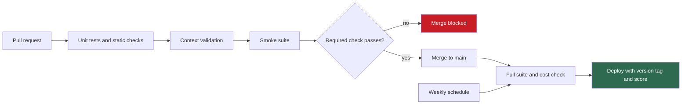
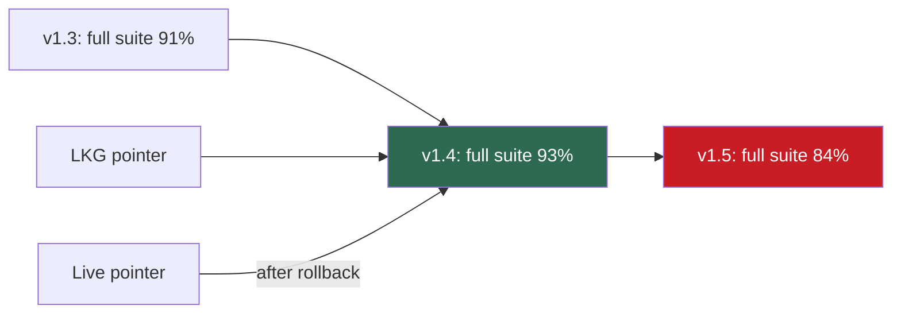

## 1. The question this idea answers

A teammate changes one word in the system prompt. Which evaluations run, when, and what stops the change if it breaks something? If a bad version still reaches production, how do you return to the last good version in minutes, not days? And when two teams add rules that contradict each other, who notices?

Lesson [L6](/notes/ai/context-engineering/09-production/l6-evaluation) built the measurement. This lesson puts it into the delivery process: CI gates, A/B tests, versions with scores, rollback, and a registry of instructions.

## 2. Mental model

> [!analogy] Save points in a video game
> A careful player saves the game only when the character is healthy. Before a risky fight, the player checks the save. When the fight goes badly, the player loads the last good save and tries again.
>
> A prompt version with a good evaluation score is a save point. The CI gate is the check before the fight. Rollback loads the last known good version.
>
> **Where it stops working:** a game state is exact. An evaluation score is a noisy sample. A drop of one case in a 20-case suite can be chance. So the gate needs enough cases, a margin and a look at which cases changed, before it calls a change a regression.

## 3. Terms

| Term | Plain meaning |
|---|---|
| smoke suite | A small, fast set of evaluation cases that runs on every pull request to catch large breaks. |
| full suite | The complete set of evaluation cases. It runs on merge, on a schedule and before releases. |
| CI job | One unit of work in a continuous integration system, for example a GitHub Actions job. |
| CI secret | A value, such as an API key, that the CI system stores encrypted and passes to jobs. It never goes into the repository. |
| required status check | A CI check that must pass before a pull request can merge into a protected branch. |
| eval threshold | The minimum score that a change must reach to pass the gate. |
| regression list | The cases that passed on the base version and fail on the new version. |
| last known good (LKG) | The most recent version that passed the full suite and worked in production. |
| rollback | Switching production back to an earlier version, usually the last known good one. |
| A/B test | An experiment that sends part of the traffic to a new variant and compares outcomes with the current one. |
| statistical power | The probability that a test detects a real difference of a given size. 80% is a common choice. |
| minimum detectable effect | The smallest real difference that a test is designed to detect. |
| instruction registry | A version-controlled list of every instruction rule, with its owner, its purpose and the rules it interacts with. |
| semantic versioning | Version numbers in the form major.minor.patch, where each part says how large the change is. |

## 4. Method and math

### 4.1 When to run evaluations

The FAQ (Session 7, Q17) names three triggers. Two more follow from the earlier lessons.

| Trigger | Suite | Why |
|---|---|---|
| Any change to the system prompt or an instruction, even one word | Smoke on the pull request, full on merge | Even a one-word edit can change behavior (FAQ Q17) |
| Any change to a tool description or a just-in-time instruction | Smoke, plus the cases tagged with that tool | Tool text is context too (Part 6) |
| A new model version | Full | Model behavior changes across versions. Position and length effects change too (lesson [1.5](/notes/ai/context-engineering/01-foundations/l5-position-and-length-effects)). |
| A change to retrieval: chunking, index, embedding model | Full | Retrieval decides what enters the window (Parts 4 and 5) |
| Weekly, with no change | Full | Drift: new products, new policies, changed tool behavior (FAQ Q17) |

The weekly run catches a class of failure that the other triggers miss. Nothing in your repository changed, but the world did. A correct answer from last month can be wrong today.

### 4.2 Smoke and full suites: cost and time

The FAQ (Q24 and Q35) suggests a smoke suite of 20 cases for about USD 1 on every pull request. The full suite of 100 or more cases costs USD 5 to 10 and runs on merge to main. Compute your own numbers.

$$
C_{\text{run}} = N \,(c_{\text{agent}} + c_{\text{judge}}) \qquad T_{\text{run}} \approx \left\lceil \frac{N}{w} \right\rceil t
$$

The symbols mean:

- $N$: the number of cases in the suite.
- $c_{\text{agent}}$: the cost of running the agent on one case. $c_{\text{judge}}$: the cost of judging it (0 for code-only scoring).
- $w$: the number of cases that run in parallel.
- $t$: the time of one case.
- $\lceil x \rceil$: $x$ rounded up.

> [!example] Worked example: suite cost on Claude Sonnet 5.5
> Prices: USD 2 / MTok input and USD 10 / MTok output (lesson [1.4](/notes/ai/context-engineering/01-foundations/l4-attention-and-the-cost-of-length), checked on 2026-10-12). Assume one case uses 8,000 input and 800 output tokens for the agent, and 3,000 input and 300 output tokens for the judge.
>
> - Agent: $(8{,}000 \times 2 + 800 \times 10) / 10^6 = 0.024$ USD.
> - Judge: $(3{,}000 \times 2 + 300 \times 10) / 10^6 = 0.009$ USD.
> - One case: 0.033 USD.
>
> | Suite | Cases | Cost |
> |---|---|---|
> | Smoke | 20 | 0.66 USD |
> | Full | 100 | 3.30 USD |
> | Large | 1,000 | 33 USD, or 16.50 USD with the Batch API |
>
> Time for the full suite with $w = 8$ and $t = 20$ s: $\lceil 100 / 8 \rceil \times 20 = 13 \times 20 = 260$ s, about 4.3 minutes.

The handbook's figures (USD 1 for a smoke run, USD 50 to 200 for 1,000 cases in Q31) are rules of thumb. An agent that runs many tool steps per case costs much more, because its input grows with every step (lesson [1.6](/notes/ai/context-engineering/01-foundations/l6-the-cost-of-a-conversation)).

The Batch APIs of Anthropic and OpenAI charge 50% of the standard price (checked on 2026-10-12). Anthropic says that most batches finish in under an hour, and a batch expires if it is not done in 24 hours. OpenAI's `completion_window` is `24h`. So batches suit the nightly or weekly full suite, not a gate that a pull request waits for.

### 4.3 Noise: what a smoke suite can and cannot see

A suite's match rate is a sample. Its standard error is:

$$
\text{SE} = \sqrt{\frac{p(1-p)}{n}}
$$

The symbols mean:

- $p$: the true pass rate of the system.
- $n$: the number of cases.

A rough 95% interval is $p \pm 1.96\,\text{SE}$.

> [!example] Worked example: how much a score moves by chance
> With $p = 0.90$:
>
> | Cases $n$ | SE | About ±1.96 SE |
> |---|---|---|
> | 20 | 0.067 | ±13 points |
> | 100 | 0.030 | ±5.9 points |
> | 400 | 0.015 | ±2.9 points |
>
> In a 20-case suite, one case is 5 points. A drop from 90% to 85% is one case, well inside the noise.

Three rules follow:

1. **The smoke suite catches large breaks only.** A prompt that breaks a whole intent is visible. A 3-point loss does not.
2. **Compare on the same cases.** Run the base version and the new version on the same cases. List the regressions: cases that passed before and fail now. One flipped case with the tag `critical` blocks the merge. One flipped ordinary case is a warning.
3. **Treat a fixed threshold as a rule of thumb.** The FAQ's "commonly 85%" (Q17, Q24) has no source. A better gate has two parts. No critical case regresses. The full-suite score stays above the last known good score minus a margin that you set from the noise.

### 4.4 The CI pipeline

The FAQ (Q24) adds four stages to normal code CI:

1. **Context validation:** static checks on prompts and context files (lesson [L4](/notes/ai/context-engineering/09-production/l4-validation-loops), section 4.7), including token budgets and a conflict check (section 4.7 below).
2. **GTX evaluation:** fail below the gate.
3. **Judge scoring:** for open answers.
4. **Cost and latency check:** the FAQ suggests 50 representative queries. Fail when the average cost or the 95th-percentile latency is over budget.



> [!example] Worked example: a GitHub Actions workflow
> ```yaml
> name: evals
> on:
>   pull_request:
>   push:
>     branches: [main]
>   schedule:
>     - cron: "0 3 * * 1"   # Mondays 03:00 UTC: weekly drift run
> jobs:
>   evals:
>     runs-on: ubuntu-latest
>     steps:
>       - uses: actions/checkout@<pinned version>
>       - uses: astral-sh/setup-uv@<pinned version>
>       - run: uv sync
>       - name: Run evaluation suite
>         env:
>           ANTHROPIC_API_KEY: ${{ secrets.ANTHROPIC_API_KEY }}
>         run: |
>           SUITE=smoke
>           if [ "${{ github.event_name }}" != "pull_request" ]; then SUITE=full; fi
>           uv run python scripts/run_evals.py --suite "$SUITE" \
>             --baseline evals/baseline.json --out results.json
>       - uses: actions/upload-artifact@<pinned version>
>         if: always()
>         with:
>           name: eval-results
>           path: results.json
> ```
> Replace each `<pinned version>` with a current release tag or a commit SHA. The workflow does not run with the placeholders. `run_evals.py` exits with a non-zero code when the gate fails, so the job fails. The results file is kept as a build artifact, so you can follow scores over time.

Four rules from the GitHub docs (checked on 2026-10-12):

1. **Read keys only from secrets.** A workflow reads them as `${{ secrets.NAME }}`. Never print them. GitHub redacts secrets in logs, but "this redaction is not guaranteed".
2. **Expect no secrets on pull requests from forks.** "secrets are not passed to the runner when a workflow is triggered from a forked repository". Only `GITHUB_TOKEN` is passed. So the evaluation job cannot call a paid API for a fork's pull request. Plan a maintainer-run path for those.
3. **Do not use `pull_request_target` to get around this with untrusted code.** Such workflows "may have repository write access and access to referenced secrets".
4. **Make the job a required status check.** Branch protection or a ruleset can require it before merge. A check with the status `skipped` counts as passing. So do not skip the evaluation job with a condition. In the workflow above, the job always runs and only the suite size changes.

> [!note] Source check: the CI gate
> **Corrected.** The FAQ (Q17, Q24 and Q35) says to add the evaluation as a CI step that blocks deployment. It also says to keep API keys as CI secrets. Both are right, with two gaps. Fork pull requests get no secrets, so the job fails or must skip. And a gate blocks a merge only if it is a required status check, where a skipped check counts as a pass. Source: GitHub docs, "Using secrets in GitHub Actions" and "About protected branches", checked on 2026-10-12.

### 4.5 A/B tests in production

Offline evaluations use fixed cases. An A/B test measures the real effect on real users. The FAQ (Q14) gives the design:

1. **Metrics:** task completion, satisfaction, cost per interaction, latency and error rate.
2. **Unit of measure: the conversation, not the turn.** A new prompt can give a worse first reply and a better conversation.
3. **Assignment:** route each user or conversation to one variant, with a stable hash of its ID or a feature flag.
4. **Duration:** at least one week, to cover weekday patterns. This is a rule of thumb.

Low temperature reduces random variation, but it does not make outputs identical across runs. Treat each conversation as a random sample.

The FAQ's sample size, "500–1,000 interactions per variant", depends on the size of the effect. For a completion rate, the standard formula for two proportions is:

$$
n = \frac{\left(z_{1-\alpha/2} + z_{1-\beta}\right)^2 \left[p_1(1-p_1) + p_2(1-p_2)\right]}{(p_1 - p_2)^2}
$$

The symbols mean:

- $n$: conversations per variant.
- $p_1$, $p_2$: the completion rates of the two variants.
- $\alpha$: the false-positive rate, usually 0.05, so $z_{1-\alpha/2} = 1.96$.
- $1 - \beta$: the power, usually 0.80, so $z_{1-\beta} = 0.84$.

> [!example] Worked example: detect 80% → 85%
> - $(1.96 + 0.8416)^2 = 2.8016^2 \approx 7.849$.
> - $p_1(1-p_1) + p_2(1-p_2) = 0.80 \times 0.20 + 0.85 \times 0.15 = 0.16 + 0.1275 = 0.2875$.
> - $(p_1 - p_2)^2 = 0.05^2 = 0.0025$.
> - $n = 7.849 \times 0.2875 / 0.0025 \approx 903$ conversations per variant.
>
> To detect 80% → 82% instead, $n \approx 6{,}036$ per variant. To detect 80% → 90%, $n \approx 197$.

So the FAQ's 500 to 1,000 fits an effect of about 5 points at an 80% base rate. Small improvements need many more conversations. Decide the minimum detectable effect before the test starts.

The FAQ names LaunchDarkly, Statsig or custom flags for the traffic split. One fact changed: OpenAI announced the acquisition of Statsig on 2 September 2025. OpenAI says that Statsig "will continue operating independently". Know who owns a vendor before you send it your traffic data. (OpenAI announcement, checked on 2026-10-12.)

### 4.6 Versions, scores and rollback

The FAQ (Q25) treats prompts and just-in-time instructions as code. Keep them in git, not in an opaque database. Tag each version with its evaluation scores, and keep a "last known good" pointer.



> [!example] Worked example: a version registry and its rollback rule
> ```json
> {
>   "system_prompt": {
>     "live": "v1.5",
>     "last_known_good": "v1.4",
>     "versions": {
>       "v1.4": {"commit": "a1b2c3d", "context_id": "3f9e0c1a7b22", "gtx_full": 0.93},
>       "v1.5": {"commit": "d4e5f6a", "context_id": "8c0d4e2f9a10", "gtx_full": 0.84}
>     }
>   }
> }
> ```
> The rule compares the live version with the LKG version. Use the full-suite score, or the judge score on sampled production traffic. If the live score is more than the margin below the LKG score, set `live` to the LKG version. Here 0.84 is 9 points below 0.93, so `live` returns to `v1.4`. The rollback is a change of one pointer, not a code deploy.

Three details make rollback work:

1. **Every trace records the context version ID** (lesson [L1](/notes/ai/context-engineering/09-production/l1-context-is-the-product), exercise 1.2). Then you can split production metrics by version.
2. **The application reads the live pointer at run time,** with a short cache. Then a rollback needs no new build.
3. **Expect a cost spike after any switch.** A new prefix causes cache writes until the cache is warm again (lesson [1.7](/notes/ai/context-engineering/01-foundations/l7-prompt-caching)).

For just-in-time instructions, the FAQ suggests one YAML file per tool, with semantic versioning, deployed apart from the application code. Here is one reasonable meaning of the parts. A major version changes what the rule requires. A minor version adds guidance. A patch changes only the wording. Each change still runs the cases tagged with that tool.

### 4.7 An instruction registry with conflict detection

Lesson [L9](/notes/ai/context-engineering/09-production/l9-seven-anti-patterns) shows how rules from many teams start to conflict. The FAQ (Q30) proposes a registry: a YAML or JSON file in version control. Each rule has these fields:

- `rule_text`
- `owner_team`
- `created_date`
- `interacts_with`: the IDs of other rules that it touches
- `gtx_cases`: the evaluation cases that test the rule

> [!example] Worked example: two registry entries
> ```yaml
> - id: sys-recommend-own
>   scope: system_prompt
>   rule_text: "Recommend our own products when they fit the merchant's need."
>   owner_team: core-assistant
>   created_date: 2026-03-02
>   interacts_with: [jit-competitor-honest]
>   gtx_cases: [recs-004, recs-011]
> - id: jit-competitor-honest
>   scope: jit:compare_competitors
>   rule_text: "If the competitor's product is clearly better for this use case, say so honestly."
>   owner_team: market-intel
>   created_date: 2026-05-19
>   interacts_with: [sys-recommend-own]
>   gtx_cases: [comp-002, comp-007]
> ```
> These two rules look like a conflict. The FAQ (Q19) gives the hierarchy that resolves it: the system prompt sets defaults, and a just-in-time instruction narrows them for one tool. So this pair is a specialization. The registry records that decision, and the `gtx_cases` test it.

Conflict detection has two steps.

1. **Find candidate pairs.** Checking every pair of $R$ rules costs $R(R-1)/2$ comparisons. Grouping rules by the targets they touch, for example a tool, an intent or an output format, gives far fewer pairs.
2. **Classify each candidate pair.** A script or a model labels it: conflict, specialization or independent. CI posts conflicts as warnings on the pull request (FAQ Q30).

$$
\text{pairs}_{\text{all}} = \frac{R(R-1)}{2} \qquad \text{pairs}_{\text{grouped}} = \sum_{t} \frac{g_t (g_t - 1)}{2}
$$

The symbols mean:

- $R$: the number of rules.
- $g_t$: the number of rules that touch target $t$.

> [!example] Worked example: 60 rules
> All pairs: $60 \times 59 / 2 = 1{,}770$ model calls. Now put the 60 rules into 10 groups of sizes 12, 9, 8, 7, 6, 5, 5, 4, 2 and 2. The grouped count is $66 + 36 + 28 + 21 + 15 + 10 + 10 + 6 + 1 + 1 = 194$ pairs. That is about 89% fewer calls. A rule that touches two targets appears in both groups, so real counts are a little higher.

For a team, the FAQ (Q26) adds process: one owner for the system prompt, CLAUDE.md and `examples/`, with review by pull request. Each sub-team owns the instructions of its own tools. The anti-pattern to avoid is write access to the system prompt for everyone. The FAQ's weekly 15-minute "context review" is a reasonable rule of thumb. A small team can keep the registry as a spreadsheet.

### 4.8 Production view

| Concern | What this lesson means for it |
|---|---|
| Reliability | No context change merges without a required evaluation check. Every live version has a score and a rollback target. |
| Cost | Smoke suites on pull requests, full suites on merge and on a schedule. Batch the scheduled runs at 50%. |
| Statistics | Small suites see only large breaks. Compare cases one to one, and size A/B tests for the effect that you want to detect. |
| Security | Keys only in CI secrets. No secrets for fork pull requests. No untrusted code under `pull_request_target`. |
| Team scale | A registry with owners and tested interactions keeps rules from many teams consistent. |
| Observability | The context version ID in each trace links production metrics to versions. |

## 5. Code

These exercises go in `notebooks/09-production.ipynb` for notes and experiments. Scripts go in `scripts/`, modules in `src/evals/` and tests in `tests/`.

**Exercise 7.1: an evaluation runner with a gate.**

1. Write `scripts/run_evals.py` with the options `--suite smoke|full`, `--baseline` and `--out`. Use the scorer of exercise 6.2.
2. Write a JSON result: the score, the list of regressions against the baseline and the cases tagged `critical` that failed.
3. Exit with code 1 when a critical case regresses, or when the score is more than a set margin below the baseline.

Acceptance tests:

- A run with no changes exits with 0 and lists no regressions.
- A deliberate break of one critical case exits with 1 and names the case.

**Exercise 7.2: the workflow.** Write `.github/workflows/evals.yml` from section 4.4 for your lab repository. Use a fake model client when no key is present, so that the job also works for forks.

Acceptance tests:

- The job runs on pull requests, on pushes to main and weekly.
- The results file is uploaded even when the gate fails.
- No step prints the key.

**Exercise 7.3: last known good.**

1. Write `src/evals/versions.py` with `record(version, scores)`, `promote(version)` and `rollback()`, working on the JSON of section 4.6.
2. `promote` refuses a version without a full-suite score.

Acceptance tests:

- After `promote("v1.5")` and `rollback()`, `live` is the previous last known good version.
- `rollback()` with no earlier good version raises an error with a clear message.

**Exercise 7.4: a registry checker.** Write `scripts/registry_check.py`. It loads the YAML of section 4.7 and checks two things: every `interacts_with` ID exists, and every rule has at least one `gtx_cases` entry. Then it prints the candidate pairs grouped by target.

Acceptance test: for group sizes 12, 9, 8, 7, 6, 5, 5, 4, 2 and 2, the script reports 194 candidate pairs.

**Exercise 7.5: sample size.** Write `ab_sample_size(p1, p2, alpha=0.05, power=0.8)` with `statistics.NormalDist`. Reproduce 903, 6,036 and 197 from section 4.5.

**Exercise 7.6: see the noise.** Simulate a system with a true pass rate of 0.90 on a 20-case suite 10,000 times with NumPy. Plot the histogram of scores. Report how often the score is 85% or lower by chance alone.

## 6. Common mistakes

1. **"The smoke suite passed, so the change is safe."** A 20-case suite sees only large breaks. The full suite and production monitoring see the rest.
2. **"Below 85% fails, above passes."** A fixed number is a rule of thumb. Gate on critical regressions and on a margin against the last known good score.
3. **"A skipped eval job is harmless."** A skipped required check counts as passing. Never make the evaluation job conditional.
4. **"Use `pull_request_target` so forks get the API key."** That exposes secrets to untrusted code.
5. **"500 conversations per variant is always enough."** That fits about a 5-point effect at 80%. A 2-point effect needs about 6,000.
6. **"Prompts in a database are easier to edit."** They are harder to review, compare and restore. Keep them in git and deploy a pointer.

## 7. One-minute explanation

Evaluations must run at the right moments: on every prompt or instruction change, on every model change, on every retrieval change and weekly for drift. A small smoke suite runs on each pull request as a required status check. It catches large breaks only, because one case in twenty is five points. The full suite runs on merge and on a schedule, and the scheduled run can use the Batch API at half price. Keys stay in CI secrets, which fork pull requests do not receive. Every prompt version is in git with its score, and a last-known-good pointer allows rollback in minutes. In production, A/B tests compare whole conversations, and the sample size depends on the effect that you want to see. A registry of rules with owners and tested interactions keeps many teams from writing conflicting instructions.

## 8. Check questions

```check
{
  "question": "How many conversations per variant does an A/B test need to detect a completion rate change from 70% to 75%, with α = 0.05 and 80% power?",
  "hint": "n = (1.96 + 0.84)² [p1(1 − p1) + p2(1 − p2)] / (p1 − p2)².",
  "answer": "(1.96 + 0.8416)² ≈ 7.849. p1(1 − p1) + p2(1 − p2) = 0.21 + 0.1875 = 0.3975. (0.05)² = 0.0025. n ≈ 7.849 × 0.3975 / 0.0025 ≈ 1,248 conversations per variant."
}
```

```check
{
  "question": "On a 20-case smoke suite, main passes 18 cases and the branch passes 17. Is this a regression? What do you check?",
  "answer": "Not by the score alone. One case is 5 points, and the 95% interval at 90% with 20 cases is about ±13 points. Compare the two runs case by case. If the flipped case has the critical tag, block the merge. If not, treat it as a warning and let the full suite on merge decide."
}
```

```check
{
  "question": "The evaluation job fails on every pull request from a fork with an authentication error from the model API. Why? What must the team not do to fix it?",
  "answer": "GitHub does not pass secrets to workflows that a forked repository triggers, except GITHUB_TOKEN, so the job has no API key. The team must not switch to pull_request_target to run the fork's code with secrets, because such workflows can have write access and access to secrets. Use a fake client for forks, and a maintainer-run evaluation before merge."
}
```

```check
{
  "question": "A registry has 20 rules in three target groups of 10, 6 and 4. How many candidate pairs does grouping give, against all pairs?",
  "answer": "Grouped: 10 × 9 / 2 + 6 × 5 / 2 + 4 × 3 / 2 = 45 + 15 + 6 = 66. All pairs: 20 × 19 / 2 = 190. Grouping removes about 65% of the comparisons."
}
```

```check
{
  "question": "A team adds if: github.event_name == 'push' to its required evaluation job, to save money on pull requests. What happens to the merge gate?",
  "answer": "On pull requests the job is skipped, and a skipped required check counts as passing. So every pull request can merge with no evaluation. Keep the job unconditional and run the cheaper smoke suite on pull requests instead."
}
```

## 9. Links

- Previous: [L6: Evaluation](/notes/ai/context-engineering/09-production/l6-evaluation)
- Next: [L8: Observability, cost and latency](/notes/ai/context-engineering/09-production/l8-observability-cost-and-latency)
- [Lesson 1.7: Prompt caching](/notes/ai/context-engineering/01-foundations/l7-prompt-caching): why a version switch costs cache writes
- [Glossary](/notes/ai/context-engineering/glossary)
