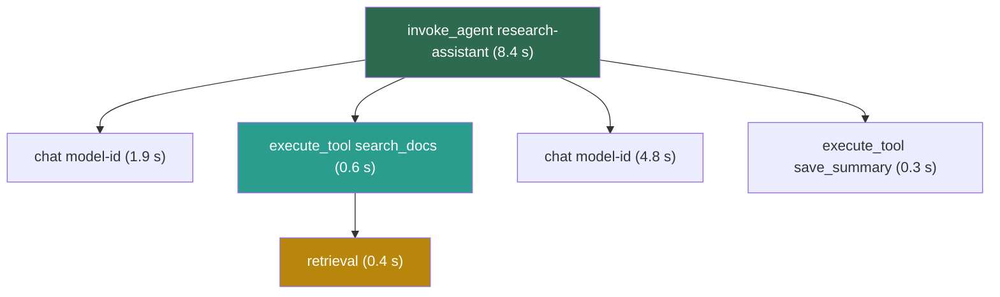

## 1. The question this idea answers

A user reports that the agent gave a wrong answer yesterday afternoon. Can you see exactly what the model saw on that call: the system prompt version, the retrieved chunks, the tool results? Can you say what that conversation cost, and where its eight seconds went?

Without traces, debugging an LLM system is guesswork. The FAQ (Session 7, Q33) says that a trace view turns debugging "from guesswork into forensics". This lesson covers what to record, the standard names for it, the current tools, and how to use the data to cut cost and latency.

## 2. Mental model

> [!analogy] The flight data recorder
> After an incident, investigators do not guess. They read the flight data recorder: every input, every setting, every action, with exact times. They rebuild the flight step by step.
>
> A trace is the flight recorder of one request. It holds every model call, tool call and retrieval, with inputs, outputs, tokens and times.
>
> **Where it stops working:** a flight recorder holds instrument data. A trace holds user messages and documents, which are personal data. So traces need redaction, access control and a retention limit. Also, a trace shows what the model saw and what it did, not why it chose its answer.

## 3. Terms

| Term | Plain meaning |
|---|---|
| trace | The full record of one request or one agent task, made of nested spans. |
| span | One timed unit of work inside a trace, such as one model call or one tool call, with attributes. |
| run | LangSmith's name for a span: "A run represents a single unit of work". |
| OpenTelemetry (OTel) | An open standard and toolset for traces, metrics and logs, supported by most observability tools. |
| semantic conventions | Standard names for span attributes, so that different tools read the same data the same way. |
| GenAI semantic conventions | The OpenTelemetry conventions for model calls, tool calls and agents, with attribute names that start with `gen_ai.` |
| span attribute | A key and a value stored on a span, for example `gen_ai.usage.output_tokens` = 450. |
| percentile (p95) | The value below which 95% of the measurements fall. The p95 latency shows the slow tail that the mean hides. |
| cost per conversation | The sum of the cost of all calls in one conversation or agent task. |
| model routing | Sending each request to the cheapest model that can handle it, with a rule or a classifier. |
| Batch API | A provider interface that runs many requests without a time guarantee, at a lower price. |
| drift | A change over time in the inputs or the data, so that old evaluations no longer represent real use. |

## 4. Method and math

### 4.1 What to record on every call

| Field | Why |
|---|---|
| Context version ID | Ties the call to the exact prompt and tool text ([L7](/notes/ai/context-engineering/09-production/l7-evals-in-ci-and-versioning)) |
| The assembled input, or a hash and a pointer to stored text | Most failures are visible only in the full input (lesson [1.1](/notes/ai/context-engineering/01-foundations/l1-what-a-model-does-with-context)) |
| Model, `max_tokens`, temperature | Reproduces the call |
| Usage, with the cache fields | Cost and cache hit rate (lesson [1.7](/notes/ai/context-engineering/01-foundations/l7-prompt-caching)) |
| Stop reason | A cut answer has no error code (lesson [1.3](/notes/ai/context-engineering/01-foundations/l3-the-chat-api-call)) |
| Time to first token and total time | Latency |
| Tool calls: name, arguments, result size, error | Tool errors and tool-result bloat |
| Retrieval: query, chunk IDs, scores, tokens | Shows whether the right knowledge arrived |
| Conversation ID and a pseudonymous user ID | Cost per conversation, and per-user debugging without names |

### 4.2 Traces and spans

An agent task is a tree of spans. The parent span covers the whole task. Each child covers one step, with its own start time, duration and attributes.



LangSmith uses the same structure with its own words. Its docs say: "A trace is a collection of runs for a single operation."

LangSmith's datasets and evaluators play the role of the GTX and the scorers of lesson [L6](/notes/ai/context-engineering/09-production/l6-evaluation).

### 4.3 The OpenTelemetry GenAI conventions

All facts in this section were checked on 2026-10-12.

1. **Status:** Development. Every `gen_ai` attribute carries a Development badge, so names can still change.
2. **Home:** the conventions moved from the core semantic-conventions repository to `open-telemetry/semantic-conventions-genai`.
3. **Span name** for a model call: `{gen_ai.operation.name} {gen_ai.request.model}`, with span kind CLIENT. Tool spans are named `execute_tool {gen_ai.tool.name}`, and agent spans `invoke_agent {gen_ai.agent.name}`.
4. **Operation names** include `chat`, `generate_content`, `text_completion`, `embeddings`, `retrieval`, `execute_tool`, `create_agent`, `invoke_agent`, `invoke_workflow` and `plan`.

| Attribute | Requirement level | Meaning |
|---|---|---|
| `gen_ai.operation.name` | Required | The kind of operation, for example `chat` |
| `gen_ai.provider.name` | Required | The model provider |
| `gen_ai.request.model` | Conditionally required | The model that the request named |
| `gen_ai.response.model` | Recommended | The model that answered |
| `gen_ai.usage.input_tokens` | Recommended | Input tokens |
| `gen_ai.usage.output_tokens` | Recommended | Output tokens |
| `gen_ai.usage.cache_read.input_tokens` | (cache attribute) | Input tokens read from the cache |
| `gen_ai.usage.cache_write.input_tokens` | (cache attribute) | Input tokens written to the cache |

Two names are deprecated. `gen_ai.system` became `gen_ai.provider.name`. `gen_ai.usage.prompt_tokens` and `gen_ai.usage.completion_tokens` became `input_tokens` and `output_tokens`. Old dashboards may still read the old names.

> [!example] Worked example: the cost of one span
> One `chat` call on Claude Sonnet 5.5 returns this usage: `cache_read_input_tokens` = 18,000, `cache_creation_input_tokens` = 1,200, `input_tokens` = 300 and `output_tokens` = 450. The prices come from lesson [1.7](/notes/ai/context-engineering/01-foundations/l7-prompt-caching), checked on 2026-10-12. Input is USD 2 / MTok and output USD 10 / MTok. A cache read is USD 0.10 / MTok, and a 5-minute cache write is USD 2.50 / MTok.
>
> $$
> \frac{18{,}000 \times 0.10 + 1{,}200 \times 2.50 + 300 \times 2 + 450 \times 10}{10^6} = \frac{1{,}800 + 3{,}000 + 600 + 4{,}500}{10^6} = 0.0099 \text{ USD}
> $$
>
> Without the cache, the same call costs $(19{,}500 \times 2 + 450 \times 10)/10^6 = 0.0435$ USD. Store the cache counts in the two cache attributes. Also keep the provider's raw usage object, so that cost math never depends on how a library maps the fields.

### 4.4 The tool landscape

The FAQ (Q32) gives three tiers: LangSmith, then Arize Phoenix, Braintrust and Humanloop, then Weights & Biases and APM tools. Several facts changed. The status below was checked on 2026-10-12.

| Tool | What it does | Status |
|---|---|---|
| LangSmith | Tracing (runs and traces), datasets, evaluators. Works with any framework through manual instrumentation. | Active |
| Langfuse | Open-source tracing and evaluation | ClickHouse acquired it (announced 16 January 2026). The core stays MIT-licensed and self-hostable. |
| Arize Phoenix | "open-source AI observability platform designed for experimentation, evaluation, and troubleshooting". Built on OpenTelemetry and OpenInference. | Elastic License 2.0: source-available, not OSI open source |
| Braintrust | Tracing, experiments, datasets, scorers | Active |
| W&B Weave | Tracing and evaluations with LLM judges and custom scorers | CoreWeave completed its acquisition of Weights & Biases on 5 May 2025. CoreWeave calls Agent Lens "the successor to Weights & Biases Weave". |
| promptfoo | Evaluations and red-teaming from the command line | OpenAI announced on 9 March 2026 that it would acquire Promptfoo. The repository says it "remains open source and MIT licensed". |
| DeepEval | "similar to Pytest but specialized for unit testing LLM apps" | Apache-2.0 |
| RAGAS | "reference-free evaluation of Retrieval Augmented Generation (RAG) pipelines" (Es et al., arXiv 2309.15217) | The repository moved to `github.com/vibrantlabsai/ragas`. |
| Humanloop | Was a prompt management and evaluation platform | Closed on 8 September 2025 |

> [!note] Source check: Humanloop, Phoenix and W&B
> **Corrected.** The FAQ (Q31, Q32 and Q39) recommends Humanloop for prompt management. Humanloop's team joined Anthropic, and the platform was sunset on 8 September 2025, before the handbook's date. All account data was deleted on that date. The FAQ (Q32, Q36) calls Arize Phoenix open source: its license is the Elastic License 2.0, which is source-available. The FAQ lists Weights & Biases as an independent tool: it is now part of CoreWeave. Sources: Humanloop migration guide, the Phoenix repository, CoreWeave announcement, checked on 2026-10-12.

The FAQ says that "LangSmith alone covers 80% of needs". That is a rule of thumb with no source. Choose with these questions instead:

1. Does it accept OpenTelemetry data? Then you can change tools later without new instrumentation.
2. Can you self-host it? Traces hold user data, and some data must not leave your network.
3. Does it link traces to datasets and evaluators, so that a bad trace becomes a GTX case in one step?
4. What does it cost at your trace volume?

> [!note] Source check: Vercel AI SDK parameters
> **Corrected.** The FAQ (Q37) says that the Vercel AI SDK has `maxTokens` and `maxSteps`. AI SDK 5.0 (July 2025) renamed `maxTokens` to `maxOutputTokens` and replaced `maxSteps` with `stopWhen`. In AI SDK 5 and 6 the step condition is `stepCountIs(n)`. In AI SDK 7, the current version, it is `isStepCount(n)`, and `stepCountIs` remains as an alias. The FAQ's main point holds: these settings limit output and steps. They are not input budgets. Source: AI SDK 5.0 migration guide and the `ai` npm package, checked on 2026-10-12.

### 4.5 Watch the population, not only single traces

A single trace answers "why did this request fail?". Dashboards answer "is the system getting worse?". The FAQ (Q36) makes the same split between LangSmith for single traces and Phoenix for population trends.

| Signal | Alert when |
|---|---|
| Cost per conversation | It rises faster than traffic. This is often the quadratic history term (lesson [1.6](/notes/ai/context-engineering/01-foundations/l6-the-cost-of-a-conversation)). |
| Cache hit rate | It drops after a deploy. Something near the top of the prompt changed. |
| p95 latency | It crosses the budget. |
| Tool error rate | One tool's errors rise. |
| Attempt rate | Refusals rise: possible opt-out behavior ([L6](/notes/ai/context-engineering/09-production/l6-evaluation)). |
| Judge score on sampled traffic | It falls below the last known good level ([L7](/notes/ai/context-engineering/09-production/l7-evals-in-ci-and-versioning)). |
| Input tokens per call | They grow: context overload ([L9](/notes/ai/context-engineering/09-production/l9-seven-anti-patterns)). |
| Query drift | New kinds of queries appear that the GTX does not cover. |

The p95 uses the nearest-rank rule: sort the $n$ values and take the value at rank $\lceil 0.95\,n \rceil$.

> [!example] Worked example: mean, median and p95
> Here are twenty response times in seconds, sorted.
>
> 0.8, 0.9, 0.9, 1.0, 1.0, 1.1, 1.1, 1.2, 1.2, 1.3, 1.3, 1.4, 1.5, 1.6, 1.7, 1.9, 2.2, 2.6, 3.4, 6.1.
>
> - Mean: 34.2 / 20 = 1.71 s.
> - Median: (1.3 + 1.3) / 2 = 1.3 s.
> - p95: rank $\lceil 0.95 \times 20 \rceil = 19$, so 3.4 s.
>
> One response in twenty is slower than 3.4 s, and here that one takes 6.1 s. The mean of 1.71 s hides this tail.

### 4.6 Cost levers, in order

The FAQ (Q27) lists six cost levers "in order of impact". The order is a reasonable default. Measure your own traces to confirm it.

| Lever | What it changes | Typical effect | Lesson |
|---|---|---|---|
| 1. Prompt caching | Repeated prefixes are billed at the read price | Reads at 0.025 × to 0.1 × input on current Claude models. Writes cost more. | [1.7](/notes/ai/context-engineering/01-foundations/l7-prompt-caching) |
| 2. Model routing | Easy requests go to a cheaper model | See the example below | this lesson |
| 3. Token budgets | Caps on each part of the context | Stops runaway growth | [7.6](/notes/ai/context-engineering/07-compress-and-isolate/l6-token-budgets) |
| 4. Tool-result clearing | Old tool results become short stubs | The FAQ says "up to 99%" per tool call: a rule of thumb | [7.3](/notes/ai/context-engineering/07-compress-and-isolate/l3-tool-result-clearing) |
| 5. Batch API | Asynchronous jobs at 50% of the price | Evaluations and offline jobs only | this lesson |
| 6. Compression | Summaries replace old history | The history stops growing | [7.2](/notes/ai/context-engineering/07-compress-and-isolate/l2-summarization-and-compaction) |

> [!note] Source check: the caching arithmetic of FAQ Q15
> **Corrected.** The FAQ (Q15) says that cached tokens cost 10% on Anthropic. Its example has 1,000 requests per hour with a 3,000-token system prompt. It says that caching saves roughly 3 to 5 USD per hour, or 2,000 to 3,600 USD per month. The arithmetic does not fit a Claude Sonnet price. 1,000 × 3,000 = 3,000,000 tokens per hour. At USD 3 / MTok, the input price of Sonnet 4 to 4.6, the prompt costs USD 9.00 per hour uncached. Cached, it costs about USD 0.91: 999 reads at 0.1 × and one write at 1.25 ×. The saving is about USD 8.09 per hour, or about USD 5,825 per 720-hour month. A saving of USD 3 to 5 per hour needs an input price of only about USD 1.1 to 1.9 / MTok. The FAQ also ignores cache writes, which cost 1.25 × (5 minutes) or 2 × (1 hour). Source: Anthropic pricing and prompt-caching docs, checked on 2026-10-12.

> [!example] Worked example: FAQ Q15 with current prices
> Claude Sonnet 5.5: input USD 2 / MTok, cache read 0.05 × = USD 0.10 / MTok, 5-minute write 1.25 × = USD 2.50 / MTok. Traffic: 1,000 requests per hour, each with the same 3,000-token prefix. That is one request every 3.6 s, so each hit refreshes the 5-minute lifetime and the cache stays warm.
>
> - Uncached: $3{,}000{,}000 \times 2 / 10^6 = 6.00$ USD per hour.
> - Cached reads: $3{,}000{,}000 \times 0.10 / 10^6 = 0.30$ USD per hour.
> - One write when the cache starts cold: $3{,}000 \times 2.50 / 10^6 = 0.0075$ USD.
> - Saving: about 5.69 USD per hour, or about 4,100 USD per 720-hour month.
>
> Now take 10 requests per hour, one every 6 minutes. The 5-minute cache expires between calls, so every call is a write at 1.25 ×: 0.075 USD per hour against 0.06 USD uncached. Caching **costs more** here. With the 1-hour lifetime, the first hour has one write at 2 × and nine reads: $(3{,}000 \times 4 + 9 \times 3{,}000 \times 0.10)/10^6 \approx 0.0147$ USD. Each hit refreshes the lifetime, so later hours have only reads: $10 \times 3{,}000 \times 0.10 / 10^6 = 0.003$ USD per hour.

> [!note] Source check: model prices in FAQ Q27
> **Corrected.** The FAQ (Q27) prices Claude Haiku at 0.25 USD input and 1.25 USD output per million tokens. That was Claude 3 Haiku, which is no longer on the pricing page. Haiku 4.5 costs USD 1 / USD 5. The current Claude Haiku 5.5 costs USD 0.10 / USD 0.50 for prompts up to 100K tokens (lesson [1.4](/notes/ai/context-engineering/01-foundations/l4-attention-and-the-cost-of-length)). The FAQ's Batch discount of 50% is confirmed for Anthropic and OpenAI. Source: Anthropic pricing page and batch-processing docs, checked on 2026-10-12.

> [!example] Worked example: model routing
> Each request uses 5,000 input and 500 output tokens.
>
> - On Sonnet 5.5: $(5{,}000 \times 2 + 500 \times 10)/10^6 = 0.015$ USD.
> - On Haiku 5.5: $(5{,}000 \times 0.10 + 500 \times 0.50)/10^6 = 0.00075$ USD.
>
> A router sends 70% of requests to Haiku and 30% to Sonnet. The average cost is $0.7 \times 0.00075 + 0.3 \times 0.015 = 0.005025$ USD. That is 66.5% less than Sonnet alone. Add the router's own cost, and check with the GTX that the easy requests really stay correct on the smaller model.

Anthropic's Message Batches API charges 50% of standard prices on input and output. Most batches finish in under an hour. A batch expires if it is not done within 24 hours. One batch holds up to 100,000 requests or 256 MB, and results stay available for 29 days. OpenAI's Batch API also gives 50%, with a `completion_window` of `24h` (checked on 2026-10-12).

### 4.7 Latency levers

Lesson [1.4](/notes/ai/context-engineering/01-foundations/l4-attention-and-the-cost-of-length) showed that output tokens usually dominate the total time, because decode writes one token at a time. Prefill sets the time to first token.

> [!example] Worked example: where eight seconds go
> Assume a time to first token of 0.8 s and a decode speed of 50 tokens per second. These are planning numbers. Measure your own.
>
> | Change | Total time |
> |---|---|
> | Baseline: 400 output tokens | $0.8 + 400/50 = 8.8$ s |
> | Half the output: 200 tokens | $0.8 + 200/50 = 4.8$ s (−45%) |
> | Half the input: time to first token 0.5 s | $0.5 + 400/50 = 8.5$ s (−3%) |
>
> Cutting output wins by far. This agrees with OpenAI's latency guide, quoted in lesson 1.4: a 50% shorter prompt "may only result in a 1–5% latency improvement".

| Lever | What it improves |
|---|---|
| Shorter output: a lower `max_tokens`, a concise format | Total time, most of all |
| Streaming | Perceived latency: the user sees text after the time to first token |
| Parallel tool calls | Agent time: two independent 1.2 s calls take 1.2 s, not 2.4 s |
| Prompt caching of a long prefix | Time to first token |
| A smaller, faster model | Both, if quality holds on the GTX |
| Fewer agent steps | Total time: each step adds a full model call |

### 4.8 Hard mode 1: voice agents

The FAQ (Q41) calls voice "context engineering on hard mode". Users expect a reply in about a second, and speech-to-text output is noisy. The FAQ's rules, with this course's notes:

1. **A small context.** The FAQ suggests 2,000 to 4,000 tokens in total. That is a rule of thumb. Size it from your latency budget.
2. **The fastest model for conversational turns.** Hand slow reasoning to a background step or a sub-agent.
3. **Clean the transcript before it enters context.** Remove filler words and normalize numbers. Keep the raw transcript in the trace, because cleaning can change meaning.
4. **A stable, cached prefix.** Just-in-time instructions keep the system prompt fixed, so the cache cuts the time to first token.
5. **Tool-result clearing.** Voice conversations have many short turns, so old results accumulate fast.

> [!example] Worked example: a one-second budget
> This planning budget covers the time from the end of speech to the first audio. The parts are assumed values:
>
> | Part | Time |
> |---|---|
> | Final transcript | 0.2 s |
> | Model time to first token | 0.4 s |
> | First synthesized audio | 0.2 s |
> | Network | 0.2 s |
> | Total | 1.0 s |
>
> Every part needs a measured value and an owner. The model's share is only 0.4 s, which leaves no room for a long uncached prefix.

The signal side of voice, from sampling to spectra, is in the [FFT and signal processing notes](/notes/maths/fft-signal-processing).

### 4.9 Hard mode 2: edge and on-device models

The FAQ (Q44) says that edge models have windows of 2K to 8K tokens, against 128K to 200K for cloud models. The cloud figure is out of date: current Claude models have 1,000,000-token windows (lesson [1.1](/notes/ai/context-engineering/01-foundations/l1-what-a-model-does-with-context)). For an on-device model, read the model card. The window is often small because memory is small. Lesson 1.4 gives the KV cache of Llama 3 8B as 128 KiB per token. So 8,192 tokens need $131{,}072 \times 8{,}192$ bytes = 1 GiB of memory for one sequence.

The FAQ's rules follow from the small window. Keep budgets precise. Compress every few turns. Clear tool results in every case. Keep memory outside the window (Part 8). One advantage: a local model has no API price, so compression on every turn costs only time and energy.

Images also take tokens by area, so one screenshot can fill a small window. The FAQ (Q45) says that an image costs "1,600–6,400 tokens". Lesson [1.2](/notes/ai/context-engineering/01-foundations/l2-tokens-and-tokenizers) gives the correct rule. On Claude, a 200 × 200 pixel image costs 64 tokens. The maximum is 1,568 or 4,784 tokens, by model.

### 4.10 Production view

| Concern | What this lesson means for it |
|---|---|
| Observability | Every call is a span with the GenAI attribute names, the context version ID and the raw usage. |
| Cost | Track cost per conversation. Apply levers in order, and recompute each one with current prices and real traffic. |
| Latency | Budget at the p95. Cut output first, then stream, parallelize and cache. |
| Privacy | Traces hold personal data: redact, restrict access, set retention. Self-host if data must stay inside. |
| Vendor risk | Several tools changed owners or closed in 2025 and 2026. OpenTelemetry instrumentation keeps you portable. |

## 5. Graphs

```plot
{
  "title": "Prompt cost per hour for a 3,000-token prefix on Sonnet 5.5: uncached (red), cached with a warm 5-minute cache (blue)",
  "xAxis": { "label": "requests per hour", "domain": [0, 1000] },
  "yAxis": { "label": "USD per hour", "domain": [0, 6.5] },
  "disableZoom": true,
  "data": [
    { "fn": "0.006*x", "color": "#C81D25" },
    { "fn": "0.0003*x", "color": "#1E6091" }
  ]
}
```

The red line is $r \times 3{,}000 \times 2 / 10^6$. The blue line is the read price, 0.05 × input. The blue line assumes at least one request every 5 minutes, which means at least 12 per hour. Below that rate, the 5-minute cache expires between calls and each call pays the write price, 1.25 ×. At 1,000 requests per hour the two lines are at 6.00 and 0.30 USD.

## 6. Code

These exercises go in `notebooks/09-production.ipynb`. The tracer goes in `src/obs/trace.py`, with tests in `tests/`.

**Exercise 8.1: a minimal tracer.**

1. Write a context manager `span(name, **attributes)` that records a start time, an end time, a span ID and a parent span ID.
2. Write each finished span as one JSON line to `traces.jsonl`. Use the GenAI attribute names of section 4.3.
3. Wrap one fake agent task: one `invoke_agent` span with two `chat` spans and one `execute_tool` span inside.

Acceptance tests:

- Every child span has the parent's ID.
- A child's start and end lie inside the parent's start and end.
- The span name of a model call is `chat <model id>`.

**Exercise 8.2: cost from usage.** Write `call_cost(usage, prices)` that handles input, output, cache reads and cache writes. Reproduce 0.0099 USD from section 4.3. Then write `hourly_cost(rate, prefix_tokens, prices, ttl_minutes)` and reproduce the three cases of the FAQ Q15 example.

**Exercise 8.3: a dashboard from traces.** From `traces.jsonl`, compute cost per conversation, mean, median and p95 latency, and the cache hit rate.

Acceptance test: on the 20 times of section 4.5, your p95 function returns 3.4.

**Exercise 8.4 (optional): real OpenTelemetry.** Install `opentelemetry-sdk` and send the spans of exercise 8.1 to the console exporter. Compare the output with your JSON lines.

**Exercise 8.5 (optional, costs money): measure latency.** For one prompt, measure the time to first token and the total time with streaming on. Repeat with half the `max_tokens`. Report the change in each.

## 7. Common mistakes

1. **"Log the user message and the answer. That is enough."** Most failures are in the assembled context: the retrieved chunks, the tool results, the prompt version.
2. **"The mean latency is fine, so users are fine."** Check the p95. The slow tail is where users leave.
3. **"Caching always saves money."** With gaps longer than the cache lifetime, every call pays the write price.
4. **"Use Humanloop for prompt management."** It closed on 8 September 2025.
5. **"A shorter prompt is the fastest latency fix."** Output length usually dominates. Cut output first.
6. **"Traces are just logs."** They hold personal data and need the same controls as a production database.

## 8. One-minute explanation

Observability means you can rebuild any request after the fact. Each model call, tool call and retrieval is a span in a trace. A span holds the context version, the usage with cache fields, the stop reason and the times. OpenTelemetry's GenAI conventions name these fields, for example `gen_ai.usage.input_tokens`, but they are still marked as in development. The tool market moves fast: Humanloop closed, Langfuse joined ClickHouse, and Weights & Biases is now part of CoreWeave. So instrument with OpenTelemetry and stay portable. For cost, apply the levers in order: caching, routing, budgets, tool-result clearing, batch at half price, compression. Recompute every saving with current prices. The handbook's caching example understates the saving and ignores cache writes. For latency, cut output first. Voice and edge agents are the same work with tighter limits.

## 9. Check questions

```check
{
  "question": "A call on Sonnet 5.5 reports 30,000 cache-read tokens, 2,000 cache-write tokens (5-minute), 500 uncached input tokens and 600 output tokens. What does it cost?",
  "hint": "Read USD 0.10, write USD 2.50, input USD 2 and output USD 10, all per MTok.",
  "answer": "(30,000 × 0.10 + 2,000 × 2.50 + 500 × 2 + 600 × 10) / 10^6 = (3,000 + 5,000 + 1,000 + 6,000) / 10^6 = 0.015 USD."
}
```

```check
{
  "question": "A service sends 200 requests per hour with the same 4,000-token prefix to Sonnet 5.5. What does the prefix cost per hour without and with a warm cache?",
  "answer": "Without: 200 × 4,000 × 2 / 10^6 = 1.60 USD per hour. With reads at 0.10 USD per MTok: 200 × 4,000 × 0.10 / 10^6 = 0.08 USD per hour, plus 0.01 USD for each cold-start write. One request every 18 s keeps the 5-minute cache warm. The saving is about 1.51 USD per hour."
}
```

```check
{
  "question": "After a deploy, the cache hit rate falls from 92% to 3% and the cost per conversation triples. Traffic is the same. Where do you look in the traces?",
  "answer": "At the start of the prompt in the new version: compare the context version IDs before and after, and diff the system prompt and the tool definitions. A timestamp, an ID or a reordered tool list near the top changes the prefix on every call, so nothing can be read from the cache (lesson 1.7)."
}
```

```check
{
  "question": "Answers take about 8 s. The prompt is 3,000 tokens and the answers are about 600 tokens. Which two changes cut the time most?",
  "answer": "First, shorter output: a lower max_tokens or a more concise answer format, because decode writes one token at a time and dominates the total time. Second, streaming, which does not change the total but shows text after the time to first token. A shorter prompt helps little at this size."
}
```

```check
{
  "question": "An old design document picks Humanloop for prompt versions and Arize Phoenix as the open-source monitor. What do you change?",
  "answer": "Humanloop closed on 8 September 2025, so choose another tool, or keep prompts in git with scores and a last-known-good pointer (lesson 9.7). Phoenix is usable, but its license is the Elastic License 2.0, which is source-available, not OSI open source. Check that the license fits your use."
}
```

## 10. Links

- Previous: [L7: Evals in CI and versioning](/notes/ai/context-engineering/09-production/l7-evals-in-ci-and-versioning)
- Next: [L9: The seven anti-patterns](/notes/ai/context-engineering/09-production/l9-seven-anti-patterns)
- [Lesson 1.4: Attention, the KV cache and the cost of length](/notes/ai/context-engineering/01-foundations/l4-attention-and-the-cost-of-length)
- [Lesson 1.7: Prompt caching](/notes/ai/context-engineering/01-foundations/l7-prompt-caching)
- [Glossary](/notes/ai/context-engineering/glossary)
