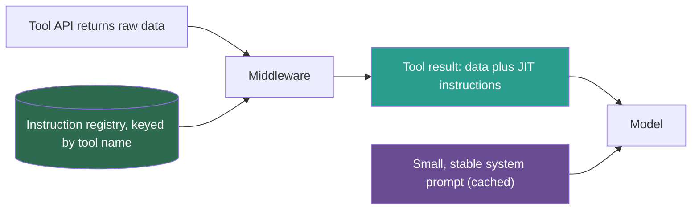
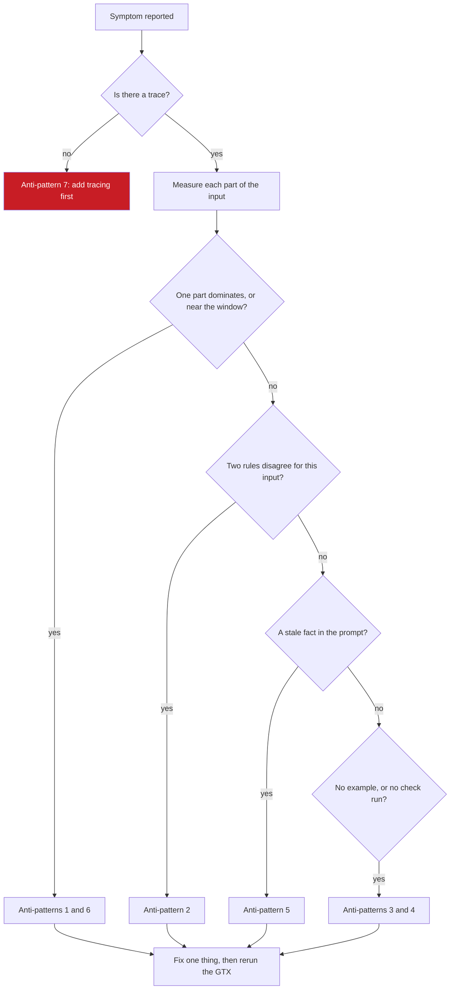

## 1. The question this idea answers

An agent fails in production. The usual reaction is to add a sentence to the system prompt and hope. That often makes things worse, because the new sentence adds tokens and can conflict with old rules.

The FAQ (Session 7, Q7) gives a better method: a checklist of seven anti-patterns, used as "a diagnostic checklist". This lesson turns the list into a procedure. For each anti-pattern: what you see, how to confirm it in a trace, how to fix it, and which lesson teaches the fix.

## 2. Mental model

> [!analogy] A doctor's differential diagnosis
> A good doctor does not treat the first guess. The doctor lists the conditions that could cause the symptoms, orders a test for each, and treats the one that the tests confirm. Then the doctor checks that the treatment worked.
>
> The seven anti-patterns are the list of conditions. The trace is the test. The GTX run after the fix is the follow-up check.
>
> **Where it stops working:** in LLM systems, conditions often come together, and one can look like another. An overloaded context can hide a rule, which looks like an instruction conflict. So fix one thing at a time and measure again after each fix.

## 3. Terms

| Term | Plain meaning |
|---|---|
| anti-pattern | A common design that looks reasonable but causes failures. |
| context overload | The anti-pattern of putting more into the window than the task needs, so that key content is lost among the rest. |
| instruction conflict | Two rules in the same context that ask for different actions on the same input. |
| missing examples | The anti-pattern of giving no example of the expected output or code pattern, so the model invents one. |
| hardcoded context | A fact written into a prompt as fixed text, such as a price or a policy, that goes stale when the real fact changes. |
| token budget | A planned limit on the tokens of each part of the context: instructions, history, retrieved knowledge and tool results. |
| Death by a Thousand Instructions | Shopify's name for a system prompt that grew into many special cases and conflicting rules as teams added tools. |
| just-in-time (JIT) instruction | Guidance that the application returns together with a tool's result, so that it enters the context only when that tool runs. |
| specialization | A narrower rule that refines a general default for one tool or case, instead of contradicting it. |

## 4. Method and math

### 4.1 The checklist

| # | Anti-pattern | Symptom | Confirm it in a trace | Fix | Lesson |
|---|---|---|---|---|---|
| 1 | Context overload | A rule or a fact in the context is ignored. Quality falls as conversations grow. | Input tokens per call are high or rising. The ignored content sits in the middle of a long input. | Retrieve less, budget each part, compress, move tool rules to JIT | [1.5](/notes/ai/context-engineering/01-foundations/l5-position-and-length-effects), [7.6](/notes/ai/context-engineering/07-compress-and-isolate/l6-token-budgets), section 4.2 |
| 2 | Instruction conflicts | Similar inputs get different behavior. The style flips between two forms. | The assembled input holds two rules that ask for different actions on this input. | A rule hierarchy, a registry, conflict checks in CI | [L7](/notes/ai/context-engineering/09-production/l7-evals-in-ci-and-versioning), [3.1](/notes/ai/context-engineering/03-system-layer/l1-five-parts-of-a-system-prompt) |
| 3 | Missing examples | Output format or code structure varies, or does not match the house pattern. | No example of this output type is in the context. | Few-shot examples, an `examples/` folder | [L2](/notes/ai/context-engineering/09-production/l2-the-project-files), [3.8](/notes/ai/context-engineering/03-system-layer/l8-few-shot-examples) |
| 4 | No validation loops | "Done" but broken. Errors accumulate silently. | No check or test spans before the agent ended its turn. | Three levels of checks, hooks, CI gates | [L4](/notes/ai/context-engineering/09-production/l4-validation-loops), [L5](/notes/ai/context-engineering/09-production/l5-commands-skills-and-hooks) |
| 5 | Hardcoded context | Answers were right last month and are wrong now. | A literal fact in the prompt differs from the current source of truth. | Fetch facts at run time with tools or retrieval. Run evaluations weekly. | section 4.4, [L7](/notes/ai/context-engineering/09-production/l7-evals-in-ci-and-versioning) |
| 6 | Ignoring the token budget | Cut answers, `model_context_window_exceeded`, cost spikes | Input plus `max_tokens` is near the window. One part, often history or tool results, dominates. | A budget per part, a compression trigger at 80% | [7.5](/notes/ai/context-engineering/07-compress-and-isolate/l5-when-to-compress), [7.6](/notes/ai/context-engineering/07-compress-and-isolate/l6-token-budgets) |
| 7 | No monitoring | You learn about failures from users. | There is no trace to open. | Traces, dashboards, a judge on sampled traffic | [L8](/notes/ai/context-engineering/09-production/l8-observability-cost-and-latency) |

The FAQ (Q7) maps four of these to earlier sessions:

- Overload to context rot. Section 4.3 corrects this mapping.
- Conflicts to Shopify's "Death by a Thousand Instructions".
- Missing examples to the context stack.
- The token budget to the 40-40-20 framework of lesson [7.6](/notes/ai/context-engineering/07-compress-and-isolate/l6-token-budgets).

### 4.2 Death by a Thousand Instructions, and the JIT fix

Shopify's post "Building production-ready agentic systems" is by Andrew McNamara, 26 August 2025, and comes from an ICML 2025 talk. It describes what happened to its Sidekick agent as tool teams added rules. In Shopify's words, "our system prompt became an unwieldy collection of special cases, conflicting guidance, and edge case handling". The post groups the growth into three bands of tool count: 0 to 20, 20 to 50, and more than 50.

This one story shows anti-patterns 1 and 2 together. Each rule was reasonable alone. Together they made the prompt long (overload) and contradictory (conflicts).

Shopify's fix: "Instead of cramming all guidance into the system prompt, we return relevant instructions alongside tool data". The post names three benefits:

1. **Localized guidance.** The rule appears next to the data that it is about.
2. **Cache efficiency.** Instructions can change "without breaking LLM prompt caches", because the system prompt stays the same (lesson [1.7](/notes/ai/context-engineering/01-foundations/l7-prompt-caching)).
3. **Modularity.** Instructions can vary by beta flag, model version or page context.



The FAQ (Q12) gives an example of the result format, shortened here. The format is the handbook's illustration, not Shopify's:

```json
{
  "data": {"order_id": "123", "status": "shipped"},
  "jit_instructions": "IMPORTANT: Always show the tracking URL when status is 'shipped'. Use the estimated_delivery field..."
}
```

The FAQ's template for one instruction (Q12, Q21): "[IMPORTANT rule if applicable]. [How to interpret this data]. [Common mistake to avoid]. [Formatting preference]." Its size advice, 50 to 100 tokens for each tool, is a rule of thumb. Lesson [6.5](/notes/ai/context-engineering/06-tools-and-mcp/l5-many-tools) teaches the pattern in full.

> [!note] Source check: the Shopify numbers in the FAQ
> **Corrected.** The FAQ (Q3, Q4 and Q15) gives numbers for Sidekick's system prompt. With 5 to 10 tools it had about 2,000 tokens. With 50 or more tools it grew to more than 15,000 tokens. It says that JIT gave a 95% or higher cache hit rate, through a `jit_instructions` field. It also gives a conflict between "always recommend premium products first" and "be unbiased". Shopify's post contains none of these numbers, no field name and no such example. Its tool bands are 0–20, 20–50 and 50+. Treat the numbers as the handbook's illustrations. Source: Shopify Engineering, checked on 2026-10-12.

> [!example] Worked example: instruction tokens with and without JIT (handbook numbers)
> Take the handbook's illustration: a 15,000-token system prompt, against a 2,000-token prompt plus JIT instructions of 80 tokens for each tool call. A typical request makes 2 tool calls.
>
> - Without JIT: 15,000 instruction tokens on every call.
> - With JIT: $2{,}000 + 2 \times 80 = 2{,}160$ tokens, which is about 86% fewer.
>
> The bigger gain can be the cache. The 2,000-token prompt stays the same, so it is read from the cache. The 15,000-token prompt changed with every team's edit, so each change wrote it again.

### 4.3 Overload, rot and stale context: one set of words

The handbook uses "context rot" for two different things.

| Term | Handbook, FAQ Q3 and Q7 | Handbook, FAQ Q20 | This course (lesson 1.5) |
|---|---|---|---|
| Context overload | The same as context rot | "a volume problem" | An anti-pattern: a design that puts too much into the window |
| Context rot | The same as overload | "a freshness problem": stale or degraded information | The length effect: accuracy falls as the input grows (Chroma, 2025) |
| Stale context | not named | Called "rot" | Old, wrong or conflicting content in the window. Its production form is hardcoded context and stale retrieval. |

> [!note] Source check: context overload and context rot
> **Corrected.** The FAQ contradicts itself. Q3 and Q7 say that context overload maps directly to context rot. Q20 says that overload is a volume problem and rot is a freshness problem. Common usage, from Chroma's report "Context Rot: How Increasing Input Tokens Impacts LLM Performance" (July 2025), uses context rot for the drop in quality as input length grows. This course follows lesson [1.5](/notes/ai/context-engineering/01-foundations/l5-position-and-length-effects). Overload is the design mistake. Rot is the length effect that overload causes. Stale context is the freshness problem. Each has its own fix: send fewer tokens for overload and rot, and refresh or remove content for staleness.

The FAQ's fixes for the freshness problem (Q20) still apply under the name "stale context". They are scheduled data refresh, a time-to-live on cached embeddings, monitoring for stale retrievals, and regular audits of the system prompt.

### 4.4 Hardcoded context

A prompt is a bad place for facts that change. Typical cases:

| Hardcoded text | Why it goes stale |
|---|---|
| "Our return window is 30 days." | The policy changes, or differs by category. |
| "The Pro plan costs 49 per month." | Prices change. |
| "Use the endpoint /v1/orders." | Endpoints are renamed. |
| "The current year is 2025." | Time passes. |

The rule is simple. **A prompt holds behavior. Tools and retrieval hold facts.** A fact that comes from a tool at run time carries its own source and date. Two checks catch the rest. A static check in CI flags numbers, dates and URLs in prompt files for review ([L4](/notes/ai/context-engineering/09-production/l4-validation-loops), section 4.7). The weekly evaluation run catches facts that went stale while nothing in the repository changed ([L7](/notes/ai/context-engineering/09-production/l7-evals-in-ci-and-versioning)).

### 4.5 Diagnose from one trace



> [!example] Worked example: the composition of one failing call
> A research agent ignored the rule "cite page numbers". The trace of the failing call shows this input:
>
> | Part | Tokens | Share |
> |---|---|---|
> | System prompt | 14,800 | 17.1% |
> | Tool definitions (52 tools) | 9,600 | 11.1% |
> | Conversation history | 38,000 | 44.0% |
> | Retrieved chunks (24) | 24,000 | 27.8% |
> | New user message | 40 | 0.05% |
> | Total | 86,440 | 100% |
>
> The citation rule is at line 212 of a 260-line system prompt. The tool definitions come first, so the rule sits about 21,700 tokens into the input. That is about 25% of the way through, far from both ends.
>
> Diagnosis: anti-pattern 6, because the history takes 44% with no cap. Anti-pattern 1, because 52 tool definitions and 24 chunks make a long input, and the rule sits far from both ends (lesson 1.5). The 14,800-token system prompt also suggests Death by a Thousand Instructions.
>
> Fixes, one at a time, with a GTX run after each:
>
> 1. Cap the history and compress it at a trigger (lessons 7.5 and 7.6).
> 2. Retrieve fewer, better chunks (Part 5).
> 3. Move tool-specific rules from the system prompt into JIT instructions, and load only the tools that the task needs (lesson 6.5).
> 4. Keep "cite page numbers" as a short rule near the end of the system prompt, and add a GTX case for it.

### 4.6 Three broken agents

Diagnose each story before you read the answers in the check questions.

**Story A: the returns bot.** A support agent tells customers that they can return any item within 30 days. Several customers return laptops after 20 days, and the warehouse refuses them. In the traces, the `get_return_policy` tool returned `{"category": "electronics", "return_window_days": 14}`. The system prompt, written a year ago, contains the line "Our return window is 30 days." No error was logged.

**Story B: the coding agent that says done.** An agent implements a feature from a PRP. Its pull request is green and merges. In staging the feature fails at once. The diff adds two `# type: ignore` comments and one `@pytest.mark.skip`. The session trace shows lint and unit tests, but no level 3 run.

**Story C: the research assistant that forgets.** After about 40 turns, the assistant stops following the user's turn-2 request to "cite page numbers". Cost per conversation grows faster than the number of turns. A few calls end with `model_context_window_exceeded`. The traces show that history is 70% of the input, each call retrieves 30 chunks, and nothing is ever compressed. The team found the problem from a user complaint.

### 4.7 Production view

| Concern | What this lesson means for it |
|---|---|
| Reliability | Diagnose by checklist, fix one cause at a time, and confirm each fix with the GTX. |
| Cost | Overload and an ignored budget raise cost on every call. JIT and budgets also restore prompt caching. |
| Team scale | Conflicts grow with the number of teams. A registry and owners prevent them ([L7](/notes/ai/context-engineering/09-production/l7-evals-in-ci-and-versioning)). |
| Freshness | Facts belong in tools and retrieval, not in prompts. Weekly evaluations catch drift. |
| Observability | Without traces, none of the other six can be confirmed. Anti-pattern 7 blocks the diagnosis of all the others. |

## 5. Code

These exercises go in `notebooks/09-production.ipynb`. The scanner goes in `src/obs/antipatterns.py`, with tests in `tests/`.

**Exercise 9.1: an anti-pattern scanner.**

1. Read the trace file of exercise 8.1. For each call, compute the tokens of each part of the input.
2. Flag four conditions:
   - a part above its budget share
   - input plus `max_tokens` above 80% of the window
   - the stop reason `max_tokens` or `model_context_window_exceeded`
   - more tool definitions than a set limit
3. Scan the system prompt for numbers, dates and URLs, and list them as possible hardcoded facts.

Acceptance tests:

- The composition of section 4.5 gives a flag for the history share.
- A system prompt with "Our return window is 30 days." gives one hardcoded-fact finding.
- A trace with no spans gives the finding "no monitoring data".

**Exercise 9.2: JIT middleware.**

1. Write `wrap_result(tool_name, data, registry) -> dict` that adds the instruction for that tool from a YAML registry.
2. Move three tool-specific rules from a real system prompt into the registry.
3. Count the system prompt tokens before and after, with `tiktoken` as an estimate.

Acceptance tests:

- A tool with no registry entry returns its data unchanged.
- The system prompt is shorter, and the GTX match rate does not fall.

**Exercise 9.3: diagnose your own agent.** Run the checklist of section 4.1 on one real agent from your work. Write one page: the symptoms, the trace evidence, the anti-patterns found, and the fixes in order.

## 6. Common mistakes

1. **"Add one more sentence to the prompt."** Each sentence adds tokens and possible conflicts. Diagnose first.
2. **"Context overload and context rot are the same thing."** Overload is the design mistake. Rot is the length effect that it causes. Stale context is a third problem.
3. **"Put the policy in the system prompt so the model always knows it."** It goes stale. Fetch facts from tools or retrieval.
4. **"The numbers 2,000, 15,000 and 95% come from Shopify."** They are the handbook's illustrations.
5. **"A system rule and a JIT rule that differ are a conflict."** Often the JIT rule is a specialization. Record the hierarchy and test it.
6. **"Fix everything at once."** You will not know which fix worked, or which one broke something. Fix one thing and measure.

## 7. One-minute explanation

When an LLM system fails, walk a checklist of seven anti-patterns instead of guessing. Context overload: too much in the window, so key rules get lost. Instruction conflicts: two rules that disagree. Missing examples: the model invents a pattern. No validation loops: nobody checks the work. Hardcoded context: facts in prompts that go stale. Ignoring the token budget: one part, often history, takes the window. No monitoring: you cannot see any of this. Confirm each one in a trace, fix one at a time and rerun the evaluation. Shopify's story shows the first two together. Their prompt grew into special cases and conflicts, and they moved tool guidance into tool results as just-in-time instructions. Note the words: overload is the mistake, rot is the length effect, stale context is old content.

## 8. Check questions

```check
{
  "question": "Story A (the returns bot): name the anti-patterns and give the fixes.",
  "answer": "Hardcoded context: the system prompt holds a policy fact, 30 days, that is wrong for electronics. Instruction conflict: the prompt fact disagrees with the tool result, and the model followed the prompt. It is also a misbehaving agent, because no error appears. Fixes: remove the fact from the prompt, add a JIT instruction to the policy tool that says to use the return_window_days field, and add GTX trap cases for electronics."
}
```

```check
{
  "question": "Story B (the coding agent that says done): name the anti-pattern and give the fixes.",
  "answer": "No validation loop, in two ways: level 3 never ran, and the agent passed levels 1 and 2 by disabling checks instead of fixing them. Fixes: add an integration test to the PRP's level 3, block suppressions with a PreToolUse hook, gate the end of the turn with a Stop hook that runs all levels, and add a CI diff check for new suppressions as a required status check."
}
```

```check
{
  "question": "Story C (the research assistant that forgets): name the anti-patterns and give the fixes.",
  "answer": "Ignoring the token budget: history is 70% of the input with no cap, and some calls hit the window. Context overload: 30 chunks on every call, and the turn-2 request is now far from the end of a long input. No monitoring: a user complaint found it. Fixes: a budget per part with compression at a trigger, fewer chunks, the user's standing preference kept in state or memory and placed near the end, and alerts on input tokens per call and on window-exceeded stops."
}
```

```check
{
  "question": "A trace shows: system prompt 6,000 tokens, tools 4,000, history 50,000, retrieved 18,000, user 50. Which part dominates, and what share does it have?",
  "hint": "Add the parts first.",
  "answer": "The total is 78,050 tokens. History is 50,000 / 78,050 ≈ 64%. This points to anti-pattern 6, ignoring the token budget. Cap and compress the history."
}
```

```check
{
  "question": "A teammate says: \"Our context rot is bad: the prompt still mentions the old API endpoint.\" Which term does this course use, and why does the word matter?",
  "answer": "Stale context, in its production form of hardcoded context. In this course, context rot means the drop in accuracy as the input gets longer. The word matters because the fixes differ: stale content needs a refresh or removal, while rot needs fewer tokens."
}
```

## 9. Links

- Previous: [L8: Observability, cost and latency](/notes/ai/context-engineering/09-production/l8-observability-cost-and-latency)
- Next: [Hard questions: Production](/notes/ai/context-engineering/09-production/hard-questions)
- [Lesson 1.5: Position and length effects](/notes/ai/context-engineering/01-foundations/l5-position-and-length-effects)
- [Lesson 6.5: Many tools](/notes/ai/context-engineering/06-tools-and-mcp/l5-many-tools): just-in-time instructions in full
- [Lesson 7.6: Token budgets](/notes/ai/context-engineering/07-compress-and-isolate/l6-token-budgets)
- [Glossary](/notes/ai/context-engineering/glossary)
