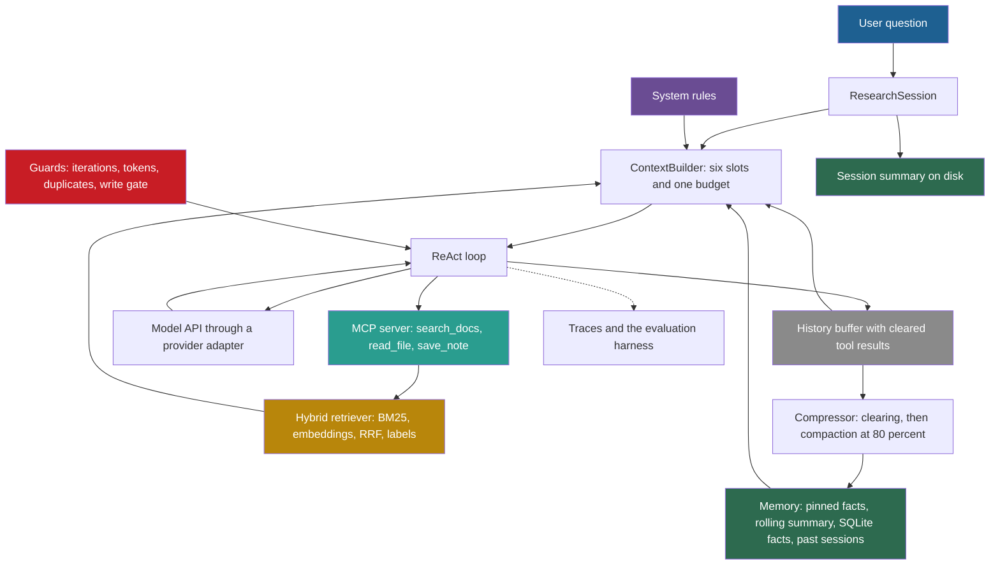

## 1. The goal of the system

The capstone is a **research assistant agent**. You give it a topic and a set of documents. It answers questions about them with citations, keeps a long conversation inside a fixed token budget, and remembers earlier research sessions.

The handbook plans this capstone as Session 8, but it does not include it (Session 7, §6). It names six parts that the agent must integrate:

| Handbook part (Session 7, §6) | Where this capstone builds it |
|---|---|
| A system prompt (Session 2) | M1: the system slot of the context builder |
| RAG over a document set (Session 3) | M2: hybrid retrieval with citations |
| Tool use: web search, file read, summarize (Session 4) | M3: an MCP server with `search_docs`, `read_file` and `save_note` |
| Context compression (Session 5) | M4: tool-result clearing and compaction |
| A memory store of past research sessions (Session 6) | M5: three memory layers and session summaries on disk |
| The PRP workflow and folder structure (Session 7) | M0: the scaffold, then one PRP per milestone |

The handbook's first feature is a `ResearchSession` class. It accepts a topic and a list of document paths, loads the documents with the RAG pipeline and keeps a conversation history. It has a `compress()` method for a context that passes a threshold, and it writes a session summary to disk at the end. M0 writes its specification, M1 builds its skeleton, and M2 to M5 complete it.

Two changes from the handbook are deliberate:

1. **`search_docs` replaces web search.** The local corpus makes evaluation repeatable and free. Web search adds untrusted content and a network path (lesson [6.9](/notes/ai/context-engineering/06-tools-and-mcp/l9-tool-security-and-prompt-injection)). It is a stretch goal of M3.
2. **Summarize is a host function, not a tool.** The compactor of M4 calls the summarizer. The model does not decide when to compress its own history.

The production question for the whole capstone: can you defend every token in the window with a number that you measured?

## 2. Architecture of the final system

The colors follow the subject legend. User input is blue, system instructions purple and conversation history gray. Retrieved knowledge is gold, tools teal, state and memory green, and guards red.

Read the diagram as one user turn:

1. The session takes the question and asks the context builder for a request.
2. The builder fills six slots in a cache-friendly order and enforces the token budget (M1).
3. The ReAct loop calls the model through the provider adapter. When the model asks for a tool, the loop calls the MCP server (M3).
4. `search_docs` runs the hybrid retriever and returns labeled sources (M2).
5. After the turn, the compressor clears used tool results and compacts the history when utilization passes 80% (M4).
6. The memory layers keep facts and past sessions. The session writes its summary to disk at the end (M5).
7. Every call becomes a span in a trace. The evaluation harness runs the 20-case set against the whole system (M6).

## 3. The milestone map

| Milestone | What it adds | Main lessons | Gate to pass |
|---|---|---|---|
| [M0: Scaffold](/notes/ai/context-engineering/10-capstone/m0-scaffold) | Repository, CLAUDE.md, INITIAL.md, PRP skills, 20-case set, pre-commit | 9.2, 9.3, 9.5, 9.6 | All files pass their linters. A fresh session has no open questions about INITIAL.md. |
| [M1: Context builder](/notes/ai/context-engineering/10-capstone/m1-context-builder) | Neutral messages, two adapters, six slots, budget, call log, `ResearchSession` skeleton | 1.3, 1.7, 2.3, 7.6 | No request exceeds the budget. Both adapters pass their format tests. |
| [M2: Retrieval](/notes/ai/context-engineering/10-capstone/m2-retrieval) | Loader, chunker, embeddings, BM25, RRF, labels, incremental index | 4.5, 4.6, 5.1, 5.2, 5.6, 5.8 | Recall@5 at least 0.80 and MRR at least 0.60 on the answerable cases |
| [M3: Tools and MCP](/notes/ai/context-engineering/10-capstone/m3-tools-and-mcp) | MCP server with three tools, guarded ReAct loop, write gate | 6.4, 6.5, 6.6, 6.8, 6.9 | Every guard trips in its test. No write runs without approval. |
| [M4: Compression](/notes/ai/context-engineering/10-capstone/m4-compression) | Tool-result clearing, compaction, retention test, cost log | 7.2, 7.3, 7.5, 7.10 | No tool pair is ever split. Critical facts survive 5 compaction cycles. |
| [M5: Memory](/notes/ai/context-engineering/10-capstone/m5-memory) | Buffer, rolling summary, SQLite facts, session summaries, deletion | 8.3, 8.6, 8.8 | Isolation, decay and deletion tests pass. The summary file is atomic. |
| [M6: Evaluation and traces](/notes/ai/context-engineering/10-capstone/m6-evaluation-and-traces) | End-to-end evaluation, calibrated judge, traces, CI job | 5.8, 9.6, 9.7, 9.8 | Judge kappa at least 0.6. The CI job fails on a broken retriever. |
| [M7: Ship](/notes/ai/context-engineering/10-capstone/m7-ship) | README, Dockerfile, demo, cost report, known limits, design review | 9.7, 9.8, 9.9 | A fresh clone runs the demo with one command. Every decision has a number. |

Each milestone depends only on earlier milestones. M6 measures what M1 to M5 built, so run its harness early on the parts that exist, and complete it at M6.

## 4. One PRP per milestone

The capstone uses the workflow of lessons [9.3](/notes/ai/context-engineering/09-production/l3-the-prp-workflow) and [9.5](/notes/ai/context-engineering/09-production/l5-commands-skills-and-hooks) for every milestone, not only for the first feature.

1. **Spec.** Write `INITIAL.md` for the milestone. Copy the requirements and the acceptance tests of the milestone page into it. Archive the previous one in `PRPs/initial/`.
2. **Plan.** Run `/create-prp INITIAL.md`. The skill writes `PRPs/mN-<slug>.md` and changes no code.
3. **Review.** Check the PRP with the checklist of lesson 9.3, section 4.7. Fix problems in the PRP, never in the code.
4. **Build.** Run `/execute-prp PRPs/mN-<slug>.md`. The validation levels run in order: lint and types, unit tests, then the integration check of the milestone.
5. **Record.** Fill the measurements of the milestone in its notebook. Commit, and tag the commit `mN-done`.

You write the code. The PRP is your plan, and the agent is a tool that you supervise. If an agent writes a module for you, the project rule applies. Explain every line of it before the milestone counts as done.

## 5. Rules for the whole build

| Rule | Reason |
|---|---|
| Every test uses a fake LLM client by default. | Tests must be free, fast and repeatable. |
| A test that calls a paid API carries the pytest marker `paid` and never runs in pre-commit or on pull requests. | Cost control, and forks get no secrets (lesson [9.7](/notes/ai/context-engineering/09-production/l7-evals-in-ci-and-versioning)). |
| Embeddings, BM25, the reranker and SQLite run locally. | Retrieval and memory cost nothing to run and to evaluate. |
| Prices live in one data file with a "checked on" date. | Prices change. Code must never hold a price. |
| No confidential work data in the corpus, the traces or the repository. | The repository and its traces can become public. |
| Every number on a milestone page that you change gets a reason in the design review. | The design review of M7 defends each budget and threshold. |

The default corpus is a copy of these study notes, Parts 1 to 9. It has 82 Markdown files with about 470,000 tokens (counted with `o200k_base` on 2026-10-12). You know the right answers, and the notes contain trap material: each corrected handbook claim appears next to its correction. A second corpus of public documentation for a tool that you use at work is a good extension.

## 6. Definition of done for the capstone

The capstone is done when all of these statements are true:

1. Every acceptance test of M0 to M7 passes on the tagged release commit.
2. A fresh clone runs the demo with one command, with the fake provider and with a real one.
3. The 20-case evaluation meets every gate of M6 with a real model. The scorecard in the README names the model, the date and the corpus hash.
4. The judge has a Cohen's kappa of at least 0.6 against your own labels, and you report your own test-retest kappa next to it.
5. The cost report gives the mean and the 95th-percentile cost per task, with and without prompt caching.
6. The design review defends hybrid retrieval, the token budgets and the single-agent design with your own measurements.
7. The README lists the known limits, each with its impact and a workaround.
8. You can explain any module, line by line, without notes.

## 7. Links

- First milestone: [M0: Scaffold](/notes/ai/context-engineering/10-capstone/m0-scaffold)
- [Lesson 9.3: The PRP workflow](/notes/ai/context-engineering/09-production/l3-the-prp-workflow)
- [Lesson 9.5: Commands, skills and hooks](/notes/ai/context-engineering/09-production/l5-commands-skills-and-hooks)
- [Lesson 2.3: The six elements of context](/notes/ai/context-engineering/02-paradigm-shift/l3-the-six-elements-of-context)
- Research track: [11 Research track](/notes/ai/context-engineering/11-research-track)
- [Course plan](/notes/ai/context-engineering/course-plan)
- [Glossary](/notes/ai/context-engineering/glossary)
