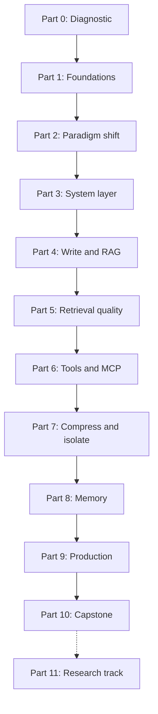

## The map

Part 11 is optional. It can start after Part 9.

## Parts

| Part | Folder | Sessions | Content | Handbook |
|---|---|---|---|---|
| 0 | [00 Progress](/notes/ai/context-engineering/00-progress) | 1 | A short diagnostic, one question at a time | — |
| 1 | [01 Foundations](/notes/ai/context-engineering/01-foundations) | 5 to 7 | Tokens, the API call, attention cost, position and length effects, conversation cost, prompt caching | assumed |
| 2 | [02 Paradigm shift](/notes/ai/context-engineering/02-paradigm-shift) | 4 to 5 | Definitions, the LLM OS model, the six elements, the quality curve, the context audit | Session 1 |
| 3 | [03 System layer](/notes/ai/context-engineering/03-system-layer) | 6 to 8 | System prompts, altitude, structure, iteration, rules files, the context stack, few-shot examples | Session 2 |
| 4 | [04 Write and RAG](/notes/ai/context-engineering/04-write-and-rag) | 6 to 7 | The four strategies, WRITE, the RAG pipeline, chunking, embeddings, vector search | Session 3 |
| 5 | [05 Retrieval quality](/notes/ai/context-engineering/05-retrieval-quality) | 7 to 9 | BM25, RRF, rerankers, query transformation, MMR, budgets, just-in-time retrieval, evaluation | Session 3 |
| 6 | [06 Tools and MCP](/notes/ai/context-engineering/06-tools-and-mcp) | 8 to 10 | The tool-call loop, schemas, results, many tools, ReAct, MCP, tool security | Session 4 |
| 7 | [07 Compress and isolate](/notes/ai/context-engineering/07-compress-and-isolate) | 8 to 10 | Compaction, clearing, trimming, triggers, budgets, sub-agents, contracts, metrics | Session 5 |
| 8 | [08 Memory](/notes/ai/context-engineering/08-memory) | 6 to 8 | Memory types, scoring and decay, tiers, strategies, persistence, ACE, a memory agent | Session 6 |
| 9 | [09 Production](/notes/ai/context-engineering/09-production) | 7 to 9 | Context as code, PRP workflow, validation, Claude Code mechanisms, evaluation, CI, observability | Session 7 |
| 10 | [10 Capstone](/notes/ai/context-engineering/10-capstone) | 8 milestones | A research assistant agent that uses every part | Session 8 (planned in the handbook, not included) |
| 11 | [11 Research track](/notes/ai/context-engineering/11-research-track) | optional | Nine experiments with measurements | bootcamp topics |

The plan has about 60 to 75 sessions, plus the capstone. A **lesson** is one idea. A **session** is one sitting.

Part 1 is "just in time". The diagnostic decides which Part 1 lessons need a full session. If the diagnostic shows that I know an idea, one check question is enough.

## The learning ladder

The handbook uses a ladder from simple to complex context. The parts follow it.

| Level | What it is | Example | Parts |
|---|---|---|---|
| Atom | One prompt: task, constraints, format | "Summarize this text in 3 bullets." | 2, 3 |
| Molecule | Instruction, examples, context and new input | A few-shot classifier | 3 |
| Cell | Context with state: history, retrieval, memory | A chatbot with RAG and memory | 4, 5, 7, 8 |
| Organ | Several agents, each with its own context | An orchestrator with research and code sub-agents | 6, 7, 9, 10 |

> [!note] Source of the ladder
> The handbook credits the "davidkimai framework". This is the community repository `davidkimai/Context-Engineering` on GitHub, not a research paper. The ladder is a teaching device. It is not a standard.

## How each session works

1. **Recall.** One or two questions on old lessons that are due.
2. **Problem.** The question that the idea answers, and why it matters in production.
3. **Intuition.** A picture or an analogy, and the point where the analogy stops working.
4. **Visual.** A diagram, a graph, or a Manim video from the media queue.
5. **Mechanism.** The exact technical details. Every number has a source or a calculation.
6. **Calculation.** A small result by hand: tokens, cost, scores or ranks.
7. **Code.** I write the code myself in the lab repository. Hints come in three levels: idea, pseudocode, partial code.
8. **Debug.** When the handbook code has a bug, I find it and fix it.
9. **Check and explain back.** Check questions, then I teach the idea back.
10. **Close.** Session report in chat, then a notes update.

> [!key] Gate rule
> A gate passes only when I answer the check questions correctly in my own words. "I understand" does not pass a gate. A correct answer with a wrong reason does not pass.

## How each lesson page is built

Each lesson page has the 12 sections of the notes protocol. This subject adds four things:

1. **Production view.** The end of section 4 covers latency, cost, reliability, security and observability.
2. **Exercises.** Section 7 holds tasks with acceptance tests. I write the code. The page later links to my file.
3. **Debug exercises.** Section 7 holds the handbook code when it has a bug.
4. **Source labels.** Callouts mark each handbook claim as confirmed, corrected, or rule of thumb.

Section 9 ("Questions and answers") appears only after I ask a question about the lesson.

Each part also has a **Hard questions** page. It holds the tricky and skeptical questions from the handbook FAQ, plus interview questions, with full answers.

## Visuals

| Kind | Who makes it | Where it goes |
|---|---|---|
| Mermaid diagrams and `plot` graphs | Claude, inside the lesson | The lesson page |
| SVG figures | Claude in chat, checked as PNG before saving | `/notes/media/context-engineering/figures/` |
| Manim videos (17) | Claude Code, from a prompt that Claude writes | `/notes/media/context-engineering/manim/` |
| PaperBanana figures (11) | Claude Code, from a prompt that Claude writes | `/notes/media/context-engineering/paperbanana/` |

Each figure has a Mermaid version first, so no lesson waits for media. The [media queue](/notes/ai/context-engineering/00-progress/media-queue) tracks every video and figure.
