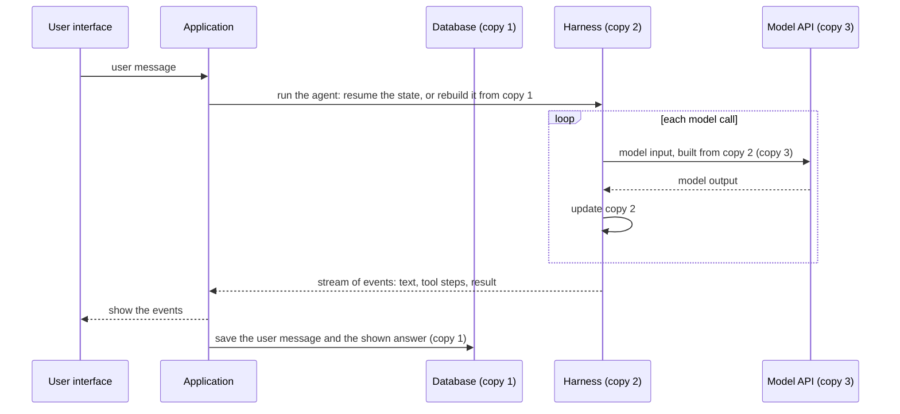

## 1. The question this idea answers

People say "the conversation" as if there is one. In an agent application there are at least three, and they are different:

1. The messages that the user typed and saw.
2. The messages that the agent framework keeps for the model: with tool calls, tool results, thinking blocks and summaries.
3. The exact input that goes to the model on one call.

When a design mixes them, data is lost. A common failure: the application saves the chat from the framework's state. Then the framework summarizes old messages, and the user's history shrinks to a summary. Another failure: the framework's copy lives on a temporary disk, and the history disappears after a restart.

This lesson names the three copies, shows who writes each one, and gives the rule that keeps them apart.

## 2. Mental model

> [!analogy] A court case
> - The **official record** of the court holds every word that was said in the courtroom. Nobody edits it. This is the **user transcript**.
> - The **lawyer's working file** holds the record plus notes, evidence extracts and summaries of long hearings. The lawyer rewrites it to stay useful. This is the **harness state**.
> - The **briefing** for an expert witness holds only what the expert needs for one question. It is made for that one question and then discarded. This is the **model input**.
>
> Each copy has a different owner and a different job. The working file is built from the record, and the briefing is built from the working file. The reverse direction is wrong: nobody rebuilds the official record from a briefing.
>
> **Where it stops working:** in a court, people make the copies by hand and see the difference. In software, code makes them automatically. One wrong line, for example "save the harness state as the chat history", lets a summary replace the record and nobody sees it.

## 3. Terms

| Term | Plain meaning |
|---|---|
| user transcript | The messages that the user typed and the answers that the user saw, stored by the application. |
| harness | The code that runs the agent loop: the Claude Agent SDK with its CLI, or a LangChain agent. |
| harness state | The copy of the conversation that the harness keeps for the model: a session file, or a checkpoint. |
| checkpoint | A saved snapshot of a LangGraph agent's state, keyed by a thread id. |
| model input | The full request body of one model call: system prompt, tools and messages. It exists for one call. |
| source of truth | The copy that wins when two copies disagree. All other copies are built from it. |
| derived copy | A copy built from another copy. It can be rebuilt. |
| display part | A piece of an answer that the user saw: text, a chart, a table, a tool status line. |
| drift | The copies become different from each other over time. |

## 4. Method and math

### 4.1 The three copies


| | Copy 1: user transcript | Copy 2: harness state | Copy 3: model input |
|---|---|---|---|
| Written by | Your application | The harness | The harness, for each call |
| Lives in | Your database | Claude SDK: a session file on the local disk. LangGraph: the checkpointer's store. | One HTTP request |
| Lifetime | As long as your retention rule says | Until the disk is replaced, the file expires, or the thread is deleted | One call |
| Holds | What the user typed and saw: text, charts, tool status | Full model messages: content blocks, tool calls and results, thinking, compaction summaries | System prompt, tool definitions, and the messages after trimming and editing |
| Shape | Your own neutral format, for example messages with parts | The harness format | The provider format: Anthropic Messages or OpenAI chat |
| Changes old content? | No, only adds | Yes: compaction and summarization replace old messages | Built new for every call |
| Source of truth? | **Yes** | No: a cache of the model's context | No: a view |

### 4.2 One turn, step by step



Two details in this diagram matter.

1. **The application builds copy 1 from the events that it showed.** It does not read copy 2 after the run and save that. What the user saw is exactly what goes into the transcript.
2. **The harness builds copy 3 from copy 2 on every call.** It can trim, clear or reorder for that call only. That change does not reach copy 2 or copy 1 unless a component writes it there. [L2](/notes/ai/conversation-state/01-where-state-lives/l2-transient-vs-persistent-context) names this difference: transient vs persistent.

### 4.3 How the copies drift apart

> [!example] Worked example: a long chat
> A chat has 60 turns. Many answers used tools with large results. The harness compacted once after turn 40.
>
> | Copy | What it holds after turn 60 |
> |---|---|
> | 1. User transcript | 60 user messages and 60 answers, as the user saw them, with charts and tool status lines |
> | 2. Harness state | The full raw history up to turn 40 (in the file, but out of the current chain), one compaction summary, and full messages for turns 41 to 60 with every tool call and result |
> | 3. Model input for the next call | The system prompt, the tool definitions, the summary, turns 41 to 60 with old tool outputs cleared, and the new message |
>
> The user can scroll back to turn 1. The model cannot see turn 1 except through the summary. Both facts are correct. The copies have different jobs.

### 4.4 Why copy 1 must be the source of truth

If the application treats copy 2 as the chat history, four things go wrong.

| Failure | Cause |
|---|---|
| Lost messages | Compaction or a summarization step replaces old messages in copy 2 with a summary. A transcript built from copy 2 shrinks. |
| History gone after a restart | The Claude SDK keeps copy 2 in a file on the local disk ([sessions L3](/notes/ai/claude-agent-sdk/04-sessions/l3-session-files-on-temporary-disks)). A temporary disk deletes it. |
| Internals shown to the user | Copy 2 holds raw tool results, thinking blocks and system entries that the user never saw. |
| Locked to one harness | Copy 2 has the format of one harness. A second harness, for example LangChain next to the Claude SDK, cannot read it. |

> [!key] The direction rule
> Data flows from copy 1 to copy 2 to copy 3, never back. The application writes copy 1 from what the user saw. The harness keeps copy 2, and it can rebuild copy 2 from copy 1 when needed. The harness builds copy 3 for each call. Nothing writes copy 1 from copy 2 or copy 3.

### 4.5 Two harnesses, one transcript

| | Claude Agent SDK | LangChain / LangGraph |
|---|---|---|
| Copy 2 | The session JSONL file, written by the CLI | The agent state, saved by a checkpointer per thread id |
| How copy 2 shrinks | Auto-compaction near the window limit | `SummarizationMiddleware` and other `before_model` hooks |
| How to rebuild copy 2 | A new session with the old turns in the prompt (Flow 2) | Load the stored messages into the state of a new thread |
| Copy 3 | Built by the CLI | Built by the model node, after `wrap_model_call` middleware |
| Copy 1 | The same tables for both | The same tables for both |

Because copy 1 does not depend on the harness, one chat store serves both harnesses. A chat can even start on one harness and continue on the other, with a rebuild.

### 4.6 What copy 1 must hold

Copy 1 is the record of what happened. It needs enough to show the chat again and enough to rebuild a model context.

| Item | Why |
|---|---|
| Each user message, exactly as typed | Display, and rebuild |
| Each answer as an ordered list of parts: text, tool calls with inputs, tool results or their short form, charts | Display, and a rebuild that keeps the tool steps |
| Ids and order | Correct order in display and rebuild |
| Time stamps | Display, retention, debugging |
| The harness and the session id that produced the answer | Flow 1 resume, and debugging |
| The owner of the chat | Access checks ([lesson 3.1](/notes/ai/conversation-state/03-lifecycle/l1-ownership-checks)) |

[Lesson 2.1](/notes/ai/conversation-state/02-chat-history-model/l1-chats-messages-and-parts) turns this list into tables.

### 4.7 Production view

| Concern | What to do |
|---|---|
| Durability | Store copy 1 in a real database, not on the local disk of the service. |
| Correctness | Save copy 1 from the events that the user saw, at the end of each turn, in one transaction ([PostgreSQL transactions](/notes/databases/postgres/02-transactions/l1-transactions)). |
| Portability | Keep copy 1 in a neutral format. Convert to each harness at the last step. |
| Privacy | Copy 2 also holds private data. Clean it up with the same retention rule as copy 1. |
| Debugging | When an answer is wrong, read copy 3 (what the model got), not copy 1 (what the user saw). Log it. |

## 5. Code

These exercises go in `conversation-state/01-three-copies.ipynb`. They need no API key.

**Exercise 1.1: classify.** For each item, write copy 1, 2 or 3, and one reason: (a) a compaction summary, (b) a chart that the user saw, (c) the system prompt of call 4, (d) a raw tool result of 40,000 characters, (e) the text that the user typed, (f) a thinking signature, (g) a tool output replaced by "[cleared]" for one call, (h) the session id of the last answer.

Acceptance test: your answers and reasons match the table of section 4.1. Bring them to the session.

**Exercise 1.2: a fake harness that compacts.** Write a class `FakeHarness` with a list `state`. Each `run(user_text)` appends a user message and an answer. When the list has more than 10 messages, it replaces all but the last 4 with one message "SUMMARY". Write two savers:

- `save_from_state(harness)`: copies `harness.state` into the transcript.
- `save_from_events(user_text, answer)`: appends the two shown messages to the transcript.

Acceptance tests:

- After 20 runs, the transcript from `save_from_events` has 40 messages.
- After 20 runs, the transcript from `save_from_state` has fewer than 10 messages and contains "SUMMARY".
- Write one sentence that names the design rule that the second saver breaks.

## 6. Common mistakes

1. **"There is one conversation."** There are three copies with three owners and three jobs.
2. **Saving the chat from the harness state.** Compaction and summaries then delete the user's history.
3. **Using the session file or checkpoint as the only store.** A temporary disk or a new harness loses it.
4. **Debugging from the transcript.** The model never saw the transcript. Read the model input.
5. **Showing the harness state to the user.** It holds internals that the user never saw.

## 7. One-minute explanation

An agent application keeps three copies of one conversation. The user transcript is what the user typed and saw. The application stores it in its own database, and it is the source of truth. The harness state is the framework's working copy for the model: the session file of the Claude SDK, or the checkpoint of LangGraph. It holds every tool call and result, and the framework compacts or summarizes it when it gets long. The model input is built from the harness state for one call and then discarded. Data flows in one direction: transcript to harness state to model input. The application saves the transcript from what it showed the user, never from the harness state, or a summary can replace the user's history.

## 8. Check questions

```check
{
  "question": "After a long chat, users report that their old messages are gone and the first message is now a block of summary text. Which copy did the application save as the transcript, and what is the fix?",
  "answer": "It saved the harness state (copy 2). The harness summarized old messages in its own state, and the transcript copied the summary. The fix is to save the transcript from the events that the user saw, at the end of each turn, and never from the harness state."
}
```

```check
{
  "question": "Name two reasons why the session file of the Claude Agent SDK cannot be the source of truth for chat history.",
  "answer": "Any two: it is on the local disk, so a restart or another instance loses it. It is compacted, so its current chain starts at a summary. It holds internals that the user never saw. It has the format of one harness, so another harness cannot use it. It can expire after the retention period."
}
```

```check
{
  "question": "A model answer is wrong. Which copy do you read first to debug it, and why?",
  "answer": "Copy 3, the model input of the call that produced the answer. The model reacted only to that input, which can differ from the transcript because of trimming, cleared tool outputs and summaries."
}
```

## 9. Links

- Next: [L2: Transient vs persistent context](/notes/ai/conversation-state/01-where-state-lives/l2-transient-vs-persistent-context)
- Copy 2 in the Claude SDK: [What a session is](/notes/ai/claude-agent-sdk/04-sessions/l1-what-a-session-is)
- Copy 1 as tables: [Chats, messages and parts](/notes/ai/conversation-state/02-chat-history-model/l1-chats-messages-and-parts)
- [Glossary](/notes/ai/conversation-state/glossary)
