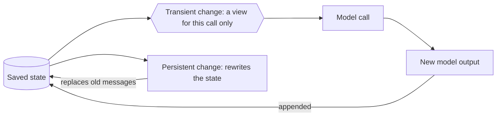

## 1. The question this idea answers

An agent changes its context all the time. It trims old messages, clears big tool outputs, writes summaries, adds a dynamic system prompt, and compacts the conversation when the window fills. All of these make the model input smaller or more useful.

But they are not the same kind of change. Some changes affect only the input of one model call. The next call starts again from the full saved state. Other changes rewrite the saved state, and the old content is gone for every later turn.

If you do not know which kind a change is, you lose data without noticing it, or you pay for the same work on every call. This lesson gives the two names, a test to tell them apart, and the place of each kind in LangChain and in the Claude Agent SDK.

## 2. Mental model

> [!analogy] A filter in a photo editor
> A photo editor can show a filter in the preview: brighter, cropped, black and white. The file on disk does not change. Turn the filter off and the original is back. This is a **transient** change.
>
> The editor can also "apply and save". Now the file on disk is changed, and every later edit starts from the changed file. This is a **persistent** change.
>
> **Where it stops working:** in a photo editor, "apply and save" is a choice that a person makes. In an agent, persistent changes are often automatic, for example a summary when the history gets long. And there is more than one file: a change can be persistent in the harness state (copy 2) and must still never reach the user transcript (copy 1) of [L1](/notes/ai/conversation-state/01-where-state-lives/l1-three-copies-of-a-conversation).

## 3. Terms

| Term | Plain meaning |
|---|---|
| transient change | A change to the model input of one call. The saved state stays the same. |
| persistent change | A change to the saved state. It affects every later call. |
| saved state | The state that the harness keeps between calls and turns: LangGraph state, or the Claude SDK session file. |
| model context | Everything that goes into one model call: instructions, messages, tools, model choice, response format. |
| tool context | What tools can read and write: state, store, runtime context. |
| life-cycle context | What happens between model and tool calls: summarization, guardrails, logging. |
| runtime context | Fixed configuration for one run, for example the user id or a database connection. |
| store | Long-term memory that lives across conversations. |
| reducer | The function that merges an update into a state field. For messages, `add_messages`. |
| destructive | It removes information that cannot be rebuilt from the same copy. |

## 4. Method and math

### 4.1 The definitions

The LangChain context-engineering page defines both terms (checked on 2026-10-12):

> **Transient context:** "What the LLM sees for a single call. You can modify messages, tools, or prompts without changing what's saved in state."
>
> **Persistent context:** "What gets saved in state across turns. Life-cycle hooks and tool writes modify this permanently."

The same page groups what you can control:

| Kind | What it covers (quote) | Type |
|---|---|---|
| Model context | "What goes into model calls (instructions, message history, tools, response format)" | Transient |
| Tool context | "What tools can access and produce (reads/writes to state, store, runtime context)" | Persistent |
| Life-cycle context | "What happens between model and tool calls (summarization, guardrails, logging, etc.)" | Persistent |

And it states the rule in one line: "Model context changes are transient (per-call), while life-cycle context changes persist to state".

### 4.2 The two-question test

For any operation, ask two questions.

1. **After the call, is the saved state different?**
2. **Does the operation run again on the next call, from the full state?**

| Answer to 1 | Answer to 2 | Kind |
|---|---|---|
| No | Yes | Transient |
| Yes | No (the next call starts from the changed state) | Persistent |




### 4.3 Transient and persistent in LangChain code

LangChain middleware has two styles of hooks. The style decides the kind of change.

| Hook | Style | Return value | Kind |
|---|---|---|---|
| `wrap_model_call` with `request.override(...)` | wrap | A model response | Transient |
| `@dynamic_prompt` | wrap (a shortcut for `wrap_model_call`) | A system prompt string | Transient |
| `before_model`, `after_model` | node | A dictionary of state updates, "applied to the agent state using the graph's reducers" | Persistent |
| `before_agent`, `after_agent` | node | A dictionary of state updates | Persistent |
| `wrap_tool_call` returning a `Command(update=...)` | wrap | A command that updates the state | Persistent |
| `wrap_model_call` returning `ExtendedModelResponse` with a `Command` | wrap | A response plus a state update | Persistent |

This sketch shows the two kinds side by side. It is a sketch for reading. Check the imports against the installed version (langchain 1.4.5 was checked).

```python
from langchain.agents.middleware import wrap_model_call, before_model

@wrap_model_call
def last_20_only(request, handler):
    # TRANSIENT: the model sees 20 messages. The state keeps all of them.
    return handler(request.override(messages=request.messages[-20:]))

@before_model
def drop_old(state, runtime):
    # PERSISTENT: the reducer applies this to the state. The old messages are gone
    # for every later call. (RemoveMessage and REMOVE_ALL_MESSAGES: see lesson 3.3 of LangChain.)
    ...
    return {"messages": [...]}
```

Two built-in middleware classes show the difference in the installed source (langchain 1.4.5):

**`ContextEditingMiddleware` is transient.** Its `wrap_model_call` copies the messages, edits the copy, and passes the copy on:

```python
edited_messages = deepcopy(list(request.messages))
for edit in self.edits:
    edit.apply(edited_messages, count_tokens=count_tokens)

return handler(request.override(messages=edited_messages))
```

The state keeps the full tool outputs. So the clearing runs again on every model call.

**`SummarizationMiddleware` is persistent.** Its `before_model` hook returns a state update that removes all messages and puts back a summary and the newest messages:

```python
return {
    "messages": [
        RemoveMessage(id=REMOVE_ALL_MESSAGES),
        *new_messages,
        *preserved_messages,
    ]
}
```

`new_messages` is one human message that starts with "Here is a summary of the conversation to date:". The `add_messages` reducer sees `REMOVE_ALL_MESSAGES` and drops everything before it. The old messages are gone from the state.

The context-engineering page says it directly: "Unlike the transient message trimming shown in Model Context, summarization **persistently updates state** - permanently replacing old messages with a summary that's saved for all future turns."

> [!trap] The LangChain docs disagree about trimming
> The context-engineering page calls message trimming transient. But the "Trim messages" example on the short-term memory page uses `@before_model` with `RemoveMessage(REMOVE_ALL_MESSAGES)`, which is persistent. The example function is also named `trim_messages`, the same name as the core utility, and it does not call that utility. Trimming is transient only when it runs inside `wrap_model_call` (or on the model input in a node). Use the two-question test, not the name.

### 4.4 Ten operations classified

| Operation | Kind | Reason |
|---|---|---|
| `wrap_model_call` that keeps the last 20 messages | Transient | It overrides the request. The state is unchanged. |
| `ContextEditingMiddleware` with `ClearToolUsesEdit` | Transient | It edits a deep copy for each call. |
| `@dynamic_prompt` that adds "be concise" after 10 messages | Transient | It overrides the system message for one call. |
| `SummarizationMiddleware` | Persistent | It returns `RemoveMessage(REMOVE_ALL_MESSAGES)` plus a summary as a state update. |
| A `before_model` hook that deletes old messages | Persistent | Node-style updates go through the reducer into the state. |
| A tool that returns `Command(update={"authenticated": True})` | Persistent | Tool writes change the state. |
| Anthropic API context editing (`clear_tool_uses_20250919`) | Transient for your data | The docs say: "Context editing is applied server-side before the prompt reaches Claude. Your client application maintains the full, unmodified conversation history." |
| Claude Code auto-compaction | Persistent in copy 2 | The session chain starts at the summary after compaction ([sessions L1](/notes/ai/claude-agent-sdk/04-sessions/l1-what-a-session-is)). |
| The recorded system prompt of a Claude SDK session | Persistent in copy 2 | The session keeps it for all later requests ([system prompts](/notes/ai/claude-agent-sdk/05-prompts-and-input/l1-system-prompts-and-snapshot)). |
| Per-turn UI data placed in the user message | Persistent, and correct | It becomes part of the history, because it was true at that turn. |

### 4.5 Persistent for which copy?

"Persistent" always means "persistent in some saved copy". Use the three copies of [L1](/notes/ai/conversation-state/01-where-state-lives/l1-three-copies-of-a-conversation) to ask which one.

| Operation | Copy 1: user transcript | Copy 2: harness state | Copy 3: model input |
|---|---|---|---|
| Transient trimming or clearing | unchanged | unchanged | changed |
| Summarization or compaction | **must stay unchanged** | changed | changed |
| A new user message | changed (appended) | changed (appended) | changed |

> [!key] Never let a harness decide what you store
> A persistent change in the harness is fine when it keeps the model inside its window. It must never flow into the user transcript. So `SummarizationMiddleware`, Claude Code compaction and any `before_model` deletion must never decide what the application stores. The application stores what the user saw, from the event stream ([L1, section 4.2](/notes/ai/conversation-state/01-where-state-lives/l1-three-copies-of-a-conversation)).

### 4.6 When to use each kind

| Use transient when | Use persistent when |
|---|---|
| The full data can be useful later, for example a tool output that the user may ask about again | The information will not be needed again, and the state would grow without limit |
| The change depends on the current call, for example the remaining token budget | The change is expensive to compute and should be computed once, for example a summary made by a model call |
| You want to undo or tune the change later | You accept that the old content is gone from that copy |

> [!example] Worked example: why summarization is persistent and clearing is transient
> A chat has 120 messages. A summary of the first 100 costs one extra model call with about 30,000 input tokens.
>
> - As a **transient** step, the summary would run on every later call: 50 later calls × 30,000 tokens = 1,500,000 extra input tokens.
> - As a **persistent** step, it runs once: 30,000 tokens. Later calls read the stored summary.
>
> Clearing an old tool output needs no model call. It only replaces text with "[cleared]". So it is cheap to repeat on every call, and the full output stays available.

> [!trap] Transient edits can move the cache prefix
> The prompt cache matches the start of the input ([prompt caching](/notes/ai/context-engineering/01-foundations/l7-prompt-caching)). A transient edit that changes an early message, for example clearing a tool output in turn 3, changes the prefix from that point. If the set of cleared outputs changes often, the cache match ends at the first changed message on each call. Clear in large steps, not one message at a time.

### 4.7 Production view

| Concern | What to do |
|---|---|
| Data safety | Store the user transcript from the event stream. Run summaries only on the harness state. |
| Cost | Repeat cheap transient edits per call. Compute expensive summaries once, persistently. |
| Debugging | Log the model input (copy 3) of each call. A transient edit is visible only there. |
| Testing | For each middleware, test the state before and after one call. A transient middleware must leave it equal. |
| Reviews | In code review, ask the two questions for every context operation. |

## 5. Video

```video
{
  "src": "/notes/media/conversation-state/manim/m01-transient-vs-persistent.mp4",
  "caption": "A transient edit makes a view for one call and the state stays full. A persistent summary rewrites the state for every later call."
}
```

## 6. Code

These exercises go in `conversation-state/02-transient-persistent.ipynb`. They need no API key.

**Exercise 2.1: two functions, two kinds.** The state is a list of dictionaries `{"role", "content"}`. Write:

- `view_last(state, n)`: returns a new list with the last `n` messages, for one call.
- `summarize_in_place(state, keep)`: replaces all but the last `keep` messages with one message `{"role": "user", "content": "SUMMARY of k messages"}`, inside the same list object.

Acceptance tests:

- After `view_last(state, 3)`, `len(state)` is unchanged.
- After `summarize_in_place(state, 3)`, `len(state)` is 4, and the first message holds "SUMMARY".
- Both functions keep tool-call pairs together ([LLM APIs L2, safe-cut rule](/notes/ai/llm-apis/01-messages-api/l2-tool-use-and-tool-result)).

**Exercise 2.2: test a middleware for transience.** Write a test helper `assert_transient(fn, state)` that deep-copies the state, runs `fn` on it, and fails if the state changed.

Acceptance tests:

- `assert_transient` passes for `view_last`.
- `assert_transient` fails for `summarize_in_place`.

**Exercise 2.3: classify.** Add three operations of your own to the table of section 4.4, with the kind and the reason. Bring them to the session.

## 7. Common mistakes

1. **Judging by the name.** A function named "trim" can be persistent. Use the two-question test.
2. **Letting a summary reach the user transcript.** The user loses history.
3. **Summarizing transiently.** A model call on every turn for the same summary wastes tokens.
4. **Assuming clearing is free.** It moves the cache prefix when the cleared set changes.
5. **"Persistent" without a copy.** Always say which copy changes: transcript, harness state or model input.

## 8. One-minute explanation

Some changes to an agent's context affect only one model call. They make a view of the saved state, and the next call starts again from the full state. These are transient: trimming in `wrap_model_call`, a dynamic system prompt, clearing old tool outputs, or Anthropic's server-side context editing. Other changes rewrite the saved state, so the old content is gone for all later calls. These are persistent: `SummarizationMiddleware`, `before_model` deletions, tool writes, and Claude Code's auto-compaction of the session. Test any operation with two questions: is the saved state different after the call, and does the operation run again next time? Persistent changes are fine inside the harness to save tokens, but they must never decide what the application stores as the user's chat history.

## 9. Check questions

```check
{
  "question": "A middleware runs in wrap_model_call. It replaces every tool output older than 5 turns with \"[cleared]\" and calls handler(request.override(messages=edited)). Is it transient or persistent? What happens on the next call?",
  "answer": "Transient. It overrides the request for this call only, and the state keeps the full tool outputs. On the next call, the middleware runs again on the full state and clears the outputs that are older than 5 turns at that point."
}
```

```check
{
  "question": "Why is SummarizationMiddleware persistent, in terms of its code?",
  "answer": "It runs in before_model, a node-style hook, and returns a state update: RemoveMessage(id=REMOVE_ALL_MESSAGES), a summary message and the preserved recent messages. The add_messages reducer applies it, so the old messages are removed from the state for every later turn."
}
```

```check
{
  "question": "Claude Code compacts a session. Is that change transient or persistent? For which of the three copies?",
  "answer": "Persistent for copy 2, the harness state: the session chain now starts at the summary. It changes copy 3 for all later calls. It must not change copy 1, the user transcript, which the application stores separately."
}
```

```check
{
  "question": "Give one reason to make a context change persistent instead of transient, with a number.",
  "answer": "Cost of repeated work. For example, a summary that costs 30,000 input tokens, recomputed on each of 50 later calls, costs 1,500,000 tokens as a transient step, but only 30,000 tokens once as a persistent step."
}
```

## 10. Links

- Previous: [L1: Three copies of a conversation](/notes/ai/conversation-state/01-where-state-lives/l1-three-copies-of-a-conversation)
- Next in the priority path: [PostgreSQL L1: Tables, keys and constraints](/notes/databases/postgres/01-relational-basics/l1-tables-keys-and-constraints)
- LangChain details: [Context management](/notes/ai/langchain-langgraph/03-context-management) (planned lessons)
- Compression in theory: [Context engineering Part 7](/notes/ai/context-engineering/07-compress-and-isolate)
- [Glossary](/notes/ai/conversation-state/glossary)
