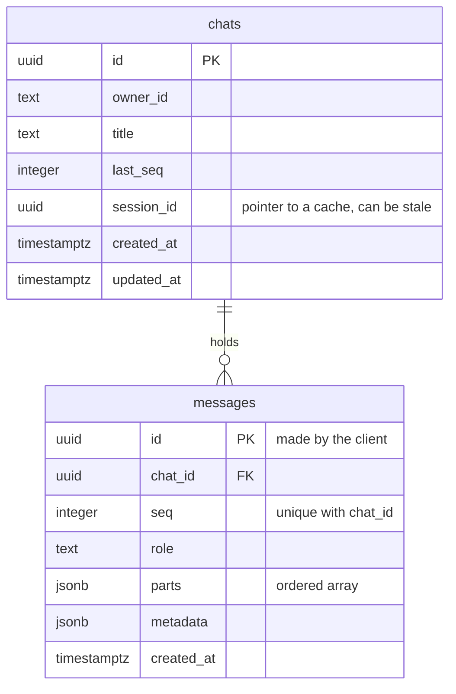

## 1. The question this idea answers

[L1 of this subject](/notes/ai/conversation-state/01-where-state-lives/l1-three-copies-of-a-conversation) says that the user transcript (copy 1) is the source of truth, and that the application must store it itself. This lesson designs that store. The design must meet six requirements:

| Code | Requirement | From |
|---|---|---|
| R1 | Show any chat again, exactly as the user saw it, with tool steps and charts | Copy 1 |
| R2 | Rebuild a model context for any harness (Flow 2) | [SDK sessions L3](/notes/ai/claude-agent-sdk/04-sessions/l3-session-files-on-temporary-disks) |
| R3 | Never save half a turn | [Transactions](/notes/databases/postgres/02-transactions/l1-transactions) |
| R4 | Never split a tool call from its result | [tool_use and tool_result](/notes/ai/llm-apis/01-messages-api/l2-tool-use-and-tool-result) |
| R5 | Accept new fields later without a slow migration | [Column types](/notes/databases/postgres/01-relational-basics/l2-column-types) |
| R6 | Fast for the two main queries: one chat in order, and a user's chat list | [Indexes](/notes/databases/postgres/01-relational-basics/l3-indexes) |

The design uses two tables: `chats` and `messages`. Each message holds an ordered list of typed **parts**. Every SQL statement in this lesson ran on PostgreSQL 16.15.

## 2. Mental model

> [!analogy] A filing cabinet of case folders
> Each chat is a folder with a label: the owner, the title, the last change. Inside the folder are numbered sheets, one for each message: sheet 1 is the user's question, sheet 2 is the answer. A sheet is not one paragraph. It holds an ordered list of items: a paragraph of text, a "tool card" with the request and the result stapled together, a chart.
>
> To add a turn, the clerk takes the folder, writes the next two sheet numbers on the label, puts both sheets in, and closes the folder. Nobody else can add sheets to that folder while the clerk holds it.
>
> **Where it stops working:** a folder label is always true. The `session_id` on the chat label is only a pointer to a cache on some server's disk. It can name a file that no longer exists.

## 3. Terms

| Term | Plain meaning |
|---|---|
| chat | One conversation, with an owner. One row in `chats`. |
| message | One user message or one assistant answer, as the user saw it. One row in `messages`. |
| part | One typed item inside a message: text, reasoning, a tool step, a chart, a file. |
| part type | The `type` field of a part. It decides the other fields. |
| tool part | One part that holds a tool call and its result (or its error) together. |
| tool part state | The stage of a tool part: `input-available` (called, no result yet), `output-available` (result), `output-error` (failed). |
| `seq` | The number of a message inside its chat: 1, 2, 3, and so on. It defines the order. |
| turn | One user message and the assistant answer to it: two rows. |
| UI message | A message in the format for display, with parts. |
| model message | A message in a provider format for a model call, with content blocks. |
| idempotency key | An id that the client makes before the first attempt, so that a retry does not write twice. |

## 4. Method and math

### 4.1 Why parts

The Vercel AI chatbot changed its message format from one `content` string to a list of `parts`. The migration guide says: "We recommend rendering the messages using the `parts` property instead of the `content` property." And: "The parts property supports different message types, including text, tool invocation, and tool result" (checked on 2026-10-12).

The AI SDK persistence page gives the second half of the idea: "The `useChat` message format is different from the `ModelMessage` format." And: "We recommend storing the messages in the `useChat` message format." In the language of this subject: store copy 1 in a display format with parts, not copy 2 in a provider format.

There is a structural reason too. One answer that the user sees is often several model messages: an assistant message with a tool call, a user message with the result, another assistant message with text ([agent loop](/notes/ai/claude-agent-sdk/01-foundations/l2-the-agent-loop)). To the user, it is one answer. So the store keeps **one assistant row per answer**, and the steps inside it become parts.

### 4.2 The two tables

```sql
CREATE TABLE chats (
    id          uuid PRIMARY KEY,
    owner_id    text NOT NULL,
    title       text NOT NULL DEFAULT 'New chat',
    last_seq    integer NOT NULL DEFAULT 0,
    session_id  uuid,
    created_at  timestamptz NOT NULL DEFAULT now(),
    updated_at  timestamptz NOT NULL DEFAULT now()
);
CREATE INDEX chats_owner_updated_idx ON chats (owner_id, updated_at DESC);

CREATE TABLE messages (
    id          uuid PRIMARY KEY,
    chat_id     uuid NOT NULL REFERENCES chats (id) ON DELETE CASCADE,
    seq         integer NOT NULL,
    role        text NOT NULL CHECK (role IN ('user', 'assistant')),
    parts       jsonb NOT NULL CHECK (jsonb_typeof(parts) = 'array' AND jsonb_array_length(parts) > 0),
    metadata    jsonb NOT NULL DEFAULT '{}'::jsonb,
    created_at  timestamptz NOT NULL DEFAULT now(),
    CONSTRAINT messages_chat_seq_key UNIQUE (chat_id, seq)
);
```



### 4.3 Every column, with its reason

| Column | Type and constraints | Reason |
|---|---|---|
| `chats.id` | `uuid PRIMARY KEY` | The client or the server makes it before the first save. It can also be the agent's session id for a new session ([resume and fork, 4.5](/notes/ai/claude-agent-sdk/04-sessions/l2-resume-continue-fork)). |
| `chats.owner_id` | `text NOT NULL` | Every read checks it ([ownership lesson](/notes/ai/conversation-state/03-lifecycle/l1-ownership-checks)). |
| `chats.last_seq` | `integer NOT NULL DEFAULT 0` | The counter for the next `seq`. The save updates it, which also locks the chat row (section 4.5). |
| `chats.session_id` | `uuid`, nullable | The session of the last answer, for Flow 1. A pointer to a cache, never the truth. |
| `chats.updated_at` | `timestamptz NOT NULL` | The order of the chat list. One instant, in any time zone ([column types, 4.3](/notes/databases/postgres/01-relational-basics/l2-column-types)). |
| `messages.id` | `uuid PRIMARY KEY` | An idempotency key made by the client, so that a retry cannot save twice (section 4.6). |
| `messages.chat_id` | `uuid NOT NULL REFERENCES chats ON DELETE CASCADE` | A message cannot exist without its chat. Deleting a chat deletes its messages. |
| `messages.seq` | `integer NOT NULL`, `UNIQUE (chat_id, seq)` | The order inside the chat. Random uuids do not give order. The unique constraint forbids two messages in one position, and its index serves R6. |
| `messages.role` | `text` with `CHECK` | Only `user` and `assistant` exist in copy 1. |
| `messages.parts` | `jsonb`, a non-empty array | An ordered list of typed parts. `jsonb` keeps array order and supports `@>` ([column types, 4.4](/notes/databases/postgres/01-relational-basics/l2-column-types)). |
| `messages.metadata` | `jsonb NOT NULL DEFAULT '{}'` | Fields that vary and grow: harness, session id, model, usage, cost, stop reason. R5. |
| `messages.created_at` | `timestamptz NOT NULL` | Display and retention. Not used for order: two rows can have the same time. |

> [!note] One index serves two jobs
> The constraint `UNIQUE (chat_id, seq)` creates a B-tree index on `(chat_id, seq)`. It serves the foreign key (cascade deletes and lookups by `chat_id`) and the ordered read of one chat. No separate index on `chat_id` is needed ([indexes, 4.4](/notes/databases/postgres/01-relational-basics/l3-indexes)).

### 4.4 The parts format

The parts format is neutral: it belongs to the application, not to a provider.

| Part type | Fields | Shown to the user as |
|---|---|---|
| `text` | `text` | Text |
| `reasoning` | `text` | A "thinking" panel, when the UI shows summarized thinking |
| `tool` | `tool_call_id`, `name`, `state`, `input`, `output` or `error` | A tool step: "Counted orders for 2026-10-11: 412" |
| `chart` | `chart_id`, `spec` | A chart |
| `file` | `media_type`, `url`, `filename` | An attachment |

An assistant answer with one tool step and a chart:

```json
[
  { "type": "reasoning", "text": "The user wants one count for one date." },
  { "type": "tool", "tool_call_id": "toolu_1", "name": "count_orders",
    "state": "output-available", "input": { "date": "2026-10-11" }, "output": "412" },
  { "type": "text", "text": "412 orders shipped on 2026-10-11." },
  { "type": "chart", "chart_id": "c1", "spec": { "kind": "bar", "series": [412] } }
]
```

> [!key] One tool part holds the call and the result
> The API sends a tool call and its result in two different messages. The store puts them into **one** part, joined by `tool_call_id`. So a stored message can never hold a call without its result: the part either has an `output`, or its `state` is `output-error`. Requirement R4 holds by construction. The AI SDK uses the same idea: its `tool-<name>` part moves through the states `input-streaming`, `input-available`, `output-available` and `output-error`.

What the parts do **not** hold: thinking signatures, raw content blocks and compaction summaries. Those belong to copy 2, the harness state. A Flow 2 rebuild turns the parts into text, so it does not need them ([sessions L3, section 4.4](/notes/ai/claude-agent-sdk/04-sessions/l3-session-files-on-temporary-disks)).

### 4.5 Saving one turn: two rows, one transaction

The application saves the turn after the agent's stream ends, from the events that it showed (copy 1 rule). The save is one short transaction ([transactions, 4.8](/notes/databases/postgres/02-transactions/l1-transactions)):

```sql
BEGIN;

-- 1. Lock the chat row, check the owner, take two numbers.
UPDATE chats
   SET last_seq = last_seq + 2, updated_at = now(), session_id = $session_id
 WHERE id = $chat_id AND owner_id = $owner_id
RETURNING last_seq;            -- for example 2; zero rows means "no such chat for this owner"

-- 2. Insert both messages with seq = last_seq - 1 and last_seq.
INSERT INTO messages (id, chat_id, seq, role, parts, metadata) VALUES
  ($user_msg_id,      $chat_id, $last_seq - 1, 'user',      $user_parts,      '{}'),
  ($assistant_msg_id, $chat_id, $last_seq,     'assistant', $assistant_parts, $metadata);

COMMIT;
```

The test ran this transaction: the `UPDATE` returned `last_seq = 2`, the `INSERT` added 2 rows, and the read gave seq 1 `user` with 1 part and seq 2 `assistant` with 2 parts.

Why the `UPDATE` comes first:

1. **It locks the chat row.** A second save for the same chat waits at its own `UPDATE` until the first transaction ends. So two saves cannot take the same `seq` numbers.
2. **It checks the owner.** If the chat does not belong to `$owner_id`, it updates zero rows, and the code rolls back.
3. **It computes the numbers.** No `max(seq) + 1` query is needed.

> [!example] Worked example: the database rejects bad writes
> The test also tried three bad writes.
>
> | Write | Result |
> |---|---|
> | `parts` = `{"type": "text"}` (an object, not an array) | `violates check constraint "messages_parts_check"` |
> | A second message with `seq` = 2 in the same chat | `duplicate key value violates unique constraint "messages_chat_seq_key"` |
> | A retry of message `...0001` with `ON CONFLICT (id) DO NOTHING` | `INSERT 0 0`, and the chat still has 2 rows |

**When to save the user message.** There are two choices.

| Choice | Strength | Weakness |
|---|---|---|
| Both rows at the end, in one transaction (this design) | Every user row has an answer row after it. A rebuild never sends a question with no answer. | If the agent fails, the question is not in the history. The UI must keep it and offer a retry. |
| The user row at the start, the answer at the end | The question survives a failure. | Two transactions. The history can hold questions with no answer, and the rebuild must handle them. |

This design takes the first choice, to keep requirement R3 simple. A failed turn can go to a separate log table for support and debugging.

### 4.6 Retries

The client makes `user_msg_id` and `assistant_msg_id` before it sends the message. If the connection drops after `COMMIT` but before the answer, the client retries with the same ids. The save code first checks:

```sql
SELECT 1 FROM messages WHERE id = $assistant_msg_id;
```

If the row exists, the turn is already saved, and the code returns with no change. A unique id and `ON CONFLICT (id) DO NOTHING` give a second layer of protection. The AI SDK docs give the same advice for ids: "for persistence, you should use IDs that are stable before messages are stored".

### 4.7 The two read queries

**One chat, in order.**

```sql
SELECT role, parts, created_at
  FROM messages
 WHERE chat_id = $chat_id
 ORDER BY seq;
```

For the newest messages only, add `ORDER BY seq DESC LIMIT 50`. In a test with 200 chats of 1,000 messages each (200,002 rows), the plan for the newest 50 was `Index Scan Backward using messages_chat_seq_key`, in 0.19 ms. The full chat of 1,000 messages took 1.6 ms with a bitmap index scan and a sort.

**A user's chat list.**

```sql
SELECT id, title, updated_at
  FROM chats
 WHERE owner_id = $owner_id
 ORDER BY updated_at DESC
 LIMIT 50;
```

The index `chats_owner_updated_idx (owner_id, updated_at DESC)` serves it: equality first, then the sort column.

> [!trap] The chat id is not a password
> Every query that reads a chat must also filter by the owner, for example `JOIN chats ... WHERE chats.owner_id = $owner_id`. A query by `chat_id` alone lets anyone who knows or guesses an id read the chat. The owner value must come from the verified identity of the request, never from the request body ([security lesson 1.1](/notes/software-engineering/security-and-operations/01-access-control/l1-self-asserted-identity)).

### 4.8 Adding a field later

New needs appear: a thumbs-up value, a cost per answer, a language. Two paths exist:

1. **A key in `metadata`.** No schema change at all.
2. **A real column**, when the database must enforce it or queries filter on it. The test ran `ALTER TABLE messages ADD COLUMN feedback text NOT NULL DEFAULT 'none';` on a table with rows. The old rows read `none` at once.

The PostgreSQL 16 docs explain why step 2 is fast: "From PostgreSQL 11, adding a column with a constant default value no longer means that each row of the table needs to be updated when the `ALTER TABLE` statement is executed." A volatile default, such as `clock_timestamp()`, still rewrites every row. [Lesson 4.1](/notes/databases/postgres/04-schema-changes/l1-alter-table-add-column) covers locks, and [lesson 4.2](/notes/databases/postgres/04-schema-changes/l2-migrations-as-code) covers migrations.

### 4.9 Two alternative designs

| Design | Who uses it | Strength | Weakness |
|---|---|---|---|
| Parts as a `jsonb` array in the message row (this design) | The Vercel chatbot keeps `parts` in one JSON column of `Message_v2` | One row per message. One read per chat. The save is atomic. | Queries on one part type scan the arrays. A GIN index helps. |
| One table per part type | The fullstackrecipes persistence recipe: `message_texts`, `message_tools`, `message_reasoning`, and others | Typed columns per part. The recipe says: "Query specific part types without scanning all messages", and "Add indexes on specific columns". | Many tables. A message read needs a query per part table, and the save touches all of them. |

Three details of the Vercel schema differ from this design, on purpose:

| Vercel `Message_v2` | This design | Reason |
|---|---|---|
| `json` | `jsonb` | Containment queries and GIN indexes |
| `timestamp` (without time zone) | `timestamptz` | One instant, in every time zone |
| No `ON DELETE` rule on `chatId` (so `NO ACTION`) | `ON DELETE CASCADE` | A message has no meaning without its chat |

### 4.10 From rows back to a model

| Flow | What the harness needs from the store |
|---|---|
| Flow 1: resume | Only the new user message. The session file has the rest. |
| Flow 2: rebuild, Claude SDK | The earlier turns as text in the new prompt: text parts as text, tool parts as short lines such as "Tool count_orders(date=2026-10-11) returned 412". |
| LangChain | The earlier turns as LangChain messages, converted from the parts ([lesson 2.2](/notes/ai/conversation-state/02-chat-history-model/l2-from-stored-parts-to-model-input)). |

The conversion runs at the last step, for each harness. The store stays the same for all of them.

### 4.11 Production view

| Concern | What the design does |
|---|---|
| Correctness | Two rows per turn in one transaction. Tool calls and results in one part. |
| Concurrency | The `UPDATE` on the chat row serializes saves of the same chat. |
| Retries | Client-made message ids, an existence check and `ON CONFLICT DO NOTHING`. |
| Speed | `(chat_id, seq)` and `(owner_id, updated_at DESC)` serve the two main reads. |
| Change | New fields go to `metadata` or to a new column with a constant default. |
| Security | Every read filters by the owner from the verified identity. |
| Growth | The table grows with every turn. Lesson 3.2 covers retention ([Retention and deletion](/notes/ai/conversation-state/03-lifecycle/l2-retention-and-deletion)). |

## 5. Video

```video
{
  "src": "/notes/media/conversation-state/manim/m02-save-a-turn.mp4",
  "caption": "One turn becomes two rows: the chat row is locked, two seq numbers are taken, both messages are inserted, and COMMIT makes them visible together."
}
```

## 6. Code

These exercises go in `conversation-state/03-chat-store.ipynb`, with your local PostgreSQL 16 server and `psycopg` 3.

**Exercise 1.1: build and attack the schema.** Create the two tables of section 4.2. Then try the three bad writes of the worked example in section 4.5, plus one of your own.

Acceptance test: each bad write fails with the constraint that you predicted, or does nothing with `ON CONFLICT`.

**Exercise 1.2: write `save_turn`.** Write `save_turn(conn, owner_id, chat_id, user_msg_id, user_parts, assistant_msg_id, assistant_parts, metadata, session_id)` with the transaction of section 4.5 and the retry check of section 4.6. Pass `parts` with `psycopg.types.json.Jsonb`.

Acceptance tests:

- A first call adds two rows with `seq` 1 and 2. A second turn adds 3 and 4.
- A retry with the same ids adds no rows and raises no error.
- A call with a wrong `owner_id` adds no rows and raises your own `ChatNotFound` error.
- Two threads that save turns for the same chat at the same time produce four rows with `seq` 1 to 4 and no error.

**Exercise 1.3: from agent events to parts.** You receive a list of SDK-style messages: assistant messages with `tool_use` and `text` blocks, and user messages with `tool_result` blocks ([agent loop, 4.2](/notes/ai/claude-agent-sdk/01-foundations/l2-the-agent-loop)). Write `to_parts(messages)` that returns the parts of one assistant answer.

Acceptance tests:

- Each `tool_use` and its `tool_result` become one `tool` part with `state = "output-available"`, joined by id.
- A result with `is_error: true` becomes `state = "output-error"` with an `error` field.
- Text keeps its position between the tool parts.

**Exercise 1.4: load and rebuild.** Write `load_chat(conn, owner_id, chat_id, limit)` and connect it to your `rebuild_prompt` from [sessions exercise 3.3](/notes/ai/claude-agent-sdk/04-sessions/l3-session-files-on-temporary-disks).

Acceptance test: a chat saved with exercise 1.2 produces a Flow 2 prompt with the turns in order and the tool results as short lines.

## 7. Common mistakes

1. **One text column for the answer.** It loses tool steps and charts, and the rebuild loses the tool results.
2. **Storing the raw provider messages as the chat history.** That is copy 2, in one harness's format.
3. **Ordering by `created_at` or by a random uuid.** Use `seq`.
4. **The call in one part and the result in another, in different rows.** A crash between them leaves an orphan. Keep both in one tool part.
5. **Two separate saves for one turn.** A failure leaves a question with no answer.
6. **Reading a chat by id with no owner check.** Anyone with the id can read it.

## 8. One-minute explanation

The chat store has two tables. `chats` has one row per conversation: owner, title, a counter for message numbers, the pointer to the last agent session and the last change time. `messages` has one row per user message and one row per assistant answer, with the chat id, a sequence number that defines the order, the role, a `jsonb` array of typed parts, and a `jsonb` field for metadata. A part is text, reasoning, a chart, or a tool step that holds the call and its result together, so a call can never lose its result. One turn is two rows, saved in one transaction that first locks the chat row, checks the owner and takes two numbers. Client-made ids make retries safe. A unique index on chat and sequence serves the ordered read, and every read checks the owner.

## 9. Check questions

```check
{
  "question": "Why does the save transaction start with UPDATE chats ... RETURNING last_seq, and not with SELECT max(seq) FROM messages?",
  "answer": "The UPDATE locks the chat row, so a second save of the same chat waits until the first one commits, and the two saves cannot take the same seq numbers. It also checks the owner in its WHERE clause and returns the new counter in one step. Two concurrent SELECT max(seq) queries could both read the same maximum and try the same seq."
}
```

```check
{
  "question": "An answer used two tools. How many rows and how many parts does the store write for the turn, at minimum?",
  "answer": "Two rows: one user message and one assistant message. The assistant row has at least three parts: two tool parts, each with its call and result, and at least one text part. The user row has at least one text part."
}
```

```check
{
  "question": "Why does the store keep one tool part with both the input and the output, instead of the API's separate tool_use and tool_result?",
  "answer": "So that a stored message can never hold a tool call without its result. The part either has an output or an output-error state. The API pairing rule then holds by construction, and a rebuild never produces an orphan call or result."
}
```

```check
{
  "question": "A product manager wants a thumbs-up value on each answer. Give two ways to store it and when each one is better.",
  "answer": "A key in the metadata jsonb, with no schema change, which is better when the database does not need to enforce or filter on it. Or a new column, for example ALTER TABLE messages ADD COLUMN feedback text NOT NULL DEFAULT 'none', which is fast since PostgreSQL 11 because the default is constant, and which is better when queries filter on it or a CHECK must enforce its values."
}
```

## 10. Links

- Previous in the priority path: [PostgreSQL transactions](/notes/databases/postgres/02-transactions/l1-transactions)
- Next in the part: [L2: From stored parts to model input](/notes/ai/conversation-state/02-chat-history-model/l2-from-stored-parts-to-model-input)
- Why copy 1: [Three copies of a conversation](/notes/ai/conversation-state/01-where-state-lives/l1-three-copies-of-a-conversation)
- Flow 1 and Flow 2: [Session files on temporary disks](/notes/ai/claude-agent-sdk/04-sessions/l3-session-files-on-temporary-disks)
- Tool pairing: [tool_use and tool_result](/notes/ai/llm-apis/01-messages-api/l2-tool-use-and-tool-result)
- [Glossary](/notes/ai/conversation-state/glossary)
