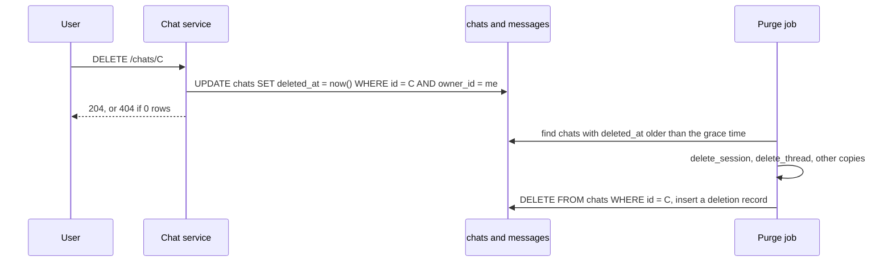

## 1. The question this idea answers

Every turn adds two rows ([L2.1](/notes/ai/conversation-state/02-chat-history-model/l1-chats-messages-and-parts)). A service with 500 users who send 20 messages a day adds 20,000 rows a day, more than 7 million a year. Old chats also hold business data: costs, margins, staff names, plant problems. Keeping them forever is a cost and a privacy risk.

So the service needs a rule for how long chats stay, and a way to delete them. Deleting looks simple: `DELETE FROM chats WHERE ...`. In practice four problems appear:

1. A large delete holds locks and can block users.
2. `ON DELETE CASCADE` hides most of the work.
3. PostgreSQL does not free the space at once.
4. A chat lives in more than one place, so one `DELETE` misses copies.

This lesson solves all four, with timings measured on one million message rows on PostgreSQL 16.15.

## 2. Mental model

> [!analogy] An archive room with a shredding schedule
> An archive keeps each folder for a fixed time, then shreds it. A good clerk shreds a few boxes at a time, so the corridor is never blocked for long. The shredded paper stays in the bin until the cleaner empties it. The empty shelf space is then used for new folders, but the room does not become smaller. To make the room smaller, the archive must close and rebuild its shelves.
>
> Batched deletes are "a few boxes at a time". Dead rows are the paper in the bin. `VACUUM` is the cleaner. `VACUUM FULL` is the rebuild, and it closes the room: it takes an exclusive lock.
>
> **Where it stops working:** an archive folder has one copy. A chat has several: the database rows, a session file, checkpoints, old Delta rows, traces and backups. Shredding the folder leaves the other copies.

## 3. Terms

| Term | Plain meaning |
|---|---|
| retention policy | A written rule: which data stays for how long, and what happens after that time. |
| retention period | The time that data stays, for example 180 days after the last activity. |
| hard delete | The row is removed with `DELETE`. |
| soft delete | The row stays, with a mark such as `deleted_at`. Every read hides marked rows. |
| purge | The later hard delete of soft-deleted rows. |
| batch | A small group of rows deleted in one short transaction. |
| cascade | `ON DELETE CASCADE`: deleting a chat also deletes its messages, through a trigger. |
| dead row version | An old row version left by `UPDATE` or `DELETE`. Other transactions may still need it. |
| `VACUUM` | Removes dead row versions and marks their space for reuse. The file does not shrink. |
| autovacuum | A PostgreSQL background process that runs `VACUUM` and `ANALYZE` when tables change enough. |
| table bloat | Space in a table file that holds no live rows. |
| `VACUUM FULL` | Writes a new, compact copy of the table. It needs an exclusive lock. |
| restore window | How far back a database backup can restore. Deleted data is still in it until the window passes. |
| deletion record | A log row that says which chat was deleted, when, and from which copies, with no chat content. |

## 4. Method and math

### 4.1 A retention policy

Write the policy before the code. A policy for a chat service can look like this:

| Data | Rule | Trigger |
|---|---|---|
| Chats with no activity | Hard delete after 180 days | Nightly job, on `updated_at` |
| A chat that the user deletes | Soft delete at once, purge within 7 days | The user's request |
| Harness state (session files, checkpoints) | Deleted with the chat, and never kept longer than the chat | The same jobs |
| Traces and logs with chat content | The shortest period that debugging needs | The tracing platform's own setting |
| Chats under a legal hold | Never deleted while the hold exists | A flag set by an administrator |

Use `updated_at` (last activity), not `created_at`. A chat that started a year ago and is still in use must stay.

### 4.2 The retention query needs its own index

The retention job asks: "which chats are older than the cutoff, oldest first?"

```sql
SELECT id FROM chats
 WHERE updated_at < now() - interval '180 days'
 ORDER BY updated_at
 LIMIT 500;
```

The index `(owner_id, updated_at DESC)` of L2.1 cannot serve it, because the query has no condition on its first column `owner_id` ([indexes](/notes/databases/postgres/01-relational-basics/l3-indexes)). The test used 10,000 chats and 1,000,000 messages.

| Index | Plan | Execution time |
|---|---|---|
| None on `updated_at` | `Seq Scan on chats`, then `top-N heapsort` | 14.3 ms |
| `CREATE INDEX chats_updated_idx ON chats (updated_at)` | `Index Scan using chats_updated_idx` | 0.46 ms |

### 4.3 Delete in batches

One `DELETE` of every old chat works, but it is one long transaction. Every deleted row stays locked until it commits. The batched form deletes a fixed number of chats per transaction:

```sql
WITH doomed AS (
    SELECT id FROM chats
     WHERE updated_at < now() - interval '180 days'
     ORDER BY updated_at
     LIMIT 100
     FOR UPDATE SKIP LOCKED
)
DELETE FROM chats c USING doomed d WHERE c.id = d.id;
```

The job runs this statement in a loop, with one commit per batch, until it deletes 0 rows. PostgreSQL 16 has no `LIMIT` on `DELETE`, so the CTE chooses the rows. The test deleted 4,995 old chats (499,500 messages) both ways. A second thread renamed one old chat 0.3 s after the start.

| Method | Total time | Longest transaction | The concurrent rename waited |
|---|---|---|---|
| One `DELETE` | 1.27 s | 1.27 s | 0.97 s, then updated 0 rows (the chat was gone) |
| 50 batches of 100 chats | 1.41 s | 80 ms (median 26 ms) | 6 ms |

The total time is almost the same. The longest lock is 16 times shorter: 1.27 s / 0.080 s = 15.9. One `DELETE` holds its locks for the whole run, so its lock time grows with the data. A batch holds its locks for one batch only. A failure undoes one batch, not the whole job.

> [!note] Two details of the batch statement
> `SKIP LOCKED`: the docs say that "any selected rows that cannot be immediately locked are skipped". A chat that a user is saving right now waits for the next run.
>
> The cutoff is inside the statement, so each batch tests it at the moment the batch runs. A chat that became active before the batch no longer matches, so it stays. Without `SKIP LOCKED`, PostgreSQL would wait for a locked row, and then "the WHERE clause is re-evaluated to see if the updated version of the row still matches the search condition" (Read Committed, PostgreSQL 16 docs). A job that reads a list of ids first and deletes them later loses both protections.

### 4.4 The hidden cost of ON DELETE CASCADE

The `messages.chat_id` foreign key has `ON DELETE CASCADE`. Each deleted chat fires a trigger that deletes its messages. `EXPLAIN ANALYZE` shows this work on a separate line, not in the plan:

```text
 Delete on chats (actual time=0.026..0.026 rows=0 loops=1)
   ->  Index Scan using chats_pkey on chats (actual time=0.015..0.017 rows=1 loops=1)
 Trigger for constraint messages_chat_id_fkey: time=162.968 calls=1
 Execution Time: 163.011 ms
```

This was one chat with 200,000 messages. The plan says "1 row". The trigger line holds almost all of the 163 ms.

The trigger must find the messages of each chat. The PostgreSQL 16 docs: "Since a DELETE of a row from the referenced table ... will require a scan of the referencing table for rows matching the old value, it is often a good idea to index the referencing columns too." And: "the declaration of a foreign key constraint does not automatically create an index on the referencing columns."

> [!example] Worked example: the same delete with and without an index on chat_id
> Two copies of the data: 2,000 chats with 100 messages each, so 200,000 message rows. Delete the 50 oldest chats, so 5,000 messages.
>
> | Table | Trigger time (50 calls) | Execution time |
> |---|---|---|
> | With `UNIQUE (chat_id, seq)` | 12.95 ms | 14.47 ms |
> | No index that starts with `chat_id` | 1,333.10 ms | 1,334.41 ms |
>
> Per chat without the index: 1,333.10 / 50 = 26.7 ms, one scan of all 200,000 rows each time. 1,334.41 / 14.47 = 92 times slower. The L2.1 design is safe, because `UNIQUE (chat_id, seq)` starts with `chat_id`.

For a very long chat, a single cascade can still take long. Delete its messages first, in batches by `seq`, and then delete the chat row.

### 4.5 Dead rows, VACUUM and table bloat

A `DELETE` does not free space. The PostgreSQL 16 docs: "In PostgreSQL, an UPDATE or DELETE of a row does not immediately remove the old version of the row." Other transactions may still need the old version. `VACUUM` removes it later:

> "The standard form of VACUUM removes dead row versions in tables and indexes and marks the space available for future reuse. However, it will not return the space to the operating system, except in the special case where one or more pages at the end of a table become entirely free and an exclusive table lock can be easily obtained."

The test disabled autovacuum on the test tables, to see each step:

| Step | `messages` table file | Total with indexes | Dead row versions |
|---|---|---|---|
| Before the delete | 326 MB | 408 MB | 0 |
| After deleting 499,500 rows | 326 MB | 408 MB | 499,500 |
| After `VACUUM` (1.22 s) | 326 MB | 408 MB | 0 |
| After inserting 300,000 new rows | 326 MB | 419 MB | 0 |
| After `VACUUM FULL` (2.98 s) | 261 MB | 316 MB | 0 |

Three facts come from this table. The delete freed nothing on disk. `VACUUM` did not shrink the file, but the 300,000 new rows reused the space, and the table file did not grow. Only `VACUUM FULL` made the file smaller. The docs say that it "requires an ACCESS EXCLUSIVE lock on the table", so no reads or writes run while it works.

**Autovacuum.** The docs: "In the default configuration, autovacuuming is enabled". A table is vacuumed when its dead rows pass this threshold:

$$
\text{vacuum threshold} = \text{base threshold} + \text{scale factor} \times \text{number of tuples}
$$

The defaults on the test server (PostgreSQL 16.15, `SHOW`, checked on 2026-10-13): `autovacuum_vacuum_threshold = 50`, `autovacuum_vacuum_scale_factor = 0.2`, `autovacuum_naptime = 1min`.

> [!example] Worked example: will last night's job trigger autovacuum?
> The `messages` table has 1,000,000 rows.
>
> Threshold = 50 + 0.2 × 1,000,000 = 50 + 200,000 = 200,050 dead rows.
>
> - A job that deletes 4,995 chats × 100 messages = 499,500 rows passes it. Autovacuum checks each database about once per `autovacuum_naptime`, so a worker starts within about a minute.
> - A job that deletes 1,500 chats × 100 = 150,000 rows does not pass it. Autovacuum waits until more dead rows pass the threshold, or until inserts pass the separate insert threshold.
>
> For a table that grows large, lower the scale factor for that table, for example `ALTER TABLE messages SET (autovacuum_vacuum_scale_factor = 0.02)`.

> [!trap] Plan the space, not only the delete
> A retention job that starts on a table of 10 GB leaves a file of 10 GB. That is normal. New rows reuse the space. Run `VACUUM FULL` only in a maintenance window, and only when the table must become smaller. On a managed database, read its own docs for autovacuum settings before you change them.

### 4.6 Soft delete or hard delete

| | Hard delete | Soft delete, then purge |
|---|---|---|
| How | `DELETE` at once | `UPDATE chats SET deleted_at = now()`, purge job later |
| Undo | Only from a backup | Clear `deleted_at` before the purge |
| Every read | No change | Must add `AND deleted_at IS NULL` |
| Privacy | The data leaves the live table at once | The data stays until the purge |
| Risk | A wrong `WHERE` cannot be undone | One read that forgets the filter shows deleted chats |

A good default for user requests: soft delete at once, so the chat disappears from every screen, and a purge within a short, fixed time. A partial index such as `CREATE INDEX ON chats (owner_id, updated_at DESC) WHERE deleted_at IS NULL` keeps the chat list fast. The SDK uses the same idea for its own files: the `delete_session` docstring says "This is a hard delete" and offers `tag_session(id, '__hidden')` for "soft-delete semantics".

### 4.7 Delete every copy

[Three copies of a conversation](/notes/ai/conversation-state/01-where-state-lives/l1-three-copies-of-a-conversation) applies to deletion too. A purge that deletes only the rows leaves the other copies.

| Copy | How to delete it (checked on 2026-10-13) |
|---|---|
| `chats` and `messages` rows | `DELETE` with the owner filter. The cascade deletes the messages. |
| Claude SDK session file | `delete_session(session_id, directory=None)` in SDK 0.2.165 removes the `.jsonl` file and the sibling folder of subagent transcripts. It raises `FileNotFoundError` when the file is not on this instance. |
| A session store | `delete_session_via_store`, which calls the store's `delete`. The `SessionStore.delete` docstring says: "if unimplemented, deletion is a no-op". |
| Local transcripts that you never delete | The Claude Code data-usage page: transcripts are stored "under `~/.claude/projects/` for 30 days by default". The setting is `cleanupPeriodDays`. |
| LangGraph checkpoints | `checkpointer.delete_thread(thread_id)`. In langgraph-checkpoint-postgres 3.1.3 it deletes from `checkpoints`, `checkpoint_blobs` and `checkpoint_writes`. |
| Old Delta tables | `DELETE`, then `VACUUM` after the retention threshold. Databricks: "The default retention threshold for data files after running `VACUUM` is 7 days." With deletion vectors, run `REORG TABLE ... APPLY (PURGE)` first. |
| Traces with chat content | The tracing platform's own retention and delete functions ([tracing agents](/notes/software-engineering/security-and-operations/02-observability/l1-tracing-agents)) |
| Lakebase backups | Not deletable one row at a time. The Lakebase docs: the restore window is from 2 to 30 days, "with a default of 7 days". |

A session file exists only on the instance that wrote it, and that instance may be gone ([SDK sessions L3](/notes/ai/claude-agent-sdk/04-sessions/l3-session-files-on-temporary-disks)). So the purge must treat `FileNotFoundError` as success, and the file retention setting is the safety net for files on other instances.

### 4.8 A user-requested deletion



Make every step of the job idempotent. A copy that is already gone counts as deleted. Then a job that fails half way can run again from the start. Write the deletion record in the same transaction as the final `DELETE`. It holds the chat id, the time and the list of copies, never the content.

### 4.9 Production view

| Concern | What to do |
|---|---|
| Locks | Delete in batches of a fixed size, with a commit per batch and the cutoff inside the statement. |
| Speed | Index `chats (updated_at)` for the retention query. Keep an index that starts with `messages.chat_id`. |
| Space | Expect the files to stay large. Check that autovacuum runs. Lower the scale factor for large tables. |
| Privacy | Delete every copy: rows, session files, checkpoints, Delta rows, traces. State the backup window in the privacy notice. |
| Reliability | Make the purge idempotent. Treat "already gone" as success. |
| Observability | Count deleted chats, batches, time per batch and dead rows per night. Alert when the job stops. |
| Safety | Test the retention `WHERE` clause with a `SELECT count(*)` first, and keep a legal-hold flag. |

## 5. Code

These exercises go in `conversation-state/06-retention.ipynb`, with your local PostgreSQL 16 server.

**Exercise 2.1: the batched job.** Fill the L2.1 tables with 10,000 chats of 100 messages, with `updated_at` spread over 365 days. Write `run_retention(conn, days, batch)`.

Acceptance tests:

- It deletes exactly the chats older than `days` and their messages.
- It prints the number of batches, the total time and the longest batch.
- A chat that a second connection updates during the run is not deleted.

**Exercise 2.2: measure the cascade.** Repeat the worked example of section 4.4 with your own data.

Acceptance tests:

- `EXPLAIN ANALYZE` shows the trigger line in both runs.
- Without the index, the trigger time is at least 10 times larger.

**Exercise 2.3: watch the space.** Disable autovacuum on a test table. Repeat the steps of section 4.5.

Acceptance tests:

- `n_dead_tup` in `pg_stat_user_tables` is close to the number of deleted rows before `VACUUM`, and 0 after it.
- The table file does not shrink after `VACUUM`, and it does not grow when you insert fewer rows than you deleted.

**Exercise 2.4: delete every copy.** Write `purge_chat(conn, chat_id, checkpointer, session_dir)`. Use `InMemorySaver` for the checkpointer and a temporary folder for session files.

Acceptance tests:

- After the call, the rows, the checkpoints of the thread and the session file are gone.
- A second call succeeds and changes nothing.
- A deletion record exists, with no message text in it.

## 6. Common mistakes

1. **No written policy.** The table grows until it causes a problem, and then the delete is urgent and large.
2. **One huge `DELETE`.** It holds locks on every row for the whole run. Delete in batches.
3. **Reading the old ids first and deleting them later.** A chat that became active in between is deleted. Keep the cutoff in the delete statement.
4. **A foreign key with no index on the referencing column.** Every cascade scans the whole child table.
5. **Expecting the disk to shrink after a delete.** `VACUUM` marks space for reuse. Only a rewrite shrinks the file.
6. **Running `VACUUM FULL` during working hours.** It blocks all reads and writes of the table.
7. **Deleting only the rows.** Session files, checkpoints, Delta files, traces and backups still hold the chat.

## 7. One-minute explanation

A chat table grows with every turn, so it needs a written retention policy. For example: delete chats with no activity for 180 days, and purge a chat within 7 days after the user deletes it. The retention query filters on `updated_at`, so it needs its own index. Delete in batches with a CTE that selects a fixed number of old chats with `FOR UPDATE SKIP LOCKED`, and commit each batch. In the test, the total time stayed the same, but the longest lock fell from 1.27 seconds to 80 milliseconds. Each deleted chat fires a cascade trigger that must find its messages. So an index that starts with `chat_id` is essential. Without it, the same delete was 92 times slower. A delete leaves dead row versions, `VACUUM` marks their space for reuse without shrinking the file, and only `VACUUM FULL` shrinks it, with an exclusive lock. Finally, a deletion must reach every copy: rows, session files, checkpoints, old Delta files and traces, and the backup window must be stated.

## 8. Check questions

```check
{
  "question": "A retention job runs DELETE FROM chats WHERE updated_at < now() - interval '180 days' once a night, on 5 million messages. Users report that saving a message sometimes hangs for many seconds at night. Explain why, and give the fix.",
  "answer": "The single DELETE is one long transaction. It locks every old chat row and cascades to its messages until it commits. A user who continues an old chat waits for the lock, which the test measured at 0.97 s for only 500,000 messages. Fix: delete in batches of a fixed size with a CTE, LIMIT and FOR UPDATE SKIP LOCKED, and commit each batch. Then the longest lock is one batch (80 ms in the test)."
}
```

```check
{
  "question": "EXPLAIN ANALYZE of a DELETE of one chat shows an index scan of 1 row and an execution time of 160 ms. Where did the time go, and what would make it much worse?",
  "answer": "Into the cascade trigger of the foreign key, which deletes the chat's messages. EXPLAIN ANALYZE shows it as a separate Trigger for constraint line. It gets much worse without an index that starts with messages.chat_id, because then each trigger call scans the whole messages table. In the test that made the delete 92 times slower."
}
```

```check
{
  "question": "After deleting half of a 400 MB table and running VACUUM, the table is still 400 MB. Is this a bug? What happens when new rows arrive, and what would shrink the file?",
  "answer": "It is not a bug. Standard VACUUM removes dead row versions and marks the space for reuse. It does not return the space to the operating system, except for free pages at the end of the table. New rows reuse the free space, so the file does not grow until the space is full. VACUUM FULL, or another table rewrite, writes a compact copy and shrinks the file, but it needs an ACCESS EXCLUSIVE lock."
}
```

```check
{
  "question": "A user deletes a chat. Name four places, other than the chats and messages tables, where its content can still exist, and how each one is handled.",
  "answer": "The Claude SDK session file on an instance: delete_session, with FileNotFoundError treated as success, and cleanupPeriodDays as the safety net. LangGraph checkpoints: checkpointer.delete_thread(thread_id). Old Delta tables: DELETE, then VACUUM after the retention threshold (7 days by default), and REORG TABLE ... APPLY (PURGE) when deletion vectors are on. Traces with chat content: the tracing platform's retention and delete. Database backups: they keep the data until the restore window passes (Lakebase default 7 days), so the privacy notice must say so."
}
```

## 9. Links

- Previous: [L1: Ownership checks](/notes/ai/conversation-state/03-lifecycle/l1-ownership-checks)
- Next: [L3: Moving old chats](/notes/ai/conversation-state/03-lifecycle/l3-moving-old-chats)
- Locks and transactions: [Transactions](/notes/databases/postgres/02-transactions/l1-transactions)
- Index design: [Indexes](/notes/databases/postgres/01-relational-basics/l3-indexes)
- Checkpoints: [Checkpointers and threads](/notes/ai/langchain-langgraph/04-persistence/l2-checkpointers-and-threads)
- Session files: [Session files on temporary disks](/notes/ai/claude-agent-sdk/04-sessions/l3-session-files-on-temporary-disks)
- [Glossary](/notes/ai/conversation-state/glossary)
