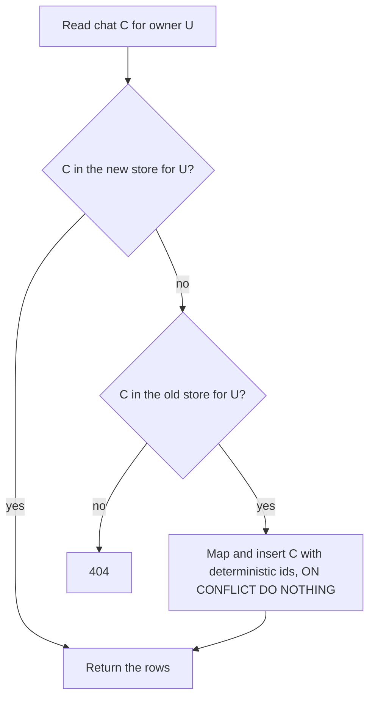

## 1. The question this idea answers

A chat service changes its storage. The old history lives in Delta tables, one row per turn, or in LangGraph checkpoints. The new history lives in the `chats` and `messages` tables of [L2.1](/notes/ai/conversation-state/02-chat-history-model/l1-chats-messages-and-parts) on Lakebase Postgres ([Lakebase vs Delta](/notes/platforms/databricks/05-lakebase/l4-lakebase-vs-delta)).

Users expect to open last month's chat and continue it. So the old chats must move. Five questions follow:

1. How does each old format become messages with parts?
2. How can the copy job run again after a failure, without duplicates?
3. How do you prove that every chat arrived complete and unchanged?
4. When does the service read from the new store, and what happens to chats written during the move?
5. How do you return to the old store if the new one fails?

This lesson answers each one. A small backfill ran against real LangGraph checkpoints and a flat table, twice, on PostgreSQL 16.15.

## 2. Mental model

> [!analogy] Moving a warehouse with a labeled inventory
> A company moves its stock to a new warehouse. Each box gets a fixed label before the move. The new warehouse refuses a box whose label it already has, so a second truck with the same boxes changes nothing. At the end, someone counts the boxes per shelf and opens a sample to compare contents with the inventory list. The old warehouse keeps its keys until the new one has worked for some weeks.
>
> Fixed labels are deterministic ids. Refusing a known label is `ON CONFLICT DO NOTHING`. Counting and opening boxes is verification by counts and checksums. The old keys are the rollback plan.
>
> **Where it stops working:** a warehouse is closed during a move. A chat service keeps running. Users write new messages during the move, sometimes into chats that have not moved yet. The switching plan in section 4.5 handles this.

## 3. Terms

| Term | Plain meaning |
|---|---|
| source store | Where the old chats are now: Delta tables or LangGraph checkpoints. |
| target store | The new `chats` and `messages` tables. |
| backfill | A job that copies existing old data into the target store. |
| mapping | The rules that turn one old record into messages with parts. |
| idempotent | Running it twice gives the same result as running it once. |
| deterministic id | An id computed from the source key, the same on every run, for example a version 5 uuid. |
| checksum | A short hash of the content. Equal content gives an equal checksum. |
| reconciliation | Comparing source and target, chat by chat, and listing every difference. |
| cutover | The moment the service starts to use the target store. |
| dual-write | During the move, the service writes each new turn to both stores. |
| read-fallback | The service reads the target store first, and reads (and copies) from the source store when a chat is missing. |
| one-time cutover | Stop writes, backfill, verify, switch, all in one maintenance window. |
| rollback plan | The tested steps to return to the source store. |
| feature flag | A setting that switches a code path without a new deployment. |

## 4. Method and math

### 4.1 Two old formats

| | Flat Delta table | LangGraph checkpoints (`PostgresSaver`) |
|---|---|---|
| Unit | One row per turn: `session_id`, `user_email`, `turn_index`, `question`, `answer`, `tool_calls_json`, `created_at` | Snapshots of the graph state per thread, at each super-step |
| Tool calls | A JSON string with name, arguments and result, often with no tool call id | `AIMessage.tool_calls` with ids, and `ToolMessage` objects with the same ids |
| Owner | A column in the row | Not in the checkpoint. It must come from your own table that maps `thread_id` to a user. |
| How to read | SQL through a warehouse ([statement execution](/notes/platforms/databricks/03-sql-and-delta/l1-statement-execution-and-delta)) | The checkpointer API: `get_tuple(config)` |

The checkpoint tables of langgraph-checkpoint-postgres 3.1.3 (checked on 2026-10-13) are `checkpoints`, `checkpoint_blobs` and `checkpoint_writes`. The messages are not readable in SQL. The test listed the newest blob of the `messages` channel of one thread:

```text
 channel  |  type   | bytes
----------+---------+-------
 messages | msgpack |  2022
```

Its first bytes were `\230\307\316\x05\224\275langchain_core.mes`: a msgpack encoding of LangChain message objects. So read checkpoints with the library, not with raw SQL. The test made two threads with `create_agent`, a fake tool-calling model and a real `PostgresSaver`. Two runs per thread produced 10 checkpoints per thread. The newest checkpoint of `t-100` held 8 messages: `HumanMessage`, `AIMessage`, `ToolMessage`, `AIMessage`, and the same four again.

> [!trap] The newest checkpoint may hold a summary, not the history
> `SummarizationMiddleware` replaces old messages in the state with one `HumanMessage` whose `additional_kwargs` hold `"lc_source": "summarization"` (langchain 1.4.5 source). A backfill from that checkpoint would store a summary as if the user wrote it. Check for the mark. Stop and report the chat, or rebuild the older turns from earlier checkpoints with `get_state_history`.

### 4.2 Mapping to parts

**Checkpoint messages.** Each `HumanMessage` starts a new turn. Everything until the next `HumanMessage` forms one assistant row.

| Source | Target part |
|---|---|
| `HumanMessage` | A `user` row with one `text` part |
| `AIMessage` content | A `text` part in the assistant row |
| One entry of `AIMessage.tool_calls` plus the `ToolMessage` with the same id | One `tool` part with `output-available`, or `output-error` when `status == "error"` |
| A tool call with no `ToolMessage` | A `tool` part with `output-error` and the error "No result was stored." |

**Flat rows.** Each row is one turn. Each entry of `tool_calls_json` becomes a `tool` part. The old rows have no tool call id, so the mapping makes one from the source key: `legacy-<session_id>-<turn_index>-<position>`. The answer becomes a `text` part after the tool parts.

One stored part from the test, for thread `t-100`, turn 1:

```json
{"name": "count_orders", "type": "tool", "input": {"date": "2026-03-02", "plant": "Brampton"},
 "state": "output-available", "output": "412", "tool_call_id": "call_a1"}
```

Three fields need care:

| Field | Rule |
|---|---|
| `owner_id` | Take it from the source record or your own mapping table. A wrong owner here is an ownership flaw created by data ([ownership checks](/notes/ai/conversation-state/03-lifecycle/l1-ownership-checks)). Never guess. |
| `updated_at` | Copy the old last-activity time. With `now()`, every migrated chat looks new to the retention job ([retention](/notes/ai/conversation-state/03-lifecycle/l2-retention-and-deletion)). |
| `last_seq` | Set it to the highest `seq`. The next real turn then takes the next two numbers. |

### 4.3 An idempotent backfill

A backfill fails half way: a network error, a bad record, a deployment. It must run again from the start with no duplicates. Two tools make this possible.

**Deterministic ids.** Python's `uuid.uuid5(namespace, name)` returns the same uuid for the same namespace and name. The test used:

| Record | Id |
|---|---|
| A chat from a thread | `uuid5(NS, "langgraph/t-100")` |
| A chat from a flat session | `uuid5(NS, "delta/s-9")` |
| A message | `uuid5(NS, "<chat id>/<seq>")` |

**`ON CONFLICT (id) DO NOTHING`.** A second insert of the same id does nothing. Name the conflict target. Then a different conflict, for example a second message at the same `(chat_id, seq)` with another id, still raises an error. The test confirmed it: `duplicate key value violates unique constraint "messages_chat_seq_key"`. That error means that the target already holds different data for this position, and a person must examine it.

The job writes one chat per transaction: the chat row and all its message rows. A crash leaves whole chats or nothing ([transactions](/notes/databases/postgres/02-transactions/l1-transactions)).

> [!example] Worked example: run the backfill twice
> Source: 2 LangGraph threads with 2 turns each, and 2 flat sessions with 2 turns and 1 turn.
>
> Expected rows: 2 × (2 turns × 2 rows) + (2 × 2) + (1 × 2) = 8 + 4 + 2 = 14.
>
> | Run | Message rows inserted |
> |---|---|
> | 1 | 14 |
> | 2 | 0 |
>
> The target held 4 chats: two for `alice@example.com` (`last_seq` 4 and 4) and two for `bob@example.com` (`last_seq` 4 and 2).

### 4.4 Verification by counts and checksums

"The job finished with no error" proves nothing about content. Compare each chat in the source with the same chat in the target.

1. **Counts.** The number of message rows per chat, and the number of chats per owner.
2. **Checksums.** For each chat, build one canonical text from all rows: `seq`, `role` and the parts as JSON with sorted keys. Hash it with SHA-256. Compute it the same way from the source mapping and from the target rows.
3. **Owner.** Compare `owner_id` per chat directly.

The test output, with the first 12 hex digits of each hash:

```text
9802e50f source 4 b0097c1be5fa target 4 b0097c1be5fa OK
d07e08ff source 4 b0097c1be5fa target 4 b0097c1be5fa OK
22c21479 source 2 e155df3c3cc5 target 2 e155df3c3cc5 OK
08c804fa source 4 bff504842a73 target 4 bff504842a73 OK
chats checked: 4 mismatches: 0
```

Then the test changed one stored answer from "An oven belt jam." to "An oven belt jam!". The check reported `target 4 5a12f32b4d0c MISMATCH`. A second backfill run inserted 0 rows, and the mismatch stayed.

Two lessons come from this output:

- **`DO NOTHING` never repairs.** A wrong row stays wrong. To repair migrated rows, use `ON CONFLICT (id) DO UPDATE ... WHERE messages.parts IS DISTINCT FROM EXCLUDED.parts`, and limit it to rows whose metadata has the key `migrated_from` (`messages.metadata ? 'migrated_from'`), so it never overwrites a user's new data. The test repaired the changed row this way: 1 row updated, then 0 mismatches.
- **A content hash cannot see the owner.** The first two chats belong to different users but have the same content, so their hashes are equal. If the owners were swapped, the content check would still pass. That is why step 3 exists.

### 4.5 Switching: three strategies

| Strategy | How it works | Strength | Weakness |
|---|---|---|---|
| Dual-write | Write every new turn to both stores. Backfill the old turns. Switch reads when verification passes. | No downtime. The new store is complete at the switch. | Two writes per turn. A failure in one store leaves them different. You need a rule for which one wins. |
| Read-fallback | Write only to the new store. On read, if a chat is missing, read it from the old store and copy it at once. A background backfill copies the rest. | Simple writes. Active chats move first. | Two read paths for a long time. The first read of an old chat is slow. |
| One-time cutover | Stop writes, run the backfill, verify, switch, start writes. | One clear moment. No mixed state. | Downtime. The window must fit the backfill and the checks. |



Read-fallback works only because the backfill is idempotent. The request path and the background job can copy the same chat at the same time. The deterministic ids make the second copy a no-op.

> [!trap] A chat written in the new store before its old turns arrive
> With read-fallback, a user can continue an old chat before the backfill copies it. If the service creates the chat in the new store with `seq` 1 and 2, the old turns can no longer take those numbers. Copy the old chat first, inside the same request, then save the new turn. The unique `(chat_id, seq)` constraint turns any mistake into an error, not into mixed history.

### 4.6 The rollback plan

A rollback plan is a procedure that you test before the cutover, not an idea.

| Step | Rule |
|---|---|
| Keep the source | Make the old store read-only and keep it unchanged for a fixed time, for example 30 days. |
| Switch with a flag | The read path and the write path each use a feature flag. A rollback changes the flags, with no deployment. |
| Track new data | Record which chats and messages were created after the cutover. They exist only in the new store. |
| Decide for new data | Decide before the cutover. Either write new chats to the old format too, with a reverse mapping. Or accept that a rollback hides them, and tell users. |
| Rehearse | Run the rollback once in a test environment, with real counts. |

### 4.7 Production view

| Concern | What to do |
|---|---|
| Correctness | Map every part type. Stop on summary messages. Keep tool calls with their results. |
| Repeatability | Deterministic ids, `ON CONFLICT (id) DO NOTHING`, one transaction per chat. |
| Proof | Counts, per-chat checksums and owner checks. Report every mismatch by chat id. |
| Security | Owners from source data or a mapping table, never guessed. Verify them like content. |
| Load | Run the backfill in small batches and at a limited rate, so live traffic stays fast. |
| Retention | Keep the old `updated_at`. Delete the source data after the rollback period ([retention](/notes/ai/conversation-state/03-lifecycle/l2-retention-and-deletion)). |
| Observability | Count chats copied, skipped, failed and mismatched. Log the source key of each failure. |

## 5. Code

These exercises go in `conversation-state/07-moving-chats.ipynb`, with your local PostgreSQL 16 server, a second database for the old store, and `langgraph-checkpoint-postgres`.

**Exercise 3.1: create an old store.** Use `create_agent` with a fake model that returns a tool call and then a text answer, and a `PostgresSaver` in the second database. Run two threads with two user messages each. Create a flat table with the columns of section 4.1 and three rows.

Acceptance tests:

- `get_tuple` of each thread returns a checkpoint with `HumanMessage`, `AIMessage`, `ToolMessage` and `AIMessage` per turn.
- The flat table has one session with a tool call and one without.

**Exercise 3.2: the mappings.** Write `turns_from_checkpoint(messages)` and `turns_from_flat(rows)`. Each returns a list of `(user_parts, assistant_parts)`.

Acceptance tests:

- Each tool call becomes one tool part with its result, joined by id.
- A `ToolMessage` with `status="error"` becomes `output-error`.
- A message with `additional_kwargs["lc_source"] == "summarization"` raises your own error.
- Flat tool calls receive the deterministic ids of section 4.2.

**Exercise 3.3: the idempotent backfill.** Write `backfill(old_conn, new_conn, saver)` with deterministic ids and one transaction per chat.

Acceptance tests:

- Run 1 inserts the expected number of rows. Run 2 inserts 0.
- Kill the job after the first chat (raise an exception), run it again, and the result equals a clean run.
- `last_seq` equals the highest `seq` of each chat, and `updated_at` equals the old value.

**Exercise 3.4: verification.** Write `reconcile(old_conn, new_conn, saver)` that prints one line per chat.

Acceptance tests:

- A clean target gives 0 mismatches.
- One changed message gives exactly one mismatch, with the right chat id.
- Swapping the owners of two chats with the same content gives a mismatch.

## 6. Common mistakes

1. **Random ids in the backfill.** A second run duplicates every chat. Compute ids from the source keys.
2. **Reading checkpoint blobs with SQL.** They are msgpack objects. Use the checkpointer API.
3. **Copying a summary as history.** Check the newest checkpoint for summary messages.
4. **Setting `updated_at` to the time of the copy.** The retention job then keeps every old chat for another full period.
5. **Trusting "no errors" as proof.** Compare counts, checksums and owners per chat.
6. **Expecting `ON CONFLICT DO NOTHING` to fix wrong rows.** It skips them. Repair needs `DO UPDATE` for migrated rows only.
7. **No rollback rehearsal.** A plan that never ran is a guess.

## 7. One-minute explanation

When the chat storage changes, users must keep their chats, so a backfill copies the old history into the new `chats` and `messages` tables. Each old format needs a mapping. Flat Delta rows become one user row and one assistant row per turn. LangGraph checkpoints, read through the checkpointer API because the blobs are msgpack, become turns that start at each human message. Each tool call is joined to its result by id. Watch for summary messages in the newest checkpoint, take the owner from source data, and keep the old last-activity time. Make the job idempotent. Compute every id from the source key with a version 5 uuid, insert with `ON CONFLICT (id) DO NOTHING`, and write one chat per transaction. Then a second run inserts nothing. Prove the result per chat with row counts, a SHA-256 checksum of the canonical rows and a direct owner comparison. `DO NOTHING` never repairs a wrong row. Then choose dual-write, read-fallback or a one-time cutover, and keep the old store read-only with a tested, flag-based rollback.

## 8. Check questions

```check
{
  "question": "A backfill job uses uuid4() for every new chat and message id and INSERT ... ON CONFLICT (id) DO NOTHING. It fails after 60% of the chats and runs again. What happens, and what is the fix?",
  "answer": "The second run makes new random ids, so no insert conflicts. The 60% of chats that already moved are copied a second time, as new chats. Fix: compute ids from the source keys, for example uuid5(namespace, \"langgraph/<thread_id>\") for a chat and uuid5(namespace, \"<chat id>/<seq>\") for a message. Then a second run conflicts on every existing id and inserts nothing."
}
```

```check
{
  "question": "The reconciliation reports 0 mismatches, but a user says that a colleague's chat appears in her list. Which check was missing, and why did the checksums not catch it?",
  "answer": "A direct comparison of owner_id per chat. The checksum covered only seq, role and parts. Two chats with the same content, or one chat with a wrong owner, give the same content hash. The owner must be compared separately, and the owner mapping must come from source data, never from a guess."
}
```

```check
{
  "question": "With read-fallback, a user opens an old chat that is not yet in the new store and sends a message. In which order must the service act, and what protects it from a race with the background backfill?",
  "answer": "First copy the old chat into the new store with its deterministic ids, then save the new turn with the next seq numbers from last_seq. The background job may copy the same chat at the same moment. The deterministic ids with ON CONFLICT (id) DO NOTHING make the second copy a no-op. If anything goes wrong, the unique (chat_id, seq) constraint raises an error instead of mixing histories."
}
```

## 9. Links

- Previous: [L2: Retention and deletion](/notes/ai/conversation-state/03-lifecycle/l2-retention-and-deletion)
- The target design: [Chats, messages and parts](/notes/ai/conversation-state/02-chat-history-model/l1-chats-messages-and-parts)
- Upserts: [Isolation and upserts](/notes/databases/postgres/02-transactions/l2-isolation-and-upserts)
- Checkpoints: [Checkpointers and threads](/notes/ai/langchain-langgraph/04-persistence/l2-checkpointers-and-threads)
- Why the move: [Lakebase vs Delta](/notes/platforms/databricks/05-lakebase/l4-lakebase-vs-delta)
- [Glossary](/notes/ai/conversation-state/glossary)
