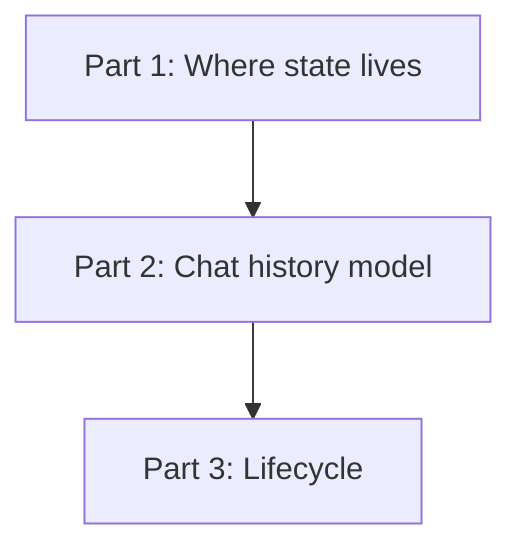

## The map

## Parts

| Part | Folder | Lessons | Pages written | Content |
|---|---|---|---|---|
| 1 | [01 Where state lives](/notes/ai/conversation-state/01-where-state-lives) | 2 | 2 | Three copies of a conversation, transient vs persistent context |
| 2 | [02 Chat history model](/notes/ai/conversation-state/02-chat-history-model) | 2 | 1 | The chats + messages model with parts, rebuilding model input |
| 3 | [03 Lifecycle](/notes/ai/conversation-state/03-lifecycle) | 3 | 0 | Ownership, retention, deletion, moving old chats |

A **lesson** is one idea. A **session** is one sitting. A lesson page can exist before I study it. Its status stays `not-started` until I pass its gate.

## How each session works

1. **Recall.** One or two questions on old lessons that are due.
2. **Problem.** The question that the idea answers, and why it matters in a real agent.
3. **Intuition.** A picture or an analogy, and the point where the analogy stops working.
4. **Visual.** A diagram, a figure or a Manim video.
5. **Mechanism.** The exact technical details. Every claim has a source.
6. **Experiment.** A small test that proves the claim: a fake model, a local file, a local database.
7. **Code.** I write the code myself. Hints come in three levels: idea, pseudocode, partial code.
8. **Check and explain back.** Check questions, then I teach the idea back.
9. **Close.** Session report in chat, then a notes update.

> [!key] Gate rule
> A gate passes only when I answer the check questions correctly in my own words. "I understand" does not pass a gate. A correct answer with a wrong reason does not pass.
