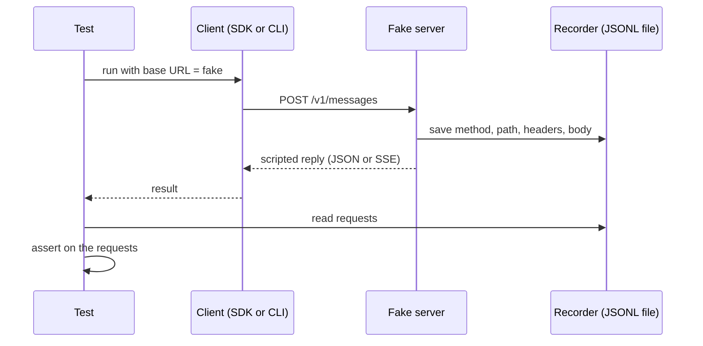

## 1. The question this idea answers

You change how an agent service resumes a chat. After the change, a resumed session must still send the old tool results to the model. How do you prove this?

A first idea is a live run. You ask the real model a follow-up question, and it answers correctly. But this proves little. The model can guess the answer, read it from another place in the prompt, or ask the tool again. A correct answer does not show that the old tool result was in the request.

The opposite mistake also happens. A test with a fake model shows that the request holds a tool definition. Then someone claims "the model uses the tool". The fake cannot prove this, because the fake decides its own replies.

So every claim about an agent needs the right kind of test. This lesson separates two kinds of claims. It shows how a fake model server works, with real output from a test against the Anthropic Python SDK and the Claude Code CLI.

## 2. Mental model

> [!analogy] A rehearsal with a stand-in
> Before a play, the crew rehearses with a stand-in actor. The stand-in shows that each cue, light and prop arrives at the right time and place. The crew can record everything that reaches the stage.
>
> But the stand-in cannot show how the star will act. Only the real performance shows that.
>
> The fake model server is the stand-in. It proves what reaches the model. The real model is the star. Only a live run shows what the model does with its input.
>
> **Where it stops working:** a stand-in walks on any stage. A fake server accepts any request, also a request that the real API rejects with HTTP 400. So a fake can pass a test that the real API would fail. The fake must check the rules that matter, or a small live smoke run must confirm the request shape.

## 3. Terms

| Term | Plain meaning |
|---|---|
| fake model server | A small HTTP server that answers like the Messages API but returns replies from a script, not from a model. |
| request recorder | The part of the fake that saves every request it receives: method, path, headers and JSON body. |
| scripted reply | The reply that the fake chooses from rules, for example "return a tool call when the request has tools and no tool result yet". |
| claim about input | A claim about the exact request that the model receives. A fake can prove it. |
| claim about behavior | A claim about what the model does with its input. Only the real model can prove it. |
| live test | A test that calls the real model through the real endpoint. |
| base URL | The address that a client sends its API requests to. |
| server-sent events (SSE) | A streaming format: the server sends named events as text, each with a `data:` line of JSON. |
| stream event | One SSE event of a streamed Messages API reply, for example `message_start` or `content_block_delta`. |
| fault injection | A test that makes the fake fail on purpose, for example with HTTP 529 or a cut stream. |
| flaky test | A test that passes on some runs and fails on others with no code change. |
| smoke run | A small live run that confirms that the real API accepts the request shape. |

## 4. Method and math

### 4.1 Two kinds of claims

Every model call has two sides. The **input** is the request: the system prompt, the messages and the tool definitions. The **output** is what the model writes.

Your code controls the input completely. So a claim about the input is a claim about your code. A test can check it exactly, with no model at all.

The output depends on the model. A claim about the output is a claim about a probabilistic system. Only the real model can test it, and one run is not enough ([Part 2](/notes/ai/evaluation/02-statistics)).

| Claim | Kind | Test | What the test checks |
|---|---|---|---|
| The resumed session sends the old tool result | Input | Fake | The request of the resumed run holds the old `tool_result` block, with its nonce |
| The system prompt holds the new page | Input | Fake | A `system` block of the request contains the page marker |
| The tool list holds only the Genie tool | Input | Fake | The `tools` array has exactly the expected names |
| The rebuilt context keeps the newest turns under the budget | Input | Fake | The first user message holds the newest turns and stays under the size limit |
| The service survives an overloaded error | Input (fault) | Fake | The fake returns HTTP 529 once. The recorder shows a retry, and the service returns an answer |
| The model uses the tool | Behavior | Real | The transcript holds a `tool_use` block for the tool, in most of n runs |
| The answer cites the right number | Behavior | Real | The final text contains the random number from the tool data |
| The model follows the new page instruction | Behavior | Real | The final text follows the rule of the page, scored strictly |

> [!key] The fake proves what the model receives. The real model proves what the model does.
> Before you write a test, name the claim. If the claim is about the request, use a fake and check the request exactly. If the claim is about the reply, use the real model, random data and enough runs.

Some features need both. "The agent recovers after a tool error" has an input part: the error reaches the model as a `tool_result` with `is_error: true`. A fake proves that part. It also has a behavior part: the model then explains the error or tries again. Only a live test proves that part.

### 4.2 How a fake model server works

A fake model server is an ordinary HTTP server. A client sends it the same requests that it would send to the real API. The fake records each request and answers with a scripted reply.



The fake must serve the paths that the client calls. The Claude Code gateway guide lists them for the Anthropic Messages format (checked on 2026-10-13):

| Path | Required | Notes from the guide |
|---|---|---|
| `POST /v1/messages` | Yes | "Inference requests post to `/v1/messages?beta=true`". The guide says: "Match on the path, not the full URL". |
| `POST /v1/messages/count_tokens` | No | "when they're absent, Claude Code falls back to a character-based estimate of context usage." |
| `HEAD /api/hello` | No | A "connection-warming probe". The guide calls it best-effort startup traffic. |

The reply has one of two shapes. If the request body has `"stream": true`, the fake writes SSE events. If not, it returns one JSON message object with `id`, `type`, `role`, `model`, `content`, `stop_reason` and `usage`.

The script decides the reply from the request. A typical rule: when the request has tools and the last user message holds no `tool_result`, return a `tool_use` block. When the last user message holds a `tool_result`, return text. This rule lets a test drive the full agent loop with no model.

### 4.3 The stream that the fake writes

A streamed reply is a fixed sequence of events. This is the stream that the test fake wrote for one tool call, with the message id and the file path shortened. The Anthropic Python SDK 1.13.0 and Claude Code 2.1.296 both accepted it (test run on 2026-10-13).

```text
event: message_start
data: {"type": "message_start", "message": {"id": "msg_fake_01", "type": "message", "role": "assistant", "model": "claude-sonnet-5", "content": [], "stop_reason": null, "stop_sequence": null, "usage": {"input_tokens": 10, "output_tokens": 1}}}

event: content_block_start
data: {"type": "content_block_start", "index": 0, "content_block": {"type": "tool_use", "id": "toolu_fake_01", "name": "Read", "input": {}}}

event: content_block_delta
data: {"type": "content_block_delta", "index": 0, "delta": {"type": "input_json_delta", "partial_json": "{\"file_path\": \"/work/"}}

event: content_block_delta
data: {"type": "content_block_delta", "index": 0, "delta": {"type": "input_json_delta", "partial_json": "orders.txt\"}"}}

event: content_block_stop
data: {"type": "content_block_stop", "index": 0}

event: message_delta
data: {"type": "message_delta", "delta": {"stop_reason": "tool_use", "stop_sequence": null}, "usage": {"output_tokens": 5}}

event: message_stop
data: {"type": "message_stop"}
```

Four rules come from the docs and from this test:

1. The response header is `content-type: text/event-stream`. The gateway guide says: "Return `text/event-stream` on streamed Anthropic Messages-format responses".
2. Each event is an `event:` line, a `data:` line with JSON, and an empty line.
3. Tool input arrives as pieces of a JSON string in `partial_json`. The client joins the pieces and parses them at `content_block_stop` ([stream events](/notes/ai/llm-apis/02-streaming-and-thinking/l1-stream-events)).
4. The stream must end with `message_delta` and `message_stop`. The gateway guide says: "If the body ends cleanly after a content block has started but before that final `message_delta`, Claude Code treats the response as a dropped connection."

Writing one event takes two lines of Python. This is the core of the fake, not a full server:

```python
def send_event(wfile, name, data):
    wfile.write(f"event: {name}\ndata: {json.dumps(data)}\n\n".encode())
    wfile.flush()
```

> [!trap] Rule 4 is also a test tool
> A fake that stops after `content_block_delta` imitates a dropped connection. This is fault injection. The real API does not do it on demand, so only a fake can test how the service handles a cut stream.
>
> The test for this lesson did it with the Anthropic Python SDK 1.13.0 and `max_retries=0`. The SDK raised no error. `get_final_message()` returned the partial text "4831 orders" with `stop_reason` equal to `None`. So a service that reads only the text stores a cut answer as a complete one. Check `stop_reason` before you trust a streamed reply.

### 4.4 Directing a client to the fake

| Client | How to direct it to the fake | Source (checked on 2026-10-13) |
|---|---|---|
| Anthropic Python SDK 1.13.0 | `Anthropic(base_url="http://127.0.0.1:PORT")`, or the variable `ANTHROPIC_BASE_URL` | Source `_client.py`: "base_url precedence: kwarg > ANTHROPIC_BASE_URL > profile config ... > hardcoded default" |
| Claude Code CLI | Variable `ANTHROPIC_BASE_URL` | Env-vars page: "Override the API endpoint to route requests through a proxy or gateway." |
| Claude Agent SDK | `ClaudeAgentOptions(env={"ANTHROPIC_BASE_URL": ...})` | The SDK passes `env` to the CLI process. Tested with SDK 0.2.159. |

The fake does not check the key, so any value works, for example `ANTHROPIC_API_KEY=sk-fake`.

> [!trap] The inherited environment can send the test elsewhere
> The Agent SDK merges `options.env` on top of the inherited process environment. The gateway guide says that Claude Code reaches Microsoft Foundry through its own variables, such as `ANTHROPIC_FOUNDRY_BASE_URL`. So a test process that inherits the Foundry configuration of the service may not use the fake. Start the CLI with a clean environment: only `PATH`, a temporary `HOME`, the base URL and a fake key. The test for this lesson did exactly that.

### 4.5 What the recorder saw

The test ran Claude Code 2.1.296 against a fake server on 2026-10-13. Each run used `claude -p ... --output-format json` with a clean environment and `CLAUDE_CODE_DISABLE_NONESSENTIAL_TRAFFIC=1`.

| Observation | Value in this test |
|---|---|
| Path of each model request | `/v1/messages?beta=true` |
| Streaming | `"stream": true` on every model request |
| Headers | `x-api-key`, `anthropic-version: 2023-06-01`, an `anthropic-beta` list and `X-Claude-Code-Session-Id` |
| System prompt | A list of 3 text blocks. The first block starts with `x-anthropic-billing-header:`, the attribution block of the gateway guide. |
| Tools | 20 tool definitions in this environment |
| Messages | The list also held entries with role `system`. The `anthropic-beta` list held `mid-conversation-system-2026-04-07`. |
| Requests for one prompt with one tool call | 2: one returned `tool_use`, one carried the `tool_result` |

The Anthropic Python SDK showed one more effect. The fake returned HTTP 529 once. The SDK retried, so the recorder held two requests, with header `x-stainless-retry-count` equal to `0` and then `1`. The source sets `DEFAULT_MAX_RETRIES = 2` (anthropic 1.13.0).

> [!trap] The last message is not always the user's message
> The first script of the test read the last entry of `messages` to find the user's question. Claude Code had put a `system` entry last, so the script never returned its tool call. Find the last entry with role `user`, and match on block types, not on positions.

> [!example] Worked example: the resumed session sends the old tool result
> The claim is about input, so the test uses a fake.
>
> 1. The test writes `orders.txt` with the line `shipped_orders=4831 nonce=K7P2QX`. The nonce is a random code that exists only in this file ([L2](/notes/ai/evaluation/01-test-design/l2-random-data-controls-strict-scoring)).
> 2. Run 1: `claude -p "How many orders shipped at plant 7?" --session-id 11111111-2222-4333-8444-555555555555`. The fake script returns `tool_use` for `Read` on the file. The CLI runs the tool and sends request 2 with the `tool_result`. The fake returns "4831 orders shipped.".
> 3. Run 2: `claude -p "Repeat the number." --resume 11111111-2222-4333-8444-555555555555`. The recorder saves request 3.
> 4. Assertion: request 3 has 8 entries in `messages`. They hold the old `tool_use` (id `toolu_fake_01`) and its `tool_result`, which contains `K7P2QX`. Result: pass.
> 5. Negative control: a new session with the same prompt, with no `--resume`. Its request has 2 entries in `messages`, and `K7P2QX` is absent. Result: as expected.
>
> The control matters. It shows that the nonce reaches the request only through the resumed history. A weaker assertion, such as "the nonce appears anywhere in the request", would also pass if the nonce leaked through another path, for example the system prompt. The control reveals such a leak.

### 4.6 Assertions on the recording

A good assertion checks the part of the request that the claim names, and nothing more.

| Claim | Strong assertion | Weak assertion |
|---|---|---|
| The system prompt holds the new page | One `system` block contains the marker `Current page: downtime-dashboard-v2` | The whole system prompt equals a saved copy |
| The tool list holds only the Genie tool | The set of names in `tools` equals `{"genie_query"}` | `len(tools) == 1` |
| The resumed session sends the old tool result | A `tool_result` block with `tool_use_id == "toolu_fake_01"` contains the nonce | The nonce appears anywhere in the request |

The whole-prompt comparison is weak because the CLI changes its own text between versions. The test then fails for a reason that is not the claim. In the test for this lesson, `--append-system-prompt "Current page: downtime-dashboard-v2"` placed the marker at the end of the third system block, at character 27,170. A containment check found it. An exact copy would break on the next CLI release.

> [!trap] Count only the requests that the claim is about
> One user prompt can produce several requests: a retry, a request after each tool call, and side requests such as session titles. The gateway guide lists a header `x-claude-code-request-class` with the values `main`, `subagent`, `workflow`, `compaction` and `auxiliary`. With a custom base URL, it is "off by default", and `CLAUDE_CODE_GATEWAY_HINT_HEADERS=1` enables it. Filter on it, or on the path and the content, before you assert "exactly one request".

### 4.7 Cost, speed and flakiness

| | Fake model test | Live test |
|---|---|---|
| Cost per run | No tokens | Input and output tokens. Claude Sonnet 5 list price: USD 2 per million input tokens and USD 10 per million output tokens (checked on 2026-10-13). |
| Speed in the test for this lesson | About 50 ms per SDK call (100 calls in 4.9 s), 0.8 to 1.5 s per CLI run | Seconds per model call. It depends on the model and the output length. |
| Repeatable | Yes. The same script gives the same reply. | No. Model output varies between runs. |
| Proves | What the model receives | What the model does |
| Runs in | Every commit, in CI | A scheduled job or a release gate |

You cannot make a live test repeatable with sampling settings. The Messages API reference says of `temperature` (checked on 2026-10-13): "Models released after Claude Opus 4.6 do not support setting temperature. A value of 1.0 will be accepted for backwards compatibility, all other values will be rejected with a 400 error." It also says: "Note that even with `temperature` of `0.0`, the results will not be fully deterministic." So a live test must expect variation and count passes over several runs.

> [!example] Worked example: the cost of one live test
> Assume one agent run makes 4 model calls. Each call sends 40,000 input tokens and returns 500 output tokens. There is no prompt caching.
>
> 1. Input tokens: 4 × 40,000 = 160,000. Cost: 160,000 / 1,000,000 × USD 2 = USD 0.32.
> 2. Output tokens: 4 × 500 = 2,000. Cost: 2,000 / 1,000,000 × USD 10 = USD 0.02.
> 3. One run: USD 0.32 + USD 0.02 = USD 0.34.
> 4. Twenty runs: 20 × USD 0.34 = USD 6.80.
>
> The same claim tested with a fake costs nothing and runs in under a second. Use live runs only for claims about behavior. Foundry billing can differ from the list price, so use your own rate.

### 4.8 The limits of a fake

A fake proves input claims only if the fake itself is correct. Three limits remain.

1. **The fake is too lenient.** It accepts a request with a broken tool pairing that the real API rejects with HTTP 400 ([tool pairing rules](/notes/ai/llm-apis/01-messages-api/l2-tool-use-and-tool-result)). Add a pairing check to the fake, or run one live smoke run after each change to the request builder.
2. **The fake encodes your beliefs about the API.** If you misread the stream format, the fake and the client can agree with each other and both be wrong. Test the fake with the official SDK, as in section 4.5.
3. **The API changes.** The streaming docs say that "new event types may be added". A fake from last year does not send them. Real smoke runs reveal the change.

### 4.9 Production view

| Concern | What to do |
|---|---|
| Correctness | Name the claim first. Use a fake for input claims and live runs for behavior claims. |
| Isolation | Start the client with a clean environment that holds only the fake base URL and a fake key. |
| Reliability | Use the fake for fault injection: HTTP 529, HTTP 400, a stream cut before `message_delta`. |
| Cost | Run fake tests on every commit. Run live tests on a schedule or before a release. |
| Observability | Save every recorded request as one JSONL line. A failed test then shows the exact request. |
| Security | Never record real keys. Redact `x-api-key` and `Authorization` before you save headers. |
| Drift | Run a small live smoke run after a model, SDK or CLI upgrade, because the fake does not change by itself. |

## 5. Code

These exercises go in the lab folder `C:\Users\ASohi\Downloads\AI\agent-harness-lab`, notebook `evaluation/01-fake-vs-real.ipynb`. They need no API key.

**Exercise 1.1: a fake server with a recorder.** Write a fake Messages API server with Python's `http.server`. It serves `POST /v1/messages` with and without streaming, records every request to a JSONL file, and returns a JSON error with HTTP 404 for unknown paths.

Acceptance tests:

- An `anthropic.Anthropic(base_url=..., api_key="sk-fake")` client gets the scripted text from `messages.create`.
- `client.messages.stream(...).get_final_message()` returns the same text and `stop_reason`.
- The JSONL file has one line per request, with method, path, redacted headers and body.
- A path with a query string, such as `/v1/messages?beta=true`, still reaches the messages handler.

**Exercise 1.2: a scripted tool call.** Extend the script. When the request has tools and the last user message has no `tool_result`, return one `tool_use` block. Stream its input in at least two `partial_json` pieces.

Acceptance tests:

- The SDK's final message holds a `tool_use` block whose `input` equals the scripted dictionary.
- A second request with the matching `tool_result` gets a text reply with `stop_reason` equal to `end_turn`.
- A request whose last entry has role `system` still gets the tool call.

**Exercise 1.3: prove the resume claim.** Repeat the worked example of section 4.5 with the Claude Code CLI or the Agent SDK. Use a new random nonce for each test run.

Acceptance tests:

- The request of the resumed run holds a `tool_result` block with the nonce.
- The negative control, a new session with no resume, holds no nonce.
- If you remove the resume option, the test fails.

**Exercise 1.4: fault injection.** Add two faults to the fake: HTTP 529 on the first request, and a stream that stops after one `content_block_delta`.

Acceptance tests:

- With the 529 fault, the recorder shows two requests for one SDK call, and the call succeeds.
- With `max_retries=0`, the same call raises an error.
- With the cut stream, your service function reports an error. It never returns the partial text as a complete answer, although the SDK itself returns it with `stop_reason` equal to `None`.

## 6. Common mistakes

1. **"The live run answered correctly, so the history was sent."** A correct answer can come from a guess or from another source. Check the request with a fake.
2. **"The fake test passed, so the model uses the tool."** The fake chooses its own replies. Behavior claims need the real model.
3. **Comparing the whole system prompt with a saved copy.** The CLI changes its own text. Check only the part that the claim names.
4. **Reading the last entry of `messages` as the user's question.** Claude Code can add `system` entries. Find the last `user` entry and match on block types.
5. **Counting all requests as model turns.** Retries and side requests also reach the fake. Filter before you count.
6. **Running the test with the service's environment.** Inherited provider variables can send requests to the real endpoint. Use a clean environment.
7. **Trusting the fake forever.** A fake accepts invalid requests and does not learn new event types. Add a smoke run after upgrades.
8. **Trusting a streamed reply without its `stop_reason`.** A cut stream can return partial text with no error. Check that `stop_reason` is set.

## 7. One-minute explanation

Tests for an agent prove two different kinds of claims. A claim about input says what the model receives: the system prompt, the messages and the tools. A claim about behavior says what the model does with that input. A fake model server proves input claims. It is a small HTTP server that speaks the Messages API, with JSON replies and SSE streams, records every request, and returns scripted replies. You direct the Anthropic SDK or Claude Code to it with `ANTHROPIC_BASE_URL`. Then you assert on the recorded requests, for example that a resumed session still holds an old tool result with a random nonce. Fake tests cost nothing, run in under a second and give the same result every time. Only live runs with the real model prove behavior, such as "the model uses the tool", and they cost tokens and vary between runs. A fake is also too lenient, so add pairing checks and a small live smoke run after each upgrade.

## 8. Check questions

```check
{
  "question": "A teammate says: \"I resumed the session and asked the real model for the number again. It answered 4831, so resume works.\" What is wrong with this proof, and what test do you propose?",
  "hint": "Is the claim about input or about behavior?",
  "answer": "The claim \"the resumed session sends the old tool result\" is about input. A correct live answer does not prove it, because the model can guess, call the tool again, or read the number from another place. Use a fake server: put a random nonce in the tool data, run the first session, resume it, and assert that the recorded request of the resumed run holds the tool_result block with the nonce. Add a negative control: a new session without resume must not hold the nonce."
}
```

```check
{
  "question": "Your fake writes message_start, content_block_start, two content_block_delta events and content_block_stop, and then closes the connection. What does Claude Code do, and why can this be useful?",
  "answer": "The gateway guide says that a body that ends after a content block started but before the final message_delta is treated as a dropped connection. So Claude Code reports it or retries. On purpose, this is fault injection: it tests how the service handles a cut stream, which the real API does not produce on demand. It matters because the Anthropic Python SDK 1.13.0 raised no error on such a stream in the test: it returned the partial text with stop_reason None."
}
```

```check
{
  "question": "Classify each claim as input or behavior, and name the test: (a) the tools array holds only genie_query, (b) the model asks Genie before it answers a downtime question, (c) a tool error reaches the model with is_error true.",
  "answer": "(a) Input, fake: assert that the set of tool names equals {genie_query}. (b) Behavior, real model: count the runs that hold a tool_use for genie_query, over several runs with random data. (c) Input, fake: script the tool to fail and assert that the next request holds a tool_result block with is_error true."
}
```

```check
{
  "question": "Why can you not make a live test repeatable by setting temperature to 0 on the newest Claude models?",
  "answer": "The Messages API reference (checked on 2026-10-13) says that models released after Claude Opus 4.6 do not support setting temperature: only 1.0 is accepted, and other values get a 400 error. It also says that even temperature 0.0 does not give fully deterministic results. So a live test must expect variation and count passes over several runs."
}
```

## 9. Links

- Next: [L2: Random data, controls and strict scoring](/notes/ai/evaluation/01-test-design/l2-random-data-controls-strict-scoring)
- The events that the fake writes: [Stream events](/notes/ai/llm-apis/02-streaming-and-thinking/l1-stream-events)
- The pairing rules that a strict fake checks: [tool_use and tool_result](/notes/ai/llm-apis/01-messages-api/l2-tool-use-and-tool-result)
- The resume claim: [Resume, continue and fork](/notes/ai/claude-agent-sdk/04-sessions/l2-resume-continue-fork)
- The system prompt claim: [System prompts and snapshot](/notes/ai/claude-agent-sdk/05-prompts-and-input/l1-system-prompts-and-snapshot)
- Test helpers: [pytest fixtures and monkeypatch](/notes/software-engineering/python/03-tooling/l2-pytest-fixtures-and-monkeypatch)
- [Glossary](/notes/ai/evaluation/glossary)
