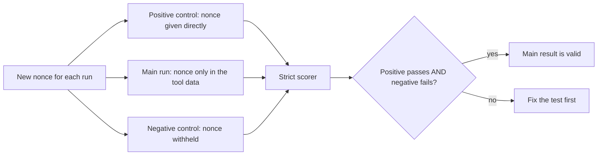

## 1. The question this idea answers

A live test asks the agent: "How many shifts does plant 7 run per day?" The tool data says 3. The agent answers "3", and the test passes. Did the agent read the tool data?

Perhaps not. Most plants run 3 shifts, so the model can answer 3 with no tool call at all. The test passes whether the feature works or not. A test like this is worse than no test, because it gives false confidence.

A good test has a property that you can state as a number: the chance that it passes when the feature is broken. This lesson shows how to make that number tiny and how to compute it. The tools are random data, controls and strict scoring. [L1](/notes/ai/evaluation/01-test-design/l1-fake-model-vs-real-model) separated claims about input from claims about behavior. This lesson matters most for live tests of behavior, but fake tests use the same tools.

## 2. Mental model

> [!analogy] A code word in a sealed letter
> A teacher wants to know if a student read a letter. The letter contains a random code word, for example `K7P2QX`. The student must say the code word exactly. A student who did not read the letter can only guess. The chance to guess six random symbols is about one in a billion.
>
> The teacher also uses two controls. One student gets the letter with the code word read aloud to them: that student must pass, or the check itself is broken. Another student gets a letter with no code word: if that student "knows" it, the code word leaked.
>
> **Where it stops working:** a student can repeat the code word without understanding the letter. A nonce proves that information reached the answer. It does not prove that the answer reasons correctly with the information. Test the reasoning with separate, strictly scored values.

## 3. Terms

| Term | Plain meaning |
|---|---|
| accidental pass (false pass) | A test passes although the feature it tests is broken. |
| chance pass probability $q$ | The probability that one run passes when the feature is broken. |
| nonce | A random value made for one test run only, for example `K7P2QX`. The model cannot know it in advance. |
| random data | Test data with random values, so that the model cannot guess the expected answer. |
| scoring rule | The exact rule that decides if one run passes. |
| strict scoring | A scoring rule that accepts only the exact expected value, in the agreed form, in the agreed place. |
| lenient scoring | A scoring rule that accepts answers that "look right", for example a substring or a loose pattern. |
| positive control | A run in which the information is clearly available. It must pass. It proves that the test can pass. |
| negative control | A run in which the information is withheld. It must fail. It proves that the test can fail. |
| leak | A path by which the expected value reaches the model or the scorer, other than the path under test. |
| word boundary | The edge of a token. A strict rule does not match `4831` inside `14831`. |
| guessing model | A model of a broken system that answers without the information, for example by picking a likely value. |

## 4. Method and math

### 4.1 The number that matters

For one run of a test, define:

$$
q = P(\text{the run passes} \mid \text{the feature is broken})
$$

The value $q$ depends on the scoring rule and on how a broken system answers. A broken system can still produce text. It can guess, repeat values from the prompt, or list several candidates.

A test usually has $n$ runs and a rule for the whole test. If the runs are independent and each passes by chance with probability $q$:

$$
P(\text{all } n \text{ pass by chance}) = q^n
$$

$$
P(\text{at least } k \text{ of } n \text{ pass by chance}) = \sum_{i=k}^{n} \binom{n}{i} q^i (1-q)^{n-i}
$$

These numbers were computed with `scipy.stats.binom` (scipy 1.18.1):

| Scoring situation | $q$ per run | Rule | Chance pass of the test |
|---|---|---|---|
| Yes/no question, guessing model | 0.5 | 3 of 3 | 0.125 |
| Yes/no question, guessing model | 0.5 | at least 2 of 3 | 0.5 |
| Yes/no question, guessing model | 0.5 | 20 of 20 | 0.00000095 |
| One of 10 options, guessing model | 0.1 | at least 2 of 3 | 0.028 |
| Random number from 1000 to 9999, exact match | 1/9000 = 0.000111 | 1 of 1 | 0.000111 |
| Six-symbol nonce, 32 symbols, exact match | $1/32^6$ = 0.00000000093 | 1 of 1 | 0.00000000093 |

```plot
{
  "title": "Chance that all n runs pass by accident: q = 0.5 (red), q = 0.25 (blue), q = 0.1 (gold)",
  "xAxis": { "label": "number of runs n", "domain": [1, 10] },
  "yAxis": { "label": "probability of an accidental pass", "domain": [0, 0.55] },
  "disableZoom": true,
  "data": [
    { "fn": "0.5^x", "color": "#C81D25" },
    { "fn": "0.25^x", "color": "#1E6091" },
    { "fn": "0.1^x", "color": "#B8860B" }
  ]
}
```

> [!key] Lower q first, then add runs
> More runs lower $q^n$. But a yes/no test needs 20 runs to reach one in a million, and each live run costs money. A nonce gives one in a billion in a single run. Design the scoring rule so that $q$ is tiny. Then use repeated runs to measure how often the feature works ([Part 2](/notes/ai/evaluation/02-statistics)).

### 4.2 Random data and nonces

A nonce is a random value that exists only in one test run. The test puts it where the feature must carry it, for example in a tool result. Then the scorer checks that the nonce appears in the answer.

Three rules make a nonce useful:

1. **Make a new nonce for every run.** A reused nonce can stay in a session file, a cache or a database row. A later run can then pass from the old copy.
2. **Use a random source.** The Python docs say that `secrets` "should be used in preference to the default pseudo-random number generator in the random module, which is designed for modelling and simulation, not security or cryptography." For tests, the point is that no fixed seed repeats the same value across runs. Record each nonce in the test result, so that you can replay the run.
3. **Use a clear alphabet.** Crockford's Base32 uses 32 symbols. Its spec says: "We exclude 4 of the 26 letters: I L O U." So `0` and `O`, and `1`, `I` and `L`, cannot be confused.

```python
import secrets
ALPHABET = "0123456789ABCDEFGHJKMNPQRSTVWXYZ"   # Crockford Base32
nonce = "".join(secrets.choice(ALPHABET) for _ in range(6))   # for example "Q4ZM7T"
```

This snippet does not yet apply the two-digit rule of section 4.3. Exercise 2.1 adds it.

The same idea works for numbers. A test for "the answer cites the right number" draws the order count at random from 1000 to 9999. A guessing model then passes with $q = 1/9000$. A fixed, plausible value such as 100 or 3 lets the model pass by guessing.

> [!example] Worked example: making a ranking test strict
> The test asks: "Which of the 5 plants had the most downtime yesterday, and how many minutes?" The fake data puts the maximum at a random plant, with a random value from 100 to 999 minutes.
>
> 1. A guessing model names the right plant with $q_1 = 1/5 = 0.2$.
> 2. It names the right minutes with $q_2 = 1/900 = 0.00111$.
> 3. If the scorer needs both, and the guesses are independent: $q = 0.2 \times 0.00111 = 0.000222$.
> 4. With the plant name only, 3 of 3 runs pass by chance with $0.2^3 = 0.008$. With both values, $0.000222^3 \approx 1.1 \times 10^{-11}$.
>
> If the maximum is always at plant 1, a model that prefers the first item passes every time. Randomize the position too.

### 4.3 Strict scoring

A scoring rule has three parts: **where** to look, **what** to match, and **how many** matches to accept. Strict scoring fixes all three before the first run.

| Part | Strict rule | Why |
|---|---|---|
| Where | The final assistant text only | The tool result in the transcript also holds the nonce. A search of the whole transcript always finds it. |
| What | The exact nonce, case-sensitive, with token boundaries | `k7p2qx` and `K7P2QXA` are not the nonce. |
| How many | Exactly one nonce-shaped token, equal to the nonce | An answer that lists several candidates must not pass. |

The test for this lesson compared a strict rule and a lenient rule (`nonce.lower() in answer.lower()`) on five answers. Expected nonce: `K7P2QX`.

| Final answer | Strict | Lenient |
|---|---|---|
| `The code is K7P2QX.` | pass | pass |
| `The code is k7p2qx.` | fail | pass |
| `The code is K7P2QXA.` | fail | pass |
| `Maybe K7P2QX or K7P2QY.` | fail | pass |
| `I could not read the code.` | fail | fail |

The same check for a number. Expected value: 4831. The strict rule extracts all numbers, removes thousands separators, and requires exactly one number equal to 4831.

| Final answer | Numbers found | Strict | Substring `"4831" in answer` |
|---|---|---|---|
| `4831 orders shipped.` | [4831] | pass | pass |
| `4,831 orders shipped.` | [4831] | pass | fail |
| `14831 orders shipped.` | [14831] | fail | pass |
| `48310 orders.` | [48310] | fail | pass |
| `4831 of 5000 orders.` | [4831, 5000] | fail | pass |

The substring rule fails both ways. It rejects the correct `4,831` and accepts the wrong `14831`. The last row shows the cost of strictness: a correct answer with a second number fails. Decide such cases in the written rule before the runs, and let the positive control reveal a rule that is too strict.

> [!trap] Normalize by a written rule, not by taste
> Allowed forms such as `4,831` or a trailing period belong in the written scoring rule. Never widen the rule after you read the failing answers. A rule changed after the results can be tuned until any result passes.

> [!trap] Words can have the nonce shape
> A six-letter uppercase word such as `DEFECT` uses only Base32 symbols. A "how many nonce-shaped tokens" rule counts it. Put at least two digits in each nonce and match the shape with that condition, or check the rule against the positive control.

### 4.4 Positive and negative controls

A control is a run whose correct result you know in advance. Each kind answers one question about the test itself.

| Control | Setup | Expected | If it gives the other result |
|---|---|---|---|
| Positive | The information is clearly available, for example the user message says "The code is Q4ZM7T. Repeat the code." | Pass | The test cannot pass: the scorer is too strict, the harness is broken, or the task is too hard. |
| Negative | The information is withheld, for example a new session with no resume, or a tool that returns no nonce | Fail | Information leaks, or the scorer is lenient. The main result means nothing. |



The negative control and the computed $q$ do different jobs. The computed $q$ covers a guessing model. The negative control catches a leak that the arithmetic ignores, for example a nonce in a file that the agent can read. In [L1](/notes/ai/evaluation/01-test-design/l1-fake-model-vs-real-model), the negative control of the resume test was a new session: its request held 2 messages and no nonce.

> [!note] A clean negative control is weak evidence alone
> A negative control that fails 20 of 20 times shows only that its pass rate is probably below about 16% ([Part 2, L1](/notes/ai/evaluation/02-statistics/l1-pass-rates-and-confidence-intervals)). The strong argument for a tiny $q$ is the arithmetic of the nonce. The control checks that no leak breaks that arithmetic.

### 4.5 How tests pass by accident

| Cause | Example | Fix |
|---|---|---|
| The answer leaks into the prompt | The nonce is in the system prompt, in a project file that the agent reads, or in the user question | Put the nonce only on the path under test. A negative control catches the leak. |
| The scorer reads the whole transcript | The nonce is in the `tool_result`, so the scorer finds it even when the final answer says "I could not read it" | Score the final assistant text only. |
| A lenient pattern | `"4831" in answer` accepts `14831`. A pattern such as `\d{4}` accepts any four-digit number. | Exact match with token boundaries |
| The model guesses a likely value | 3 shifts, 100 orders, the first plant in a list | Random values from a wide range, at random positions |
| Many candidates in one answer | "It is K7P2QX or K7P2QY" | Accept exactly one candidate |
| A reused nonce | A fixed test value stays in a session file or a cache | A new nonce for every run |
| A scripted fake writes the nonce | In a fake test, the scripted `tool_use` input contains the nonce, so the request holds it before any tool runs | Put the nonce only in the data that the tool reads |

> [!example] Worked example: a substring rule with numbers
> The expected downtime is 31 minutes. The scorer passes if `"31"` appears in the answer. A broken agent answers with one random four-digit number from 1000 to 9999.
>
> 1. The test counted the four-digit numbers that contain `31`: 279 of 9,000.
> 2. So $q = 279 / 9000 = 0.031$ for one number.
> 3. If the answer lists 5 such numbers: $q = 1 - (1 - 0.031)^5 = 0.146$.
> 4. With a word-boundary rule, no four-digit number matches `31`, so $q = 0$ for these answers.

### 4.6 Production view

| Concern | What to do |
|---|---|
| Correctness | Write the scoring rule before the first run. Compute $q$ for a guessing model and record it with the test. |
| Leaks | Run a negative control with every live test batch. A passing negative control blocks the result. |
| Strictness | Run a positive control. A failing positive control means the rule or the harness is wrong. |
| Reproducibility | Record each nonce, the prompt and the raw transcript. Score from the saved transcript, not from memory. |
| Cost | With a tiny $q$, one run already excludes a chance pass. Spend the runs on measuring the pass rate. |
| Security | Nonces are test data. Never use real secrets or customer data as test values. |

## 5. Code

These exercises go in `evaluation/02-random-data-controls.ipynb` in the lab folder `C:\Users\ASohi\Downloads\AI\agent-harness-lab`. Exercises 2.1 and 2.2 need no model.

**Exercise 2.1: a strict scorer.** Write `make_nonce()` and `score_nonce(final_text, nonce)`. The nonce has 6 Crockford Base32 symbols with at least two digits. The scorer follows the three strict rules of section 4.3.

Acceptance tests:

- All five rows of the nonce table in section 4.3 give the "Strict" result.
- An answer that contains the word `DEFECT` and the nonce passes.
- 10,000 calls of `make_nonce()` give 10,000 different values.

**Exercise 2.2: a chance-pass calculator.** Write `chance_pass(q, n, k)` that returns the probability that at least `k` of `n` independent runs pass by chance.

Acceptance tests:

- `chance_pass(0.5, 3, 3)` is 0.125 and `chance_pass(0.5, 3, 2)` is 0.5.
- `chance_pass(0.1, 3, 2)` is 0.028 within `1e-12`.
- The function agrees with `scipy.stats.binom.sf(k - 1, n, q)` for 100 random inputs.

**Exercise 2.3: controls for the resume test.** Add a positive control and a negative control to exercise 1.3 of [L1](/notes/ai/evaluation/01-test-design/l1-fake-model-vs-real-model). The positive control puts the nonce directly in the user prompt. The negative control is a new session with no resume. For a control, "pass" means that the nonce appears anywhere in the recorded request.

Acceptance tests:

- The test reports three results: positive, main and negative.
- The test marks the main result invalid if the positive control fails or the negative control passes.
- If you add the nonce to every run with `--append-system-prompt`, the negative control passes and the main result is marked invalid.

**Exercise 2.4: hunt a leak.** Write a function that searches every recorded request of a negative control for the nonce. It reports the JSON path of each hit, for example `system[2].text`.

Acceptance tests:

- With the planted leak of exercise 2.3, it reports a path inside `system`.
- With no leak, it reports nothing.

## 6. Common mistakes

1. **A fixed, plausible expected value.** The model can guess 3 shifts or 100 orders. Use random values from a wide range.
2. **Searching the whole transcript for the nonce.** The tool result holds it. Score the final answer only.
3. **Substring or case-insensitive matching.** It accepts `14831` and `k7p2qx`. Match exactly, with token boundaries.
4. **No negative control.** A leak makes every run pass. The control is the only check that catches it.
5. **No positive control.** A scorer that is too strict fails every run, and the feature looks broken.
6. **Widening the rule after reading the failures.** Decide normalization before the runs.
7. **Reusing one nonce across runs.** Old copies in files and caches make later runs pass.

## 7. One-minute explanation

A test is useful only if it cannot pass when the feature is broken, so compute that chance. Call it $q$ for one run. For $n$ independent runs that must all pass, the chance is $q^n$. A yes/no check has $q = 0.5$, so 3 of 3 passes happen by chance 12.5% of the time. A random six-symbol nonce has $q$ of about one in a billion in a single run. So put a fresh nonce, or a random number from a wide range, where the feature must carry it, and score strictly. Strict means the final answer only, the exact value with token boundaries, and exactly one candidate. Then add two controls. In the positive control, the information is given directly, and the run must pass. In the negative control, it is withheld, and the run must fail. A failing positive control means the test cannot pass, and a passing negative control means information leaks.

## 8. Check questions

```check
{
  "question": "A live test asks \"Is plant 7 running?\" and passes if the answer contains \"yes\". The test needs 3 of 3 passes. What is the chance of an accidental pass for a model that guesses, and how do you make the test strict?",
  "hint": "What is q for a yes/no answer?",
  "answer": "q = 0.5, so the chance is 0.5^3 = 0.125. Make the tool data carry a random value, for example a status code nonce or a random count of running lines from a wide range, and require the exact value in the final answer, with token boundaries and exactly one candidate. Then q for one run is near 1/32^6 for a six-symbol nonce."
}
```

```check
{
  "question": "Your scorer passes a run if the nonce appears anywhere in the saved transcript. Every run passes, also the runs where the final answer says \"I could not find the code\". Why?",
  "answer": "The transcript also holds the tool_result, and the tool_result contains the nonce. So the scorer finds the nonce in every run in which the tool ran, whatever the final answer says. Score only the final assistant text."
}
```

```check
{
  "question": "Your negative control passes 4 of 10 times. What does this mean for the main result, and what do you do next?",
  "answer": "The main result is invalid. A negative control must fail, so either the information reaches the model by another path (a leak) or the scorer is lenient. Search the recorded requests of the negative control for the nonce to find the leak, and check the scoring rule. Rerun the controls before you trust any main result."
}
```

```check
{
  "question": "Why does the strict number rule of section 4.3 reject \"4831 of 5000 orders.\", and is that a problem?",
  "answer": "The rule requires exactly one number equal to 4831, and the answer holds two numbers. It can be a problem: a correct answer fails. Decide such cases in the written rule before the runs, for example \"4831 must be the first number\", and use the positive control to see if the rule is too strict. Never widen the rule after reading the failures."
}
```

## 9. Links

- Previous: [L1: Fake model vs real model](/notes/ai/evaluation/01-test-design/l1-fake-model-vs-real-model)
- Next: [L3: Independent audit](/notes/ai/evaluation/01-test-design/l3-independent-audit)
- What a pass rate proves: [Pass rates and confidence intervals](/notes/ai/evaluation/02-statistics/l1-pass-rates-and-confidence-intervals)
- Where tool results sit in the transcript: [tool_use and tool_result](/notes/ai/llm-apis/01-messages-api/l2-tool-use-and-tool-result)
- [Glossary](/notes/ai/evaluation/glossary)
