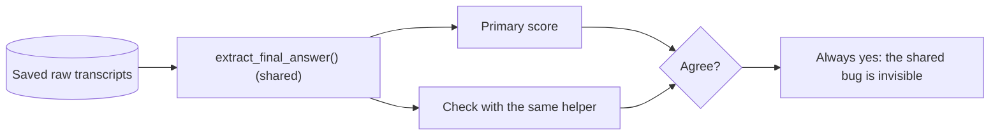
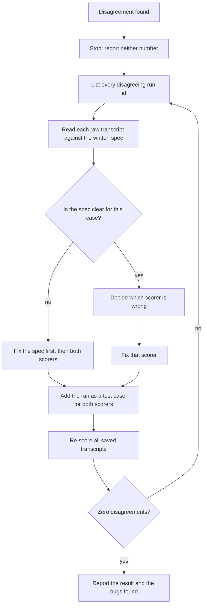

## 1. The question this idea answers

A live test suite reports 40 of 40 passes. The runner, the scorer and the report come from one module, written in one session by one author. If the scorer has a bug, every number in the report has the same bug. Nothing in the report can reveal it.

[L2](/notes/ai/evaluation/01-test-design/l2-random-data-controls-strict-scoring) made the scoring rule strict. But a strict rule on paper is not a strict rule in code. The code can search the wrong field, compare in the wrong case, or split text in the wrong way.

So who checks the checker? This lesson answers with an **independent audit**: a second implementation that re-scores the saved raw transcripts from the written rule. Where the two scorers disagree, at least one of them has a bug. The lesson also shows the numbers to report and the procedure for a disagreement.

## 2. Mental model

> [!analogy] A second accountant with the original receipts
> A company's spreadsheet says the month made a profit. An auditor does not read the spreadsheet's formulas. The auditor takes the original receipts and computes the totals again, with their own method. If the two totals agree, both are probably right. If they differ, someone made an error, and the receipts decide who.
>
> The primary scorer is the spreadsheet. The saved raw transcripts are the receipts. The audit is the second accountant. The written scoring rule is the accounting standard that both must follow.
>
> **Where it stops working:** two accountants with the same training can make the same mistake on the same receipt. Then they agree, and both are wrong. Independent programs also fail together more often than chance predicts (section 4.2). An audit lowers the risk of a shared bug. It does not remove it.

## 3. Terms

| Term | Plain meaning |
|---|---|
| primary scorer | The scorer that the test runner uses to produce its report. |
| independent audit | A second scorer, built separately from the written rule, that re-scores the same saved data. |
| raw transcript | The saved, unprocessed record of a run: the recorded requests and replies, or the session file. |
| re-scoring | Scoring saved transcripts again, with no new model calls. |
| scoring spec | The written scoring rule. Both scorers follow it, and it decides every disagreement. |
| common-mode failure | One cause that makes two components fail in the same way at the same time, for example a shared helper function. |
| differential testing | Running two implementations on the same input and treating any difference in output as a bug in at least one of them. |
| agreement table | A 2 × 2 table that counts runs by (primary result, audit result). |
| percent agreement $p_o$ | The share of runs where both scorers give the same result. |
| chance agreement $p_e$ | The agreement that two scorers would reach by chance, given how often each one passes. |
| Cohen's kappa $\kappa$ | Agreement corrected for chance agreement: $(p_o - p_e) / (1 - p_e)$. |
| adjudication | A decision by hand, against the spec, of which scorer is right for one disagreeing run. |

## 4. Method and math

### 4.1 Why the same code hides bugs

A test runner often scores and reports with shared helpers. A typical chain: `run()` saves the transcript, `extract_final_answer()` finds the answer text, `score()` compares it with the nonce, and `report()` counts passes.

If the report and its own "check" both call `extract_final_answer()`, a bug in that function affects both in the same way. The check agrees with the report every time. The unit tests of the scorer do not help much if the same author wrote them from the same misreading of the rule.



The fix is to break the shared path. The audit must reach its result by a different route from the same raw data.

### 4.2 What "independent" means

Independence has four dimensions. Aim for all four.

| Dimension | Primary scorer | Independent audit |
|---|---|---|
| Input | Parsed objects in memory during the run, for example SDK message objects | The raw saved data on disk: the JSONL of recorded requests and replies, or the session file |
| Code | The runner's helpers | No imports from the runner or the primary scorer |
| Method | For example, token comparison after `split()` | A different method, for example a regular expression with explicit boundaries |
| Source of the rule | The author's memory of the rule | The written scoring spec only, ideally by another person or at another time |

Independence is a goal, not a guarantee. Knight and Leveson tested it in 1986. The paper is "An Experimental Evaluation of the Assumption of Independence in Multiversion Programming" (IEEE Transactions on Software Engineering, vol. 12, no. 1, pp. 96–109). Their abstract says: "In all, 27 versions of a program were prepared independently from the same specification at two universities and then subjected to one million tests." The result: "the programs were individually extremely reliable but that the number of tests in which more than one program failed was substantially more than expected."

So two scorers can share a mistake even with no shared code, often where the spec is hard or vague. A clear spec with examples lowers this risk.

### 4.3 Differential testing

McKeeman named the method in "Differential Testing for Software" (Digital Technical Journal, vol. 10, no. 1, 1998, pp. 100–107). The idea: give the same input to two implementations of the same specification and compare the outputs. Any difference shows a bug in at least one of them.

The method has one big strength. It needs no expected answer for each input. The disagreement itself is the signal. This fits LLM tests well, because hundreds of saved transcripts have no hand-checked labels.

It also has one limit. When both implementations have the same bug, they agree, and the method sees nothing. So the audit complements the controls of L2. It does not replace them.

### 4.4 The agreement table and kappa

For each run, each scorer gives pass or fail. Count the four combinations.

| | Audit: pass | Audit: fail |
|---|---|---|
| Primary: pass | $a$ | $b$ |
| Primary: fail | $c$ | $d$ |

With $N = a + b + c + d$ runs:

$$
p_o = \frac{a + d}{N}, \qquad
p_e = \frac{a+b}{N}\cdot\frac{a+c}{N} + \frac{c+d}{N}\cdot\frac{b+d}{N}, \qquad
\kappa = \frac{p_o - p_e}{1 - p_e}
$$

$p_e$ is the agreement that two scorers with these pass rates would reach by chance. Kappa is 1 for perfect agreement and 0 for agreement at chance level.

> [!trap] Percent agreement can look good for a useless scorer
> A scorer that passes every run agrees with an audit that passes 80% of runs on 80% of runs. That sounds good. But kappa is exactly 0, because a constant scorer agrees only by chance. The worked example below shows this case.

> [!key] For an audit, every disagreement is a bug to explain
> Kappa thresholds come from human raters, who disagree for honest reasons. Two programs that follow one written spec should agree on every run. Report $p_o$ and $\kappa$, but the goal is zero unexplained disagreements.

### 4.5 Worked example: 40/40 becomes 32/40

The test for this lesson made 40 synthetic transcripts, each with a random six-symbol nonce. In each run, the user asks for a batch code, the tool returns `batch_code=<nonce>`, and the assistant gives a final answer. The final answers were of five kinds:

| Kind | Final answer | Runs | Correct by the spec |
|---|---|---|---|
| clean | `The batch code is <nonce>` | 31 | pass |
| period | `The batch code is <nonce>.` | 1 | pass |
| lowercase | `The batch code is <nonce in lowercase>` | 2 | fail |
| tool only | `I could not read the batch code.` | 4 | fail |
| wrong | `The batch code is <another nonce>` | 2 | fail |

The spec: the final assistant text must contain the exact nonce, case-sensitive, with boundaries. So the correct result is 32 of 40.

The audit read only the last assistant message and used a regular expression with boundaries. In these synthetic transcripts, each reply is one message, so that is safe here (but see the trap in section 4.6). The primary scorer had bugs, in two rounds.

> [!example] Worked example: round 1
> Primary scorer v1: `nonce.lower() in json.dumps(transcript).lower()`. It searched the whole transcript, case-insensitive.
>
> | | Audit: pass | Audit: fail |
> |---|---|---|
> | v1: pass | 32 | 8 |
> | v1: fail | 0 | 0 |
>
> 1. v1 reports 40/40. The audit reports 32/40.
> 2. $p_o = (32 + 0)/40 = 0.80$.
> 3. $p_e = (40/40)(32/40) + (0/40)(8/40) = 0.80$.
> 4. $\kappa = (0.80 - 0.80)/(1 - 0.80) = 0$.
> 5. The 8 disagreements, read by hand: 4 "tool only", 2 "wrong", 2 "lowercase". In all 8, the tool result held the nonce, and v1 found it there. In the 2 lowercase runs, case-insensitive matching also hid the error.
>
> Adjudication: the audit is right in all 8 runs. Fix: score the final answer only, case-sensitive.

> [!example] Worked example: round 2
> Primary scorer v2: `nonce in final_text.split()`. It reads the final answer only and compares whole tokens.
>
> | | Audit: pass | Audit: fail |
> |---|---|---|
> | v2: pass | 31 | 0 |
> | v2: fail | 1 | 8 |
>
> 1. v2 reports 31/40. The audit reports 32/40.
> 2. $p_o = (31 + 8)/40 = 0.975$.
> 3. $p_e = (31/40)(32/40) + (9/40)(8/40) = 0.62 + 0.045 = 0.665$.
> 4. $\kappa = (0.975 - 0.665)/(1 - 0.665) = 0.9254$.
> 5. The 1 disagreement is the "period" run. `split()` returns the token `ZTD9R1.` with the period, which is not equal to `ZTD9R1`.
>
> Adjudication: the spec says "with boundaries", and a period is a boundary. The audit is right. After the fix, the two scorers agree on all 40 runs: 32/40.

The report changed a lot. With the Wilson interval of [Part 2](/notes/ai/evaluation/02-statistics/l1-pass-rates-and-confidence-intervals), 40/40 gives a 95% interval of [0.912, 1.000]. The correct 32/40 gives [0.652, 0.895]. The two intervals do not overlap. The bug did not add noise. It changed the conclusion.

### 4.6 When the audit disagrees

Never average the two numbers, and never report the friendlier one. Follow these steps.



Re-scoring costs nothing. It needs no new model calls, because the raw transcripts are saved. So fix the scorer, not the runs.

> [!trap] The audit can be the scorer with the bug
> An audit is code too. One real trap for an audit that reads Claude Code output: one model reply can arrive as several assistant messages. In a test for this lesson, the fake model returned one reply with a text block and a `tool_use` block. Claude Code 2.1.296, with `--output-format stream-json`, emitted two assistant messages with the same `message.id`, one block each. An audit that reads only the last assistant message object can then miss text from the same reply. Group the assistant messages by `message.id` before you take "the final answer".

> [!trap] Do not make the audit agree by editing it
> If you change the audit until it matches the primary, the audit becomes a copy of the primary. Change a scorer only after the adjudication says it is wrong, and record why.

### 4.7 What to save so that an audit can run

| Save | Why |
|---|---|
| The raw transcript of every run | The audit reads it. Without it, no re-scoring is possible. |
| The nonce or random value of every run | The spec compares with it. |
| The version of the scoring spec | A result is valid only for the spec it used. |
| The primary result of every run | The agreement table compares per run, not only totals. |
| The run id | Disagreements are listed and adjudicated by run. |

Equal totals do not mean agreement. Two scorers can both report 32/40 and disagree on 6 runs, 3 each way. Always compare run by run.

### 4.8 Production view

| Concern | What to do |
|---|---|
| Correctness | Run the audit on every live test batch before you publish its pass rate. |
| Independence | The audit reads the raw files, imports nothing from the runner, and follows the written spec. |
| Cost | Re-scoring needs no model calls. Save every transcript, so that a fix costs seconds, not new runs. |
| Reporting | Report the pass rate, the agreement table, $\kappa$, and the number of disagreements found and fixed. |
| Regression | Add every adjudicated run to the test cases of both scorers. |
| Ownership | Ask a second person to write or review the audit from the spec, without reading the primary code. |

## 5. Code

These exercises go in `evaluation/03-independent-audit.ipynb` in the lab folder `C:\Users\ASohi\Downloads\AI\agent-harness-lab`. They need no API key.

**Exercise 3.1: build the 40 transcripts.** Generate the 40 synthetic runs of section 4.5, with the five kinds and their counts. Save them as one JSONL file. Each line holds the run id, the nonce and the message list.

Acceptance tests:

- The file has 40 lines and 40 different nonces.
- Counting by kind gives 31, 1, 2, 4 and 2.

**Exercise 3.2: an independent audit.** Write `audit_score(path)` in its own module. It reads the JSONL file, groups assistant messages by message id where ids exist, and applies the written spec.

Acceptance tests:

- It reports 32 passes on the file of exercise 3.1.
- An `ast` check of the module shows no import from your primary scorer module.
- A transcript where the final reply is split into two assistant messages with one id, text in the first, is scored as a pass.

**Exercise 3.3: the agreement report.** Write `agreement(primary, audit)` that takes two dictionaries from run id to pass or fail. It returns the 2 × 2 table, $p_o$, $\kappa$ and the sorted list of disagreeing run ids.

Acceptance tests:

- With the v1 results of section 4.5, it returns the table 32, 8, 0, 0 and $\kappa = 0$.
- With the v2 results, it returns 31, 0, 1, 8 and $\kappa$ equal to 0.9254 when rounded to 4 places.
- If the two dictionaries have different run ids, it raises an error.

**Exercise 3.4: plant bugs.** Make three changed copies of a correct primary scorer: case-insensitive, whole transcript, and `split()` tokens. Run the audit against each.

Acceptance tests:

- Each changed copy produces at least one disagreement on the 40 runs.
- The disagreement list of each copy contains only runs of the kinds that its bug affects.

## 6. Common mistakes

1. **Checking the report with the code that made it.** A shared helper hides a shared bug. The audit must use its own code and the raw files.
2. **Comparing totals only.** Equal totals can hide disagreements that cancel. Compare run by run.
3. **Trusting high percent agreement.** A scorer that always passes can reach 80% agreement with $\kappa = 0$.
4. **Assuming that the audit is right.** The spec decides each disagreement, and the audit can have bugs.
5. **Editing the audit until it agrees.** Then it is no longer independent.
6. **Rerunning the model to fix a scoring bug.** The saved transcripts are enough. Re-score them.
7. **Not saving raw transcripts.** Without them, no audit can run later.

## 7. One-minute explanation

A scorer is code, and code has bugs. If a test report and its check share helpers, a bug in a helper affects both in the same way, so they always agree. An independent audit breaks that shared path. It reads the saved raw transcripts from disk, imports nothing from the runner, and follows only the written scoring spec. Then you compare the two scorers run by run in a 2 × 2 agreement table, with percent agreement and Cohen's kappa. Every disagreement means a bug in at least one scorer. Read those transcripts by hand, let the spec decide, fix the wrong scorer, and re-score with no new model calls. In the worked example, a primary scorer that searched the whole transcript reported 40/40, the audit reported 32/40, and kappa was 0. Independence lowers the risk of a shared bug but does not remove it, because independent programs also fail together more often than chance predicts.

## 8. Check questions

```check
{
  "question": "A primary scorer passes 40 of 40 runs. The audit passes 32 of 40, and the 8 disagreements are all primary pass, audit fail. Compute the percent agreement and Cohen's kappa. What does the kappa tell you?",
  "hint": "p_e = P(primary pass) × P(audit pass) + P(primary fail) × P(audit fail).",
  "answer": "p_o = 32/40 = 0.80. p_e = (40/40)(32/40) + (0/40)(8/40) = 0.80. kappa = (0.80 − 0.80)/(1 − 0.80) = 0. The primary passes every run, so its agreement with the audit is exactly what chance gives. It carries no information about which runs really passed."
}
```

```check
{
  "question": "Your audit imports extract_final_answer() from the runner module \"to avoid duplicate code\". Why is this a problem?",
  "answer": "It creates a common-mode failure. If extract_final_answer() has a bug, for example it returns the whole transcript or the wrong message, the primary scorer and the audit both get the same wrong text and agree. The disagreement that would reveal the bug never appears. The audit must find the final answer with its own code, from the raw saved data."
}
```

```check
{
  "question": "The audit and the primary disagree on 3 runs. A teammate proposes to report the average of the two pass rates. What do you do instead?",
  "answer": "Report neither number yet. List the 3 run ids, read each raw transcript against the written spec, and decide which scorer is wrong. If the spec is unclear for a case, fix the spec first. Fix the wrong scorer, add the 3 runs as test cases for both scorers, and re-score all saved transcripts. Report only when there are zero disagreements, together with the bugs found."
}
```

```check
{
  "question": "Two scorers both report 32/40. Can you conclude that they agree? Why or why not?",
  "answer": "No. Equal totals can hide disagreements that cancel, for example 3 runs where only the primary passes and 3 where only the audit passes. Compare the results run by run in the agreement table. Only b = c = 0 means full agreement."
}
```

## 9. Links

- Previous: [L2: Random data, controls and strict scoring](/notes/ai/evaluation/01-test-design/l2-random-data-controls-strict-scoring)
- Next: [Part 2, L1: Pass rates and confidence intervals](/notes/ai/evaluation/02-statistics/l1-pass-rates-and-confidence-intervals)
- Where the raw transcripts come from: [L1: Fake model vs real model](/notes/ai/evaluation/01-test-design/l1-fake-model-vs-real-model)
- How assistant messages arrive in the SDK: [Message and block types](/notes/ai/claude-agent-sdk/02-options-and-messages/l2-message-and-block-types)
- [Glossary](/notes/ai/evaluation/glossary)
