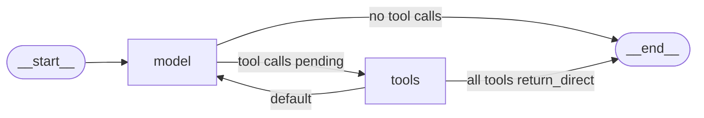

## 1. The question this idea answers

`create_agent(model, tools)` returns an object with `invoke` and `stream`. It looks like a function call. It is a compiled graph with nodes, edges, a state and a step counter.

You need that picture in a real agent service for four reasons:

1. Streaming. You filter streamed events by node name, so you must know the names.
2. Limits. A runaway loop stops at the recursion limit. You must know what it counts.
3. Middleware. Every hook of Part 2 becomes a node or wraps a node. You must know where.
4. Memory. A checkpointer saves the state after each step. You must know what the state holds.

This lesson builds a toy agent with a fake model and prints every part of the graph (langchain 1.4.5, langgraph 1.2.14, checked on 2026-10-13).

## 2. Mental model

> [!analogy] An assembly line with a return belt
> A part enters the line. The first station, "model", inspects it and writes a work order. If the order asks for machining, a belt carries the part to the "tools" station. After machining, a return belt carries it back to "model". When "model" writes no work order, the part leaves the line.
>
> A supervisor counts belt moves. When the count reaches the limit, the supervisor stops the line with an error, even if the part is not finished.
>
> **Where it stops working:** on a real line, two machining jobs take two moves. In the graph, all tool calls of one model response run in the same move, in parallel. And the supervisor also counts the move that brings the part onto the line (the `__start__` step).

## 3. Terms

| Term | Plain meaning |
|---|---|
| `create_agent` | The LangChain v1 function that builds and compiles an agent graph. |
| `CompiledStateGraph` | The runnable object that `create_agent` returns. It has `invoke`, `stream` and `get_state`. |
| node | One step function of the graph, for example `model` or `tools`. |
| edge | A fixed connection from one node to the next. |
| conditional edge | A function that reads the state and chooses the next node. |
| super-step | One round of the graph. All nodes that run in the same round form one super-step. |
| agent state | The dict that flows through the graph. The main key is `messages`. |
| model node | The node named `model`. It calls the chat model once. |
| tools node | The node named `tools`. It runs tool calls and returns `ToolMessage` objects. |
| `Send` | A LangGraph object that starts one node task with its own input. The agent sends one per tool call. |
| recursion limit | The maximum number of super-steps in one run. |
| `GraphRecursionError` | The error raised when a run reaches the recursion limit. |
| checkpointer | An object that saves the agent state after each super-step, per thread. |
| `thread_id` | The key of one conversation in the checkpointer. |
| store | Long-term memory shared across threads. |

## 4. Method and math

### 4.1 The call

The signature in langchain 1.4.5 (`langchain/agents/factory.py`):

```python
create_agent(
    model,                 # a model string or a BaseChatModel instance
    tools=None,            # BaseTool objects, functions, or provider tool dicts
    *,
    system_prompt=None,    # str or SystemMessage
    middleware=(),
    response_format=None,
    state_schema=None,
    context_schema=None,
    checkpointer=None,
    store=None,
    interrupt_before=None,
    interrupt_after=None,
    debug=False,
    name=None,
    cache=None,
    transformers=None,
) -> CompiledStateGraph
```

Three rules come from the docstring and the code:

1. "If `None` or an empty list, the agent will consist of a model node without a tool calling loop."
2. A string `system_prompt` "will be converted to a `SystemMessage`". It "is added to the beginning of the message list when calling the model."
3. Tool dicts are provider built-in tools. The tools node does not run them. Only `BaseTool` objects and functions go to the tools node.

### 4.2 The graph it builds

The toy agent has one tool and a fake model. The fake model is a `FakeMessagesListChatModel` subclass with a `bind_tools` method that returns the model itself. It returns two prepared messages: first a tool call, then the answer.

```python
@tool
def get_downtime(plant_id: int, date: str) -> str:
    """Return total downtime minutes for one plant on one date (YYYY-MM-DD)."""
    return f"Plant {plant_id} had 47 minutes of downtime on {date}."

agent = create_agent(model, tools=[get_downtime],
                     system_prompt="You answer production questions.")
```

The real output of `agent.get_graph()` and `agent.config`:

```text
CompiledStateGraph
nodes: ['__start__', 'model', 'tools', '__end__']
edge: __start__ -> model
edge: model -> __end__ (conditional)
edge: model -> tools (conditional)
edge: tools -> model (conditional)
config: {'recursion_limit': 9999, 'metadata': {'ls_integration': 'langchain_create_agent'}, 'configurable': {}}
```



The edge from `tools` to the end exists only when some tool has `return_direct=True` or `response_format` is set. The toy agent has neither, so its printed edges show only `tools -> model`.

### 4.3 The model node

The model node builds a `ModelRequest` from the state and calls the model once. The core code (`_execute_model_sync`):

```python
model_, effective_response_format = _get_bound_model(request)
messages = request.messages
if request.system_message:
    messages = [request.system_message, *messages]

output = model_.invoke(messages)
```

The fake model recorded every call. The real record:

```text
('bind_tools', ['get_downtime'], {'tool_choice': None})
('input', ['SystemMessage', 'HumanMessage'])
('bind_tools', ['get_downtime'], {'tool_choice': None})
('input', ['SystemMessage', 'HumanMessage', 'AIMessage', 'ToolMessage'])
```

Two facts follow. First, the agent calls `bind_tools` again on every model call, because middleware can change the tools for each call. Second, the system message goes in front of the messages for the call only. It is not in the state.

> [!trap] create_agent does not accept a pre-bound model
> The migration guide says: "`create_agent` no longer accepts pre-bound models with tools or configuration" (checked on 2026-10-13). Pass the plain model and the tools list. The model node binds the tools itself.

### 4.4 The conditional edge after the model

After the model node, the function `model_to_tools` chooses the next node. The source checks six rules in this order:

| Order | Condition | Next node |
|---|---|---|
| 1 | The state has `jump_to` | The target of the jump |
| 2 | No `AIMessage` in the state | the end |
| 3 | The last `AIMessage` has no tool calls | the end |
| 4 | Some tool calls have no `ToolMessage` yet | `tools`, with one `Send` per pending call |
| 5 | A structured response was produced | the end |
| 6 | Tool calls exist, and all have results | `model` again |

Rule 4 is the core of the loop. The code is `return [Send("tools", [tool_call]) for tool_call in pending_tool_calls]`. So each tool call becomes its own task. Tasks of the same super-step run in parallel. A real run with two parallel calls produced two separate `tools` updates in one super-step:

```text
{'tools': [('call_3', '47')]}
{'tools': [('call_4', '47')]}
```

After the tools node, the edge `tools_to_model` returns to the model. It ends the run only when every executed tool has `return_direct=True`, or when a structured output tool ran.

### 4.5 The state

The default state schema is `AgentState` (`langchain/agents/middleware/types.py`):

```python
class AgentState(TypedDict, Generic[ResponseT]):
    messages: Required[Annotated[list[AnyMessage], add_messages]]
    jump_to: NotRequired[Annotated[JumpTo | None, EphemeralValue, PrivateStateAttr]]
    structured_response: NotRequired[Annotated[ResponseT, OmitFromInput]]
```

| Key | Reducer or channel | Meaning |
|---|---|---|
| `messages` | `add_messages` | The conversation. Updates append, replace by id, or remove. |
| `jump_to` | `EphemeralValue`, private | A one-step jump request from middleware. It is cleared after one step. |
| `structured_response` | omitted from input | The parsed output when `response_format` is set. |

The real channel list: `['messages', 'jump_to', 'structured_response', '__start__', '__pregel_tasks', 'branch:to:model', 'branch:to:tools']`. The input schema has only `messages`. The output schema has `messages` and `structured_response`.

The final state of the toy run holds four messages. Note the ids:

```text
  HumanMessage id=9bdbee8c-1de4-4e0c-976b-9e22ff6af35b             name=None
  AIMessage    id=lc_run--01a13582-af5a-7c12-b089-44a4041f5bd7-0   name=None
  ToolMessage  id=58f146c9-75dc-4fe7-a047-38dd8b1966af             name=get_downtime
  AIMessage    id=lc_run--01a13582-af61-7663-8b70-7e86a25972fc-0   name=None
```

The `add_messages` reducer gave a UUID to the user message and to the tool message. The model messages kept their `lc_run--` ids ([L1, section 4.4](/notes/ai/langchain-langgraph/01-foundations/l1-langchain-messages)). No `SystemMessage` is in the state.

### 4.6 A run, streamed

`stream_mode="updates"` yields one dict per node task, keyed by the node name. The real output of the toy run:

```text
UPDATE from model -> [('AIMessage', '', [{'name': 'get_downtime', 'args': {'plant_id': 3, 'date': '2026-10-12'}, 'id': 'call_1', 'type': 'tool_call'}])]
UPDATE from tools -> [('ToolMessage', 'Plant 3 had 47 minutes of downtime on 2026-10-12.', 'call_1')]
UPDATE from model -> [('AIMessage', 'Plant 3 had 47 minutes of downtime on 2026-10-12.', None)]
```

The checkpoint history of a similar run shows the super-steps. A checkpointer saves one snapshot per super-step ([checkpointers and threads](/notes/ai/langchain-langgraph/04-persistence/l2-checkpointers-and-threads)):

```text
step -1 source input next ('__start__',) msgs 0
step 0 source loop next ('model',) msgs 1
step 1 source loop next ('tools', 'tools') msgs 2
step 2 source loop next ('model',) msgs 4
step 3 source loop next () msgs 5
```

This history comes from a run with two parallel tool calls. Step 1 lists `tools` twice: two tasks, one super-step. Step 0 is the `__start__` node, which writes the input into the state.

### 4.7 The recursion limit

The LangGraph docs define it: "The recursion limit sets the maximum number of super-steps the graph can execute during a single execution." Once the limit is reached, "LangGraph will raise `GraphRecursionError`" (graph API page, checked on 2026-10-13).

The default differs between the docs and the code:

| Source | Default (checked on 2026-10-13) |
|---|---|
| LangGraph docs | "Starting in version 1.0.6, the default recursion limit is set to 1000 steps." |
| langgraph 1.2.14 source | `DEFAULT_RECURSION_LIMIT = int(getenv("LANGGRAPH_DEFAULT_RECURSION_LIMIT", "10007"))` |
| langchain 1.4.5 `create_agent` | `config = {"recursion_limit": 9_999}`, attached with `with_config` |

The code wins. A plain LangGraph graph ran 10,007 node steps before the error in a test. An agent from `create_agent` uses 9,999, unless the run config passes another value. A run config value replaces it: `agent.invoke(inputs, {"recursion_limit": 20})`.

The error text, as raised:

```text
Recursion limit of 6 reached without hitting a stop condition. You can increase the limit by setting the `recursion_limit` config key.
```

What does the limit count in an agent? A test found the smallest limit that lets a run finish, for an agent with no middleware and $k$ rounds of tool calls:

| Tool rounds $k$ | Smallest working limit |
|---|---|
| 0 | 2 |
| 1 | 4 |
| 2 | 6 |
| 3 | 8 |
| 5 | 12 |

> [!example] Worked example: counting super-steps
> A run with $k$ tool rounds and no middleware has these super-steps:
>
> 1. `__start__`: 1 step.
> 2. Each round: `model` then `tools`: 2 steps. For $k$ rounds: $2k$ steps.
> 3. The final `model` call that answers: 1 step.
>
> Total: $S = 1 + 2k + 1 = 2k + 2$. The run finishes when the limit $L \ge S$. For $k = 3$: $S = 8$, which matches the table.
>
> With the create_agent default $L = 9999$: $2k + 2 \le 9999$ gives $k \le 4998.5$, so at most 4,998 tool rounds.
>
> Parallel tool calls do not change $S$. Two calls in one round still cost one `tools` step. A test with two parallel calls also needed a limit of 4.

Middleware adds nodes, so it adds steps. Let $n_{bm}$ and $n_{am}$ be the numbers of `before_model` and `after_model` hooks, and $n_{ba}$ and $n_{aa}$ the numbers of `before_agent` and `after_agent` hooks. Then:

$$
S = 1 + n_{ba} + k\,(n_{bm} + n_{am} + 2) + (n_{bm} + n_{am} + 1) + n_{aa}
$$

Two tests confirm it. First test: one `before_model` hook and $k = 1$. The formula gives $S = 1 + 0 + 3 + 2 + 0 = 6$, and the smallest working limit was 6. Second test: one middleware with `before_agent`, `after_model` and `after_agent`, and $k = 2$. The formula gives $S = 1 + 1 + 6 + 2 + 1 = 11$, and the smallest working limit was 11.

> [!trap] The recursion limit is a crash, not a budget
> `GraphRecursionError` leaves the graph. The user gets no answer, and the last state can end with tool calls that have no results. Use the recursion limit only as a last safety net. Use `ModelCallLimitMiddleware` for a clean stop ([built-in middleware](/notes/ai/langchain-langgraph/02-middleware/l2-built-in-middleware-map)).

### 4.8 Checkpointer and store

| Parameter | What it keeps | Key | Lesson |
|---|---|---|---|
| `checkpointer` | The agent state after each super-step | `config["configurable"]["thread_id"]` | [Checkpointers and threads](/notes/ai/langchain-langgraph/04-persistence/l2-checkpointers-and-threads) |
| `store` | Long-term data across threads, for example user preferences | namespace and key | not in this course |

With `InMemorySaver` and `thread_id="chat-42"`, a second `invoke` with one new user message continued the same conversation. The real result: "after second invoke on the same thread: 6 messages". The third model call received `['SystemMessage', 'HumanMessage', 'AIMessage', 'ToolMessage', 'AIMessage', 'HumanMessage']`.

So with a checkpointer, you send only the new user message. Without a checkpointer, you must send the full history on every call.

> [!key] create_agent is a loop drawn as a graph
> The model node calls the model. A conditional edge sends each pending tool call to the tools node and returns to the model. The loop ends when the model writes no tool calls. Every node run is a super-step: the recursion limit counts super-steps, and a checkpointer saves one snapshot per super-step.

### 4.9 Production view

| Concern | What to do |
|---|---|
| Reliability | Keep the recursion limit as a safety net. Stop normal runaway loops with a model call limit. |
| Latency | Expect parallel tool calls to run at the same time. Make each tool safe to run in parallel. |
| Streaming | Filter events by the node names `model` and `tools`. Middleware nodes have names like `Name.before_model`. |
| Memory | Pass a checkpointer and a `thread_id` per chat. Send only the new user message. |
| Observability | Log the run config, including `recursion_limit`, with each run. |
| Testing | Use a fake model with a `bind_tools` method. Record each model input to prove what the model receives. |

## 5. Video

```video
{
  "src": "/notes/media/langchain-langgraph/manim/m01-create-agent-loop.mp4",
  "caption": "The graph that create_agent builds, one super-step at a time, and how the recursion limit counts the steps."
}
```

## 6. Code

These exercises go in `langchain-langgraph/02-create-agent.ipynb`. They need no API key.

**Exercise 2.1: a fake model for agents.** Write a fake chat model class that returns prepared `AIMessage` objects, accepts `bind_tools`, and records the class names of each input message list.

Acceptance tests:

- `create_agent(fake, tools=[...])` builds without error.
- After one run with one tool round, the record has two inputs, and the second input ends with a `ToolMessage`.
- The first message of every recorded input is a `SystemMessage` when `system_prompt` is set.

**Exercise 2.2: print the graph.** Build an agent with two tools. Print its nodes and edges, and draw them as a Mermaid diagram by code.

Acceptance tests:

- The node list is `__start__`, `model`, `tools`, `__end__`.
- Three edges are marked conditional.
- With `tools=[]`, the graph has no `tools` node.

**Exercise 2.3: measure the recursion limit.** Write a function that finds the smallest recursion limit for a run with $k$ tool rounds.

Acceptance tests:

- For $k = 0, 1, 2, 3$ the results are 2, 4, 6, 8.
- Adding one `before_model` hook gives $3k + 3$ for $k = 1, 2$.
- The function catches `GraphRecursionError` and never catches other exceptions.

## 7. Common mistakes

1. **"create_agent returns a function."** It returns a `CompiledStateGraph`. It has nodes, a state and a step counter.
2. **Passing a model that already has tools bound.** `create_agent` binds the tools itself on every model call.
3. **"The system prompt is in the state."** It is added in front of the messages for each call only.
4. **"The recursion limit counts tool calls."** It counts super-steps, including `__start__` and every middleware node.
5. **"The default limit is 25."** That is the langchain-core default for plain runnables. LangGraph 1.2.14 uses 10,007, and `create_agent` sets 9,999.
6. **Sending the full history with a checkpointer.** With a checkpointer and a `thread_id`, send only the new message. The reducer appends it to the saved state.

## 8. One-minute explanation

`create_agent` builds a LangGraph graph and compiles it. The `model` node calls the chat model with the system prompt in front of the state messages, and the `tools` node runs tool calls. After the model, a conditional edge reads the last `AIMessage`. With no tool calls the run ends. With pending tool calls it sends one task per call to the tools node, so parallel calls run in one super-step. After the tools, the edge returns to the model. The state holds `messages` with the `add_messages` reducer, plus `jump_to` and `structured_response`. The recursion limit counts super-steps, including the `__start__` step and every middleware node, so a run with k tool rounds needs 2k + 2 steps. LangGraph's own default is 10,007 in the code, and `create_agent` sets 9,999. A checkpointer saves the state per thread after each super-step, so the next message continues the same conversation.

## 9. Check questions

```check
{
  "question": "An agent with no middleware makes 4 rounds of tool calls and then answers. What is the smallest recursion limit that lets the run finish? Show the count.",
  "hint": "Count __start__, each round, and the final model call.",
  "answer": "10. __start__ is 1 step, each of the 4 rounds is model plus tools = 2 steps, so 8 steps, and the final model call is 1 step. S = 1 + 8 + 1 = 10 = 2k + 2 with k = 4."
}
```

```check
{
  "question": "The model returns one AIMessage with three tool calls. How many tools tasks run, and how many super-steps do they use?",
  "answer": "Three tools tasks, one per tool call, because the edge returns one Send per pending call. They run in the same super-step, so they use one super-step."
}
```

```check
{
  "question": "Your agent has two middleware: one with before_model and one with after_model. How many super-steps does one tool round cost, and how many does the run need for k = 2?",
  "answer": "One round costs before_model + model + after_model + tools = 4 steps. With n_bm = 1, n_am = 1, k = 2: S = 1 + 0 + 2 x 4 + (1 + 1 + 1) + 0 = 12."
}
```

```check
{
  "question": "Where is the system prompt of create_agent stored, and what does the model receive on its second call in a run?",
  "answer": "It is not stored in the state. The model node puts the SystemMessage in front of the state messages for each call. On the second call of a one-tool run the model receives SystemMessage, HumanMessage, AIMessage with the tool call, and ToolMessage."
}
```

## 10. Links

- Previous: [L1: LangChain messages](/notes/ai/langchain-langgraph/01-foundations/l1-langchain-messages)
- Next: [L3: ChatDatabricks](/notes/ai/langchain-langgraph/01-foundations/l3-chatdatabricks)
- Where hooks fit in this graph: [The middleware hooks](/notes/ai/langchain-langgraph/02-middleware/l1-the-middleware-hooks)
- Saved state per thread: [Checkpointers and threads](/notes/ai/langchain-langgraph/04-persistence/l2-checkpointers-and-threads)
- The same loop in the Claude SDK: [The agent loop](/notes/ai/claude-agent-sdk/01-foundations/l2-the-agent-loop)
- [Glossary](/notes/ai/langchain-langgraph/glossary)
