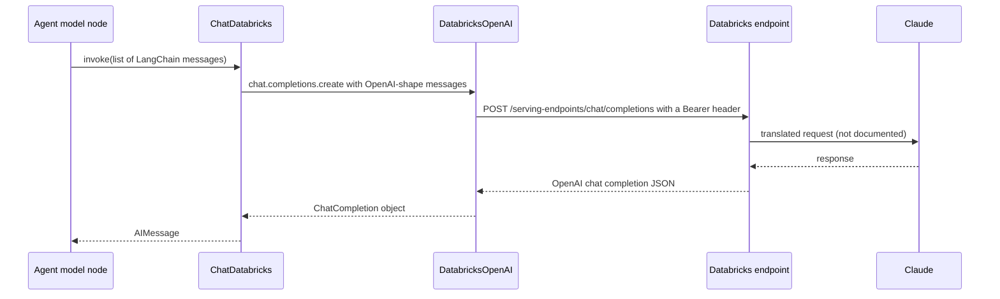

## 1. The question this idea answers

An agent backend runs in a Databricks App. It uses `create_agent` with `ChatDatabricks`, and a Claude model runs behind a Databricks serving endpoint. The agent code sees only LangChain messages ([L1](/notes/ai/langchain-langgraph/01-foundations/l1-langchain-messages)).

But Claude itself speaks the Anthropic Messages format, and the agent code never builds that format. So what travels on the wire? Which fields survive the trip, and which are lost or changed? How does the client prove who it is? And what can you control about the request that finally reaches Claude?

This lesson answers these questions from the source of databricks-langchain 0.21.0 and from request bodies that a local fake endpoint recorded (checked on 2026-10-13). The general rule comes from [The API sets the format, not the model](/notes/ai/llm-apis/01-messages-api/l3-the-api-sets-the-format): the endpoint decides the wire format.

## 2. Mental model

> [!analogy] Two interpreters in a row
> You speak to an interpreter in your language. She speaks to a second interpreter in a shared trade language. The second interpreter speaks to the guest in the guest's language. You never hear the trade language, and you never hear the guest's language.
>
> Your language is LangChain messages. `ChatDatabricks` is the first interpreter. The trade language is the OpenAI chat shape. Databricks is the second interpreter, and Claude is the guest.
>
> **Where it stops working:** a real interpreter asks when a word has no translation. `ChatDatabricks` does not ask. When a reply contains structured content with no plain-text form, it writes the structure as a JSON string and passes the string on. And you cannot read what the second interpreter says to the guest, because Databricks does not document that translation.

## 3. Terms

| Term | Plain meaning |
|---|---|
| `ChatDatabricks` | The LangChain chat model class in `databricks_langchain`. It calls a Databricks serving endpoint. |
| serving endpoint | A named Databricks model endpoint. `ChatDatabricks(model=...)` takes its name. |
| OpenAI chat shape | The request format of OpenAI Chat Completions: `messages` with roles, `tools`, `tool_calls` with string arguments. |
| `DatabricksOpenAI` | A subclass of the `openai.OpenAI` client from the `databricks-openai` package. It adds Databricks authentication. |
| `WorkspaceClient` | The main class of the Databricks SDK. It holds the host and the credentials. |
| unified authentication | The Databricks SDK rule that searches code, then environment variables, then a profile for credentials. |
| config profile | A named section in `~/.databrickscfg` with a host and credentials. |
| OAuth M2M | Machine-to-machine login with a service principal's client id and client secret. |
| `bind_tools` | The chat model method that attaches tool schemas to every later call. |
| `tool_choice` | The request field that controls whether the model may or must call a tool. |
| `stream_usage` | A `ChatDatabricks` field. When true, the stream ends with a chunk that holds token usage. |
| `extra_body` | An `openai` client argument that adds extra JSON fields to the request body. |
| AI Gateway | Databricks routes for model traffic, for example `/ai-gateway/mlflow/v1` and `/ai-gateway/anthropic/v1/messages`. |

## 4. Method and math

### 4.1 The constructor

`ChatDatabricks` is a pydantic model. These are its fields in `databricks_langchain/chat_models.py` of version 0.21.0, lines 275 to 308 (checked on 2026-10-13):

| Field | Default | Meaning |
|---|---|---|
| `model` (alias `endpoint`) | required | "Name of Databricks Model Serving endpoint to query." |
| `workspace_client` | `None` | Credentials. `None` means `WorkspaceClient()` with default authentication. |
| `target_uri` | `None` | Deprecated. Raises `ValueError` together with `workspace_client`. |
| `temperature` | `None` | Sent only when set. |
| `n` | `1` | Sent only when not 1. |
| `stop` | `None` | Stop strings. |
| `max_tokens` | `None` | Sent only when set. |
| `extra_params` | `None` (then `{}`) | Extra keyword arguments for the `openai` call. |
| `stream_usage` | `True` | Adds a usage chunk at the end of a stream. |
| `use_responses_api` | `False` | Uses the Responses API instead of Chat Completions. |
| `timeout` | `None` | Passed to the `openai` client. Its default is 600 s, connect 5 s. |
| `max_retries` | `None` | Passed to the `openai` client. Its default is 2. |
| `use_ai_gateway` | `False` | Routes to `{host}/ai-gateway/mlflow/v1`. |
| `use_ai_gateway_native_api` | `False` | Routes to `{host}/ai-gateway/openai/v1`. Not with `use_ai_gateway`. |

The `openai` defaults come from `openai/_constants.py` of openai 3.29.0: `DEFAULT_TIMEOUT = httpx2.Timeout(timeout=600, connect=5.0)` and `DEFAULT_MAX_RETRIES = 2`.

> [!trap] Two docstrings are swapped
> Lines 289 to 294 attach the text "Whether to include usage metadata in streaming output" to `extra_params`, and the text "Any extra parameters to pass to the endpoint" to `stream_usage`. The code does the opposite: `extra_params` is spread into the request, and `stream_usage` controls the usage chunk. Trust the code.

### 4.2 The request path

`ChatDatabricks.client` is a cached property. It calls `get_openai_client(workspace_client=..., **kwargs)` in `utils.py`, which returns `DatabricksOpenAI(workspace_client=...)`. So every call goes through the standard `openai` client.

The base URL comes from `_resolve_base_url` in `databricks_openai/utils/clients.py` (databricks-openai 0.17.1, the newest version that pip resolved on 2026-10-13):

```python
# lines 128-137
host = workspace_client.config.host

# AI Gateway routing: {host}/ai-gateway/{api_path}
if use_ai_gateway_native_api:
    return f"{host}/ai-gateway/openai/v1"
elif use_ai_gateway:
    return f"{host}/ai-gateway/mlflow/v1"

# Fallback to using serving endpoints
return f"{host}/serving-endpoints"
```



A local fake endpoint recorded the real path and header: `/serving-endpoints/chat/completions Bearer dapi-fake-token`.

### 4.3 From LangChain messages to the OpenAI shape

The conversion is `_convert_message_to_dict`, lines 1416 to 1459 of `chat_models.py`:

```python
1416  def _convert_message_to_dict(message: BaseMessage) -> dict:
1417      message_dict: Dict[str, Any] = {"content": message.content}
1418
1419      # NB: We don't propagate 'name' field from input message to the endpoint because
1420      #  FMAPI doesn't support it. ...
1425      if isinstance(message, ChatMessage):
1426          return {"role": message.role, **message_dict}
1427      elif isinstance(message, HumanMessage):
1428          return {"role": "user", **message_dict}
1429      elif isinstance(message, AIMessage):
1430          if tool_calls := _get_tool_calls_from_ai_message(message):
1431              message_dict["tool_calls"] = tool_calls
1432              # If tool calls present, content null value should be None not empty string.
1433              message_dict["content"] = message_dict["content"] or None
1434          return {"role": "assistant", **message_dict}
1435      elif isinstance(message, SystemMessage):
1436          return {"role": "system", **message_dict}
1437      elif isinstance(message, ToolMessage):
```

The `ToolMessage` branch (lines 1437 to 1452) returns only `role`, `tool_call_id` and `content`. A `FunctionMessage` raises `ValueError`. The tool calls come from `_get_tool_calls_from_ai_message`, lines 1584 to 1616:

```python
1585      tool_calls = [
1586          {
1587              "type": "function",
1588              "id": tc["id"],
1589              "function": {
1590                  "name": tc["name"],
1591                  "arguments": json.dumps(tc["args"]),
1592              },
1593          }
1594          for tc in message.tool_calls
1595      ]
```

Invalid tool calls are sent too, with their raw `args`. When both lists are empty, the function reads `additional_kwargs["tool_calls"]`.

The fake endpoint recorded the second request of a one-tool loop. The input had a `ToolMessage` with `status="error"` and `name="get_downtime"`. The recorded messages:

```json
[
 {"role": "system", "content": "You answer production questions."},
 {"role": "user", "content": "Downtime at plant 3 on 2026-10-12?"},
 {"role": "assistant", "content": " ",
  "tool_calls": [{"type": "function", "id": "toolu_01A",
                  "function": {"name": "get_downtime",
                               "arguments": "{\"plant_id\": 3, \"date\": \"2026-10-12\"}"}}]},
 {"role": "tool", "tool_call_id": "toolu_01A", "content": "47"}
]
```

| LangChain field | On the wire | Kept? |
|---|---|---|
| message class | `role` | yes |
| `content` (string or list) | `content`, unchanged | yes, as given |
| `tool_calls[i]["args"]` | `arguments` as a JSON string | yes |
| tool call ids | `id` and `tool_call_id` | yes |
| `name` | not sent | no |
| `ToolMessage.status` | not sent | no |
| `ToolMessage.artifact` | not sent | no, by design |
| message `id` | not sent | no |

### 4.4 The Claude fix inside the client

The assistant content in the recording is `" "`, not `null`. Line 1433 set `None`. The change to a space happens later, in `databricks-openai`:

```python
# clients.py lines 95-108
def _fix_empty_assistant_content_in_messages(messages: Any) -> None:
    """Replace empty assistant content with a single space when tool_calls are present.

    Claude models on Databricks reject empty text content blocks in assistant messages.
    When tool_calls are present but content is empty, set content to " " to avoid errors.
    """
    ...
        if message.get("role") == "assistant" and message.get("tool_calls"):
            if _is_empty_content(message.get("content")):
                message["content"] = " "
```

`DatabricksCompletions.create` (lines 235 to 242) calls this fix only when `_is_claude_model(model)` is true, and that test is `"claude" in model.lower()`. It also removes the `strict` field from tool schemas when the name has no `"gpt"`.

> [!trap] The Claude fix depends on the endpoint name
> The same message list was sent to an endpoint named `prod-chat`. The recorded assistant message was `{'role': 'assistant', 'content': None, 'tool_calls': [...]}`. The fix did not run, because the name has no "claude". If your endpoint name hides the model, the empty-content fix is skipped. Test the endpoint with a tool loop before production.

### 4.5 From the response to an AIMessage

`_convert_dict_to_message`, lines 1619 to 1665, builds the `AIMessage`. Tool calls are parsed with `parse_tool_call`. A call that fails to parse becomes an `invalid_tool_call`. The content rule is at lines 1623 to 1627:

```python
1623      content = _dict.get("content") or ""
1624      if not isinstance(content, str):
1625          # for non-string content, serialize it into a string to maintain compatibility with downstream consumers
1626          # for example, output parsers expect a string
1627          content = json.dumps(content)
```

This matters for Claude with extended thinking. The Databricks reasoning-models page shows the response content as a list: a block `{"type": "reasoning", "summary": [{"type": "summary_text", "text": ..., "signature": ...}]}`, then a block `{"type": "text", "text": ...}` (checked on 2026-10-13). The fake endpoint returned that shape. The real result:

```text
AIMessage.content type: str
AIMessage.text: '[{"type": "reasoning", "summary": [{"type": "summary_text", "text": "Sum the st
assistant message sent back: {"role": "assistant", "content": "[{\"type\": \"reasoning\", \"summary\": ...
```

So the reasoning block becomes plain text. On the next call, `ChatDatabricks` sends that JSON string as the assistant text. The Databricks page says that for the model to use its earlier thinking, "you must include the full, unmodified assistant message". A JSON string is not that message.

> [!trap] Thinking through ChatDatabricks is not round-trip safe
> With reasoning enabled, `message.text` holds a JSON string, and the next request sends the string again as text. Either keep thinking disabled in this client, or remove the reasoning text from the state yourself, for example in an `after_model` hook.

### 4.6 Usage numbers

`_convert_completion_usage_to_usage_metadata` has a branch for Claude, lines 660 to 675:

```python
660          elif getattr(usage, "cache_read_input_tokens", None) is not None:
661              # Most likely Claude Model
...
665              usage_metadata = UsageMetadata(
666                  input_tokens=(usage.prompt_tokens or 0)
667                  + cache_read_input_tokens
668                  + cache_creation_input_tokens,
669                  output_tokens=usage.completion_tokens or 0,
670                  total_tokens=usage.total_tokens or 0,
```

> [!example] Worked example: usage totals that do not match
> The fake endpoint returned `prompt_tokens = 20`, `completion_tokens = 9`, `total_tokens = 29`, `cache_read_input_tokens = 400` and `cache_creation_input_tokens = 0`.
>
> 1. `input_tokens = 20 + 400 + 0 = 420`.
> 2. `output_tokens = 9`.
> 3. `total_tokens = 29`, copied from the response.
>
> The real result: `{'input_tokens': 420, 'output_tokens': 9, 'total_tokens': 29, 'input_token_details': {'cache_creation': 0, 'cache_read': 400}}`. Here `total_tokens` (29) is smaller than `input_tokens` (420). Compute your own total as `input_tokens + output_tokens = 429`.

### 4.7 bind_tools

`bind_tools` (lines 1086 to 1153) converts each tool with `convert_to_openai_tool` and binds `tools=...`. The recorded schema of `get_downtime` was `{"type": "function", "function": {"name", "description", "parameters"}}`, with the docstring as the description and a JSON Schema built from the type hints.

| `tool_choice` argument | Sent as |
|---|---|
| `None` (the create_agent default) | not sent |
| `"auto"`, `"none"`, `"required"` | the same string |
| `"any"` | `"required"` |
| any other string | `{"type": "function", "function": {"name": <string>}}` |
| a dict | the dict, after a check that the tool exists |

How the endpoint maps `"required"` for each Claude version is not documented on the pages checked. The Anthropic API rejects forced tool choice on the newest models ([tool_use and tool_result, section 4.7](/notes/ai/llm-apis/01-messages-api/l2-tool-use-and-tool-result)). Test it before you rely on it.

### 4.8 Streaming

`_stream` sends `"stream": true` and reads `chat.completion.chunk` events. Each tool call fragment becomes a `tool_call_chunk`. LangChain merges chunks with the same `index`. A recorded stream of four tool fragments merged into `[{'name': 'get_downtime', 'args': {'plant_id': 3}, 'id': 'toolu_01A', 'type': 'tool_call'}]`.

The recorded stream request had only three keys: `['messages', 'model', 'stream']`. `ChatDatabricks` does not send `stream_options`. It collects usage from whatever chunks carry it, and emits one extra usage chunk at the end when `stream_usage` is true.

> [!trap] Streamed usage can count twice
> Two stream shapes were tested with the same usage, 412 input and 9 output tokens. Shape A sends usage in a final chunk with empty `choices`. Shape B sends usage in the last chunk that also has a choice. Merged results: shape A gave 412 input tokens, shape B gave 824. In shape B the usage is attached to the content chunk and again to the extra usage chunk. Check which shape your endpoint sends before you sum streamed usage.

### 4.9 Authentication

`WorkspaceClient()` with no arguments uses unified authentication. The Databricks docs say that SDKs try "Personal access tokens (legacy)", then "OAuth machine-to-machine (M2M)", then "OAuth user-to-machine (U2M)". For each method they check SDK config fields, then environment variables, then the `DEFAULT` profile in `.databrickscfg` (checked on 2026-10-13).

| Variable (the `Config` class of databricks-sdk 0.152.0) | Use |
|---|---|
| `DATABRICKS_HOST` | Workspace URL |
| `DATABRICKS_TOKEN` | Personal access token |
| `DATABRICKS_CLIENT_ID`, `DATABRICKS_CLIENT_SECRET` | OAuth M2M with a service principal |
| `DATABRICKS_CONFIG_PROFILE` | Profile name in `.databrickscfg` |
| `DATABRICKS_AUTH_TYPE` | Forces one method |

In a Databricks App, "Databricks sets the environment variables automatically in the app runtime": `DATABRICKS_CLIENT_ID` and `DATABRICKS_CLIENT_SECRET` of the app service principal. For calls on behalf of the user, the app receives the user token in the header `x-forwarded-access-token` ([user identity in apps](/notes/platforms/databricks/02-identity-and-auth/l3-user-identity-in-apps)).

The header is fresh on every HTTP request. `DatabricksOpenAI` installs `BearerAuth(workspace_client.config.authenticate)`, and `authenticate` "Returns a list of fresh authentication headers". So OAuth token refresh happens inside the SDK. On a laptop, pass `workspace_client=WorkspaceClient(profile="dev")` to choose a named profile (a sketch, not run against a real workspace).

### 4.10 What Claude receives

| Fact | Status (checked on 2026-10-13) |
|---|---|
| `ChatDatabricks` sends the OpenAI chat shape, or the Responses shape with `use_responses_api=True` | Confirmed in source and by recording |
| Databricks also offers a native Anthropic Messages route: `https://<workspace_host>.databricks.com/ai-gateway/anthropic/v1/messages` | Confirmed in Databricks docs |
| `ChatDatabricks` never calls that native route | Confirmed in source: the base URL is `serving-endpoints`, `ai-gateway/mlflow/v1` or `ai-gateway/openai/v1` |
| How Databricks translates the OpenAI request for Claude | Not documented |
| Extended thinking is requested with `extra_body={"thinking": {...}}` | Shown on the Databricks reasoning-models page |

To pass the thinking field through `ChatDatabricks`, nest it in `extra_body`. A flat key fails. The real error with `extra_params={"thinking": {...}}`:

```text
TypeError: Completions.create() got an unexpected keyword argument 'thinking'
```

With `extra_params={"extra_body": {"thinking": {"type": "enabled", "budget_tokens": 10240}}}`, the recorded body had a top-level `"thinking"` field. On the Anthropic API, Claude 4.7 and later models reject the manual `enabled` type and use adaptive thinking ([thinking blocks](/notes/ai/llm-apis/02-streaming-and-thinking/l2-thinking-blocks-and-signatures)). How Databricks maps this field for each model is not documented. Test it before you copy the docs example.

> [!key] ChatDatabricks is an OpenAI-shape client
> Everything you control is the OpenAI chat request: roles, string arguments, tool schemas and extra body fields. Tool call ids, text and arguments survive. Names, tool status, message ids and structured reply content do not. Databricks translates the request for Claude in a way that is not documented, so prove behavior with a recorded request and a live test.

### 4.11 Production view

| Concern | What to do |
|---|---|
| Correctness | Run one tool loop against the real endpoint. Confirm that empty assistant content is accepted. |
| Reliability | Remember that the `openai` client retries 408, 409, 429 and 5xx twice by default. Add retry middleware with care ([built-in middleware](/notes/ai/langchain-langgraph/02-middleware/l2-built-in-middleware-map)). |
| Cost | Compute totals from `input_tokens + output_tokens`. Test the stream usage shape once. |
| Security | Use the app service principal or the forwarded user token. Never put a personal token in app code. |
| Latency | Set `timeout` explicitly. The `openai` default is 600 s. |
| Observability | Log the endpoint name and `response_metadata["finish_reason"]` for each call. |

## 5. Code

These exercises go in `langchain-langgraph/03-chatdatabricks.ipynb`. They need no workspace.

**Exercise 3.1: record the wire.** Write a small local HTTP server that accepts `POST /serving-endpoints/chat/completions`, stores each JSON body, and returns a prepared chat completion. Point a `WorkspaceClient(host="http://127.0.0.1:<port>", token="fake")` at it.

Acceptance tests:

- One `ChatDatabricks.invoke` stores one body with `model`, `stream` and `messages`.
- The stored `Authorization` header is `Bearer fake`.
- A tool loop stores a `tool` message whose `tool_call_id` equals the id of the earlier tool call.

**Exercise 3.2: prove the losses.** With the recorder, send a `ToolMessage` with `status="error"`, `name` and `artifact`.

Acceptance tests:

- The stored tool message has exactly the keys `role`, `tool_call_id` and `content`.
- An endpoint name with "claude" stores `" "` as empty assistant content. A name without it stores `null`.

**Exercise 3.3: safe usage totals.** Write `usage_total(ai_message)` that returns input plus output tokens, and a stream test that merges chunks.

Acceptance tests:

- For the worked example of section 4.6, the function returns 429.
- For stream shape B, your test detects the double count and reports it.

## 6. Common mistakes

1. **"ChatDatabricks speaks Anthropic to Claude."** It speaks the OpenAI chat shape. Databricks translates for Claude.
2. **Putting provider fields directly in `extra_params`.** They become keyword arguments of `openai`'s `create()`. Unknown ones raise `TypeError`. Use `extra_body`.
3. **Trusting `total_tokens` for Claude.** It can be smaller than `input_tokens`. Add input and output yourself.
4. **Expecting `ToolMessage.status` to reach the model.** It is not sent. Write the error into the content.
5. **Reading the swapped docstrings.** `extra_params` and `stream_usage` have each other's description in 0.21.0.
6. **Hiding the model name in the endpoint name without a test.** The empty-content fix for Claude runs only when the name contains "claude".

## 7. One-minute explanation

`ChatDatabricks` is a LangChain chat model that calls a Databricks serving endpoint through the standard `openai` client, wrapped as `DatabricksOpenAI` for authentication. On every call it converts LangChain messages into the OpenAI chat shape. Tool calls get JSON string arguments, and tool results become `tool` messages with a `tool_call_id`. Names, tool status, message ids and artifacts are not sent. For each response it parses the tool calls. But it turns any list content, such as Claude reasoning blocks, into a JSON string, so thinking is not safe across turns. Authentication comes from `WorkspaceClient`, which searches code, environment variables and profiles, and the header is refreshed on every request. A Claude model behind the endpoint receives a request that Databricks translates in an undocumented way. So you prove the behavior with a recorded request body and a live tool loop.

## 8. Check questions

```check
{
  "question": "Your agent sends an AIMessage with one tool call and empty content to an endpoint named fgf-claude-prod, and then to one named prod-chat. What content does each request carry for that assistant message, and why?",
  "hint": "Find where the content becomes None and where it becomes a space.",
  "answer": "fgf-claude-prod: \" \" (a space). prod-chat: null. ChatDatabricks sets None when tool calls exist (line 1433). Then DatabricksCompletions replaces empty assistant content with \" \" only when \"claude\" is in the model name."
}
```

```check
{
  "question": "A Claude response through ChatDatabricks reports prompt_tokens 100, cache_read_input_tokens 9,000, cache_creation_input_tokens 0, completion_tokens 50, total_tokens 150. What does usage_metadata hold, and what total should you log?",
  "answer": "input_tokens = 100 + 9,000 + 0 = 9,100, output_tokens = 50, total_tokens = 150 (copied), input_token_details with cache_read 9,000. Log 9,100 + 50 = 9,150 as the total."
}
```

```check
{
  "question": "Why does a Claude thinking block not survive a second turn through ChatDatabricks 0.21.0?",
  "answer": "The response content is a list with a reasoning block and a text block. _convert_dict_to_message turns non-string content into a JSON string with json.dumps. The next request sends that string as the assistant text, so the model gets text, not the unmodified reasoning block that Databricks says you must include."
}
```

```check
{
  "question": "Inside a Databricks App, ChatDatabricks is created with no workspace_client. Where do its credentials come from, and how often is the Authorization header built?",
  "answer": "WorkspaceClient() uses unified authentication. In the app runtime Databricks sets DATABRICKS_CLIENT_ID and DATABRICKS_CLIENT_SECRET for the app service principal, so OAuth M2M is used. BearerAuth calls config.authenticate on every HTTP request, so the header is fresh each time."
}
```

## 9. Links

- Previous: [L2: create_agent](/notes/ai/langchain-langgraph/01-foundations/l2-create-agent)
- Next part: [The middleware hooks](/notes/ai/langchain-langgraph/02-middleware/l1-the-middleware-hooks)
- The format rule: [The API sets the format, not the model](/notes/ai/llm-apis/01-messages-api/l3-the-api-sets-the-format)
- The OpenAI shape: [The OpenAI chat shape](/notes/ai/llm-apis/03-openai-format/l1-the-openai-chat-shape)
- Credentials: [CLI profiles](/notes/platforms/databricks/02-identity-and-auth/l1-cli-profiles) and [user identity in apps](/notes/platforms/databricks/02-identity-and-auth/l3-user-identity-in-apps)
- [Glossary](/notes/ai/langchain-langgraph/glossary)
