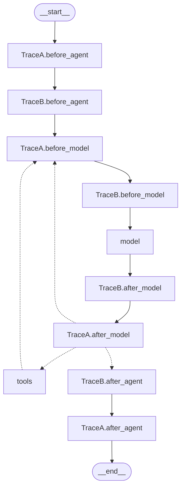

## 1. The question this idea answers

An agent backend needs custom logic inside the agent loop. Some examples from a production data assistant:

- Block a request that asks to change data, before the model ever sees it.
- Check the final answer for internal table names before it is saved.
- Take a chart from a tool result and give it to the user interface.
- Change the system prompt on each call, for example with the current shift.

LangChain middleware gives seven places for such logic. Each place runs at a different time, receives different objects, and changes either the model input of one call or the saved state. If you choose the wrong place, the logic runs too often, too late, or it changes data that you wanted to keep. This lesson maps the seven hooks with real runs (langchain 1.4.5, checked on 2026-10-13).

## 2. Mental model

> [!analogy] Doors and escorts in a building
> A visitor enters a building, visits several offices, and leaves. The building has doors with guards. One guard checks the visitor at the entrance, once. Guards stand at each office door, before and after each visit. One guard checks the visitor at the exit, once. Each guard can write in the visitor log.
>
> The building also has escorts. An escort walks with the visitor through one office visit. The escort can change what the visitor carries for this visit only, repeat the visit, or cancel the visit.
>
> Guards are node-style hooks. Escorts are wrap-style hooks. The visitor log is the agent state.
>
> **Where it stops working:** in the building, the exit guards stand in the same order as the entrance guards. In LangChain, the after hooks run in reverse order. And an escort's change does not reach the visitor log unless the escort returns an explicit state update.

## 3. Terms

| Term | Plain meaning |
|---|---|
| middleware | An object that adds hooks to `create_agent`. A subclass of `AgentMiddleware`, or a function with a hook decorator. |
| hook | A method that the agent calls at one fixed point of the loop. |
| node-style hook | A hook that becomes its own graph node: `before_agent`, `before_model`, `after_model`, `after_agent`. |
| wrap-style hook | A hook that runs around one call and receives a `handler`: `wrap_model_call`, `wrap_tool_call`. |
| `handler` | The function that a wrap-style hook calls to run the next layer, and finally the model or the tool. |
| `ModelRequest` | The object for one model call: model, messages, system message, tools, tool choice, state, runtime. |
| `ModelResponse` | The result of one model call: a list of messages and an optional structured response. |
| `ToolCallRequest` | The object for one tool call: the tool call dict, the tool, the state and the runtime. |
| `Command` | A LangGraph object with a state update (`update=...`). |
| `ExtendedModelResponse` | A `ModelResponse` plus a `Command`. It lets `wrap_model_call` update the state. |
| `jump_to` | A state key that a node-style hook sets to move to `"model"`, `"tools"` or `"end"`. |
| `can_jump_to` | The list of jump targets that a hook declares. Without it, the graph has no edge for the jump. |
| `state_schema` | A `TypedDict` that adds keys to the agent state. |
| `dynamic_prompt` | A decorator that turns a function into a `wrap_model_call` hook that sets the system prompt. |

## 4. Method and math

### 4.1 The seven hooks

| Hook | Style | When it runs | Receives | Returns | Change |
|---|---|---|---|---|---|
| `before_agent` | node | Once per invocation, before the loop | `state, runtime` | `dict` or `None` | persistent |
| `before_model` | node | Before each model call | `state, runtime` | `dict` or `None` | persistent |
| `wrap_model_call` | wrap | Around each model call | `request, handler` | `ModelResponse`, `AIMessage` or `ExtendedModelResponse` | transient, unless `ExtendedModelResponse` |
| `after_model` | node | After each model response | `state, runtime` | `dict` or `None` | persistent |
| `wrap_tool_call` | wrap | Around each tool call | `request, handler` | `ToolMessage` or `Command` | the result is persistent |
| `after_agent` | node | Once per invocation, after the loop | `state, runtime` | `dict` or `None` | persistent |
| `dynamic_prompt` | wrap (a shortcut) | Around each model call | `request` | `str` or `SystemMessage` | transient |

The "once per invocation" and "before each model call" wording comes from the custom middleware page (checked on 2026-10-13). [Transient vs persistent context](/notes/ai/conversation-state/01-where-state-lives/l2-transient-vs-persistent-context) defines the two kinds of change.

### 4.2 Node-style hooks

A node-style hook becomes a graph node with the name `<middleware name>.<hook>`, for example `TraceA.before_model`. The docs say: "Return a dict directly. The dict is applied to the agent state using the graph's reducers." So a returned `{"messages": [...]}` goes through `add_messages`: new ids append, an equal id replaces.

Two forms exist. A class method:

```python
class InputGuard(AgentMiddleware):
    def before_agent(self, state, runtime):
        ...
        return None          # no change
```

Or a decorated function: `@before_model`, `@after_model`, `@before_agent`, `@after_agent`. The decorators accept `state_schema`, `tools`, `can_jump_to` and `name`.

> [!trap] The second parameter must be named runtime
> LangGraph passes the runtime by parameter name. A hook written as `def before_agent(self, s, r)` failed with the real error `TypeError: M.before_agent() missing 1 required positional argument: 'r'`. Name the parameters `state` and `runtime`.

Each node-style hook is a super-step. It counts toward the recursion limit ([create_agent, section 4.7](/notes/ai/langchain-langgraph/01-foundations/l2-create-agent)). Wrap-style hooks run inside the `model` or `tools` node, so they add no super-step.

### 4.3 Wrap-style hooks

`wrap_model_call(request, handler)` receives a `ModelRequest`. Its fields (`types.py`): `model`, `messages` ("excluding system message"), `system_message`, `tool_choice`, `tools`, `response_format`, `state`, `runtime` and `model_settings`. The docstring says the hook can call the handler "multiple times for retry logic, skip calling it to short-circuit, or modify the request/response".

To change the request, use `request.override(...)`. It returns a new request and leaves the original unchanged. Direct assignment is deprecated.

A real test with a transient trim and a dynamic prompt. The state held 5 user messages:

```python
@wrap_model_call
def last_two(request, handler):
    return handler(request.override(messages=request.messages[-2:]))
```

```text
model received system: 'You answer production questions. The chat has 5 messages.' | total messages: 3
state messages after run: 6
```

The model saw the system message and 2 messages. The state kept all 5 user messages plus the answer.

`wrap_tool_call(request, handler)` receives a `ToolCallRequest` with `tool_call`, `tool`, `state` and `runtime`. It returns a `ToolMessage` or a `Command`. The returned `ToolMessage` enters the state, so the tool result that you return is persistent.

> [!trap] Sync and async are separate methods
> If you implement only `awrap_model_call` and call `agent.invoke()`, the agent raises `NotImplementedError` with the message "Synchronous implementation of wrap_model_call is not available." The same applies the other way. Implement the method that matches how you run the agent, or both.

### 4.4 dynamic_prompt

`@dynamic_prompt` is a shortcut. The source builds a middleware whose `wrap_model_call` calls your function, then calls `handler(request.override(system_message=...))`. A string result becomes a `SystemMessage`.

The override replaces the whole system message. In the run above, `create_agent` had `system_prompt="Base prompt."`, and the model received only the dynamic text. To extend the base prompt, read `request.system_prompt` in your function and add to it.

### 4.5 Execution order: a real run

Two middleware, `A` and `B`, implement all six method hooks with print statements. A `@dynamic_prompt` comes third. The fake model calls one tool, then answers.

```python
agent = create_agent(model, tools=[get_downtime],
                     middleware=[Trace("A"), Trace("B"), shift_prompt],
                     system_prompt="Base prompt.")
```

The real output:

```text
A.before_agent   msgs=1
B.before_agent   msgs=1
A.before_model   msgs=1
B.before_model   msgs=1
A.wrap_model_call enter (system='Base prompt.')
B.wrap_model_call enter (system='Base prompt.')
dynamic_prompt runs
B.wrap_model_call exit
A.wrap_model_call exit
B.after_model    msgs=2
A.after_model    msgs=2
A.wrap_tool_call enter (get_downtime)
B.wrap_tool_call enter (get_downtime)
        TOOL get_downtime runs
B.wrap_tool_call exit
A.wrap_tool_call exit
A.before_model   msgs=3
B.before_model   msgs=3
A.wrap_model_call enter (system='Base prompt.')
B.wrap_model_call enter (system='Base prompt.')
dynamic_prompt runs
B.wrap_model_call exit
A.wrap_model_call exit
B.after_model    msgs=4
A.after_model    msgs=4
B.after_agent    msgs=4
A.after_agent    msgs=4
```

This matches the rules on the custom middleware page: "`before_*` hooks: First to last", "`after_*` hooks: Last to first (reverse)", "`wrap_*` hooks: Nested (first middleware wraps all others)".

The graph that produced this run. The edges are the real printed edges, with the conditional ones dashed:



Three facts are visible. The loop returns to `TraceA.before_model`, not to `before_agent`. The conditional edge leaves from the first `after_model` hook, which runs last. And `wrap_model_call` and `wrap_tool_call` have no nodes.

> [!key] Two styles, two kinds of change
> Node-style hooks are graph nodes. They read the state and return updates that the reducers apply, so their changes are persistent. Wrap-style hooks run around one model or tool call and receive a handler. A `request.override` changes only that call, so it is transient. Before hooks run first to last, after hooks run last to first, and wrap hooks nest with the first middleware outermost.

### 4.6 State updates from wrap-style hooks

A wrap-style hook can still update the state, with an explicit `Command`:

| Hook | How to update the state |
|---|---|
| `wrap_model_call` | Return `ExtendedModelResponse(model_response=..., command=Command(update={...}))` |
| `wrap_tool_call` | Return `Command(update={"messages": [tool_message], ...})` |

A real test stored the output tokens of each model call in a new state key:

```python
def wrap_model_call(self, request, handler):
    resp = handler(request)
    tokens = resp.result[-1].usage_metadata["output_tokens"]
    return ExtendedModelResponse(model_response=resp,
                                 command=Command(update={"last_output_tokens": tokens}))
```

```text
last_output_tokens in state: 9
```

The docs add two rules for several layers: "For non-reducer state fields, commands are applied inner-first, then outer. The outermost middleware's value takes precedence on conflicting keys." And "commands from earlier calls are discarded" when an outer layer retries. A `Command` with `goto` raises `NotImplementedError` in `wrap_model_call`.

### 4.7 jump_to and can_jump_to

A node-style hook can return `{"jump_to": "end"}` (or `"model"`, or `"tools"`). The docs define the targets: "`'end'`: Jump to the end of the agent execution (or the first `after_agent` hook)", and "`'model'`: Jump to the model node (or the first `before_model` hook)".

The graph needs an edge for the jump. The hook declares it with `@hook_config(can_jump_to=["end"])` on a method, or `can_jump_to=["end"]` in a decorator. A real test returned the same jump with and without the declaration:

```text
NoDecl model calls: 1 ['q', 'Blocked.', 'Model answer.']
Decl model calls: 0 ['q', 'Blocked.']
```

> [!trap] An undeclared jump is ignored without an error
> Without `can_jump_to`, `create_agent` adds a plain edge for the hook. The `jump_to` value is set, then cleared, and the model still runs. Always declare the targets, and test that the model is not called.

`jump_to` is an `EphemeralValue` channel. It lives for one step only.

### 4.8 state_schema extensions

A middleware adds state keys with a class attribute `state_schema`. The schema must be a `TypedDict` that extends `AgentState`. The migration guide says that `create_agent` "only supports `TypedDict` for state schemas" (checked on 2026-10-13).

```python
class ChartState(AgentState):
    charts: NotRequired[Annotated[list[dict], operator.add]]

class ChartCapture(AgentMiddleware):
    state_schema = ChartState
```

`create_agent` merges the schemas of all middleware, then the `state_schema` argument. The source comment says the base schema comes last "so it wins any field conflict". The real channel list after the merge started with `['messages', 'jump_to', 'structured_response', 'charts', ...]`.

> [!trap] Two instances of one class need different names
> The default middleware name is the class name. Two instances of one class raise `AssertionError: Please remove duplicate middleware instances.` Override the `name` property when you need two.

### 4.9 Three guards from one run

One agent with three middleware, in this order: `InputGuard`, `ChartCapture`, `OutputGuard`. The tool returns content and an artifact (`response_format="content_and_artifact"`).

| Middleware | Hook | Logic |
|---|---|---|
| `InputGuard` | `before_agent`, with `can_jump_to=["end"]` | If the user text contains "DROP TABLE", add a refusal and jump to the end. |
| `ChartCapture` | `wrap_tool_call` | Call the tool. If the `ToolMessage` has an artifact, return `Command(update={"messages": [msg], "charts": [artifact]})`. |
| `OutputGuard` | `after_agent` | If the last answer contains "raw_", replace it with a message that has the same id. |

The real results of three questions:

```text
Q: DROP TABLE orders
    HumanMessage 'DROP TABLE orders'
    AIMessage 'I cannot run that request.'
    charts: []
    model calls: 0
Q: Downtime by shift at plant 3?
    HumanMessage 'Downtime by shift at plant 3?'
    AIMessage ''
    ToolMessage 'Shift A: 12 min. Shift B: 35 min.' artifact
    AIMessage 'Shift B had the most downtime: 35 minutes.'
    charts: [{'type': 'bar', 'x': 'shift', 'y': 'minutes', 'rows': [{'shift': 'A', 'minutes': 12}, {'shift': 'B', 'minutes': 35}]}]
    model calls: 2
Q: Which table?
    HumanMessage 'Which table?'
    AIMessage '[answer removed: it named an internal table]'
    charts: []
    model calls: 1
```

The model never received the chart rows. They were in the artifact, not in the content ([L1, section 4.3](/notes/ai/langchain-langgraph/01-foundations/l1-langchain-messages)).

> [!trap] An after_agent guard runs after the stream
> The output guard replaced the answer in the state. But with `stream_mode="messages"`, the client had already received every token. The real stream: `'It'`, `' '`, `'is'`, `' '`, `'in'`, `' '`, `'prod.raw_downtime.'` from node `model`, and only then the update from `OutputGuard.after_agent`. A guard that must stop text from reaching the user must run before the model output is streamed, or the stream must be buffered.

### 4.10 Production view

| Concern | What to do |
|---|---|
| Correctness | Use node-style hooks for state changes. Use wrap-style hooks for per-call views, retries and tool result handling. |
| Data safety | Never let a persistent hook decide what the application stores as the user transcript ([transient vs persistent](/notes/ai/conversation-state/01-where-state-lives/l2-transient-vs-persistent-context)). |
| Security | Put input guards in `before_agent` with a declared jump. Test that the model is called zero times. |
| Latency | Each node-style hook is a super-step with a checkpoint write. Prefer few hooks. |
| Streaming | Output checks in `after_model` or `after_agent` run after tokens leave. Filter the stream if needed. |
| Testing | Record the order of hooks with a fake model, as in section 4.5. |

## 5. Video

```video
{
  "src": "/notes/media/langchain-langgraph/manim/m02-middleware-hook-order.mp4",
  "caption": "Two middleware around one agent loop: before hooks forward, wrap hooks nested, after hooks in reverse."
}
```

## 6. Code

These exercises go in `langchain-langgraph/04-middleware-hooks.ipynb`. They need no API key.

**Exercise 4.1: predict, then print.** Write three middleware `X`, `Y`, `Z` that print in every hook. Before you run, record the order that you expect for one tool round. Then run with a fake model.

Acceptance tests:

- Your prediction matches the real output for `middleware=[X, Y, Z]`.
- After you change the list to `[Z, X, Y]`, a new prediction also matches.
- The output shows `wrap_tool_call` of `X` outside `Y` when `X` comes first.

**Exercise 4.2: an input guard that really stops.** Write an input guard in `before_agent` that refuses any request that asks to delete or update data.

Acceptance tests:

- A refused request causes zero model calls.
- A normal request causes at least one model call.
- Removing `can_jump_to` makes the refused-request test fail.

**Exercise 4.3: transient or persistent.** Write two middleware that keep only the last 4 messages: one in `wrap_model_call`, one in `before_model`.

Acceptance tests:

- With the wrap version, the state after the run has every message.
- With the node version, the state after the run has at most 4 earlier messages plus the new ones.
- In both versions, the model receives at most 4 messages plus the system message.

**Exercise 4.4: capture artifacts.** Write a `wrap_tool_call` middleware that collects every tool artifact into a new state key `artifacts` with a list reducer.

Acceptance tests:

- Two tool calls with artifacts give a list of 2 items.
- A tool without an artifact adds nothing.
- The model input never contains the artifact data.

## 7. Common mistakes

1. **"After hooks run in list order."** They run in reverse. The first middleware's `after_model` runs last.
2. **Returning `jump_to` without `can_jump_to`.** The jump is ignored and the model still runs.
3. **Editing `request.messages` and expecting the state to change.** `request.override` is transient. Return `ExtendedModelResponse` or use a node-style hook.
4. **Naming the hook parameters freely.** The runtime is passed by the name `runtime`.
5. **Using `@dynamic_prompt` and expecting the base prompt to stay.** It replaces the whole system message.
6. **Checking the output in `after_agent` and calling it safe.** Streamed tokens already reached the client.

## 8. One-minute explanation

LangChain middleware has seven hooks. Four are node-style: `before_agent` and `after_agent` run once per invocation, and `before_model` and `after_model` run around each model call. They become graph nodes, receive the state and the runtime, and return a dict that the reducers apply, so their changes are persistent. Two are wrap-style: `wrap_model_call` and `wrap_tool_call` run around one call and receive a request and a handler. They can change the request, retry, or skip the call. A `request.override` is transient, and only an `ExtendedModelResponse` or a `Command` updates the state. `dynamic_prompt` is a shortcut that replaces the system message for one call. Before hooks run first to last, after hooks run last to first, and wrap hooks nest with the first middleware outermost. A node-style hook can jump to the model, the tools or the end, but only if it declares `can_jump_to`. A middleware can add state keys with a `TypedDict` state schema.

## 9. Check questions

```check
{
  "question": "middleware=[A, B]. Both implement before_model, wrap_model_call and after_model. Write the order of the six calls around one model call.",
  "hint": "Before: forward. Wrap: nested. After: reverse.",
  "answer": "A.before_model, B.before_model, A.wrap_model_call enters, B.wrap_model_call enters, the model runs, B exits, A exits, B.after_model, A.after_model."
}
```

```check
{
  "question": "A before_model hook returns {\"jump_to\": \"end\", \"messages\": [AIMessage(\"Blocked.\")]} but the model is still called. What is the most likely cause, and how do you prove the fix?",
  "answer": "The hook did not declare can_jump_to, so the graph has a plain edge and ignores jump_to. Add @hook_config(can_jump_to=[\"end\"]) or can_jump_to in the decorator. Prove it with a fake model that counts calls: the count must be 0."
}
```

```check
{
  "question": "You want the model to see only the last 20 messages, but the chat history in the agent state must stay complete. Which hook do you use, and what do you return?",
  "answer": "wrap_model_call. Return handler(request.override(messages=request.messages[-20:])). The override changes only this call, so it is transient and the state keeps every message. Keep tool call pairs together when you cut."
}
```

```check
{
  "question": "Why does a check in after_agent not stop a forbidden word from reaching a user who reads the stream?",
  "answer": "after_agent runs after the loop ends. With stream_mode messages, the tokens of the model output are streamed from the model node before any after hook runs. The guard can change the saved state, but the user already received the text."
}
```

## 10. Links

- Previous part: [L3: ChatDatabricks](/notes/ai/langchain-langgraph/01-foundations/l3-chatdatabricks)
- Next: [L2: The built-in middleware map](/notes/ai/langchain-langgraph/02-middleware/l2-built-in-middleware-map)
- The graph these hooks join: [create_agent](/notes/ai/langchain-langgraph/01-foundations/l2-create-agent)
- The two kinds of change: [Transient vs persistent context](/notes/ai/conversation-state/01-where-state-lives/l2-transient-vs-persistent-context)
- The same ideas in the Claude SDK: [Hooks](/notes/ai/claude-agent-sdk/08-hooks-and-subagents/l1-hooks)
- [Glossary](/notes/ai/langchain-langgraph/glossary)
