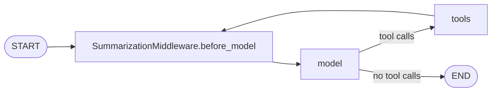

## 1. The question this idea answers

A user asks an agent about plant downtime for an hour. Each question adds a user message, tool calls, tool results with SQL rows, and an answer. Every model call sends the whole list again. The input grows on each call, the cost grows with it, and at some point the list no longer fits in the context window.

`SummarizationMiddleware` is LangChain's answer. When the history is too long, it asks a model to summarize the old part and replaces the old part with the summary. This lesson answers four questions. When does it run, and when does it silently never run? Where does it cut? What does the summarizer read? What happens to the saved state? All results are from runs with langchain 1.4.5, langchain-core 1.6.10 and langgraph 1.2.14 with fake chat models (checked on 2026-10-13).

## 2. Mental model

> [!analogy] The minutes of a long meeting
> A secretary keeps a working binder for a long meeting. When the binder gets too thick, the secretary removes the first pages and puts one page of minutes in their place. The last pages stay word for word. The secretary never separates a question from its answer: if the cut falls between them, the cut moves earlier.
>
> The binder is the agent state. The page of minutes is the summary message. The rule about questions and answers is the rule that keeps a tool call with its tool results.
>
> **Where it stops working:** a real secretary reads all the removed pages. The summarizer reads only the newest part of the removed pages, about 4,000 tokens by default. And the binder is a working copy. The official record of the meeting, the user transcript, must live somewhere else and must never be replaced by the minutes.

## 3. Terms

| Term | Plain meaning |
|---|---|
| `SummarizationMiddleware` | A built-in LangChain middleware that replaces old messages in the agent state with one summary message. |
| trigger | The condition that starts summarization: a number of messages, tokens, or a fraction of the model's window. |
| keep | How much of the newest history stays word for word after summarization. |
| `ContextSize` | A tuple that states one size: `("messages", n)`, `("tokens", n)` or `("fraction", f)`. |
| `TriggerClause` | A dictionary of thresholds that must all be met at the same time, for example `{"tokens": 4000, "messages": 10}`. |
| cut point | The index in the message list. Messages before it are summarized. Messages from it onward are preserved. |
| safe cut | A cut point that does not separate an AI message with tool calls from its tool messages. |
| summary message | The `HumanMessage` that holds the summary. It starts with "Here is a summary of the conversation to date:". |
| summarizer | The model that writes the summary. By default it is the `model` argument of the middleware. |
| `trim_tokens_to_summarize` | The token budget for the old messages that the summarizer reads. Default 4,000. |
| `RemoveMessage` | A message object that tells the `add_messages` reducer to delete a message by id. |
| `REMOVE_ALL_MESSAGES` | The special id `"__remove_all__"`. A `RemoveMessage` with it deletes every message before it. |
| approximate token counter | `count_tokens_approximately`: a character-based estimate, about 4 characters per token plus 3 tokens per message. |
| model profile | Data on a chat model that includes `max_input_tokens`. A `fraction` size needs it. |

## 4. Method and math

### 4.1 Where it runs

`SummarizationMiddleware` implements one hook: `before_model`. In the compiled graph it is a node of its own. The graph of an agent with this middleware has these nodes (real output):

```text
['__start__', 'model', 'tools', 'SummarizationMiddleware.before_model', '__end__']
```



The node runs **before every model call**, not once per user turn. A turn with five tool rounds has six model calls, so the check runs six times. So summarization can start in the middle of a tool loop. A `before_model` hook is a node-style hook, so its return value goes through the reducers into the state ([L2.1: The middleware hooks](/notes/ai/langchain-langgraph/02-middleware/l1-the-middleware-hooks)). This makes the change **persistent** ([Transient vs persistent context](/notes/ai/conversation-state/01-where-state-lives/l2-transient-vs-persistent-context)).

### 4.2 The constructor

The signature in the installed source (`langchain/agents/middleware/summarization.py`, langchain 1.4.5, checked on 2026-10-13):

| Parameter | Default | Meaning |
|---|---|---|
| `model` | required | A model string or a `BaseChatModel`. It writes the summary, and its profile sets the size of a `fraction`. |
| `trigger` | `None` | One `ContextSize`, one `TriggerClause`, or a list of them. `None` means never. |
| `keep` | `("messages", 20)` | One `ContextSize`. Lists are not allowed here. |
| `token_counter` | `count_tokens_approximately` | The function that counts tokens for the trigger and for `keep`. |
| `summary_prompt` | `DEFAULT_SUMMARY_PROMPT` | The prompt template. It should contain `{messages}`, where the old messages go. |
| `trim_tokens_to_summarize` | `4000` | The token budget of the old messages that the summarizer reads. `None` disables trimming. |
| `summarizer` | `None` | A different chat model, a `Runnable` or a function that writes the summary. |
| `**deprecated_kwargs` | | Catches old names. See section 4.9. |

The `summarizer` parameter is in the installed code, and it works. The built-in middleware page of the docs does not list it yet (checked on 2026-10-13).

### 4.3 The trigger=None trap

The docs say: "If `trigger` is not provided, summarization will not trigger automatically." (checked on 2026-10-13). The code is direct:

```python
def _should_summarize(self, messages, total_tokens):
    if not self._trigger_clauses:
        return False
```

A test called `before_model` of `SummarizationMiddleware(model=...)`, with no trigger, on 200 messages and 4,680 approximate tokens. It returned `None`, which means "no state update". The middleware is in the graph and runs before every model call, but it never summarizes. No warning appears.

> [!trap] A middleware that does nothing, quietly
> `SummarizationMiddleware(model="...")` alone is valid code that never summarizes. Always pass `trigger`. Add a startup check that fails when `mw.trigger is None`.

### 4.4 The forms of trigger and keep

| Form | Example | Meaning |
|---|---|---|
| `ContextSize` tuple | `("messages", 50)` | One threshold. |
| `TriggerClause` dict | `{"tokens": 4000, "messages": 10}` | AND: every threshold in the dict must be reached. |
| List | `[("tokens", 4000), ("messages", 10)]` | OR: any item is enough. |
| List of dicts | `[{"tokens": 5000, "messages": 3}, {"tokens": 3000, "messages": 6}]` | OR of ANDs. |

"Reached" means greater than or equal to: `len(messages) < value` fails the clause. The test below used 10 messages with 192 approximate tokens:

```text
dict AND {'tokens':4000,'messages':10}: False
list OR [('tokens',4000),('messages',10)]: True
clauses: [{'tokens': 4000}, {'messages': 10}]
```

The constructor validates the values. These are real errors:

```text
trigger={'messages': True}: ValueError: messages trigger value must be numeric, got True
trigger={'tokens': 3.5}: ValueError: tokens trigger values must be integers, got 3.5
trigger=('messages', 0): ValueError: trigger thresholds must be greater than 0, got 0.
trigger={'turns': 3}: ValueError: Unsupported trigger metric: 'turns'
```

A `fraction` needs `max_input_tokens` from the model profile. With a model that has no profile, the constructor raises `ValueError: Model profile information is required to use fractional token limits...`. The message suggests `ChatModel(..., profile={"max_input_tokens": ...})`.

A `tokens` or `fraction` clause can also pass because of reported usage. The newest `AIMessage` must report `usage_metadata["total_tokens"]` at or above the threshold. Its `model_provider` must match the provider of the middleware's model. So the real usage of the last call can start summarization when the estimate is lower.

### 4.5 How tokens are counted

The default counter is `count_tokens_approximately` (langchain-core 1.6.10). For each message it counts the characters of the content and of the role name (`user`, `assistant`, `tool`, `system`). It adds the `repr` of the tool calls of an AI message, the `tool_call_id` of a tool message, and the `name`. Then:

$$
\text{tokens per message} = \left\lceil \frac{\text{characters}}{4} \right\rceil + 3
$$

The middleware changes two details. If the model's `_llm_type` starts with `anthropic-chat`, it uses 3.3 characters per token. And it can scale the estimate with the `total_tokens` that the newest AI message reported, by a factor between 1.0 and 1.25. A Claude model called through `ChatDatabricks` has `_llm_type` `"chat-databricks"`, so it gets the default 4 characters per token.

> [!example] Worked example: one tool message
> `ToolMessage("plant 3: 95 min; plant 7: 40 min", tool_call_id="c1", name="downtime_by_plant")`
>
> 1. Content: 32 characters.
> 2. `tool_call_id` `"c1"`: 2 characters.
> 3. Role `"tool"`: 4 characters.
> 4. Name `"downtime_by_plant"`: 17 characters.
> 5. Total: 32 + 2 + 4 + 17 = 55 characters.
> 6. $\lceil 55 / 4 \rceil = 14$, plus 3 gives **17 tokens**. The run printed 17.

### 4.6 The cut point

With `keep=("messages", n)`, the middleware first sets the target cut at `len(messages) - n`. Then it makes the cut safe. This is the installed source, with the comments and the type cast removed:

```python
def _find_safe_cutoff_point(messages, cutoff_index):
    if cutoff_index >= len(messages) or not isinstance(messages[cutoff_index], ToolMessage):
        return cutoff_index
    tool_call_ids: set[str] = set()
    idx = cutoff_index
    while idx < len(messages) and isinstance(messages[idx], ToolMessage):
        if messages[idx].tool_call_id:
            tool_call_ids.add(messages[idx].tool_call_id)
        idx += 1
    for i in range(cutoff_index - 1, -1, -1):
        msg = messages[i]
        if isinstance(msg, AIMessage) and msg.tool_calls:
            ai_tool_call_ids = {tc.get("id") for tc in msg.tool_calls if tc.get("id")}
            if tool_call_ids & ai_tool_call_ids:
                return i
    return idx
```

In words: if the target cut lands on a tool message, collect the ids of that tool message and the tool messages right after it. Then search backward for the AI message that made those calls, and cut just before it. Only if no such AI message exists does the cut move forward, past the tool messages.

With `keep=("tokens", n)` or `("fraction", f)`, a binary search first finds the earliest index whose suffix fits the budget. Then the same function makes it safe.

> [!example] Worked example: the target cut lands on a tool result
> The state has 10 messages. Messages 0 to 4: user, AI call `c1`, tool `c1`, AI answer, user. Messages 5 to 9: AI calls `c2` and `c3`, tool `c2`, tool `c3`, AI answer, user "Compare with last week.". The middleware has `trigger=("messages", 10)` and `keep=("messages", 4)`.
>
> 1. Trigger: 10 messages, and 10 ≥ 10, so it runs.
> 2. Target cut: 10 − 4 = 6. Message 6 is a `ToolMessage`.
> 3. Collect ids from index 6 onward: `c2` (index 6), `c3` (index 7). Index 8 is an AI message, so the collection stops.
> 4. Search backward from index 5. Message 5 has calls `{c2, c3}`. The intersection is not empty, so the cut is **5**.
> 5. Summarized: messages 0 to 4 (5 messages). Preserved: messages 5 to 9 (5 messages, one more than `keep`).

The cut moved earlier, so the middleware kept more than `keep` asked for. This is the safe-cut rule of [LLM APIs L2](/notes/ai/llm-apis/01-messages-api/l2-tool-use-and-tool-result) in code.

### 4.7 What the state looks like after

`before_model` returns this update (installed source):

```python
return {
    "messages": [
        RemoveMessage(id=REMOVE_ALL_MESSAGES),
        *new_messages,
        *preserved_messages,
    ]
}
```

`new_messages` is one message:

```python
HumanMessage(
    content=f"Here is a summary of the conversation to date:\n\n{summary}",
    additional_kwargs={"lc_source": "summarization"},
)
```

The `add_messages` reducer sees `REMOVE_ALL_MESSAGES`, drops every message before it, and keeps the rest ([L3.3](/notes/ai/langchain-langgraph/03-context-management/l3-trim-and-remove-messages)). This is the real state of the worked example, before and after the run:

| Index | Before (10 messages) | After (7 messages) |
|---|---|---|
| 0 | human `m0` "Which plants had downtime yesterday?" | human, new uuid, "Here is a summary of the conversation to date: ..." |
| 1 | ai `m1` calls `c1` | ai `m5` calls `c2`, `c3` |
| 2 | tool `m2` for `c1` | tool `m6` for `c2` |
| 3 | ai `m3` "Plant 3 had 95 minutes..." | tool `m7` for `c3` |
| 4 | human `m4` "What caused plant 3?" | ai `m8` "A conveyor jam on line 2..." |
| 5 | ai `m5` calls `c2`, `c3` | human `m9` "Compare with last week." |
| 6 | tool `m6` for `c2` | ai `m10` "Last week plant 3 had 30 minutes of downtime." |
| 7 | tool `m7` for `c3` | |
| 8 | ai `m8` "A conveyor jam on line 2..." | |
| 9 | human `m9` "Compare with last week." | |

The model input of that call was the first six rows of the "After" column. The preserved messages keep their ids. The summary gets a new uuid and the tag `{'lc_source': 'summarization'}`.

The next turn starts from the 7 messages, not from the original 10. Older checkpoints of the same thread still hold the old messages until the thread is deleted ([L4.2](/notes/ai/langchain-langgraph/04-persistence/l2-checkpointers-and-threads)). The summary has the role `user`, so a UI that renders the state would show it as if the user wrote it.

### 4.8 What the summarizer reads

The summarizer does not read the whole old slice. Before the call, the middleware runs `trim_messages` on it (installed source):

```python
trim_messages(
    messages,
    max_tokens=self.trim_tokens_to_summarize,
    token_counter=self.token_counter,
    start_on="human",
    strategy="last",
    allow_partial=True,
    include_system=True,
)
```

So the summarizer reads the **newest** messages of the old slice that fit in 4,000 tokens, starting at a user message. Any older part of the old slice is deleted from the state without being read. The messages go into the prompt in an XML form, for example `<message type="human">What caused plant 3?</message>` and `<tool_call id="c1" name="downtime_by_plant">{"date": "2026-10-12"}</tool_call>`.

> [!example] Worked example: a budget of 40 tokens
> The old slice of section 4.6 has five messages: human 13, ai 30, tool 17, ai 15, human 9 tokens, 84 in total. Set `trim_tokens_to_summarize=40`.
>
> 1. From the end: human `m4` 9, running total 9.
> 2. Add ai `m3` 15: total 24 ≤ 40, kept.
> 3. Add tool `m2` 17: total 41 > 40, stop. The tool text has no newline, so no partial message fits.
> 4. Kept: `m3`, `m4`. Now `start_on="human"` drops messages from the front until a user message is first. `m3` goes.
> 5. The summarizer reads one message: "What caused plant 3?". The run printed exactly that.
>
> The facts "plant 3: 95 min; plant 7: 40 min" left the state, and the summarizer never saw them.

A second test shows a worse case. The state started with an earlier summary ("SUMMARY 1: plant 3 lost 95 min to a conveyor jam."), then 20 question and answer pairs. With `keep=("messages", 10)`, the old slice had 31 messages and 4,834 tokens. The summarizer read only questions 3 to 14:

```text
summarizer saw SUMMARY 1: False
questions seen: ['3', '4', '5', '6', '7', '8', '9', '10', '11', '12', '13', '14']
```

The earlier summary is the **first** message of the old slice, so `strategy="last"` drops it first. Each new summary can lose the content of the summary before it.

> [!trap] Summaries can forget earlier summaries
> When the old slice is larger than `trim_tokens_to_summarize`, the summarizer reads only its newest part, and the previous summary is the oldest part. Raise `trim_tokens_to_summarize` to fit the summarizer's window, or pass `None` to send the whole old slice.

Error handling, from the class docstring: summary errors are retried, "up to 3 attempts total", except errors marked non-retryable. If the summary prompt overflows the window (`ContextOverflowError`), the call is retried once "with the middle of the history cut out". If it still fails, "the underlying error propagates rather than fabricating a summary". So a failed summary fails the agent run.

### 4.9 Deprecated and silently swallowed arguments

The constructor collects unknown keyword arguments in `**deprecated_kwargs`. It reacts only to two names. A real run:

```text
warning: DeprecationWarning max_tokens_before_summary is deprecated. Use trigger=('tokens', value) instead.
warning: DeprecationWarning messages_to_keep is deprecated. Use keep=('messages', value) instead.
trigger: ('tokens', 3000) keep: ('messages', 10)
warnings for unknown kwargs: 0
trigger: None keep: ('messages', 20)
```

The second construction passed `trigger_tokens=3000` (a typo) and `summary_prefix="## Summary"`. Both were accepted with no warning and had no effect. The trigger stayed `None`, so the trap of section 4.3 returned. The docs list `summary_prefix` as deprecated, but the 1.4.5 code ignores it with no warning.

### 4.10 Summary tokens in the stream

The summarizer call is a normal model call inside the graph. With `stream_mode="messages"`, its tokens reach the client as `AIMessageChunk` objects from the node `SummarizationMiddleware.before_model`, with `lc_source: "summarization"` in the metadata. The `RemoveMessage` and the summary `HumanMessage` follow as events too. A UI that prints every `AIMessageChunk` shows the summary as if it were the answer. Filter on `metadata["langgraph_node"] == "model"` ([L5.1](/notes/ai/langchain-langgraph/05-streaming/l1-stream-modes-and-stream-writer)).

### 4.11 The rule: it must never decide what the application stores

LangChain's context engineering page says: "Unlike the transient message trimming shown in Model Context, summarization persistently updates state" (checked on 2026-10-13). Persistent here means persistent in **copy 2**, the harness state, of [the three copies](/notes/ai/conversation-state/01-where-state-lives/l1-three-copies-of-a-conversation).

| | Copy 1: user transcript | Copy 2: harness state | Copy 3: model input |
|---|---|---|---|
| After summarization | Must still hold every message the user saw | The summary plus the preserved messages | Built from copy 2 |
| Who writes it | The application, from the event stream | The middleware, through the reducer | The model node |

> [!key] The middleware manages the window, not the record
> `SummarizationMiddleware` decides what the model sees on later calls. It must never decide what the application stores or shows. Save the user transcript from the event stream of each turn. Never save it from `result["messages"]` or from a checkpoint.

### 4.12 Production view

| Concern | What to do |
|---|---|
| Configuration | Always pass `trigger`. Fail at startup if it is `None`. Pass only documented argument names. |
| Window size | Use `("tokens", n)` with `n` well below the model window. A `fraction` needs a model profile, which `ChatDatabricks` may not have. |
| Quality | Set `trim_tokens_to_summarize` to what the summarizer can read, so earlier summaries are not dropped. |
| Cost | Each summarization is one extra model call. A cheaper `summarizer` model is allowed. |
| Reliability | A failed summary fails the run after three attempts. Monitor it as an error of its own. |
| Streaming | Filter `messages` events by node, so summary tokens never reach the user. |
| Data safety | Store the user transcript from the event stream, never from the state. |
| Observability | Log when summarization runs, the cut point and the token counts before and after. |

## 5. Video

```video
{
  "src": "/notes/media/langchain-langgraph/manim/m03-summarization-rewrites-state.mp4",
  "caption": "The cut moves back to keep a tool call with its results, the summarizer reads only the newest old messages, and RemoveMessage(REMOVE_ALL_MESSAGES) rewrites the state."
}
```

## 6. Code

These exercises go in `langchain-langgraph/06-summarization.ipynb`. They need no API key. Build a fake chat model that returns scripted `AIMessage` objects and records every input list it receives.

**Exercise 1.1: reproduce the cut point.** Build the 10-message state of section 4.6. Call the middleware's `before_model` directly with `{"messages": state}` and `trigger=("messages", 10)`, `keep=("messages", 4)`.

Acceptance tests:

- The update starts with `RemoveMessage(id="__remove_all__")`.
- The first preserved message is the AI message with calls `c2` and `c3`.
- With `keep=("messages", 5)`, the cut is 5 again, and with `keep=("messages", 2)` it is 8.

**Exercise 1.2: measure what the summarizer reads.** Use a fake summarizer that records its prompt. Run the old slice of section 4.8 with `trim_tokens_to_summarize` set to 4000, 40 and `None`.

Acceptance tests:

- With 4000 and with `None`, all five old messages appear in the prompt.
- With 40, only "What caused plant 3?" appears.
- Your notebook explains the 40 case with the token numbers.

**Exercise 1.3: keep the transcript safe.** Run an agent with summarization over three turns. Build a `transcript` list from the events of each turn, not from the state.

Acceptance tests:

- After summarization, the state holds a summary message, and the transcript holds every user message and every answer.
- The transcript never contains the text "Here is a summary of the conversation to date".

## 7. Common mistakes

1. **No trigger.** `SummarizationMiddleware(model=...)` never summarizes. Always pass `trigger`.
2. **A typo in an argument name.** Unknown names are swallowed with no warning. Check `mw.trigger` and `mw.keep` after construction.
3. **"It only changes the model input."** It rewrites the state with `RemoveMessage(REMOVE_ALL_MESSAGES)`. The next turn starts from the summary.
4. **"The summarizer reads all old messages."** It reads the newest ones that fit in `trim_tokens_to_summarize`, 4,000 tokens by default.
5. **Saving the chat from the state.** After summarization, the state holds a summary with the role `user`. Store the transcript from the event stream.
6. **Showing every streamed chunk.** Summary tokens stream under the node `SummarizationMiddleware.before_model`. Filter by node.

## 8. One-minute explanation

`SummarizationMiddleware` runs as a `before_model` node before every model call. If its trigger is met, it summarizes the old part of the message list and rewrites the state. With no trigger it never runs, and with a misspelled argument it also never runs, with no warning. The trigger is a tuple, an AND dictionary, or an OR list of them, in messages, tokens or a fraction of the window. The cut point starts at the length minus `keep`. If it lands on a tool result, it moves back to the AI message that made the call, so pairs stay together. The summarizer reads only the newest 4,000 tokens of the old part, so an earlier summary can be lost. The middleware returns `RemoveMessage(REMOVE_ALL_MESSAGES)`, one summary `HumanMessage`, and the preserved messages, and the reducer replaces the state. This is persistent for the harness state only. The application must store the user transcript from the event stream, never from the state.

## 9. Check questions

```check
{
  "question": "A teammate writes SummarizationMiddleware(model=\"...\", max_tokens=8000). The chat history grows to 300 messages. Does it summarize? Why?",
  "hint": "Which keyword names does the constructor react to?",
  "answer": "No. max_tokens is not a parameter. The constructor collects it in **deprecated_kwargs and ignores it with no warning, because it reacts only to max_tokens_before_summary and messages_to_keep. So trigger stays None, and _should_summarize returns False on every call."
}
```

```check
{
  "question": "The state has 12 messages. keep = (\"messages\", 3). Message 9 is an AI message with calls x and y, messages 10 and 11 are tool messages for x and y. Where is the cut, and how many messages are preserved?",
  "answer": "The target cut is 12 - 3 = 9. Message 9 is an AI message, not a tool message, so the cut stays at 9. Messages 9, 10 and 11 are preserved, 3 messages, and the pair stays together. If keep were 2, the target 10 would land on a tool message. The search back would find message 9, so the cut would also be 9."
}
```

```check
{
  "question": "Why can a second summarization lose the content of the first summary?",
  "answer": "The first summary is the first message of the state, so it is the oldest message of the next old slice. The summarizer reads the old slice through trim_messages with strategy last and a budget of trim_tokens_to_summarize, 4000 tokens by default. If the old slice is larger, the oldest messages are dropped first, and the first summary is among them."
}
```

```check
{
  "question": "After a summarization, what holds the summary text, and what must the chat history table of the application hold?",
  "answer": "The harness state (copy 2) holds the summary as a HumanMessage tagged lc_source summarization, plus the preserved messages. The model input (copy 3) is built from it. The application's chat history (copy 1) must still hold every message that the user typed and saw. It is saved from the event stream and holds no summary."
}
```

## 10. Links

- Previous part: [L2.2: The built-in middleware map](/notes/ai/langchain-langgraph/02-middleware/l2-built-in-middleware-map)
- Next: [L2: ContextEditingMiddleware](/notes/ai/langchain-langgraph/03-context-management/l2-context-editing-middleware)
- The rule this lesson applies: [Three copies of a conversation](/notes/ai/conversation-state/01-where-state-lives/l1-three-copies-of-a-conversation)
- Transient and persistent changes: [Transient vs persistent context](/notes/ai/conversation-state/01-where-state-lives/l2-transient-vs-persistent-context)
- The safe-cut rule: [tool_use and tool_result](/notes/ai/llm-apis/01-messages-api/l2-tool-use-and-tool-result)
- The same idea in the Claude Agent SDK: [Compaction controls](/notes/ai/claude-agent-sdk/06-context-window/l2-compaction-controls)
- [Glossary](/notes/ai/langchain-langgraph/glossary)
