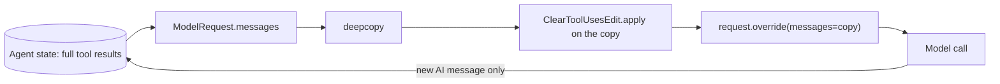

## 1. The question this idea answers

In a data agent, tool results are the largest messages. One SQL tool can return hundreds of rows. One Genie answer can hold a table and the SQL text. After ten tool calls, old results fill most of the input, and the model rarely needs them again.

You want the model to see less, but you do not want to lose the data. The user can still ask "what were the numbers for plant 1 again?", and the state should still hold them. `ContextEditingMiddleware` does exactly this: it replaces old tool results with a short placeholder in the **model input only**. This lesson shows how it decides what to clear. It proves with a test that the state does not change. It also shows the two prices of this design: work on every call, and a moving prompt cache prefix.

## 2. Mental model

> [!analogy] Covering old tables on a projected slide
> A presenter projects a page from a binder. Before each slide, the presenter makes a fresh photocopy of the page and covers the old tables on the copy with cards that say "[cleared]". The newest tables stay visible. The binder itself is never touched.
>
> The binder is the agent state. The photocopy is the model input of one call. The cards are the placeholder text.
>
> **Where it stops working:** the presenter makes a new photocopy and covers the tables again for every slide. So the work repeats on every model call. And when a new table arrives, one more old table gets a card. The slide now differs from the previous slide near the top, and the prompt cache matches only the part before that point.

## 3. Terms

| Term | Plain meaning |
|---|---|
| `ContextEditingMiddleware` | A built-in LangChain middleware that edits a copy of the messages before each model call. |
| `ContextEdit` | The protocol of one edit strategy: a method `apply(messages, count_tokens=...)` that changes a list in place. |
| `ClearToolUsesEdit` | The only built-in strategy. It replaces old tool results with a placeholder. |
| trigger | The token count above which the edit runs. Default 100,000. |
| keep | The number of newest tool results that are never cleared. Default 3. |
| `clear_at_least` | A minimum number of tokens to reclaim. The edit stops clearing once it reaches it. Default 0. |
| `exclude_tools` | Tool names whose results are never cleared. |
| `clear_tool_inputs` | When true, the arguments of the matching tool call are also replaced with `{}`. |
| placeholder | The text that replaces a cleared tool result. Default `"[cleared]"`. |
| `token_count_method` | `"approximate"` (character estimate) or `"model"` (the chat model's own counter). |
| `deepcopy` | A full copy of a Python object, so that changes to the copy never reach the original. |
| `request.override` | A method of `ModelRequest` that returns a new request with some fields replaced. The original stays unchanged. |
| prompt cache prefix | The start of the model input that matches an earlier request, so the provider can read it from its cache. |
| server-side context editing | Anthropic's API feature that clears old tool results on the server, before the prompt reaches Claude. |

## 4. Method and math

### 4.1 Constructor and parameters

From the installed source (`langchain/agents/middleware/context_editing.py`, langchain 1.4.5, checked on 2026-10-13):

| Class | Parameter | Default |
|---|---|---|
| `ContextEditingMiddleware` | `edits` | `[ClearToolUsesEdit()]` |
| | `token_count_method` | `"approximate"` |
| | `token_counter` | `None`. A custom counter. The docstring says: "Takes precedence over `token_count_method` when provided". |
| `ClearToolUsesEdit` | `trigger` | `100_000` tokens |
| | `clear_at_least` | `0` |
| | `keep` | `3` |
| | `clear_tool_inputs` | `False` |
| | `exclude_tools` | `()` |
| | `placeholder` | `"[cleared]"` |

The built-in middleware page of the docs lists the same defaults (checked on 2026-10-13). It does not list `token_counter`. The module docstring says it "Mirrors Anthropic's context editing capabilities", and the class docstring says it aligns "with Anthropic's `clear_tool_uses_20250919` behavior".

### 4.2 The code that makes it transient

The whole hook is short. This is the installed `wrap_model_call`, without the docstring:

```python
def wrap_model_call(self, request, handler):
    if not request.messages:
        return handler(request)

    count_tokens = self._resolve_token_counter(request)

    edited_messages = deepcopy(list(request.messages))
    for edit in self.edits:
        edit.apply(edited_messages, count_tokens=count_tokens)

    return handler(request.override(messages=edited_messages))
```

Three facts make this transient:

1. It is a wrap-style hook. It returns a model response, not a state update ([L2.1: The middleware hooks](/notes/ai/langchain-langgraph/02-middleware/l1-the-middleware-hooks)).
2. `deepcopy` copies every message, so `apply` changes only the copy.
3. `request.override` returns a new request. The docstring says it "follows an immutable pattern, leaving the original request unchanged".



### 4.3 The clearing algorithm

`ClearToolUsesEdit.apply` runs these steps on the copy (installed source):

1. Count the tokens of the messages. If `tokens <= self.trigger`, return with no change.
2. Collect every `ToolMessage` in order. Remove the last `keep` of them from the list of candidates.
3. For each candidate, from oldest to newest:
   - skip it if its `response_metadata` already says `cleared`,
   - find the nearest earlier `AIMessage`, and in it the tool call with the same id. Skip the candidate if there is none,
   - skip it if its tool name is in `exclude_tools`,
   - replace it with a copy whose `content` is the placeholder, whose `artifact` is `None`, and whose `response_metadata` holds `{"context_editing": {"cleared": True, "strategy": "clear_tool_uses"}}`,
   - if `clear_tool_inputs` is true, replace the AI message with a copy whose matching tool call has `args = {}`,
   - if `clear_at_least > 0`, count the tokens again, and stop once the reclaimed tokens reach `clear_at_least`.

The tool call and the tool message stay in place. Only the content changes. So the pairing rules of [LLM APIs L2](/notes/ai/llm-apis/01-messages-api/l2-tool-use-and-tool-result) still hold.

> [!trap] What the trigger counts
> With `token_count_method="approximate"`, the counter is `count_tokens_approximately(messages)` on `request.messages`. In `create_agent`, that list excludes the system prompt, and the tool definitions are not counted either. A system prompt of 20,000 tokens does not move the trigger. With `"model"`, the middleware calls `request.model.get_num_tokens_from_messages(system_msg + messages, request.tools)`, which includes both.

### 4.4 A run: the model input and the state

The test history has a user message, four tool rounds, an answer and a new question. Tool 2 is `shift_log`, the others are `run_sql`. Each tool result holds 400 characters of rows. The approximate token counts are:

| Message | Tokens |
|---|---|
| h0 user | 13 |
| a1, a3, a4 AI with a `run_sql` call | 34 each |
| a2 AI with a `shift_log` call | 25 |
| t1, t3, t4 `run_sql` results | 110 each |
| t2 `shift_log` result | 111 |
| a5 answer, h6 question | 11, 10 |

> [!example] Worked example: the total and the trigger
> 1. Sum: 13 + 34 + 110 + 25 + 111 + 34 + 110 + 34 + 110 + 11 + 10 = **602** tokens.
> 2. One `run_sql` result: 414 content characters + 2 (`"c1"`) + 4 (`"tool"`) + 7 (`"run_sql"`) = 427 characters. $\lceil 427 / 4 \rceil = 107$, plus 3 gives 110.
> 3. The edit runs only when the total is **strictly greater** than `trigger`. The test gave: `trigger=601` cleared 3 results, `trigger=602` cleared 0, `trigger=603` cleared 0.

With `ClearToolUsesEdit(trigger=300, keep=1, exclude_tools=("shift_log",))`, the model received this input (real output, shortened):

```text
 1 ai    id=a1 run_sql({'query': 'SELECT * FROM downtime WHERE plant = 1'} | ''
 2 tool  id=t1 | '[cleared]'
 3 ai    id=a2 shift_log({'plant': 2}) | ''
 4 tool  id=t2 | 'plant 2 rows: xxxxxxxxxxxxxxxxxxxxxxxxxx'
 5 ai    id=a3 run_sql({'query': 'SELECT * FROM downtime WHERE plant = 3'} | ''
 6 tool  id=t3 | '[cleared]'
 7 ai    id=a4 run_sql({'query': 'SELECT * FROM downtime WHERE plant = 4'} | ''
 8 tool  id=t4 | 'plant 4 rows: xxxxxxxxxxxxxxxxxxxxxxxxxx'
```

`t4` is kept by `keep=1`. `t2` is kept by `exclude_tools`. `t1` and `t3` are cleared. In the model input, `t1` carries `{'context_editing': {'cleared': True, 'strategy': 'clear_tool_uses'}}`.

The checkpointed state after the run still holds `t1` as `'plant 1 rows: xxxxxx...'`. The test compared every message of the state, except the new answer, with a deep copy of the input:

```text
state (without the new answer) equals the input: True
```

### 4.5 Proving transience in a test

The test pattern is simple and worth keeping in every middleware test suite:

```python
snapshot = copy.deepcopy(input_messages)
agent.invoke({"messages": input_messages}, cfg)
state = agent.get_state(cfg).values["messages"]
assert [m.model_dump() for m in state[:-1]] == [m.model_dump() for m in snapshot]
assert fake_model.calls[0][2].content == "[cleared]"   # the model saw the edit
```

The first assertion proves that the state is unchanged. The second proves that the model input was edited. You need both: a middleware that does nothing also passes the first test. This is the "fake model to prove what the model receives" pattern of [Fake model vs real model](/notes/ai/evaluation/01-test-design/l1-fake-model-vs-real-model).

### 4.6 clear_tool_inputs, placeholder and clear_at_least

With `clear_tool_inputs=True, placeholder="[result removed]"`, the model saw empty arguments, for example `run_sql({})`, for the cleared calls, and `'[result removed]'` for their results. The AI message `a1` in the input got `{'context_editing': {'cleared_tool_inputs': ['c1']}}`. The model then sees a call with no arguments. It knows that a tool ran, but not what it asked.

`clear_at_least` stops the clearing early. The test, with `trigger=300` and `keep=1`:

```text
clear_at_least=0: cleared ['t1', 't2', 't3'], input tokens now 298
clear_at_least=100: cleared ['t1'], input tokens now 501
clear_at_least=10000: cleared ['t1', 't2', 't3'], input tokens now 298
```

> [!example] Worked example: why 100 stops after one result
> 1. A cleared `run_sql` result: 9 placeholder characters + 2 + 4 + 7 = 22 characters, $\lceil 22/4 \rceil + 3 = 9$ tokens.
> 2. Clearing `t1` saves 110 − 9 = 101 tokens. 602 − 101 = 501.
> 3. 101 ≥ 100, so the loop stops after `t1`.
> 4. With 0, it clears all three candidates. `t2` saves 111 − 9 = 102 (its name has 9 characters, so 24 characters, also 9 tokens). `t3` saves 101. 602 − 101 − 102 − 101 = **298**.

> [!trap] clear_at_least does not mean "all or nothing" here
> Anthropic's API says about its `clear_at_least`: "If the API can't clear at least the specified amount, the strategy will not be applied." The LangChain edit does the opposite. With 10,000, it could reclaim only 304 tokens, and it still cleared all three results. Do not assume the two behave the same.

### 4.7 It runs again on every model call

The state keeps the full tool results, so every model call repeats the work: deep copy, count, clear. A sandbox measurement with 2,001 messages, 1,000 tool results of 2,000 characters each and about 533,000 approximate tokens:

| Step | Time in the sandbox |
|---|---|
| `deepcopy` of the messages | 45 ms |
| `apply` with `clear_at_least=0` (997 results cleared) | 29 ms |
| `apply` with `clear_at_least=50000` (101 results cleared) | 815 ms |

These numbers depend on the machine. The shape does not. With `clear_at_least > 0`, the edit counts all tokens again after each cleared result. So the cost grows with the number of results times the number of messages. In an agent loop with ten model calls in one turn, the cost is paid ten times.

### 4.8 The effect on the prompt cache prefix

A prompt cache matches the start of the input ([Prompt caching](/notes/ai/context-engineering/01-foundations/l7-prompt-caching)). An early message that changes between two calls ends the match at that message.

The test ran one turn with two model calls and `keep=2`. The first call ended with a new `run_sql` call, so the second call had one more tool result:

```text
cleared in call 1: ['t1', 't2']
cleared in call 2: ['t1', 't2', 't3']
first index where call 2 differs from call 1: 6 -> t3 '[cleared]'
```

On call 2, `t3` became `[cleared]`. So the shared prefix of the two calls ends at index 5. From index 6 on, nothing can be read from the cache, also the messages that did not change. Anthropic's context editing page says the same about its own feature: clearing "Invalidates cached prompt prefixes when content is cleared" (checked on 2026-10-13).

A second sandbox test applied the edit to a history that grew by one tool round at a time, with `trigger=400` and `keep=2`:

| Tool results | Cleared, `clear_at_least=0` | Input tokens | Cleared, `clear_at_least=300` | Input tokens |
|---|---|---|---|---|
| 4 | t1 to t2 | 334 | t1 to t2 | 334 |
| 5 | t1 to t3 | 367 | t1 to t3 | 367 |
| 6 | t1 to t4 | 400 | t1 to t4 | 400 |
| 7 | t1 to t5 | 433 | t1 to t4 | 531 |
| 8 | t1 to t6 | 466 | t1 to t4 | 662 |

With 0, each new result clears one more old result, so the prefix changes on every call. With 300, the edit stops once it reclaims 300 tokens. The cleared set stays t1 to t4 and the prefix is stable, but the input grows again.

> [!key] Transient edits are cheap to undo, but they repeat and they move the prefix
> `ContextEditingMiddleware` never loses data: the state keeps every tool result. The price is a repeated edit on every model call, and a cache miss from the first newly cleared result onward. The built-in options give either a moving prefix (`clear_at_least=0`) or a growing input (`clear_at_least > 0`). Clearing in large batches needs a custom `ContextEdit` (exercise 2.3).

### 4.9 Compared with Anthropic's server-side clear_tool_uses

| | LangChain `ClearToolUsesEdit` | Anthropic `clear_tool_uses_20250919` |
|---|---|---|
| Where it runs | In your process, in `wrap_model_call` | On Anthropic's servers, "before the prompt reaches Claude" |
| How to enable it | Add the middleware | Beta header `context-management-2025-06-27` and an edit in the request |
| Trigger | Approximate tokens of the messages, default 100,000 | Input tokens or tool uses, default 100,000 input tokens |
| keep | Newest tool results, default 3 | "how many recent tool use/result pairs to keep", default 3 |
| `clear_at_least` | Stops when reached, clears all candidates when not reachable | "If the API can't clear at least the specified amount, the strategy will not be applied" |
| Placeholder | `"[cleared]"`, configurable | "placeholder text", exact string not documented |
| Report | Metadata on the edited copy only | `context_management.applied_edits` in the response |
| Models | Any LangChain chat model, for example `ChatDatabricks` | Claude through the Anthropic Messages API |

Anthropic quotes are from the context editing page (checked on 2026-10-13). That page also says: "Your client application maintains the full, unmodified conversation history." Both designs are transient for your data. I could not confirm that an OpenAI-compatible endpoint, such as a Databricks serving endpoint, passes this beta field to Claude. Treat the server-side edit as unavailable there until a test proves it.

### 4.10 Production view

| Concern | What to do |
|---|---|
| Correctness | Test each middleware twice: the state is unchanged, and the model input is edited. |
| Cost | Set `trigger` well above a normal turn. Choose between a moving prefix and a growing input, or write a batching edit. |
| Latency | Avoid `clear_at_least > 0` on long histories. It counts again after each cleared result. |
| Quality | Use `exclude_tools` for small results that the model needs later, for example a schema lookup. |
| Observability | Log the number of cleared results per call. The edit is visible only in the model input. |
| Trigger accuracy | Use `token_count_method="model"` or a custom `token_counter` when the system prompt and tools are large. |

## 5. Code

These exercises go in `langchain-langgraph/07-context-editing.ipynb`. They need no API key. Use a fake chat model that records every input list.

**Exercise 2.1: the two-sided test.** Build the history of section 4.4. Run an agent with `ContextEditingMiddleware` and a checkpointer.

Acceptance tests:

- The state after the run, without the new answer, equals the input.
- The model input has `[cleared]` for `t1` and `t3`, and the full text for `t2` and `t4`.
- The test fails when you remove the middleware.

**Exercise 2.2: find the trigger edge.** Compute the approximate token total of your history with `count_tokens_approximately`.

Acceptance tests:

- With `trigger` equal to the total, nothing is cleared.
- With `trigger` one below the total, the edit clears.
- Your notebook explains the result with the rule of section 4.3.

**Exercise 2.3: a batching edit.** Write a class `BatchClearEdit` with `trigger`, `keep` and `batch`. It follows the `ContextEdit` protocol: `apply(messages, *, count_tokens)` changes the list in place. It clears old tool results only in multiples of `batch`. Also write `shared_prefix(call_a, call_b)`, which counts the leading messages that are equal in two recorded model inputs.

Acceptance tests:

- The number of cleared results is always a multiple of `batch`.
- On a history that grows by one tool round at a time, `shared_prefix` of two neighboring calls drops only once every `batch` rounds.
- The state after a run is unchanged, as in exercise 2.1.

## 6. Common mistakes

1. **"It deletes old tool results."** It changes a copy for one call. The state keeps every result.
2. **"The trigger counts the whole prompt."** In approximate mode it counts only the messages, not the system prompt or the tools.
3. **Equal means trigger.** The edit runs only when the count is strictly greater than `trigger`.
4. **Treating clear_at_least like Anthropic's.** LangChain clears all candidates when the minimum is not reachable.
5. **Ignoring the cache.** Each change in the cleared set moves the start of the cache miss.
6. **Testing only the state.** A middleware that does nothing also leaves the state unchanged. Test the model input too.

## 7. One-minute explanation

`ContextEditingMiddleware` runs in `wrap_model_call`. Before each model call, it deep-copies the messages, applies its edits to the copy, and calls the model with `request.override(messages=copy)`. The state is never changed, so the edit is transient and runs again on every call. The built-in edit, `ClearToolUsesEdit`, acts when the estimated token count of the messages is strictly greater than `trigger`, 100,000 by default. It replaces every tool result with the text `[cleared]`, except the newest `keep` results and the tools in `exclude_tools`. It can also empty the tool call arguments. Pairs stay valid, because only the content changes. The price is repeated work per call and a prompt cache miss from the first newly cleared result. Anthropic's server-side `clear_tool_uses` edit does the same job on the server, with slightly different rules for `clear_at_least`.

## 8. Check questions

```check
{
  "question": "A teammate says: \"ContextEditingMiddleware saves storage because old SQL results are cleared.\" Is that right? Use the code to explain.",
  "answer": "No. wrap_model_call deep-copies request.messages, applies the edit to the copy, and calls handler(request.override(messages=copy)). The state and the checkpoints keep the full results. It saves input tokens on each model call, not storage."
}
```

```check
{
  "question": "The messages total 602 approximate tokens and trigger is 602. Is anything cleared? And if the system prompt has 50,000 tokens?",
  "answer": "Nothing is cleared, because the rule is tokens <= trigger means no edit. In approximate mode the system prompt is not in request.messages, so 50,000 system tokens do not change the count. With token_count_method model, the system message and the tools are counted, and the edit would run."
}
```

```check
{
  "question": "keep = 2. A turn has two model calls, and between them one new tool result arrives. Why does the second call get a prompt cache miss earlier than the end of the first call's input?",
  "answer": "On the second call there are more tool results, so one more old result falls outside the newest 2 and becomes [cleared]. That message is in the middle of the input. The cache matches only the prefix before it. So the second call pays new input from that message onward, also for messages that did not change."
}
```

```check
{
  "question": "You need clearing of old tool results with an agent that calls Claude through ChatDatabricks. Which option do you use, and why?",
  "answer": "ContextEditingMiddleware, because it runs in the client and works with any LangChain chat model. Anthropic's server-side clear_tool_uses edit needs the Anthropic Messages API with the context-management beta header. It is not confirmed that an OpenAI-compatible Databricks endpoint passes that field."
}
```

## 9. Links

- Previous: [L1: SummarizationMiddleware](/notes/ai/langchain-langgraph/03-context-management/l1-summarization-middleware)
- Next: [L3: trim_messages and RemoveMessage](/notes/ai/langchain-langgraph/03-context-management/l3-trim-and-remove-messages)
- Transient and persistent changes: [Transient vs persistent context](/notes/ai/conversation-state/01-where-state-lives/l2-transient-vs-persistent-context)
- Caching in agent loops: [Prompt caching in agent loops](/notes/ai/llm-apis/04-providers-and-caching/l2-prompt-caching-in-agent-loops)
- [Glossary](/notes/ai/langchain-langgraph/glossary)
