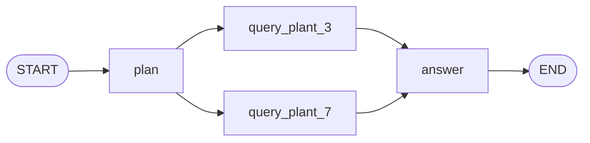

## 1. The question this idea answers

`create_agent` returns a compiled LangGraph graph ([L1.2: create_agent](/notes/ai/langchain-langgraph/01-foundations/l2-create-agent)). Middleware hooks return dictionaries like `{"messages": [...]}`. A summary hook returns `RemoveMessage(REMOVE_ALL_MESSAGES)` and the state shrinks. A model node returns one `AIMessage` and the state grows by one. Why does one dictionary append and another one replace everything?

The answer is the state model of LangGraph: a typed state, nodes that return **partial updates**, and a **reducer** per key that merges each update. Checkpoints, streaming and every context-management hook build on this model. This lesson builds it from first principles with a small graph that you can run, using langgraph 1.2.14 (checked on 2026-10-13).

## 2. Mental model

> [!analogy] A shared whiteboard with a rule for each column
> A team works on one whiteboard. Each column has a rule written at the top. "Replace" means wipe and write. "Append" means add to the end. "Merge by id" means replace the line with the same id, add new lines, and delete lines on request.
>
> In each round, some team members work at the same time. They do not write on the board directly. They hand in slips: "status: planned", "rows: plant 3: 95 min". At the end of the round, a clerk applies every slip by the rule of its column. Then the next round starts.
>
> The board is the state. A team member is a node. A slip is a partial update. The column rule is the reducer. A round is a super-step.
>
> **Where it stops working:** a human clerk who gets two slips for a "replace" column in one round would pick one. LangGraph raises an error. And a slip for a column that does not exist is not returned to its writer: it is silently discarded.

## 3. Terms

| Term | Plain meaning |
|---|---|
| `StateGraph` | The LangGraph class that builds a graph whose nodes share one typed state. |
| state schema | The type of the state, usually a `TypedDict`. Each key is one field. |
| channel | LangGraph's internal storage for one state key, with its reducer. |
| node | A function that reads the state and returns a partial update. |
| partial update | A dictionary with only the keys that a node wants to change. |
| reducer | A function `(old_value, update) -> new_value` that merges an update into one key. |
| default reducer | The behavior with no reducer: the update replaces the old value. |
| `Annotated` | The Python typing form that attaches a reducer to a key: `Annotated[list, add_messages]`. |
| `operator.add` | A reducer that concatenates lists: `old + update`. |
| `add_messages` | The reducer for message lists: append new ids, replace same ids, delete by `RemoveMessage`. |
| super-step | One round of execution: all nodes that are active run, then all their updates are applied. |
| `InvalidUpdateError` | The error when a key with no reducer receives more than one value in one super-step. |
| `Overwrite` | A wrapper that writes a value directly and bypasses the reducer. |
| recursion limit | The maximum number of super-steps in one run. |

## 4. Method and math

### 4.1 The state schema

The LangGraph Graph API page defines `State` as "A shared data structure that represents the current snapshot of your application" (checked on 2026-10-13). In Python, you write it as a `TypedDict`. A reducer is attached with `Annotated`:

```python
import operator
from typing import Annotated
from typing_extensions import TypedDict
from langgraph.graph.message import add_messages

class State(TypedDict):
    messages: Annotated[list, add_messages]   # reducer: add_messages
    rows: Annotated[list[str], operator.add]  # reducer: list concatenation
    status: str                               # no reducer: last write wins
```

`create_agent` uses the same pattern. Its `AgentState` in langchain 1.4.5 has `messages: Required[Annotated[list[AnyMessage], add_messages]]`, plus two private or optional keys, `jump_to` and `structured_response`.

### 4.2 Nodes return partial updates

The docs say that a node "does not need to return the whole `State` schema - just an update" (checked on 2026-10-13). The test graph has four nodes:

```python
def plan(state):           return {"status": "planned",
                                   "messages": [AIMessage("I will query plants 3 and 7.", id="ai-plan")]}
def query_plant_3(state):  return {"rows": ["plant 3: 95 min"]}
def query_plant_7(state):  return {"rows": ["plant 7: 40 min"]}
def answer(state):         return {"status": "answered",
                                   "messages": [AIMessage(f"Downtime: {'; '.join(state['rows'])}.", id="ai-answer")]}

b = StateGraph(State)
for name, fn in [("plan", plan), ("query_plant_3", query_plant_3),
                 ("query_plant_7", query_plant_7), ("answer", answer)]:
    b.add_node(name, fn)
b.add_edge(START, "plan")
b.add_edge("plan", "query_plant_3")
b.add_edge("plan", "query_plant_7")
b.add_edge(["query_plant_3", "query_plant_7"], "answer")   # wait for both
b.add_edge("answer", END)
graph = b.compile()
```



No node returns the whole state. `query_plant_3` returns one key. The reducers decide what each update does.

### 4.3 Reducers decide: replace, append or merge

The docs say: "Reducers are key to understanding how updates from nodes are applied to the `State`." They add: "The default reducer ignores the left argument and replaces the state value with the right argument." (checked on 2026-10-13)

| Key definition | Reducer | Update `X` on old value `V` gives |
|---|---|---|
| `status: str` | none (default) | `X`. The old value is gone. |
| `rows: Annotated[list[str], operator.add]` | `operator.add` | `V + X`. Always appends. |
| `messages: Annotated[list, add_messages]` | `add_messages` | New ids append, the same id replaces, `RemoveMessage` deletes, `REMOVE_ALL_MESSAGES` resets ([L3.3](/notes/ai/langchain-langgraph/03-context-management/l3-trim-and-remove-messages)). |
| any key, update `Overwrite(value=X)` | bypassed | `X`, also for a key with a reducer. |

A test with `rows` = `["old 1", "old 2"]` and a node that returned `{"rows": Overwrite(value=["reset"])}` gave `rows=['reset']`. Without `Overwrite`, `operator.add` would give three items.

A second test showed `add_messages` with the same id: a node `plan` added `AIMessage("I will query plants 3 and 7.", id="ai-plan")`, and the next node returned `AIMessage("I will query plants 3, 7 and 9.", id="ai-plan")`. The final messages were:

```text
[('h1', 'Downtime at plants 3 and 7?'), ('ai-plan', 'I will query plants 3, 7 and 9.')]
```

The second message replaced the first in place. It did not append.

### 4.4 Super-steps

The docs describe execution as message passing (checked on 2026-10-13):

- "A super-step can be considered a single iteration over the graph nodes."
- "At the start of graph execution, all nodes begin in an `inactive` state."
- A node becomes active when it receives a new message on an incoming edge.
- "The graph execution terminates when all nodes are `inactive` and no messages are in transit."

In each super-step, every active node runs on the **same** state snapshot. Their updates are applied together at the end of the step. Then the next step starts.

The test streamed the graph twice. `stream_mode="updates"` gives one event per node update:

```text
plan: {'status': 'planned', 'messages': ['ai:ai-plan']}
query_plant_3: {'rows': ['plant 3: 95 min']}
query_plant_7: {'rows': ['plant 7: 40 min']}
answer: {'status': 'answered', 'messages': ['ai:ai-answer']}
```

`stream_mode="values"` gives the full state once at the start and once after each super-step:

```text
emission 0: status='new' rows=[] messages=['human:h1']
emission 1: status='planned' rows=[] messages=['human:h1', 'ai:ai-plan']
emission 2: status='planned' rows=['plant 3: 95 min', 'plant 7: 40 min'] messages=['human:h1', 'ai:ai-plan']
emission 3: status='answered' rows=['plant 3: 95 min', 'plant 7: 40 min'] messages=['human:h1', 'ai:ai-plan', 'ai:ai-answer']
```

> [!example] Worked example: counting super-steps
> 1. Emission 0 is the input state. It is not a super-step of a node.
> 2. Step with `plan`: emission 1. `status` is replaced, one message is appended.
> 3. Step with `query_plant_3` and `query_plant_7` together: emission 2. Both `rows` updates are applied by `operator.add`: `[] + ["plant 3: 95 min"] + ["plant 7: 40 min"]`, 2 items.
> 4. Step with `answer`: emission 3. `answer` reads `rows` with 2 items, because the previous step applied both updates before this step started.
> 5. Four nodes ran, but there were **three** super-steps, so `values` emitted 1 + 3 = 4 times.

`answer` waited for both query nodes because of `add_edge(["query_plant_3", "query_plant_7"], "answer")`. The list form makes a node wait until every listed node has finished.

### 4.5 Two writes to a key with no reducer

Two nodes that start in the same super-step both returned a value for `status`, which has no reducer. Real error:

```text
InvalidUpdateError: At key 'status': Can receive only one value per step. Use an Annotated key to handle multiple values.
```

LangGraph does not pick a winner. Parallel nodes may write the same key only when the key has a reducer that can combine values, such as `operator.add` or `add_messages`.

### 4.6 A key that is not in the schema

A node returned `{"plant": 3}`. The schema has no `plant` key. The run finished with no error, and the final state had no `plant` key:

```text
status='new' rows=[] messages=['human:h1']
```

> [!trap] Misspelled keys disappear quietly
> A node that returns `{"mesages": [...]}` produces no error and no change. Write tests that read the state after each node, or use a typed return value, so that a typo fails loudly.

### 4.7 The recursion limit

The docs say: "Starting in version 1.0.6, the default recursion limit is set to 1000 steps." The limit "sets the maximum number of super-steps the graph can execute during a single execution" (checked on 2026-10-13). The installed source of langgraph 1.2.14 says something else:

```python
DEFAULT_RECURSION_LIMIT = int(getenv("LANGGRAPH_DEFAULT_RECURSION_LIMIT", "10007"))
```

A test graph with one node that loops to itself forever stopped with:

```text
GraphRecursionError after n = 10007 | Recursion limit of 10007 reached without hitting a stop condition. You can increase the limit by setting the `recursion_limit` config key.
```

The code follows the source: 10,007 in this version, unless the environment variable sets another value. `create_agent` sets its own value: its factory returns `graph.compile(...).with_config(config)`, where `config` holds `"recursion_limit": 9_999`. Pass `{"recursion_limit": n}` in the run config to set a limit that you control. With `recursion_limit=25`, the same loop stopped with "Recursion limit of 25 reached".

> [!key] The reducer, not the node, decides what an update means
> A node only says "here is a value for key K". The reducer of K decides whether that value replaces, appends, replaces by id, or deletes. The same dictionary `{"messages": [m]}` appends a new message, replaces an old message with the same id, or wipes the list when it starts with `RemoveMessage(REMOVE_ALL_MESSAGES)`. To predict the state after a hook, read the reducer.

### 4.8 Production view

| Concern | What to do |
|---|---|
| Correctness | Give every key that parallel nodes write a reducer. Otherwise the run fails with `InvalidUpdateError`. |
| Typos | Test the state after each node. Unknown keys are discarded with no error. |
| Growth | `operator.add` appends on every run of the same thread. Reset per-turn keys with `Overwrite` or a replace key ([L4.2](/notes/ai/langchain-langgraph/04-persistence/l2-checkpointers-and-threads)). |
| Loops | Set `recursion_limit` in the run config. Do not depend on the default, because the docs and the code disagree. |
| Message ids | Give messages stable ids when a later node must replace them. |
| Debugging | Stream `updates` to see each node's update, and `values` to see the state after each super-step. |

## 5. Code

These exercises go in `langchain-langgraph/09-state-and-reducers.ipynb`. They need no API key and no model.

**Exercise 1.1: rebuild the graph.** Write the state and the four nodes of section 4.2 from memory, then run it with `stream_mode="values"`.

Acceptance tests:

- `values` emits four states, and the third has two rows.
- `answer` produces "Downtime: plant 3: 95 min; plant 7: 40 min."
- `stream_mode="updates"` shows exactly four node updates.

**Exercise 1.2: break it on purpose.** Change `rows` to `rows: list[str]` (no reducer).

Acceptance tests:

- The run raises `InvalidUpdateError` that names the key `rows`.
- Your notebook explains why the error happens in step 2 and not in step 1.

**Exercise 1.3: your own reducer.** Write a reducer `keep_max(old, new)` for a key `worst_minutes: Annotated[int, keep_max]`. Each query node writes its minutes.

Acceptance tests:

- After the run, `worst_minutes` is 95.
- A node that writes 30 later does not lower it.
- Run it once with no initial value for `worst_minutes` and explain the result.

## 6. Common mistakes

1. **"A node returns the new state."** A node returns a partial update. The reducers build the new state.
2. **"Two parallel writes: the last one wins."** For a key with no reducer, LangGraph raises `InvalidUpdateError`.
3. **"Returning a message always appends it."** With `add_messages`, the same id replaces the old message.
4. **Counting nodes as steps.** Parallel nodes share one super-step.
5. **Trusting the documented recursion limit.** langgraph 1.2.14 uses 10,007, and `create_agent` uses 9,999. Set it yourself.
6. **Misspelled keys.** They are discarded with no error.

## 7. One-minute explanation

A LangGraph `StateGraph` has one typed state, usually a `TypedDict`. Nodes read the state and return partial updates: dictionaries with only the keys that they change. Each key has a reducer that merges updates. With no reducer, the update replaces the value, and two updates to that key in one super-step raise `InvalidUpdateError`. With `operator.add`, lists are concatenated. With `add_messages`, new ids append, the same id replaces, and `RemoveMessage` deletes. Execution runs in super-steps: all active nodes run on the same snapshot, then all their updates are applied together, so parallel nodes share one step. `Overwrite` bypasses a reducer, and unknown keys are discarded silently. The reducer sets the meaning of an update, which is why the same `{"messages": [...]}` can append, replace or wipe the history.

## 8. Check questions

```check
{
  "question": "A state has status: str with no reducer. Nodes A and B both run in the same super-step and both return a status. What happens, and what are two fixes?",
  "answer": "The run raises InvalidUpdateError: At key 'status': Can receive only one value per step. Fix 1: give status a reducer with Annotated, for example one that keeps a list or a priority. Fix 2: change the graph so that only one of the nodes writes status, or so that they run in different super-steps."
}
```

```check
{
  "question": "A graph runs START -> plan -> (query_plant_3, query_plant_7) -> answer -> END. How many times does stream_mode=\"values\" emit, and why not five?",
  "answer": "Four times: once for the input state and once after each of the three super-steps. The two query nodes run in the same super-step, so they produce one emission together, not two."
}
```

```check
{
  "question": "A node returns {\"messages\": [AIMessage(\"v2\", id=\"x\")]} and the state already holds a message with id x. What is the state after the step? What if the key had operator.add as its reducer?",
  "answer": "With add_messages, the new message replaces the old one with id x in the same position, and the length stays the same. With operator.add, the list would get a second message with id x appended at the end, because operator.add only concatenates and does not read ids."
}
```

## 9. Links

- Previous part: [L3.3: trim_messages and RemoveMessage](/notes/ai/langchain-langgraph/03-context-management/l3-trim-and-remove-messages)
- Next: [L2: Checkpointers and threads](/notes/ai/langchain-langgraph/04-persistence/l2-checkpointers-and-threads)
- What create_agent builds: [L1.2: create_agent](/notes/ai/langchain-langgraph/01-foundations/l2-create-agent)
- Why node-style hooks are persistent: [Transient vs persistent context](/notes/ai/conversation-state/01-where-state-lives/l2-transient-vs-persistent-context)
- [Glossary](/notes/ai/langchain-langgraph/glossary)
