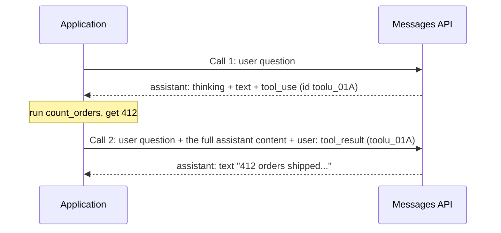

## 1. The question this idea answers

Every agent framework sends HTTP requests to a model and reads the responses. The Claude Agent SDK does it. LangChain does it. When a framework fails, the raw request is the only record that tells the truth.

So what is inside one request and one response? And why can one reply from the model hold text, a tool call and a thinking block at the same time?

The answer is the **content block**. A message is not a string. A message is a role plus an ordered list of typed blocks. This lesson shows the exact shape. Every later lesson about tools, streaming, sessions and chat storage depends on it.

## 2. Mental model

> [!analogy] An envelope with typed cards inside
> A message is an envelope. The label on the envelope says who sent it: `user` or `assistant`. Inside the envelope there is a stack of cards in a fixed order. Each card has a type printed on it: a text card, an image card, a "please run this tool" card, a "here is the tool result" card, a thinking card.
>
> The receiver reads the cards in order. The card type tells the receiver how to read the card.
>
> **Where it stops working:** real envelopes have no rules about their cards. Messages have strict rules. Some card types can appear only in one kind of envelope. A tool result card must answer a tool card from the envelope just before it, and it must come first in its stack ([L2](/notes/ai/llm-apis/01-messages-api/l2-tool-use-and-tool-result)). Two envelopes with the same label in a row are merged into one.

## 3. Terms

| Term | Plain meaning |
|---|---|
| Messages API | Anthropic's HTTP endpoint for model calls: `POST /v1/messages`. |
| request body | The JSON object that the application sends in one call. |
| message | One entry in the `messages` list: a `role` and a `content`. |
| role | The sender of a message. In `messages` it is `user` or `assistant`. Some newer models also accept `system` (section 4.4). |
| content block | One typed item inside the `content` of a message, for example a `text` block or a `tool_use` block. |
| block type | The value of the `type` field of a block. It decides which other fields the block has. |
| turn | One message, or several neighboring messages with the same role, that the model treats as one unit. |
| system prompt | Instructions from the developer that apply to the whole conversation. On this API it is the top-level `system` field. |
| stateless | The server keeps no memory between calls. Each request carries the full conversation. |
| prefill | A last message with the role `assistant`. The model continues that text. The newest models reject it. |
| stop reason | The `stop_reason` field of a response. It says why the model stopped. |
| usage | The `usage` field of a response. It holds the billed token counts. |

## 4. Method and math

### 4.1 The smallest request

A request needs three fields: `model`, `max_tokens` and `messages`.

```json
{
  "model": "claude-sonnet-5-5",
  "max_tokens": 1024,
  "messages": [
    { "role": "user", "content": "What is a content block?" }
  ]
}
```

| Field | Job |
|---|---|
| `model` | The model ID. On some providers, for example Microsoft Foundry, it is the name of a deployment (planned lesson [4.1](/notes/ai/llm-apis/04-providers-and-caching)). |
| `max_tokens` | The largest number of output tokens for this call. The API reference says: "Set to `0` to populate the prompt cache without generating a response." |
| `messages` | The conversation, oldest first. The API reference sets a limit of 100,000 messages in one request. |

The string `"What is a content block?"` is a shortcut. The API reference says: "Using a `string` for `content` is shorthand for an array of one content block of type \"text\"." So these two messages are the same:

```json
{ "role": "user", "content": "What is a content block?" }
```

```json
{ "role": "user", "content": [ { "type": "text", "text": "What is a content block?" } ] }
```

> [!key] The long form is the real form
> The API returns the long form. A response from the model always has `content` as a list of blocks, never as a string. Code that reads responses must always expect a list.

### 4.2 The system prompt is a top-level field

The system prompt is not a message. It is the field `system`, next to `messages`. It can be a string or a list of text blocks. The list form lets you put a cache marker on part of the prompt ([prompt caching](/notes/ai/context-engineering/01-foundations/l7-prompt-caching)).

```json
{
  "model": "claude-sonnet-5-5",
  "max_tokens": 1024,
  "system": "You answer questions about production data. Use the tools. Never guess a number.",
  "messages": [
    { "role": "user", "content": "How many orders shipped yesterday?" }
  ]
}
```

### 4.3 The block types

Each block has a `type`. The type decides the other fields. Some blocks are written by the model. Others are written by the application. This table shows the main types (checked on 2026-10-12).

| Block type | Written by | Appears in | Main fields | Job |
|---|---|---|---|---|
| `text` | both | `user` and `assistant` | `text` | Plain text. |
| `image` | application | `user` | `source` | A picture, as base64 data, a URL or a file ID. |
| `document` | application | `user` | `source` | A PDF or a text document. |
| `tool_use` | model | `assistant` | `id`, `name`, `input` | The model asks the application to run a tool. |
| `tool_result` | application | `user` | `tool_use_id`, `content`, `is_error` | The application returns the output of a tool. |
| `thinking` | model | `assistant` | `thinking`, `signature` | The reasoning of the model before its answer ([planned lesson 2.2](/notes/ai/llm-apis/02-streaming-and-thinking)). |
| `redacted_thinking` | model | `assistant` | `data` | Reasoning that the safety system encrypted. Send it again unchanged. |
| `server_tool_use` and the matching result blocks | the API | `assistant` | varies | Tools that run on Anthropic's servers, for example web search. |

> [!note] Who writes a block decides who must keep it
> The application writes `tool_result`, `image` and `document` blocks. So the application has its own copy of them. The model writes `text`, `tool_use` and `thinking` blocks. The only copy of these is in the response. If the application does not store them exactly, they are lost.

### 4.4 The role rules

**Rule 1. Two roles in `messages`.** The classic rule is that `messages` has only `user` and `assistant` messages. The system prompt goes in the top-level `system` field.

**Rule 2. Same-role neighbors merge.** The API reference says: "Consecutive `user` or `assistant` turns in your request will be combined into a single turn." So two user messages in a row become one turn with the blocks of both, in order. This is not an error.

**Rule 3. The conversation should end with a user message.** If the last message has the role `assistant`, the model continues its text. This is called prefill. The errors page says: "Claude 4.6 and later models and Claude Mythos Preview do not support prefilling assistant messages." Those models return HTTP 400 with this message:

```text
This model does not support assistant message prefill. The conversation must end with a user message.
```

**Rule 4. A newer exception: system messages inside `messages`.** Some of the newest models accept a message with `"role": "system"` in the middle of the conversation (checked on 2026-10-12). The supported list is Fable 5.1, Mythos 5.1, Fable 5, Mythos 5, Opus 5.5, Opus 5, Opus 4.8, Sonnet 5.5 and Haiku 5.5. The docs say: "Not available on Claude Sonnet 5." The docs list the Claude API, Amazon Bedrock and Google Cloud as platforms. Microsoft Foundry is not in that list. The position rules are strict:

1. It cannot be the first entry in `messages`.
2. It must come right after a user turn, or after an assistant turn that ends with a server tool result.
3. It must be the last entry, or an assistant turn must follow it.
4. Any other position returns a 400 error. This includes a position between a `tool_use` block and the `tool_result` that answers it.

> [!trap] Old docs and new docs disagree about roles
> The API reference still says that "there is no \"system\" role for input messages". The newer page about mid-conversation system messages says that some models accept it. Both are true for different models. For a model that is not on the list, use only `user` and `assistant`, and put instructions in `system`.

### 4.5 The response

This is a response from the Messages API, from the official docs (checked on 2026-10-12):

```json
{
  "id": "msg_01XFDUDYJgAACzvnptvVoYEL",
  "type": "message",
  "role": "assistant",
  "content": [ { "type": "text", "text": "Hello!" } ],
  "model": "claude-opus-5-5",
  "stop_reason": "end_turn",
  "stop_sequence": null,
  "usage": { "input_tokens": 12, "output_tokens": 6 }
}
```

| Field | Meaning |
|---|---|
| `id` | The ID of this response. The SDK docstring says: "The format and length of IDs may change over time." Do not parse it. |
| `type` | Always `"message"`. |
| `role` | Always `"assistant"`. |
| `content` | A list of blocks. It can hold `thinking`, `text` and `tool_use` blocks, in the order that the model wrote them. |
| `model` | The model that answered. |
| `stop_reason` | Why the model stopped. The seven values are in [context engineering L3](/notes/ai/context-engineering/01-foundations/l3-the-chat-api-call). `tool_use` means: run the tools and call again. |
| `usage` | Token counts for billing. |

The total input of a call has three parts. The SDK docstring says: "Total input tokens in a request is the summation of `input_tokens`, `cache_creation_input_tokens`, and `cache_read_input_tokens`."

$$
\text{total input} = \texttt{input\_tokens} + \texttt{cache\_creation\_input\_tokens} + \texttt{cache\_read\_input\_tokens}
$$

> [!example] Worked example: total input
> A response reports `input_tokens = 1,200`, `cache_creation_input_tokens = 0` and `cache_read_input_tokens = 38,400`.
>
> Total input = 1,200 + 0 + 38,400 = 39,600 tokens.
>
> The share that came from the cache is 38,400 / 39,600 = 0.97, so 97%. A dashboard that shows only `input_tokens` shows 1,200 and hides 97% of the input.

### 4.6 A full round trip with three block types

This is the most important example in the lesson. One response can hold several block types. The application must put the **whole** `content` list back into the next request, unchanged, as an `assistant` message.

**Call 1, request.**

```json
{
  "model": "claude-sonnet-5-5",
  "max_tokens": 2048,
  "system": "Use the tools. Never guess a number.",
  "tools": [ { "name": "count_orders", "description": "Count shipped orders for one date.", "input_schema": { "type": "object", "properties": { "date": { "type": "string" } }, "required": ["date"] } } ],
  "messages": [
    { "role": "user", "content": "How many orders shipped on 2026-10-11?" }
  ]
}
```

**Call 1, response content** (other fields omitted). The thinking text and the signature are shortened.

```json
[
  { "type": "thinking", "thinking": "The user wants a count for one date...", "signature": "EqQBCgIYAhIM..." },
  { "type": "text", "text": "I will count the orders." },
  { "type": "tool_use", "id": "toolu_01A", "name": "count_orders", "input": { "date": "2026-10-11" } }
]
```

The `stop_reason` is `tool_use`. The application runs `count_orders`. The result is `412`.

**Call 2, request `messages`.**

```json
[
  { "role": "user", "content": "How many orders shipped on 2026-10-11?" },
  { "role": "assistant", "content": [
      { "type": "thinking", "thinking": "The user wants a count for one date...", "signature": "EqQBCgIYAhIM..." },
      { "type": "text", "text": "I will count the orders." },
      { "type": "tool_use", "id": "toolu_01A", "name": "count_orders", "input": { "date": "2026-10-11" } }
  ] },
  { "role": "user", "content": [
      { "type": "tool_result", "tool_use_id": "toolu_01A", "content": "412" }
  ] }
]
```

**Call 2, response content.**

```json
[ { "type": "text", "text": "412 orders shipped on 2026-10-11." } ]
```



Three facts come from this example:

1. **The assistant message in call 2 is a copy.** The application does not rewrite it. It copies the `content` list of the call 1 response.
2. **The thinking block returns with its signature.** During a tool-use turn this is required. A changed thinking block returns a 400 error ([planned lesson 2.2](/notes/ai/llm-apis/02-streaming-and-thinking)).
3. **The tool result is a block in a `user` message.** It names the call by its `id`. [L2](/notes/ai/llm-apis/01-messages-api/l2-tool-use-and-tool-result) covers all the rules.

### 4.7 What this means for a chat store

A chat store that keeps only the final text of each answer loses three things:

| Lost item | Effect |
|---|---|
| `tool_use` blocks and their results | The model cannot see which tools it called and what they returned. It can call the same tool again, or give an answer that does not match the earlier data. |
| `thinking` blocks and signatures | The application cannot rebuild the exact input of a tool-use turn. On some models the earlier reasoning is also lost for later turns. |
| The order of blocks | Text before and after a tool call loses its meaning. |

So a store needs a **list of typed parts** for each message, not one text column. The subject [Conversation State](/notes/ai/conversation-state/02-chat-history-model/l1-chats-messages-and-parts) designs that table.

### 4.8 Production view

| Concern | What to do |
|---|---|
| Reliability | Read `content` as a list every time. Handle unknown block types without a crash. New types appear often. |
| Correctness | Copy assistant content back unchanged. Never rebuild it from the displayed text. |
| Cost | Read all three input fields of `usage`. The cache field is often most of the input. |
| Portability | Store a neutral list of parts. Convert to each API format at the last step ([planned lesson 3.2](/notes/ai/llm-apis/03-openai-format)). |
| Debugging | Log the full request body and the full response body for each call, with the response `id`. |

## 5. Code

These exercises go in the lab folder, in `llm-apis/01-messages.ipynb`. They need no API key. They use plain Python dictionaries.

**Exercise 1.1: normalize content.** Write `as_blocks(content)`. It returns a list of blocks for a string or for a list.

Acceptance tests:

- `as_blocks("hi")` returns `[{"type": "text", "text": "hi"}]`.
- A list returns unchanged, as the same list object or an equal copy.

**Exercise 1.2: merge same-role neighbors.** Write `merge_turns(messages)`. It returns the list of turns that the API sees: neighboring messages with the same role become one message with all their blocks, in order.

Acceptance tests:

- `[user "a", user "b", assistant "c"]` becomes `[user ["a", "b"], assistant ["c"]]`.
- The input list does not change.

**Exercise 1.3: the round trip.** Write `append_response(messages, response)`. It adds the response as an `assistant` message to a copy of `messages`.

Acceptance tests:

- With the call 1 response of section 4.6, the new last message has three blocks in the same order.
- The thinking block keeps its `signature` exactly.
- The function never converts `content` to a string.

**Exercise 1.4: usage report.** Write `total_input(usage)` and `cache_share(usage)`.

Acceptance test: with the numbers of the worked example in section 4.5, the results are 39,600 and 0.97 (rounded to two places).

## 6. Common mistakes

1. **Code that expects `content` to be a string.** Responses always have a list. Requests can have either form.
2. **A `system` message inside `messages` on a model that does not support it.** Use the top-level `system` field. Check the supported list for mid-conversation system messages before you use one.
3. **Rebuilding the assistant message from the text that the user saw.** This drops `tool_use` and `thinking` blocks. Copy the full `content` list.
4. **A conversation that ends with an `assistant` message on a new model.** Claude 4.6 and later return 400. End with a user message.
5. **Reading only `input_tokens`.** Cache reads and cache writes are separate fields. Add all three.

## 7. One-minute explanation

A model call on the Messages API sends a model ID, a token limit, an optional system prompt and a list of messages. Each message has a role, `user` or `assistant`, and a content. The content is a list of typed blocks. A string is only a shortcut for one text block. The model can answer with several blocks at once: thinking, text and a request to run a tool. The application must send that whole list back, unchanged, as the next assistant message. The application answers a tool request with a tool result block inside a user message. The API is stateless, so every call carries the full conversation. A chat store must keep the blocks, not only the final text, or it cannot rebuild what the model saw.

## 8. Check questions

```check
{
  "question": "A request has these messages in order: user, user, assistant, user. How many turns does the model see, and what is in the first one?",
  "hint": "What does the API do with neighboring messages that have the same role?",
  "answer": "Three turns. The API combines the two neighboring user messages into one user turn that holds the blocks of both, in order. Then comes the assistant turn, then the last user turn."
}
```

```check
{
  "question": "A response has stop_reason = \"tool_use\" and content = [text, tool_use]. The application stores only the text, runs the tool and sends the next request with the stored text as the assistant message and a tool_result block. What goes wrong?",
  "hint": "What must the tool_result point to?",
  "answer": "The tool_result block names a tool_use_id, but the assistant message in the request has no tool_use block with that id. The request breaks the pairing rule and the API rejects it. The fix is to copy the full content list of the response, with the tool_use block, into the assistant message."
}
```

```check
{
  "question": "usage = {input_tokens: 800, cache_creation_input_tokens: 4,000, cache_read_input_tokens: 0}. What is the total input, and what does this call tell you about the cache?",
  "answer": "800 + 4,000 + 0 = 4,800 input tokens. No tokens came from the cache, and 4,000 tokens were written to it. This is the first call with this prefix, or the cache expired."
}
```

```check
{
  "question": "Your application uses Claude Sonnet 5 on Microsoft Foundry. A teammate wants to add a message with role system in the middle of the conversation for per-turn instructions. What do you tell them?",
  "answer": "Do not do it. The docs say mid-conversation system messages are not available on Claude Sonnet 5, and Foundry is not in the list of platforms. Put the per-turn instructions in the next user message instead, and keep the fixed instructions in the top-level system field."
}
```

## 9. Links

- Next: [L2: tool_use and tool_result](/notes/ai/llm-apis/01-messages-api/l2-tool-use-and-tool-result)
- Background: [Context engineering L3: The chat API call](/notes/ai/context-engineering/01-foundations/l3-the-chat-api-call) (statelessness, stop reasons, three providers)
- Background: [Context engineering L7: Prompt caching](/notes/ai/context-engineering/01-foundations/l7-prompt-caching)
- Used by: [Chats, messages and parts](/notes/ai/conversation-state/02-chat-history-model/l1-chats-messages-and-parts)
- [Glossary](/notes/ai/llm-apis/glossary)
