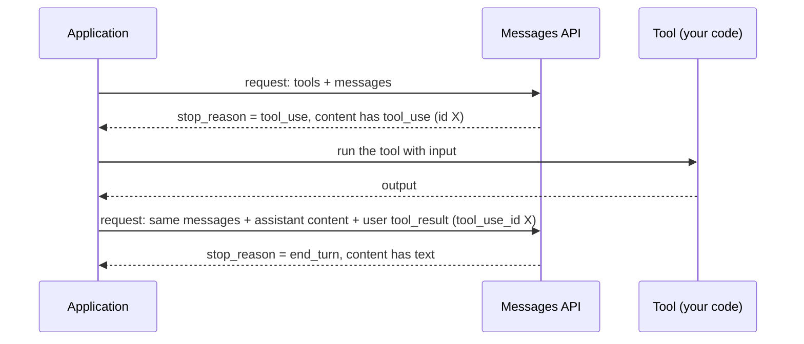

## 1. The question this idea answers

A model produces tokens. It cannot open a database or call a web service. So how does an agent "use a tool"?

The model writes a request to run a tool. The application runs the tool and writes the result back into the conversation. The API joins the request and the result with an id.

This joining is strict. A message list that breaks it gets HTTP 400, and the agent stops. The errors usually appear later, far from their cause: when a harness cuts old messages, when a store drops a message, or when a summary replaces part of the history. This lesson gives the exact rules, so that you can find these errors quickly.

## 2. Mental model

> [!analogy] Order tickets in a restaurant kitchen
> A waiter writes an order on a numbered ticket: "ticket 17: soup". The kitchen cooks the soup and puts it on a tray with the label "ticket 17". The waiter can match each dish to its order by the number. Every ticket gets a dish, or a note that says "ticket 17: no soup today". A ticket with no dish and no note is a fault.
>
> The model is the waiter. The application is the kitchen. The ticket is a `tool_use` block with an `id`. The dish is a `tool_result` block with the same id in `tool_use_id`.
>
> **Where it stops working:** a kitchen can serve dishes late or in any order. The API cannot wait. The results must arrive in the very next message, all together, and they must come before any other text in that message.

## 3. Terms

| Term | Plain meaning |
|---|---|
| tool | A function that the application offers to the model: a name, a description and an input schema. |
| tool definition | The JSON object in the `tools` list of a request that describes one tool. |
| input schema | A JSON Schema object that describes the input that the tool accepts. |
| `tool_use` block | A block in an `assistant` message. The model asks the application to run one tool with one input. |
| tool use id | The `id` field of a `tool_use` block, for example `toolu_01A`. The API creates it. |
| `tool_result` block | A block in a `user` message. The application returns the output of one tool call. |
| `tool_use_id` | The field of a `tool_result` block that names the `tool_use` block that it answers. |
| `is_error` | A field of a `tool_result` block. `true` tells the model that the tool failed. |
| pairing | The rule that each `tool_use` block has exactly one matching `tool_result` block, in the right place. |
| parallel tool use | One assistant message with two or more `tool_use` blocks. |
| client tool | A tool that the application runs. |
| server tool | A tool that Anthropic's servers run, for example web search. The application does not send its result. |
| `tool_choice` | The request field that controls whether the model may, must or must not call a tool. |
| orphan | A `tool_use` block with no result, or a `tool_result` block with no matching call. |

## 4. Method and math

### 4.1 A tool definition

```json
{
  "name": "count_orders",
  "description": "Count the orders that shipped on one date. Use it for any question about shipped order counts. The date is in YYYY-MM-DD format.",
  "input_schema": {
    "type": "object",
    "properties": {
      "date": { "type": "string", "description": "The ship date, YYYY-MM-DD" }
    },
    "required": ["date"]
  }
}
```

| Field | Rule (checked on 2026-10-12) |
|---|---|
| `name` | "Must match the regex `^[a-zA-Z0-9_-]{1,128}$`." So no dots and no spaces. |
| `description` | "A detailed plaintext description of what the tool does, when it should be used, and how it behaves." The model reads it to decide when to call the tool. |
| `input_schema` | "A JSON Schema object defining the expected parameters for the tool." |

> [!note] Tool definitions are context
> The tool definitions are part of the input of every call. They cost tokens on every call, and they come first in the cache order: tools, then system, then messages.

### 4.2 The loop



1. The application sends the tools and the conversation.
2. The model answers with `stop_reason: "tool_use"` and one or more `tool_use` blocks.
3. The application runs each tool. The model never runs code.
4. The application adds two messages to the conversation: the full assistant content, then a user message with the results.
5. The application calls the API again. The loop repeats until `stop_reason` is not `tool_use`.

Each pass through steps 2 to 5 is one **turn** of the agent loop. The Claude Agent SDK runs this loop for you ([agent loop](/notes/ai/claude-agent-sdk/01-foundations/l2-the-agent-loop)). The rules below still apply inside the SDK.

### 4.3 The five pairing rules

These rules come from the "Handle tool calls" and "Parallel tool use" pages (checked on 2026-10-12).

| Rule | Text of the rule | Source words |
|---|---|---|
| R1. One result per call | Each `tool_use` block gets exactly one `tool_result` block. The `tool_use_id` equals the `id` of the call. | "return one `tool_result` for each `tool_use` block, all together in the next user message." |
| R2. Right after | The results go in the message that comes directly after the assistant message with the calls. No message can come between. | "Tool result blocks must immediately follow their corresponding tool use blocks in the message history. You cannot include any messages between the assistant's tool use message and the user's tool result message." |
| R3. Results first | In that user message, all `tool_result` blocks come first. Text can come only after them. | "In the user message containing tool results, the tool_result blocks must come FIRST in the content array. Any text must come AFTER all tool results." |
| R4. All together | The results of a parallel call go in one user message, not in one message each. | The docs call one message per result "Wrong". It teaches the model to stop parallel calls. |
| R5. Errors are results | A failed tool still gets a `tool_result`, with `is_error: true`. A call that the application skipped also gets one. | Example from the docs: `"is_error": true, "content": "Not executed: the preceding write_file call failed."` |

The docs quote this API error for a broken R1 or R2:

```text
tool_use ids were found without tool_result blocks immediately after
```

> [!trap] Text after tool results can cause empty answers
> The stop-reasons page says: "Never add text blocks immediately after tool results." R3 allows text after the results, but text in that position can cause empty `end_turn` responses. Put your extra instructions in the `tool_result` content, or in the system prompt.

### 4.4 A correct parallel call

The model asks for two tools in one message. The ids are `toolu_A` and `toolu_B`.

```json
[
  { "role": "user", "content": "Compare orders shipped on 10-10 and 10-11." },
  { "role": "assistant", "content": [
      { "type": "tool_use", "id": "toolu_A", "name": "count_orders", "input": { "date": "2026-10-10" } },
      { "type": "tool_use", "id": "toolu_B", "name": "count_orders", "input": { "date": "2026-10-11" } }
  ] },
  { "role": "user", "content": [
      { "type": "tool_result", "tool_use_id": "toolu_A", "content": "390" },
      { "type": "tool_result", "tool_use_id": "toolu_B", "content": "412" }
  ] }
]
```

The results can come in any order inside the user message, because each one names its call. One message holds both. No text comes before them.

### 4.5 Five broken message lists

Each list below breaks one rule. Find the rule before you read the diagnosis. Only the important blocks are shown.

> [!example] Broken list 1
> `user "Compare..."` → `assistant [tool_use A, tool_use B]` → `user [tool_result A]`
>
> **Diagnosis:** R1. Call B has no result. **Fix:** add `tool_result B`. If the application did not run B, the result says so, with `is_error: true`.

> [!example] Broken list 2
> `user "Count..."` → `assistant [tool_use A]` → `user "Also check returns."` → `user [tool_result A]`
>
> **Diagnosis:** R2 and R3. The two neighboring user messages merge into one turn: `["Also check returns.", tool_result A]`. The text now comes before the result. **Fix:** put the result first: `user [tool_result A, "Also check returns."]`. Better: put the new question in the next turn, after the model answers.

> [!example] Broken list 3
> `user "Compare..."` → `assistant [tool_use A, tool_use B]` → `user [tool_result A]` → `user [tool_result B]`
>
> **Diagnosis:** R4. The API merges the two user messages, so this specific list may still be accepted. But the docs call this pattern wrong, and the application code that produced it is wrong. **Fix:** build one user message with both results.

> [!example] Broken list 4
> `user [tool_result A]` → `assistant "390 orders shipped."` → `user "And yesterday?"`
>
> **Diagnosis:** an orphan result. The list starts with a result, but the message with call A is gone. This happens when a harness cuts old messages at a bad point. **Fix:** move the cut to a user message that holds a real question, never to a user message that holds only tool results.

> [!example] Broken list 5
> `user "Count..."` → `assistant [text "I will count.", tool_use A]` → `user [tool_result X]`
>
> **Diagnosis:** R1. The result names `X`, but the call is `A`. This happens when an application creates its own ids instead of copying the `id` from the response. **Fix:** copy the id exactly.

### 4.6 Rule for every cut of history

Many components cut the history: a trimming function, a summarizer, a sliding window, a store that loads "the last 20 messages". Each cut must keep pairs together.

> [!key] The safe-cut rule
> Cut the history only at the start of a user message that holds a real user question. Never cut between an assistant message with `tool_use` blocks and the user message with their results.

Here is the reason in the language of this lesson. A cut can remove the assistant message with the calls and keep the results: that is broken list 4. Or it can keep the calls and remove the results: that breaks R1. The LangChain summarization middleware has code that searches backward to keep the AI message and its tool messages together ([SummarizationMiddleware](/notes/ai/langchain-langgraph/03-context-management/l1-summarization-middleware)). Your own code must do the same.

### 4.7 tool_choice and parallel calls

| `tool_choice` | Meaning (docs, checked on 2026-10-12) |
|---|---|
| `{"type": "auto"}` | The model decides. "This is the default value when `tools` are provided." |
| `{"type": "any"}` | The model "must use one of the provided tools, but doesn't force a particular tool." |
| `{"type": "tool", "name": "..."}` | The model must call this tool. |
| `{"type": "none"}` | No tool calls. The default when no `tools` are present. |

Two restrictions are new, so many older examples break:

1. On Claude Opus 5.5, Sonnet 5.5, Fable 5.1 and Mythos 5.1, `any` and `tool` return a 400 error. Use `auto` with strict tool use or structured outputs.
2. With manual thinking (`type: "enabled"`), only `auto` and `none` work.

To stop parallel calls, set `"disable_parallel_tool_use": true` inside `tool_choice`. The docs say: "It is not a top-level request parameter." With `auto`, the model then calls at most one tool per response.

### 4.8 Client tools and server tools

| | Client tool | Server tool |
|---|---|---|
| Who runs it | The application | Anthropic's servers |
| What the model writes | `tool_use` | `server_tool_use` |
| Who writes the result | The application, as `tool_result` in a user message | The API, as a result block in the same assistant message |
| `stop_reason` | `tool_use` | Usually `end_turn`. `pause_turn` when the server loop reaches its limit. |

Tools from an MCP server that the application connects to are client tools. The application, or the SDK inside it, runs them and writes the results.

### 4.9 Production view

| Concern | What to do |
|---|---|
| Correctness | Validate the tool input against the schema before you run the tool. The model can send an invalid input. |
| Reliability | Catch every tool exception. Return it as a `tool_result` with `is_error: true` and a short, useful message. The model can then try again or explain the problem. |
| Context size | Every result enters the window and stays there. Return small results: counts, top rows, a summary with a reference. |
| Latency | Run the calls of a parallel tool use at the same time when they do not depend on each other. |
| Security | The tool input comes from the model, and the model can read untrusted text. Check permissions in the tool, not in the prompt. |
| Storage | Store each call with its result and keep the ids. Without the ids, you cannot rebuild a valid request. |

## 5. Video

```video
{
  "src": "/notes/media/llm-apis/manim/m01-tool-pairing.mp4",
  "caption": "Tool calls and results paired by id, a parallel call, and a bad cut that leaves an orphan result."
}
```

## 6. Code

These exercises go in `llm-apis/02-tool-pairing.ipynb`. They need no API key.

**Exercise 2.1: a pairing validator.** Write `check_pairing(messages)`. It returns a list of error strings. An empty list means the list is valid. It must detect breaks of R1, R2, R3 and orphan results. Merge same-role neighbors first, as the API does ([L1, exercise 1.2](/notes/ai/llm-apis/01-messages-api/l1-messages-and-content-blocks)).

Acceptance tests:

- The list of section 4.4 returns no errors.
- Each of broken lists 1, 2, 4 and 5 returns at least one error that names the rule.
- Broken list 3 returns no error after the merge, but a second function `check_parallel_style(messages)` reports it.

**Exercise 2.2: a safe cut.** Write `safe_cut(messages, keep)`. It keeps at least the last `keep` messages, then moves the cut point earlier until the first kept message is a user message with no `tool_result` blocks.

Acceptance tests:

- The output always passes `check_pairing`.
- The output is never shorter than `keep` messages, unless the full list is shorter.
- With a list where the cut falls on a tool-result message, the function keeps the assistant message with the calls.

**Exercise 2.3: errors as results.** Write `run_tool_calls(content, tools)`. It runs every `tool_use` block in `content` with a Python function from the `tools` dictionary and returns one user message with all the results.

Acceptance tests:

- A tool that raises an exception produces `is_error: true` and the exception text, and the other results still appear.
- An unknown tool name produces `is_error: true` with "unknown tool".
- The result blocks keep the order of the calls.

## 7. Common mistakes

1. **"The model runs the tool."** The application runs it. The model only writes the request.
2. **A result for some calls of a parallel call.** Every call needs a result, also a call that the application skipped.
3. **Text before the tool results in the same user message.** Results come first.
4. **A history cut that starts with a tool-result message.** It leaves orphan results. Cut at a real user question.
5. **Raising an exception out of the agent loop when a tool fails.** Return the error as a result with `is_error: true`.
6. **New ids.** Copy the `id` of each `tool_use` block into the `tool_use_id` of its result.

## 8. One-minute explanation

The model cannot run code. When it needs data, it writes a `tool_use` block with a tool name, an input and an id, and it stops with `stop_reason: "tool_use"`. The application runs the tool and sends the result back as a `tool_result` block that names the same id. The rules are strict. Every call gets exactly one result. The results go in the user message right after the calls, all together, and before any text. A failed or skipped call still gets a result, marked as an error. Any code that cuts the history must keep each call with its result, so it must cut only at a real user question. When these rules break, the API returns HTTP 400 and the agent stops.

## 9. Check questions

```check
{
  "question": "An assistant message has three tool_use blocks: A, B and C. Tool B fails with a timeout. What exactly must the next user message hold?",
  "hint": "Rules R1, R3 and R5.",
  "answer": "One user message with three tool_result blocks, first in the content: A with its output, B with is_error = true and a message about the timeout, and C with its output. Any text comes after all three results."
}
```

```check
{
  "question": "A store loads the last 10 messages of a chat. The 10th message from the end is a user message that holds two tool_result blocks. What goes wrong, and what is the fix?",
  "answer": "The loaded list starts with tool results whose tool_use blocks are not loaded. These are orphan results, and the API rejects the request. The fix is to move the start of the loaded list earlier, to the nearest user message that holds a real question, so that each call stays with its results."
}
```

```check
{
  "question": "Your code sends tool_choice = {\"type\": \"any\"} to claude-sonnet-5-5 and gets HTTP 400. Why, and what do you use instead?",
  "answer": "On Opus 5.5, Sonnet 5.5, Fable 5.1 and Mythos 5.1, the values any and tool return a 400 error (checked on 2026-10-12). Use tool_choice auto, and make the tool call reliable with a clear tool description, strict tool use or structured outputs."
}
```

```check
{
  "question": "Is a tool from an MCP server that your application connects to a client tool or a server tool? Who writes its result?",
  "answer": "A client tool. The application, or the SDK inside the application, runs it through the MCP connection and writes the tool_result block. Server tools are only the tools that Anthropic's servers run, such as web search."
}
```

## 10. Links

- Previous: [L1: Messages and content blocks](/notes/ai/llm-apis/01-messages-api/l1-messages-and-content-blocks)
- Next in the part: [L3: The API sets the format, not the model](/notes/ai/llm-apis/01-messages-api/l3-the-api-sets-the-format)
- Next in the priority path: [Claude Agent SDK L1: What the SDK is](/notes/ai/claude-agent-sdk/01-foundations/l1-what-the-sdk-is)
- The loop inside the SDK: [The agent loop](/notes/ai/claude-agent-sdk/01-foundations/l2-the-agent-loop)
- Cuts and summaries: [Transient vs persistent context](/notes/ai/conversation-state/01-where-state-lives/l2-transient-vs-persistent-context)
- [Glossary](/notes/ai/llm-apis/glossary)
