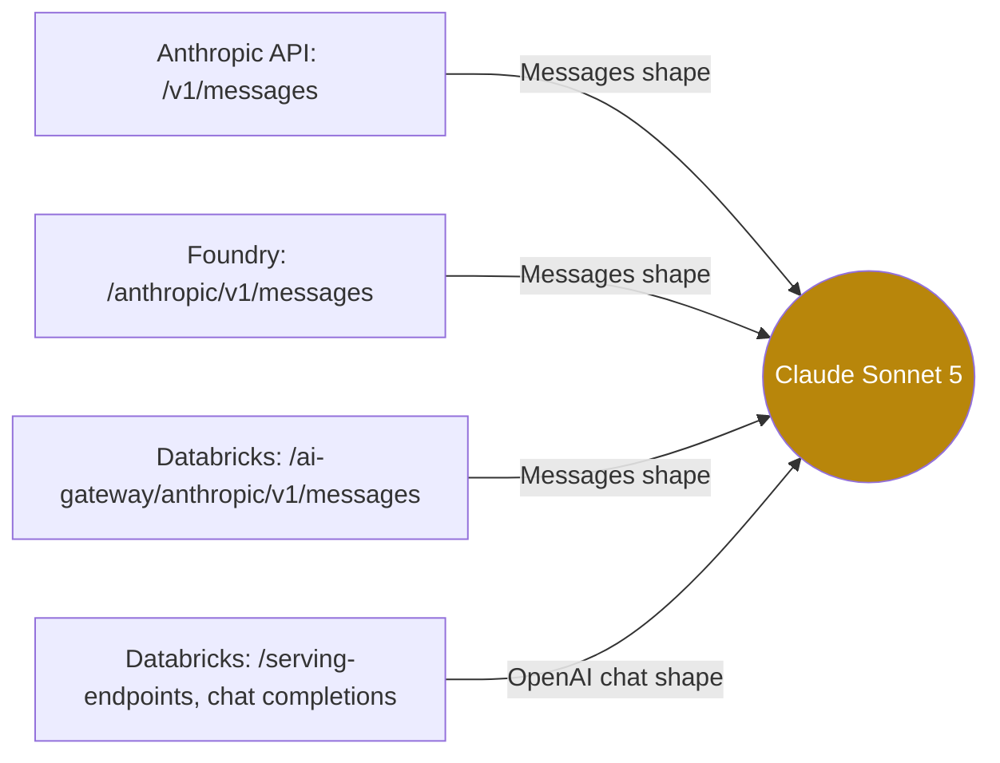

## 1. The question this idea answers

An agent service has two harnesses. Both call Claude Sonnet 5. The first harness uses the Claude Agent SDK, and its traffic goes to a Microsoft Foundry endpoint. The second harness uses LangChain with `ChatDatabricks`, and its traffic goes to a Databricks model serving endpoint.

A developer logs the raw requests of both and sees two different shapes:

- Harness 1 sends `tool_use` blocks with an `input` object, `tool_result` blocks inside user messages, and `thinking` blocks with a `signature`.
- Harness 2 sends `tool_calls` with an `arguments` string, separate messages with the role `tool`, and no `thinking` blocks.

The model is the same. So why are the shapes different? And which shape should the chat database store?

The answer is a rule that this lesson makes exact: **the endpoint decides the wire format, not the model.** The model never sees your JSON. A server receives the request in the format of its endpoint and converts it into the model input. Different endpoints accept different formats for the same model.

## 2. Mental model

> [!analogy] One kitchen, two order counters
> A restaurant has one kitchen and two order counters. The front counter uses a paper ticket with fixed boxes: "dish", "notes", "table number". The delivery counter uses a web form with other fields: "items" as a list, "special requests" as free text, "order id". A clerk at each counter copies the order into the kitchen's own system.
>
> The kitchen is the model. Each counter is an endpoint, and its form is the wire format. The cook makes the same food for both counters. But you must complete the form of the counter where you stand.
>
> **Where it stops working:** the two forms do not have the same boxes. One form has a box for "the cook's private notes" (thinking with a signature). The other form has no such box. When you copy an order from one form to the other, some information has no place to go, and it is lost. The clerk's copy into the kitchen system is also invisible to you, so you cannot check what the kitchen really received.

## 3. Terms

| Term | Plain meaning |
|---|---|
| wire format | The JSON shape of the request and response on one HTTP endpoint: field names, roles, block types. |
| endpoint | One URL that accepts model requests, for example `https://{resource}.services.ai.azure.com/anthropic/v1/messages`. |
| Anthropic Messages shape | The wire format of `POST /v1/messages`: a top-level `system`, `user` and `assistant` messages with typed content blocks. |
| OpenAI chat shape | The wire format of Chat Completions: a list of messages with roles such as `system`, `user`, `assistant` and `tool`. |
| OpenAI-compatible | A server that is not OpenAI but accepts the OpenAI chat shape, so the OpenAI client libraries work with it. |
| provider | The service that hosts the model and its endpoints, for example Anthropic, Microsoft Foundry or Databricks. |
| translation layer | Code that converts one wire format into another. It runs on a server or in your own process. |
| `tool_calls` | The list of tool requests in an assistant message of the OpenAI chat shape. |
| `arguments` string | The tool input in the OpenAI chat shape. It is a JSON text, not a JSON object. |
| tool message | A message with the role `tool` and a `tool_call_id`. It holds one tool result in the OpenAI chat shape. |
| reasoning item | A Databricks extension of the OpenAI chat shape: a content item of type `reasoning` that carries Claude's thinking and its signature. |
| format-neutral store | A chat database whose rows do not follow any provider's wire format. Code converts the rows to a wire format at the last step. |

## 4. Method and math

### 4.1 The rule

> [!key] The endpoint decides the wire format
> A model has no wire format. An endpoint has one. To know which shape a request must have, ask "which URL does this client call?", not "which model does it use?".



Each arrow is a different server with its own translation layer. The model in the middle is the same.

### 4.2 Who speaks which format

These facts come from the official docs and from library source code (checked on 2026-10-13).

| Client | Endpoint it calls | Wire format | Evidence |
|---|---|---|---|
| Claude Agent SDK, through the Claude Code CLI with `CLAUDE_CODE_USE_FOUNDRY=1` | `https://{resource}.services.ai.azure.com/anthropic` | Anthropic Messages | The Claude Code gateway guide: "Microsoft Foundry and the Claude Platform on AWS implement the Anthropic Messages format." |
| `anthropic.AnthropicFoundry` | the same Foundry URL | Anthropic Messages | The SDK builds `https://{resource}.services.ai.azure.com/anthropic/` and calls `messages.create`. |
| `ChatDatabricks` (databricks-langchain 0.21.0), default settings | `{host}/serving-endpoints`, with the model field set to the endpoint name | OpenAI chat | The source calls `self.client.chat.completions.create(**data)` on an OpenAI client. databricks-openai 0.17.1 sets the base URL to `f"{host}/serving-endpoints"`. |
| The `anthropic` package with a Databricks base URL | `https://<workspace_host>.databricks.com/ai-gateway/anthropic/v1/messages` | Anthropic Messages | Databricks docs: "The Anthropic Messages API provides native Anthropic SDK compatibility for Claude models on Databricks." |

The Databricks API reference states the general rule for its model endpoints: "Most Foundation Model APIs use OpenAI-compatible REST formats to make migrating existing projects easier." So the same Databricks workspace offers both formats for a Claude model. The URL decides.

The Claude Code CLI speaks only Anthropic-style formats. The gateway guide lists three formats that a gateway can expose to it: Anthropic Messages (`/v1/messages`), Amazon Bedrock InvokeModel and Google Cloud's Agent Platform rawPredict. The OpenAI chat shape is not in the list. So the Agent SDK cannot call an OpenAI-compatible endpoint directly.

### 4.3 One conversation, two shapes

This is a three-message tool conversation: a question, a tool call and its result. The sandbox validated both versions against the types of the official SDKs: `anthropic` 1.13.0 `MessageParam` and `openai` 3.29.0 `ChatCompletionMessageParam` (checked on 2026-10-13). It checked every message and every block.

**Anthropic Messages shape.**

```json
{
  "system": "You answer questions about production data. Never guess a number.",
  "messages": [
    { "role": "user", "content": "How many orders shipped on 2026-10-11?" },
    { "role": "assistant", "content": [
        { "type": "text", "text": "I will count the orders." },
        { "type": "tool_use", "id": "toolu_01A", "name": "count_orders", "input": { "date": "2026-10-11" } }
    ] },
    { "role": "user", "content": [
        { "type": "tool_result", "tool_use_id": "toolu_01A", "content": "412" }
    ] }
  ]
}
```

**OpenAI chat shape.**

```json
{
  "messages": [
    { "role": "system", "content": "You answer questions about production data. Never guess a number." },
    { "role": "user", "content": "How many orders shipped on 2026-10-11?" },
    { "role": "assistant", "content": "I will count the orders.",
      "tool_calls": [
        { "id": "toolu_01A", "type": "function",
          "function": { "name": "count_orders", "arguments": "{\"date\": \"2026-10-11\"}" } }
      ] },
    { "role": "tool", "tool_call_id": "toolu_01A", "content": "412" }
  ]
}
```

Read the two versions line by line. Four differences are visible at once:

1. The system prompt is a top-level field in one shape and the first message in the other.
2. The tool input is an object in one shape and a string of JSON text in the other.
3. The tool result is a block inside a `user` message in one shape and a separate `tool` message in the other.
4. The assistant message holds one ordered list of blocks in one shape. In the other shape it holds two separate fields: `content` and `tool_calls`.

### 4.4 What differs

| Item | Anthropic Messages shape | OpenAI chat shape |
|---|---|---|
| System prompt | Top-level `system` field (string or text blocks) | A `system` or `developer` message. Databricks: "The `system` role can only be used once, as the first message in a conversation." |
| Roles in the message list | `user`, `assistant` | `developer`, `system`, `user`, `assistant`, `tool` (and the deprecated `function`) |
| Where a tool call goes | A `tool_use` block inside the assistant `content` list | An item of the assistant's `tool_calls` list |
| Tool input | `input`: a JSON object | `function.arguments`: a string of JSON text. The OpenAI type says that "the model does not always generate valid JSON". |
| Where a tool result goes | A `tool_result` block inside a `user` message | A message with role `tool` and a `tool_call_id` |
| Several results of a parallel call | One user message with several `tool_result` blocks | Several `tool` messages, one per call |
| Failed tool | `is_error: true` on the result | No field. Only the text of `content` can say it failed. |
| Order of text and tool calls | One ordered list: text can come before or after a call | `content` and `tool_calls` are separate, so the order between them is not recorded |
| Thinking | `thinking` blocks with `signature`, and `redacted_thinking` blocks | No standard field. Databricks adds a `reasoning` content item with a `signature` inside `summary`. |
| Why the model stopped | `stop_reason`: `end_turn`, `tool_use`, `max_tokens`, and others | `finish_reason`: `stop`, `length`, `tool_calls`, `content_filter` (and the deprecated `function_call`) |
| Streaming | Named events: `message_start`, `content_block_delta`, and others ([lesson 2.1](/notes/ai/llm-apis/02-streaming-and-thinking/l1-stream-events)) | Chunks of type `chat.completion.chunk` with a `delta`, then `data: [DONE]` ([lesson 3.1](/notes/ai/llm-apis/03-openai-format/l1-the-openai-chat-shape)) |
| Usage fields | `input_tokens`, `output_tokens`, `cache_read_input_tokens`, `cache_creation_input_tokens` | `prompt_tokens`, `completion_tokens`, `total_tokens`, with details such as `cached_tokens` |

### 4.5 What stays the same

| Item | Why it stays the same |
|---|---|
| The model | Both endpoints serve the same model. Its knowledge and its behavior do not depend on your JSON. |
| The context window and the output limit | They are properties of the model. The Foundry docs list a 1M window for Sonnet 5 (checked on 2026-10-13). |
| The tool ids | A good translation layer copies them. In the example, `toolu_01A` appears in both shapes. |
| The pairing rules | Every call still needs exactly one result, right after it ([lesson 1.2](/notes/ai/llm-apis/01-messages-api/l2-tool-use-and-tool-result)). Only the place of the result changes. |

The exact token count of one conversation can differ a little between two endpoints. Each server renders the request into model input in its own way. The docs do not describe these renderings. Measure the counts if they matter to you.

### 4.6 Every translation can lose information

When the format of your client differs from the format that the model service needs, someone translates. Each translation is a place where information can disappear.

> [!example] Worked example: ChatDatabricks and a reasoning item
> The Databricks docs show Claude thinking in the OpenAI chat shape as a content list: `[{"type": "reasoning", "summary": [{"type": "summary_text", "text": "...", "signature": "..."}]}, {"type": "text", "text": "..."}]`.
>
> The sandbox ran the response converter of `ChatDatabricks` (databricks-langchain 0.21.0, function `_convert_dict_to_message`, the non-streaming chat-completions path) on such a message. The source comment says: "for non-string content, serialize it into a string to maintain compatibility with downstream consumers". The real output:
>
> ```text
> AIMessage.content type: str
> AIMessage.content: [{"type": "reasoning", "summary": [{"type": "summary_text", "text": "Count for one date.", "signature": "EqoBCkgIARAB"}]}, {"type": "text", "text": "I will count the orders."}]
> ```
>
> On the next request, `_convert_message_to_dict` sends this string as the assistant `content`. So the reasoning item returns to the server as plain text inside a string, not as a reasoning item. The tool call itself survived: `tool_calls` held `{'name': 'count_orders', 'args': {'date': '2026-10-11'}, 'id': 'toolu_01A'}`.

This does not mean that the library is wrong. It means that a translation made a choice, and the choice has a cost. You must know where each translation happens and what it drops. [Lesson 3.2](/notes/ai/llm-apis/03-openai-format/l2-converting-between-formats) gives the full map.

> [!trap] Thinking is the item that a translation loses first
> A thinking block has a signature, and the API checks the signature when you send the block again ([lesson 2.2](/notes/ai/llm-apis/02-streaming-and-thinking/l2-thinking-blocks-and-signatures)). The standard OpenAI chat shape has no field for it. So a harness that speaks the OpenAI chat shape cannot keep Claude's thinking in the documented form. The exception is a provider extension that the client library also keeps.

### 4.7 Consequence: a format-neutral chat store

The chat database serves both harnesses. If it stores the Anthropic shape, the LangChain harness must convert on every load. If it stores the OpenAI shape, the thinking signatures and the `is_error` flags of the Agent SDK harness are lost at save time. No later code can restore them.

So the store keeps its own neutral parts, and each harness converts at the last step.

| Neutral part | Fields | Anthropic Messages | OpenAI chat |
|---|---|---|---|
| `text` | `text` | `text` block | text in `content` |
| `tool_call` | `call_id`, `name`, `input` (object), `raw_arguments` (string or null) | `tool_use` block | item of `tool_calls`, with `arguments` from `raw_arguments` or `json.dumps(input)` |
| `tool_result` | `call_id`, `content`, `is_error` | `tool_result` block | `tool` message (`is_error` is lost) |
| `thinking` | `provider`, `model`, `text`, `signature` | `thinking` block, only for the same provider family | omitted, or a provider extension |
| `image` | `media_type`, `data` or `url` | `image` block | `image_url` part with a data URL |

> [!key] Store the richest form, convert at the edge
> A conversion can only lose information. So store the richest form you receive, with every id and every signature. Convert to a wire format only when you build a request. [Conversation State 2.2](/notes/ai/conversation-state/02-chat-history-model/l2-from-stored-parts-to-model-input) builds this conversion step.

### 4.8 Production view

| Concern | What to do |
|---|---|
| Correctness | For each client, record the URL that it calls and the wire format of that URL. Do not guess from the model name. |
| Debugging | Log the raw request body at the client. A server translation step is invisible, so your log is the last copy that you control. |
| Portability | Keep the chat store format-neutral. Put all conversion code in one module with round-trip tests. |
| Data safety | Never save a chat from the output of a lossy translation. Save from the richest form. |
| Upgrades | Pin the versions of translation libraries such as `databricks-langchain`. A new version can change what a translation keeps. |
| Features | Some features exist in only one format, for example thinking signatures or `is_error`. Check each feature on each endpoint before you depend on it. |

## 5. Code

These exercises go in the lab folder, in `llm-apis/03-api-sets-the-format.ipynb`. They need no API key.

**Exercise 3.1: detect the format.** Write `detect_format(body)`. It returns `"anthropic"`, `"openai"` or `"unknown"` for a request body as a Python dictionary.

Acceptance tests:

- Both bodies of section 4.3 return the correct value.
- A body with a top-level `system` returns `"anthropic"`.
- A body with a message whose role is `tool`, or with `tool_calls`, returns `"openai"`.
- A body with only one plain user message string returns `"unknown"`, because both formats accept it.

**Exercise 3.2: one record, two shapes.** Define a neutral turn as a Python dictionary with the parts of section 4.7. Write `to_anthropic(system, turns)` and `to_openai(system, turns)`.

Acceptance tests:

- From one neutral record of the conversation in section 4.3, the two functions produce the two bodies of that section. Normalize the string shorthand for `content` before you compare.
- The tool id is identical in both outputs.
- A `tool_result` part with `is_error = true` keeps the flag in the Anthropic output.

**Exercise 3.3: check against the official types.** Install `anthropic` and `openai`. Validate your outputs with `pydantic.TypeAdapter(MessageParam)` and `TypeAdapter(ChatCompletionMessageParam)`, then validate each content block and each tool call on its own.

> [!trap] Pydantic checks the blocks only when you iterate them
> The `content` field of these types is declared as an `Iterable`. Pydantic validates an `Iterable` lazily. In the sandbox, `TypeAdapter(list[MessageParam]).validate_python(...)` accepted a `tool_use` block whose `input` was a string. It returned a `ValidatorIterator`, and the errors appeared only on iteration: `ValidationError 72 validation errors for ValidatorIterator`. So build a second adapter for the block union and validate every block in a loop.

Acceptance tests:

- Both outputs of exercise 3.2 validate with no exception.
- A deliberately wrong body, for example `input` as a string, fails validation, and you can name the field from the error.

## 6. Common mistakes

1. **"Claude speaks the Messages format."** The endpoint speaks a format. The same Claude model is reachable through the OpenAI chat shape on Databricks.
2. **Storing the chat in the format of one harness.** The other harness must then convert on every load. The lossy direction also drops data at save time.
3. **Treating `arguments` as an object.** In the OpenAI chat shape it is a string of JSON text, and it can be invalid.
4. **Expecting thinking blocks on an OpenAI-compatible endpoint.** The standard shape has no thinking field. Check the provider's extension and the client library.
5. **Pointing the Claude Agent SDK at an OpenAI-compatible URL.** The CLI accepts only Anthropic Messages, Bedrock and Agent Platform formats.

## 7. One-minute explanation

A model does not have a wire format. An endpoint has one. The same Claude model is reachable through the Anthropic Messages shape, for example on Foundry's `/anthropic` endpoint or through the Claude Code CLI. It is also reachable through an OpenAI-compatible chat shape, for example on a Databricks serving endpoint that `ChatDatabricks` calls. In the Messages shape, the system prompt is a field and a tool call is a block with an input object. A tool result is a block in a user message. In the OpenAI shape, the system prompt is a message, the tool input is an arguments string, and each result is a separate tool message. Thinking blocks with signatures exist only in the Messages shape, and each translation can lose them and the error flags. So a chat store keeps its own neutral parts, with every id and signature. It converts to a wire format only when it builds a request.

## 8. Check questions

```check
{
  "question": "Two harnesses call Claude Sonnet 5. One logs tool_use blocks with an input object. The other logs tool_calls with an arguments string. A teammate says one of them uses the wrong model. What do you answer?",
  "hint": "What decides the wire format?",
  "answer": "Both can use the same model. The endpoint decides the wire format. The first harness calls an Anthropic Messages endpoint, for example Foundry's /anthropic endpoint. The second calls an OpenAI-compatible endpoint, for example a Databricks serving endpoint through ChatDatabricks. Compare the URLs, not the model names."
}
```

```check
{
  "question": "Name three items that the OpenAI chat shape cannot carry in its standard form but the Anthropic Messages shape can.",
  "answer": "Any three: thinking blocks with their signatures, redacted_thinking blocks, the is_error flag of a tool result, the order of text blocks relative to tool calls inside one assistant message, and several tool results grouped in one message."
}
```

```check
{
  "question": "Your chat store saves the OpenAI chat shape because the LangChain harness uses it. Later the Claude Agent SDK harness must continue a chat that had tool failures and thinking. What is already lost, and why can no code restore it?",
  "answer": "The is_error flags and the thinking blocks with their signatures. The OpenAI shape had no field for them, so they were never saved. A signature is an encrypted copy of the reasoning that only the API produces, and an error flag that was not stored can only be guessed from text. The fix is a format-neutral store that keeps the richest form."
}
```

```check
{
  "question": "Can you configure the Claude Agent SDK to call a Databricks endpoint that speaks only the OpenAI chat shape? Explain.",
  "answer": "No, not directly. The SDK runs the Claude Code CLI, and the CLI speaks only the Anthropic Messages, Amazon Bedrock InvokeModel and Agent Platform rawPredict formats. You need an endpoint that speaks the Anthropic Messages shape, for example Databricks' /ai-gateway/anthropic endpoint or Foundry's /anthropic endpoint, or a gateway that translates."
}
```

## 9. Links

- Previous: [L2: tool_use and tool_result](/notes/ai/llm-apis/01-messages-api/l2-tool-use-and-tool-result)
- Basics of the Messages shape: [L1: Messages and content blocks](/notes/ai/llm-apis/01-messages-api/l1-messages-and-content-blocks)
- Next part: [Part 2: Stream events](/notes/ai/llm-apis/02-streaming-and-thinking/l1-stream-events)
- The OpenAI shape in detail: [L3.1: The OpenAI chat shape](/notes/ai/llm-apis/03-openai-format/l1-the-openai-chat-shape) and [L3.2: Converting between formats](/notes/ai/llm-apis/03-openai-format/l2-converting-between-formats)
- The LangChain side: [ChatDatabricks](/notes/ai/langchain-langgraph/01-foundations/l3-chatdatabricks)
- The store: [Chats, messages and parts](/notes/ai/conversation-state/02-chat-history-model/l1-chats-messages-and-parts)
- [Glossary](/notes/ai/llm-apis/glossary)
