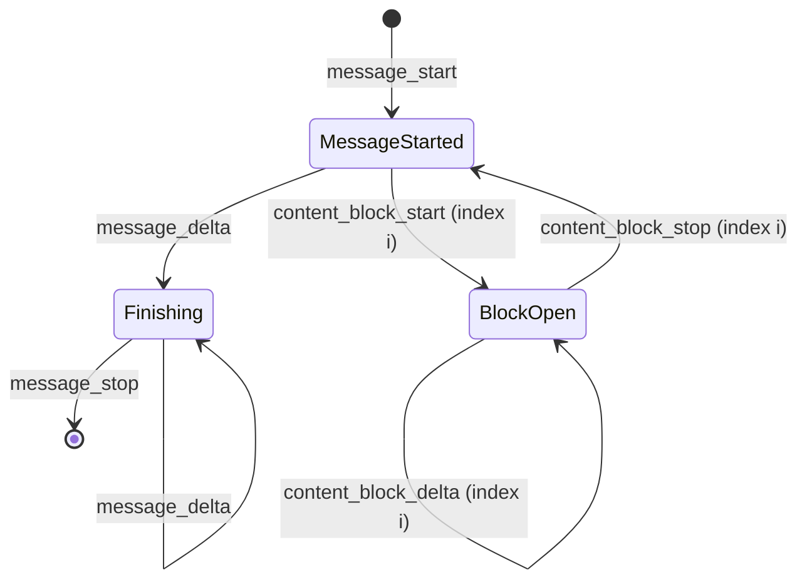

## 1. The question this idea answers

A chat UI must show the answer while the model writes it. So the service asks for a streamed response. Now the reply does not arrive as one JSON object. It arrives as dozens of small events: "a block starts", "here are three more characters", "a block stops".

The service needs two things from this stream:

1. **A live view** for the user: text as it arrives, and a status line such as "running count_orders" when a tool call starts.
2. **The exact final message** for the harness and the store: every block in order, the tool input as an object, the signature complete.

The second need is harder than it looks. Tool input arrives as fragments of JSON text that are not valid JSON until the end. Usage numbers arrive twice. Some events carry nothing useful. And a stream can break in the middle. This lesson gives the exact event sequence and the rules to rebuild the message from it.

## 2. Mental model

> [!analogy] Assembling a report from a live dictation
> Someone dictates a report to you over a radio. The report has numbered sections. They say: "Open section 0, type text." Then they dictate words: "Okay", ", let's", " check". Then: "Close section 0." Then: "Open section 1, type form." For the form, they spell the content character by character: `{"location":`, then ` "San`, then ` Francisc`. You cannot read the form until they say "Close section 1", because half a form is not a form. At the end they say: "Reason for stopping: a tool is needed. Final word count: 89. Over."
>
> You build the report by section number. Each fragment says which section it belongs to.
>
> **Where it stops working:** a real radio operator repeats lost words. A stream does not. If the connection breaks, the open sections stay incomplete, and you cannot ask for the missing fragments. Also, the radio sometimes sends "still here" signals (`ping`) and, in future, new kinds of messages that you do not know. Your code must ignore them safely, not crash.

## 3. Terms

| Term | Plain meaning |
|---|---|
| streaming | The server sends the response in pieces while the model generates it, instead of one JSON body at the end. |
| server-sent events (SSE) | A text format for a stream over HTTP. Each event is an `event:` line, a `data:` line and a blank line. |
| event | One unit of the stream: a name and a JSON object. |
| content block index | The `index` field of a block event. It is the position of the block in the final `content` list. |
| delta | A small change to one block, for example three more characters of text. |
| `text_delta` | A delta that adds text to a `text` block. |
| `input_json_delta` | A delta that adds a fragment of JSON text to the input of a `tool_use` block. |
| partial JSON | JSON text that is not complete yet, so a normal JSON parser rejects it. |
| `thinking_delta` | A delta that adds text to a `thinking` block. |
| `signature_delta` | A delta that sets the `signature` of a thinking block. It comes just before the block stops. |
| cumulative usage | Token counts that give the total so far, not the increase since the last event. |
| `ping` | An event with no content. It keeps the connection active. |
| accumulator | Your code that rebuilds the final message from the events. |
| `StreamEvent` | The Claude Agent SDK message type that carries one raw API stream event. |

## 4. Method and math

### 4.1 The wire format

A streamed request sets `"stream": true`. The response is a text stream. The Anthropic streaming page says (checked on 2026-10-13): "Each server-sent event includes a named event type and associated JSON data. Each event uses an SSE event name (for example, `event: message_stop`), and includes the matching event `type` in its data."

So one event looks like this. A blank line ends it.

```text
event: content_block_delta
data: {"type": "content_block_delta","index": 0,"delta": {"type": "text_delta", "text": "ello frien"}}

```

The `event:` name and the `type` inside `data` are the same. Use the `type` field inside the JSON as the source of truth. Then your code works the same way on raw SSE text and on events that a library has already parsed for you.

### 4.2 The event sequence

The streaming page defines the flow of every stream:

1. "`message_start`: contains a `Message` object with empty `content`."
2. "A series of content blocks, each of which has a `content_block_start`, one or more `content_block_delta` events, and a `content_block_stop` event. Each content block has an `index` that corresponds to its index in the final Message `content` array."
3. "One or more `message_delta` events, indicating top-level changes to the final `Message` object."
4. "A final `message_stop` event."



Any number of `ping` events can appear between these events. The page also names one exception: during a server-side fallback, a `fallback` block arrives as a start and a stop with no deltas. The Foundry docs list server-side fallback as not supported on Foundry (checked on 2026-10-13).

This is the documented tool-use example, with all 27 events counted in the sandbox:

| Event name | Count | What it carried |
|---|---|---|
| `message_start` | 1 | id `msg_014p7gG3wDgGV9EUtLvnow3U`, empty `content`, `usage` with `input_tokens` 472 and `output_tokens` 2 |
| `content_block_start` | 2 | index 0: an empty `text` block. Index 1: a `tool_use` block with id, name and `input: {}` |
| `ping` | 1 | nothing |
| `content_block_delta` | 19 | 13 `text_delta` for index 0, 6 `input_json_delta` for index 1 |
| `content_block_stop` | 2 | index 0, then index 1 |
| `message_delta` | 1 | `stop_reason: "tool_use"`, `usage` with `output_tokens` 89 |
| `message_stop` | 1 | nothing |

### 4.3 Rebuild by index

The accumulator keeps one message and one list of blocks. Each event changes exactly one thing.

| Event | Action of the accumulator |
|---|---|
| `message_start` | Copy `message`. Its `content` is empty. |
| `content_block_start` | Append a copy of `content_block` at position `index`. For `tool_use`, start an empty text buffer for the input. |
| `content_block_delta` | Find the block by `index`. Apply the delta by its type (section 4.4). |
| `content_block_stop` | Finish the block at `index`. For `tool_use`, parse the buffer as JSON and store the object in `input`. |
| `message_delta` | Set `stop_reason` and `stop_sequence`. Replace the usage values with the new values. |
| `message_stop` | The message is complete. |
| `ping` | Ignore. |
| any other name | Ignore, and log it once. |

> [!key] The index is the address
> Never append deltas "to the last block". Always use the `index` of the event. The index of a block equals its position in the final `content` list, so the rebuilt list has the same order as a non-streamed response.

The sandbox ran an accumulator on the documented tool-use stream. The rebuilt message:

```json
{
  "id": "msg_014p7gG3wDgGV9EUtLvnow3U",
  "role": "assistant",
  "content": [
    { "type": "text", "text": "Okay, let's check the weather for San Francisco, CA:" },
    { "type": "tool_use", "id": "toolu_01T1x1fJ34qAmk2tNTrN7Up6", "name": "get_weather",
      "input": { "location": "San Francisco, CA" } }
  ],
  "stop_reason": "tool_use",
  "usage": { "input_tokens": 472, "output_tokens": 89 }
}
```

### 4.4 The delta types

| `delta.type` | Field | Block it changes | Rule |
|---|---|---|---|
| `text_delta` | `text` | `text` | Append the string. |
| `input_json_delta` | `partial_json` | `tool_use` | Append to the buffer. Parse only at `content_block_stop`. |
| `thinking_delta` | `thinking` | `thinking` | Append the string. |
| `signature_delta` | `signature` | `thinking` | Set the signature. It comes "just before the `content_block_stop` event". |
| `citations_delta` | `citation` | `text` | Append the citation to the block's `citations` list. The type is in the official Python SDK (`anthropic` 1.13.0). The streaming page does not describe it (checked on 2026-10-13). |

### 4.5 Partial JSON

The docs say: "the deltas are *partial JSON strings*, whereas the final `tool_use.input` is always an *object*." They also say: "You can accumulate the string deltas and parse the JSON once you receive a `content_block_stop` event".

> [!example] Worked example: parse after every fragment
> The sandbox appended the six documented `partial_json` fragments one at a time and called Python's `json.loads` after each one. Real output:
>
> ```text
> '' -> JSONDecodeError: Expecting value: line 1 column 1 (char 0)
> '{"location":' -> JSONDecodeError: Expecting value: line 1 column 13 (char 12)
> '{"location": "San' -> JSONDecodeError: Unterminated string starting at: line 1 column 14 (char 13)
> '{"location": "San Francisc' -> JSONDecodeError: Unterminated string starting at: line 1 column 14 (char 13)
> '{"location": "San Francisco,' -> JSONDecodeError: Unterminated string starting at: line 1 column 14 (char 13)
> '{"location": "San Francisco, CA"}' -> parses
> ```
>
> Five of six attempts fail. Only the full text parses. Note the first fragment: it is an empty string.

Three more facts about tool input in a stream:

1. **The block starts with `input: {}`.** That empty object is a placeholder. Do not treat it as the real input.
2. **A tool with no input can have no fragments.** Then the buffer stays empty at the stop. Treat an empty buffer as `{}`.
3. **Fragments can arrive in bursts.** The docs say: "Current models only support emitting one complete key and value property from `input` at a time. As such, when using tools, there may be delays between streaming events while the model is working."

> [!trap] A live preview of tool input is not the input
> A UI can show the growing buffer as text, for example "count_orders(date: 2026-10…". That is fine for display. But never run the tool, validate the input or store it before `content_block_stop`. The docs mention partial JSON parsers (Pydantic, or the SDK's streaming helpers) for a live preview. The result of a partial parse is still not the final input.

### 4.6 Thinking in a stream

With thinking on, a thinking block streams like this (from the docs, shortened):

```text
event: content_block_start
data: {"type": "content_block_start", "index": 0, "content_block": {"type": "thinking", "thinking": "", "signature": ""}}

event: content_block_delta
data: {"type": "content_block_delta", "index": 0, "delta": {"type": "thinking_delta", "thinking": "I need to find the GCD of 1071 and 462 using the Euclidean algorithm.\n\n1071 = 2 × 462 + 147"}}

event: content_block_delta
data: {"type": "content_block_delta", "index": 0, "delta": {"type": "signature_delta", "signature": "EqQBCgIYAhIM1gbcDa9GJwZA2b3hGgxBdjrkzLoky3dl1pkiMOYds..."}}

event: content_block_stop
data: {"type": "content_block_stop", "index": 0}
```

The page describes the case `display: "omitted"`: "no thinking text is streamed. The thinking block opens, receives a `thinking_delta` with an empty `thinking` string and then a single `signature_delta`, and closes." On Claude 5.x models, Opus 4.8 and Opus 4.7, `omitted` is the default ([lesson 2.2](/notes/ai/llm-apis/02-streaming-and-thinking/l2-thinking-blocks-and-signatures)). So an empty thinking block in your stream is normal. It is not a bug, and you must still keep it with its signature.

### 4.7 message_delta and cumulative usage

The page says: "The token counts shown in the `usage` field of the `message_delta` event are *cumulative*." The `anthropic` 1.13.0 type `MessageDeltaUsage` describes each field as "The cumulative number of ..." tokens, for input, output, cache reads and cache writes.

> [!example] Worked example: replace, do not add
> The tool-use stream has `output_tokens: 2` in `message_start` and `output_tokens: 89` in `message_delta`.
>
> - Correct: replace. Final `output_tokens` = 89.
> - Wrong: add. 2 + 89 = 91. This overcounts by 2 on every response.
>
> If a stream had two `message_delta` events with 40 and then 89, the correct value is still 89, the last one.

The official SDK does the same. Its accumulator (`anthropic` 1.13.0, `lib/streaming/_messages.py`, function `accumulate_event`) assigns the value: `current_snapshot.usage.output_tokens = event.usage.output_tokens`. It also assigns `input_tokens` and the two cache fields when they are present.

The extended-thinking page adds one more rule: the thinking share of the output, `usage.output_tokens_details.thinking_tokens`, "appears only on the final `message_delta` event" when you stream. So read the usage at the end, not at the start.

### 4.8 ping, error and unknown events

| Event | Docs (checked on 2026-10-13) | What to do |
|---|---|---|
| `ping` | "Event streams may also include any number of `ping` events." | Ignore it. Do not treat it as a delta. |
| `error` | "during periods of high usage, you may receive an `overloaded_error`, which would normally correspond to an HTTP 529 in a non-streaming context" | Stop the accumulator. Mark the message as failed. Retry the request with backoff. |
| unknown name | "new event types may be added, and your code should handle unknown event types gracefully." | Ignore it and log the name. |

The documented error event:

```text
event: error
data: {"type": "error", "error": {"type": "overloaded_error", "message": "Overloaded"}}
```

An error can arrive after HTTP 200 and after many deltas. So the HTTP status code of a stream does not prove success. Only `message_stop` proves that the message is complete.

The official Python SDK follows these rules (`anthropic` 1.13.0, `_streaming.py`). It skips `ping` with `continue` and raises an exception for `error`. It yields only the event names in its known list, so other names produce nothing.

### 4.9 A broken stream

A network failure, a timeout or an `error` event can end a stream early. Then you hold a partial message. What can you keep?

The streaming page gives the recovery rule for Claude 4.6 and later models: "instead of placing the partial response in an assistant message, add a user message that instructs the model to continue from where it left off." Its sample prompt: "Your previous response was interrupted and ended with [previous_response]. Continue from where you left off." It also says: "Tool use and thinking blocks cannot be partially recovered. You can resume streaming from the most recent text block."

| State of the block when the stream broke | Keep it? | Reason |
|---|---|---|
| A `text` block that received its `content_block_stop` | Yes | It is complete. |
| A `text` block that is still open | As text only, for the "continue" prompt | You can show it and quote it. It is not a complete block. |
| A `thinking` block without its signature | No | A thinking block needs its signature to be sent again. |
| A `tool_use` block that is still open | No | Its input is partial JSON. Running it with a guessed input is a bug. |
| A complete `tool_use` block, but no `message_stop` | Not as an assistant turn to send again | The message has no confirmed `stop_reason`. Retry the whole request instead. |

> [!trap] Never store a half message as a normal turn
> A store that saves the partial assistant message as a normal turn creates broken history. It can hold a `tool_use` with no result, or a thinking block with no signature. The next request then fails with HTTP 400 ([lesson 1.2](/notes/ai/llm-apis/01-messages-api/l2-tool-use-and-tool-result)). Mark the turn as interrupted, show what the user saw, and exclude it from the model input, or keep only its finished text.

### 4.10 The same events in the Claude Agent SDK

The Agent SDK does not stream by default. It yields one `AssistantMessage` for each finished content block. With `include_partial_messages=True`, it also yields a `StreamEvent` for each raw API stream event (SDK 0.2.165, checked on 2026-10-13). The SDK passes the CLI flag `--include-partial-messages` (source: `subprocess_cli.py`).

```python
@dataclass
class StreamEvent:
    uuid: str
    session_id: str
    event: dict[str, Any]  # The raw Anthropic API stream event
    parent_tool_use_id: str | None = None
```

`event` is the same dictionary as the `data` of section 4.1. So the accumulator of this lesson works on `message.event` with no change. Three rules from the SDK streaming page:

1. "The `parent_tool_use_id` field is always `None` in Python". Stream events come only from the main session: "token-level deltas from subagents aren't forwarded."
2. "each `AssistantMessage` arrives before that block's `content_block_stop` event". So the order is: deltas, then the complete `AssistantMessage`, then the stop event.
3. For a cut stream: "A cut text or thinking block also gets its `content_block_stop`. A cut tool call doesn't, so if `message_stop` arrives while a tool call's block is still open, treat that call's input as incomplete." This holds from Claude Code v2.1.290. The Python SDK bundles that version from v0.2.164.

[Agent SDK L2.2](/notes/ai/claude-agent-sdk/02-options-and-messages/l2-message-and-block-types) covers all the message types.

### 4.11 Production view

| Concern | What to do |
|---|---|
| Correctness | Build the final message only from complete blocks, by `index`. Parse tool input only at `content_block_stop`. |
| Reliability | Treat `message_stop` as the only proof of a complete message. Handle `error` events after HTTP 200. Ignore `ping` and unknown events. |
| Cost accounting | Read usage from the last `message_delta`. Replace values, never add them. |
| Latency | Show `text_delta` at once. Show a tool status line at `content_block_start` of a `tool_use` block, before its input is complete. |
| Gateways | A proxy must not buffer the stream or remove `ping` events. The Claude Code gateway guide says that a gateway that buffers a response "until it is complete" makes Claude Code stall, and that pings can be the only bytes during a long thinking pause. |
| Testing | Record real event lists once. Replay them in unit tests of the accumulator, including a cut stream and an unknown event. |

## 5. Video

```video
{
  "src": "/notes/media/llm-apis/manim/m02-stream-assembly.mp4",
  "caption": "Stream events build the final message block by block, by index. Tool input is partial JSON until content_block_stop, and usage in message_delta replaces the start value."
}
```

## 6. Code

These exercises go in `llm-apis/04-stream-events.ipynb`. They need no API key. Copy the documented tool-use stream and the thinking stream from the streaming page into two text files.

**Exercise 1.1: an SSE parser.** Write `parse_sse(text)`. It returns a list of `(name, data_dict)` pairs. A blank line ends an event. Lines that start with `:` are comments.

Acceptance tests:

- The tool-use file gives 27 events with the counts of the table in section 4.2.
- Every pair has `name == data["type"]`.

**Exercise 1.2: the accumulator.** Write `accumulate(events)`. It returns the final message as a dictionary. It must follow the table of section 4.3.

Acceptance tests:

- The tool-use events give exactly the message of section 4.3: two blocks, `input == {"location": "San Francisco, CA"}`, `stop_reason == "tool_use"`, `output_tokens == 89`.
- The thinking events give a `thinking` block whose `signature` equals the documented signature, then a `text` block.
- An extra event `{"type": "content_block_flash"}` in the list changes nothing and raises nothing.
- A test that adds a second `message_delta` with `output_tokens: 120` gives 120, not a sum.

**Exercise 1.3: a cut stream.** Remove every event after the third `input_json_delta` of the tool-use stream. Write `finish_partial(events)`. It returns the complete blocks and a status for each open block.

Acceptance tests:

- The text block at index 0 is returned as complete.
- The tool block at index 1 is reported as incomplete, and its input is not parsed.
- The function returns a flag that says "retry", because `message_stop` is missing.

**Exercise 1.4 (optional, calls the model): the SDK view.** Run one `query()` with `include_partial_messages=True` and a prompt that uses one tool. Feed every `message.event` of each `StreamEvent` into your accumulator.

Acceptance test: the accumulated content of each message id matches the `AssistantMessage` blocks that the SDK yields for that id.

## 7. Common mistakes

1. **Appending deltas to "the current block".** Use the `index` of each event. The index is the position in the final list.
2. **Parsing tool input on every delta.** Partial JSON fails to parse until the end. Parse once at `content_block_stop`.
3. **Adding the usage of `message_start` and `message_delta`.** The values in `message_delta` are cumulative. Replace them.
4. **Crashing on `ping` or a new event type.** Ignore both. The docs say new event types may be added.
5. **Treating HTTP 200 as success.** An `error` event can arrive inside a 200 stream. Only `message_stop` confirms a complete message.
6. **Dropping empty thinking blocks.** With `display: "omitted"` the text is empty, but the signature is real and must be kept.
7. **Saving a cut message as a normal turn.** An open tool call or a thinking block with no signature breaks the next request.

## 8. One-minute explanation

A streamed reply is a list of server-sent events, each with a name and a JSON object. It starts with `message_start`, which holds an empty message. Then each content block arrives as a `content_block_start`, some deltas and a `content_block_stop`. Every event names its block by `index`, the block's position in the final list. Text arrives as `text_delta`, and thinking as `thinking_delta` followed by one `signature_delta`. Tool input arrives as `input_json_delta` fragments that parse only when the block stops. At the end, `message_delta` gives the stop reason and cumulative usage, which replaces the earlier values, and `message_stop` confirms that the message is complete. Ignore `ping` and unknown events, and treat an `error` event as a failed request even after HTTP 200. If a stream breaks, keep only finished text, never a half tool call or a thinking block with no signature. The Claude Agent SDK gives you the same raw events as `StreamEvent` objects when you set `include_partial_messages=True`.

## 9. Check questions

```check
{
  "question": "Events arrive in this order: content_block_start index 0 (text), content_block_start index 1 (tool_use), content_block_delta index 0 (text_delta \"Hi\"). Is this a problem for an accumulator that appends deltas to the last opened block? What is the correct rule?",
  "hint": "Which field names the block of a delta?",
  "answer": "Yes. Such an accumulator would append \"Hi\" to the tool_use block. The correct rule is to apply each delta to the block whose index equals the event's index field. The documented streams finish one block before the next starts, but the index rule is correct in every case."
}
```

```check
{
  "question": "A tool_use block has received the fragments {\"date\": \"2026 and -10-11\"}. The UI wants to start the tool early to save time. What do you answer?",
  "answer": "No. The input is partial JSON until content_block_stop, and the model can still add or change keys in later fragments. Show the growing text as a preview if you want, but run, validate and store the tool input only after content_block_stop, when the full text parses as a JSON object."
}
```

```check
{
  "question": "message_start reports output_tokens = 3. message_delta reports output_tokens = 512. A dashboard shows 515. Which value is correct, and why?",
  "answer": "512. The docs say that the usage values in message_delta are cumulative. They are the totals so far, so they replace the earlier values. Adding them double-counts the 3 tokens from message_start."
}
```

```check
{
  "question": "A stream breaks after a complete text block and half of a tool_use block. No message_stop arrived. On Claude Sonnet 5, how do you recover, and what must you not store?",
  "answer": "Do not store or send the partial assistant message as a normal turn, and never run the half tool call. Claude 4.6 and later models reject prefill, so you cannot continue the assistant message directly. Retry the request, or send a user message that quotes the finished text and asks the model to continue. The docs say tool use and thinking blocks cannot be partially recovered."
}
```

## 10. Links

- Previous part: [L1.3: The API sets the format, not the model](/notes/ai/llm-apis/01-messages-api/l3-the-api-sets-the-format)
- Next: [L2: Thinking blocks and signatures](/notes/ai/llm-apis/02-streaming-and-thinking/l2-thinking-blocks-and-signatures)
- The blocks that a stream builds: [L1.1: Messages and content blocks](/notes/ai/llm-apis/01-messages-api/l1-messages-and-content-blocks)
- The SDK view: [Agent SDK L2.2: Message and block types](/notes/ai/claude-agent-sdk/02-options-and-messages/l2-message-and-block-types)
- Forwarding a stream to a browser: [FastAPI streaming and SSE](/notes/software-engineering/python/02-web-streaming/l1-fastapi-streaming-response-and-sse)
- The OpenAI stream format: [L3.1: The OpenAI chat shape](/notes/ai/llm-apis/03-openai-format/l1-the-openai-chat-shape)
- [Glossary](/notes/ai/llm-apis/glossary)
