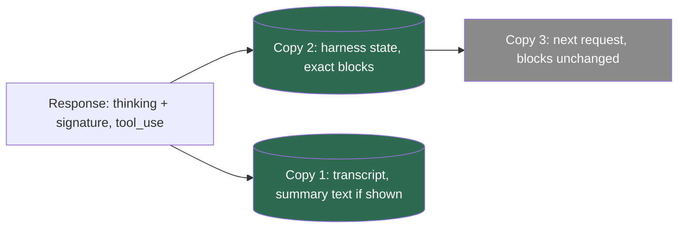

## 1. The question this idea answers

An agent on Claude Sonnet 5 answers a production question. Its response holds a `thinking` block, then a `tool_use` block. The thinking block has an empty `thinking` field and a long `signature` string. The team asks four questions:

1. The thinking text is empty. Can we delete the block before the next call to save tokens?
2. Do we pay for thinking that we never see?
3. A converter rewrites and simplifies the history before each call. Is that safe for thinking blocks?
4. What should the chat database store: the thinking text, the signature, both, or nothing?

Wrong answers here cause HTTP 400 errors in the middle of tool loops, silent loss of reasoning, and wrong cost reports. This lesson gives the exact rules from the Anthropic docs (checked on 2026-10-13) and the mapping in the Claude Agent SDK.

## 2. Mental model

> [!analogy] A sealed envelope and a summary card
> Before it answers, the model writes private working notes. It seals the full notes in an envelope with a tamper seal. Then it gives you the envelope and a card. On some models the card holds a short summary of the notes. On newer models the card is blank by default.
>
> When the task continues, you return the envelope with the next request. The model opens it and continues from its own notes. If the seal is broken, or the envelope is from another task, the model refuses it.
>
> The envelope is the `signature`. The card is the `thinking` text. You pay for the full notes, not for the card.
>
> **Where it stops working:** a real envelope is checked only for its own seal. On the newest models and accounts, the API also checks that everything before the envelope (system prompt, tools, earlier messages) is unchanged. So a change far away from the envelope, for example a cleaned system prompt, can make a perfect envelope invalid.

## 3. Terms

| Term | Plain meaning |
|---|---|
| thinking | Reasoning that the model writes before or between its visible output. |
| thinking block | A content block `{"type": "thinking", "thinking": "...", "signature": "..."}` in an assistant message. |
| adaptive thinking | The mode `{"type": "adaptive"}`. The model decides when to think and how much. |
| extended thinking | The older manual mode `{"type": "enabled", "budget_tokens": N}` with a fixed token budget. |
| effort | The setting `output_config.effort`: `low`, `medium`, `high`, `xhigh` or `max`. It controls how much work the whole response gets. |
| display | The setting `thinking.display`. It decides what the `thinking` field holds: `summarized` or `omitted`. |
| summarized thinking | A readable summary of the reasoning. It is not the full reasoning. |
| signature | An opaque string in a thinking block: "an encrypted copy of the full reasoning that you pass back unchanged". |
| `redacted_thinking` | A block with encrypted reasoning in a `data` field and no readable text. |
| interleaved thinking | Thinking blocks between tool calls inside one assistant turn. |
| tool-use turn | An assistant message with `tool_use` blocks and the user message with their results. |
| prefix check | A check that the system prompt, the tools and the earlier messages are unchanged since a thinking block was created. |
| `ThinkingConfig` | The Agent SDK type for the `thinking` option: adaptive, enabled or disabled. |

## 4. Method and math

### 4.1 Three modes, and which models accept them

The `thinking` field of a request sets the mode. The docs list a configuration table per model. This is part of it (checked on 2026-10-13):

| Model | No `thinking` field | `adaptive` | `enabled` + `budget_tokens` | `disabled` |
|---|---|---|---|---|
| Claude Sonnet 5 | Adaptive thinking | Adaptive thinking | 400 error | Thinking off |
| Claude Sonnet 5.5 | Adaptive thinking | Adaptive thinking | 400 error | 400 error |
| Claude Opus 5.5 | Adaptive thinking | Adaptive thinking | 400 error | 400 error |
| Claude Haiku 5.5 | Adaptive thinking | Adaptive thinking | 400 error | Thinking off at `high` effort or below |
| Claude Opus 4.8 and 4.7 | Thinking off | Adaptive thinking | 400 error | Thinking off |
| Claude Opus 4.6 and Sonnet 4.6 | Thinking off | Adaptive thinking | Extended thinking (deprecated) | Thinking off |
| Claude Haiku 4.5 | Thinking off | 400 error | Extended thinking | Thinking off |

Three rules follow:

1. **On the Claude 5 generation, thinking is on by default.** This includes Sonnet 5, Opus 5, Sonnet 5.5, Opus 5.5 and Haiku 5.5. You do not need to send a `thinking` field.
2. **The manual mode is gone on new models.** The extended-thinking page: "Claude 4.7 and later models do not support it and reject requests that use it, returning a 400 error." Where it still works, the budget has a "Minimum of 1,024 tokens" and must be "Less than `max_tokens`".
3. **Some models cannot disable thinking.** Sonnet 5.5 has one more value instead: `{"type": "between_tools"}`, which "turns off up-front thinking". It is accepted only at effort `high` or below.

### 4.2 Effort

Effort is a separate field: `"output_config": {"effort": "medium"}`. The docs say: "the `effort` parameter controls how much work Claude puts into the whole response, which in adaptive mode includes how often and how deeply it thinks. Don't pass `adaptive` as an `effort` value".

| Fact | Value (checked on 2026-10-13) |
|---|---|
| Values | `low`, `medium`, `high`, `xhigh`, `max` |
| Default | `high` on most models. `medium` on Opus 5.5 and Haiku 5.5. |
| `xhigh` | Available on Fable 5.1, Mythos 5.1, Fable 5, Mythos 5, Opus 5.5, Opus 5, Opus 4.8, Opus 4.7, Sonnet 5.5, Sonnet 5 and Haiku 5.5 |
| In a tool loop | "follow-up requests that only process tool results can still skip thinking at any level." |

### 4.3 Display: summarized or omitted

The `display` field decides what the `thinking` text holds.

| `display` | What you receive | Default on |
|---|---|---|
| `"summarized"` | "a readable summary of Claude's reasoning" | Opus 4.6, Sonnet 4.6 and earlier models |
| `"omitted"` | "thinking blocks are returned with an empty `thinking` field. The `signature` field still carries the encrypted full thinking for multi-turn continuity" | Fable 5.1, Mythos 5.1, Fable 5, Mythos 5, Opus 5.5, Opus 5, Sonnet 5.5, Sonnet 5, Opus 4.8, Opus 4.7, Mythos Preview, Haiku 5.5 |
| `"updates"` (beta) | Empty reasoning blocks, plus short readable progress updates between tool calls. Needs the beta header `thinking-display-updates-2026-08-18`. | none |

The documented response with `display: "omitted"`:

```json
{
  "content": [
    { "type": "thinking", "thinking": "", "signature": "EosnCkYICxIMMb3LzNrMu..." },
    { "type": "text", "text": "The answer is 12,231." }
  ]
}
```

So on Sonnet 5 with default settings, every thinking block has empty text. That is the expected result, not an error.

### 4.4 Billing: you pay for the full thinking

The thinking page says: "the tokens Claude spends reasoning are billed as output tokens, even when the thinking text isn't returned to you, and they count toward `max_tokens` alongside the response text." For the summary: "You're charged for the full thinking tokens generated by the original request, not the summary tokens." For `omitted`: "Omitting reduces latency, not cost."

The response field `usage.output_tokens_details.thinking_tokens` shows the share. The `anthropic` 1.13.0 type describes it as the "Number of output tokens the model generated as internal reasoning" and says that `output_tokens - thinking_tokens` "approximates the non-reasoning output".

> [!example] Worked example: the cost of thinking you cannot read
> A Sonnet 5 response reports `output_tokens = 1,800` and `thinking_tokens = 1,500`. The display is `omitted`. Output costs USD 10 per million tokens on Sonnet 5 (checked on 2026-10-13).
>
> - Visible output: 1,800 − 1,500 = 300 tokens.
> - Billed output: 1,800 tokens, so 1,800 × 10 / 1,000,000 = 0.018 USD.
> - Share of the bill that is thinking: 1,500 / 1,800 = 0.83, so 83%.
>
> A cost report that counts only the visible text underestimates this response by a factor of 1,800 / 300 = 6.

### 4.5 The signature

| Statement from the thinking page | What it means for your code |
|---|---|
| "an encrypted copy of the full reasoning that you pass back unchanged in multi-turn and tool-use conversations" | The signature, not the text, carries the reasoning. An empty text with a signature is a complete block. |
| "The API uses the signature to verify that thinking blocks were generated by Claude when you pass them back." | You cannot create or edit a thinking block. A changed block fails. |
| "The `signature` field is opaque: don't interpret or parse it." | Store it as an exact string. Never trim it or re-encode it. |
| "Modified thinking blocks are rejected with a 400 error." | A converter that changes the text, the signature or the order breaks the request. |

### 4.6 When you must send thinking blocks again

The thinking page gives three levels:

- "**Required:** within a tool-use turn, pass thinking blocks back."
- "**Recommended:** across turns, pass everything back."
- "**Allowed:** outside tool use, omit prior turns' thinking."

It also says: "When you return tool results, you must pass the thinking blocks from the assistant message back to the API, complete and unmodified." And: "Within the latest assistant message, the sequence of consecutive `thinking` blocks must match what the model generated in the original request: you can't rearrange, edit, or partially drop them."

> [!example] Worked example: the request after a tool call
> Call 1 returned `[thinking (empty text, signature S1), tool_use toolu_01A]`. The tool returned 412. The `messages` of call 2 must be:
>
> ```json
> [
>   { "role": "user", "content": "How many orders shipped on 2026-10-11?" },
>   { "role": "assistant", "content": [
>       { "type": "thinking", "thinking": "", "signature": "S1" },
>       { "type": "tool_use", "id": "toolu_01A", "name": "count_orders", "input": { "date": "2026-10-11" } }
>   ] },
>   { "role": "user", "content": [ { "type": "tool_result", "tool_use_id": "toolu_01A", "content": "412" } ] }
> ]
> ```
>
> Drop the empty thinking block, and you break the "Required" rule inside a tool-use turn. Fill its empty text with your own words, and the block is modified, which returns 400.

Across turns, you do not need to prune old thinking yourself. The page says: "Pass all thinking blocks back in multi-turn conversations, and the API automatically filters them, keeps the blocks needed to preserve the model's reasoning, and bills input tokens only for the blocks actually shown to Claude."

| Model group | What happens to thinking from earlier turns |
|---|---|
| Opus 4.5 and later Opus models, Sonnet 4.6 and later Sonnet models, Haiku 5.5, Fable and Mythos models | "Keep all prior turns". They "remain in context, count toward the window, and are billed as input tokens". |
| Earlier Opus and Sonnet models, and Haiku models through Haiku 4.5 | "Keep the last turn only". "When you pass older thinking blocks back, the API strips them automatically." |

### 4.7 The prefix check on the newest models

A newer page, "Preserved thinking", adds a second check (checked on 2026-10-13): a model can use an earlier thinking block "only if that model or one of a fixed set of other models produced it and nothing before the block has changed."

| Fact | Value |
|---|---|
| What is checked | "The top-level `system` prompt", "The set of `tools`" and "Every `message` before the block" |
| What is not checked | "`effort`, `max_tokens`, `output_config`, `tool_choice`, and `metadata`", and `cache_control` markers |
| Where it is enforced by default | Fable 5.1, Opus 5.5, Sonnet 5.5 and Haiku 5.5, on accounts created on or after August 31, 2026, 00:00 UTC |
| Where it is not run | "Claude Mythos 5.1 and models before Claude Fable 5.1 don't run the prefix check." So Sonnet 5 does not run it. |
| Behavior options | `thinking.block_binding.prefix_mismatch_behavior`: `"error"` (the default) or `"drop_block"`, with the beta header `thinking-binding-controls-2026-08-01` |

The 400 error begins like this (from the page):

```text
messages.1.content.0: Invalid `signature` in `thinking` block. The block is bound to a different conversation. Remove the block, or set `thinking.block_binding.prefix_mismatch_behavior` to "drop_block".
```

> [!trap] A tidy converter can invalidate all thinking
> The page gives rules for libraries and gateways. Two of them surprise many teams: "Leave a `role: "system"` message where the caller put it. Moving it into the top-level `system` field changes `system` on that request and invalidates every thinking block in the conversation." And: "To turn tool use off for a request, send `tool_choice: {"type": "none"}`. Don't remove `tools`." A harness that rebuilds the system prompt or the tool list on each call breaks the prefix of every earlier thinking block.

### 4.8 Redacted thinking

Sometimes part of the reasoning is redacted for safety. Then the response holds `{"type": "redacted_thinking", "data": "..."}`. The page says: "pass `redacted_thinking` blocks back to the API unchanged when continuing a multi-turn conversation with tools." And it warns: "Filtering on `block.type == "thinking"` alone silently drops `redacted_thinking` blocks and breaks the multi-turn protocol".

So every filter that keeps thinking must keep both types: `thinking` and `redacted_thinking`.

### 4.9 Interleaved thinking

In an agent loop, one assistant turn spans several model calls: think, call a tool, receive the result, think again, call the next tool. Thinking between tool calls is **interleaved thinking**.

| Mode | Interleaved thinking |
|---|---|
| Adaptive | "interleaved thinking is automatic on every model that supports adaptive thinking. No beta header is needed." |
| Manual, Opus 4.5, Sonnet 4.5 and earlier Claude 4 models | Needs the beta header `interleaved-thinking-2025-05-14`. Then `budget_tokens` "can exceed `max_tokens`" because the budget "spans all thinking blocks within one assistant turn". |
| Haiku 4.5 | "Claude Haiku 4.5 does not support interleaved thinking." |

Change the thinking settings only between turns. The page: "If you toggle thinking mid-turn (for example, between sending a tool call and returning its result), the API doesn't error. Instead, it silently disables thinking for that request." It also says that "Toggling thinking modes also invalidates prompt caching" ([lesson 4.2](/notes/ai/llm-apis/04-providers-and-caching/l2-prompt-caching-in-agent-loops)).

### 4.10 What each copy of the conversation keeps

An application holds three copies of one conversation ([three copies](/notes/ai/conversation-state/01-where-state-lives/l1-three-copies-of-a-conversation)). Thinking blocks belong in a different form in each copy.

| Copy | What it keeps of thinking | Why |
|---|---|---|
| Copy 1: user transcript (your database) | The summarized text, only if the UI showed it. Never the signature as display content. | The transcript records what the user saw. A blank `omitted` block was never shown. |
| Copy 2: harness state (session file or checkpoint) | Every `thinking` and `redacted_thinking` block, exact, in the original order, with signatures | The next call of a tool-use turn needs them unchanged. |
| Copy 3: model input of one call | Built from copy 2. The API filters old blocks itself. | You send everything. The API decides what the model sees. |



> [!key] Signatures live in the harness, not in the transcript
> The harness state must keep every thinking block byte for byte, because the API verifies it. The user transcript keeps only what the user saw. When a chat is rebuilt from the transcript in a new session, the old reasoning is gone. That is acceptable, because the API allows you to omit thinking from earlier turns outside a tool-use turn.

A rebuild must therefore start at a finished turn, never in the middle of a tool-use turn. You can also store signatures in your own database, for example to rebuild a Messages-shape request without a session file. Then keep them in a harness-specific column with the model id. Never mix them into display text.

### 4.11 The Agent SDK mapping

The Python SDK (0.2.165) has this type in `types.py`:

```python
ThinkingDisplay = Literal["summarized", "omitted"]

class ThinkingConfigAdaptive(TypedDict):
    type: Literal["adaptive"]
    display: NotRequired[ThinkingDisplay]

class ThinkingConfigEnabled(TypedDict):
    type: Literal["enabled"]
    budget_tokens: int
    display: NotRequired[ThinkingDisplay]

class ThinkingConfigDisabled(TypedDict):
    type: Literal["disabled"]
```

The comment above `ThinkingDisplay` says: "Opus 4.7+ defaults to "omitted" (signature-only); pass "summarized" to receive text." The SDK converts the option into CLI flags (`subprocess_cli.py`, lines 757 to 778):

| SDK option | CLI flag |
|---|---|
| `thinking={"type": "adaptive"}` | `--thinking adaptive` |
| `thinking={"type": "enabled", "budget_tokens": N}` | `--max-thinking-tokens N` |
| `thinking={"type": "disabled"}` | `--thinking disabled` |
| `display` in an adaptive or enabled config | `--thinking-display <value>` |
| `effort="high"` | `--effort high` (independent of `thinking`) |
| `max_thinking_tokens=N` (deprecated) | `--max-thinking-tokens N`. The docstring: "On newer models, this value is treated as on/off (0 = disabled, any other value = adaptive)." |

The SDK returns thinking as `ThinkingBlock(thinking, signature)` inside `AssistantMessage.content`. The `updates` display value is not in the SDK type.

> [!trap] The effort docstring is older than the docs
> The SDK docstring for `effort` says that `xhigh` is "Opus 4.7 only; falls back to `high` on other models". The effort page lists `xhigh` on many models, Sonnet 5 included (checked on 2026-10-13). The SDK only passes the value to the CLI as `--effort`. What the CLI sends for `xhigh` on each model is not documented in the SDK. Test it before you depend on it.

### 4.12 Production view

| Concern | What to do |
|---|---|
| Correctness | Copy every assistant `content` list unchanged into the harness state. Keep `thinking` and `redacted_thinking` blocks, also with empty text. |
| Converters | Never edit, reorder, merge or drop thinking blocks inside the latest assistant message. Do not move system text or change the tool list between calls. |
| Cost | Read `output_tokens` and `output_tokens_details.thinking_tokens`. Thinking is billed in full, also when omitted. Use effort to control it. |
| Latency | `omitted` reduces time to the first visible token. It does not reduce cost. |
| UI | Show summarized thinking only when you asked for it with `display: "summarized"`. Do not show a blank block as "the model thought nothing". |
| Storage | Signatures belong to the harness state, with the model id. The user transcript keeps only shown text. |
| Rebuilds | Rebuild a session only from finished turns. A rebuild cannot restore thinking, and the API allows that outside a tool-use turn. |

## 5. Code

These exercises go in `llm-apis/05-thinking.ipynb`. Exercises 2.1 to 2.3 need no API key.

**Exercise 2.1: a thinking-preservation check.** Write `check_thinking_preserved(original_content, outgoing_content)`. It compares the assistant content that the API returned with the content that your code is about to send.

Acceptance tests:

- An identical copy returns no errors.
- A copy that drops an empty-text thinking block returns an error that names "dropped".
- A copy that changes one character of a signature returns an error that names "modified".
- A copy that drops a `redacted_thinking` block returns an error.

**Exercise 2.2: split for two copies.** Write `split_for_copies(content, shown)`. `shown` is `True` when the UI displayed the thinking. It returns `(transcript_parts, harness_blocks)`.

Acceptance tests:

- `harness_blocks` equals `content` exactly, signatures included.
- With an `omitted` block, `transcript_parts` holds no thinking part.
- With a summarized block and `shown=True`, `transcript_parts` holds its text, and no signature.

**Exercise 2.3: validate a thinking config per model.** Write `thinking_body(model, mode, effort=None)`. It returns the `thinking` and `output_config` fields for a request, or raises `ValueError` for a combination that the table of section 4.1 marks as "400 error".

Acceptance tests:

- `("claude-sonnet-5", "enabled")` raises.
- `("claude-sonnet-5-5", "disabled")` raises, and the message suggests `between_tools`.
- `("claude-sonnet-5", "adaptive", "medium")` returns `{"thinking": {"type": "adaptive"}, "output_config": {"effort": "medium"}}`.

**Exercise 2.4 (optional, calls the model): pay for what you cannot see.** Send one hard question to Sonnet 5 twice: once with `display: "omitted"` and once with `display: "summarized"`.

Acceptance tests:

- The omitted response has thinking blocks with empty text and non-empty signatures.
- Record `output_tokens` and `thinking_tokens` for both, and explain in two sentences why both responses are billed for their full thinking.

## 6. Common mistakes

1. **Deleting thinking blocks with empty text.** With `omitted` display, the text is empty by design. The signature carries the reasoning, and a tool-use turn needs it.
2. **Filtering on `type == "thinking"` only.** This drops `redacted_thinking` blocks and breaks the turn.
3. **"Omitted thinking is free."** You pay for the full thinking. Omitting reduces latency only.
4. **Sending `{"type": "enabled", "budget_tokens": ...}` to Sonnet 5.** Claude 4.7 and later models return 400. Use adaptive thinking with effort.
5. **Changing thinking settings in the middle of a tool-use turn.** The API silently disables thinking for that request, and the cache prefix changes.
6. **Rewriting the system prompt or the tool list in a converter.** On models with the prefix check, this invalidates every earlier thinking block.
7. **Storing signatures as display content in the user transcript.** They are harness state, not something the user saw.

## 7. One-minute explanation

On the Claude 5 generation, Sonnet 5 included, thinking is on by default in adaptive mode, and you control its depth with `output_config.effort`. The old manual mode with `budget_tokens` returns 400 on Claude 4.7 and later. A thinking block has two fields. The `thinking` field holds a summary, or nothing by default on new models. The `signature` field holds an encrypted copy of the full reasoning. You pay for the full reasoning as output tokens even when you see nothing. Inside a tool-use turn you must send every thinking and redacted thinking block again, complete and unchanged, or the API returns 400. Across turns you should send everything, and the API filters what the model sees. On the newest models and accounts, the API also checks that the system prompt, the tools and the earlier messages did not change. So the harness state keeps every block byte for byte, while the user transcript keeps only the summary text that the user saw.

## 8. Check questions

```check
{
  "question": "A harness on Sonnet 5 removes thinking blocks whose thinking text is empty, to save tokens. The next call after a tool result fails with HTTP 400. Explain why, in terms of display and the pass-back rules.",
  "hint": "What is the default display on Sonnet 5, and what does the signature carry?",
  "answer": "On Sonnet 5 the default display is omitted, so thinking text is always empty, but the signature carries the full encrypted reasoning. Within a tool-use turn, the thinking blocks of the assistant message must be sent again complete and unmodified. Removing them breaks that rule, so the API rejects the request. Keep every thinking block, also with empty text."
}
```

```check
{
  "question": "A response has output_tokens = 2,400 and thinking_tokens = 2,000, with display omitted. Output costs USD 10 per million tokens. What is the output cost, and what share is thinking?",
  "answer": "2,400 × 10 / 1,000,000 = 0.024 USD. The thinking share is 2,000 / 2,400 ≈ 0.83, so about 83%. Omitted thinking is billed in full."
}
```

```check
{
  "question": "A gateway moves a mid-conversation system message into the top-level system field before it forwards requests to Claude Sonnet 5.5, on an account created in September 2026. What can go wrong?",
  "answer": "The prefix check of preserved thinking is enforced by default on Sonnet 5.5 for accounts created on or after August 31, 2026. Moving the message changes the top-level system field, which is part of the checked prefix, so every earlier thinking block becomes invalid. With the default behavior error, the API returns 400 and says the block is bound to a different conversation."
}
```

```check
{
  "question": "Which copy of the conversation should keep the thinking signatures, and which copy should keep the summarized thinking text? Give one reason for each.",
  "answer": "The harness state (copy 2) keeps every thinking and redacted_thinking block with its signature, exact and in order, because the next request of a tool-use turn needs them unchanged. The user transcript (copy 1) keeps only the summarized text that the UI showed, because it records what the user saw. It never keeps signatures as display content."
}
```

## 9. Links

- Previous: [L1: Stream events](/notes/ai/llm-apis/02-streaming-and-thinking/l1-stream-events)
- Next part: [L3.1: The OpenAI chat shape](/notes/ai/llm-apis/03-openai-format/l1-the-openai-chat-shape)
- Where thinking blocks appear: [L1.1: Messages and content blocks](/notes/ai/llm-apis/01-messages-api/l1-messages-and-content-blocks)
- The three copies: [Three copies of a conversation](/notes/ai/conversation-state/01-where-state-lives/l1-three-copies-of-a-conversation)
- The SDK block types: [Agent SDK L2.2: Message and block types](/notes/ai/claude-agent-sdk/02-options-and-messages/l2-message-and-block-types)
- Cache effects of thinking settings: [L4.2: Prompt caching in agent loops](/notes/ai/llm-apis/04-providers-and-caching/l2-prompt-caching-in-agent-loops)
- [Glossary](/notes/ai/llm-apis/glossary)
