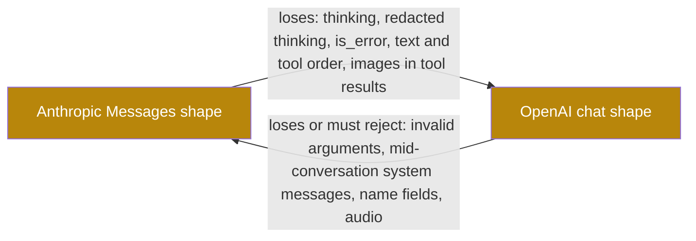

## 1. The question this idea answers

A chat service stores one history and serves two harnesses. The Claude Agent SDK path needs the Anthropic Messages shape. The LangChain path with `ChatDatabricks` needs the OpenAI chat shape ([lesson 1.3](/notes/ai/llm-apis/01-messages-api/l3-the-api-sets-the-format)). So some code must convert a conversation from one shape to the other, sometimes on every request.

A converter looks simple: rename a few fields. But a wrong converter fails in quiet ways. It drops a thinking block, and the next tool-use call returns HTTP 400. It puts a user message before tool results, and the endpoint rejects the order. It loses `is_error`, and the model believes that a failed query returned data. This lesson maps every block type in both directions, names what is lost, and shows how to test a converter with round trips.

All results below come from a reference converter that ran in the sandbox on 2026-10-13. Its outputs were validated message by message and block by block against the types of `anthropic` 1.13.0 and `openai` 3.29.0. The notes show only short excerpts of it, because exercise 2.1 asks you to write your own.

## 2. Mental model

> [!analogy] Translating a contract between two languages
> A contract written in language A must be read by a lawyer who reads only language B. Many words have exact equivalents: names, dates, amounts. Some sentences need a new structure, because B orders the parts differently. And some items have no equivalent at all: a notary's stamp is valid only on the original document. A translator can describe the stamp in a footnote, but the footnote is not a stamp.
>
> Ids and tool names are the words with exact equivalents. Tool input as an object or a string is the sentence that needs a new structure. A thinking signature is the notary's stamp.
>
> **Where it stops working:** a human translator can ask the author what a sentence means. A converter cannot. The source can be ambiguous or broken, for example tool arguments that are not valid JSON. Then the converter must follow a rule chosen in advance: fail, repair or mark. Each choice has a cost.

## 3. Terms

| Term | Plain meaning |
|---|---|
| converter | Code that converts a conversation in one wire format into the other wire format. |
| mapping | The rule that says which item of one format becomes which item of the other. |
| lossy | A conversion that drops information that the target format cannot hold. |
| lossless subset | The part of a conversation that both formats can express exactly. |
| round trip | A conversion to the other format and back again. |
| normalization | Rewriting equal forms into one form before you compare them, for example a content string into a list with one text block. |
| canonical JSON | One fixed way to write a JSON object as text, so that equal objects give equal strings. |
| data URL | A URL that holds the file bytes inline, for example `data:image/png;base64,iVBORw0K`. |
| loss report | A list that a converter returns with every item that it dropped or changed. |
| pass-through | Copying an item that the converter does not understand into the output unchanged. |

## 4. Method and math

### 4.1 Each direction loses something different



> [!key] Convert from the richest stored form, never through a lossy hop
> A conversion can only remove information. Store the richest form that you received ([lesson 1.3, section 4.7](/notes/ai/llm-apis/01-messages-api/l3-the-api-sets-the-format)). Build each wire format directly from the store. Never build the Anthropic request from an OpenAI request that you built earlier.

### 4.2 Anthropic Messages to OpenAI chat

| Anthropic item | OpenAI item | Lossy? |
|---|---|---|
| top-level `system` string | first message `{"role": "system", "content": ...}`. Use `developer` only if the endpoint documents it. | No |
| `system` as a list of text blocks | one `system` message with the texts joined | Yes: block borders and `cache_control` markers |
| user `text` block | text in `content`, or a `{"type": "text"}` part | No |
| user `image`, source `base64` | part `{"type": "image_url", "image_url": {"url": "data:<media_type>;base64,<data>"}}` | No |
| user `image`, source `url` | part `image_url` with the same URL | No |
| user `image`, source `file` (a file id) | no equivalent | Yes |
| user `document` (PDF or text) | a `file` part exists in the OpenAI type, with `file_data`, `file_id` or `filename`. Support on an OpenAI-compatible endpoint is not documented. | Yes, unless the endpoint supports it |
| `tool_result` with string content | `{"role": "tool", "tool_call_id": <tool_use_id>, "content": <string>}` | No |
| `tool_result` with text blocks | `tool` message with text parts | No |
| `tool_result` with image or document blocks | no place: tool content accepts text parts only | Yes |
| `tool_result` with `is_error: true` | `tool` message with no flag | Yes: write the failure into the text |
| several `tool_result` blocks in one user message | several `tool` messages, in the same order | No |
| text after the results in that user message | a separate `user` message after the `tool` messages | No, if the order is right (section 4.5) |
| assistant `text` blocks | `content` string. Several blocks are joined, or kept as a list of text parts. | Joining loses block borders |
| assistant `tool_use` | item of `tool_calls`: `{"id", "type": "function", "function": {"name", "arguments": json.dumps(input)}}` | No, as data |
| text block after a `tool_use` block | `content` and `tool_calls` are separate | Yes: the order |
| `thinking` | no standard field | Yes |
| `redacted_thinking` | no standard field | Yes |
| `server_tool_use` and its result blocks | no standard field | Yes |
| tool name of 65 to 128 characters | not allowed: OpenAI names have "a maximum length of 64" | Must be renamed |

The core of the tool mapping in the reference converter is three lines:

```python
calls.append({"id": b["id"], "type": "function",
              "function": {"name": b["name"],
                           "arguments": json.dumps(b["input"], ensure_ascii=False)}})
```

### 4.3 OpenAI chat to Anthropic Messages

| OpenAI item | Anthropic item | Lossy? |
|---|---|---|
| leading `system` or `developer` messages | top-level `system` (texts joined) | No |
| a `system` or `developer` message later in the list | no exact equivalent on most models. Options: a text block in a user message, or a mid-conversation system message on the few models that accept it ([lesson 1.1](/notes/ai/llm-apis/01-messages-api/l1-messages-and-content-blocks)). | Yes: its rank as an instruction |
| user string or text parts | user text blocks | No |
| `image_url` with a data URL | `image` with source `base64`, `media_type` from the URL head | No (`detail` is lost) |
| `image_url` with an https URL | `image` with source `url` | No (`detail` is lost) |
| `input_audio` part | no equivalent | Yes |
| assistant `content` string | a `text` block | No |
| assistant `content: null` with `tool_calls` | no text block | No |
| assistant `refusal` | no equivalent field | Yes |
| `tool_calls` item, valid JSON object in `arguments` | `tool_use` with `input = json.loads(arguments)` | Bytes of the string are lost (section 4.4) |
| `arguments` that are not valid JSON | no valid `tool_use`: `input` must be an object (`Required[Dict[str, object]]` in the type) | Must fail, repair or mark |
| `arguments` that are valid JSON but not an object, for example `[1, 2]` | no valid `tool_use` | Must fail or mark |
| consecutive `tool` messages | one `user` message with several `tool_result` blocks | No |
| a `user` message right after `tool` messages | text blocks appended after the `tool_result` blocks of the same user message | No |
| `name` field on a message | no equivalent | Yes |
| several `choices` (`n` > 1) | one message | Choose one choice before you store it |

### 4.4 Tool input: object or string

The Anthropic `input` is an object. The OpenAI `arguments` is text. So the converter calls `json.dumps` in one direction and `json.loads` in the other. Two facts from the sandbox:

> [!example] Worked example: a round trip changes the bytes
> The reference converter converted an OpenAI call with `"arguments": "{\"date\":\"2026-10-10\"}"` into Anthropic and back. The real output:
>
> ```text
> compact arguments string survives byte-for-byte: False -> {"date": "2026-10-10"}
> ```
>
> The data is equal: both strings parse to `{"date": "2026-10-10"}`. The text is not: `json.dumps` writes a space after the colon. A test that compares the strings fails. A test that compares the parsed objects passes.

> [!example] Worked example: invalid arguments
> With `"arguments": "{\"date\": \"2026-10-11\""` (no closing brace), the reference converter raised:
>
> ```text
> invalid arguments -> tool call call_1: arguments are not valid JSON: Expecting ',' delimiter: line 1 column 22 (char 21)
> ```
>
> Raising is one choice. Two others: keep the call and put the raw text into a marker object, or drop the call and its tool message together. Never drop only the call: its tool message then becomes an orphan.

If a call starts life in the OpenAI shape, store its raw `arguments` string next to the parsed object. Then the OpenAI path can send the exact original bytes again.

### 4.5 Grouped and separate tool results

The Anthropic shape groups the results of a parallel call in one user message, results first ([lesson 1.2](/notes/ai/llm-apis/01-messages-api/l2-tool-use-and-tool-result)). The OpenAI shape gives each result its own `tool` message, and these must come right after the assistant message ([lesson 3.1](/notes/ai/llm-apis/03-openai-format/l1-the-openai-chat-shape)).

The reference converter converted a user message `[tool_result A, tool_result B (is_error), text "Retry once if a call fails."]` into this order of roles:

```text
roles: ['system', 'user', 'assistant', 'tool', 'tool', 'user']
loss: [('thinking', 'thinking'), ('is_error', 'toolu_B')]
```

The tool messages come first, then the remaining text as a new user message. The loss report names the two items that the OpenAI shape could not hold. The key line of the reference converter is a comment and one call:

```python
out.extend(tool_msgs)  # tool messages first: they answer the previous assistant message
```

In the other direction, the converter merges consecutive `tool` messages and a following `user` message into one user message, with all `tool_result` blocks first. The sandbox result for `assistant(2 calls), tool, tool, assistant`:

```text
O->A two tool messages -> [('user', ['text']), ('assistant', ['tool_use', 'tool_use']), ('user', ['tool_result', 'tool_result']), ('assistant', ['text'])]
```

### 4.6 Same-role merging

The Messages API combines consecutive messages with the same role into one turn ([lesson 1.1](/notes/ai/llm-apis/01-messages-api/l1-messages-and-content-blocks)). A converter that targets the Anthropic shape should merge them itself, for two reasons. First, rule R4 of lesson 1.2 wants all results of a parallel call in one message. Second, a merged list is easier to test, because what you send equals what the API sees.

In the OpenAI direction, keep the messages separate. A `tool` message cannot merge with anything, because each one carries its own `tool_call_id`.

### 4.7 Thinking has no OpenAI equivalent

The standard OpenAI chat shape has no field for a thinking block or its signature. A converter to that shape has three options:

| Option | Result |
|---|---|
| Drop the blocks and record the loss | Valid for a standard OpenAI endpoint. The model loses its earlier reasoning. |
| Map to a provider extension, for example the Databricks `reasoning` item | Works only on that provider. The client library must keep the item ([lesson 1.3, section 4.6](/notes/ai/llm-apis/01-messages-api/l3-the-api-sets-the-format) shows that `ChatDatabricks` converts it into a string). |
| Pass the block through unchanged | Invalid for the OpenAI types. In the sandbox, the strict `openai` 3.29.0 validator rejected an assistant content part of type `thinking` with "Field required". |

What is lost when the blocks are dropped? Outside a tool-use turn, only the model's earlier reasoning, and the Anthropic docs allow that: "**Allowed:** outside tool use, omit prior turns' thinking" ([lesson 2.2](/notes/ai/llm-apis/02-streaming-and-thinking/l2-thinking-blocks-and-signatures)). Inside a tool-use turn, much more is lost: you can never return that turn to an Anthropic endpoint, because the required thinking blocks are gone.

> [!trap] Never switch format in the middle of a tool-use turn
> Convert a history only at a finished turn: after an assistant message with no `tool_use` blocks. A turn that is still in its tool loop needs its thinking blocks unchanged on the Anthropic side. A converter cannot rebuild them.

### 4.8 Ids

Copy every id unchanged: the `tool_use` id becomes the tool call `id`, and the `tool_use_id` of a result becomes the `tool_call_id`. Never create new ids. The pairing in both formats depends on exact matches.

The Anthropic type files declare the `tool_use` id only as a string. They do not document a character pattern (checked on 2026-10-13). The ids in the OpenAI guide, such as `call_DdmO9pD3xa9XTPNJ32zg2hcA`, use only letters, digits and `_`. If a provider creates ids with other characters, test them on the Anthropic endpoint before you depend on them.

### 4.9 LangChain's convert_to_openai_messages

LangChain has a ready converter: `convert_to_openai_messages(messages, *, text_format="string", include_id=False, pass_through_unknown_blocks=True)` in `langchain_core.messages` (langchain-core 1.6.10). Its docstring says that it accepts messages "whose contents are in OpenAI, Anthropic, Bedrock Converse, or VertexAI formats". The sandbox ran it on Anthropic-shape dictionaries. Five real behaviors:

| Input | What the function did | Assessment |
|---|---|---|
| `tool_use` block | an item of `tool_calls`, `arguments` = `"{\"date\": \"2026-10-11\"}"` | Correct |
| `tool_result` with `is_error: true` | `{"role": "tool", "tool_call_id": "toolu_A", "content": "timeout after 30 s"}` with no error marker | Lossy. The source sets `status="error"` on an internal `ToolMessage`, but the output dictionary has no field for it. |
| `image` block with base64 source | `image_url` part with a data URL | Correct |
| `thinking` and `redacted_thinking` blocks | copied into the assistant `content` list unchanged | Invalid for the OpenAI types. The source passes `thinking` and `reasoning` blocks even with `pass_through_unknown_blocks=False`. |
| user message `[tool_result A, tool_result B, text]` | order `assistant, user, tool, tool` | Wrong order: the user text comes before the tool messages |

The order comes from this line of the source:

```python
oai_messages.extend([oai_msg, *tool_messages])
```

So the user message with the remaining text is sent first, and the tool messages follow it. The safe rule of lesson 3.1 puts the tool messages directly after the assistant message. Does your history have text after tool results in the same user message? Then move that text to the next turn before you call this function, or write your own converter. [LangChain messages](/notes/ai/langchain-langgraph/01-foundations/l1-langchain-messages) covers the message classes.

### 4.10 Testing a converter

Three properties catch most converter bugs:

| Property | Test | Sandbox result |
|---|---|---|
| Round trip A to O to A | Equal after normalization, for a conversation in the lossless subset | `round trip A->O->A equal without normalizing: False`, then `True` after the string shorthand was normalized |
| Round trip O to A to O | Equal, with arguments compared as parsed objects | `O->A->O equal: True` for arguments written by `json.dumps` |
| Loss report | Every lossy item appears in the report | `[('thinking', 'thinking'), ('is_error', 'toolu_B')]` for the parallel example |

Why did the first round trip fail before normalization? The source message had `"content": "How many orders shipped on 2026-10-11?"`, a string. The converted message had the long form, a list with one text block. Both mean the same thing to the API ([lesson 1.1](/notes/ai/llm-apis/01-messages-api/l1-messages-and-content-blocks)), so the test must normalize both sides first.

### 4.11 Production view

| Concern | What to do |
|---|---|
| Correctness | Validate every converter output block by block against the official SDK types. Run the round-trip tests in CI. |
| Data safety | Convert from the store to each wire format. Never chain conversions. Never save a converted request as history. |
| Observability | Return and log a loss report for each conversion. Count dropped thinking blocks and lost error flags. |
| Tool failures | When `is_error` must go to the OpenAI shape, put a fixed marker into the text, for example `ERROR:`, and keep the flag in the store. |
| Timing | Switch a chat between harnesses only at a finished turn, never inside a tool loop. |
| Libraries | Read what a library converter does before you use it. Test it with parallel calls, failed tools, thinking and text after results. |

## 5. Code

These exercises go in `llm-apis/07-convert.ipynb`. They need no API key. Install `anthropic`, `openai` and `langchain-core`.

**Exercise 2.1: a converter, both ways.** Write `anthropic_to_openai(system, messages)` and `openai_to_anthropic(messages)`. Each returns the converted conversation and a loss report.

Acceptance tests:

- The three-message conversation of [lesson 1.3](/notes/ai/llm-apis/01-messages-api/l3-the-api-sets-the-format) converts both ways and validates block by block against `MessageParam` and `ChatCompletionMessageParam`.
- A to O to A gives the original conversation after normalization of the string shorthand.
- O to A to O gives the original conversation when the arguments are compared as parsed objects.
- A user message `[tool_result A, tool_result B, text]` gives the roles `tool, tool, user`, in this order.
- Two consecutive `tool` messages and a `user` message give one Anthropic user message with the two `tool_result` blocks first.
- `is_error` and thinking blocks appear in the loss report of the A to O direction.
- Invalid `arguments` raise an error that names the tool call id, or produce a marker that your tests document. Choose one and test it.

**Exercise 2.2: compare with LangChain.** Run `convert_to_openai_messages` and your converter on the parallel example of section 4.5.

Acceptance tests:

- Print both role orders, and explain the difference in one sentence.
- Show that your converter's output passes your validator from [lesson 3.1, exercise 1.1](/notes/ai/llm-apis/03-openai-format/l1-the-openai-chat-shape) and LangChain's output does not.

**Exercise 2.3: a safe switch point.** Write `last_safe_switch_index(messages)`. It returns the index of the last assistant message that has no `tool_use` blocks.

Acceptance tests:

- A history that ends inside a tool loop returns the index of the last finished answer before that loop.
- A history with no finished answer returns `None`.

## 6. Common mistakes

1. **Comparing `arguments` strings in tests.** `json.dumps` changes spacing. Compare the parsed objects.
2. **Putting user text before the tool messages.** The tool messages must come directly after the assistant message.
3. **Passing thinking blocks into the OpenAI shape.** The OpenAI types reject them. Drop them with a loss report, or use a documented provider extension.
4. **Dropping `is_error` silently.** Write the failure into the tool text and keep the flag in the store.
5. **Creating new tool ids.** Copy every id, or the pairing breaks.
6. **Converting in the middle of a tool loop.** The thinking blocks that the Anthropic side needs cannot be rebuilt.
7. **Chaining conversions.** Each hop can only lose information. Convert from the store.

## 7. One-minute explanation

A converter between the Anthropic and OpenAI shapes renames and restructures items, and some items have no equivalent. The system prompt moves between a top-level field and a first message. A `tool_use` block becomes a `tool_calls` item, with `json.dumps` of the input as the `arguments` string, and back with `json.loads`, which fails on invalid JSON. Several `tool_result` blocks in one user message become several `tool` messages directly after the assistant message, and any user text must follow them. The Anthropic to OpenAI direction loses thinking blocks, redacted thinking, the `is_error` flag, images in tool results and the order of text around tool calls. The other direction loses names, refusals, audio and the rank of mid-conversation system messages. Ids must be copied exactly. Test a converter with round trips after normalization, compare arguments as parsed objects, validate every block against the SDK types, and return a loss report. LangChain's `convert_to_openai_messages` is useful, but it drops `is_error`, keeps thinking blocks that the OpenAI types reject, and puts trailing user text before the tool messages.

## 8. Check questions

```check
{
  "question": "Your converter converts an Anthropic user message [tool_result A, tool_result B, text \"Use metric units.\"] into OpenAI messages. Write the roles of the output messages in order, and explain why this order.",
  "answer": "tool (A), tool (B), user (\"Use metric units.\"). The tool messages must come directly after the assistant message with the tool_calls, one per call id. The text becomes a separate user message after them."
}
```

```check
{
  "question": "A round-trip test O -> A -> O fails although the conversation looks identical. The only difference is {\"date\":\"2026-10-10\"} versus {\"date\": \"2026-10-10\"}. Is the converter wrong? What do you change?",
  "answer": "The converter is not wrong as data. json.loads and json.dumps keep the object but change the spacing of the text. Change the test to compare json.loads of both arguments strings. If the exact bytes matter, store the raw arguments string from the OpenAI side and send it again unchanged."
}
```

```check
{
  "question": "Name four items that are lost when you convert an Anthropic conversation to the standard OpenAI chat shape.",
  "answer": "Any four: thinking blocks with signatures, redacted_thinking blocks, the is_error flag of tool results, images or documents inside tool results, the order of text relative to tool calls in one assistant message, server tool blocks, cache_control markers and the block borders of a list system prompt."
}
```

```check
{
  "question": "A chat is in the middle of a tool loop on the Agent SDK harness. The service wants to move it to the LangChain harness now. Why is this unsafe, and what is the rule?",
  "hint": "What does the Anthropic side require inside a tool-use turn?",
  "answer": "Inside a tool-use turn, the thinking blocks of the assistant message must return unchanged. The OpenAI shape cannot carry them, so after the move the turn can never return to the Anthropic side, and the reasoning of the open turn is lost. The rule: switch format only at a finished turn, an assistant message with no tool_use blocks."
}
```

## 9. Links

- Previous: [L1: The OpenAI chat shape](/notes/ai/llm-apis/03-openai-format/l1-the-openai-chat-shape)
- Next part: [L4.1: Claude on Microsoft Foundry](/notes/ai/llm-apis/04-providers-and-caching/l1-claude-on-microsoft-foundry)
- Why two formats exist: [L1.3: The API sets the format, not the model](/notes/ai/llm-apis/01-messages-api/l3-the-api-sets-the-format)
- Thinking rules: [L2.2: Thinking blocks and signatures](/notes/ai/llm-apis/02-streaming-and-thinking/l2-thinking-blocks-and-signatures)
- LangChain message classes: [LangChain messages](/notes/ai/langchain-langgraph/01-foundations/l1-langchain-messages)
- Building requests from the store: [From stored parts to model input](/notes/ai/conversation-state/02-chat-history-model/l2-from-stored-parts-to-model-input)
- [Glossary](/notes/ai/llm-apis/glossary)
