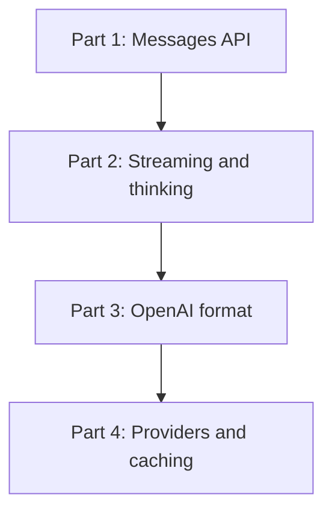

## The map

## Parts

| Part | Folder | Lessons | Pages written | Content |
|---|---|---|---|---|
| 1 | [01 Messages API](/notes/ai/llm-apis/01-messages-api) | 3 | 3 | Request and response, content blocks, roles, tool_use and tool_result |
| 2 | [02 Streaming and thinking](/notes/ai/llm-apis/02-streaming-and-thinking) | 2 | 2 | Server-sent events, deltas, thinking blocks and signatures |
| 3 | [03 OpenAI format](/notes/ai/llm-apis/03-openai-format) | 2 | 2 | The OpenAI chat shape and conversion |
| 4 | [04 Providers and caching](/notes/ai/llm-apis/04-providers-and-caching) | 2 | 2 | Claude on Microsoft Foundry, prompt caching in agent loops |

A **lesson** is one idea. A **session** is one sitting. A lesson page can exist before I study it. Its status stays `not-started` until I pass its gate.

## How each session works

1. **Recall.** One or two questions on old lessons that are due.
2. **Problem.** The question that the idea answers, and why it matters in a real agent.
3. **Intuition.** A picture or an analogy, and the point where the analogy stops working.
4. **Visual.** A diagram, a figure or a Manim video.
5. **Mechanism.** The exact technical details. Every claim has a source.
6. **Experiment.** A small test that proves the claim: a fake model, a local file, a local database.
7. **Code.** I write the code myself. Hints come in three levels: idea, pseudocode, partial code.
8. **Check and explain back.** Check questions, then I teach the idea back.
9. **Close.** Session report in chat, then a notes update.

> [!key] Gate rule
> A gate passes only when I answer the check questions correctly in my own words. "I understand" does not pass a gate. A correct answer with a wrong reason does not pass.
