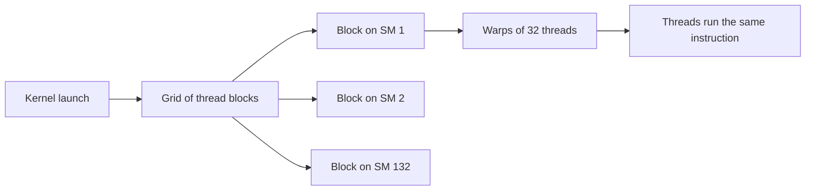

## 1. The question this idea answers

Llama-3.1-8B needs about 16 billion floating-point operations (16 GFLOP) to produce one token ([L2](/notes/ai/llm-systems/01-math-and-hardware/l2-matrices-and-matrix-multiplication)). An NVIDIA H100 can do about 989 trillion BF16 operations per second. Divide, and one token should take about 16 microseconds: more than 60,000 tokens per second.

In reality, one sequence on one H100 gets at most about 208 tokens per second. That is about 300 times slower than the arithmetic allows. Where does the time go?

The answer is **memory bandwidth**. To produce one token, the GPU must read all 16 GB of weights from its memory. At 3.35 TB/s that takes about 4.8 ms, no matter how fast the arithmetic is. This single fact explains most of LLM serving. It explains why decode is slow, why batching helps and why the KV cache size matters so much. It also explains why quantization speeds up generation, and why PagedAttention was invented. The interviewer who asks about the KV cache "and its implementation" expects you to know this hardware story. This lesson is the hardware foundation for parts 03 and 04.

## 2. Mental model

> [!analogy] A kitchen with a slow conveyor belt from the warehouse
> A huge kitchen has thousands of cooks (the arithmetic units). Each cook has a tiny cutting board (registers), and each team of cooks shares a small counter (shared memory). Ingredients live in a big warehouse across the road (HBM, the GPU's main memory). A conveyor belt of fixed speed brings them over (the bandwidth). If each ingredient needs a lot of work, such as a dish that uses every vegetable many times, the cooks are the bottleneck: **compute-bound**. If each ingredient needs only one quick cut, the cooks stand idle and wait for the belt: **memory-bound**. Decode is a kitchen where every vegetable gets one cut.
>
> **Where it stops working:** a real GPU starts the next delivery while the cooks still work, so loading and computing overlap. It keeps recent ingredients on a nearby shelf (the L2 cache). It also has a delay before the first delivery arrives (latency), which matters for tiny jobs. And the cooks work in groups of 32 that must do the same step at the same time (warps).

## 3. Terms

| Term | Plain meaning |
|---|---|
| CPU | The general-purpose processor: a few strong cores, built to finish one task fast. |
| GPU | A processor with thousands of simple arithmetic units, built to finish many identical tasks per second. |
| streaming multiprocessor (SM) | One of the many processor blocks of an NVIDIA GPU. An H100 SXM has 132. |
| thread | One sequence of instructions. A GPU runs many thousands at once. |
| warp | A group of 32 threads that run the same instruction at the same time. |
| thread block | A group of threads that run on one SM and can share its fast memory. |
| kernel | A function that runs on the GPU. One kernel launch starts a grid of thread blocks. |
| Tensor Core | A unit inside an SM that does a small matrix multiply-accumulate in one step. |
| HBM | High Bandwidth Memory: the GPU's main memory, stacked next to the chip. 80 GB on an H100 SXM. |
| SRAM, shared memory | Small, very fast memory on the chip, inside each SM. |
| register | The fastest storage, private to one thread. |
| L2 cache | On-chip memory shared by all SMs. 50 MB on an H100 SXM. |
| bandwidth | How many bytes per second can move between two places, for example 3.35 TB/s from HBM. |
| latency | The delay before the first byte of a request arrives. |
| FLOP/s, TFLOPS | Floating-point operations per second. 1 TFLOPS $= 10^{12}$ FLOP/s. |
| arithmetic intensity | FLOPs done per byte moved between HBM and the chip. |
| roofline model | A chart of the attainable FLOP/s as a function of arithmetic intensity. |
| ridge point | The intensity where the memory limit and the compute limit meet: peak FLOP/s divided by bandwidth. |
| memory-bound, compute-bound | Limited by bytes per second, or limited by FLOPs per second. |
| NVLink, PCIe | Links between GPUs (NVLink) and between a GPU and the CPU (PCIe). |

All terms are also in the [Glossary](/notes/ai/llm-systems/glossary).

## 4. CPU versus GPU

### 4.1 Two designs for two goals

A **CPU** has a small number of complex cores. Each core predicts branches, reorders instructions and has large caches. The goal is to finish one sequence of instructions as fast as possible: low latency.

A **GPU** spends its chip area on arithmetic instead. The goal is the largest number of operations per second: high throughput. The NVIDIA Hopper architecture blog describes the H100 SXM5 as 132 SMs with 128 FP32 cores each, so 16,896 FP32 cores. Each SM also has 4 Tensor Cores, so 528 in total.

Neural networks suit this design. A matrix multiplication of $4096 \times 4096$ by $4096 \times 4096$ contains $4096^2 \approx 16.8$ million independent dot products. Each one can go to a different thread.

### 4.2 SMs, warps, threads, blocks and kernels

The CUDA Programming Guide defines the vocabulary:

- "a function that is invoked for execution on the GPU is, for historical reasons, called a *kernel*."
- "A block of threads is referred to [...] as a *thread block*." "Thread blocks are organized into a *grid*."
- "the GPU can be considered to be a collection of *Streaming Multiprocessors* (SMs)". "Different thread blocks within the grid are scheduled among the available SMs and may be executed in any order."
- "Within a thread block, threads are organized into groups of 32 threads called *warps*." "A warp executes the kernel code in a *Single-Instruction Multiple-Threads* (SIMT) paradigm."



**Why so many threads?** A read from HBM takes a long time compared with one arithmetic instruction. An SM keeps many warps ready, up to 2,048 threads (64 warps) per SM for compute capability 9.0, the Hopper generation. When one warp waits for memory, the scheduler runs another warp. Many warps in flight hide the latency. This works only if there is enough independent work, which is another reason why GPUs need large batches.

### 4.3 Tensor Cores, and how to read a datasheet

A **Tensor Core** multiplies two small matrix tiles and adds the result to an accumulator in one operation. NVIDIA's "GPU Performance Background User's Guide" says Tensor Cores "accelerate matrix multiply and accumulate operations" and "operate on small matrix blocks". It also says: "Tensor Cores can compute and accumulate products in higher precision than the inputs". Work that is not a matrix multiplication, such as adding two tensors element by element, runs on the ordinary CUDA cores.

The H100 SXM datasheet numbers show how much the Tensor Cores and the number format matter:

| H100 SXM rate (NVIDIA product page) | Stated value | Dense value |
|---|---|---|
| FP32 (CUDA cores) | 67 TFLOPS | 67 TFLOPS |
| TF32 Tensor Core | 989 TFLOPS with sparsity | about 495 TFLOPS |
| BF16 Tensor Core | 1,979 TFLOPS with sparsity | about 989 TFLOPS |
| FP8 Tensor Core | 3,958 TFLOPS with sparsity | about 1,979 TFLOPS |

> [!trap] Dense versus "with sparsity"
> NVIDIA marks the Tensor Core rates "With sparsity". Since the Ampere generation, Tensor Cores can skip zeros in a fixed "2:4" pattern: NVIDIA's Ampere blog says the pattern "allows two non-zero values in every four-entry vector" and "doubles math throughput by skipping the zeros". Normal LLM weights are dense. So for LLM math, **use half the "with sparsity" number**. The L4 page states it directly: "Specifications are one-half lower without sparsity." This guide always uses dense rates.

## 5. The memory hierarchy


Memory on a GPU forms a hierarchy. Each level is larger and slower than the level above it. The numbers below are for the H100 SXM5 (NVIDIA Hopper architecture blog and H100 product page).

| Level | Size on H100 SXM5 | Who can use it | Notes |
|---|---|---|---|
| Registers | 256 KB per SM, 33,792 KB total | One thread | The fastest storage |
| Shared memory and L1 cache | 256 KB per SM combined, up to 228 KB as shared memory | The threads of one block | On-chip SRAM. The programmer controls shared memory. |
| L2 cache | 50 MB | All SMs | On chip. 1.25 times the 40 MB of the A100. |
| HBM3 | 80 GB | All SMs | Off the chip, about 3.35 TB/s |

Two facts follow from the table.

1. **Weights do not fit on the chip.** All on-chip SRAM together is about 33 MB plus 33 MB of registers, and L2 is 50 MB. The weights of Llama-3.1-8B are 16 GB, about 320 times L2. HBM is 1,600 times larger than L2. So every forward pass streams the weights from HBM again.
2. **On-chip memory is much faster.** For the A100, the FlashAttention paper (Dao et al., 2022) states "40-80GB of high bandwidth memory (HBM) with bandwidth 1.5-2.0TB/s" and "192KB of on-chip SRAM per each of 108 streaming multiprocessors with bandwidth estimated around 19TB/s". So SRAM is roughly 10 times faster than HBM. Kernels that keep data in SRAM and reuse it many times win. FlashAttention is built on this idea ([L7 of part 02](/notes/ai/llm-systems/02-attention-and-the-transformer/l7-attention-cost-and-flashattention)).

**How the threads should read HBM.** The CUDA C++ Best Practices Guide says that "Global memory loads and stores by threads of a warp are coalesced by the device into as few as possible transactions". The best case is when "the *k*-th thread accesses the *k*-th word". With a stride of 2, "half the elements in the transaction are not used". So a kernel reaches the full 3.35 TB/s only when neighboring threads read neighboring bytes. That is why memory layout and contiguity matter ([L3](/notes/ai/llm-systems/01-math-and-hardware/l3-tensors-shapes-and-batches)).

> [!note] A CPU comparison, computed
> A server with 12 channels of DDR5-4800 memory moves at most $12 \times 4800 \times 10^6 \times 8$ bytes $\approx 460.8$ GB/s (each 64-bit channel moves 8 bytes per transfer). That is about one seventh of one H100's HBM bandwidth. This is a computed example configuration, not a specific product.

## 6. FLOPs, FLOP/s and bandwidth

Keep three quantities apart:

- **FLOPs** (a count): how much arithmetic a task needs. One token of Llama-3.1-8B needs about $2 \times 8.03 \times 10^9 \approx 16.06$ GFLOP.
- **FLOP/s** (a rate): how fast hardware can do arithmetic. H100 SXM, dense BF16: about $989 \times 10^{12}$ FLOP/s.
- **Bandwidth** (a rate): how fast hardware can move bytes. H100 SXM HBM3: about $3.35 \times 10^{12}$ bytes/s.

Each gives a lower bound on the time of a task:

$$
t_{compute} = \frac{\text{FLOPs}}{\text{peak FLOP/s}}, \qquad t_{memory} = \frac{\text{bytes moved}}{\text{bandwidth}}, \qquad t \geq \max(t_{compute}, t_{memory})
$$

Because loading and computing overlap, the larger of the two sets the time in the best case. Real kernels need more time than this bound.

> [!example] Worked example: one decode step of Llama-3.1-8B at batch size 1 on an H100 SXM
> - Bytes: all weights, $16.06$ GB in BF16 (the KV cache of a short context adds little).
> - $t_{memory} = 16.06 \times 10^9 / 3.35 \times 10^{12} \approx 4.79$ ms.
> - FLOPs: about $16.06$ GFLOP.
> - $t_{compute} = 16.06 \times 10^9 / 989.5 \times 10^{12} \approx 16.2$ µs.
> - The step needs at least 4.79 ms, so at most $1 / 4.79\text{ ms} \approx 208.6$ tokens per second for one sequence.
> - The arithmetic units are busy for $16.2 / 4790 \approx 0.34\%$ of the step.
>
> **A refinement for deep follow-ups.** The decode step reads only one row of the 1.05 GB embedding table. Without that table the weight bytes are about 15.01 GB, so about 4.48 ms and about 223 tokens per second. The simple "16 GB, 4.8 ms, 208 tokens per second" is the standard estimate. The refined number shows that you know what is read.

## 7. Arithmetic intensity

The **arithmetic intensity** of a task is

$$
I = \frac{\text{FLOPs}}{\text{bytes moved between HBM and the chip}}
$$

It is a property of the task, not of the hardware. A task with high intensity does a lot of work for each byte that it loads.

| Task (BF16, 2 bytes per number) | FLOPs | Bytes | Intensity (FLOPs per byte) |
|---|---|---|---|
| Add two vectors of length $n$ | $n$ | read $2n$ numbers, write $n$: $6n$ | $1/6 \approx 0.17$ |
| ReLU on $n$ numbers | $n$ | read $n$, write $n$: $4n$ | $0.25$ |
| Dot product of length $n$ | $2n$ | $4n$ | $0.5$ |
| Matrix times one vector ($k \times n$ weights) | $2kn$ | $\approx 2kn$ | $\approx 1$ |
| Linear layer with $m$ tokens ($m \ll k, n$) | $2mkn$ | $\approx 2kn$ | $\approx m$ |
| Square GEMM, $n \times n$ by $n \times n$ | $2n^3$ | $6n^2$ | $n/3$, for example 1,365 at $n = 4096$ |
| Decode attention of one sequence over its cache | $4 H d_h$ per cached token per layer | $4 H_{kv} d_h$ per cached token per layer | $H / H_{kv}$: 1 for classic multi-head attention, 4 for Llama-3.1-8B |

NVIDIA's "GPU Performance Background User's Guide" lists the same kind of numbers. A linear layer at batch size 1 has 1 FLOP per byte, ReLU has 0.25, and layer normalization has "< 10".

Two rows deserve attention.

**The linear layer: intensity grows with the batch.** Its weights dominate the bytes, and each extra token reuses them. So batching more sequences into one decode step raises the intensity almost one for one ([L2](/notes/ai/llm-systems/01-math-and-hardware/l2-matrices-and-matrix-multiplication) derived $I \approx m$).

**Decode attention: intensity does not grow with the batch.** Each sequence reads its **own** KV cache. Per cached token and layer, it reads $2 \times H_{kv} \times d_h$ numbers (keys and values, 2 bytes each). It does $4 \times H \times d_h$ FLOPs: a score and a weighted sum for each query head. The ratio is $H / H_{kv}$, independent of the batch size. Adding sequences adds caches to read, not reuse. [L3 of part 04](/notes/ai/llm-systems/04-inference/l3-compute-bound-vs-memory-bound) works through this in detail.

## 8. The roofline model

### 8.1 The formula

Williams, Waterman and Patterson introduced the **roofline model** (Communications of the ACM, 2009). It gives the best attainable speed of a task with intensity $I$ on hardware with peak compute $\pi$ and bandwidth $\beta$:

$$
P(I) = \min(\pi, \ I \times \beta)
$$

The symbols mean:

- $P(I)$: the attainable FLOP/s.
- $\pi$: the peak FLOP/s of the hardware (dense, in the format you use).
- $\beta$: the memory bandwidth in bytes per second.
- $I \times \beta$: the FLOP/s that memory can feed. Each byte that arrives allows $I$ FLOPs.

On a plot of $P$ against $I$, memory gives a slanted line and compute gives a flat roof. The two meet at the **ridge point**:

$$
I^{*} = \frac{\pi}{\beta}
$$

A task with $I < I^{*}$ is **memory-bound**: faster memory would help, more FLOP/s would not. A task with $I > I^{*}$ is **compute-bound**.

> [!example] Worked example: ridge points (dense BF16, computed in these notes)
> - H100 SXM: $989.5 \times 10^{12} / 3.35 \times 10^{12} \approx 295$ FLOPs per byte.
> - A100 80 GB SXM: $312 / 2.039 \approx 153$.
> - H200 SXM: $989.5 / 4.8 \approx 206$.
> - L4: $121 / 0.300 \approx 403$.
>
> A linear layer with 200 tokens per step ($I \approx 200$) is compute-bound on an A100 80 GB, but memory-bound on an H100. The H100 has more than 3 times the FLOP/s and only about 1.6 times the bandwidth, so it needs more reuse per byte.

### 8.2 Reading the roofline

```plot
{
  "title": "Roofline, dense BF16: H100 SXM (gold) and A100 80 GB SXM (purple). Red dots: decode at batch 1 (I = 1), decode attention of Llama-3.1-8B (I = 4), a linear layer with 64 tokens (I = 62)",
  "xAxis": { "label": "arithmetic intensity (FLOPs per byte)", "domain": [0, 450] },
  "yAxis": { "label": "attainable TFLOPS", "domain": [0, 1100] },
  "disableZoom": true,
  "data": [
    { "points": [[0, 0], [295.4, 989.5], [450, 989.5]], "fnType": "points", "graphType": "polyline", "color": "#B8860B", "skipTip": true },
    { "points": [[0, 0], [295.4, 989.5], [450, 989.5]], "fnType": "points", "graphType": "scatter", "color": "#B8860B", "skipTip": true },
    { "points": [[0, 0], [153.0, 312], [450, 312]], "fnType": "points", "graphType": "polyline", "color": "#6A4C93", "skipTip": true },
    { "points": [[0, 0], [153.0, 312], [450, 312]], "fnType": "points", "graphType": "scatter", "color": "#6A4C93", "skipTip": true },
    { "points": [[1, 3.35], [4, 13.4], [62, 207.7]], "fnType": "points", "graphType": "polyline", "color": "#C81D25", "skipTip": true },
    { "points": [[1, 3.35], [4, 13.4], [62, 207.7]], "fnType": "points", "graphType": "scatter", "color": "#C81D25", "skipTip": true }
  ]
}
```

The red dots lie on the slanted part of the H100 line. At $I = 1$ the attainable rate is $1 \times 3.35 = 3.35$ TFLOPS: about 0.34% of the 989.5 TFLOPS roof. On a linear axis the low-intensity region is squeezed against the origin. The log-log figure below shows it better.


```video
{"src": "/notes/media/llm-systems/manim/m03-roofline.mp4", "caption": "The roofline of an H100 is built from its bandwidth slope and its compute roof, then decode and prefill move onto it as the batch grows."}
```

> [!key] The main idea of the roofline
> Attainable FLOP/s $= \min(\text{peak}, \; I \times \text{bandwidth})$. The ridge point of an H100 SXM is about 295 FLOPs per byte. Decode at batch size 1 has an intensity of about 1, so it is deeply memory-bound and uses well under 1% of the arithmetic. Batching raises the intensity of the weight reads, but not of the KV cache reads.

## 9. Worked examples on one H100 SXM

### 9.1 Decode with a batch and a real context

Now add the KV cache. Take a context of $T = 4096$ tokens per sequence. Each sequence has $4096 \times 131{,}072$ bytes $= 0.5$ GiB of cache. One decode step for $b$ sequences must read all weights once and every sequence's cache. The FLOPs are $b \times (2P + 4 T d L)$, where the second term is the attention work of [L2](/notes/ai/llm-systems/01-math-and-hardware/l2-matrices-and-matrix-multiplication) section 9.3.

> [!example] Worked example: decode steps at T = 4096 (best-case times, computed in these notes)
> | Batch $b$ | KV bytes read | Total bytes | $t_{memory}$ | $t_{compute}$ | Tokens/s, all sequences | Tokens/s, per sequence |
> |---|---|---|---|---|---|---|
> | 1 | 0.54 GB | 16.60 GB | 4.95 ms | 0.018 ms | 202 | 201.8 |
> | 16 | 8.59 GB | 24.65 GB | 7.36 ms | 0.29 ms | 2,174 | 135.9 |
> | 64 | 34.36 GB | 50.42 GB | 15.05 ms | 1.18 ms | 4,252 | 66.4 |
>
> - From $b = 1$ to $b = 64$, the total throughput grows about 21 times, because 64 sequences share one read of the weights.
> - Each sequence gets slower: from about 202 to about 66 tokens per second, because every step also reads 64 caches.
> - At $b = 64$, the caches (34.4 GB) are larger than the weights (16.1 GB). The KV cache now dominates the memory traffic.
> - Every row stays memory-bound: $t_{compute}$ is far below $t_{memory}$.
> - Capacity: $(80 - 16.06)$ GB $/ 0.537$ GB per sequence allows at most about 119 such sequences, before any framework overhead.

This table contains the whole motivation of PagedAttention. Throughput grows with the batch size. The batch size is limited by how many caches fit in memory. So every byte of cache memory that is wasted, for example reserved for a maximum length that a request never reaches, directly lowers throughput. The paper page [03 The question](/notes/papers/llm-serving/2023-pagedattention/03-the-question) measures that waste in earlier systems.

### 9.2 Prefill is compute-bound

> [!example] Worked example: a 2,000-token prompt
> - FLOPs of the matrices: $2 \times 8.03 \times 10^9 \times 2000 \approx 32.1$ TFLOP. The attention scores add about $2 L d T^2 = 2 \times 32 \times 4096 \times 2000^2 \approx 1.05$ TFLOP (half of $4LdT^2$ because of the causal mask).
> - $t_{compute} \approx 33.2 \times 10^{12} / 989.5 \times 10^{12} \approx 33.5$ ms.
> - Bytes: the weights, read once for all 2,000 tokens: $t_{memory} \approx 4.8$ ms.
> - Intensity: about $33.2 \times 10^{12} / 16.06 \times 10^9 \approx 2{,}065$ FLOPs per byte, far above the ridge of 295.
>
> Prefill is compute-bound. Its ideal time grows with the prompt length. That is the time to first token. [L2 of part 03](/notes/ai/llm-systems/03-kv-cache/l2-prefill-and-decode) compares the two phases in detail.

### 9.3 Which GPU decodes fastest?

At batch size 1, decode speed is about bandwidth divided by weight bytes. With the same 16.06 GB of BF16 weights (upper bounds, computed in these notes):

| GPU | Bandwidth | At most, tokens per second |
|---|---|---|
| L4 | 300 GB/s | 18.7 |
| A100 80 GB SXM | 2,039 GB/s | 127.0 |
| H100 SXM | 3.35 TB/s | 208.6 |
| H200 SXM | 4.8 TB/s | 298.9 |
| B200 | about 8 TB/s | about 498 |

The H200 has the same BF16 compute as the H100 but 1.43 times the bandwidth. So a single stream decodes about 1.43 times faster, while prefill (compute-bound) gains little from the GPU change alone. Quantizing the weights to FP8 halves the bytes and almost doubles the batch-1 decode speed, even with no change in FLOP/s ([L7 of part 04](/notes/ai/llm-systems/04-inference/l7-quantization)).

## 10. Kernels, launches and fusion

The CPU starts every kernel. Each **kernel launch** costs time on the CPU and the GPU before any useful work starts. NVIDIA's blog "Getting Started with CUDA Graphs" (Alan Gray, 2019) measured this on a V100 with CUDA 10.1. A small kernel took 2.9 µs to execute. Launched one by one with a synchronization after each, it took 9.6 µs per kernel including overheads. With overlapped launches it took 3.8 µs, and inside a CUDA graph 3.4 µs.

> [!example] Worked example: launch overhead in a decode step (hypothetical numbers)
> Assume that one decode step launches 300 kernels (a few per layer, 32 layers). Assume also that each launch costs about 3 µs of overhead that does not overlap with work. Then the launches alone take about $300 \times 3$ µs $= 0.9$ ms. That is about 19% of the 4.8 ms step. The kernel count and the cost per launch are assumptions for illustration.

Two techniques reduce this cost:

1. **CUDA graphs** record a whole sequence of kernel launches once and replay it with one launch. vLLM documents its use of them on its design page "CUDA Graphs".
2. **Kernel fusion** merges several small kernels into one. The FlashAttention paper says: "The most common approach to accelerate memory-bound operations is kernel fusion", because "the input can be loaded once from HBM, instead of multiple times for each operation". A fused kernel also saves launches.

Interpretation of these notes: at batch size 1, a decode step is a long chain of small, memory-bound kernels. So launch overhead and extra HBM round trips both matter, and serving engines fight them with graphs and fusion.

## 11. Moving data between GPUs and to the CPU

A single GPU is not always enough. Data then moves over links that are much slower than HBM.

| Link (NVIDIA product pages and Hopper blog) | Bandwidth |
|---|---|
| H100 SXM HBM3 (for comparison) | 3.35 TB/s |
| NVLink, H100 and H200 SXM (fourth generation) | 900 GB/s total per GPU |
| NVLink, B200 (fifth generation, HGX page) | 1.8 TB/s GPU to GPU |
| NVLink, A100 SXM | 600 GB/s |
| PCIe Gen5 x16 (H100) | 128 GB/s total, 64 GB/s in each direction |
| PCIe Gen4 x16 (A100, L4, L40S) | 64 GB/s |

> [!example] Worked example: move a KV cache or the weights over PCIe Gen5
> - Copy 1 GiB of KV cache (8,192 tokens of Llama-3.1-8B) to CPU memory at 64 GB/s: $1.0737 \times 10^9 / 64 \times 10^9 \approx 16.8$ ms. That is about 3.5 decode steps of 4.8 ms.
> - Load the 16.06 GB of BF16 weights from CPU memory at 64 GB/s: at least about 0.25 s.
>
> vLLM can swap the cache of a paused request to CPU memory. The paper page [07 Scheduling and preemption](/notes/papers/llm-serving/2023-pagedattention/07-scheduling-and-preemption) compares that with recomputation. Tensor parallelism splits one layer over several GPUs and needs NVLink-class bandwidth ([L8 of part 04](/notes/ai/llm-systems/04-inference/l8-parallelism)).

**SXM versus PCIe.** "SXM" GPUs sit on a server board (for example HGX) with NVLink between all GPUs. "PCIe" GPUs are cards in standard slots. The same chip often has a lower power limit and lower rates as a PCIe card. For example, the H100 NVL lists 1,671 TFLOPS BF16 with sparsity against 1,979 for the H100 SXM. Always check which variant a cloud instance has.

## 12. A table of data-center GPUs

Dense BF16 Tensor Core rates are half the "with sparsity" values that NVIDIA lists. Bandwidth is to the GPU's own memory. All values were checked on 2026-10-15.

| GPU | Form factor | Memory | Bandwidth | Dense BF16 | Ridge point (FLOPs per byte) |
|---|---|---|---|---|---|
| L4 | PCIe, 72 W | 24 GB GDDR6 | 300 GB/s | about 121 TFLOPS | about 403 |
| A10 | PCIe, 150 W | 24 GB GDDR6 | 600 GB/s | 125 TFLOPS | about 208 |
| A10G (AWS G5 only) | not published | 24 GB | not published by AWS | not published | not computed |
| L40S | PCIe, 350 W | 48 GB GDDR6 | 864 GB/s | 362.05 TFLOPS | about 419 |
| A100 40 GB | SXM or PCIe | 40 GB HBM2 | 1,555 GB/s | 312 TFLOPS | about 201 |
| A100 80 GB PCIe | PCIe, 300 W | 80 GB HBM2e | 1,935 GB/s | 312 TFLOPS | about 161 |
| A100 80 GB SXM | SXM, 400 W | 80 GB HBM2e | 2,039 GB/s | 312 TFLOPS | about 153 |
| H100 SXM | SXM, up to 700 W | 80 GB HBM3 | 3.35 TB/s | about 989 TFLOPS | about 295 |
| H100 NVL | PCIe, 350 to 400 W | 94 GB | 3.9 TB/s | about 836 TFLOPS | about 214 |
| H200 SXM | SXM, up to 700 W | 141 GB HBM3e | 4.8 TB/s | about 989 TFLOPS | about 206 |
| B200 | SXM (HGX or DGX B200) | about 180 GB HBM3e | about 8 TB/s | about 2,250 TFLOPS | about 281 |

Notes on the table:

- **A10G.** AWS states that "Each A10G GPU has 24 GB of memory, 80 RT (ray tracing) cores, 320 third-generation NVIDIA Tensor Cores" and "up to 250 TOPS". Neither AWS nor NVIDIA publishes its bandwidth or BF16 rate on the pages checked. Do not assume A10 numbers for it.
- **A100 40 GB.** Taken from the A100 datasheet (both the SXM and PCIe variants list 1,555 GB/s).
- **B200.** NVIDIA's DGX B200 page lists "1,440 GB total, 64 TB/s HBM3e bandwidth" for 8 GPUs, so about 180 GB and 8 TB/s per GPU (computed). The HGX page lists 36 PFLOPS FP16/BF16 for 8 GPUs "in Sparse", with dense at half, so about 2.25 PFLOPS per GPU (computed). A Lenovo product guide for the B200 180 GB lists 7.7 TB/s, so per-GPU bandwidth differs slightly between sources.
- **H200 and H100 NVL** values are from NVIDIA's product pages. The H200 page marks its numbers as "Preliminary specifications".

## 13. What this means for LLM serving

| Hardware fact | Consequence | Where the guide continues |
|---|---|---|
| Decode at batch 1 has intensity about 1, the ridge is about 295 | Decode is memory-bound. Time per token is about weight bytes divided by bandwidth. | [L3 of part 04](/notes/ai/llm-systems/04-inference/l3-compute-bound-vs-memory-bound) |
| Batching reuses the weights | Throughput grows with the batch size until memory or compute limits it | [L4 of part 04](/notes/ai/llm-systems/04-inference/l4-batching-and-scheduling) |
| Each sequence reads its own KV cache | Long contexts and large batches make the cache the main memory traffic and the main capacity limit | [L3 of part 03](/notes/ai/llm-systems/03-kv-cache/l3-the-kv-cache-size-formula) |
| Wasted cache memory lowers the batch size | Efficient cache allocation raises throughput | [PagedAttention paper page 03](/notes/papers/llm-serving/2023-pagedattention/03-the-question) |
| Prefill has high intensity | Prefill is compute-bound and sets the time to first token | [L2 of part 03](/notes/ai/llm-systems/03-kv-cache/l2-prefill-and-decode) |
| Fewer bytes per weight means fewer bytes to read | Quantization speeds up memory-bound decode | [L7 of part 04](/notes/ai/llm-systems/04-inference/l7-quantization) |
| SRAM is fast and small, HBM is slow and large | Fused, tiled kernels such as FlashAttention avoid HBM round trips | [L7 of part 02](/notes/ai/llm-systems/02-attention-and-the-transformer/l7-attention-cost-and-flashattention) |
| GPU memory sets the model and cache budget | Choose the GPU from memory and bandwidth, not only from TFLOPS | [L2 of part 05](/notes/ai/llm-systems/05-cloud-hosting/l2-sizing-gpus) |

## 14. Code

### 14.1 A roofline and decode calculator

```python
GPUS = {                      # name: (dense BF16 TFLOPS, bandwidth TB/s)
    "A100-80GB-SXM": (312.0, 2.039),
    "H100-SXM": (989.5, 3.35),
    "H200-SXM": (989.5, 4.8),
}

def attainable_tflops(intensity, gpu):
    peak, bw = GPUS[gpu]
    return min(peak, intensity * bw)        # TFLOPS: (FLOPs/byte) * (TB/s) = TFLOPS

def ridge(gpu):
    peak, bw = GPUS[gpu]
    return peak / bw                        # FLOPs per byte

def decode_step_ms(gpu, params=8_030_261_248, batch=1, ctx=0,
                   kv_bytes_per_token=131_072, d=4096, layers=32, bytes_per_param=2):
    peak, bw = GPUS[gpu]
    bytes_moved = params * bytes_per_param + batch * ctx * kv_bytes_per_token
    flops = batch * (2 * params + 4 * ctx * d * layers)
    t_mem = bytes_moved / (bw * 1e12)
    t_cmp = flops / (peak * 1e12)
    return round(1e3 * max(t_mem, t_cmp), 2), "memory" if t_mem > t_cmp else "compute"

for g in GPUS:
    print(g, round(ridge(g), 1), round(attainable_tflops(1, g), 2), decode_step_ms(g))
# A100-80GB-SXM 153.0 2.04 (7.88, 'memory')
# H100-SXM 295.4 3.35 (4.79, 'memory')
# H200-SXM 206.1 4.8 (3.35, 'memory')
print(decode_step_ms("H100-SXM", batch=64, ctx=4096))   # (15.05, 'memory')
```

What each important part does:

- `attainable_tflops` is the roofline formula $\min(\pi, I \beta)$. The units work out: FLOPs per byte times TB/s gives TFLOPS.
- `decode_step_ms` adds the bytes of the weights (read once per step) and of every sequence's cache. It adds the FLOPs of the matrices ($2P$ per token) and of attention ($4Td$ per token per layer). It returns the larger of the two times, and which limit applies.
- The model treats the step as perfectly overlapped and perfectly efficient. Real engines reach a fraction of these numbers, so read the results as upper bounds on speed.

### 14.2 Exercises

Write these in `C:\Users\ASohi\Downloads\AI\agent-harness-lab`, notebook folder `llm-systems/`, file `05-roofline.ipynb`.

1. **Ridge points for every GPU.** Take five GPUs from section 12: L4, A100 80 GB SXM, H100 SXM, H200 SXM and B200. Note the dense BF16 rate and the bandwidth of each. Print each ridge point and the batch-1 decode bound for 16.06 GB of weights.
   - Acceptance test: you print about 403, 153, 295, 206 and 281 FLOPs per byte, and about 18.7, 127.0, 208.6, 298.9 and 498 tokens per second.
   - Hint 1: ridge = TFLOPS / (TB/s). Keep the units consistent.
   - Hint 2: tokens per second = bandwidth in bytes per second / weight bytes.
2. **When does the cache dominate?** Take Llama-3.1-8B on an H100 SXM. Find the smallest batch at which the KV bytes per step exceed the weight bytes. Do it for contexts of 1,024, 4,096 and 32,768 tokens.
   - Acceptance test: you find batches of 120, 30 and 4. The product of batch and context is about $16.06 \times 10^9 / 131{,}072 \approx 122{,}500$ tokens in every case.
   - Hint 1: the condition is $b \times T \times 131{,}072 > 16{,}060{,}522{,}496$.
   - Hint 2: solve for $b$ and take the next whole number.
3. **Measure your own machine.** On your laptop (CPU) or a GPU, time two float32 products. The GEMV is $1 \times 4096$ by $4096 \times 4096$. The GEMM is $256 \times 4096$ by $4096 \times 4096$. Compute the achieved GFLOP/s of both.
   - Acceptance test: the GEMM reaches at least 3 times the GFLOP/s of the GEMV. Write one sentence that explains the gap with arithmetic intensity.
   - Hint 1: run each product once before you time it, then average over several runs with `time.perf_counter()`.
   - Hint 2: GFLOP/s $= 2mkn / \text{seconds} / 10^9$.

## 15. Common mistakes

1. **"A GPU with more TFLOPS generates tokens faster."** At small batch sizes, decode speed follows the memory bandwidth, not the TFLOPS. An H200 decodes a single stream about 1.43 times faster than an H100 with the same TFLOPS.
2. **"The datasheet says 1,979 TFLOPS BF16 for the H100."** That number is "with sparsity". Dense BF16 is about 989 TFLOPS.
3. **"Batching makes each request faster."** Batching raises total throughput. Each sequence gets slower, because every step reads more KV cache and does more work.
4. **"Batching also fixes attention's memory-bound decode."** It amortizes the weight reads only. Each sequence still reads its own cache, with intensity about $H/H_{kv}$ regardless of batch size.
5. **"The weights stay on the chip between steps."** The on-chip memory is tens of MB. The weights are 16 GB. Every decode step streams them from HBM again.
6. **"FLOPs and FLOP/s are the same thing."** FLOPs count work. FLOP/s measure speed. Time is FLOPs divided by FLOP/s, and also at least bytes divided by bandwidth.
7. **"PCIe is fine for splitting a model across GPUs."** PCIe Gen5 x16 gives 128 GB/s total. NVLink on an H100 gives 900 GB/s. Tensor parallelism communicates at every layer and needs NVLink-class links.

## 16. One-minute explanation

A GPU has thousands of simple arithmetic units grouped into streaming multiprocessors, and it runs threads in warps of 32 that execute the same instruction. Its Tensor Cores do matrix multiply-accumulate in BF16 or FP8 and add in higher precision. Its memory is a hierarchy. Registers and shared memory on the chip are fast but hold only tens of megabytes. HBM holds tens of gigabytes at about 3.35 TB/s on an H100. The roofline model says that attainable speed is the minimum of the peak FLOP/s and the arithmetic intensity times the bandwidth. The ridge point of an H100 is about 989 divided by 3.35, so about 295 FLOPs per byte. Decode at batch size 1 has an intensity of about 1, because every weight is read for a single multiply-add. So one step of Llama-3.1-8B reads 16 GB in about 4.8 ms, which caps one sequence at about 208 tokens per second. The arithmetic needs only about 16 microseconds. Batching shares the weight reads across sequences, but each sequence still reads its own KV cache. So the cache becomes the main memory traffic and the limit on batch size, which is exactly why PagedAttention manages cache memory so carefully.

## 17. Check questions

```check
{
  "question": "Interview follow-up: one token of Llama-3.1-8B needs about 16 GFLOP, and an H100 SXM does about 989 dense BF16 TFLOPS. Why does single-stream decode reach only about 208 tokens per second instead of about 60,000?",
  "hint": "Count the bytes that one decode step must read, and divide by the bandwidth.",
  "answer": "Each decode step must read every weight from HBM: about 16.06 GB in BF16. At 3.35 TB/s that takes at least $16.06 / 3.35 \\approx 4.79$ ms, so at most about 208.6 tokens per second. The arithmetic needs only $16.06 \\times 10^9 / 989.5 \\times 10^{12} \\approx 16.2$ µs. The intensity is about 1 FLOP per byte, because each 2-byte weight is used for one multiply-add. That is far below the ridge point of about 295. So the step is memory-bound and the Tensor Cores are busy about 0.34% of the time. Refinement: the step reads only one row of the 1.05 GB embedding table. So about 15.0 GB and about 223 tokens per second is the tighter bound. Real engines reach less than either bound."
}
```

```check
{
  "question": "Interview follow-up: compute the ridge points of the A100 80 GB SXM and the H100 SXM in dense BF16. Is a linear layer that processes 200 tokens per step compute-bound or memory-bound on each?",
  "answer": "A100 80 GB SXM: $312 / 2.039 \\approx 153$ FLOPs per byte. H100 SXM: $989.5 / 3.35 \\approx 295$. A linear layer with $m$ tokens has an intensity of about $m$ (the weight bytes dominate), so about 200. On the A100, $200 > 153$: compute-bound. On the H100, $200 < 295$: memory-bound. Over the A100, the H100 gained about 3.2 times the FLOP/s but only about 1.6 times the bandwidth. So it needs more reuse per byte to stay busy. This is a general trend: compute grows faster than bandwidth between GPU generations."
}
```

```check
{
  "question": "Interview follow-up: a team moves Llama-3.1-8B from H100 SXM to H200 SXM. Estimate the change in single-stream decode speed and in prefill time for a 2,000-token prompt. Explain the difference.",
  "answer": "Both have about 989 dense BF16 TFLOPS. The H200 has 4.8 TB/s against 3.35 TB/s. Decode at batch 1 is memory-bound, so it scales with bandwidth: about $4.8 / 3.35 \\approx 1.43$ times faster. The bound moves from about 208.6 to about 298.9 tokens per second. Prefill of 2,000 tokens is compute-bound: its intensity of about 2,000 is far above both ridge points (about 206 and 295). So its ideal time stays about 33.5 ms. The extra 61 GB of memory (141 GB against 80 GB) also allows a much larger batch of KV caches, which raises total throughput further."
}
```

```check
{
  "question": "Interview follow-up: on an H100 SXM, at what batch size does decoding of the weights of Llama-3.1-8B stop being memory-bound, in theory? Why does real decode at a 4,096-token context stay memory-bound at any batch size that fits?",
  "answer": "Weights only: time to read them is $2P/\\beta$, and time to compute $b$ tokens is $b \\cdot 2P/\\pi$. They are equal when $b = \\pi/\\beta \\approx 295$, the ridge point. But each sequence also reads its own KV cache: 0.5 GiB at 4,096 tokens. Attention over the cache has an intensity of about $H/H_{kv} = 4$ for Llama-3.1-8B, whatever the batch. At $b = 64$ the cache reads are already 34.4 GB per step, more than twice the weights. The step needs about 15 ms of memory time against about 1.2 ms of compute time. Memory also caps the batch: about $(80 - 16.06) / 0.537 \\approx 119$ sequences. So decode stays memory-bound, and the cache becomes both the main traffic and the capacity limit."
}
```

```check
{
  "question": "The H100 SXM page lists BF16 Tensor Core at 1,979 TFLOPS with an asterisk. What does the asterisk mean, and which number should you use for LLM inference math?",
  "answer": "The asterisk means \"With sparsity\". The rate assumes the 2:4 structured sparsity pattern: two of every four values are zero, and the Tensor Core skips them. Normal LLM weights are dense, so use half: about 989 TFLOPS dense BF16. The L4 page states the rule directly: \"Specifications are one-half lower without sparsity.\""
}
```

```check
{
  "question": "What is a kernel launch, why can its overhead matter in decode, and name two ways to reduce it.",
  "answer": "A kernel is a function that runs on the GPU. The CPU starts each one, and each start costs microseconds. NVIDIA's CUDA Graphs blog measured 2.9 µs of execution for a small kernel. Launched one by one with a synchronization after each, it cost 9.6 µs per kernel. Decode at batch 1 is a chain of many small, memory-bound kernels per layer. So these microseconds accumulate, next to a step of only about 5 ms. Two ways reduce it. CUDA graphs record the launches once and replay them (3.4 µs per kernel in the blog's example). Kernel fusion merges several kernels into one, which also saves HBM round trips."
}
```

```check
{
  "question": "An 8,192-token Llama-3.1-8B request has a KV cache of 1 GiB. How long does a copy to CPU memory over PCIe Gen5 x16 take, at least? Compare with one decode step.",
  "answer": "PCIe Gen5 x16 gives 128 GB/s total, 64 GB/s in each direction. $1 \\text{ GiB} = 1.0737 \\times 10^9$ bytes, so about $1.0737 / 64 \\approx 16.8$ ms. One decode step at batch 1 takes about 4.8 ms, so the copy costs about 3.5 decode steps. Copying it back costs the same again. This is the swap cost that the PagedAttention paper weighs against recomputation (paper page 07)."
}
```

```check
{
  "question": "Exercise 1: show a reference solution",
  "answer": "```python\nGPUS = {                      # dense BF16 TFLOPS, bandwidth TB/s\n    \"L4\": (121.0, 0.300),\n    \"A100-80GB-SXM\": (312.0, 2.039),\n    \"H100-SXM\": (989.5, 3.35),\n    \"H200-SXM\": (989.5, 4.8),\n    \"B200\": (2250.0, 8.0),\n}\nW = 8_030_261_248 * 2         # Llama-3.1-8B weights in BF16, bytes\n\nfor name, (tflops, tbps) in GPUS.items():\n    ridge = tflops / tbps\n    tok_s = tbps * 1e12 / W\n    print(f\"{name:14s} ridge {ridge:6.1f} FLOPs/byte   batch-1 decode <= {tok_s:6.1f} tokens/s\")\n# L4 403.3 / 18.7, A100 153.0 / 127.0, H100 295.4 / 208.6, H200 206.1 / 298.9, B200 281.2 / 498.1\n```\n\nBoth numbers use only two datasheet values. The B200 values are approximate (about 8 TB/s and about 2.25 PFLOPS per GPU, computed from 8-GPU system figures)."
}
```

```check
{
  "question": "Exercise 2: show a reference solution",
  "answer": "```python\nimport math\n\nW = 8_030_261_248 * 2         # weight bytes\nKV = 131_072                  # KV bytes per token, Llama-3.1-8B, BF16\n\nfor T in (1024, 4096, 32768):\n    b = math.floor(W / (T * KV)) + 1          # smallest b with b*T*KV > W\n    print(T, b, b * T * KV > W, (b - 1) * T * KV > W)\n# 1024 120 True False\n# 4096 30 True False\n# 32768 4 True False\nprint(round(W / KV))          # 122532 tokens of cache weigh as much as the model\n```\n\nThe crossover is a fixed number of cached tokens, about 122,500, whatever their split between batch and context. Beyond it, every decode step reads more cache than weights."
}
```

```check
{
  "question": "Exercise 3: show a reference solution",
  "answer": "```python\nimport time\nimport numpy as np\n\nrng = np.random.default_rng(0)\nA = rng.standard_normal((4096, 4096), dtype=np.float32)\nx = rng.standard_normal((1, 4096), dtype=np.float32)\nX = rng.standard_normal((256, 4096), dtype=np.float32)\n\ndef seconds(f, reps):\n    f()                                   # warm-up\n    t = time.perf_counter()\n    for _ in range(reps):\n        f()\n    return (time.perf_counter() - t) / reps\n\ngemv = 2 * 1 * 4096 * 4096 / seconds(lambda: x @ A, 50) / 1e9\ngemm = 2 * 256 * 4096 * 4096 / seconds(lambda: X @ A, 5) / 1e9\nprint(round(gemv, 1), round(gemm, 1), round(gemm / gemv, 1))\nassert gemm / gemv >= 3\n```\n\nOn the sandbox CPU of these notes, two runs gave ratios of about 6.6 and 13.3. The GEMV reads the 64 MiB float32 matrix for only 2 FLOPs per weight (intensity about 0.5 in float32), so it runs at memory speed. The GEMM reuses each weight 256 times, so it runs much closer to the compute peak. Your numbers depend on your machine."
}
```

## 18. Links

- Previous: [L4: Numbers in memory: FP32, BF16, FP8, INT4](/notes/ai/llm-systems/01-math-and-hardware/l4-numbers-in-memory)
- Next part: [L1 of part 02: From text to vectors and back](/notes/ai/llm-systems/02-attention-and-the-transformer/l1-from-text-to-vectors)
- [L7 of part 02: The cost of attention and FlashAttention](/notes/ai/llm-systems/02-attention-and-the-transformer/l7-attention-cost-and-flashattention): SRAM tiling
- [L2 of part 03: Prefill and decode](/notes/ai/llm-systems/03-kv-cache/l2-prefill-and-decode): the two phases with these numbers
- [L3 of part 04: Compute-bound vs memory-bound](/notes/ai/llm-systems/04-inference/l3-compute-bound-vs-memory-bound): the roofline in a real server
- [L8 of part 04: Parallelism](/notes/ai/llm-systems/04-inference/l8-parallelism): NVLink and tensor parallelism
- [L2 of part 05: Sizing GPUs for a model](/notes/ai/llm-systems/05-cloud-hosting/l2-sizing-gpus): choosing a GPU
- Paper: [03 The question: where does KV cache memory go?](/notes/papers/llm-serving/2023-pagedattention/03-the-question)
- Older lesson: [Attention, the KV cache and the cost of length](/notes/ai/context-engineering/01-foundations/l4-attention-and-the-cost-of-length)
- [Glossary](/notes/ai/llm-systems/glossary)

### Sources

- NVIDIA H100 product page (H100 SXM and NVL rates, memory, bandwidth, NVLink, PCIe, sparsity footnote): https://www.nvidia.com/en-us/data-center/h100/ (checked on 2026-10-15)
- NVIDIA H200 product page (141 GB, 4.8 TB/s, rates "With sparsity", "Preliminary specifications"): https://www.nvidia.com/h200 (checked on 2026-10-15)
- NVIDIA A100 product page and datasheet (40 GB and 80 GB variants): https://www.nvidia.com/en-us/data-center/a100/ and https://www.nvidia.com/content/dam/en-zz/Solutions/Data-Center/a100/pdf/nvidia-a100-datasheet-us-nvidia-1758950-r4-web.pdf (checked on 2026-10-15)
- NVIDIA L4, L40S and A10 product pages: https://www.nvidia.com/en-us/data-center/l4/, https://www.nvidia.com/en-us/data-center/l40s/, https://www.nvidia.com/en-us/data-center/products/a10-gpu/ (checked on 2026-10-15)
- AWS, "New – EC2 Instances (G5) with NVIDIA A10G Tensor Core GPUs" and the G5 instance page: https://aws.amazon.com/blogs/aws/new-ec2-instances-g5-with-nvidia-a10g-tensor-core-gpus/ and https://aws.amazon.com/ec2/instance-types/g5/ (checked on 2026-10-15)
- NVIDIA HGX platform page (HGX B200 FP16/BF16 "Specification in Sparse", NVLink 1.8 TB/s) and DGX B200 page ("1,440 GB total, 64 TB/s HBM3e bandwidth"): https://www.nvidia.com/en-us/data-center/hgx/ and https://www.nvidia.com/en-us/data-center/dgx-b200/ (checked on 2026-10-15)
- Lenovo Press, ThinkSystem NVIDIA B200 180GB product guide LP2226 (7.7 TB/s): https://lenovopress.lenovo.com/lp2226-thinksystem-nvidia-b200-180gb-1000w-gpu (checked on 2026-10-15)
- NVIDIA, "NVIDIA Hopper Architecture In-Depth" (132 SMs, 50 MB L2, 256 KB L1/shared per SM, 228 KB shared, 256 KB registers, PCIe Gen5 64 GB/s per direction): https://developer.nvidia.com/blog/nvidia-hopper-architecture-in-depth/ (checked on 2026-10-15)
- NVIDIA, "NVIDIA Ampere Architecture In-Depth" (2:4 structured sparsity): https://developer.nvidia.com/blog/nvidia-ampere-architecture-in-depth/ (checked on 2026-10-15)
- NVIDIA CUDA Programming Guide, "Programming Model" (kernel, thread block, grid, warp, SIMT, SM): https://docs.nvidia.com/cuda/cuda-programming-guide/01-introduction/programming-model.html (checked on 2026-10-15)
- NVIDIA CUDA C++ Best Practices Guide, "Coalesced Access to Global Memory": https://docs.nvidia.com/cuda/cuda-c-best-practices-guide/index.html (checked on 2026-10-15)
- NVIDIA, "GPU Performance Background User's Guide" (arithmetic intensity, Table 1, Tensor Core accumulation): https://docs.nvidia.com/deeplearning/performance/dl-performance-gpu-background/index.html (checked on 2026-10-15)
- Williams, Waterman and Patterson, "Roofline: An Insightful Visual Performance Model for Multicore Architectures", Communications of the ACM 52(4), 2009. Technical report version: https://www2.eecs.berkeley.edu/Pubs/TechRpts/2008/EECS-2008-134.html (checked on 2026-10-15)
- Dao et al., "FlashAttention: Fast and Memory-Efficient Exact Attention with IO-Awareness", NeurIPS 2022, arXiv 2205.14135, section 2.1: https://arxiv.org/abs/2205.14135 (checked on 2026-10-15)
- Alan Gray, "Getting Started with CUDA Graphs", NVIDIA Technical Blog, 5 September 2019: https://developer.nvidia.com/blog/cuda-graphs/ (checked on 2026-10-15)
- vLLM documentation, design page "CUDA Graphs": https://docs.vllm.ai/en/stable/design/cuda_graphs/ (checked on 2026-10-15)
- All derived numbers (dense rates, ridge points, decode bounds, intensities and times) were computed in these notes with Python.
