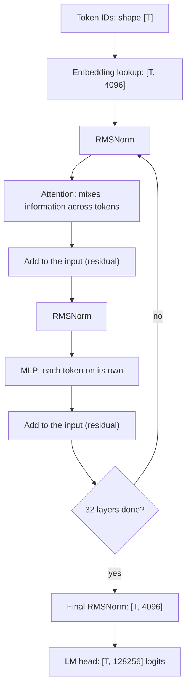

## 1. The question this idea answers

A model can only compute with numbers. Your prompt is a string of characters. So three questions come first:

1. How does the text "the cat sat" become numbers that a GPU can multiply?
2. Which numbers enter the attention layers, and with which shapes?
3. How does the model convert its last numbers back into the next word?

An interviewer who asks "what is attention?" expects you to place attention inside this pipeline. He can also ask "what is the shape of the logits?" or "how big is the embedding table of an 8B model?". This lesson gives every step, every shape and every byte count. Lessons L2 to L4 then open the attention step.

## 2. Mental model

> [!analogy] A spreadsheet with one row per token
> The model owns a huge spreadsheet. It has one row for each token in the vocabulary: 128,256 rows for Llama-3.1-8B. Each row holds 4,096 numbers. To read your prompt, the model copies the row of each token into a working sheet. Then 32 editing passes change the working sheet. In each pass, every row first borrows information from the earlier rows (attention), then each row is edited on its own (the MLP). At the end, the model compares the last row with every row of a second spreadsheet of 128,256 rows. Each comparison gives a score. The best score names the next token.
>
> **Where it stops working:** the numbers in a row do not have names like "is an animal". Training sets them, and a single column rarely means one human idea. Also, the model compares the last row with a **second** spreadsheet (the output matrix), not with the input one. Some models reuse the input spreadsheet for this. Llama-3.1-8B does not.

## 3. Terms

| Term | Plain meaning |
|---|---|
| token | A piece of text that the model reads as one unit: a word, a part of a word, a byte or a control symbol. |
| tokenizer | The program that converts text into token IDs, and token IDs back into text. |
| token ID | The integer that represents one token. The model sees only these integers. |
| vocabulary | The fixed set of all tokens. Its size is $V$. For Llama-3.1-8B, $V = 128{,}256$. |
| embedding table | A matrix $E$ of shape $[V, d]$. Row $i$ is the learned vector of token ID $i$. |
| embedding lookup | Copy the row of $E$ that belongs to a token ID. No multiplication happens. |
| model width $d$ | The number of values in each token vector inside the model. For Llama-3.1-8B, $d = 4{,}096$. |
| hidden state | The vector of one token at one point inside the model. All hidden states of a sequence form a matrix of shape $[T, d]$. |
| layer | One transformer block: attention plus an MLP. Llama-3.1-8B has $L = 32$ layers. |
| LM head | The last linear layer. It converts a hidden state of $d$ values into $V$ logits. |
| logit | The raw score of one vocabulary token for the next position. Any real number. |
| softmax | The function that converts logits into probabilities that are positive and sum to 1. |
| greedy decoding | Always choose the token with the highest logit. |
| sampling | Choose the next token at random, with the probabilities of the softmax. |
| temperature | A number that divides the logits before the softmax. Below 1 it sharpens the distribution. Above 1 it flattens it. |
| autoregressive generation | Generate one token, append it to the input, and run the model again for the next token. |
| stop token | A special token that ends generation, for example `<\|eot_id\|>` in Llama 3.1. |
| tied embeddings | The LM head reuses the embedding table as its weight matrix. |

All terms are also in the [Glossary](/notes/ai/llm-systems/glossary).

## 4. The pipeline at one glance


The figure has seven steps. This lesson follows them in order.

| Step | What happens | Toy shape (this guide) | Llama-3.1-8B shape |
|---|---|---|---|
| 1 | Text to token IDs (tokenizer) | $[3]$ | $[T]$ |
| 2 | IDs to vectors (embedding lookup) | $[3, 4]$ | $[T, 4096]$ |
| 3 | Vectors through the layers | $[3, 4]$ in, $[3, 4]$ out | $[T, 4096]$ in, $[T, 4096]$ out, 32 times |
| 4 | Last vector to logits (LM head) | $[6]$ | $[128256]$ |
| 5 | Logits to probabilities (softmax) | $[6]$ | $[128256]$ |
| 6 | Choose the next token ID | one integer | one integer |
| 7 | Append it and repeat, or stop | $[4]$ | $[T + 1]$ |

A batch of $B$ sequences adds a first axis $B$ to every shape. Lesson [L3 of part 01](/notes/ai/llm-systems/01-math-and-hardware/l3-tensors-shapes-and-batches) explains axes and shapes.

## 5. Step 1: text to token IDs

### 5.1 What a tokenizer does

A tokenizer cuts the text into tokens and replaces each token by its ID. The model never sees letters. It sees a list of integers.

Llama 3 uses byte-pair encoding (BPE) on bytes. BPE starts from the 256 byte values and merges frequent pairs into larger tokens. Lesson [Tokens and tokenizers](/notes/ai/context-engineering/01-foundations/l2-tokens-and-tokenizers) shows the merge algorithm step by step. Here you need only the facts below.

### 5.2 The Llama 3 vocabulary, verified

| Fact | Value | Source |
|---|---|---|
| Regular BPE tokens | 128,000. The paper says it "combines 100K tokens from the tiktoken tokenizer with 28K additional tokens". | Llama 3 paper, Table 3 and §3.1 |
| Special tokens | 256. The reference tokenizer sets `num_reserved_special_tokens = 256`. | `llama-models` repository, `tokenizer.py` |
| Total, `vocab_size` | $128{,}000 + 256 = 128{,}256$ | `LLAMA3_VOCAB_SIZE = 128256` in `sku_list.py` |
| Compression | "from 3.17 to 3.94 characters per token" on a sample of English data, compared with Llama 2 | Llama 3 paper, §3.1 |

The special tokens get the IDs after the regular tokens. So they use the IDs 128,000 to 128,255. The reference code lists them in a fixed order:

| Special token | ID | Job |
|---|---|---|
| `<\|begin_of_text\|>` | 128000 | "Specifies the start of the prompt" (the BOS token). |
| `<\|end_of_text\|>` | 128001 | The model stops. Only the base models generate it. A stop token. |
| `<\|eom_id\|>` | 128008 | "End of message": a possible stop for a tool call. A stop token. |
| `<\|eot_id\|>` | 128009 | The model has finished its turn. A stop token. |

The IDs follow from the list order in `tokenizer.py`: ID = 128,000 + position in the list. The `eos_token_id` list of the model configuration is `[128001, 128008, 128009]`, which agrees. The descriptions are from the Llama 3.1 prompt format page.

One more detail from the same file: before BPE, a regular expression splits the text into chunks. One part of it, `\p{N}{1,3}`, takes digits in groups of at most three. So "2026" becomes at least two tokens.

### 5.3 The toy vocabulary of this guide

This guide uses a toy vocabulary of six tokens, so that you can compute everything by hand.

| ID | Token |
|---|---|
| 0 | the |
| 1 | cat |
| 2 | sat |
| 3 | down |
| 4 | dog |
| 5 | `<eos>` |

The prompt "the cat sat" becomes the ID list `[0, 1, 2]`. Its shape is $[T] = [3]$.

## 6. Step 2: token IDs to vectors

### 6.1 The embedding table

The embedding table $E$ is a matrix with one row per vocabulary token. Its shape is $[V, d]$. Row $i$ is the vector of token ID $i$.

The toy model has $V = 6$ and $d = 4$. Its rows for the first four tokens are the token vectors of the whole guide:

```text
E = [[1, 0, 1, 0],    # 0 "the"   = x_the
     [0, 1, 0, 1],    # 1 "cat"   = x_cat
     [1, 1, 0, 0],    # 2 "sat"   = x_sat
     [0, 1, 1, 0],    # 3 "down"  = x_down
     [0, 0, 1, 1],    # 4 "dog"
     [0, 0, 0, 1]]    # 5 "<eos>"
```

These numbers are hand-picked. A real table holds learned numbers: small positive and negative decimals.

### 6.2 The lookup is a row copy

To embed the IDs `[0, 1, 2]`, take rows 0, 1 and 2:

$$
X = E[[0, 1, 2]] =
\begin{bmatrix} 1 & 0 & 1 & 0 \\ 0 & 1 & 0 & 1 \\ 1 & 1 & 0 & 0 \end{bmatrix}
\quad \text{shape } [T, d] = [3, 4]
$$

Mathematically, the lookup equals a matrix product with one-hot vectors. A one-hot vector has $V$ entries: a 1 at the token ID and 0 everywhere else.

$$
X = \text{onehot}(\text{ids}) \, E
\qquad [3, 6] \times [6, 4] = [3, 4]
$$

> [!example] Worked example: one row of the one-hot product
> The one-hot vector of "cat" (ID 1) is $[0, 1, 0, 0, 0, 0]$.
>
> 1. Column 1 of the product: $0 \cdot 1 + 1 \cdot 0 + 0 \cdot 1 + 0 \cdot 0 + 0 \cdot 0 + 0 \cdot 0 = 0$.
> 2. Column 2: $0 \cdot 0 + 1 \cdot 1 + 0 + 0 + 0 + 0 = 1$.
> 3. Column 3: $0 \cdot 1 + 1 \cdot 0 + 0 + 0 + 0 + 0 = 0$.
> 4. Column 4: $0 \cdot 0 + 1 \cdot 1 + 0 + 0 + 0 + 0 = 1$.
>
> Result: $[0, 1, 0, 1]$, which is row 1 of $E$. The product only selects a row.

Real code never builds the one-hot matrix. It indexes the table:

```python
import numpy as np

vocab = ["the", "cat", "sat", "down", "dog", "<eos>"]   # toy vocabulary, V = 6
E = np.array([[1, 0, 1, 0],    # 0 "the"
              [0, 1, 0, 1],    # 1 "cat"
              [1, 1, 0, 0],    # 2 "sat"
              [0, 1, 1, 0],    # 3 "down"
              [0, 0, 1, 1],    # 4 "dog"
              [0, 0, 0, 1]],   # 5 "<eos>"
             dtype=np.float32)  # shape [V, d] = [6, 4]

ids = np.array([0, 1, 2])           # "the cat sat", shape [T] = [3]
X = E[ids]                          # lookup: shape [T, d] = [3, 4]
one_hot = np.eye(len(vocab), dtype=np.float32)[ids]   # shape [3, 6]
assert np.array_equal(X, one_hot @ E)                 # same result
print(X)
```

Line by line:

1. `E[ids]` uses NumPy fancy indexing. It copies rows 0, 1 and 2 into a new $[3, 4]$ array.
2. `np.eye(6)[ids]` builds the three one-hot rows, only to prove the equality.
3. The `assert` passes. In PyTorch, `nn.Embedding` does the same row copy on the GPU.

> [!key] Why the one-hot view matters
> The lookup has no multiplications, so it costs only a memory read: $d \times 2 = 8{,}192$ bytes per token for Llama-3.1-8B in BF16. The one-hot view explains training: the gradient of $\text{onehot} \cdot E$ with respect to $E$ is non-zero only in the rows of the tokens in the batch. So one training step changes only the rows of the tokens that it saw.

### 6.3 Why not feed the one-hot vector directly?

A one-hot vector of Llama 3 has 128,256 entries, with one 1. Two problems follow:

1. **Size.** The first layer would need a weight matrix with 128,256 rows anyway. That matrix is exactly an embedding table.
2. **No similarity.** Any two different one-hot vectors have a dot product of 0. "cat" is as far from "dog" as from "the". A learned dense vector can place similar tokens near each other. Lesson [L1 of part 01](/notes/ai/llm-systems/01-math-and-hardware/l1-vectors-and-dot-products) explains the dot product as a similarity.

### 6.4 The size of the table for Llama-3.1-8B

> [!example] Worked example: the embedding table of Llama-3.1-8B
> 1. Parameters: $V \times d = 128{,}256 \times 4{,}096 = 525{,}336{,}576$, about 525M.
> 2. Bytes in BF16 (2 bytes per number): $525{,}336{,}576 \times 2 = 1{,}050{,}673{,}152$ bytes.
> 3. That is about 1.05 GB, or about 0.98 GiB ($1{,}050{,}673{,}152 / 2^{30}$).
>
> Lesson [L4 of part 01](/notes/ai/llm-systems/01-math-and-hardware/l4-numbers-in-memory) explains BF16, GB and GiB.

### 6.5 What is not added here in Llama

The original Transformer did two more things at this step (Vaswani et al., 2017, §3.4 and §3.5):

1. It multiplied the embeddings by $\sqrt{d_{model}}$.
2. It added a position vector to each token vector.

The Llama reference code does neither. Its forward pass starts with `h = self.tok_embeddings(tokens)` and passes rotation angles to every layer. Llama puts the position information inside attention, with rotary position embeddings (RoPE). Lesson [L6](/notes/ai/llm-systems/02-attention-and-the-transformer/l6-the-transformer-block) explains RoPE.

## 7. Step 3: hidden states pass through the layers

### 7.1 One matrix in, one matrix of the same shape out

After the lookup, the model holds a matrix $H_0$ of shape $[T, d]$: one hidden state per token. Each layer reads a $[T, d]$ matrix and writes a new $[T, d]$ matrix. The shape never changes inside the stack.

In the Llama reference code, one layer is two lines:

```python
h = x + self.attention(self.attention_norm(x), start_pos, freqs_cis, mask)
out = h + self.feed_forward(self.ffn_norm(h))
```

1. `attention_norm` and `ffn_norm` are RMSNorm layers. They rescale each hidden state.
2. `self.attention(...)` is the attention layer. It is the subject of L2 to L5.
3. `self.feed_forward(...)` is the MLP. It works on each token on its own.
4. `x + ...` and `h + ...` are residual connections: each layer adds a change to its input. Lesson [L6](/notes/ai/llm-systems/02-attention-and-the-transformer/l6-the-transformer-block) explains all four parts.



### 7.2 Where attention fits

> [!key] Attention is the only step where tokens exchange information
> The embedding lookup, RMSNorm, the MLP and the LM head all work on each token on its own. Only attention lets the hidden state of "sat" use the hidden states of "the" and "cat". Without attention, the model would predict the next token from the current token only. That is a bigram model (section 10).

Inside one attention layer of Llama-3.1-8B, the hidden states become three tensors:

| Tensor | Shape for one sequence | Meaning |
|---|---|---|
| queries $Q$ | $[T, 32, 128]$ | 32 query heads of 128 values each |
| keys $K$ | $[T, 8, 128]$ | 8 key heads of 128 values each |
| values $V$ | $[T, 8, 128]$ | 8 value heads of 128 values each |

Do not confuse the value tensor $V$ with the vocabulary size $V$. The context always tells which one is meant. The keys have fewer heads than the queries because of grouped-query attention ([part 03 L5](/notes/ai/llm-systems/03-kv-cache/l5-mha-mqa-gqa-and-mla)). Lesson [L3](/notes/ai/llm-systems/02-attention-and-the-transformer/l3-scaled-dot-product-attention) computes one head by hand.

### 7.3 Hidden states have a size in memory

One hidden state of Llama-3.1-8B holds 4,096 numbers. In BF16 that is $4{,}096 \times 2 = 8{,}192$ bytes, or 8 KiB, per token per layer. A prompt of 2,000 tokens gives a hidden-state matrix of about 16 MB at each layer. Engines do not keep all of them. They keep only the keys and values of each layer, in the KV cache ([part 03 L1](/notes/ai/llm-systems/03-kv-cache/l1-why-the-kv-cache-exists)).

## 8. Step 4: the LM head converts vectors into logits

### 8.1 The formula

After the last layer, a final RMSNorm rescales each hidden state. Then the LM head multiplies by an output matrix $W_{out}$ of shape $[d, V]$:

$$
z = h \, W_{out} \qquad [d] \times [d, V] = [V]
$$

- $h$ is the final hidden state of one position, with $d$ values.
- $z$ is the logit vector, with one score for each of the $V$ vocabulary tokens.
- Entry $z_j$ is the dot product of $h$ with column $j$ of $W_{out}$. A high dot product means that $h$ points in a similar direction as the vector of token $j$.

In PyTorch, `nn.Linear(4096, 128256, bias=False)` stores its weight as $[128256, 4096]$ and computes $h W^\top$. The math is the same.

### 8.2 A toy LM head, by hand

The toy reuses its embedding table as the output matrix: $W_{out} = E^\top$. This is a tied head (section 8.3). Assume that the final hidden state at "sat" is $h = [0.2, 1.1, 0.9, 0.1]$. These four numbers are invented for this example.

> [!example] Worked example: logits, softmax and the greedy choice
> **Logits** ($z_j = h \cdot E_j$):
>
> | ID | Token | Row $E_j$ | $h \cdot E_j$ | Logit |
> |---|---|---|---|---|
> | 0 | the | [1, 0, 1, 0] | 0.2 + 0.9 | 1.1 |
> | 1 | cat | [0, 1, 0, 1] | 1.1 + 0.1 | 1.2 |
> | 2 | sat | [1, 1, 0, 0] | 0.2 + 1.1 | 1.3 |
> | 3 | down | [0, 1, 1, 0] | 1.1 + 0.9 | 2.0 |
> | 4 | dog | [0, 0, 1, 1] | 0.9 + 0.1 | 1.0 |
> | 5 | `<eos>` | [0, 0, 0, 1] | 0.1 | 0.1 |
>
> **Softmax.** Subtract the largest logit (2.0) from each logit: $[-0.9, -0.8, -0.7, 0, -1.0, -1.9]$. Take $e$ to each value: $[0.4066, 0.4493, 0.4966, 1, 0.3679, 0.1496]$. The sum is $2.8699$. Divide each value by the sum:
>
> $$p = [0.1417, 0.1566, 0.1730, 0.3484, 0.1282, 0.0521]$$
>
> The six probabilities sum to 1. **Greedy choice:** ID 3, "down", with $p = 0.3484$.

The same computation in NumPy:

```python
import numpy as np

E = np.array([[1, 0, 1, 0], [0, 1, 0, 1], [1, 1, 0, 0],
              [0, 1, 1, 0], [0, 0, 1, 1], [0, 0, 0, 1]], dtype=np.float64)
vocab = ["the", "cat", "sat", "down", "dog", "<eos>"]

h = np.array([0.2, 1.1, 0.9, 0.1])     # final hidden state of "sat" (invented)
logits = h @ E.T                        # [d] @ [d, V] -> [V]
z = logits - logits.max()               # subtract the max for safety
p = np.exp(z) / np.exp(z).sum()         # softmax -> probabilities
print(logits.round(4))
print(p.round(4), p.sum().round(6))
print(vocab[int(np.argmax(p))])
```

The output is `[1.1 1.2 1.3 2.  1.  0.1]`, then the six probabilities and `1.0`, then `down`. Lesson [L3](/notes/ai/llm-systems/02-attention-and-the-transformer/l3-scaled-dot-product-attention) explains why the code subtracts the maximum.

### 8.3 Tied or untied: verify it, do not assume it

The original Transformer shares "the same weight matrix between the two embedding layers and the pre-softmax linear transformation" (Vaswani et al., 2017, §3.4). Many people assume that every model does this. Llama-3.1-8B does not.

Three pieces of evidence, checked on 2026-10-15:

1. The Meta reference code builds two separate matrices: `self.tok_embeddings = VocabParallelEmbedding(...)` and `self.output = ColumnParallelLinear(params.dim, params.vocab_size, ...)`.
2. A copy of the model configuration on Hugging Face has `"tie_word_embeddings": false`.
3. The parameter count agrees. Computed in these notes: with two separate matrices, the model has 8,030,261,248 parameters, about 8.03B. With a tied head, it would have 7,504,924,672, about 7.50B.

> [!example] Worked example: the parameter count of Llama-3.1-8B
> 1. Embedding table: $128{,}256 \times 4{,}096 = 525{,}336{,}576$.
> 2. LM head, untied: another $525{,}336{,}576$.
> 3. Attention per layer: $W_Q$ $4{,}096 \times 4{,}096$ plus $W_K$ and $W_V$ $4{,}096 \times 1{,}024$ each, plus $W_O$ $4{,}096 \times 4{,}096$. Total $41{,}943{,}040$.
> 4. MLP per layer: $3 \times 4{,}096 \times 14{,}336 = 176{,}160{,}768$.
> 5. Two RMSNorm vectors per layer: $2 \times 4{,}096 = 8{,}192$.
> 6. One layer: $41{,}943{,}040 + 176{,}160{,}768 + 8{,}192 = 218{,}112{,}000$. Times 32 layers: $6{,}979{,}584{,}000$.
> 7. Final RMSNorm: $4{,}096$.
> 8. Total: $525{,}336{,}576 \times 2 + 6{,}979{,}584{,}000 + 4{,}096 = 8{,}030{,}261{,}248$.
>
> The embedding table and the LM head together hold about 13.1% of all parameters. Lesson [L6](/notes/ai/llm-systems/02-attention-and-the-transformer/l6-the-transformer-block) counts the layers in more detail.

Some smaller models tie the head to save parameters. The torchtune builders for Llama 3.2 1B and 3B use `tie_word_embeddings=True`, with the same vocabulary of 128,256 tokens.

### 8.4 The cost of the LM head

> [!example] Worked example: compute and memory of the LM head
> 1. Compute per token: $2 \times d \times V = 2 \times 4{,}096 \times 128{,}256 = 1{,}050{,}673{,}152$ FLOPs, about 1.05 GFLOP. The factor 2 counts one multiply and one add ([part 01 L2](/notes/ai/llm-systems/01-math-and-hardware/l2-matrices-and-matrix-multiplication)).
> 2. The whole model needs about $2 \times (8.03 - 0.525) \times 10^9 \approx 15.0$ GFLOP per token, because the lookup has no multiplications. So the LM head is about 7% of the work.
> 3. Memory of one logit vector in FP32: $128{,}256 \times 4 = 513{,}024$ bytes, about 501 KiB.
> 4. Logits for all 8,192 positions of a long prompt: $8{,}192 \times 513{,}024 \approx 4.2$ GB.

Point 4 explains a detail of real code. Generation needs only the logits of the **last** position. The Hugging Face `LlamaForCausalLM.forward` has an argument `logits_to_keep`. With the value 1, it applies the LM head only to the last hidden state. The Meta reference code computes all positions and then takes `logits[:, -1]`.

## 9. Step 5: logits to probabilities

Softmax converts the logit vector $z$ into a probability vector $p$:

$$
p_j = \frac{e^{z_j}}{\sum_{m=1}^{V} e^{z_m}}
$$

- $e^{z_j}$ is always positive, so every $p_j$ is positive.
- The division by the sum makes the $p_j$ sum to 1.
- A larger logit always gives a larger probability.
- Only the differences between logits matter. Adding the same number to every logit does not change $p$.

The page [Probability and next-token prediction](/notes/papers/reasoning-models/2025-why-reasoning-models-loop/01-background-probability-and-next-token-prediction) explains softmax from zero. Lesson [L3](/notes/ai/llm-systems/02-attention-and-the-transformer/l3-scaled-dot-product-attention) uses the same softmax inside attention.

## 10. Step 6: choose the next token

### 10.1 Greedy and sampling

| Method | Rule | Toy result |
|---|---|---|
| greedy | Take the ID with the highest logit. | always "down" |
| sampling, temperature 1 | Draw an ID with the probabilities $p$. | "down" in about 34.8% of draws |
| sampling, temperature $\tau$ | Divide the logits by $\tau$ first, then softmax, then draw. | depends on $\tau$ |

> [!example] Worked example: temperature on the toy logits
> Divide the logits $[1.1, 1.2, 1.3, 2.0, 1.0, 0.1]$ by $\tau$, then apply the softmax. The probability of "down":
>
> | $\tau$ | Probability of "down" |
> |---|---|
> | 0.5 | 0.5645 |
> | 1.0 | 0.3484 |
> | 2.0 | 0.2496 |
>
> A low temperature sharpens the distribution. A high temperature flattens it. As $\tau$ moves toward 0, sampling becomes greedy.

The Meta reference `generate()` uses `temperature=0.6` and `top_p=0.9` as defaults. With `temperature` equal to 0, it uses `torch.argmax`. The Hugging Face docs say that the default strategy of `generate()` is greedy search, "unless otherwise specified in a models GenerationConfig". Top-p, top-k and the other rules are in [part 04 L5](/notes/ai/llm-systems/04-inference/l5-sampling-and-structured-output) and on the page [Decoding: greedy, temperature, sampling](/notes/papers/reasoning-models/2025-why-reasoning-models-loop/02-background-decoding-greedy-temperature-sampling).

### 10.2 The simplest language model: a bigram table

A bigram model predicts the next token from the current token only. It is a $[V, V]$ table of logits: row = current token, column = next token. It has no attention. It cannot use any earlier token. The loop in section 11 uses such a table, because it is small enough to read.

A transformer replaces the table with the full stack of section 7. The logits for the next token then depend on every earlier token, through attention. Lesson [L2](/notes/ai/llm-systems/02-attention-and-the-transformer/l2-why-attention) explains why that matters.

## 11. Step 7: the autoregressive loop

The model produces one token per run. To produce a text, a loop appends each new token to the input and runs the model again.

```python
import numpy as np

VOCAB = ["the", "cat", "sat", "down", "dog", "<eos>"]
EOS_ID = 5
# A bigram model: row = previous token ID, column = logit of the next token ID.
BIGRAM_LOGITS = np.array([
    [0.0, 2.0, 0.1, 0.0, 1.5, 0.0],   # after "the":  "cat" wins
    [0.0, 0.0, 2.0, 0.5, 0.0, 0.3],   # after "cat":  "sat" wins
    [0.2, 0.0, 0.0, 2.0, 0.0, 0.8],   # after "sat":  "down" wins
    [0.5, 0.0, 0.0, 0.0, 0.0, 2.0],   # after "down": "<eos>" wins
    [0.0, 0.0, 2.0, 0.5, 0.0, 0.3],   # after "dog":  "sat" wins
    [0.0, 0.0, 0.0, 0.0, 0.0, 0.0],   # after "<eos>": never used
])

def next_token_logits(ids):
    return BIGRAM_LOGITS[ids[-1]]        # shape [V]

def generate(prompt_ids, max_new_tokens=10):
    ids = list(prompt_ids)
    for _ in range(max_new_tokens):
        logits = next_token_logits(ids)  # one score per vocabulary token
        next_id = int(np.argmax(logits)) # greedy choice
        ids.append(next_id)              # the output becomes input
        if next_id == EOS_ID:            # stop condition 1: end token
            break                        # stop condition 2: the loop limit
    return ids

out = generate([0])                      # prompt: "the"
print([VOCAB[i] for i in out])
```

The output is `['the', 'cat', 'sat', 'down', '<eos>']`. The important lines:

1. `next_token_logits(ids)` is the model. A transformer would run the whole stack on `ids` and return the logits of the last position.
2. `ids.append(next_id)` is the autoregressive step. The output of one run becomes part of the input of the next run.
3. The loop has two stop conditions: a stop token and a maximum number of new tokens. Real servers add stop strings ([part 04 L1](/notes/ai/llm-systems/04-inference/l1-the-life-of-a-request)).

| Run | Input IDs | Input length | New token |
|---|---|---|---|
| 1 | [0] | 1 | cat |
| 2 | [0, 1] | 2 | sat |
| 3 | [0, 1, 2] | 3 | down |
| 4 | [0, 1, 2, 3] | 4 | `<eos>` |

> [!trap] The naive loop repeats work
> A transformer in this loop processes the whole input again in each run. Run 4 recomputes the keys and values of "the", "cat" and "sat", which run 3 already computed. Lesson [L4](/notes/ai/llm-systems/02-attention-and-the-transformer/l4-causal-masking-and-generation) shows that these keys and values never change. The [KV cache](/notes/ai/llm-systems/03-kv-cache/l1-why-the-kv-cache-exists) stores them, so each run processes only the newest token.

## 12. Back to text: detokenization

The tokenizer converts the new IDs back to text. A byte-level tokenizer maps each ID to a sequence of bytes. The bytes then form UTF-8 text.

One token can hold only part of a character. The letter "é" is two bytes in UTF-8: `0xC3 0xA9`. If a token ends after `0xC3`, that token alone is not valid text. Python then gives the replacement character `�` for it. A streaming server must therefore hold incomplete bytes until the next token completes the character. [Part 04 L1](/notes/ai/llm-systems/04-inference/l1-the-life-of-a-request) explains incremental detokenization.

## 13. Every shape for Llama-3.1-8B

The table uses a batch of $B$ sequences of $T$ tokens. The configuration values are $V = 128{,}256$, $d = 4{,}096$, $L = 32$, 32 query heads, 8 KV heads and a head width of 128.

| Point in the pipeline | Shape | Data type in the reference code |
|---|---|---|
| token IDs | $[B, T]$ | int64 (`torch.long`) |
| embedding table | $[128256, 4096]$ | BF16 |
| hidden states after the lookup | $[B, T, 4096]$ | BF16 |
| queries in one layer | $[B, T, 32, 128]$ | BF16 |
| keys and values in one layer | $[B, T, 8, 128]$ each | BF16 |
| hidden states after each layer | $[B, T, 4096]$ | BF16 |
| logits, all positions | $[B, T, 128256]$ | FP32 (the code calls `.float()`) |
| logits, last position only | $[B, 128256]$ | FP32 |
| next token IDs | $[B]$ | int64 |

### Exercises

Work in `C:\Users\ASohi\Downloads\AI\agent-harness-lab\llm-systems\02-l1-text-to-vectors.ipynb`.

1. **Lookup equals a one-hot product.** Write `embed_index(ids, E)` and `embed_one_hot(ids, E)`. Also write `one_hot_flops_per_token(V, d)`.
   - Acceptance test: both functions return the same array for the toy table and `[0, 1, 2]`. The FLOP function returns 1,050,673,152 for Llama-3.1-8B.
   - Hint 1: NumPy can index an array with a list of row numbers.
   - Hint 2: `np.eye(V)[ids]` gives the one-hot rows. A product $[T, V] \times [V, d]$ costs $2 \cdot V \cdot d$ FLOPs per row.
2. **Count the parameters of Llama-3.1-8B.** Write `llama_params(V, d, L, H, H_kv, d_h, F, tied)`.
   - Acceptance test: 8,030,261,248 with `tied=False` and 7,504,924,672 with `tied=True`.
   - Hint 1: count the embedding, the head, one layer, and the final norm separately.
   - Hint 2: one layer has $W_Q$, $W_K$, $W_V$, $W_O$, three MLP matrices and two norm vectors.
3. **Sampling with temperature.** Write `sample(logits, temperature, rng)`. A temperature of 0 means greedy.
   - Acceptance test: `sample(toy_logits, 0, rng)` returns 3. With temperature 1, the share of ID 3 in 10,000 draws is within 0.02 of 0.3484.
   - Hint 1: divide the logits by the temperature before the softmax.
   - Hint 2: `rng.choice(len(p), p=p)` draws one index with the probabilities `p`.

## 14. Common mistakes

1. **"The model reads words."** The model reads token IDs. One word can be several tokens. Llama 3 splits digits into groups of at most three.
2. **"The embedding lookup is a matrix multiplication."** It equals a one-hot product mathematically, but the code copies one row. It costs a memory read of 8 KiB per token in Llama-3.1-8B, not 1 GFLOP.
3. **"The vocabulary of Llama 3 has 128,000 tokens."** The paper says 128,000 for the BPE tokens. The model has `vocab_size` 128,256, because 256 special tokens follow them.
4. **"Every model ties the LM head to the embedding table."** The original Transformer does. Llama-3.1-8B does not: the reference code builds two separate matrices, and the count of 8.03B parameters needs both.
5. **"Logits are probabilities."** Logits are any real numbers. Only the softmax makes them positive and makes them sum to 1.
6. **"The model returns a whole sentence."** One run returns one distribution for the next token. A loop outside the model produces the text.
7. **"Attention happens at the input."** Attention happens inside every one of the 32 layers. The lookup and the LM head work on each token on its own.

## 15. One-minute explanation

The tokenizer converts the text into token IDs, integers below 128,256 for Llama 3. The embedding table, a $[128256, 4096]$ matrix, gives each ID a learned vector of 4,096 numbers by a simple row copy. These hidden states pass through 32 layers, and each layer keeps the shape $[T, 4096]$. Attention is the only part where a token reads information from other tokens. The MLP and the norms work on each token alone. After the last layer, the LM head multiplies the last hidden state by a $[4096, 128256]$ matrix and gives one logit per vocabulary token. Softmax converts the logits into probabilities, and greedy decoding or sampling picks the next ID. A loop appends that ID and runs the model again until a stop token or a length limit. In Llama-3.1-8B the head is a separate matrix, so the embedding and the head together hold about 1.05B of the 8.03B parameters.

## 16. Check questions

```check
{
  "question": "A batch of 4 prompts, each padded to 1,000 tokens, enters Llama-3.1-8B. Give the shape of the token IDs, of the hidden states after layer 17, of the keys in one layer, and of the logits if the model computes them for every position.",
  "hint": "Batch first, then time, then the feature axes. $d = 4096$, 8 KV heads of 128 values, $V = 128256$.",
  "answer": "Token IDs: $[4, 1000]$. Hidden states after any layer: $[4, 1000, 4096]$, because no layer changes the shape. Keys in one layer: $[4, 1000, 8, 128]$ (8 KV heads of 128 values each, $8 \\times 128 = 1024$). Logits for every position: $[4, 1000, 128256]$. In FP32 that is $4 \\times 1000 \\times 128256 \\times 4 \\approx 2.05$ GB, which is why generation computes the logits of the last position only."
}
```

```check
{
  "question": "Show that the embedding lookup of \"dog\" (ID 4) in the toy table equals a one-hot vector times $E$. Then say why real code does not multiply.",
  "hint": "The one-hot vector of ID 4 has six entries. Multiply it by each column of $E$.",
  "answer": "The one-hot vector is $[0, 0, 0, 0, 1, 0]$. Each column of the product is $\\sum_i \\text{onehot}_i E_{i,c} = E_{4,c}$, because only entry 4 is 1. So the product is row 4 of $E$: $[0, 0, 1, 1]$. Real code indexes the row instead, because the product would cost $2 \\times V \\times d$ FLOPs per token (about 1.05 GFLOP for Llama-3.1-8B) to compute something that a memory read of $d \\times 2 = 8192$ bytes already gives."
}
```

```check
{
  "question": "A streaming server decodes each new token to text at once and sends it to the user. Sometimes the user sees the replacement character � for a moment. Why?",
  "hint": "Think about bytes, UTF-8 and where a token boundary can fall.",
  "answer": "A byte-level tokenizer maps a token to bytes, not to whole characters. A character such as \"é\" is two bytes in UTF-8 (`0xC3 0xA9`). If a token ends after the first byte, that token alone is not valid UTF-8, so the decoder emits the replacement character U+FFFD. The fix is incremental detokenization: keep incomplete bytes in a buffer and send text only when the bytes form complete characters."
}
```

```check
{
  "question": "Interview follow-up: \"Does Llama-3.1-8B tie its input embedding and its output layer? How would you check it in two independent ways, and what would change if it did?\"",
  "hint": "Code, configuration, and a parameter count.",
  "answer": "It does not. Check 1: the Meta reference code builds `tok_embeddings` and `output` as two separate modules. Check 2: the configuration has `tie_word_embeddings: false`. Check 3 (arithmetic): with two matrices the count is 8,030,261,248, about 8.03B. A tied head would remove $128256 \\times 4096 = 525{,}336{,}576$ parameters (about 1.05 GB in BF16), giving 7,504,924,672. The compute per token would not change: the LM head still multiplies by a $[4096, 128256]$ matrix, about 1.05 GFLOP per token. Only the memory for weights would shrink. Small models such as Llama 3.2 1B and 3B tie the head. For the 1B model ($d = 2048$), one table is $128256 \\times 2048 \\approx 263$M parameters, a large share of a model of that size."
}
```

```check
{
  "question": "Interview follow-up: \"What share of the compute per generated token does the LM head take in Llama-3.1-8B? And what share of the parameters?\"",
  "hint": "Compute about $2 \\times$ (parameters that multiply) FLOPs per token. The embedding lookup does not multiply.",
  "answer": "LM head: $2 \\times 4096 \\times 128256 = 1{,}050{,}673{,}152$ FLOPs, about 1.05 GFLOP. All matrix parameters except the embedding: $8.030 - 0.525 \\approx 7.505$B, so about $15.0$ GFLOP per token (without the attention-score term, which grows with the context). Share: $1.05 / 15.0 \\approx 7\\%$. Parameters: $525{,}336{,}576 / 8{,}030{,}261{,}248 \\approx 6.5\\%$ for the head alone, and about 13.1% for the head plus the embedding table."
}
```

```check
{
  "question": "Interview follow-up: \"Your prefill of 8,192 tokens runs out of GPU memory at the very end, after all 32 layers pass. What is a likely cause and the fix?\"",
  "hint": "Compute the size of the full logit tensor.",
  "answer": "A likely cause is the logit tensor. For every position it is $8192 \\times 128256$ values. In FP32 that is $8192 \\times 128256 \\times 4 \\approx 4.2$ GB for one sequence, created after the last layer. Generation needs only the last row. The fix is to apply the LM head to the last hidden state only. In Hugging Face Transformers the argument `logits_to_keep=1` of `LlamaForCausalLM.forward` does this."
}
```

```check
{
  "question": "The toy bigram model and a transformer both return a $[V]$ logit vector for the next token. What can the transformer know that the bigram model cannot? Which layer type gives it this ability?",
  "hint": "Which earlier tokens can each model use?",
  "answer": "The bigram model uses only the current token: its logits are one row of a $[V, V]$ table. After \"sat\" it gives the same prediction in \"the cat sat\" and in \"the dog sat\". A transformer can use every earlier token in the context. Attention is the only layer type that moves information between positions. The MLP, the norms, the embedding and the LM head all work on each token alone."
}
```

```check
{
  "question": "Exercise 1: show a reference solution.",
  "answer": "```python\nimport numpy as np\n\ndef embed_index(ids, E):\n    return E[np.asarray(ids)]                      # [T] -> [T, d]\n\ndef embed_one_hot(ids, E):\n    V = E.shape[0]\n    one_hot = np.eye(V, dtype=E.dtype)[np.asarray(ids)]   # [T, V]\n    return one_hot @ E                             # [T, V] @ [V, d] -> [T, d]\n\ndef one_hot_flops_per_token(V, d):\n    return 2 * V * d                               # one multiply and one add per term\n\nE = np.array([[1, 0, 1, 0], [0, 1, 0, 1], [1, 1, 0, 0],\n              [0, 1, 1, 0], [0, 0, 1, 1], [0, 0, 0, 1]], dtype=np.float32)\nids = [0, 1, 2]\nassert np.array_equal(embed_index(ids, E), embed_one_hot(ids, E))\nprint(one_hot_flops_per_token(128256, 4096))      # 1050673152\n```\n\nThe script prints `1050673152`. Indexing and the one-hot product give the same $[3, 4]$ array."
}
```

```check
{
  "question": "Exercise 2: show a reference solution.",
  "answer": "```python\ndef llama_params(V, d, L, H, H_kv, d_h, F, tied):\n    embed = V * d                                   # input embedding table\n    head = 0 if tied else V * d                     # LM head (0 extra if tied)\n    attn = d * H * d_h + 2 * d * H_kv * d_h + H * d_h * d   # W_Q, W_K, W_V, W_O\n    mlp = 3 * d * F                                 # gate, up, down projections\n    norms = 2 * d                                   # two RMSNorm weight vectors\n    return embed + head + L * (attn + mlp + norms) + d      # + final RMSNorm\n\nuntied = llama_params(128256, 4096, 32, 32, 8, 128, 14336, tied=False)\ntied = llama_params(128256, 4096, 32, 32, 8, 128, 14336, tied=True)\nprint(untied, tied)                                 # 8030261248 7504924672\nassert untied == 8_030_261_248 and tied == 7_504_924_672\nprint(round(128256 * 4096 * 2 / 1e9, 3), \"GB per table in BF16\")\n```\n\nThe script prints `8030261248 7504924672` and `1.051 GB per table in BF16`."
}
```

```check
{
  "question": "Exercise 3: show a reference solution.",
  "answer": "```python\nimport numpy as np\n\ndef sample(logits, temperature, rng):\n    logits = np.asarray(logits, dtype=np.float64)\n    if temperature == 0:\n        return int(np.argmax(logits))              # greedy\n    z = logits / temperature\n    z = z - z.max()                                # stable softmax\n    p = np.exp(z) / np.exp(z).sum()\n    return int(rng.choice(len(p), p=p))\n\nlogits = [1.1, 1.2, 1.3, 2.0, 1.0, 0.1]            # toy logits of the lesson\nrng = np.random.default_rng(0)\nassert sample(logits, 0, rng) == 3                 # \"down\"\ndraws = [sample(logits, 1.0, rng) for _ in range(10_000)]\nfreq = draws.count(3) / len(draws)\nprint(round(freq, 4))                              # close to 0.3484\nassert abs(freq - 0.3484) < 0.02\n```\n\nWith `default_rng(0)` the script prints `0.3463`, within 0.02 of 0.3484."
}
```

## 17. Links

- Previous: [L5: GPUs, memory and bandwidth](/notes/ai/llm-systems/01-math-and-hardware/l5-gpus-memory-and-bandwidth)
- Next: [L2: Why attention exists](/notes/ai/llm-systems/02-attention-and-the-transformer/l2-why-attention)
- [L3: Scaled dot-product attention, step by step](/notes/ai/llm-systems/02-attention-and-the-transformer/l3-scaled-dot-product-attention): the attention step of this pipeline
- [L6: The transformer block, end to end](/notes/ai/llm-systems/02-attention-and-the-transformer/l6-the-transformer-block): one layer in full
- [Tokens and tokenizers](/notes/ai/context-engineering/01-foundations/l2-tokens-and-tokenizers): BPE step by step
- [Probability and next-token prediction](/notes/papers/reasoning-models/2025-why-reasoning-models-loop/01-background-probability-and-next-token-prediction): softmax from zero
- [Part 04 L5: Sampling and structured output](/notes/ai/llm-systems/04-inference/l5-sampling-and-structured-output)
- [Part 03 L1: Why the KV cache exists](/notes/ai/llm-systems/03-kv-cache/l1-why-the-kv-cache-exists)

### Sources

- Vaswani et al., "Attention Is All You Need", NIPS 2017, §3.4 and §3.5: https://arxiv.org/abs/1706.03762 (checked on 2026-10-15)
- Llama Team, "The Llama 3 Herd of Models", 2024, Table 3 and §3.1: https://arxiv.org/abs/2407.21783 (checked on 2026-10-15)
- Meta reference code, `models/llama3/model.py`, `tokenizer.py`, `generation.py` and `models/sku_list.py`: https://github.com/meta-llama/llama-models (checked on 2026-10-15)
- Llama-3.1-8B model card (release date 23 July 2024, BF16): https://huggingface.co/meta-llama/Llama-3.1-8B (checked on 2026-10-15)
- Meta, "Llama 3.1 model card and prompt formats" (special tokens): https://www.llama.com/docs/model-cards-and-prompt-formats/llama3_1/ (checked on 2026-10-15)
- A copy of the Llama-3.1-8B-Instruct `config.json` with `tie_word_embeddings: false` and `eos_token_id` `[128001, 128008, 128009]`: https://huggingface.co/neuralmagic/Meta-Llama-3.1-8B-Instruct-quantized.w4a16 (checked on 2026-10-15)
- Hugging Face Transformers, `modeling_llama.py` (`logits_to_keep`, `lm_head`): https://github.com/huggingface/transformers/blob/main/src/transformers/models/llama/modeling_llama.py (checked on 2026-10-15)
- Hugging Face Transformers docs, "Text generation" (greedy default, `max_new_tokens`), v5.13.0: https://huggingface.co/docs/transformers/llm_tutorial (checked on 2026-10-15)
- torchtune Llama 3.2 model builders (`tie_word_embeddings=True`): https://docs.pytorch.org/torchtune/stable/_modules/torchtune/models/llama3_2/_model_builders.html (checked on 2026-10-15)
