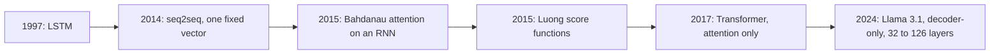

## 1. The question this idea answers

The embedding table of [L1](/notes/ai/llm-systems/02-attention-and-the-transformer/l1-from-text-to-vectors) gives each token ID one fixed vector. So "bank" gets the same vector in "the bank of the river" and in "the bank approved my loan". But the two words mean different things. The model must change the vector of "bank" with information from the other words.

So the question is this: **how can each token take information from the other tokens of its text**? The method must work for any distance and choose the useful tokens by their content. It must also run fast on a GPU and be trainable with gradients. This lesson shows the older answer (recurrent networks), why it failed, and why attention replaced it.

## 2. Mental model

> [!analogy] A chain of whispers versus a notice board
> **Recurrent network:** people stand in a line. Each person hears a short message from the person before and adds their own word. Then they whisper a message of the same short length to the next person. The last person must know the whole sentence from one short message.
>
> **Attention:** each person pins a card on a notice board. The card has a **label** on the front (the key) and **content** on the back (the value). A person with a **question** (the query) reads every label and decides how well each label matches the question. Then the person takes a mix of all contents. Good matches get a large share of the mix.
>
> **Where it stops working:** in a real model, labels, contents and questions are vectors of numbers, not words. Nobody writes them: training learns the matrices that make them. The "mix" is a weighted average, so a person never receives exactly one card. And the board is read again in every layer and in many heads at the same time.

## 3. Terms

| Term | Plain meaning |
|---|---|
| context | The other tokens around a token. They decide its meaning. |
| static embedding | The fixed vector of a token ID from the embedding table. It is the same in every sentence. |
| contextual representation | A hidden state of a token that also carries information from its context. |
| recurrent neural network (RNN) | A network that reads tokens one at a time and keeps one hidden state that it updates at each step. |
| LSTM | Long short-term memory. An RNN with gates that help it keep information for more steps. |
| encoder | The part of a model that reads the input text and makes hidden states for it. |
| decoder | The part of a model that generates the output tokens one at a time. |
| sequence-to-sequence (seq2seq) | An encoder-decoder model that maps an input sequence to an output sequence, for example for translation. |
| bottleneck vector | In early seq2seq models, the one fixed-size vector that had to hold the whole input sentence. |
| alignment | Which input tokens matter for one output token. |
| additive attention | The attention of Bahdanau et al. (2015). A small neural network computes each score. |
| query | The vector that asks "what do I need?". It belongs to the token that reads. |
| key | The vector that says "this is what I contain". Queries are compared with keys. |
| value | The vector that a token delivers when it is read. Outputs are weighted averages of values. |
| attention weight | The share of one value in the weighted average. The weights of one query sum to 1. |
| self-attention | Attention where the model computes the queries, keys and values all from the same sequence. |
| cross-attention | Attention where the model computes the queries from one sequence, and the keys and values from another. |
| path length | The number of steps that information needs to travel from one token to another inside a layer. |

All terms are also in the [Glossary](/notes/ai/llm-systems/glossary).

## 4. Context changes meaning

### 4.1 Two classic examples

The Google Research blog post that introduced the Transformer (Uszkoreit, 31 August 2017) uses two examples:

1. "I arrived at the bank after crossing the river." The word "river" tells the model that "bank" means the side of a river.
2. "The animal didn't cross the street because it was too tired" and "... because it was too wide". In the first sentence "it" means the animal. In the second sentence "it" means the street. One word at the end of the sentence decides it.

The post says that attention lets the model compare "bank" with every other word and give each word a score. A word like "river" can then contribute strongly to a new representation of "bank".

### 4.2 What the mechanism must do

A static embedding cannot solve these examples. The vector of "it" from the embedding table is the same in both sentences. So the model needs a step that changes each hidden state with information from other tokens. The step must meet four requirements:

1. **Any distance.** "tired" can be a few tokens after "animal", or hundreds of tokens after it.
2. **Chosen by content.** The useful tokens depend on the words, not on fixed positions.
3. **Fast on a GPU.** A GPU is fast at large matrix products and slow at long chains of small steps ([part 01 L5](/notes/ai/llm-systems/01-math-and-hardware/l5-gpus-memory-and-bandwidth)).
4. **Differentiable.** Training changes the weights with gradients. Every step must have a useful derivative.

Keep these four requirements in mind. Recurrent networks meet requirement 1 only weakly, and they fail requirement 3. Attention meets all four.

## 5. Before attention: recurrent networks

### 5.1 The recurrence

An RNN reads token vectors $x_1, x_2, \dots, x_T$ one at a time. It keeps one hidden state $h_t$ and updates it at each step:

$$
h_t = \tanh\left(W_h h_{t-1} + W_x x_t + b\right)
$$

- $h_{t-1}$ is the hidden state after the previous token. $h_0$ is usually a vector of zeros.
- $W_h$, $W_x$ and $b$ are learned weights. The same weights serve every step.
- $\tanh$ squashes each value into the range $-1$ to $1$.
- $h_t$ has the same size at every step, whatever the length of the text.

Two facts follow from the formula:

1. **Sequential.** You cannot compute $h_3$ before $h_2$. A text of $T$ tokens needs $T$ steps, one after the other.
2. **Fixed size.** All information about tokens $1$ to $t$ must fit into the one vector $h_t$.

### 5.2 A toy: the first token fades

Take an RNN with one number as its hidden state, $w_h = 0.5$, $W_x = 1$ and $b = 0$. Only the first token carries a signal: $x = [1, 0, 0, 0]$.

> [!example] Worked example: four steps of a one-number RNN
> 1. $h_1 = \tanh(0.5 \cdot 0 + 1) = \tanh(1) = 0.7616$
> 2. $h_2 = \tanh(0.5 \cdot 0.7616 + 0) = \tanh(0.3808) = 0.3634$
> 3. $h_3 = \tanh(0.5 \cdot 0.3634) = \tanh(0.1817) = 0.1797$
> 4. $h_4 = \tanh(0.5 \cdot 0.1797) = \tanh(0.0899) = 0.0896$
>
> After three more tokens, the signal of token 1 is about 12% of its first value ($0.0896 / 0.7616 \approx 0.118$). Each step multiplies it by about 0.5.

```python
import numpy as np

w_h, h = 0.5, 0.0                 # recurrent weight and the start state
xs = [1.0, 0.0, 0.0, 0.0]         # only the first token carries a signal
for t, x in enumerate(xs, start=1):
    h = np.tanh(w_h * h + x)      # h_t = tanh(w_h * h_{t-1} + x_t)
    print(t, round(float(h), 4))
```

The output is `1 0.7616`, `2 0.3634`, `3 0.1797` and `4 0.0896`. Interpretation of these notes: a real RNN has learned matrices, not a fixed 0.5, so it does not always fade this fast. But information from token 1 must always pass through every later step to reach token $T$. Gradients during training take the same long path backward. The LSTM (Hochreiter and Schmidhuber, 1997) adds gates to keep information longer. It is still sequential, and its state still has a fixed size.

### 5.3 Sequence-to-sequence and the bottleneck

Sutskever, Vinyals and Le (NIPS 2014) built a translation model from two LSTMs:

1. The **encoder** LSTM reads the source sentence. Its last hidden state is a vector $v$ of fixed size.
2. The **decoder** LSTM generates the target sentence from $v$, one token at a time:

$$
p(y_1, \dots, y_{T'} \mid x_1, \dots, x_T) = \prod_{t=1}^{T'} p(y_t \mid v, y_1, \dots, y_{t-1})
$$

The paper used 4 layers with 1,000 cells each, 1,000-dimensional word embeddings, an input vocabulary of 160,000 words and an output vocabulary of 80,000. It reported a BLEU score of 34.8 on the WMT'14 English-to-French test set. Reversing the word order of the source sentences improved the results. The authors write that "the LSTM did not suffer on very long sentences", and they credit the reversed order for this.

The weak point is $v$. A sentence of 5 words and a sentence of 50 words must both fit in the same fixed-size vector. Bahdanau, Cho and Bengio (ICLR 2015) "conjecture that the use of a fixed-length vector is a bottleneck". They cite Cho et al. (2014), who showed that the quality of a basic encoder-decoder drops as the input sentence gets longer.


## 6. The first attention: Bahdanau et al. (2015)

### 6.1 Keep every encoder state

Bahdanau et al. keep every encoder hidden state $h_j$. They call it the **annotation** of source word $j$. Their encoder reads the sentence in both directions, so each $h_j$ describes word $j$ and its neighbors.

For each output position $i$, the decoder computes three things:

$$
e_{ij} = a(s_{i-1}, h_j) = v_a^\top \tanh\left(W_a s_{i-1} + U_a h_j\right)
$$

$$
\alpha_{ij} = \frac{\exp(e_{ij})}{\sum_{k=1}^{T_x} \exp(e_{ik})}
\qquad
c_i = \sum_{j=1}^{T_x} \alpha_{ij} h_j
$$

- $s_{i-1}$ is the decoder state before output token $i$. It plays the role of the **query**.
- $h_j$ is annotation $j$. It plays the role of the **key** (in the score) and of the **value** (in the sum).
- $a(\cdot)$ is the **alignment model**: a small feed-forward network with weights $W_a$, $U_a$, $v_a$. Training learns them with the rest of the model.
- $e_{ij}$ is a score, $\alpha_{ij}$ is an attention weight, and $c_i$ is the **context vector** for output $i$.
- $T_x$ is the length of the source sentence.

The paper describes this as "allowing a model to automatically (soft-)search for parts of a source sentence". The decoder no longer depends on one vector. It reads a different weighted mix of all source states at every output step.

> [!example] Worked example: additive scores with tiny numbers
> Take $s = [1, 0]$, three annotations $h_1 = [1, 0]$, $h_2 = [0, 1]$, $h_3 = [1, 1]$, and the simplest weights $W_a = U_a = I$ (the identity) and $v_a = [1, 1]$.
>
> 1. $e_1 = v_a^\top \tanh([1, 0] + [1, 0]) = \tanh(2) + \tanh(0) = 0.9640 + 0 = 0.9640$
> 2. $e_2 = \tanh(1) + \tanh(1) = 0.7616 + 0.7616 = 1.5232$
> 3. $e_3 = \tanh(2) + \tanh(1) = 0.9640 + 0.7616 = 1.7256$
> 4. Softmax: $\alpha = [0.2045, 0.3576, 0.4379]$.
> 5. Context: $c = 0.2045 \cdot [1, 0] + 0.3576 \cdot [0, 1] + 0.4379 \cdot [1, 1] = [0.6424, 0.7955]$.

```python
import numpy as np

s = np.array([1.0, 0.0])                              # decoder state s_{i-1}
H = np.array([[1.0, 0.0], [0.0, 1.0], [1.0, 1.0]])    # annotations h_1, h_2, h_3
W_a = np.eye(2); U_a = np.eye(2); v_a = np.array([1.0, 1.0])

def additive_scores(s, H, W_a, U_a, v_a):
    return np.array([v_a @ np.tanh(W_a @ s + U_a @ h) for h in H])   # e_ij

e = additive_scores(s, H, W_a, U_a, v_a)
alpha = np.exp(e - e.max()); alpha = alpha / alpha.sum()             # softmax over j
c = alpha @ H                                                        # context vector
print(e.round(4), alpha.round(4), c.round(4))
dot = H @ s
print(dot)
```

The last line prints the plain dot products $h_j \cdot s = [1, 0, 1]$. With dot products, $h_1$ and $h_3$ would get equal scores. The additive network gives $h_3$ a higher score. Different score functions give different weights.

### 6.2 From additive scores to dot products

Luong, Pham and Manning (2015) compared several score functions. Three of them:

| Name | Score |
|---|---|
| dot | $h_t^\top \bar{h}_s$ |
| general | $h_t^\top W_a \bar{h}_s$ |
| concat (additive) | $v_a^\top \tanh(W_a [h_t ; \bar{h}_s])$ |

Here $h_t$ is the decoder state and $\bar{h}_s$ is a source state. The "general" score is important for the next lessons. The Transformer score $q_i \cdot k_j = (x_i W_Q) \cdot (x_j W_K) = x_i W_Q W_K^\top x_j^\top$ is exactly a "general" score with the matrix $W_a = W_Q W_K^\top$. Lesson [L3](/notes/ai/llm-systems/02-attention-and-the-transformer/l3-scaled-dot-product-attention) uses this fact.

Vaswani et al. (2017, §3.2.1) explain the choice of the dot product. The two kinds have a similar theoretical complexity, but dot-product attention "is much faster and more space-efficient in practice", because it is a matrix product. They also report that "additive attention outperforms dot product attention without scaling for larger values of $d_k$". That observation is the reason for the scaling in L3.

## 7. "Attention Is All You Need" (2017)

Bahdanau attention still sat on top of an RNN. So the model was still sequential. Vaswani et al. (NIPS 2017) removed the recurrence completely. In their words, the model "contains no recurrence and no convolution". Three ideas define it:

1. **Self-attention.** Each token reads the other tokens of its own sequence. The encoder uses it, and so does the decoder.
2. **Separate query, key and value projections.** Each hidden state $x_i$ makes three vectors with three learned matrices: $q_i = x_i W_Q$, $k_i = x_i W_K$, $v_i = x_i W_V$. In Bahdanau attention the key and the value were the same vector $h_j$.
3. **Scaled dot-product scores**, computed for all tokens with one matrix product ([L3](/notes/ai/llm-systems/02-attention-and-the-transformer/l3-scaled-dot-product-attention)), in several heads at the same time ([L5](/notes/ai/llm-systems/02-attention-and-the-transformer/l5-multi-head-attention)).

Table 1 of the paper compares one layer of each type. Here $n$ is the sequence length and $d$ the width of the hidden state.

| Layer type | Work per layer | Sequential operations | Longest path between two tokens |
|---|---|---|---|
| self-attention | $O(n^2 \cdot d)$ | $O(1)$ | $O(1)$ |
| recurrent | $O(n \cdot d^2)$ | $O(n)$ | $O(n)$ |

Read the three columns:

1. **Work.** Self-attention compares every pair of tokens, so its work grows with $n^2$. A recurrent layer does one $d \times d$ matrix-vector product per token, so its work grows with $n \cdot d^2$.
2. **Sequential operations.** Self-attention has no chain of steps across tokens, so a GPU can process all tokens at the same time. The RNN needs $n$ steps in order.
3. **Path length.** In self-attention, token 1 and token 1,000 are one step apart. In an RNN, information must pass through 999 steps.

The paper notes that self-attention is cheaper than recurrence when "the sequence length $n$ is smaller than the representation dimensionality $d$". That was true for translated sentences in 2017. It is not true for a modern prompt: Llama-3.1-8B has $d = 4{,}096$ and accepts 131,072 tokens. That is why the $n^2$ term is the main cost of long contexts ([L7](/notes/ai/llm-systems/02-attention-and-the-transformer/l7-attention-cost-and-flashattention), [part 03](/notes/ai/llm-systems/03-kv-cache/l1-why-the-kv-cache-exists)).



## 8. Attention as a soft dictionary lookup

### 8.1 Three kinds of lookup

A Python dictionary does an exact lookup: `prices["cat"]` returns one value if the key matches exactly, and an error otherwise. Attention changes this in two steps.

| Lookup | How it compares | What it returns | Differentiable? |
|---|---|---|---|
| exact (a Python `dict`) | key equal to the query, or not | one value, or an error | no |
| hard similarity lookup | dot product with each key, take the best | the value of the best key | no: the choice jumps |
| soft lookup (attention) | dot product with each key, then softmax | a weighted average of all values | yes |

> [!key] Attention in one sentence
> Attention compares one query with every key. A softmax converts the scores into positive weights that sum to 1. The output is the weighted average of the values.

### 8.2 The toy example of this guide

This guide uses one toy example on every attention page. The full computation of the vectors is in [L3](/notes/ai/llm-systems/02-attention-and-the-transformer/l3-scaled-dot-product-attention). Here, take the results for the token "sat", which reads the three tokens "the", "cat" and "sat":

| Token | Key | Value |
|---|---|---|
| the | [1, 0] | [2, 3] |
| cat | [0, 2] | [2, 2] |
| sat | [0, 1] | [1, 2] |

The query of "sat" is $q = [0, 1]$.

> [!example] Worked example: hard lookup and soft lookup for "sat"
> 1. Dot products of $q$ with each key: $0 \cdot 1 + 1 \cdot 0 = 0$, $0 \cdot 0 + 1 \cdot 2 = 2$, $0 \cdot 0 + 1 \cdot 1 = 1$.
> 2. **Hard lookup:** the best key is "cat" (score 2). The result is the value of "cat": $[2, 2]$.
> 3. **Soft lookup:** divide the scores by $\sqrt{2}$ (L3 explains why): $[0, 1.4142, 0.7071]$.
> 4. Softmax: the weights are $[0.1400, 0.5760, 0.2840]$. They sum to 1.
> 5. Weighted average: $0.1400 \cdot [2, 3] + 0.5760 \cdot [2, 2] + 0.2840 \cdot [1, 2] = [1.7160, 2.1400]$.
>
> The soft lookup gives "cat" the largest share, 57.6%. But "the" and "sat" also contribute.

```python
import numpy as np

q = np.array([0.0, 1.0])                              # query of "sat"
K = np.array([[1.0, 0.0], [0.0, 2.0], [0.0, 1.0]])    # keys: the, cat, sat
V = np.array([[2.0, 3.0], [2.0, 2.0], [1.0, 2.0]])    # values: the, cat, sat

def hard_lookup(q, K, V):
    scores = K @ q                       # one dot product per key
    return V[np.argmax(scores)]          # the value of the best key only

def soft_lookup(q, K, V):
    scores = K @ q / np.sqrt(K.shape[1]) # scaled dot products
    w = np.exp(scores - scores.max())    # softmax, step 1
    w = w / w.sum()                      # softmax, step 2: weights sum to 1
    return w @ V, w                      # weighted average of all values

print(hard_lookup(q, K, V))              # [2. 2.]
out, w = soft_lookup(q, K, V)
print(w.round(4), out.round(4))          # [0.14 0.576 0.284] [1.716 2.14]
```

```video
{
  "src": "/notes/media/llm-systems/manim/m04-attention-soft-lookup.mp4",
  "caption": "The query of \"sat\" scores three keys, the softmax converts the scores into weights, and the output is the weighted average of the three values."
}
```

### 8.3 Why "soft" is the important word

1. **Gradients.** The hard lookup uses `argmax`. A small change of the query does not change its output at all, until the best key suddenly changes. So its derivative is zero almost everywhere, and training cannot learn from it. The soft output changes smoothly with every query, key and value. Every weight gets a gradient.
2. **Blending.** One output can carry information from several tokens. "it" can take a little from "animal" and a little from "street", and later layers can sharpen the choice.
3. **A bounded output.** The weights are positive and sum to 1. So the output is a weighted average and lies inside the region spanned by the values. In the toy, the first coordinate of the output (1.716) lies between 1 and 2, and the second (2.14) lies between 2 and 3. Attention cannot invent a value larger than all values.

## 9. Why attention is parallel

All queries of a sequence form a matrix $Q$, and all keys form a matrix $K$. One matrix product $QK^\top$ computes every score of every token at the same time. No row waits for another row. A GPU does exactly this kind of work well.

> [!trap] Parallel in training and in prefill, not across generated tokens
> Attention processes all tokens of a **known** text at the same time: during training, and during the prefill of a prompt. Generation is still sequential: token 101 needs token 100 first, because token 100 is part of its input. Lesson [L4](/notes/ai/llm-systems/02-attention-and-the-transformer/l4-causal-masking-and-generation) explains both modes, and [part 03 L2](/notes/ai/llm-systems/03-kv-cache/l2-prefill-and-decode) explains prefill and decode.

## 10. Self-attention and cross-attention

The only difference is the source of the three inputs.

| | Queries from | Keys and values from | Typical mask | Used in |
|---|---|---|---|---|
| self-attention, bidirectional | the sequence itself | the same sequence | none: every token sees every token | encoders, for example BERT-style models |
| self-attention, causal | the sequence itself | the same sequence, earlier tokens only | causal mask | decoder-only LLMs such as Llama 3.1 |
| cross-attention | the decoder sequence | the output of the encoder, or another input | none | the original Transformer, encoder-decoder models |

Vaswani et al. (§3.2.3) use all three kinds. In their "encoder-decoder attention" layers, "the queries come from the previous decoder layer, and the memory keys and values come from the output of the encoder". That is cross-attention. Bahdanau attention is also cross-attention: the decoder state reads the encoder states.

Llama 3.1 text models use only causal self-attention. The Meta reference code also has a `CrossAttentionTransformer` class, for its vision models. The page [Attention and position](/notes/papers/long-context/2023-lost-in-the-middle/02-background-attention-and-position) compares decoder-only and encoder-decoder models.

## 11. What attention does not do

1. **It does not know the order of tokens.** The score uses only the two vectors. Lesson [L3](/notes/ai/llm-systems/02-attention-and-the-transformer/l3-scaled-dot-product-attention) proves this and [L6](/notes/ai/llm-systems/02-attention-and-the-transformer/l6-the-transformer-block) adds positions.
2. **It does no complex processing of one token.** For fixed weights, the output is a linear mix of the values. The MLP of each layer does the per-token processing ([L6](/notes/ai/llm-systems/02-attention-and-the-transformer/l6-the-transformer-block)).
3. **It is not free.** The scores grow with $T^2$, and generation must keep the keys and values of every earlier token ([part 03](/notes/ai/llm-systems/03-kv-cache/l1-why-the-kv-cache-exists)).

### Exercises

Work in `C:\Users\ASohi\Downloads\AI\agent-harness-lab\llm-systems\02-l2-why-attention.ipynb`.

1. **Watch a signal fade.** Write `run_rnn(xs, w_h)` for the one-number RNN of section 5.2. It returns the list of $h_t$.
   - Acceptance test: `run_rnn([1, 0, 0, 0], 0.5)` returns about `[0.7616, 0.3634, 0.1797, 0.0896]`. With $w_h = 0.9$ the last value is larger than with $w_h = 0.5$.
   - Hint 1: start from $h_0 = 0$ and apply the formula once per token.
   - Hint 2: use `np.tanh`.
2. **Hard and soft lookup.** Write `hard_lookup(q, K, V)` and `soft_lookup(q, K, V)`.
   - Acceptance test: for the toy keys and values of section 8.2 and $q = [0, 1]$, the results are $[2, 2]$ and about $[1.716, 2.14]$. Each coordinate of the soft result lies between the smallest and the largest value in that coordinate.
   - Hint 1: the hard version needs `np.argmax`, the soft version needs a softmax.
   - Hint 2: subtract the largest score before `np.exp`.
3. **Additive versus dot-product scores.** Write `additive_scores(s, H, W_a, U_a, v_a)` and `dot_scores(s, H)`.
   - Acceptance test: with the numbers of section 6.1, the additive weights are about `[0.2045, 0.3576, 0.4379]`. The dot-product weights for the same $s$ and $H$ (no scaling) are about `[0.4223, 0.1554, 0.4223]`.
   - Hint 1: the additive score of $h_j$ is $v_a^\top \tanh(W_a s + U_a h_j)$.
   - Hint 2: the dot-product score of $h_j$ is $h_j \cdot s$.

## 12. Common mistakes

1. **"Attention was invented in the Transformer paper."** Bahdanau et al. used attention in 2015, on top of an RNN. The Transformer (2017) removed the RNN and kept only attention.
2. **"Attention picks the most relevant token."** Attention gives a weight to every visible token and returns a weighted average. In the toy, "cat" gets 57.6%, but "the" and "sat" still contribute.
3. **"Keys and values are the same thing."** In Bahdanau attention the same vector $h_j$ served as both. In the Transformer two different learned matrices compute them. The key decides **how much** a token is read. The value decides **what** it delivers.
4. **"The Transformer makes generation parallel."** It makes training and prefill parallel. Generation still produces one token after the other.
5. **"RNNs fail only because of long sentences."** Sutskever et al. report that their LSTM with reversed input "did not suffer on very long sentences". The deeper problems are the sequential computation, the fixed-size state and the long path between distant tokens.
6. **"Self-attention is cheaper than an RNN."** Only when the length $n$ is smaller than the width $d$. For long prompts the $n^2 \cdot d$ term dominates.

## 13. One-minute explanation

A token's meaning depends on its context: "bank" near "river" is not "bank" near "loan". The embedding table cannot know that, so the model needs a step where each token takes information from other tokens. Recurrent networks did this one token at a time with one fixed-size state, so they could not run in parallel. Seq2seq models squeezed a whole sentence into one vector. Bahdanau attention fixed that bottleneck in 2015: the decoder reads a weighted mix of all encoder states at every step. The Transformer of 2017 removed the recurrence and kept only attention. Each token makes a query, a key and a value, and its query is compared with every key. A softmax converts the scores into weights, and the output is the weighted average of the values: a soft dictionary lookup. Because all of this is matrix products, all tokens of a known text are processed at the same time, in training and in prefill. The price is that the work grows with the square of the sequence length.

## 14. Check questions

```check
{
  "question": "Why can the embedding table alone never tell \"bank\" (river) from \"bank\" (money)? Which step of the model can, and what must it have access to?",
  "hint": "What does the lookup depend on?",
  "answer": "The lookup depends only on the token ID. \"bank\" has one ID, so it gets the same row of $E$ in every sentence. A step that changes the hidden state of \"bank\" with information from other tokens (\"river\", \"loan\") can tell the meanings apart. In a transformer that step is attention: the query of \"bank\" is compared with the keys of the other tokens, and their values are mixed into its new hidden state."
}
```

```check
{
  "question": "In the seq2seq model of Sutskever et al., what exactly is the bottleneck, and how does Bahdanau attention remove it?",
  "hint": "What does the decoder receive from the encoder in each model?",
  "answer": "The bottleneck is the single fixed-size vector $v$, the last hidden state of the encoder LSTM. The decoder receives only $v$, for a sentence of 5 or of 50 words. Bahdanau attention keeps every encoder state $h_j$. At each output step $i$ it scores every $h_j$ against the decoder state $s_{i-1}$, converts the scores into weights $\\alpha_{ij}$ with a softmax, and gives the decoder the context vector $c_i = \\sum_j \\alpha_{ij} h_j$. So each output step reads a different mix of all input states."
}
```

```check
{
  "question": "Interview follow-up: \"Why does attention use a softmax and a weighted average, and not simply take the value of the best-matching key?\"",
  "hint": "Think about training with gradients.",
  "answer": "Taking the best key is an `argmax`. Its output does not change for small changes of the query or the keys, and then jumps when another key becomes the best. So its gradient is zero almost everywhere, and gradient descent cannot learn $W_Q$ and $W_K$ through it. The softmax gives a smooth function: every score changes every weight a little, so every query, key and value gets a gradient. A second reason: a weighted average can combine information from several tokens, and later layers can still make the weights very sharp if that helps. With the toy, the hard lookup returns $[2, 2]$ and the soft lookup returns $[1.716, 2.14]$."
}
```

```check
{
  "question": "Interview follow-up: \"Show that the Transformer score $q_i \\cdot k_j$ is a Luong 'general' score. What is the matrix, and what is its largest possible rank?\"",
  "hint": "Write $q_i = x_i W_Q$ and $k_j = x_j W_K$ with row vectors.",
  "answer": "$q_i \\cdot k_j = q_i k_j^\\top = x_i W_Q (x_j W_K)^\\top = x_i \\, (W_Q W_K^\\top) \\, x_j^\\top$. That is the general score $h^\\top W_a \\bar{h}$ with $W_a = W_Q W_K^\\top$, a $d \\times d$ matrix. Its rank is at most $d_k$, because it is a product through a $d_k$-dimensional space. In Llama-3.1-8B one head has $d = 4096$ and $d_k = 128$, so each head scores with a $4096 \\times 4096$ matrix of rank at most 128. In the toy, $W_Q W_K^\\top$ is $4 \\times 4$ with rank 2. The matrix is not symmetric, so the score of \"the\" reading \"cat\" (2) differs from \"cat\" reading \"the\" (0)."
}
```

```check
{
  "question": "Interview follow-up: \"Table 1 of the Transformer paper says self-attention costs $O(n^2 d)$ and recurrence $O(n d^2)$. For Llama-3.1-8B, when is attention the more expensive one, and what does that mean for a 128K-token prompt?\"",
  "hint": "Compare $n^2 d$ with $n d^2$. Divide both by $n d$.",
  "answer": "Divide both terms by $nd$: the comparison becomes $n$ against $d$. With $d = 4096$, the $n^2 d$ term is larger as soon as $n > 4096$ tokens (this ignores the constant factors). A prompt of $131{,}072$ tokens is 32 times longer than $d$, so the pairwise term is about 32 times the per-token term in this rough comparison. That is why long contexts are dominated by attention, and why FlashAttention and the KV cache matter (L7 and part 03). In 2017 the paper noted that $n < d$ is most often the case for sentence representations in machine translation (its base model has $d = 512$), so self-attention was the cheaper layer there."
}
```

```check
{
  "question": "Interview follow-up: \"If attention is parallel, why does an LLM still produce its answer one token at a time?\"",
  "hint": "Separate a known text from a text that does not exist yet.",
  "answer": "Attention is parallel over the tokens of a text that is already known. In training, all target tokens are known, so all positions are computed in one pass (with a causal mask, L4). In prefill, the prompt is known, so all prompt tokens are processed together. During generation, token $t+1$ does not exist until the model has chosen it from the logits of position $t$. So each new token needs its own forward pass. This sequential decode is the reason for the KV cache and for the memory-bound decode phase (part 03)."
}
```

```check
{
  "question": "Give the source of the queries, keys and values in (a) Llama 3.1 text attention, (b) the encoder-decoder attention of the original Transformer, (c) Bahdanau attention.",
  "answer": "(a) Causal self-attention: the model computes the queries, keys and values from the same sequence, and each token sees only itself and earlier tokens. (b) Cross-attention: the queries are computed from the previous decoder layer, and the keys and values from the output of the encoder (Vaswani et al., §3.2.3). (c) Also cross-attention: the query role is the decoder state $s_{i-1}$, and the encoder annotations $h_j$ serve as both keys and values."
}
```

```check
{
  "question": "Exercise 1: show a reference solution.",
  "answer": "```python\nimport numpy as np\n\ndef run_rnn(xs, w_h):\n    h, out = 0.0, []\n    for x in xs:\n        h = float(np.tanh(w_h * h + x))   # h_t = tanh(w_h h_{t-1} + x_t)\n        out.append(h)\n    return out\n\na = run_rnn([1, 0, 0, 0], 0.5)\nb = run_rnn([1, 0, 0, 0], 0.9)\nprint([round(v, 4) for v in a])          # [0.7616, 0.3634, 0.1797, 0.0896]\nprint([round(v, 4) for v in b])\nassert np.allclose(a, [0.7616, 0.3634, 0.1797, 0.0896], atol=1e-4)\nassert b[-1] > a[-1]\n```\n\nOutput: `[0.7616, 0.3634, 0.1797, 0.0896]` and `[0.7616, 0.595, 0.4896, 0.4142]`. A larger recurrent weight keeps the signal longer."
}
```

```check
{
  "question": "Exercise 2: show a reference solution.",
  "answer": "```python\nimport numpy as np\n\ndef hard_lookup(q, K, V):\n    return V[np.argmax(K @ q)]\n\ndef soft_lookup(q, K, V):\n    s = K @ q / np.sqrt(K.shape[1])\n    w = np.exp(s - s.max())\n    w = w / w.sum()\n    return w @ V\n\nq = np.array([0.0, 1.0])\nK = np.array([[1.0, 0.0], [0.0, 2.0], [0.0, 1.0]])\nV = np.array([[2.0, 3.0], [2.0, 2.0], [1.0, 2.0]])\nh, s = hard_lookup(q, K, V), soft_lookup(q, K, V)\nprint(h, s.round(4))\nassert np.array_equal(h, [2.0, 2.0])\nassert np.allclose(s, [1.716, 2.14], atol=1e-3)\nassert np.all(s >= V.min(axis=0)) and np.all(s <= V.max(axis=0))   # inside the value range\n```\n\nOutput: `[2. 2.] [1.716 2.14 ]`."
}
```

```check
{
  "question": "Exercise 3: show a reference solution.",
  "answer": "```python\nimport numpy as np\n\ndef softmax(z):\n    z = np.asarray(z, dtype=float)\n    e = np.exp(z - z.max())\n    return e / e.sum()\n\ndef additive_scores(s, H, W_a, U_a, v_a):\n    return np.array([v_a @ np.tanh(W_a @ s + U_a @ h) for h in H])\n\ndef dot_scores(s, H):\n    return H @ s\n\ns = np.array([1.0, 0.0])\nH = np.array([[1.0, 0.0], [0.0, 1.0], [1.0, 1.0]])\nW_a, U_a, v_a = np.eye(2), np.eye(2), np.array([1.0, 1.0])\nwa = softmax(additive_scores(s, H, W_a, U_a, v_a))\nwd = softmax(dot_scores(s, H))\nprint(wa.round(4), wd.round(4))   # [0.2045 0.3576 0.4379] [0.4223 0.1554 0.4223]\nassert np.allclose(wa, [0.2045, 0.3576, 0.4379], atol=1e-4)\nassert np.allclose(wd, [0.4223, 0.1554, 0.4223], atol=1e-4)\n```\n\nOutput: `[0.2045 0.3576 0.4379] [0.4223 0.1554 0.4223]`. The dot product gives $h_1$ and $h_3$ the same weight. The additive network prefers $h_3$."
}
```

## 15. Links

- Previous: [L1: From text to vectors and back](/notes/ai/llm-systems/02-attention-and-the-transformer/l1-from-text-to-vectors)
- Next: [L3: Scaled dot-product attention, step by step](/notes/ai/llm-systems/02-attention-and-the-transformer/l3-scaled-dot-product-attention)
- [L4: Causal masking and generation](/notes/ai/llm-systems/02-attention-and-the-transformer/l4-causal-masking-and-generation)
- [L5: Multi-head attention](/notes/ai/llm-systems/02-attention-and-the-transformer/l5-multi-head-attention)
- [Part 01 L1: Vectors and dot products](/notes/ai/llm-systems/01-math-and-hardware/l1-vectors-and-dot-products)
- [Attention and position](/notes/papers/long-context/2023-lost-in-the-middle/02-background-attention-and-position): another worked example and the causal mask in a long prompt
- [Attention, the KV cache and the cost of length](/notes/ai/context-engineering/01-foundations/l4-attention-and-the-cost-of-length)

### Sources

- Sutskever, Vinyals, Le, "Sequence to Sequence Learning with Neural Networks", NIPS 2014: https://arxiv.org/abs/1409.3215 (checked on 2026-10-15)
- Bahdanau, Cho, Bengio, "Neural Machine Translation by Jointly Learning to Align and Translate", ICLR 2015: https://arxiv.org/abs/1409.0473 (checked on 2026-10-15)
- Luong, Pham, Manning, "Effective Approaches to Attention-based Neural Machine Translation", 2015, §3.1: https://arxiv.org/abs/1508.04025 (checked on 2026-10-15)
- Vaswani et al., "Attention Is All You Need", NIPS 2017, §3.2, §3.5, §4 and Table 1: https://arxiv.org/abs/1706.03762 (checked on 2026-10-15)
- Uszkoreit, "Transformer: A Novel Neural Network Architecture for Language Understanding", Google Research blog, 31 August 2017: https://research.google/blog/transformer-a-novel-neural-network-architecture-for-language-understanding/ (checked on 2026-10-15)
- Meta reference code (`generation.py` imports `CrossAttentionTransformer`): https://github.com/meta-llama/llama-models (checked on 2026-10-15)
- Hochreiter, Schmidhuber, "Long Short-Term Memory", Neural Computation 9(8), 1997 (cited for the existence of the LSTM only)
