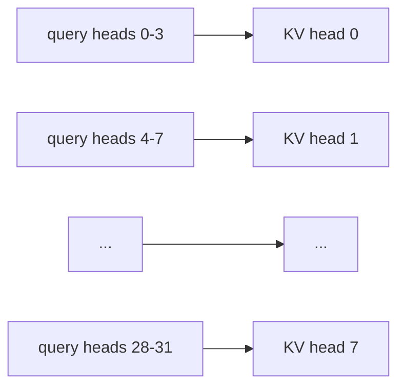

## 1. The question this idea answers

[L3](/notes/ai/llm-systems/02-attention-and-the-transformer/l3-scaled-dot-product-attention) computed one attention head. Each token got one row of weights and one weighted average of the value vectors. That is one view of the context for each token.

A token often needs several kinds of information at the same time. In "the cat sat down", the token "sat" needs its subject, "cat". It can also need the token before it, or the start of the sentence. One softmax row gives one mix. If the row gives 0.5 to "cat" and 0.5 to "the", the output is the average of two value vectors. Later layers cannot separate the two pieces of information again.

Vaswani et al. (2017) state the problem in one line: "With a single attention head, averaging inhibits this." Their solution is **multi-head attention**. It runs several small attention heads in parallel, each with its own projections, and combines the results. This lesson shows how, with every shape, the cost, the parameter count of a real model, and what the heads learn.

## 2. Mental model

> [!analogy] A panel of readers with different questions
> Imagine 32 readers who read the same sentence at the same time. Each reader has a different question, for example "which word does this verb act on?" or "what was the previous word?". Each reader marks the words that answer the question and writes a short note of 128 numbers. An editor then reads all 32 notes side by side and writes one combined update of 4,096 numbers. The readers are the heads. The short notes are the head outputs. The editor is the output projection $W_O$.
>
> **Where it stops working:** nobody gives the readers their questions. The questions are the projection matrices, and training sets them. Many heads do similar or unclear jobs. The editor does not pick one note: it adds a learned linear function of every note. And in modern models, groups of readers share one copy of the keys and values (grouped-query attention).

## 3. Terms

| Term | Plain meaning |
|---|---|
| head | One independent copy of scaled dot-product attention, with its own query, key and value projections. |
| number of heads $H$ | How many heads run in parallel in one layer. Llama-3.1-8B has $H = 32$. |
| head dimension $d_h$ | The length of one head's query, key and value vectors. Usually $d_h = d/H$. L3 calls it $d_k$. |
| model width $d$ | The length of each hidden state. Configs call it `hidden_size`. Llama-3.1-8B has $d = 4096$. |
| hidden state | The vector of one token between two layers. |
| split heads | A reshape and a transpose that change $[B, T, d]$ into $[B, H, T, d_h]$, so that each head gets its own slice. |
| concatenate | Put the head outputs side by side again: $[B, H, T, d_h] \to [B, T, H \cdot d_h]$. |
| output projection $W_O$ | The learned $[H d_h, d]$ matrix that mixes the concatenated head outputs into one update of the hidden state. |
| multi-head attention (MHA) | Attention with $H$ heads, where each head has its own keys and values. |
| attention pattern | The $T \times T$ matrix of weights of one head. Row $i$ shows how token $i$ spreads its attention. |
| representation subspace | The small $d_h$-dimensional space that one head projects into. Each head compares tokens in its own subspace. |
| KV head | One set of key and value projections. In MHA, each query head has its own KV head. |
| grouped-query attention (GQA) | A design where a group of query heads shares one KV head. Llama-3.1-8B has 8 KV heads for 32 query heads. |
| multi-query attention (MQA) | GQA with only one KV head for all query heads. |
| parameter | One learned number in a weight matrix. |
| FLOP | One floating-point operation: one multiplication or one addition. |
| `nn.Linear` | The PyTorch layer that computes $y = x W^\top + b$. It stores its weight with the shape [out, in]. |

All terms are also in the [Glossary](/notes/ai/llm-systems/glossary).

## 4. One head versus many heads

### 4.1 What one head can and cannot do

Recall the output of one head for token $i$ ([L3](/notes/ai/llm-systems/02-attention-and-the-transformer/l3-scaled-dot-product-attention)):

$$
o_i = \sum_{j \le i} a_{ij}\, v_j, \qquad a_{ij} \ge 0, \qquad \sum_{j \le i} a_{ij} = 1
$$

So $o_i$ is a weighted average of value vectors. A weighted average of two different vectors lies between them. It keeps neither vector intact.

> [!example] Worked example: one head blends
> In the toy head of L3, the row of "sat" has the weights $[0.1400, 0.5760, 0.2840]$ over "the", "cat", "sat". The values are $v_{the} = [2, 3]$, $v_{cat} = [2, 2]$, $v_{sat} = [1, 2]$.
>
> $o_{sat} = 0.1400 \cdot [2, 3] + 0.5760 \cdot [2, 2] + 0.2840 \cdot [1, 2] = [1.7160, 2.1400]$.
>
> The result equals none of the three value vectors. If "sat" also needs a clean copy of $v_{the} = [2, 3]$, this head cannot give it. Its softmax already gave most of the weight to "cat".

A second head with different projections can compute a different pattern for the same token. The model then gets both results, side by side.

### 4.2 The formula

Vaswani et al. (2017), section 3.2.2, define:

$$
\mathrm{MultiHead}(Q, K, V) = \mathrm{Concat}(\mathrm{head}_1, \dots, \mathrm{head}_H)\, W^O
$$

$$
\mathrm{head}_h = \mathrm{Attention}(Q W_h^Q,\ K W_h^K,\ V W_h^V)
$$

In self-attention, $Q$, $K$ and $V$ in this formula are all the same input: the hidden states $X$ of shape $[T, d]$. So for head $h$:

$$
Q_h = X W_h^Q, \qquad K_h = X W_h^K, \qquad V_h = X W_h^V
$$

Every head reads the **full** hidden state of every token. Only the output of each head is small.

| Object | Shape | Toy ($d = 4$, $H = 2$) | Llama-3.1-8B |
|---|---|---|---|
| $X$ | $[T, d]$ | $[4, 4]$ | $[T, 4096]$ |
| $W_h^Q$, $W_h^K$, $W_h^V$ | $[d, d_h]$ | $[4, 2]$ | $[4096, 128]$ |
| $Q_h$, $K_h$, $V_h$ | $[T, d_h]$ | $[4, 2]$ | $[T, 128]$ |
| scores $Q_h K_h^\top$ | $[T, T]$ | $[4, 4]$ | $[T, T]$ |
| $\mathrm{head}_h$ | $[T, d_h]$ | $[4, 2]$ | $[T, 128]$ |
| $\mathrm{Concat}$ | $[T, H d_h]$ | $[4, 4]$ | $[T, 4096]$ |
| $W^O$ | $[H d_h, d]$ | $[4, 4]$ | $[4096, 4096]$ |
| output | $[T, d]$ | $[4, 4]$ | $[T, 4096]$ |

The original transformer used $H = 8$ heads with $d_k = d_v = d_{model}/H = 64$ and $d_{model} = 512$. Llama-3.1-8B uses 32 heads of 128 (Llama 3 paper, Table 3).

> [!key] Same total width, more views
> Each head is small: $d_h = d/H$. Together, the heads have the same width $d$ as one big head. So the cost stays about the same, but the model gets $H$ separate attention patterns for each token.

### 4.3 The cost stays the same

Vaswani et al. write that "the total computational cost is similar to that of single-head attention with full dimensionality." Count it. A matrix product $[m, k] \times [k, n]$ costs $2mkn$ FLOPs, one multiplication and one addition per term ([part 01 L2](/notes/ai/llm-systems/01-math-and-hardware/l2-matrices-and-matrix-multiplication)).

| Step | One head of width $d$ | $H$ heads of width $d_h = d/H$ |
|---|---|---|
| $Q$, $K$, $V$ projections | $3 \times 2Td^2$ | $3 \times 2Td^2$ (the same columns, only grouped) |
| scores $QK^\top$ | $2T^2 d$ | $H \times 2T^2 d_h = 2T^2 d$ |
| weighted sum $PV$ | $2T^2 d$ | $H \times 2T^2 d_h = 2T^2 d$ |
| output projection | $2Td^2$ | $2Td^2$ |
| **total** | $8Td^2 + 4T^2 d$ | $8Td^2 + 4T^2 d$ |

The matrix work is identical. One thing grows: there are now $H$ softmax matrices of size $T \times T$ instead of one. That is $H T^2$ exponentials instead of $T^2$. In FLOPs this is small. In memory traffic it is not small, and [L7](/notes/ai/llm-systems/02-attention-and-the-transformer/l7-attention-cost-and-flashattention) shows why.

## 5. The implementation: one big matrix, then a reshape

### 5.1 The per-head matrices sit side by side

Code does not multiply $H$ small matrices one by one. The $H$ query matrices sit side by side in one $[d, H d_h]$ matrix:

$$
W_Q = \big[\, W_1^Q \ \big\vert\ W_2^Q \ \big\vert\ \cdots \ \big\vert\ W_H^Q \,\big]
$$

One product $X W_Q$ gives $[T, H d_h]$. The first $d_h$ columns belong to head 1. The next $d_h$ columns belong to head 2, and so on. The same holds for $W_K$ and $W_V$.

> [!example] Worked example: the toy $W_Q$ for two heads
> Head 1 is the head of L3: $W_1^Q = [[0,0],[0,1],[1,1],[0,0]]$. Head 2 is a new head with $W_2^Q = [[1,0],[1,0],[0,0],[0,0]]$. Side by side:
>
> $W_Q = [[0,0,1,0],\,[0,1,1,0],\,[1,1,0,0],\,[0,0,0,0]]$
>
> With the toy tokens $x_{the} = [1,0,1,0]$, $x_{cat} = [0,1,0,1]$, $x_{sat} = [1,1,0,0]$, $x_{down} = [0,1,1,0]$:
>
> $X W_Q = [[1,1,1,0],\,[0,1,1,0],\,[0,1,2,0],\,[1,2,1,0]]$
>
> Columns 1 and 2 are $Q_1 = [[1,1],[0,1],[0,1],[1,2]]$, the $Q$ of L3. Columns 3 and 4 are $Q_2 = [[1,0],[1,0],[2,0],[1,0]]$.

### 5.2 Split the heads: reshape, then transpose

With a batch of $B$ sequences:

$$
[B, T, d] \xrightarrow{\ X W_Q\ } [B, T, H d_h] \xrightarrow{\ \text{reshape}\ } [B, T, H, d_h] \xrightarrow{\ \text{transpose}(1,2)\ } [B, H, T, d_h]
$$

The transpose puts $H$ next to $B$. A batched matrix product treats all leading axes as a batch ([part 01 L3](/notes/ai/llm-systems/01-math-and-hardware/l3-tensors-shapes-and-batches)). So $B \times H$ small attention problems, each with matrices of shape $[T, d_h]$, run in one call.

After attention, the inverse:

$$
[B, H, T, d_h] \xrightarrow{\ \text{transpose}(1,2)\ } [B, T, H, d_h] \xrightarrow{\ \text{reshape}\ } [B, T, H d_h] \xrightarrow{\ \times W_O\ } [B, T, d]
$$

The reshape after the transpose **is** the concatenation. It copies the data once, because the transposed tensor is not contiguous in memory.


> [!trap] Reshape is not transpose
> A direct reshape from $[B, T, d]$ to $[B, H, T, d_h]$ is wrong. It does not raise an error, but it groups numbers of **different tokens** into one head row. Always reshape to $[B, T, H, d_h]$ first and then swap the axes. In PyTorch, the tensor after the transpose back is not contiguous, so `.view(B, T, d)` fails. Use `.reshape(B, T, d)` or `.contiguous().view(B, T, d)`.

```video
{
  "src": "/notes/media/llm-systems/manim/m07-multi-head-split-concat.mp4",
  "caption": "The toy hidden states are projected once, split into two heads, attended separately, and concatenated before W_O."
}
```

## 6. Worked example: two heads on the toy sentence

### 6.1 Head 2, step by step

The toy model now has $d = 4$, $H = 2$, $d_h = 2$. Head 1 is exactly the head of L3, so its numbers are already known. Head 2 has new weights:

$$
W_2^Q = \begin{bmatrix} 1&0\\1&0\\0&0\\0&0 \end{bmatrix},\quad
W_2^K = \begin{bmatrix} 1&0\\0&0\\1&0\\0&1 \end{bmatrix},\quad
W_2^V = \begin{bmatrix} 1&0\\0&1\\0&0\\0&1 \end{bmatrix}
$$

The projections are:

- $Q_2 = [[1,0],[1,0],[2,0],[1,0]]$
- $K_2 = [[2,0],[0,1],[1,0],[1,0]]$
- $V_2 = [[1,0],[0,2],[1,1],[0,1]]$

The raw scores $Q_2 K_2^\top$, visible part only (the causal mask hides the rest):

| Query row | the | cat | sat | down |
|---|---|---|---|---|
| the | 2 | | | |
| cat | 2 | 0 | | |
| sat | 4 | 0 | 2 | |
| down | 2 | 0 | 1 | 1 |

> [!example] Worked example: the row of "sat" in head 2
> 1. Raw scores: $[4, 0, 2]$.
> 2. Divide by $\sqrt{d_h} = \sqrt{2} = 1.4142$: $[2.8284, 0, 1.4142]$.
> 3. Subtract the maximum 2.8284: $[0, -2.8284, -1.4142]$.
> 4. Exponentials: $[1, 0.0591, 0.2431]$. Sum: $1.3022$.
> 5. Weights: $[1/1.3022,\; 0.0591/1.3022,\; 0.2431/1.3022] = [0.7679, 0.0454, 0.1867]$.
> 6. Output: $0.7679 \cdot [1, 0] + 0.0454 \cdot [0, 2] + 0.1867 \cdot [1, 1] = [0.9546, 0.2775]$.

### 6.2 Two patterns for the same tokens

| Query row | Head 1 weights (L3) | Head 2 weights |
|---|---|---|
| the | $[1, 0, 0, 0]$ | $[1, 0, 0, 0]$ |
| cat | $[0.1956, 0.8044, 0, 0]$ | $[0.8044, 0.1956, 0, 0]$ |
| sat | $[0.1400, 0.5760, 0.2840, 0]$ | $[0.7679, 0.0454, 0.1867, 0]$ |
| down | $[0.0646, 0.5388, 0.1310, 0.2657]$ | $[0.4486, 0.1091, 0.2212, 0.2212]$ |

Head 1 sends most of the weight to "cat". Head 2 sends most of the weight to "the". The same four tokens get two different patterns. Neither head has to compromise.

The outputs of the two heads:

| Token | $\mathrm{head}_1$ | $\mathrm{head}_2$ | $\mathrm{Concat}$ |
|---|---|---|---|
| the | $[2, 3]$ | $[1, 0]$ | $[2, 3, 1, 0]$ |
| cat | $[2, 2.1956]$ | $[0.8044, 0.3911]$ | $[2, 2.1956, 0.8044, 0.3911]$ |
| sat | $[1.7160, 2.1400]$ | $[0.9546, 0.2775]$ | $[1.7160, 2.1400, 0.9546, 0.2775]$ |
| down | $[1.6034, 2.3302]$ | $[0.6698, 0.6605]$ | $[1.6034, 2.3302, 0.6698, 0.6605]$ |

### 6.3 The output projection

Take $W_O = [[1,0,0,1],\,[0,1,1,0],\,[1,1,0,0],\,[0,0,1,1]]$.

> [!example] Worked example: $W_O$ for the token "the"
> $\mathrm{Concat}_{the} = [2, 3, 1, 0]$. Each output entry is the dot product with one column of $W_O$:
>
> - column 1 $[1, 0, 1, 0]$: $2 + 0 + 1 + 0 = 3$
> - column 2 $[0, 1, 1, 0]$: $0 + 3 + 1 + 0 = 4$
> - column 3 $[0, 1, 0, 1]$: $0 + 3 + 0 + 0 = 3$
> - column 4 $[1, 0, 0, 1]$: $2 + 0 + 0 + 0 = 2$
>
> So $y_{the} = [3, 4, 3, 2]$.

The full output $Y = \mathrm{Concat} \cdot W_O$ (4 decimals):

| Token | $y$ |
|---|---|
| the | $[3, 4, 3, 2]$ |
| cat | $[2.8044, 3, 2.5867, 2.3911]$ |
| sat | $[2.6706, 3.0946, 2.4175, 1.9935]$ |
| down | $[2.2731, 3, 2.9907, 2.2638]$ |

In a real transformer block, $Y$ is added to the hidden states through the residual connection ([L6](/notes/ai/llm-systems/02-attention-and-the-transformer/l6-the-transformer-block)).

### 6.4 Concatenate and project equals a sum over heads

Divide $W_O$ into $H$ blocks of rows. Block $W_O^{(h)}$ has the shape $[d_h, d]$ and holds the rows that multiply head $h$. Then:

$$
\mathrm{Concat}(\mathrm{head}_1, \dots, \mathrm{head}_H)\, W_O = \sum_{h=1}^{H} \mathrm{head}_h\, W_O^{(h)}
$$

> [!example] Worked example: the sum form for "the"
> - Head 1 part: $[2, 3] \cdot [[1,0,0,1],[0,1,1,0]] = [2, 3, 3, 2]$
> - Head 2 part: $[1, 0] \cdot [[1,1,0,0],[0,0,1,1]] = [1, 1, 0, 0]$
> - Sum: $[3, 4, 3, 2]$. This equals the result of section 6.3.

Elhage et al. (2021) use this identity and write that "Attention heads can be understood as independent operations." Each head adds its own update to the hidden state. Interpretation of these notes: this is why researchers can study, switch off, or prune single heads.

## 7. Code

### 7.1 NumPy implementation with shapes

```python
import numpy as np

def split_heads(x, H):
    B, T, d = x.shape
    return x.reshape(B, T, H, d // H).transpose(0, 2, 1, 3)   # [B, H, T, dh]

def merge_heads(x):
    B, H, T, dh = x.shape
    return x.transpose(0, 2, 1, 3).reshape(B, T, H * dh)      # [B, T, d]

def mha(X, Wq, Wk, Wv, Wo, H, causal=True):
    B, T, d = X.shape
    Q = split_heads(X @ Wq, H)                                  # [B, H, T, dh]
    K = split_heads(X @ Wk, H)
    V = split_heads(X @ Wv, H)
    S = Q @ K.transpose(0, 1, 3, 2) / np.sqrt(d // H)           # [B, H, T, T]
    if causal:
        S = S + np.triu(np.full((T, T), -np.inf), 1)
    P = np.exp(S - S.max(-1, keepdims=True))
    P = P / P.sum(-1, keepdims=True)
    O = P @ V                                                   # [B, H, T, dh]
    return merge_heads(O) @ Wo, P                               # [B, T, d]

X = np.array([[1,0,1,0],[0,1,0,1],[1,1,0,0],[0,1,1,0]], float)[None]   # [1, 4, 4]
Wq = np.array([[0,0,1,0],[0,1,1,0],[1,1,0,0],[0,0,0,0]], float)
Wk = np.array([[0,0,1,0],[0,1,0,0],[1,0,1,0],[0,1,0,1]], float)
Wv = np.array([[1,1,1,0],[0,1,0,1],[1,2,0,0],[2,1,0,1]], float)
Wo = np.array([[1,0,0,1],[0,1,1,0],[1,1,0,0],[0,0,1,1]], float)
Y, P = mha(X, Wq, Wk, Wv, Wo, H=2)
print(P.shape, Y.shape)      # (1, 2, 4, 4) (1, 4, 4)
print(Y[0].round(4))
```

Output:

```text
(1, 2, 4, 4) (1, 4, 4)
[[3.     4.     3.     2.    ]
 [2.8044 3.     2.5867 2.3911]
 [2.6706 3.0946 2.4175 1.9935]
 [2.2731 3.     2.9907 2.2638]]
```

What the important lines do:

1. `x.reshape(B, T, H, d // H)` cuts the last axis of each token into $H$ pieces of $d_h$ numbers. Piece $h$ is the column block of head $h$.
2. `.transpose(0, 2, 1, 3)` moves the head axis before the token axis. Now `Q[b, h]` is the $[T, d_h]$ query matrix of head $h$.
3. `K.transpose(0, 1, 3, 2)` swaps only the last two axes. So `Q @ K^T` is a batched product: $B \times H$ products of $[T, d_h] \times [d_h, T]$.
4. `np.triu(..., 1)` builds the causal mask: $-\infty$ above the diagonal ([L4](/notes/ai/llm-systems/02-attention-and-the-transformer/l4-causal-masking-and-generation)). It broadcasts over $B$ and $H$.
5. `S.max(-1, keepdims=True)` is the subtract-the-maximum trick of L3. It prevents overflow in `np.exp`.
6. `merge_heads(O) @ Wo` concatenates the heads and applies $W_O$ in one product.

The full matrices are the per-head matrices of section 6 side by side. For example, `Wk` holds $W_1^K$ in columns 1 and 2 and $W_2^K$ in columns 3 and 4.

### 7.2 The same computation in PyTorch

PyTorch has a fused attention function. Its inputs have the shape $[B, H, T, d_h]$.

```python
import torch
import torch.nn.functional as F

def to_heads(t, H):                                   # [B, T, d] -> [B, H, T, dh]
    B, T, d = t.shape
    return t.view(B, T, H, d // H).transpose(1, 2)

f64 = torch.float64
X  = torch.tensor([[1,0,1,0],[0,1,0,1],[1,1,0,0],[0,1,1,0]], dtype=f64)[None]
Wq = torch.tensor([[0,0,1,0],[0,1,1,0],[1,1,0,0],[0,0,0,0]], dtype=f64)
Wk = torch.tensor([[0,0,1,0],[0,1,0,0],[1,0,1,0],[0,1,0,1]], dtype=f64)
Wv = torch.tensor([[1,1,1,0],[0,1,0,1],[1,2,0,0],[2,1,0,1]], dtype=f64)
Wo = torch.tensor([[1,0,0,1],[0,1,1,0],[1,1,0,0],[0,0,1,1]], dtype=f64)
O = F.scaled_dot_product_attention(to_heads(X @ Wq, 2), to_heads(X @ Wk, 2),
                                   to_heads(X @ Wv, 2), is_causal=True)
Y = O.transpose(1, 2).reshape(1, 4, 4) @ Wo
print(O.shape)    # torch.Size([1, 2, 4, 2])
print(Y)          # the same 4 x 4 matrix as the NumPy code
```

Notes on this code:

1. `F.scaled_dot_product_attention` takes query $(N, \dots, H_q, L, E)$ and key $(N, \dots, H, S, E)$ (PyTorch 2.14 docs). $L$ is the number of queries, $S$ the number of keys, $E$ the head dimension.
2. `is_causal=True` applies the causal mask inside the function.
3. On a CUDA GPU, the function can run a fused kernel such as FlashAttention-2 ([L7](/notes/ai/llm-systems/02-attention-and-the-transformer/l7-attention-cost-and-flashattention)). On a CPU, it runs the plain C++ implementation.
4. The argument `enable_gqa=True` lets $H_q$ be a multiple of $H$, for grouped-query attention (section 10).

> [!trap] PyTorch stores linear weights transposed
> The math uses $Q = XW_Q$ with $W_Q$ of shape [in, out]. A PyTorch `nn.Linear` computes $x W^\top$ and stores $W$ as [out, in]. So in the Llama-3.1-8B checkpoint, `k_proj.weight` has the shape (1024, 4096), not (4096, 1024). Transpose it before you use it in the math form.

## 8. Parameters and FLOPs of a real model

### 8.1 The parameter count of an MHA layer

With $H d_h = d$, each of $W_Q$, $W_K$, $W_V$ and $W_O$ is $d \times d$:

$$
\text{params}_{MHA} = 4d^2 \quad (+\,4d \text{ if the layer has biases})
$$

The original transformer base model ($d = 512$): $4 \times 512^2 = 1{,}048{,}576$ weights per attention layer, plus 2,048 biases. Llama has no biases in attention: Meta's reference code creates `wq`, `wk`, `wv` and `wo` with `bias=False`.

### 8.2 Llama-3.1-8B: count every matrix

Llama-3.1-8B has $d = 4096$, $H = 32$, $H_{kv} = 8$, $d_h = 128$ (Meta `llama-models` repository and Llama 3 paper). The key and value projections are smaller, because only 8 KV heads exist: $H_{kv} d_h = 8 \times 128 = 1024$.

| Matrix | Shape [in, out] | Parameters |
|---|---|---|
| $W_Q$ | $4096 \times 4096$ | 16,777,216 |
| $W_K$ | $4096 \times 1024$ | 4,194,304 |
| $W_V$ | $4096 \times 1024$ | 4,194,304 |
| $W_O$ | $4096 \times 4096$ | 16,777,216 |
| **one layer** | | **41,943,040** ($\approx 41.9$M) |


The general formula, with $H d_h = d$:

$$
\text{params}_{GQA} = \underbrace{d \cdot d}_{W_Q} + \underbrace{2 \cdot d \cdot H_{kv} d_h}_{W_K,\ W_V} + \underbrace{d \cdot d}_{W_O} = 2d^2 + 2 d H_{kv} d_h
$$

> [!example] Worked example: attention parameters of Llama-3.1-8B
> One layer: $2 \times 4096^2 + 2 \times 4096 \times 8 \times 128 = 33{,}554{,}432 + 8{,}388{,}608 = 41{,}943{,}040$.
>
> All 32 layers: $32 \times 41{,}943{,}040 = 1{,}342{,}177{,}280 \approx 1.34$B. The whole model has 8,030,261,248 parameters (Hugging Face model metadata). So attention holds about 16.7% of the model.
>
> With full MHA (32 KV heads), one layer would need $4 \times 4096^2 = 67{,}108{,}864$. GQA saves $25{,}165{,}824$ parameters per layer, which is 37.5%.

[L6](/notes/ai/llm-systems/02-attention-and-the-transformer/l6-the-transformer-block) counts the rest of the model and reaches the full 8,030,261,248.

### 8.3 FLOPs per token per layer

Take one new token during generation. It sees $T$ tokens (itself and the cached ones). Count the FLOPs of the attention sub-layer of Llama-3.1-8B for this token:

1. **Projections** $W_Q$, $W_K$, $W_V$, $W_O$: 2 FLOPs per parameter, so $2 \times 41{,}943{,}040 = 83{,}886{,}080$ FLOPs.
2. **Scores:** 32 query heads, each with $T$ dot products of length 128. That is $32 \times T \times 2 \times 128 = 2Td = 8{,}192\,T$ FLOPs.
3. **Weighted sum:** each head adds $T$ value vectors of length 128 with weights: also $2Td = 8{,}192\,T$ FLOPs.

Steps 2 and 3 together give $4Td = 16{,}384\,T$ FLOPs per layer.

> [!example] Worked example: when does attention arithmetic win?
> The two parts are equal when $16{,}384\,T = 83{,}886{,}080$, so at $T = 5{,}120$ tokens.
>
> At $T = 8{,}192$: $4 \times 8{,}192 \times 4{,}096 = 134{,}217{,}728$ FLOPs. This is about 1.6 times the projection work of the same layer.

GQA does not change steps 2 and 3. Each of the 32 query heads still computes its own dot products and its own weighted sum. GQA reduces the parameters of $W_K$ and $W_V$, the size of the KV cache, and the bytes read from memory ([part 03 L5](/notes/ai/llm-systems/03-kv-cache/l5-mha-mqa-gqa-and-mla)).

## 9. What heads learn

Training sets the projections. Researchers then measure what each head does. The findings below are what the sources report. They are measurements on specific models, not rules for every model.

| Head behavior | What the source reports |
|---|---|
| Positional heads | Voita et al. (2019) call a head positional "if at least 90% of the time its maximum attention weight is assigned to a specific relative position". They add: "in practice either -1 or +1, i.e. attention to adjacent tokens". |
| Syntactic heads | Voita et al. find heads that attend to tokens in specific dependency relations. They test nsubj, dobj, amod and advmod. Clark et al. (2019) find BERT heads "that attend to the direct objects of verbs, determiners of nouns, objects of prepositions, and coreferent mentions". |
| Rare-word heads | Voita et al. find a head that attends to the least frequent tokens in a sentence. |
| Broad and delimiter heads | Clark et al. report heads "attending to delimiter tokens, specific positional offsets, or broadly attending over the whole sentence". |
| Induction heads | Olsson et al. (2022) describe heads that "implement a simple algorithm to complete token sequences like [A][B] ... [A] -> [B]". They propose that these heads might be the mechanism for most in-context learning. |
| Attention sinks | Xiao et al. (2023) observe "strong attention scores towards initial tokens as a sink even if they are not semantically important" ([part 03 L6](/notes/ai/llm-systems/03-kv-cache/l6-shrinking-the-kv-cache)). |

Many heads are not essential. Voita et al. report that on English-Russian WMT, "pruning 38 out of 48 encoder heads results in a drop of only 0.15 BLEU." Michel et al. (2019) report that "a large percentage of attention heads can be removed at test time without significantly impacting performance", and that "some layers can even be reduced to a single head."

> [!note] Interpretation of these notes
> Heads specialize, but not by design and not cleanly. Do not claim that "head 5 does syntax" in a model unless you measured it. A safe interview statement has three parts. Multiple heads give the model several attention patterns per layer. Training decides what the patterns are. Measurements show both useful specialization and large redundancy.

## 10. Design trade-offs and a preview of GQA

### 10.1 Why not many tiny heads?

1. **Rank.** The score matrix of one head is $Q_h K_h^\top$ with $Q_h, K_h \in \mathbb{R}^{T \times d_h}$. Its rank is at most $d_h$. In the toy, $d_h = 2$, so each $4 \times 4$ score matrix has rank 2 or less. Bhojanapalli et al. (2020) argue that "the scaling between the number of heads and the size of each head" gives "a low-rank bottleneck in attention heads".
2. **Softmax work.** Each extra head adds one more $T \times T$ softmax.
3. **KV cache.** In MHA, each head stores its own key and value for every token. More KV heads mean a larger cache.

Common head sizes in the models of these notes are 64 (original transformer) and 128 (Llama 3.1).

### 10.2 Grouped-query attention in one paragraph

Llama-3.1-8B has 32 query heads but only 8 KV heads. Each group of $32 / 8 = 4$ query heads reads the same key and value vectors. Query heads 0 to 3 use KV head 0, query heads 4 to 7 use KV head 1, and so on. In code, the KV heads are repeated before the attention product. Hugging Face's `repeat_kv` turns $[B, 8, T, 128]$ into $[B, 32, T, 128]$ and documents it as the equivalent of `torch.repeat_interleave(x, dim=1, repeats=n_rep)`.



Effect on the KV cache of one layer, per token, in BF16 (2 bytes per number): MHA would store $2 \times 32 \times 128 \times 2 = 16{,}384$ bytes. GQA stores $2 \times 8 \times 128 \times 2 = 4{,}096$ bytes. The full story is in [part 03 L5](/notes/ai/llm-systems/03-kv-cache/l5-mha-mqa-gqa-and-mla), and the size formula is in [part 03 L3](/notes/ai/llm-systems/03-kv-cache/l3-the-kv-cache-size-formula).

### Exercises

Write these in the notebook folder `llm-systems/` of the lab `C:\Users\ASohi\Downloads\AI\agent-harness-lab`.

1. **Split and merge.** Write `split_heads(x, H)` and `merge_heads(x)` for NumPy arrays.
   - Acceptance test: take `x` of shape (2, 3, 8) and $H = 4$. The split has shape (2, 4, 3, 2). `merge_heads(split_heads(x, 4))` equals `x`. `split_heads(x, 4)[1, 2]` equals `x[1, :, 4:6]`.
   - Hint 1: reshape the last axis first, then move the head axis.
   - Hint 2: the inverse needs the same transpose, then a reshape.
2. **Heads one by one.** Compute the toy two-head output from the per-head matrices only. Run head 1 and head 2 as separate single-head attentions. Then concatenate and apply $W_O$.
   - Acceptance test: your result equals the table of section 6.3, and also equals $\mathrm{head}_1 W_O^{(1)} + \mathrm{head}_2 W_O^{(2)}$.
   - Hint 1: write `one_head(X, Wq, Wk, Wv)` for a $[T, d]$ input.
   - Hint 2: $W_O^{(1)}$ is `Wo[:2]` and $W_O^{(2)}$ is `Wo[2:]`.
3. **Add GQA.** Write `gqa(X, Wq, Wk, Wv, Wo, H, Hkv)` where `Wk` and `Wv` have the shape $[d, H_{kv} d_h]$.
   - Acceptance test: with $H_{kv} = H$ it equals `mha`. With the toy and $H_{kv} = 1$ (both heads use the K and V of head 1), the result equals `F.scaled_dot_product_attention(..., enable_gqa=True)` to within $10^{-12}$.
   - Hint 1: query head $h$ reads KV head $h // (H // H_{kv})$.
   - Hint 2: `np.repeat(K, H // Hkv, axis=1)` makes the copies in the right order.
4. **Count by hand.** A model has $d = 5120$, $H = 40$, $H_{kv} = 8$, $d_h = 128$, no biases. Compute the attention parameters of one layer.
   - Acceptance test: your number matches the formula of section 8.2 computed in Python.
   - Hint 1: $W_Q$ and $W_O$ are $d \times d$.
   - Hint 2: $W_K$ and $W_V$ are $d \times H_{kv} d_h$.

```check
{
  "question": "Exercise 1: show a reference solution.",
  "hint": "Reshape to [B, T, H, dh], then transpose axes 1 and 2.",
  "answer": "```python\nimport numpy as np\n\ndef split_heads(x, H):\n    B, T, d = x.shape\n    return x.reshape(B, T, H, d // H).transpose(0, 2, 1, 3)\n\ndef merge_heads(x):\n    B, H, T, dh = x.shape\n    return x.transpose(0, 2, 1, 3).reshape(B, T, H * dh)\n\nx = np.arange(2 * 3 * 8, dtype=float).reshape(2, 3, 8)\ns = split_heads(x, 4)\nassert s.shape == (2, 4, 3, 2)\nassert np.array_equal(merge_heads(s), x)\nassert np.array_equal(s[1, 2], x[1, :, 4:6])\nprint(\"ok\")\n```\n\n`s[1, 2]` is the head with index 2 (the third head) of the sequence with index 1. It owns the columns $2 d_h$ to $3 d_h - 1$, counted from 0. These are the columns 4 and 5 when $d_h = 2$."
}
```

```check
{
  "question": "Exercise 2: show a reference solution.",
  "hint": "Run each head on the full X. Only the output of a head is small.",
  "answer": "```python\nimport numpy as np\n\nX = np.array([[1,0,1,0],[0,1,0,1],[1,1,0,0],[0,1,1,0]], float)\nheads = [\n    (np.array([[0,0],[0,1],[1,1],[0,0.]]), np.array([[0,0],[0,1],[1,0],[0,1.]]),\n     np.array([[1,1],[0,1],[1,2],[2,1.]])),\n    (np.array([[1,0],[1,0],[0,0],[0,0.]]), np.array([[1,0],[0,0],[1,0],[0,1.]]),\n     np.array([[1,0],[0,1],[0,0],[0,1.]])),\n]\nWo = np.array([[1,0,0,1],[0,1,1,0],[1,1,0,0],[0,0,1,1]], float)\n\ndef one_head(X, Wq, Wk, Wv):\n    T = X.shape[0]\n    S = (X @ Wq) @ (X @ Wk).T / np.sqrt(Wq.shape[1])\n    S = S + np.triu(np.full((T, T), -np.inf), 1)\n    P = np.exp(S - S.max(1, keepdims=True))\n    P /= P.sum(1, keepdims=True)\n    return P @ (X @ Wv)\n\nouts = [one_head(X, *w) for w in heads]\nY1 = np.concatenate(outs, 1) @ Wo\nY2 = outs[0] @ Wo[:2] + outs[1] @ Wo[2:]\nassert np.allclose(Y1, Y2)\nprint(Y1.round(4))\n```\n\nThe printed matrix is the table of section 6.3. The two forms agree because a product with a block row vector is the sum of the block products."
}
```

```check
{
  "question": "Exercise 3: show a reference solution.",
  "hint": "np.repeat copies each KV head H // Hkv times next to itself.",
  "answer": "```python\nimport numpy as np\n\ndef merge_heads(x):\n    B, H, T, dh = x.shape\n    return x.transpose(0, 2, 1, 3).reshape(B, T, H * dh)\n\ndef gqa(X, Wq, Wk, Wv, Wo, H, Hkv, causal=True):\n    B, T, d = X.shape\n    dh = Wq.shape[1] // H\n    Q = (X @ Wq).reshape(B, T, H, dh).transpose(0, 2, 1, 3)     # [B, H, T, dh]\n    K = (X @ Wk).reshape(B, T, Hkv, dh).transpose(0, 2, 1, 3)   # [B, Hkv, T, dh]\n    V = (X @ Wv).reshape(B, T, Hkv, dh).transpose(0, 2, 1, 3)\n    K = np.repeat(K, H // Hkv, axis=1)       # head h reads KV head h // (H // Hkv)\n    V = np.repeat(V, H // Hkv, axis=1)\n    S = Q @ K.transpose(0, 1, 3, 2) / np.sqrt(dh)\n    if causal:\n        S = S + np.triu(np.full((T, T), -np.inf), 1)\n    P = np.exp(S - S.max(-1, keepdims=True))\n    P = P / P.sum(-1, keepdims=True)\n    return merge_heads(P @ V) @ Wo\n```\n\nTest with the toy and $H_{kv} = 1$: use `Wk1 = [[0,0],[0,1],[1,0],[0,1]]` and `Wv1 = [[1,1],[0,1],[1,2],[2,1]]` (head 1 of L3) for both heads. Head 2 then gets the weights $[0.6698, 0.3302]$ for \"cat\" and $[0.3349, 0.1651, 0.1651, 0.3349]$ for \"down\". The output rows are $[4, 5, 6, 5]$, $[4, 4.1956, 4.8653, 4.6698]$, $[3.5524, 3.9765, 4.8129, 4.3888]$ and $[3.1034, 3.8302, 5, 4.2731]$. PyTorch's `scaled_dot_product_attention(Q, K, V, is_causal=True, enable_gqa=True)` with K and V of shape [1, 1, 4, 2] gives the same values (difference below $10^{-15}$)."
}
```

```check
{
  "question": "Exercise 4: show a reference solution.",
  "hint": "2 d^2 + 2 d H_kv d_h.",
  "answer": "$W_Q$: $5120 \\times 5120 = 26{,}214{,}400$. $W_K$: $5120 \\times (8 \\times 128) = 5120 \\times 1024 = 5{,}242{,}880$. $W_V$: $5{,}242{,}880$. $W_O$: $26{,}214{,}400$.\n\nTotal: $2 \\times 26{,}214{,}400 + 2 \\times 5{,}242{,}880 = 62{,}914{,}560 \\approx 62.9$M per layer.\n\n```python\nd, Hkv, dh = 5120, 8, 128\nprint(2 * d * d + 2 * d * Hkv * dh)   # 62914560\n```"
}
```


## 11. Common mistakes

1. **"Each head sees only a part of each token."** Every head reads the full hidden state of every token, all $d$ numbers. Only the head's projections and its output are small ($d_h$ numbers).
2. **"More heads cost more compute."** With $d_h = d/H$, the matrix FLOPs are the same for any $H$: $8Td^2 + 4T^2 d$ per layer. Only the number of softmax rows grows.
3. **"The concatenation is the layer output."** $W_O$ follows the concatenation. It mixes all heads and maps them back to width $d$. Without it, head $h$ could write only into its own slice of the hidden state.
4. **"Reshape $[B, T, d]$ directly to $[B, H, T, d_h]$."** That mixes numbers of different tokens. Reshape to $[B, T, H, d_h]$, then transpose.
5. **"Training assigns a role to each head."** Roles emerge from training. Many heads are redundant and can be pruned with a small loss.
6. **"GQA reduces the attention FLOPs."** The score and weighted-sum FLOPs depend on the 32 query heads, so they stay the same. GQA reduces the K and V parameters, the KV cache and the memory reads.
7. **"An `nn.Linear` weight has the shape [in, out]."** PyTorch stores [out, in]. Llama-3.1-8B's `k_proj.weight` is (1024, 4096).

## 12. One-minute explanation

One attention head gives each token one softmax row, so one weighted average of the values. If a token needs two kinds of information, one head must blend them. Multi-head attention runs $H$ heads in parallel. Each head projects into a small space of $d_h = d/H$ numbers with its own matrices, so it computes its own attention pattern. In code, one big matrix product makes the queries of all heads. A reshape and a transpose split them into $[B, H, T, d_h]$, and one batched attention runs all heads at once. The outputs are concatenated back to $[B, T, d]$ and multiplied by $W_O$, which equals a sum of one additive update per head. Because $d_h = d/H$, the FLOPs are the same as one big head: $8Td^2 + 4T^2 d$ per layer. In Llama-3.1-8B, one attention layer has 32 query heads, 8 KV heads and 41.9M parameters. Studies find positional, syntactic and induction heads, but also many heads that can be removed with little loss.

## 13. Check questions

```check
{
  "question": "A batch has B = 2 sequences of T = 10 tokens. The model has d = 4096 and H = 32. What are the shapes of X W_Q, of Q after the head split, of the scores, and of the output before W_O?",
  "hint": "d_h = d / H = 128.",
  "answer": "- $X W_Q$: $[2, 10, 4096]$\n- reshape: $[2, 10, 32, 128]$, then transpose: $Q$ is $[2, 32, 10, 128]$\n- scores $QK^\\top$: $[2, 32, 10, 10]$\n- $P V$: $[2, 32, 10, 128]$, then transpose and reshape: $[2, 10, 4096]$ before $W_O$."
}
```

```check
{
  "question": "Compute the output of head 2 for the token \"down\" in the toy example. The weights are [0.4486, 0.1091, 0.2212, 0.2212] and V_2 = [[1,0],[0,2],[1,1],[0,1]].",
  "hint": "Multiply each value row by its weight and add.",
  "answer": "$0.4486 \\cdot [1, 0] + 0.1091 \\cdot [0, 2] + 0.2212 \\cdot [1, 1] + 0.2212 \\cdot [0, 1]$\n\nFirst entry: $0.4486 + 0.2212 = 0.6698$. Second entry: $0.2182 + 0.2212 + 0.2212 = 0.6606$, which is $0.6605$ with unrounded weights.\n\nSo $\\mathrm{head}_2(\\text{down}) = [0.6698, 0.6605]$."
}
```

```check
{
  "question": "Interview follow-up: prove that multi-head attention with d_h = d/H needs the same matrix FLOPs as one head of width d.",
  "hint": "Write each product with its shapes and use H d_h = d.",
  "answer": "Count each step for $T$ tokens. A product $[m,k] \\times [k,n]$ costs $2mkn$ FLOPs.\n\n1. Projections: $X W_Q$ is $[T, d] \\times [d, H d_h] = [T, d] \\times [d, d]$, so $2Td^2$, the same for any split of the columns. The same for $K$, $V$ and $W_O$: total $8Td^2$.\n2. Scores: per head $[T, d_h] \\times [d_h, T]$: $2T^2 d_h$. For $H$ heads: $2T^2 H d_h = 2T^2 d$.\n3. Weighted sum: per head $[T, T] \\times [T, d_h]$: $2T^2 d_h$. For $H$ heads: $2T^2 d$.\n\nTotal $8Td^2 + 4T^2 d$, which is the single-head count. Only the softmax changes: $H T^2$ exponentials instead of $T^2$. Vaswani et al. state that the cost is \"similar to that of single-head attention with full dimensionality\"."
}
```

```check
{
  "question": "Interview follow-up: compute the attention parameters of one layer of Llama-3.1-70B (d = 8192, 64 query heads, 8 KV heads, d_h = 128, no biases), and for all 80 layers.",
  "hint": "Use 2d^2 + 2 d H_kv d_h.",
  "answer": "- $W_Q$: $8192 \\times 8192 = 67{,}108{,}864$\n- $W_K$: $8192 \\times 1024 = 8{,}388{,}608$\n- $W_V$: $8{,}388{,}608$\n- $W_O$: $67{,}108{,}864$\n\nOne layer: $150{,}994{,}944 \\approx 151.0$M. All 80 layers: $12{,}079{,}595{,}520 \\approx 12.1$B.\n\nWith full MHA, one layer would need $4 \\times 8192^2 = 268{,}435{,}456$."
}
```

```check
{
  "question": "Interview follow-up: what does W_O do, and what would break if you removed it (with H d_h = d)?",
  "hint": "Write the concatenation times W_O as a sum over heads.",
  "answer": "$W_O$ maps the concatenated head outputs back to width $d$ and mixes them. With the sum form, $\\mathrm{Concat}\\,W_O = \\sum_h \\mathrm{head}_h W_O^{(h)}$: each head writes a learned update into **all** $d$ coordinates of the hidden state.\n\nWithout $W_O$, the concatenation would still have width $d$, but head $h$ could change only its own $d_h$ coordinates. Each head would also have to produce its update directly in the value space. The model would lose the freedom to route each head's result to the coordinates that later layers read. Also, $W_V^{(h)} W_O^{(h)}$ together form a $d \\times d$ map of rank at most $d_h$ per head. $W_O$ is half of that map."
}
```

```check
{
  "question": "Interview follow-up: in one layer of Llama-3.1-8B, at what context length does the attention arithmetic (scores plus weighted sum) for one new token equal the projection arithmetic? Does GQA change the answer?",
  "hint": "2 FLOPs per parameter for the projections, 4Td for attention.",
  "answer": "Projections: $2 \\times 41{,}943{,}040 = 83{,}886{,}080$ FLOPs per token per layer.\n\nScores plus weighted sum: $4Td = 4 \\times 4096 \\times T = 16{,}384\\,T$.\n\nEqual when $T = 83{,}886{,}080 / 16{,}384 = 5{,}120$ tokens.\n\nGQA does not change the $4Td$ term, because all 32 query heads still do their dot products. GQA makes the projection term smaller than MHA ($2 \\times 67{,}108{,}864$ for MHA), so with MHA the break-even would be $134{,}217{,}728 / 16{,}384 = 8{,}192$ tokens."
}
```

```check
{
  "question": "Interview follow-up: what is the maximum rank of the score matrix of one head, and why can this be a limit?",
  "hint": "Rank of a product is at most the inner dimension.",
  "answer": "$Q_h K_h^\\top$ is a product of a $[T, d_h]$ and a $[d_h, T]$ matrix, so its rank is at most $d_h$ (128 in Llama-3.1-8B, 2 in the toy). The softmax is applied after the product, so the attention weights are not limited to this rank, but the scores are. If $d_h$ is very small, one head cannot express many independent comparison patterns. Bhojanapalli et al. (2020) call this \"a low-rank bottleneck in attention heads\" and link it to the scaling between the number of heads and the head size. This is one reason not to use many tiny heads."
}
```

```check
{
  "question": "Interview follow-up: \"Does GQA change the math of attention, or only the memory?\" Give a precise answer.",
  "hint": "Separate the parameters, the FLOPs and the cache.",
  "answer": "It changes the model, not only the memory. In GQA, the 4 query heads of a group use the **same** keys and values, so the model has fewer key and value parameters ($W_K$ and $W_V$ shrink from $d \\times d$ to $d \\times H_{kv} d_h$). A model trained with MHA cannot simply switch to GQA without changing its outputs. Ainslie et al. (2023) convert an MHA checkpoint: \"The projection matrices for key and value heads are mean pooled into single projection matrices\". Then they continue training with a small part of the original compute (uptraining). Part 03 L5 has the details.\n\nThe per-head computation is unchanged: each query head still computes $\\mathrm{softmax}(q K^\\top / \\sqrt{d_h}) V$ with its own query. So the FLOPs of the scores and weighted sum stay the same. The KV cache and the bytes read per decode step shrink by $H / H_{kv} = 4$."
}
```


## 14. Links

- Previous: [L4: Causal masking and generation](/notes/ai/llm-systems/02-attention-and-the-transformer/l4-causal-masking-and-generation)
- Next: [L6: The transformer block, end to end](/notes/ai/llm-systems/02-attention-and-the-transformer/l6-the-transformer-block)
- One head in full detail: [L3: Scaled dot-product attention, step by step](/notes/ai/llm-systems/02-attention-and-the-transformer/l3-scaled-dot-product-attention)
- Shapes, reshape and contiguous tensors: [part 01 L3: Tensors, shapes and batches](/notes/ai/llm-systems/01-math-and-hardware/l3-tensors-shapes-and-batches)
- FLOP counting: [part 01 L2: Matrices and matrix multiplication](/notes/ai/llm-systems/01-math-and-hardware/l2-matrices-and-matrix-multiplication)
- Grouped-query attention in depth: [part 03 L5: MHA, MQA, GQA and MLA](/notes/ai/llm-systems/03-kv-cache/l5-mha-mqa-gqa-and-mla)
- The size of the cache per head: [part 03 L3: The KV cache size formula](/notes/ai/llm-systems/03-kv-cache/l3-the-kv-cache-size-formula)
- Each GPU holds some heads: [part 04 L8: Parallelism](/notes/ai/llm-systems/04-inference/l8-parallelism)
- In PagedAttention, each block holds the keys and values of some heads: [04 PagedAttention: the algorithm](/notes/papers/llm-serving/2023-pagedattention/04-pagedattention-the-algorithm)
- Older lesson: [Background: attention and position](/notes/papers/long-context/2023-lost-in-the-middle/02-background-attention-and-position)

### Sources

- Vaswani et al., "Attention Is All You Need", NeurIPS 2017, section 3.2.2: https://arxiv.org/abs/1706.03762
- Llama 3 paper (Llama Team, Meta), "The Llama 3 Herd of Models", Table 3: https://arxiv.org/abs/2407.21783
- Meta `llama-models` repository, `models/sku_list.py` (8B: `dim` 4096, `n_heads` 32, `n_kv_heads` 8) and `models/llama3/model.py` (`bias=False`): https://github.com/meta-llama/llama-models
- Hugging Face model metadata for meta-llama/Llama-3.1-8B (total 8,030,261,248 parameters): https://huggingface.co/api/models/meta-llama/Llama-3.1-8B
- Hugging Face transformers, `modeling_llama.py` (`repeat_kv`, projection shapes): https://github.com/huggingface/transformers/blob/main/src/transformers/models/llama/modeling_llama.py
- PyTorch 2.14, `torch.nn.functional.scaled_dot_product_attention`: https://docs.pytorch.org/docs/2.14/generated/torch.nn.functional.scaled_dot_product_attention.html
- Elhage et al., "A Mathematical Framework for Transformer Circuits", December 2021: https://transformer-circuits.pub/2021/framework/index.html
- Voita et al., "Analyzing Multi-Head Self-Attention: Specialized Heads Do the Heavy Lifting, the Rest Can Be Pruned", 2019: https://arxiv.org/abs/1905.09418
- Clark et al., "What Does BERT Look At? An Analysis of BERT's Attention", 2019: https://arxiv.org/abs/1906.04341
- Michel, Levy and Neubig, "Are Sixteen Heads Really Better than One?", 2019: https://arxiv.org/abs/1905.10650
- Olsson et al., "In-context Learning and Induction Heads", 2022: https://arxiv.org/abs/2209.11895
- Xiao et al., "Efficient Streaming Language Models with Attention Sinks", 2023: https://arxiv.org/abs/2309.17453
- Bhojanapalli et al., "Low-Rank Bottleneck in Multi-head Attention Models", 2020: https://arxiv.org/abs/2002.07028
- Ainslie et al., "GQA: Training Generalized Multi-Query Transformer Models from Multi-Head Checkpoints", 2023: https://arxiv.org/abs/2305.13245

All sources checked on 2026-10-15.
