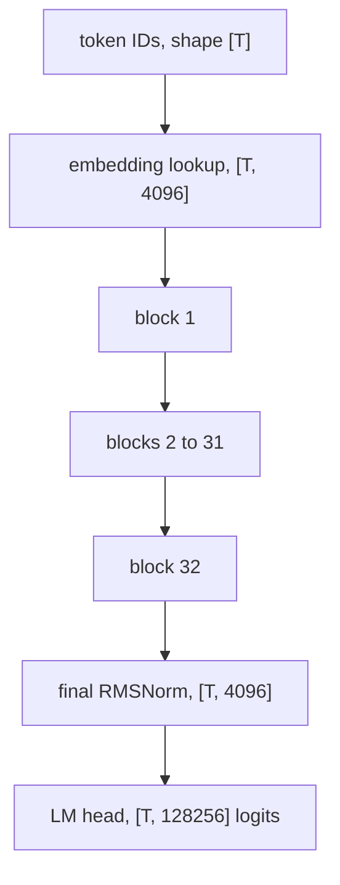

## 1. The question this idea answers

Attention alone is not a language model. Llama-3.1-8B has 32 layers, and each layer does more than attention. What runs inside one layer, in which order, and why each part is there? Where do the 8.03 billion parameters sit? How does the model know the order of tokens, when attention itself ignores order? And how many FLOPs does one generated token cost?

An interviewer who asks "what is attention" often continues with "and what is around it?". This lesson answers with the exact formulas, the shapes, and the numbers of one real model.

## 2. Mental model

> [!analogy] A conveyor belt with work stations
> Each token rides on its own conveyor belt: a vector of 4,096 numbers. Along the belt stand 64 work stations: an attention station and an MLP station in each of the 32 layers. A station never replaces what is on the belt. It reads a cleaned copy of the belt (the normalization), computes a change, and **adds** the change to the belt (the residual connection). Attention stations may also read the belts of earlier tokens. MLP stations work on one belt only. At the end, a reader turns the final belt into scores for the next token.
>
> **Where it stops working:** the stations are not independent workers. Later stations read what earlier stations added, and training shapes all of them together. The order of tokens does not ride on the belt at all in Llama. It enters only inside the attention stations, where the queries and keys are rotated by their position (RoPE).

## 3. Terms

| Term | Plain meaning |
|---|---|
| transformer block (layer) | One repeated unit: an attention sub-layer and an MLP sub-layer, each with a normalization and a residual connection. |
| residual connection | The rule $x \leftarrow x + F(x)$: a sub-layer adds its output to its input instead of replacing it. |
| residual stream | The sequence of hidden states that the residual connections carry from layer to layer. |
| pre-norm | The normalization is applied to the input of each sub-layer, inside the residual branch. |
| post-norm | The normalization is applied after the residual addition. The original transformer used it. |
| LayerNorm | A normalization that subtracts the mean and divides by the standard deviation, then multiplies by a learned gain. |
| RMSNorm | A normalization that only divides by the root mean square of the vector, then multiplies by a learned gain $g$. |
| epsilon $\epsilon$ | A small number added before a square root to avoid division by zero. Llama-3.1 uses $10^{-5}$. |
| MLP (feed-forward network) | The per-token sub-layer: two or three weight matrices with a nonlinear function between them. |
| SiLU (Swish) | The function $\mathrm{SiLU}(z) = z \cdot \sigma(z)$, where $\sigma$ is the logistic sigmoid. |
| SwiGLU | An MLP where a SiLU "gate" multiplies a second linear "up" projection element by element. |
| gate, up, down projections | The three MLP matrices of Llama: $W_{gate}$ and $W_{up}$ ($4096 \to 14336$) and $W_{down}$ ($14336 \to 4096$). |
| positional encoding | Information about the position of each token. Attention needs it because it ignores order. |
| sinusoidal encoding | Fixed sine and cosine vectors added to the input embeddings (original transformer). |
| learned positional embedding | A trained table with one vector per position, added to the input (GPT-2). |
| RoPE | Rotary position embedding: rotate each pair of query and key dimensions by an angle proportional to the position. |
| RoPE base $\theta$ | The constant that sets the rotation speeds. Llama 3 uses 500,000. |
| LM head | The final $[d, V]$ matrix that turns the last hidden state into one logit per vocabulary token. |
| logit | A raw score for one vocabulary token, before the softmax. |

All terms are also in the [Glossary](/notes/ai/llm-systems/glossary).

## 4. The block in two lines

### 4.1 The formula

Meta's reference code for Llama 3 (`models/llama3/model.py`) writes the whole block in two lines:

```python
h = x + self.attention(self.attention_norm(x), start_pos, freqs_cis, mask)
out = h + self.feed_forward(self.ffn_norm(h))
```

In math, for the hidden states $x$ of shape $[T, d]$:

$$
h = x + \mathrm{Attn}\big(\mathrm{RMSNorm}_1(x)\big)
$$

$$
\mathrm{out} = h + \mathrm{MLP}\big(\mathrm{RMSNorm}_2(h)\big)
$$

Read it from the inside. First a normalization. Then the sub-layer. Then an addition back to the input. Every symbol of these two lines gets its own section below.


```video
{
  "src": "/notes/media/llm-systems/manim/m08-transformer-block-data-flow.mp4",
  "caption": "One token's hidden state flows through RMSNorm, attention with RoPE, a residual add, RMSNorm, the SwiGLU MLP and a second residual add."
}
```

### 4.2 The whole model around the blocks



The embedding lookup and the LM head are the subject of [L1](/notes/ai/llm-systems/02-attention-and-the-transformer/l1-from-text-to-vectors). This lesson is about the 32 blocks.

## 5. Residual connections

### 5.1 What the addition does

A residual connection computes $x_{l+1} = x_l + F_l(x_l)$. The sub-layer $F_l$ computes only a **change**. If $F_l$ outputs zeros, the layer passes its input unchanged. So a deep stack can start close to the identity map and learn small changes.

He et al. (2016, "Identity Mappings in Deep Residual Networks") unroll the sum over many layers:

$$
x_L = x_l + \sum_{i=l}^{L-1} F(x_i)
$$

and differentiate it (equation 5 of that paper):

$$
\frac{\partial E}{\partial x_l} = \frac{\partial E}{\partial x_L}\left(1 + \frac{\partial}{\partial x_l}\sum_{i=l}^{L-1} F(x_i)\right)
$$

Here $E$ is the training loss. The "1" is a direct path: the gradient of the last layer reaches layer $l$ without passing through any weight matrix. The paper concludes that "the gradient of a layer does not vanish even when the weights are arbitrarily small."

> [!example] Worked example: 32 layers with and without residuals
> Take a scalar toy. Each layer has a local derivative $F'_i = 0.02$, a small value as at the start of training.
>
> - Without residuals, $x_{l+1} = F(x_l)$. The chain rule multiplies 32 factors: $0.02^{32} \approx 4.3 \times 10^{-55}$. The gradient at layer 1 is zero for all practical purposes.
> - With residuals, each factor is $1 + 0.02$. The product is $1.02^{32} \approx 1.88$. The gradient reaches layer 1 with a useful size.
>
> Expand the product $(1 + a_1)(1 + a_2)\cdots$: it equals $1 + \sum a_i + \sum a_i a_j + \dots$. The gradient is a sum over all paths through the network, including the direct path.

### 5.2 The residual stream

Elhage et al. (2021) describe the residual stream as a communication channel: "We generally think of the residual stream as a communication channel". Each sub-layer reads from the stream and writes a change into it. Section 6.4 of [L5](/notes/ai/llm-systems/02-attention-and-the-transformer/l5-multi-head-attention) showed that each attention head adds its own term. So the final hidden state is the input embedding plus the sum of 32 attention updates and 32 MLP updates.

> [!key] The main idea of residual connections
> A sub-layer adds a change to the hidden state. It never replaces it. This keeps a direct gradient path through all 32 layers. It lets the network start near the identity map. It also gives every layer access to what earlier layers wrote.

## 6. Normalization: RMSNorm and pre-norm

### 6.1 Why normalize

Each sub-layer adds to the hidden state. After many layers, the size of the vectors can grow or shrink a lot. A matrix product with a vector that is 100 times too large gives outputs that are 100 times too large, and softmax scores saturate ([L3](/notes/ai/llm-systems/02-attention-and-the-transformer/l3-scaled-dot-product-attention)). A normalization rescales each token's vector to a standard size before a sub-layer reads it.

### 6.2 LayerNorm and RMSNorm

For one token vector $a$ with $n$ entries, LayerNorm (Ba et al. 2016, as written by Zhang and Sennrich) computes:

$$
\mu = \frac{1}{n}\sum_{i=1}^{n} a_i, \qquad \sigma = \sqrt{\frac{1}{n}\sum_{i=1}^{n} (a_i - \mu)^2}, \qquad \bar a_i = \frac{a_i - \mu}{\sigma}\, g_i + b_i
$$

RMSNorm (Zhang and Sennrich, NeurIPS 2019) drops the mean and the bias:

$$
\mathrm{RMS}(a) = \sqrt{\frac{1}{n}\sum_{i=1}^{n} a_i^2}, \qquad \bar a_i = \frac{a_i}{\mathrm{RMS}(a)}\, g_i
$$

In code, an $\epsilon$ is added inside the root: $\sqrt{\tfrac{1}{n}\sum a_i^2 + \epsilon}$. The authors "hypothesize that re-centering invariance in LayerNorm is dispensable", and they report that RMSNorm "reduces the running time by 7%∼64% on different models". The gain $g$ has $n$ learned numbers. It starts at 1 and training changes it.

> [!example] Worked example: RMSNorm of the toy token "the"
> $x_{the} = [1, 0, 1, 0]$, $n = 4$, $\epsilon = 10^{-5}$, $g = [1, 1, 1, 1]$.
>
> 1. Squares: $[1, 0, 1, 0]$. Mean: $2/4 = 0.5$.
> 2. Add $\epsilon$: $0.50001$. Square root: $0.70711$.
> 3. Divide: $[1/0.70711, 0, 1/0.70711, 0] = [1.4142, 0, 1.4142, 0]$.
>
> The vector $3 x_{the} = [3, 0, 3, 0]$ gives the same result: its RMS is $\sqrt{4.5} = 2.1213$, and $3 / 2.1213 = 1.4142$. RMSNorm removes the scale.
>
> LayerNorm gives a different result. The mean is 0.5 and the standard deviation is 0.5, so the output is $[1, -1, 1, -1]$. LayerNorm also removes the mean.

Llama-3.1-8B uses $\epsilon = 10^{-5}$ (`norm_eps` in Meta's model arguments). The Hugging Face implementation computes the norm in 32-bit floats and casts the result back: `hidden_states = hidden_states.to(torch.float32)`, then `variance = hidden_states.pow(2).mean(-1, keepdim=True)`, then `hidden_states * torch.rsqrt(variance + self.variance_epsilon)`. The reason is precision: a mean of 4,096 squares in BF16 loses digits ([part 01 L4](/notes/ai/llm-systems/01-math-and-hardware/l4-numbers-in-memory)).

### 6.3 Pre-norm versus post-norm

The original transformer used **post-norm**: "LayerNorm(x + Sublayer(x))" (Vaswani et al., section 3.1). GPT-2 changed this: "Layer normalization was moved to the input of each sub-block", and "an additional layer normalization was added after the final self-attention block" (Radford et al. 2019).

| | Post-norm | Pre-norm |
|---|---|---|
| Formula | $x_{l+1} = \mathrm{LN}(x_l + F(x_l))$ | $x_{l+1} = x_l + F(\mathrm{LN}(x_l))$ |
| Residual path | passes through a norm in every layer | clean: pure additions from input to output |
| Final norm | not needed | needed before the LM head |
| Used by | original transformer, BERT | GPT-2, Llama, most current decoder LLMs |

Xiong et al. (ICML 2020) explain the difference. In post-norm, "the expected gradients of the parameters near the output layer are large" at initialization, so training needs a learning-rate warm-up. In pre-norm, "the gradients are well-behaved at initialization". They also note that the "Pre-LN Transformer uses a final layer normalization right before the prediction". Llama has that final norm: `h = self.norm(h)` before `self.output(h)`.

## 7. The MLP: SwiGLU

### 7.1 The formula

The original transformer MLP was $\max(0, xW_1 + b_1)W_2 + b_2$ with $d_{ff} = 2048$ for $d = 512$. Shazeer (2020) tested gated variants. SwiGLU is:

$$
\mathrm{FFN}_{SwiGLU}(x, W, V, W_2) = \big(\mathrm{Swish}_1(xW) \otimes xV\big)\, W_2
$$

with $\mathrm{Swish}_\beta(z) = z\,\sigma(\beta z)$, so $\mathrm{Swish}_1 = \mathrm{SiLU}$. The symbol $\otimes$ is an element-by-element product. Llama names the three matrices gate, up and down:

$$
\mathrm{MLP}(h) = \Big(\mathrm{SiLU}(h W_{gate}) \odot (h W_{up})\Big)\, W_{down}
$$

Meta's code: `return self.w2(F.silu(self.w1(x)) * self.w3(x))`. Hugging Face: `self.down_proj(self.act_fn(self.gate_proj(x)) * self.up_proj(x))`.

| Matrix | Shape [in, out] | Parameters |
|---|---|---|
| $W_{gate}$ | $4096 \times 14336$ | 58,720,256 |
| $W_{up}$ | $4096 \times 14336$ | 58,720,256 |
| $W_{down}$ | $14336 \times 4096$ | 58,720,256 |
| **one MLP** | | **176,160,768** |

### 7.2 Worked example: a tiny SwiGLU

> [!example] Worked example: SwiGLU with $d = 4$ and $d_{ff} = 3$
> Input $h = [1, 0, 1, 0]$. Take
> $W_{gate} = [[1,-1,0],[0,1,1],[1,0,-2],[0,0,1]]$, $W_{up} = [[1,0,1],[1,1,0],[0,2,1],[0,1,1]]$, $W_{down} = [[1,0,0,1],[0,1,1,0],[1,1,1,1]]$.
>
> 1. Gate input: $h W_{gate} = [1 + 1, -1 + 0, 0 - 2] = [2, -1, -2]$.
> 2. Up: $h W_{up} = [1 + 0, 0 + 2, 1 + 1] = [1, 2, 2]$.
> 3. Sigmoid of the gate input: $\sigma(2) = 0.8808$, $\sigma(-1) = 0.2689$, $\sigma(-2) = 0.1192$.
> 4. SiLU: $[2 \times 0.8808, -1 \times 0.2689, -2 \times 0.1192] = [1.7616, -0.2689, -0.2384]$.
> 5. Gate times up: $[1.7616 \times 1, -0.2689 \times 2, -0.2384 \times 2] = [1.7616, -0.5379, -0.4768]$.
> 6. Down: $1.7616 \cdot [1,0,0,1] - 0.5379 \cdot [0,1,1,0] - 0.4768 \cdot [1,1,1,1] = [1.2848, -1.0147, -1.0147, 1.2848]$.
>
> Unit 1 has a large positive gate input, so its up value passes almost fully. Units 2 and 3 have negative gate inputs, so the gate lets only a small, negative fraction pass. SiLU never goes below about $-0.278$.

Interpretation of these notes: the gate is a learned, input-dependent switch for each of the 14,336 hidden units. Shazeer reports the quality gains but gives no theory. The paper ends: "we attribute their success, as all else, to divine benevolence."

### 7.3 Why 14,336?

A plain two-matrix MLP with $d_{ff} = 4d$ has $8d^2$ parameters. SwiGLU has three matrices. Shazeer writes: "To keep the number of parameters and the amount of computation constant, we reduce the number of hidden units". The reduction is by a factor of 2/3: his baseline uses $d_{ff} = 3072$ and the GLU variants use $2048$. Llama 3 starts from there and applies two more settings from its model arguments: `ffn_dim_multiplier` = 1.3 and `multiple_of` = 1024. Meta's code:

```python
hidden_dim = int(2 * hidden_dim / 3)          # hidden_dim starts at 4 * dim
hidden_dim = int(ffn_dim_multiplier * hidden_dim)
hidden_dim = multiple_of * ((hidden_dim + multiple_of - 1) // multiple_of)
```

> [!example] Worked example: the MLP width of Llama-3.1-8B
> 1. Start: $4 \times 4096 = 16{,}384$.
> 2. Times 2/3, rounded down: $10{,}922$.
> 3. Times 1.3, rounded down: $14{,}198$.
> 4. Round up to a multiple of 1024: $14 \times 1024 = 14{,}336$.
>
> For Llama-3.1-70B ($d = 8192$, `multiple_of` = 4096): $32{,}768 \to 21{,}845 \to 28{,}398 \to 28{,}672$. Both values match Table 3 of the Llama 3 paper.

### 7.4 Attention mixes tokens, the MLP does not

The MLP applies the same function to each token separately. The rows of $[T, 4096]$ never interact inside it. Only attention moves information between tokens. Interpretation of these notes: this split explains why the KV cache exists only for attention. The MLP of a past token never has to run again.

## 8. Position: sinusoidal, learned and RoPE

### 8.1 Why position is needed

Attention scores use only $q_i \cdot k_j$. If you shuffle the input tokens, each token gets the same output vector as before, in the shuffled order ([L3](/notes/ai/llm-systems/02-attention-and-the-transformer/l3-scaled-dot-product-attention)). The MLP and the norms work per token, so they cannot see order either. Without position information, "dog bites man" and "man bites dog" give the same set of vectors.

### 8.2 Sinusoidal and learned absolute positions

Vaswani et al. add a fixed vector to each input embedding:

$$
PE_{(pos, 2i)} = \sin\!\big(pos / 10000^{2i/d}\big), \qquad PE_{(pos, 2i+1)} = \cos\!\big(pos / 10000^{2i/d}\big)
$$

> [!example] Worked example: sinusoidal vectors for $d = 4$
> The two frequencies are $1/10000^{0} = 1$ and $1/10000^{2/4} = 1/100$.
>
> - $PE(0) = [\sin 0, \cos 0, \sin 0, \cos 0] = [0, 1, 0, 1]$
> - $PE(1) = [\sin 1, \cos 1, \sin 0.01, \cos 0.01] = [0.8415, 0.5403, 0.0100, 0.9999]$
> - $PE(2) = [0.9093, -0.4161, 0.0200, 0.9998]$

The authors also tried learned positional embeddings and "found that the two versions produced nearly identical results". They chose sinusoids because "it may allow the model to extrapolate to sequence lengths longer than the ones encountered during training".

A **learned** positional embedding is a trained table of shape $[T_{max}, d]$. GPT-2 used one, with a context of 1,024 tokens. A learned table has no row for position 1,024 or later, so the model cannot run past its trained length.

Both methods add the position once, at the input. The position must then survive 32 layers of additions inside the residual stream.

### 8.3 RoPE: rotate queries and keys

RoPE (Su et al., 2021) puts the position inside every attention layer. Start with $d_h = 2$. A 2D rotation by the angle $\alpha$ is:

$$
R(\alpha) = \begin{bmatrix} \cos\alpha & -\sin\alpha \\ \sin\alpha & \cos\alpha \end{bmatrix}
$$

RoPE rotates the query of the token at position $m$ by $m\theta$ and the key of the token at position $n$ by $n\theta$:

$$
\tilde q_m = R(m\theta)\, q_m, \qquad \tilde k_n = R(n\theta)\, k_n
$$

Two facts about rotations give the main result. First, $R(\alpha)^\top = R(-\alpha)$. Second, $R(\alpha) R(\beta) = R(\alpha + \beta)$. So:

$$
\tilde q_m \cdot \tilde k_n = q_m^\top R(m\theta)^\top R(n\theta)\, k_n = q_m^\top R\big((n - m)\theta\big)\, k_n
$$

> [!key] The score depends only on the distance
> After RoPE, the score of query $m$ and key $n$ depends on the two content vectors and on $n - m$ only. The absolute positions cancel. A rotation also keeps the length of a vector, so RoPE changes only the angles between queries and keys.

For $d_h > 2$, RoPE divides the $d_h$ dimensions into $d_h / 2$ pairs. Pair $i$ rotates with its own speed $\theta_i$. The RoPE paper uses $\theta_i = 10000^{-2(i-1)/d}$ for $i = 1, \dots, d/2$. The score is the sum of the pair scores, and each pair score depends only on $n - m$.

> [!example] Worked example: RoPE on the toy tokens
> The toy numbers of L3 have no positions. Add RoPE with $d_h = 2$ and $\theta = 1$ radian per position. Positions start at 0: "the" 0, "cat" 1, "sat" 2, "down" 3.
>
> Take $q_{down} = [1, 2]$ at $m = 3$ and $k_{cat} = [0, 2]$ at $n = 1$. Without RoPE the raw score is $1 \cdot 0 + 2 \cdot 2 = 4$.
>
> 1. $n - m = -2$, so compute $R(-2)\,k_{cat}$. With $\cos(-2) = -0.4161$ and $\sin(-2) = -0.9093$: $R(-2)[0, 2] = [-\sin(-2) \cdot 2,\ \cos(-2) \cdot 2] = [1.8186, -0.8323]$.
> 2. Score: $[1, 2] \cdot [1.8186, -0.8323] = 1.8186 - 1.6646 = 0.1540$.
>
> Check with absolute rotations: $\tilde q = R(3)[1, 2] = [-1.2722, -1.8389]$ and $\tilde k = R(1)[0, 2] = [-1.6829, 1.0806]$. Their dot product is $2.1411 - 1.9871 = 0.1540$. Move both tokens 10 positions later ($m = 13$, $n = 11$): $\tilde q = [0.0671, 2.2351]$, $\tilde k = [2.0000, 0.0089]$, and the dot product is again $0.1540$.
>
> The score of a token with itself never changes: both vectors rotate by the same angle. For "down" the raw scores against "the", "cat", "sat", "down" become $[-1.2722, 0.1540, 1.9221, 3]$ instead of $[1, 4, 2, 3]$.


The score of this toy pair as a function of the distance $m - n$ is $q^\top R(-(m-n))\, k = 2\sin(m-n) + 4\cos(m-n)$. A real model adds 64 such terms with 64 different speeds.

```plot
{
  "title": "Toy RoPE score of q = [1, 2] and k = [0, 2] versus distance m - n (blue), theta = 1, with points at distance 0 and 2 (red)",
  "xAxis": { "label": "distance m - n (tokens)", "domain": [0, 12] },
  "yAxis": { "label": "score before scaling", "domain": [-5, 5] },
  "disableZoom": true,
  "data": [
    { "fn": "2*sin(x)+4*cos(x)", "color": "#1E6091" },
    { "points": [[0, 4], [2, 0.154]], "fnType": "points", "graphType": "polyline", "color": "#C81D25", "skipTip": true },
    { "points": [[0, 4], [2, 0.154]], "fnType": "points", "graphType": "scatter", "color": "#C81D25", "skipTip": true }
  ]
}
```

### 8.4 Why RoPE touches Q and K, not V

The position matters for **which** tokens to read, so it belongs in the score $q \cdot k$. The value is the content that is copied. Meta's code applies `apply_rotary_emb` to `xq` and `xk` only. The RoPE paper derives the rotation for queries and keys only. Interpretation of these notes: a rotated value would make the copied content depend on the absolute position of the source token. That would put absolute position back into the output, which is what RoPE avoids.

One consequence for serving: the KV cache stores keys **after** RoPE. A key's rotation depends only on its own position, and that position never changes. So the cached key never needs a new rotation ([part 03 L4](/notes/ai/llm-systems/03-kv-cache/l4-implementing-a-kv-cache)).

### 8.5 RoPE in Llama 3.1: the numbers

Llama-3.1-8B has $d_h = 128$, so 64 pairs. The base is 500,000 (Llama 3 paper: "We increase the RoPE base frequency hyperparameter to 500,000"). Meta's code: `freqs = 1.0 / (theta ** (torch.arange(0, dim, 2)[: (dim // 2)].float() / dim))`.

- Fastest pair: $\theta_0 = 1$ radian per token. One full turn takes $2\pi \approx 6.28$ tokens.
- Slowest pair: $\theta_{63} = 500000^{-126/128} \approx 2.46 \times 10^{-6}$ radians per token. One full turn takes about 2.56 million tokens.

Interpretation of these notes: fast pairs separate neighbors. Slow pairs change little over long distances, so they can carry information across a long context.

Llama 3.1 also rescales the slow frequencies for its 128K context (`use_scaled_rope`: True). Meta's `apply_scaling` uses `scale_factor = 8`, `low_freq_factor = 1`, `high_freq_factor = 4` and `old_context_len = 8192`. For each pair, the wavelength is $2\pi / \theta_i$:

| Wavelength | Rule | Pairs (of 64) |
|---|---|---|
| under $8192 / 4 = 2048$ tokens | unchanged | 29 (pairs 0 to 28) |
| from 2048 to 8192 tokens | smooth mix of old and divided frequency | 6 (pairs 29 to 34) |
| over $8192 / 1 = 8192$ tokens | frequency divided by 8 | 29 (pairs 35 to 63) |

These counts are computed in these notes from Meta's formula.

### 8.6 Two layouts of the same rotation

Meta's code forms each pair from **adjacent** dimensions $(0, 1), (2, 3), \dots$ with complex numbers: `torch.view_as_complex(xq.float().reshape(*xq.shape[:-1], -1, 2))`. Hugging Face pairs dimension $i$ with dimension $i + 64$ through `rotate_half`:

```python
def rotate_half(x):
    x1 = x[..., : x.shape[-1] // 2]
    x2 = x[..., x.shape[-1] // 2 :]
    return torch.cat((-x2, x1), dim=-1)

q_embed = (q * cos) + (rotate_half(q) * sin)
```

For one pair $[x_1, x_2]$, this gives $[x_1 \cos\alpha - x_2 \sin\alpha,\ x_2 \cos\alpha + x_1 \sin\alpha]$, which is $R(\alpha)[x_1, x_2]$. The two layouts compute the same dot products only if the rows of $W_Q$ and $W_K$ are reordered. The conversion script of Hugging Face does this with a function under the comment `# permute for sliced rotary`, applied to `wq` and `wk` only.

> [!trap] Mixed RoPE layouts fail without an error
> If you load weights in one layout and apply RoPE in the other layout, the code runs and the shapes match. The scores are wrong, and the model writes nonsense. Check the layout when you port a model between frameworks.

## 9. Count every parameter of Llama-3.1-8B

Configuration (Meta `llama-models`, `sku_list.py`): `dim` 4096, `n_layers` 32, `n_heads` 32, `n_kv_heads` 8, vocabulary 128,256, `ffn_dim_multiplier` 1.3, `multiple_of` 1024. The Hugging Face model stores a separate LM head. Its `lm_head` is `nn.Linear(config.hidden_size, config.vocab_size, bias=False)`.

| Part | Formula | Parameters |
|---|---|---|
| embedding table | $128256 \times 4096$ | 525,336,576 |
| attention, one layer ([L5](/notes/ai/llm-systems/02-attention-and-the-transformer/l5-multi-head-attention)) | $2 \cdot 4096^2 + 2 \cdot 4096 \cdot 1024$ | 41,943,040 |
| MLP, one layer | $3 \times 4096 \times 14336$ | 176,160,768 |
| two RMSNorm gains, one layer | $2 \times 4096$ | 8,192 |
| **one layer** | | **218,112,000** |
| 32 layers | $32 \times 218{,}112{,}000$ | 6,979,584,000 |
| final RMSNorm gain | $4096$ | 4,096 |
| LM head | $4096 \times 128256$ | 525,336,576 |
| **total** | | **8,030,261,248** |

> [!example] Worked example: add it up
> $525{,}336{,}576 + 6{,}979{,}584{,}000 + 4{,}096 + 525{,}336{,}576 = 8{,}030{,}261{,}248$.
>
> The Hugging Face model metadata for meta-llama/Llama-3.1-8B reports `"total": 8030261248`. The count matches to the last digit. It matches only if the embedding table and the LM head are **separate** matrices. With tied weights the total would be 7,504,924,672.
>
> Shares: MLP $32 \times 176{,}160{,}768 = 5.637$B (70.2%), attention 1.342B (16.7%), embedding plus LM head 1.051B (13.1%), norms 266,240 (under 0.01%).


In BF16, each parameter takes 2 bytes, so the weights take $8{,}030{,}261{,}248 \times 2 = 16{,}060{,}522{,}496$ bytes $\approx 16.06$ GB $\approx 14.96$ GiB ([part 01 L4](/notes/ai/llm-systems/01-math-and-hardware/l4-numbers-in-memory)).

## 10. One token through 32 layers

Take one decode step. The model already holds $t$ tokens in its KV cache. A new token at position $t$ arrives. Batch size 1.

| Step | Operation | Output shape |
|---|---|---|
| 0 | embedding lookup of the token ID | $[1, 4096]$ |
| | **for each layer $l = 1 \dots 32$:** | |
| 1 | RMSNorm (`input_layernorm`) | $[1, 4096]$ |
| 2 | $q = h W_Q$, split into heads | $[1, 4096] \to [32, 1, 128]$ |
| 3 | $k = h W_K$, $v = h W_V$, split | $[1, 1024] \to [8, 1, 128]$ each |
| 4 | RoPE at position $t$ on $q$ and $k$ | unchanged shapes |
| 5 | append $k$, $v$ to the cache of layer $l$ | cache $[8, t + 1, 128]$ each |
| 6 | scores $q K^\top / \sqrt{128}$, 4 query heads per KV head | $[32, 1, t + 1]$ |
| 7 | softmax over the last axis | $[32, 1, t + 1]$ |
| 8 | weighted sum $P V$ | $[32, 1, 128]$ |
| 9 | concatenate heads, then $\times W_O$ | $[1, 4096]$ |
| 10 | residual add | $[1, 4096]$ |
| 11 | RMSNorm (`post_attention_layernorm`) | $[1, 4096]$ |
| 12 | gate and up projections | $[1, 14336]$ each |
| 13 | $\mathrm{SiLU}(gate) \odot up$ | $[1, 14336]$ |
| 14 | $\times W_{down}$, then residual add | $[1, 4096]$ |
| | **after layer 32:** | |
| 15 | final RMSNorm | $[1, 4096]$ |
| 16 | LM head | $[1, 128256]$ logits |

> [!key] Every layer has its own keys and values
> Step 5 happens in all 32 layers. Each layer has its own $W_K$ and $W_V$, and each layer sees a different hidden state. So the KV cache holds 32 separate key tensors and 32 separate value tensors. One token adds $2 \times 8 \times 128 \times 2 = 4{,}096$ bytes per layer in BF16, and $32 \times 4{,}096 = 131{,}072$ bytes = 128 KiB over all layers ([part 03 L3](/notes/ai/llm-systems/03-kv-cache/l3-the-kv-cache-size-formula)).

## 11. FLOPs per generated token

### 11.1 The weight term: $2N$

Each weight matrix of shape $[a, b]$ multiplies one token vector once. That is $a \cdot b$ multiplications and about $a \cdot b$ additions: $2ab$ FLOPs. So each parameter of a matrix product costs 2 FLOPs per token.

Which parameters are used in matrix products? All except the embedding table (a lookup, no arithmetic) and the norm gains (element-wise). For Llama-3.1-8B:

$$
N_{matmul} = 8{,}030{,}261{,}248 - 525{,}336{,}576 - 266{,}240 = 7{,}504{,}658{,}432
$$

$$
2 N_{matmul} = 15{,}009{,}316{,}864 \approx 15.0 \text{ GFLOPs per token}
$$

The common rule "2 × parameters" gives $2 \times 8.03 \times 10^9 \approx 16.06$ GFLOPs. It counts the embedding lookup as if it were a product, so it is about 7% too high for this model. Both are fine for estimates.

### 11.2 The attention term: $4LTd$

A new token sees $T$ tokens. In one layer, for each of the $H$ query heads:

- scores: $T$ dot products of length $d_h$: $2 T d_h$ FLOPs
- weighted sum: $T$ value vectors of length $d_h$, each multiplied and added: $2 T d_h$ FLOPs

Over $H$ heads: $4 T H d_h = 4Td$. Over $L$ layers:

$$
\text{FLOPs per token} \approx 2N_{matmul} + 4LTd
$$

| Visible tokens $T$ | $4LTd$ (GFLOPs) | Total (GFLOPs) | Attention / weights |
|---|---|---|---|
| 1 | 0.0005 | 15.01 | 0.00003 |
| 2,000 | 1.05 | 16.06 | 0.07 |
| 8,192 | 4.29 | 19.30 | 0.29 |
| 32,768 | 17.18 | 32.19 | 1.14 |
| 131,072 | 68.72 | 83.73 | 4.58 |

At 128K tokens of context, the attention arithmetic of one new token is about 4.6 times the weight arithmetic. GQA does not change this term ([L5](/notes/ai/llm-systems/02-attention-and-the-transformer/l5-multi-head-attention)).

> [!note] Comparison with Kaplan et al. (2020)
> Table 1 of "Scaling Laws for Neural Language Models" gives $C_{forward} = 2N + 2 n_{layer} n_{ctx} d_{attn}$. Their $N$ is the non-embedding parameter count. Interpretation of these notes: during training with a causal mask, a token at a random position sees on average about $n_{ctx}/2$ tokens. Then $4 L (n_{ctx}/2) d = 2 L n_{ctx} d$, which is their term. The formula of this lesson is for one token that sees exactly $T$ tokens.

What these FLOPs mean for time depends on the phase. Prefill is limited by arithmetic. Decode is limited by memory reads ([part 03 L2](/notes/ai/llm-systems/03-kv-cache/l2-prefill-and-decode), [part 04 L3](/notes/ai/llm-systems/04-inference/l3-compute-bound-vs-memory-bound)).

> [!example] Worked example: prefill of a 2,000-token prompt
> Weight term: $2 \times 7{,}504{,}658{,}432 \times 2{,}000 \approx 30.0$ TFLOPs.
>
> Attention term with the causal mask: token $i$ sees $i$ tokens, so the sum is $4Ld \sum_{i=1}^{2000} i = 4 \times 32 \times 4096 \times 2{,}001{,}000 \approx 1.05$ TFLOPs.
>
> Total $\approx 31.1$ TFLOPs. At about 989 TFLOPS of dense BF16 on an H100 SXM, this takes at least about 31 ms.

## 12. Code: one Llama block in NumPy

### 12.1 The block

```python
import numpy as np

def rms_norm(x, g, eps=1e-5):
    rms = np.sqrt((x ** 2).mean(-1, keepdims=True) + eps)   # one number per token
    return x / rms * g                                        # g: learned gain, shape [d]

def rope(x, pos, base=500000.0):
    # x: [H, T, dh]; pos: [T]. Pairs dimension i with i + dh/2 (the rotate_half layout).
    dh = x.shape[-1]
    inv_freq = base ** (-np.arange(0, dh, 2) / dh)            # [dh/2]
    ang = pos[:, None] * inv_freq[None, :]                    # [T, dh/2]
    cos = np.concatenate([np.cos(ang), np.cos(ang)], -1)      # [T, dh]
    sin = np.concatenate([np.sin(ang), np.sin(ang)], -1)
    x1, x2 = x[..., : dh // 2], x[..., dh // 2 :]
    rot = np.concatenate([-x2, x1], -1)                       # rotate_half
    return x * cos + rot * sin

def silu(z):
    return z / (1.0 + np.exp(-z))

def block(x, p, H, Hkv, pos):
    T, d = x.shape
    dh = d // H
    # 1. attention sub-layer
    h = rms_norm(x, p["g_attn"])
    q = (h @ p["Wq"]).reshape(T, H, dh).transpose(1, 0, 2)    # [H, T, dh]
    k = (h @ p["Wk"]).reshape(T, Hkv, dh).transpose(1, 0, 2)  # [Hkv, T, dh]
    v = (h @ p["Wv"]).reshape(T, Hkv, dh).transpose(1, 0, 2)
    q, k = rope(q, pos), rope(k, pos)                         # positions enter here
    k = np.repeat(k, H // Hkv, axis=0)                        # GQA: share KV heads
    v = np.repeat(v, H // Hkv, axis=0)
    s = q @ k.transpose(0, 2, 1) / np.sqrt(dh)                # [H, T, T]
    s = s + np.triu(np.full((T, T), -np.inf), 1)              # causal mask
    a = np.exp(s - s.max(-1, keepdims=True))
    a = a / a.sum(-1, keepdims=True)
    o = (a @ v).transpose(1, 0, 2).reshape(T, d)              # concat heads
    x = x + o @ p["Wo"]                                       # residual add 1
    # 2. MLP sub-layer (SwiGLU)
    h = rms_norm(x, p["g_mlp"])
    m = silu(h @ p["Wg"]) * (h @ p["Wu"])                     # [T, d_ff]
    return x + m @ p["Wd"]                                    # residual add 2
```

What the important lines do:

1. `rms_norm` divides each token row by its own RMS. The mean runs over the last axis only, so tokens do not mix.
2. `rope` builds one angle per position and per pair: `pos * inv_freq`. The `cos` and `sin` tables repeat the 64 angles twice, because pair $i$ uses dimensions $i$ and $i + 64$.
3. `q, k = rope(q, pos), rope(k, pos)`: RoPE is applied after the projection and before the scores. `v` is not rotated.
4. `np.repeat(k, H // Hkv, axis=0)` gives each group of query heads its shared KV head ([L5](/notes/ai/llm-systems/02-attention-and-the-transformer/l5-multi-head-attention)).
5. `x = x + o @ p["Wo"]` is the first residual add. The input `x` is never normalized in place. Only the copy `h` is.
6. `silu(h @ p["Wg"]) * (h @ p["Wu"])` is the gate times the up projection. Then `@ p["Wd"]` is the down projection, and `x + ...` is the second residual add.

### 12.2 Checked against a reference implementation

These notes checked this function against `LlamaDecoderLayer` of Hugging Face transformers 5.20.0, with random weights, $d = 64$, $H = 8$, $H_{kv} = 2$, $d_{ff} = 160$ and 7 tokens. The weights of `nn.Linear` were transposed first (they are stored as [out, in]). The maximum absolute difference of the outputs was about $1.0 \times 10^{-7}$, on outputs of size up to about 3.2. The reference computes the RoPE angles in 32-bit floats, which explains the small difference.

### 12.3 What production engines change

The math stays the same, but engines fuse steps to save memory traffic and kernel launches ([part 01 L5](/notes/ai/llm-systems/01-math-and-hardware/l5-gpus-memory-and-bandwidth)). In vLLM's `llama.py`:

1. One matrix `qkv_proj` (a `QKVParallelLinear`) computes $q$, $k$ and $v$ in one product, then `qkv.split([self.q_size, self.kv_size, self.kv_size], dim=-1)`.
2. One matrix `gate_up_proj` (a `MergedColumnParallelLinear` with `output_sizes=[intermediate_size] * 2`) computes gate and up in one product. `SiluAndMul` then applies SiLU and the product in one kernel.
3. The residual add and the next RMSNorm run together: `hidden_states, residual = self.input_layernorm(hidden_states, residual)`.

The names column-parallel and row-parallel refer to tensor parallelism ([part 04 L8](/notes/ai/llm-systems/04-inference/l8-parallelism)).

### Exercises

Write these in the notebook folder `llm-systems/` of the lab `C:\Users\ASohi\Downloads\AI\agent-harness-lab`.

1. **RMSNorm.** Write `rms_norm(x, g, eps=1e-5)`.
   - Acceptance test: `rms_norm([1, 0, 1, 0], ones)` gives `[1.4142, 0, 1.4142, 0]`, and `rms_norm(3 * x, g)` equals `rms_norm(x, g)` to within $10^{-5}$.
   - Hint 1: the mean runs over the last axis, with `keepdims=True`.
   - Hint 2: add `eps` inside the square root, not outside.
2. **The RoPE property.** Write `rope(x, pos, base)` in the `rotate_half` layout. Take random $q$ and $k$ with $d_h = 8$.
   - Acceptance test: the score for positions (5, 2) equals the score for (105, 102) and (1005, 1002). The rotated $q$ has the same length as $q$.
   - Hint 1: build a $[T, d_h/2]$ table of angles, then repeat it twice along the last axis.
   - Hint 2: `rotate_half([x1, x2])` is `[-x2, x1]`.
3. **Count Llama-3.1-70B.** Use $d = 8192$, $L = 80$, $H = 64$, $H_{kv} = 8$, $d_h = 128$, $d_{ff} = 28672$, vocabulary 128,256, separate LM head.
   - Acceptance test: your total equals the Hugging Face metadata for meta-llama/Llama-3.1-70B: 70,553,706,496.
   - Hint 1: reuse the table of section 9 with the new numbers.
   - Hint 2: one layer has 855,654,400 parameters.
4. **Two properties of the block.** Use the `block` function with random weights, $d = 16$, $H = 4$, $H_{kv} = 2$, 6 tokens.
   - Acceptance test: (a) if you change only the last input token, the outputs of tokens 1 to 5 do not change. (b) If you add 10 to every position, the outputs do not change (to within $10^{-12}$).
   - Hint 1: (a) is the causal mask. (b) follows from section 8.3.
   - Hint 2: in (b), every query and key rotates by 10 more steps. The differences $n - m$ stay the same.

```check
{
  "question": "Exercise 1: show a reference solution.",
  "hint": "rms has shape [..., 1], so the division broadcasts over the last axis.",
  "answer": "```python\nimport numpy as np\n\ndef rms_norm(x, g, eps=1e-5):\n    rms = np.sqrt((x ** 2).mean(-1, keepdims=True) + eps)\n    return x / rms * g\n\nx = np.array([1., 0., 1., 0.])\ng = np.ones(4)\nprint(rms_norm(x, g).round(4))            # [1.4142 0.     1.4142 0.    ]\nassert np.allclose(rms_norm(3 * x, g), rms_norm(x, g), atol=1e-5)\n```\n\nThe scale test passes only up to about $10^{-5}$, because $\\epsilon$ is added to the mean of squares. For $3x$ the mean of squares is 4.5, for $x$ it is 0.5, so $\\epsilon$ has a slightly different relative effect."
}
```

```check
{
  "question": "Exercise 2: show a reference solution.",
  "hint": "Test with float positions and compare the dot products.",
  "answer": "```python\nimport numpy as np\n\ndef rope(x, pos, base=10000.0):\n    dh = x.shape[-1]\n    inv_freq = base ** (-np.arange(0, dh, 2) / dh)\n    ang = pos[:, None] * inv_freq[None, :]\n    cos = np.concatenate([np.cos(ang), np.cos(ang)], -1)\n    sin = np.concatenate([np.sin(ang), np.sin(ang)], -1)\n    x1, x2 = x[..., : dh // 2], x[..., dh // 2 :]\n    return x * cos + np.concatenate([-x2, x1], -1) * sin\n\ndef rot(v, p):\n    return rope(v[None, None, :], np.array([float(p)]))[0, 0]\n\nrng = np.random.default_rng(1)\nq, k = rng.normal(size=8), rng.normal(size=8)\nfor m, n in [(5, 2), (105, 102), (1005, 1002)]:\n    print(m, n, round(float(rot(q, m) @ rot(k, n)), 10))   # 0.4319811271 three times\nassert np.isclose(np.linalg.norm(rot(q, 7)), np.linalg.norm(q))\n```\n\nAll three scores are equal because each depends only on $n - m = -3$. The length is unchanged because each pair is rotated, and a rotation keeps lengths."
}
```

```check
{
  "question": "Exercise 3: show a reference solution.",
  "hint": "The MLP of the 70B model has d_ff = 28,672.",
  "answer": "```python\nd, L, H, Hkv, dh, ff, V = 8192, 80, 64, 8, 128, 28672, 128256\nattn = 2 * d * d + 2 * d * Hkv * dh        # 150,994,944\nmlp = 3 * d * ff                           # 704,643,072\nlayer = attn + mlp + 2 * d                 # 855,654,400\ntotal = V * d + L * layer + d + d * V\nprint(total)                               # 70553706496\n```\n\nEmbedding $1{,}050{,}673{,}152$, 80 layers $68{,}452{,}352{,}000$, final norm $8{,}192$, LM head $1{,}050{,}673{,}152$. Sum: $70{,}553{,}706{,}496$, equal to the Hugging Face metadata."
}
```

```check
{
  "question": "Exercise 4: show a reference solution.",
  "hint": "Compare row by row with np.allclose.",
  "answer": "Use the `block`, `rms_norm`, `rope` and `silu` functions of section 12.1.\n\n```python\nimport numpy as np\nrng = np.random.default_rng(1)\nd, H, Hkv, ff, T = 16, 4, 2, 40, 6\ndkv = d // H * Hkv\np = {\"g_attn\": np.ones(d), \"g_mlp\": np.ones(d),\n     \"Wq\": rng.normal(0, 0.3, (d, d)), \"Wk\": rng.normal(0, 0.3, (d, dkv)),\n     \"Wv\": rng.normal(0, 0.3, (d, dkv)), \"Wo\": rng.normal(0, 0.3, (d, d)),\n     \"Wg\": rng.normal(0, 0.3, (d, ff)), \"Wu\": rng.normal(0, 0.3, (d, ff)),\n     \"Wd\": rng.normal(0, 0.3, (ff, d))}\nx = rng.normal(size=(T, d))\npos = np.arange(T, dtype=float)\ny1 = block(x, p, H, Hkv, pos)\n\nx2 = x.copy()\nx2[-1] += 5.0                                   # change only the last token\ny2 = block(x2, p, H, Hkv, pos)\nassert np.allclose(y1[:-1], y2[:-1])            # (a) earlier tokens unchanged\nassert not np.allclose(y1[-1], y2[-1])\n\ny3 = block(x, p, H, Hkv, pos + 10)              # (b) shift all positions\nprint(np.abs(y3 - y1).max())                    # about 3e-15\n```\n\n(a) holds because the causal mask stops tokens 1 to 5 from reading token 6, and the MLP and the norms work per token. (b) holds because RoPE makes every score depend only on $n - m$, and nothing else in the block uses positions."
}
```


## 13. Common mistakes

1. **"A layer replaces the hidden state."** Each sub-layer adds a change: $x + F(\mathrm{norm}(x))$. The input stays on the residual path.
2. **"RMSNorm is LayerNorm with a new name."** RMSNorm does not subtract the mean and has no bias. For $[1, 0, 1, 0]$ it gives $[1.4142, 0, 1.4142, 0]$, while LayerNorm gives $[1, -1, 1, -1]$.
3. **"Pre-norm normalizes the residual stream."** Pre-norm normalizes only the copy that enters the sub-layer. The stream itself is normalized once, at the end, before the LM head.
4. **"RoPE adds a position vector to the embeddings."** RoPE rotates $q$ and $k$ inside every attention layer. Nothing is added to the hidden state, and $v$ is not rotated.
5. **"RoPE makes the score depend on the absolute positions."** The absolute positions cancel: $\tilde q_m \cdot \tilde k_n = q^\top R((n - m)\theta)\,k$.
6. **"The MLP is a small part of the model."** In Llama-3.1-8B the MLPs hold about 70.2% of all parameters. Attention holds about 16.7%.
7. **"FLOPs per token are always about 2 × parameters."** That holds for short contexts. The attention term $4LTd$ grows with the context and is about 4.6 times the weight term at 128K tokens in Llama-3.1-8B.
8. **"The KV cache has one entry per token."** It has one key and one value per token **per layer** per KV head: 32 layers times 8 KV heads in Llama-3.1-8B.

## 14. One-minute explanation

A Llama block is two residual sub-layers: $h = x + \mathrm{Attn}(\mathrm{RMSNorm}(x))$, then $\mathrm{out} = h + \mathrm{MLP}(\mathrm{RMSNorm}(h))$. The residual additions keep a direct path for the gradient through all layers, so each sub-layer only learns a change. RMSNorm divides each token vector by its root mean square and multiplies by a learned gain. It is pre-norm, so the residual path stays clean, and one final norm runs before the LM head. Attention is the only place where tokens exchange information, and RoPE puts the position there. It rotates each pair of query and key dimensions by an angle proportional to the position, so the score depends only on the distance $m - n$. The MLP is SwiGLU: $\mathrm{SiLU}(hW_{gate}) \odot hW_{up}$, then $W_{down}$, with a width of 14,336 for $d = 4096$. Llama-3.1-8B has 32 such blocks, and the parameters add up to exactly 8,030,261,248, of which about 70% are in the MLPs. Every layer has its own keys and values, so the KV cache stores 32 layers times 8 KV heads per token. One generated token costs about $2N + 4LTd$ FLOPs: about 15 GFLOPs for the weights plus a context term that reaches about 69 GFLOPs at 128K tokens.

## 15. Check questions

```check
{
  "question": "Write the two lines of a pre-norm Llama block and name what each part does.",
  "hint": "Normalize a copy, compute, add back.",
  "answer": "$h = x + \\mathrm{Attn}(\\mathrm{RMSNorm}_1(x))$ and $\\mathrm{out} = h + \\mathrm{MLP}(\\mathrm{RMSNorm}_2(h))$.\n\n- $\\mathrm{RMSNorm}$: rescales each token vector to a standard size before a sub-layer reads it.\n- $\\mathrm{Attn}$: mixes information between tokens. RoPE inside it adds the positions.\n- $\\mathrm{MLP}$: a SwiGLU network applied to each token separately.\n- $x + \\dots$ and $h + \\dots$: residual connections. The sub-layers add changes."
}
```

```check
{
  "question": "Compute RMSNorm of x = [3, 4] with g = [1, 1] and eps = 0. Then compute LayerNorm of the same vector (no bias, gain 1).",
  "hint": "RMS = sqrt(mean of squares).",
  "answer": "RMSNorm: mean of squares $(9 + 16)/2 = 12.5$, RMS $= \\sqrt{12.5} = 3.5355$. Output: $[3/3.5355, 4/3.5355] = [0.8485, 1.1314]$.\n\nLayerNorm: mean 3.5, deviations $[-0.5, 0.5]$, standard deviation 0.5. Output: $[-1, 1]$.\n\nLayerNorm removes both the mean and the scale. RMSNorm removes only the scale."
}
```

```check
{
  "question": "Interview follow-up: derive why the RoPE score depends only on m - n. Then say what happens to the score of a token with itself.",
  "hint": "Use the transpose of a rotation and the composition of two rotations.",
  "answer": "RoPE sets $\\tilde q_m = R(m\\theta) q$ and $\\tilde k_n = R(n\\theta) k$. A rotation matrix satisfies $R(\\alpha)^\\top = R(-\\alpha)$ and $R(\\alpha)R(\\beta) = R(\\alpha + \\beta)$. So\n\n$$\\tilde q_m \\cdot \\tilde k_n = q^\\top R(m\\theta)^\\top R(n\\theta) k = q^\\top R(-m\\theta) R(n\\theta) k = q^\\top R((n - m)\\theta) k.$$\n\nThe absolute positions cancel. For $d_h > 2$, the same holds for each of the $d_h/2$ pairs, each with its own $\\theta_i$, and the score is their sum.\n\nFor a token with itself, $m = n$, so $R(0) = I$ and the score is $q \\cdot k$, exactly as without RoPE. In the toy, the score of \"down\" with itself stays 3."
}
```

```check
{
  "question": "Interview follow-up: count the parameters of Llama-3.1-8B from the config and explain how the count proves that the input and output embeddings are not tied.",
  "hint": "Embedding, 32 times (attention + MLP + 2 norms), final norm, LM head.",
  "answer": "- Embedding: $128256 \\times 4096 = 525{,}336{,}576$.\n- One layer: attention $2 \\cdot 4096^2 + 2 \\cdot 4096 \\cdot 1024 = 41{,}943{,}040$, MLP $3 \\cdot 4096 \\cdot 14336 = 176{,}160{,}768$, norms $8{,}192$. Total $218{,}112{,}000$.\n- 32 layers: $6{,}979{,}584{,}000$.\n- Final norm: $4{,}096$. LM head: $525{,}336{,}576$.\n\nSum: $8{,}030{,}261{,}248$. The Hugging Face metadata reports exactly this total. If the LM head shared the embedding matrix, the stored total would be $8{,}030{,}261{,}248 - 525{,}336{,}576 = 7{,}504{,}924{,}672$. So the two matrices are separate."
}
```

```check
{
  "question": "Interview follow-up: derive the FLOPs for one generated token of Llama-3.1-8B with 32,768 tokens of context. Which part dominates?",
  "hint": "2 FLOPs per matmul parameter, plus 4Td per layer.",
  "answer": "Weights: each matmul parameter costs 2 FLOPs (multiply and add). Matmul parameters: $8{,}030{,}261{,}248 - 525{,}336{,}576$ (embedding lookup) $- 266{,}240$ (norm gains) $= 7{,}504{,}658{,}432$. So $2N = 15.01$ GFLOPs.\n\nAttention: per layer and query head, $2Td_h$ for the scores and $2Td_h$ for the weighted sum. Over 32 heads and 32 layers: $4LTd = 4 \\times 32 \\times 32{,}768 \\times 4096 = 17.18$ GFLOPs.\n\nTotal about $32.19$ GFLOPs. The attention term is about 1.14 times the weight term, so at 32K tokens they are about equal, and attention dominates for longer contexts. Note that decode time is still set mostly by memory reads, not by these FLOPs."
}
```

```check
{
  "question": "Interview follow-up: why is RoPE applied to queries and keys but not to values? What does this mean for the KV cache?",
  "hint": "Ask what the score needs and what the value carries.",
  "answer": "The position should change **which** tokens a query reads, so it belongs in the score $q \\cdot k$. With RoPE on both, the score depends on $n - m$ only. The value is the content that gets copied. Rotating $v$ would make the copied content depend on the absolute position of the source token, which brings absolute position back into the output. Meta's code applies `apply_rotary_emb` to `xq` and `xk` only.\n\nFor the KV cache: keys are cached **after** the rotation. The rotation of a key depends only on its own position, which never changes, so the cached key stays valid. Values are cached as projected, without rotation."
}
```

```check
{
  "question": "Interview follow-up: explain why the Llama-3.1-8B MLP width is 14,336, and why SwiGLU uses a smaller width than a plain 4d MLP.",
  "hint": "Start from 4d, then 2/3, then 1.3, then round up.",
  "answer": "A plain MLP with two matrices and $d_{ff} = 4d$ has $2 \\cdot d \\cdot 4d = 8d^2$ parameters. SwiGLU has three matrices (gate, up, down), so $3 \\cdot d \\cdot d_{ff}$. Shazeer (2020) reduces $d_{ff}$ by a factor of $2/3$ to keep the parameters and compute the same: $3 \\cdot d \\cdot \\tfrac{8}{3}d = 8d^2$. In his experiments, 3072 became 2048.\n\nLlama 3's code: $4 \\times 4096 = 16{,}384$; $\\lfloor 2 \\times 16{,}384 / 3 \\rfloor = 10{,}922$; $\\lfloor 1.3 \\times 10{,}922 \\rfloor = 14{,}198$ (`ffn_dim_multiplier`); round up to a multiple of 1024 (`multiple_of`): $14{,}336$. The rounding gives matrix shapes that divide well across GPUs and kernel tiles."
}
```

```check
{
  "question": "Interview follow-up: what changed in Llama 3.1's RoPE compared with Llama 3, and why?",
  "hint": "Compare the wavelength of each pair with 2048 and 8192.",
  "answer": "Llama 3 uses RoPE with base 500,000. Meta's code calls 8,192 the \"original llama3 length\" (`old_context_len = 8192`). Llama 3.1 supports 128K tokens and rescales the RoPE frequencies (`use_scaled_rope`). Meta's `apply_scaling` uses `scale_factor = 8`, `low_freq_factor = 1`, `high_freq_factor = 4`, `old_context_len = 8192`:\n\n- pairs with a wavelength under $8192/4 = 2048$ tokens keep their frequency (29 of 64 pairs),\n- pairs with a wavelength over $8192$ tokens get their frequency divided by 8 (29 pairs),\n- pairs in between get a smooth mix (6 pairs).\n\nInterpretation of these notes: the fast pairs, which separate nearby tokens, keep their old behavior. The slow pairs rotate 8 times slower, so 128K positions produce the angles that 16K positions produced before. This keeps long distances closer to the angles the model knew. Meta's code does not state a reason."
}
```


## 16. Links

- Previous: [L5: Multi-head attention](/notes/ai/llm-systems/02-attention-and-the-transformer/l5-multi-head-attention)
- Next: [L7: The cost of attention and FlashAttention](/notes/ai/llm-systems/02-attention-and-the-transformer/l7-attention-cost-and-flashattention)
- Embeddings and the LM head: [L1: From text to vectors and back](/notes/ai/llm-systems/02-attention-and-the-transformer/l1-from-text-to-vectors)
- Why attention ignores order: [L3: Scaled dot-product attention, step by step](/notes/ai/llm-systems/02-attention-and-the-transformer/l3-scaled-dot-product-attention)
- BF16 and why norms run in FP32: [part 01 L4: Numbers in memory](/notes/ai/llm-systems/01-math-and-hardware/l4-numbers-in-memory)
- One cache entry per layer: [part 03 L1: Why the KV cache exists](/notes/ai/llm-systems/03-kv-cache/l1-why-the-kv-cache-exists) and [part 03 L3: The KV cache size formula](/notes/ai/llm-systems/03-kv-cache/l3-the-kv-cache-size-formula)
- Keys stored after RoPE: [part 03 L4: Implementing a KV cache](/notes/ai/llm-systems/03-kv-cache/l4-implementing-a-kv-cache)
- FLOPs versus memory reads: [part 03 L2: Prefill and decode](/notes/ai/llm-systems/03-kv-cache/l2-prefill-and-decode) and [part 04 L3: Compute-bound vs memory-bound](/notes/ai/llm-systems/04-inference/l3-compute-bound-vs-memory-bound)
- Older lesson on position methods: [Background: attention and position](/notes/papers/long-context/2023-lost-in-the-middle/02-background-attention-and-position)

### Sources

- Meta `llama-models` repository: `models/sku_list.py` (model arguments) and `models/llama3/model.py` (block, RMSNorm, FeedForward, RoPE, `apply_scaling`): https://github.com/meta-llama/llama-models
- Llama 3 paper, "The Llama 3 Herd of Models", Table 3 and section 3.2: https://arxiv.org/abs/2407.21783
- Hugging Face model metadata (total parameters 8,030,261,248 and 70,553,706,496): https://huggingface.co/api/models/meta-llama/Llama-3.1-8B and https://huggingface.co/api/models/meta-llama/Llama-3.1-70B
- Hugging Face transformers, `modeling_llama.py` and `convert_llama_weights_to_hf.py`: https://github.com/huggingface/transformers/tree/main/src/transformers/models/llama
- vLLM, `vllm/model_executor/models/llama.py`: https://github.com/vllm-project/vllm/blob/main/vllm/model_executor/models/llama.py
- Vaswani et al., "Attention Is All You Need", 2017, sections 3.1, 3.3, 3.5: https://arxiv.org/abs/1706.03762
- Radford et al., "Language Models are Unsupervised Multitask Learners" (GPT-2), 2019, section 2.3: https://cdn.openai.com/better-language-models/language_models_are_unsupervised_multitask_learners.pdf
- Xiong et al., "On Layer Normalization in the Transformer Architecture", ICML 2020: https://arxiv.org/abs/2002.04745
- Zhang and Sennrich, "Root Mean Square Layer Normalization", NeurIPS 2019: https://arxiv.org/abs/1910.07467
- Shazeer, "GLU Variants Improve Transformer", 2020: https://arxiv.org/abs/2002.05202
- Su et al., "RoFormer: Enhanced Transformer with Rotary Position Embedding", arXiv 2104.09864: https://arxiv.org/abs/2104.09864
- He et al., "Identity Mappings in Deep Residual Networks", 2016: https://arxiv.org/abs/1603.05027
- Elhage et al., "A Mathematical Framework for Transformer Circuits", 2021: https://transformer-circuits.pub/2021/framework/index.html
- Kaplan et al., "Scaling Laws for Neural Language Models", 2020, Table 1: https://arxiv.org/abs/2001.08361
- NVIDIA H100 product page (BF16 1,979 TFLOPS with sparsity, so about 989 dense): https://www.nvidia.com/en-us/data-center/h100/

All sources checked on 2026-10-15.
